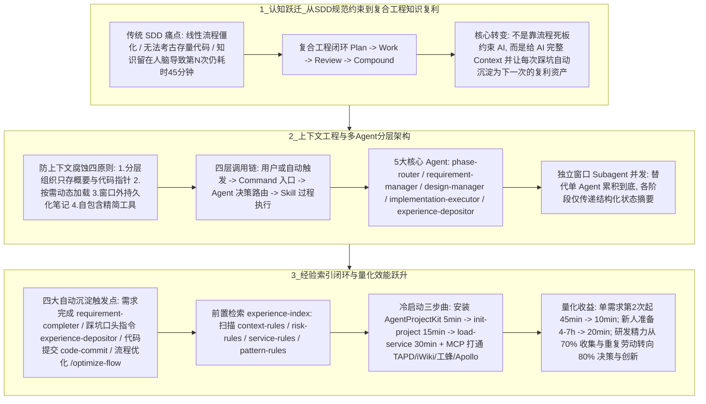

# 从规范驱动到复合工程

## 1. TL;DR

本文是一位腾讯后端研发团队负责人在深度使用规范驱动开发（SDD）工具 **`speckit` 与 `openspec` 三个月后最终决定放弃**，并转向构建基于 **“复合式工程（Compounding Engineering） + 上下文工程（Context Engineering）”** 的企业级 AI 工程化体系（`AgentProjectKit`）的 44 页深度复盘。核心洞察是：
1. **为什么 `speckit / openspec` 在真实企业场景中失灵？** 它们解决了“流程规范化”，但陷入了三个致命盲区：（1）**上下文缺失（无法“考古”）**：AI 看不到跨 BG/跨仓库的玩法引擎、Apollo 配置、雅典娜平台与钱包类型等隐性历史坑点；（2）**知识不沉淀（边际成本恒定）**：知识留在人脑里，第 1 次做商品发放需求花 **45 分钟**逐步提醒 AI，第 $n$ 次做依然要花 **45 分钟**；（3）**单 Agent 上下文腐蚀**：`Constitution -> Specify -> Plan -> Tasks -> Implement` 全程累积在同一窗口，到 Implement 阶段窗口早已爆满膨胀，引发注意力预算耗尽与检索精度滑坡。
2. **破局之道：复合式工程（`Plan -> Work -> Review -> Compound`） + 分层上下文架构**：
   - 将知识从“人脑”迁移到 **`context/`（业务/技术/经验分层目录，仅维护概要与代码指针） + `Skill`（固化执行步骤） + `Agent`（意图路由与独立窗口 Subagent 编排） + `Command`（如 `/req-dev`、`/optimize-flow`）**。
   - 通过 `experience-index` 自动检索四类规则文件（`context-rules`、`risk-rules`、`service-rules`、`pattern-rules`），并在需求完成、踩坑解决、代码提交、流程优化四个节点自动触发知识回流，使同类需求耗时从 **恒定 45 分钟骤降至第 2 次起的 10 分钟**，5 人团队做 2 轮需求总耗时从 **450 分钟压缩至 135 分钟**，新人冷启动准备从 **4–7 小时缩至 20 分钟**。

## 2. 问题定义与背景

### 2.1 规范驱动开发（SDD：`speckit` 与 `openspec`）的美好承诺与现实碰壁
团队初期为解决提示词难以复用、缺乏工程化标准的问题，引入了社区热门的 `speckit`（`Constitution -> Specify -> Plan -> Tasks -> Implement` 五步线性流）与 `openspec`（`Specs as Source of Truth`、`Changes as Proposals`、通过存储 `ADDED/MODIFIED/REMOVED/RENAMED` 语义 Delta 与 Fail-Fast 冲突检测避免 Git Merge 冲突）。
然而在真实的“12 月活动商品发放”等企业级存量需求中，写代码前横亘着“九九八十一难”（跨仓库玩法引擎、外部服务接口、Apollo 配置中心、雅典娜平台配置、虚拟/现金钱包区分），暴露出传统 SDD 工具的三大结构性缺陷：
1. **缺少“考古”与企业上下文**：Formalism（形式化方程）仅有 $F(\text{CurrentSpec}, \text{DeltaSpec}) \to \text{NewSpec}$，缺失了关键的 $\text{Context}$（实施上下文）与 $\text{Lessons}$（历史经验教训），即应升级为：
   $$F(\text{CurrentSpec}, \text{DeltaSpec}, \text{Context}, \text{Lessons}) \to \text{NewSpec} + \text{Knowledge}$$
2. **边际成本恒定（无复利效应）**：每次排查出的 Apollo 或钱包坑点没有回流进工具链，换人或隔段时间做同类需求又要重新花 45 分钟口头叮嘱 AI。
3. **`openspec` 多分支并发下的语义 Delta 冲突**：当多人并行修改同一模块时，频繁触发 `MODIFIED` 目标不存在、`ADDED` 同名冲突、`RENAMED` 占用、或同一需求同时出现在 `MODIFIED` 与 `REMOVED` 中，且 CLI 无自动合并策略。

## 3. 知识框架

## 4. 核心内容拆解

### 4.1 两大理论基石：复合式工程与上下文工程
1. **复合式工程（Compounding Engineering，源自 Claude Code 与 Every 团队 `Compound Engineering Plugin`）**：
   - 将研发循环定义为 **`Plan（多代理并行研究输出计划） -> Work（边做边测） -> Review（安全/性能/架构多代理并行审查） -> Compound（将解决的棘手问题结构化沉淀为团队资产）`**。
   - 为什么传统写文档（没人看易过时）、老人传授（离职断层）、代码注释（只写“是什么”难写“为什么与历史坑”）都失败了？复合工程的答案是：**把知识编码进工具链，让工具在正确的时刻主动提醒你**（例如第一次花 30 分钟排查解决 `N+1 query` 并沉淀后，后续所有同类规划自动前置拦截）。
2. **极简主义与“模型吞噬脚手架”（Claude Code 团队启示）**：
   - Claude Code 团队坚持“每周都在删工具（如 Sonnet 4.5 内化了 Opus 4.1 所需的外置引导后，直接从系统提示词删掉 **2,000 个 tokens**）”，并坚持**双重用户设计（Dual-User Design）**——同一个 `/req-dev` 命令既可供工程师手动调用，也可供 Agent 在流程中自动调用，最终追求“**工具隐形化**”。
3. **上下文工程四原则（对抗“上下文腐蚀 Context Rot”与“注意力预算耗尽”）**：
   - **原则 1：分层式信息组织（只存概要与代码指针）**：在 `context/` 下维护业务概要、模块职责、接口概要以及**精确到 `xxx/xxx.go` 某函数的代码指针**；**坚决不维护**详细数据结构定义、完整接口参数说明和具体实现逻辑（这些代码里都有，重复维护必过时且挤占窗口）。
   - **原则 2：按需动态加载（Just-in-Time Loading）**；
   - **原则 3：跨压缩步骤的窗口外持久化笔记**；
   - **原则 4：工具设计的上下文效率**（自包含、返回精简、边界清晰）。

### 4.2 核心架构：`腳手架 + 工具包` 与 `Command -> Agent -> Skill` 分层
1. **AI 工程化的两大物理载体**：
   - **脚手架（Git 仓库形式）**：存放随项目独立迭代的 `context/`（业务背景、技术架构、历史经验）与 `AGENTS.md`。
   - **工具包（插件形式，`AgentProjectKit`）**：提供跨项目复用的通用 Commands、Agents 与 Skills，独立版本管理。
2. **`.codebuddy/agents/` 五大核心 Agent 与 Subagent 窗口隔离**：
   - `phase-router.md`（阶段路由与意图识别）、`requirement-manager.md`（需求全生命周期）、`design-manager.md`（方案管理）、`implementation-executor.md`（开发实施）、`experience-depositor.md`（独立上下文经验沉淀）。
   - **与 `speckit` 的本质架构差异**：`speckit` 依赖“一个 Agent 从头到尾记住所有事情”，到 Implement 阶段上下文早已爆满；本方案采用 **Subagent 独立窗口 + 结构化状态传递**，每个阶段在干净的独立窗口中运行，完成后仅将结构化结果汇总回主 Agent。

### 4.3 知识沉淀与自动召回闭环（怎么存、怎么取？）
1. **四个关键节点自动触发沉淀（绝不靠做完需求后专门花时间写总结）**：
   - **需求完成时** $\to$ `requirement-completer` Skill 自动提取可复用经验；
   - **踩坑解决后** $\to$ 用户只需说一句 `"@agent，记住这个坑"`，由 `experience-depositor` Agent 按“问题描述 / 触发条件 / 解决方案”结构化写入 `context/experience/`；
   - **代码提交时** $\to$ `code-commit` Skill 检查是否有新模式；
   - **流程优化时** $\to$ `/optimize-flow` 专门优化 SOP。
2. **四类规则索引前置召回（`experience-index` Skill）**：
   当执行 `/req-dev "商品发放需求"` 时，Agent 调用 `experience-index` 扫描四类规则文件：
   - `context-rules.md`（匹配需加载的背景文档，如 `商品发放历史问题.md`）；
   - `risk-rules.md`（匹配高危风险提示，如 `level: high, 注意钱包类型`）；
   - `service-rules.md`（匹配关联服务依赖，如 `商品服务`、`钱包服务`）；
   - `pattern-rules.md`（匹配代码规范，如 `error-handling.md`）。

### 4.4 新项目冷启动三步曲与 MCP 生态集成
1. **Step 1：安装插件（5 分钟）**：`/plugin install agent-project-kit@tmap-codebuddy-plugin`。
2. **Step 2：脚手架初始化（15 分钟）**：`/agent-project-kit:init-project` 自动克隆模板并初始化 `AGENTS.md`。
3. **Step 3：加载存量服务上下文（30 分钟）**：执行 `/agent-project-kit:load-service`，自动将关联服务代码克隆至 `workspace/loadservice/`，分析业务定位、依赖、接口与常见坑点，生成结构化文档落盘至 `context/tech/services/`；并结合 **MCP 自动打通 TAPD（拉取需求）、iWiki（检索历史方案）、工蜂（Git）与 Apollo（配置中心）**。

## 5. 数据速查表

| 对比维度 / 指标 | 传统 SDD（`speckit / openspec`）或传统研发 | AI 工程化（复合工程 `AgentProjectKit`） |
| :--- | :--- | :--- |
| **单人第 3 次做“商品发放”同类需求耗时** | **45 分钟** + 排查时间（知识在人脑，每次重新想） | **10 分钟**（`experience-index` 自动提醒三大坑点，耗时降低 **78%**） |
| **5 人团队各做 2 次同类需求总耗时** | $5 \times 2 \times 45 = \mathbf{450\text{ 分钟}}$（边际成本恒定） | 首人首次 45 分钟建 `context/`，其余 9 次各 10 分钟 = **135 分钟**（节省 **70%**） |
| **新人接入项目冷启动准备耗时** | **4–7 小时**（学工具 1–2h + 老人讲架构 2–4h + 规范 1h） | **20 分钟**（插件安装 **5 分钟** + 脚手架初始化 **15 分钟**，另有 `load-service` **30 分钟**） |
| **研发人员日常时间分配结构** | **40%** 信息收集 + **30%** 重复劳动 + **20%** 核心决策 + **10%** 创新探索 | **10%** 信息确认 + **10%** 结果审核 + **50%** 核心决策 + **30%** 创新探索 |
| **Anthropic 内部 AI 效能调研基准** | 2025 年 8 月调研 **132 名**工程师、**20 万条**记录 | **60%** 工作使用 AI，生产力提升 **50%**（同比增 **2–3 倍**），**27%** 为原本不会做的新增探索工作 |
| **模型内化后可删减的提示词规模** | 外部脚手架持续膨胀 | Sonnet 4.5 内化 Opus 4.1 能力后，系统提示词直接删减 **2,000 tokens** |

## 6. 踩坑与教训 / 可迁移的设计原则

| 错误做法 | 失败表现或原因 | 原文应对（可迁移的设计原则） |
| :--- | :--- | :--- |
| **试图用 `speckit` 的单线程五步线性流程（`Constitution -> ... -> Implement`）在单个会话窗口里跑完复杂存量需求** | 前期塞入业务背景（5000 tokens）、技术上下文与规范后，到 Implement 阶段上下文窗口爆满，引发严重的“上下文腐蚀”与注意力耗尽 | **Subagent 独立窗口 + 结构化状态传递原则**：通过 `phase-router` 将需求、方案、实施、沉淀拆解给各自拥有独立干净窗口的 Subagent，跨阶段仅传递提炼后的结构化结论 |
| **在 `context/` 知识库中手写并维护详细的数据结构定义、完整的接口参数说明和具体实现逻辑** | 代码一旦迭代，文档立即过时沦为误导 AI 的噪声，且大段冗余定义迅速吃光 Token 预算 | **只存概要与“代码指针（Code Pointers）”原则**：文档仅维护业务/模块/接口概要及指向 `xxx/xxx.go` 具体函数的指针，细节让 AI 按指针实时去读源码 |
| **指望工程师在需求上线后专门抽出大块时间手动撰写复盘文档** | 违背人性，全员忙于下一个需求导致没人写、没人看，知识依然锁在个人脑子里 | **工作流节点内嵌自动沉淀与一句话触发原则**：在需求完成（`requirement-completer`）、代码提交（`code-commit`）自动提取，踩坑刚解决完只需对聊天框说一句 `"@agent，记住这个坑"` 即刻落盘 |
| **在架构设计中把越来越多的强规则死死绑在厚重的外部工具脚手架上** | 随着底层模型迭代（“模型吞噬脚手架”），过重的外部束缚反而限制了新模型的原生推理发挥，且逼迫用户记忆大量 CLI 命令 | **双重用户设计与工具隐形化原则**：保持脚手架极简可删减；命令与 Skill 同时支持人类手动调用与 `phase-router` 自动路由，让用户只感知“工作在推进”而非“在操作工具” |

## 7. 记忆锚点

- **为什么放弃 Speckit 转投复合工程？** ——“**Speckit 管流程不管考古，知识留人脑，第 N 次还得 45 分钟；复合工程（`Plan-Work-Review-Compound`）把坑存进 `context/`，用 `experience-index` 主动提醒，第 2 次只要 10 分钟！**”
- **上下文防腐蚀三字经**：“**文档只存代码指针（不抄结构体），阶段切分 Subagent（不挤单窗口），踩坑随口喊 `@agent`（不搞事后写总结）。**”

## 8. 复习卡片

作者在深度使用规范驱动开发（SDD）工具 `speckit` 和 `openspec` 三个月后，总结出它们在企业真实存量研发中的哪三大核心缺陷？::1. 上下文缺失（无法处理“考古”需求）：AI 看不到跨部门服务依赖、Apollo/雅典娜配置规范与历史坑点；2. 知识不沉淀（边际成本恒定）：排查出的坑点留在人脑里，第 1 次做花 45 分钟，第 N 次做依然要花 45 分钟逐步提醒 AI；3. 单 Agent 上下文窗口爆满與 `openspec` 多分支并发下的语义 Delta 冲突。
什么是“复合式工程（Compounding Engineering）”，它的四个核心阶段是什么？::源自 Claude Code 与 Every 团队实践，核心理念是“让每一次工作解决的问题都结构化沉淀为下一次规划的复利基石”；四个阶段为：`Plan（详细规划） -> Work（执行工作） -> Review（质量检查） -> Compound（知识沉淀回流）`。
为了防止“上下文腐蚀（Context Rot）”，在构建项目级 `context/` 目录时什么内容应该维护、什么内容坚决不维护？::应该维护：业务概要、模块概要、接口概要以及指向具体文件与函数的“代码指针（如 `xxx/xxx.go` 的 `xxx` 函数）”；坚决不维护：详细的数据结构定义、完整的接口参数说明和具体的代码实现逻辑（因为这些在代码里都有，重复维护极易过时且浪费 Token）。
在 `AgentProjectKit` 中，`experience-index` Skill 是如何在每次新需求启动时自动帮工程师避坑的？::当用户发起需求（如 `/req-dev "商品发放需求"`）时，Agent 自动调用 `experience-index` 检索四类规则文件：`context-rules.md`（匹配背景文档）、`risk-rules.md`（匹配高危风险提示，如虚拟/现金钱包区分）、`service-rules.md`（匹配依赖服务）和 `pattern-rules.md`（匹配代码规范），在写代码前主动弹窗提醒确认。
什么是 Claude Code 团队提出的“模型吞噬脚手架”与“双重用户设计（Dual-User Design）”？::1. 模型吞噬脚手架：随着模型能力升级，原本需要外部工具或冗长提示词辅助的能力会被模型内化（例如 Sonnet 4.5 内化 Opus 4.1 所需引导后可删减 2000 tokens 系统提示词），因此架构需保持极简、随时准备做减法；2. 双重用户设计：同一套命令（如 `/req-dev`）和 Skill 既支持工程师手动调用，也支持 Agent（如 `phase-router`）在工作流中自动调用，最终实现“工具隐形化”。
量化对比显示，从 `speckit` 切换到 AI 工程化（复合工程）后，单需求耗时、5 人团队总耗时与新人上手准备时间分别发生了怎样的变化？::1. 单人重复做同类需求（如商品发放）：从恒定 45 分钟降至第 2 次起的 10 分钟；2. 5 人团队各做 2 次同类需求：从 450 分钟降至 135 分钟；3. 新人冷启动准备时间：从 4–7 小时缩短至 20 分钟（安装插件 5 分钟 + 初始化 15 分钟），且研发人员用于“核心决策 + 创新探索”的时间占比从 30%（20%+10%）跃升至 80%（50%+30%）。

## 9. 知识关联

- **本库通用主题**：[Harness与模型协同](../../20_topics/Harness%E4%B8%8E%E6%A8%A1%E5%9E%8B%E5%8D%8F%E5%90%8C.md) · [Agent长期记忆](../../20_topics/Agent%E9%95%BF%E6%9C%9F%E8%AE%B0%E5%BF%86.md) · [Agent成本与上下文预算](../../20_topics/Agent%E6%88%90%E6%9C%AC%E4%B8%8E%E4%B8%8A%E4%B8%8B%E6%96%87%E9%A2%84%E7%AE%97.md) · [Agent工程循环](../../20_topics/Agent%E5%B7%A5%E7%A8%8B%E5%BE%AA%E7%8E%AF.md) · [AI研发协同](../../20_topics/AI%E7%A0%94%E5%8F%91%E5%8D%8F%E5%90%8C.md)
- **候选双链**：[[AI Coding翻车案例]] · [[从具体问题开发Skills]] · [[Agent技能与生产交付]] · [[上下文腐蚀与Subagent隔离]]

## 10. 原文参考资料

- 原文标题：《认知重建：Speckit 用了三个月，我放弃了——走出工具很强但用不好的困境》（作者：rickyshou，发布于 2026-01-09）
- 核心参考方法论与项目：`speckit`、`openspec`、Every 团队 *Compound Engineering Plugin*、Anthropic 上下文工程实践与 2025 年 8 月内部生产力调研报告。

> [!note]- 校对报告
> - **页码溯源汇总**：
>   - `p.1–8`：团队背景、`speckit` 与 `openspec`（Delta 机制 `ADDED/MODIFIED/REMOVED/RENAMED` 与 Fail-Fast）原理、12 月商品发放真实需求的“九九八十一难”（玩法引擎/Apollo/雅典娜/钱包）、语义冲突痛点、以及 `speckit` 每次恒定 45 分钟 vs AI 工程化第 3 次仅需 10 分钟的对比。
>   - `p.8–17`：复合式工程（`Plan -> Work -> Review -> Compound`，`N+1 query` 30 分钟沉淀案例）、Claude Code 极简主义（只给 `bash`、每周删工具、双重用户设计）、上下文腐蚀（Context Rot）恶性循环与有效上下文工程四原则。
>   - `p.18–29`：AI 工程化定义（脚手架 Git 仓库 + 工具包插件）、`Command -> Agent -> Skill` 分层、四大自动沉淀触发点、`experience-index` 四类规则文件（`context/risk/service/pattern-rules.md`）、形式化公式补齐 `Context` 与 `Lessons`、只维护概要与代码指针原则、`.codebuddy/agents/` 五大 Agent 及独立窗口 Subagent 架构。
>   - `p.30–43`：新项目冷启动三步曲（安装 `AgentProjectKit` 5 分钟、初始化 15 分钟、`load-service` 30 分钟）、MCP 集成 TAPD/iWiki/工蜂/Apollo、新人上手 4–7 小时 vs 20 分钟及 5 人团队 450 分钟 vs 135 分钟量化对比、Sonnet 4.5 删减 2000 tokens 系统提示词、Anthropic 2025 年 8 月调研数据（132 名工程师、20 万条记录、60% 使用率、50% 生产力提升、27% 新增工作）及研发时间结构从 `40/30/20/10` 向 `10/10/50/30` 迁移。
> - **核验结论**：全文 44 页的逻辑脉络、架构演进与全部量化对比指标均完整覆盖且与原文严格一致。
