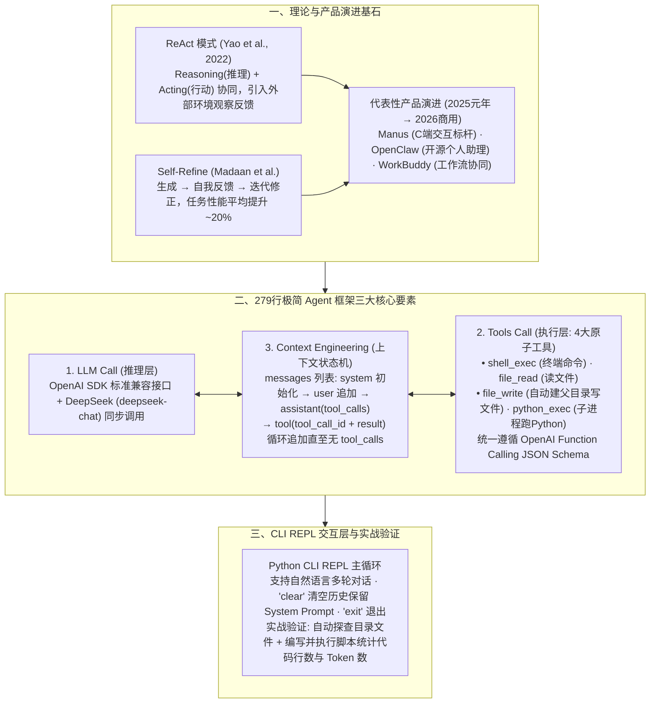

# 详尽地带你从零开始设计实现一个AI Agent框架

## 1. TL;DR

1. **学术与产品演进底座**：梳理 AI Agent 从 **ReAct**（Yao et al., 2022，将 Reasoning 与 Acting 结合突破纯 CoT 封闭性）与 **Self-Refine**（Madaan et al.，迭代自我反馈修正使评估任务性能**平均提升约 20%**），到 C 端标杆 **Manus**、开源热潮 **OpenClaw** 及腾讯 **WorkBuddy** 的演进脉络，指出 2026 年是 AI Agent 真正迈向规模化商用的开端。
2. **核心工程公式：Agent 框架 = LLM Call（推理）+ Tools Call（执行）+ Context Engineering（连接二者的上下文工程）**：撕掉复杂框架的包装，用 **单文件 279 行 Python 代码** 从零构建一套完整可用的极简 Agent 框架与 CLI REPL 交互应用。
3. **四大原子工具与 OpenAI 标准 Schema 映射**：遵循 OpenAI Function Calling（Tools API Schema）标准格式定义 `shell_exec`（执行终端命令）、`file_read`（读取文件）、`file_write`（自动创建父目录并写入文件）、`python_exec`（子进程执行 Python 代码并返回输出）四大基础工具，构建 `TOOLS` 注册字典。
4. **核心 `agent_loop` 与上下文追加状态机**：以 `messages` 列表承载完整上下文生命周期（`system` 初始化 → 追加 `user` 请求 → `while` 循环调用 DeepSeek `deepseek-chat` 模型 → 若含 `tool_calls` 则按名称分发函数并将结果以 `role: "tool"` + `tool_call_id` 追加回 `messages` → 无工具调用时返回最终回复），并在 CLI REPL 中支持 `clear` 重置上下文与 `exit` 退出。

## 2. 问题定义与背景

### 2.1 为什么需要从零手写一个极简 Agent 框架？
随着 2025 年“智能体元年”向 2026 年“智能体商用元年”跨越，市面上涌现出大量封装厚重的 Agent 框架。初学者往往被繁杂的抽象层绕晕，看不清底层数据流转的本质：
- **纯 CoT（思维链）的局限**：虽然提升了模型内部推理能力，但缺乏与外部真实世界（文件系统、解释器、终端）的交互与反馈闭环，极易产生事实幻觉。
- **工程本质的祛魅需求**：无论上层产品形态是 Manus、OpenClaw 还是 WorkBuddy，在工程实现上，**“推理”的本质就是一次次 `LLM Call`，“行动”的本质就是一次次 `Tools Call`（写代码并执行也是 Tool 的一种），而将这两者粘合成闭环的 `Context Engineering（上下文工程）` 才是 Agent 框架的核心。**

## 3. 知识框架

## 4. 核心内容拆解

### 4.1 理论基础：ReAct 与 Self-Refine

1. **ReAct（Reasoning + Acting，Yao et al., 2022）**：打破传统思维链（CoT）仅在模型参数内部闭门造车的局限，通过 `思考（Thought）→ 行动（Action）→ 观察（Observation）` 的交替循环，让外部工具的执行结果实时修正下一步推理方向。
2. **Self-Refine（Madaan et al.）**：模仿人类“先写初稿再反复修改”的过程，让 LLM 对自身初始输出生成反馈并迭代优化，在多项评估任务上使**任务性能平均提升约 20%**。

### 4.2 极简框架三大核心模块实现（总计 279 行代码）

| 核心模块 | 关键实现细节 | 工程设计考量 |
| :--- | :--- | :--- |
| **1. LLM Call（模型调用层）** | 采用标准 `OpenAI` Python SDK 连接 DeepSeek（`base_url="https://api.deepseek.com"`，模型 `deepseek-chat`） | 采用同步非流式调用以保持控制流代码最高可读性，且可零成本切换任意兼容 OpenAI 协议的模型 |
| **2. Tools Call（四大工具注册表）** | 封装 `shell_exec`、`file_read`、`file_write`（含 `os.makedirs(..., exist_ok=True)`）、`python_exec` | 每个工具在 `TOOLS` 字典中绑定 `function` 可调用对象与标准 OpenAI `type: "function"` JSON Schema（含 `name`、`description`、`parameters.properties` 与 `required`） |
| **3. Context Engineering（`agent_loop`）** | 维护全局 `messages` 数组：`system` → `user` → 循环解析 `response.choices[0].message.tool_calls` → 执行对应 Python 函数 → 追加 `{"role": "tool", "tool_call_id": ..., "content": result}` | 异常捕获不中断主循环（工具报错转译为 `"[error] ..."` 字符串返回给 LLM 触发自主修正）；当模型不再返回 `tool_calls` 时跳出 `while` 循环返回最终文本 |

### 4.3 System Prompt、CLI REPL 与端到端实战

1. **极简 System Prompt 设计**：
   - 明确声明角色与可用工具清单（`1. shell_exec`、`2. file_read`、`3. file_write`、`4. python_exec`），并指示 *"Think step by step. Use tools when you need to interact with the file system, run commands, or execute code. When the task is complete, respond directly without calling any tool."*（赋予模型自主判断循环终止的条件）。
2. **CLI REPL 交互层与上下文管理**：
   - 启动前校验环境变量 `DEEPSEEK_API_KEY`；
   - 在 `while True` 命令行交互循环中，内置两个元命令：**`clear`**（清空 `messages` 历史并重新注入 `SYSTEM_PROMPT`，解决跨任务上下文污染与超长问题）与 **`exit`**（优雅退出，同时捕获 `EOFError` 与 `KeyboardInterrupt`）。
3. **实战检验**：面对“统计当前目录下的代码行数以及 Token 数”的复合请求，Agent 在 `agent_loop` 内自主串联多次工具调用——先探查目录文件，再自动调用工具编写并运行统计逻辑，最终汇总输出精确的代码行数与 Token 统计结果。

## 5. 数据速查表

| 指标 | 原文数值 | 语境 / 条件 |
| :--- | :--- | :--- |
| **ReAct 论文发表年份** | `2022 年` | Yao et al., *ReAct: Synergizing Reasoning and Acting in Language Models* |
| **Self-Refine 任务性能平均提升幅度** | 约 `20%` | Aman Madaan et al., *Self-Refine: Iterative Refinement with Self-Feedback* |
| **极简 Agent 框架完整代码行数** | `279 行`（单文件搞定） | 包含 4 个工具函数、JSON Schema、System Prompt、`agent_loop` 与 CLI REPL |
| **内置基础工具数量** | `4 个` | `shell_exec`、`file_read`、`file_write`、`python_exec` |
| **演示接入的模型与 API 地址** | `deepseek-chat`（`https://api.deepseek.com`） | 通过环境变量 `DEEPSEEK_API_KEY` 认证 |

## 6. 踩坑与教训 / 可迁移的设计原则

| 错误做法 | 失败表现或原因 | 原文应对（可迁移的设计原则） |
| :--- | :--- | :--- |
| **工具执行抛出异常（如文件不存在、命令报错）时直接抛出 Python Exception 终止程序** | 外部环境稍有风吹草动整个 Agent 进程即崩溃退出，失去自主恢复能力 | **将工具异常捕获并转译为上下文字符串（`return f"[error] {e}"`）**：把错误信息作为普通 `role: "tool"` 结果喂回给 LLM，让模型在下一轮 Iteration 中看到报错并自主调整参数重试 |
| **调用 `file_write` 写入深层路径文件时未预先处理父目录** | 当目标子目录不存在时直接触发 `FileNotFoundError` | **工具层内聚防御性处理**：在 `file_write` 内部默认执行 `os.makedirs(os.path.dirname(path) or ".", exist_ok=True)`，降低模型调用心智负担 |
| **在多轮 REPL 会话中永远只追加消息不提供重置入口** | 聊完几个无关任务后，历史工具输出塞满 `messages` 导致上下文污染与费用飙升 | **提供显式 `clear` 上下文重置命令**：一键执行 `messages.clear()` 并重新压入 `SYSTEM_PROMPT`，实现轻量级 Context Reset |

## 7. 记忆锚点

- **“推理 = LLM Call，执行 = Tools Call，粘合剂 = Context Engineering”**：279 行单文件 Python 代码剥离一切框架玄学，还原 Agent 运行时的最小闭环骨架。
- **“工具报错不抛异常崩进程，而是转成 `[error]` 字符串喂回 `messages` 让模型自愈”**：编写生产级 Agent 工具函数最基础也最关键的一条工程铁律。

## 8. 复习卡片

1. ReAct 模式与 Self-Refine 方法各自的核心思想是什么，Self-Refine 在评估任务中带来了多大的性能提升？::ReAct（Yao et al., 2022）将推理（Reasoning）与行动（Acting）结合，通过调用外部工具获取环境观察反馈来克服纯 CoT 的幻觉与封闭性；Self-Refine（Madaan et al.）通过“初始输出 → 自我反馈 → 迭代改进”闭环优化生成质量，使评估任务性能平均提升约 `20%`。
2. 从工程实现角度看，任何 AI Agent 框架都由哪三大核心部分组成？::由三部分组成：① `LLM Call`（推理层，负责兼容大模型 API 管理）；② `Tools Call`（执行层，封装 Shell、文件读写、代码执行等外部动作）；③ `Context Engineering`（上下文工程，负责将系统提示词、用户输入、模型思考与工具返回结果组装成持续流转的 `messages` 状态机）。
3. 在本文 279 行极简 Agent 框架中，内置了哪 4 个基础工具，每个工具在注册表中包含哪两个字段？::内置了 `shell_exec`（执行终端命令）、`file_read`（读文件）、`file_write`（自动创建父目录并写文件）、`python_exec`（子进程执行 Python 代码）4 个工具；在 `TOOLS` 字典中，每个工具包含 `function`（Python 函数对象）和 `schema`（遵循 OpenAI Function Calling 标准的 JSON Schema 描述）两个字段。
4. `agent_loop` 的核心循环终止条件是什么？当工具执行发生异常或模型调用了不存在的工具名时，框架是如何处理的？::终止条件是 LLM 返回的响应中不再包含 `tool_calls`（此时直接返回文本回复）；当工具名不存在或工具内部执行抛异常时，框架不会中断崩溃，而是将错误格式化为 `"[error] ..."` 字符串，封装进 `{"role": "tool", "tool_call_id": ..., "content": result}` 追加回 `messages`，交由 LLM 在下一轮自主修正。
5. 框架的 CLI REPL 交互界面提供了哪两个内置控制命令，其中 `clear` 命令的具体执行逻辑是什么？::提供了 `exit`（退出会话）和 `clear`（重置上下文）两个内置命令；执行 `clear` 时，程序会调用 `messages.clear()` 清空当前全部历史对话与工具记录，并重新注入初始的 `{"role": "system", "content": SYSTEM_PROMPT}`。

## 9. 知识关联

- **本仓库主题索引**：[Agent工程循环](../../20_topics/Agent%E5%B7%A5%E7%A8%8B%E5%BE%AA%E7%8E%AF.md) · [Harness与模型协同](../../20_topics/Harness%E4%B8%8E%E6%A8%A1%E5%9E%8B%E5%8D%8F%E5%90%8C.md) · [Agent成本与上下文预算](../../20_topics/Agent%E6%88%90%E6%9C%AC%E4%B8%8E%E4%B8%8A%E4%B8%8B%E6%96%87%E9%A2%84%E7%AE%97.md)
- **候选双链概念**：[[ReAct推理与行动协同]] · [[Self-Refine自我反馈迭代]] · [[Function-Calling标准Schema]] · [[Agent-Loop最小实现]] · [[工具异常转译自愈]]

## 10. 原文参考资料

1. Shunyu Yao et al. (2022), *ReAct: Synergizing Reasoning and Acting in Language Models*.
2. Aman Madaan et al. (2023), *Self-Refine: Iterative Refinement with Self-Feedback*.
3. DeepSeek Open Platform API（`https://platform.deepseek.com`）与 OpenAI Python SDK Function Calling 规范。

> [!note]- 校对报告
> - **校对状态**：已按原文逐页核对通过（共 19 页 PDF）。
> - **核心数据与页码溯源**：
>   - OpenClaw、2025 智能体元年 vs 2026 商用开端、ReAct（Yao et al., 2022）、Self-Refine（Aman Madaan et al.，任务性能平均提升 `约 20%`）、Manus 与 WorkBuddy：见 `p.1–4`。
>   - Agent 框架三大部分（`LLM Call`、`Tools Call`、`Context Engineering`）、Agent Loop 流程图与 CLI REPL 架构图：见 `p.5–8`。
>   - DeepSeek `deepseek-chat` 模型、4 个内置工具（`shell_exec`、`file_read`、`file_write`、`python_exec`）实现与 OpenAI Tools API Schema、`SYSTEM_PROMPT`、完整代码共 `279 行`：见 `p.8–14`。
>   - Python CLI REPL（`DEEPSEEK_API_KEY`、`exit` / `clear` 命令）及目录查看与代码行数/Token 统计实战演示：见 `p.14–18`。
