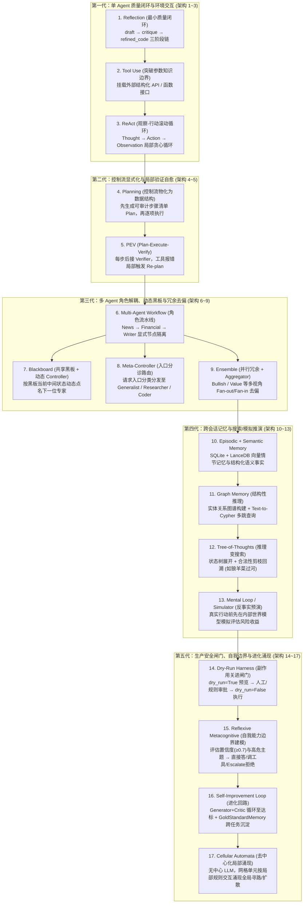

# 从0开发大模型的17种Agent架构演进详细拆解

## 1. TL;DR

1. **核心视角转换：Agent 架构演进不是“让模型更聪明”，而是“逐步升级控制流、状态空间与安全边界”**：基于开源项目 `all-agentic-architectures` 与 `Agno` 框架，任何 Agent 系统都可拆解为最小数学结构——`response_model`（定义状态空间）、`Agent/tools/Step`（定义状态变换）、`steps/Router/Condition`（定义确定性或条件转移）与 `Loop.end_condition`（定义终止条件）。
2. **统一六问拆解法**：用同一套六个工程问题审视全部 **17 种架构**——① 它解决上一代什么痛点？② 新增了什么 `State` 字段？③ 拓扑结构是什么（线性链、循环、分叉汇聚、共享黑板、树搜索、网格涌现）？④ `Router` 如何工作？⑤ 典型失败模式是什么？⑥ 什么信号出现时必须升级到下一代？
3. **17 种架构的六大演进代际**：从 **单步生成闭环**（`Reflection`、`Tool Use`、`ReAct`）→ **显式规划与验证回路**（`Planning`、`PEV`）→ **多 Agent 角色分工与冗余投票**（`Multi-Agent Workflow`、`Blackboard`、`Meta-Controller`、`Ensemble`）→ **外部长周期记忆与图推理**（`Episodic + Semantic Memory`、`Graph Memory`）→ **空间搜索与反事实模拟**（`Tree-of-Thoughts`、`Mental Loop / Simulator`）→ **生产级安全护栏、元认知边界与去中心化涌现**（`Dry-Run Harness`、`Reflexive Metacognitive`、`Self-Improvement Loop`、`Cellular Automata`）。
4. **生产落地最高频的三大设计启示**：用 `PEV` 将验证接入主循环而非事后补救；用 `Dry-Run Harness`（`preview` + 人工审批 + `execute`）关住外部副作用闸门；在医疗/金融等高危领域用 `Metacognitive Agent` 显式建模自身能力边界（置信度 `< 0.7` 或命中高危主题时主动 `escalate` 拒绝回答）。

## 2. 问题定义与背景

### 2.1 走出“换个名字就是新范式”的概念迷雾
业界谈论 Agent 时充斥着 ReAct、Plan-and-Solve、Blackboard、ToT 等繁杂术语，容易让人误以为每一种架构都是某种神秘的“新智能”。作者通读 `all-agentic-architectures` 仓库后指出：**所谓 Agent 架构演化，本质上不是追求 AGI，而是解决一个纯粹的系统工程问题——怎样通过新增显式状态字段（State）、路由分支（Router）与验证闸门（Verifier/Gate），让系统在更复杂的环境里依然保持可控、可解释、可恢复。**

### 2.2 统一分析底座：Agno 最小数学结构与“六问拆解法”
在 `Agno`（配合 `Pydantic BaseModel` 与 `gpt-5-mini`）实现中，所有架构都被映射为六个标准工程维度的演进：
1. **解决问题**：上一代架构在哪类任务上会失控？
2. **状态定义（State）**：`workflow_session_state` 或 `BaseModel` 新增了哪些必须存在的字段？
3. **拓扑形态（Topology）**：是单向链、滚动循环、Fan-out/Fan-in、中心黑板、状态树还是局部网格？
4. **路由机制（Router）**：是由 LLM 隐式决定、数据结构剩余项驱动、Verifier 布尔结果分支，还是人工审批开关？
5. **失败模式（Failure Mode）**：该架构最脆弱的瓶颈在哪里？
6. **升级信号（Upgrade Trigger）**：什么业务特征出现时应该切换到下一代架构？

## 3. 知识框架

## 4. 核心内容拆解

### 4.1 全景演进矩阵：17 种 Agent 架构的一图对标

| 序号与架构名称 | 新增核心能力 | 状态（State）与拓扑变化 | 典型失败模式与局限 |
| :--- | :--- | :--- | :--- |
| **1. Reflection** | `critique pass`（最小质量闭环） | 状态含 `draft / critique / refined_code`；单向三步链 | 仅单次静态审阅，被困在模型自身参数知识内 |
| **2. Tool Use** | `tool interface`（外部世界交互） | 引入 `tool_calls` 与 `ToolMessage`；打破知识截止日期 | 单步调用，无法根据工具返回的意外结果多步追查 |
| **3. ReAct** | `observation loop`（滚动观察回路） | `while` 循环不断追加 `Thought → Action → Observation` | **局部贪心**：只看当前步，易走弯路、重复搜索或迷失全局顺序 |
| **4. Planning** | `explicit planning`（控制流物化） | 把隐式思考变成显式步骤列表 `plan[]`，路由看列表是否为空 | **盲目乐观**：一旦初始 Plan 有误或中途某步API挂掉，后续步步错 |
| **5. PEV** | `verification loop`（验证入主回路） | 每步执行后强制过 `verifier`，失败则路由至 `replan_step` | 验证成本高、Verifier 可能误判，部分任务“验证比执行更难” |
| **6. Multi-Agent** | `role decomposition`（认知角色拆分） | 不同专家写不同状态字段（如 `news / fin`），工具与 Prompt 隔离 | **流水线僵化**：中途发现缺背景无法回退，不需要的步骤也无法跳过 |
| **7. Blackboard** | `shared workspace`（共享黑板动态调度） | 专家读写同一块黑板，由中心 `Controller` 动态点名下一位专家 | Controller 决策摇摆、黑板信息冲突变脏、专家重复劳动或死循环 |
| **8. Meta-Controller** | `entry routing`（入口分诊台） | 状态记录 `selected_agent`，入口一次分类路由给对应垂直专家 | 仅适合边界清晰的单域任务，跨领域复合任务单专家难以独自闭环 |
| **9. Ensemble** | `parallel redundancy`（并行冗余去偏） | 同一问题并发交给多视角 Agent（如看多/价值派），由 `Aggregator` 汇总 | 成本随 Agent 数线性倍增；Aggregator 若强行折中会掩盖关键分歧 |
| **10. Episodic+Semantic** | `long-term memory`（跨会话长记忆） | 状态扩展至图外 SQLite + LanceDB（`enable_agentic_memory=True`） | 错误事实一旦写入会造成长期跨会话污染；向量检索易召回近似噪音 |
| **11. Graph Memory** | `structural reasoning`（知识图谱推理） | 抽取 `Node/Edge` 入图库，通过 `Text-to-Cypher` 执行多跳关系查询 | 实体抽取错误污染图谱、Schema 设计不良或 Cypher 语法生成错误 |
| **12. Tree-of-Thoughts** | `search tree`（把推理转写为搜索） | 维护候选状态树与 `is_valid()` 约束（如狼羊菜过河状态校验与回溯） | **组合爆炸**：Token 开销巨大，仅适用于必须严格回溯搜索的专用场景 |
| **13. Mental Loop** | `counterfactual execution`（反事实模拟） | 真实行动前先在内部 `Simulator`（如股票账户沙盘）预演收益与风险 | **Sim-to-Real Gap**：模拟器保真度决定上限，“模拟里完美、现实里灾难” |
| **14. Dry-Run Harness** | `side-effect gating`（副作用闸门） | 动作拆为 `propose(dry_run=True) → approve(人工确认) → commit(False)` | 人工审批成为吞吐瓶颈；预演与真实执行环境存在时延状态差 |
| **15. Metacognitive** | `self-boundary reasoning`（自我边界感知） | 维护 `AGENT_SELF_MODEL`（领域/工具/阈值 `0.7`/高危黑名单），支持 `escalate` | 置信度校准失准：低估则过度保守全转人工，高估则在医疗/金融胡乱自信 |
| **16. Self-Improve** | `iterative refinement`（达标循环+金标库） | `Loop(end_condition=is_approved)` + 跨任务沉淀 `GoldStandardMemory` | 若 Critic 标准有偏见，会导致 Gold Standard 样例库自我强化劣化 |
| **17. Cellular Automata** | `emergence`（去中心化局部涌现） | 无中心 LLM，网格单元仅按邻居状态运行简单局部规则涌现全局寻路 | 局部规则设计极难逆向推导，难以直接处理开放域复杂自然语言语义 |

### 4.2 重点架构深度剖析：从控制流物化到安全与边界治理

1. **从 ReAct 到 Planning 再到 PEV：控制流是如何一步步变成一等公民的？**
   - **ReAct 的本质缺陷**：ReAct 的路由藏在每一次 LLM 的临时起意里（局部贪心），人类在任务跑完前看不到它将分几步走。
   - **Planning 的结构跃迁**：将“未来控制流”提前物化（Materialize）为一个可检视、可修改的数据结构（如子问题队列），路由逻辑从“LLM 临时决定下一步”变成“队列里是否还有未完成项”。
   - **PEV（Plan-Execute-Verify）的工程闭环**：针对工具接口不稳定（如示例中故意对 `employee count` 报错的 `flaky_web_search`），PEV 在每次 `executor_step` 后强制插入 `verifier_step`；一旦检测到工具报错或数据缺失，立即由 `pev_router` 将控制流重定向至 `replan_step` 改写后续计划，把全局崩溃收敛为局部自愈。
2. **分工（Multi-Agent / Blackboard）vs 冗余（Ensemble）的本质差异**：
   - `Multi-Agent Workflow` 和 `Blackboard` 解决的是 **认知负荷拆分**（让新闻分析师、财务分析师、撰稿人各司其职，且在 `workflow_session_state` 中按字段隔离写入权限）；
   - `Ensemble` 解决的则是 **单次推理的方差与视角偏见**——让看多分析师（Bullish）、价值分析师（Value）和风险分析师同时对同一标的独立论证，最后由 Aggregator 综合。**工程铁律：Ensemble 的 Aggregator 绝不能简单“取平均和稀泥”，必须显式保留各方关键分歧与成立前提。**
3. **生产系统的生死线：Dry-Run Harness 与 Reflexive Metacognitive Agent**
   - **Dry-Run Harness（管住外部副作用）**：面对发帖、转账、改线上配置、删库等不可逆操作，安全的核心不是写 Prompt 让模型“更谨慎”，而是在工具函数签名中强制引入 `dry_run: bool = True` 默认参数，并在工作流层面硬编码 `propose_step(dry_run=True) → approve_step(人工 y/n 确认) → commit_step(dry_run=False)` 三阶段闸门。
   - **Reflexive Metacognitive Agent（管住内部能力边界）**：普通 Agent 只思考“怎么把任务做完”，而元认知 Agent 先通过 `AGENT_SELF_MODEL`（声明已知领域如通用健康/营养、可用工具 `symptom_checker`、置信度阈值 **`0.7`** 以及高危禁区如“处方药剂量 / 急救医疗建议”）回答 **“这个任务我到底该不该做？”**。据此路由为三路：`reason_directly`（置信度 `≥ 0.7` 且低风险）、`use_tool`（有匹配专业工具）或 **`escalate`（主动拒绝并转交人类专家）**。
   - **Self-Improvement Loop（任务内循环 + 跨任务金标沉淀）**：在任务内通过 `Loop(end_condition=is_approved)` 驱动 `generator ↔ critic` 多轮改稿直至达标；在跨任务层面，将一次性通过的高质量样本存入 `GoldStandardMemory`，动态拼接到后续任务的 Few-Shot Prompt 中，形成越用越强的进化飞轮。

## 5. 数据速查表

| 指标 | 原文数值 | 语境 / 条件 |
| :--- | :--- | :--- |
| **拆解的 Agent 架构模式总数** | `17 种`（正文分章节编号至第 19/20 节） | 基于开源项目 `all-agentic-architectures` 与 `Agno` 框架完整重构 |
| **统一架构拆解的核心问题数** | `6 个` 固定问题 | 解决问题、State 新增字段、拓扑形态、Router 机制、失败模式、升级信号 |
| **Agent 系统的最小数学结构要素** | `6 项` 核心组件 | `response_model`、`Agent/tools/Step`、`steps`、`Router/Condition`、`Loop.end_condition`、`wf.run()` |
| **示例代码默认基座模型** | `gpt-5-mini`（`OpenAIChat(id="gpt-5-mini")`） | 全文 Agno 架构代码示例统一采用的演示模型 |
| **Metacognitive 自我模型置信度阈值** | `confidence_threshold = 0.7`（范围 `0.0 ~ 1.0`） | 置信度 `≥ 0.7` 且非高危话题才允许 `reason_directly`，否则调工具或 `escalate` |
| **Metacognitive 路由策略分支数** | `3 条` 策略分支 | `'reason_directly'`（直接回答）、`'use_tool'`（调用工具）、`'escalate'`（拒绝并转交人工） |
| **Dry-Run Harness 工作流阶段数** | `3 步` 显式步骤 | `propose`（`dry_run=True` 预览）→ `approve`（人工审批）→ `commit`（`dry_run=False` 落盘） |

## 6. 踩坑与教训 / 可迁移的设计原则

| 错误做法 | 失败表现或原因 | 原文应对（可迁移的设计原则） |
| :--- | :--- | :--- |
| **把复杂多步依赖任务全部交给单个基础 ReAct 循环去跑** | ReAct 本质是“只看当前一步观察”的在线局部贪心策略，长链路下极易重复搜索、走弯路或漏掉前置约束 | **升级至 Planning + PEV（物化控制流 + 局部验证重规划）**：先将计划物化为可追踪的数据结构，并在每步后接入 Verifier，遇工具报错局部触发 Re-plan |
| **在 Ensemble（多 Agent 投票/汇总）架构中让 Aggregator 对各专家意见简单折中取平均** | 多个 Agent 可能共享同一种幻觉偏见，或者强行合并互相矛盾的论点，掩盖了致命的尾部风险 | **异构视角设定 + 分歧保留型聚合**：为各 Agent 显式注入对立角色立场（如看多派 vs 价值派），要求 Aggregator 对比证据链并显式列出未决分歧 |
| **面对需要多跳关系推导的企业知识库（如股权并购链、组织架构），仅使用向量数据库做语义相似召回** | 向量检索（Episodic Memory）只能找到字面相似的孤立片段，无法完成跨实体的结构性关系跳转 | **升级至 Graph Memory（知识图谱 + Text-to-Cypher）**：在入库时抽取 `Node` 与 `Edge` 实体关系，查询时转译为图数据库查询语句实现多跳结构推理 |
| **对任何简单任务都盲目套用 Tree-of-Thoughts（思维树）或 Blackboard（动态黑板）** | ToT 会引发指数级组合爆炸耗尽 Token，Blackboard 的中心 Controller 容易决策摇摆陷入死循环 | **按任务复杂度最小化选型控制流**：单域分诊用 `Meta-Controller`，固定角色分工用确定性 `Multi-Agent Workflow`，仅在必须回溯搜索的局部子问题上启用 `ToT` |
| **仅靠在 System Prompt 里写“请谨慎操作”来防范发帖、删改数据等外部副作用，或在医疗/金融场景强行作答** | LLM 的概率生成无法保证 100% 遵循软约束，一旦误触外部 API 或在高危领域幻觉作答将酿成生产事故 | **Dry-Run Harness + Metacognitive 双保险**：在代码层将工具拆为 `dry_run=True/False` 强制经过人工审批节点；在入口层维护 `AGENT_SELF_MODEL`，低于 `0.7` 置信度或命中高危词立即 `escalate` 拒绝 |

## 7. 记忆锚点

- **“别问哪个架构更聪明，要问它新增了什么 State 字段、什么 Router 分支和什么验证闸门”**：全文最核心的祛魅视角——把玄学般的 Agent 模式名词全部还原为 `Pydantic State + Step/Router/Loop` 的确定性软件工程。
- **“ReAct 是局部贪心，Planning 是物化控制流，PEV 是局部重规划，Blackboard 是动态点名，Ensemble 是冗余去偏”**：五句话串起从单 Agent 循环到多 Agent 协同的演进主干。
- **“外部副作用靠 Dry-Run 关进闸门，内部无知靠 Metacognitive 主动拒绝（Escalate）”**：生产级 Agent 走向高风险真实世界的左膀右臂——在医疗、法律与金融领域，Agent 最强的能力不是“回答”，而是“知道何时该拒绝”。

## 8. 复习卡片

1. 作者提出的 Agent 系统“最小数学结构”包含哪六个要素？统一拆解 17 种架构的“六个固定问题”是什么？::最小数学结构包括：`response_model`（定义状态空间）、`Agent/tools/Step`（定义状态变换）、`steps` 列表（确定性转移）、`Router/Condition`（条件转移）、`Loop.end_condition`（终止条件）与 `wf.run()`（可执行系统）；六个固定问题是：解决什么问题、State 是什么、拓扑是什么、Router 怎么工作、失败模式是什么、什么时候升级。
2. ReAct、Planning 和 PEV（Plan-Execute-Verify）三者在控制流设计上是如何逐级演进的？::ReAct 是基于当前观察的“在线局部贪心循环”，缺乏全局步骤约束；Planning 将隐式思考提前物化（Materialize）为显式的步骤列表数据结构，路由取决于列表是否还有剩余项，但遇到单步失败容易全盘皆输；PEV 在每一步执行后强制接入 Verifier，一旦发现工具报错或结果无效，立即在局部路由回 `replan` 步骤动态修正计划。
3. Multi-Agent Workflow（固定流水线）、Blackboard（黑板系统）和 Ensemble（集成架构）三者的核心区别是什么？::Multi-Agent Workflow 是按角色拆分的固定顺序流水线（解决认知分工，但流程僵化）；Blackboard 是由中心 Controller 根据共享黑板上的当前中间状态动态决定下一个调用哪位专家（解决动态编排）；Ensemble 则是将同一个问题同时交给多个不同视角的独立 Agent 并行处理，再由 Aggregator 汇总（不是分工，而是用并行冗余降低单次推理偏差）。
4. Episodic/Semantic Memory（向量/键值记忆）与 Graph Memory（图记忆）各自解决什么问题，后者的工作流是什么？::前者通过向量库（如 LanceDB）和 SQLite 存储对话片段与事实，解决跨会话相似性召回；后者解决需要多跳关联的“结构性推理”（如组织关系、并购链条），其工作流为：`Text → 抽取 Node/Edge 构建 Knowledge Graph → Text-to-Cypher 生成查询 → 执行图查询 → Answer`。
5. 什么是 Dry-Run Harness 架构，它在代码与工作流层面是如何把外部副作用关进闸门的？::Dry-Run Harness 用于防止发邮件、发帖、改配置、删数据等不可逆副作用；在代码层为工具函数增加 `dry_run: bool = True` 参数，在工作流层显式拆分为 `propose_step`（强制 `dry_run=True` 生成预览）→ `approve_step`（人工或规则审批确认）→ `commit_step`（审批通过后才以 `dry_run=False` 真实执行）。
6. Reflexive Metacognitive Agent（元认知架构）与普通 Agent 的根本区别是什么？它是如何路由高风险请求的？::普通 Agent 只关注“如何把任务做完”，而 Metacognitive Agent 先通过显式维护的 `AGENT_SELF_MODEL`（含知识域、可用工具、置信度阈值 `0.7`、高危禁区列表）评估“这个任务我该不该做”；路由时若置信度 `≥ 0.7` 且属低风险则直接回答（`reason_directly`），若有匹配工具则调工具（`use_tool`），若置信度不足或触及处方药剂量等高危话题则主动拒绝并转交人类（`escalate`）。

## 9. 知识关联

- **本仓库主题索引**：[Agent工程循环](../../20_topics/Agent%E5%B7%A5%E7%A8%8B%E5%BE%AA%E7%8E%AF.md) · [Agent评测与反馈](../../20_topics/Agent%E8%AF%84%E6%B5%8B%E4%B8%8E%E5%8F%8D%E9%A6%88.md) · [Agent长期记忆](../../20_topics/Agent%E9%95%BF%E6%9C%9F%E8%AE%B0%E5%BF%86.md) · [Agent安全与权限](../../20_topics/Agent%E5%AE%89%E5%85%A8%E4%B8%8E%E6%9D%83%E9%99%90.md) · [Harness与模型协同](../../20_topics/Harness%E4%B8%8E%E6%A8%A1%E5%9E%8B%E5%8D%8F%E5%90%8C.md)
- **候选双链概念**：[[PEV规划执行验证循环]] · [[Blackboard黑板架构]] · [[Dry-Run副作用闸门]] · [[Metacognitive元认知路由]] · [[Self-Improvement进化回路]]

## 10. 原文参考资料

1. GitHub 开源项目：`all-agentic-architectures`（17 种 Agent 架构模式完整 Notebook 实现库，含 `10_mental_loop.ipynb`、`14_dry_run.ipynb`、`17_reflexive_metacognitive.ipynb` 等）。
2. Agno Agent Framework（文中用于实现 `Agent`、`Workflow`、`Step`、`Router`、`Loop`、`SqliteMemoryDb`、`LanceDb` 的核心 Python 框架）。

> [!note]- 校对报告
> - **校对状态**：已按原文逐章核对通过（共 48 页 PDF，其中 p.2–3、p.48 为留白/附图占位页）。
> - **核心数据与页码溯源**：
>   - `all-agentic-architectures` 项目背景、6 个固定拆解问题（解决问题、State、拓扑、Router、失败模式、何时升级）与 Agno 最小数学结构：见 `p.1–5`。
>   - 17 种 Agent 架构全景总览表（Reflection、Tool Use、ReAct、Planning、PEV、Multi-Agent、Blackboard、Meta-Controller、Ensemble、Episodic + Semantic Memory、Graph Memory、ToT、Mental Loop、Dry-Run、Metacognitive、Self-Improve、Cellular Automata）：见 `p.5–6`。
>   - 第 4~8 章（Reflection `draft/critique/refined_code`、Tool Use、ReAct 局部贪心、Planning 控制流物化、PEV `flaky_web_search` 局部 `replan`）：见 `p.6–17`。
>   - 第 9~12 章（Multi-Agent `news/fin/writer` 流水线、Blackboard 共享黑板与动态 Controller、Meta-Controller 入口分诊、Ensemble `bullish/value` 并行冗余与分歧保留）：见 `p.17–27`。
>   - 第 13~16 章（Episodic + Semantic Memory `SqliteMemoryDb + LanceDb`、Graph Memory `Text-to-Cypher`、Tree-of-Thoughts 狼羊菜过河状态搜索、Mental Loop / Simulator 股票交易反事实预演）：见 `p.28–35`。
>   - 第 17~20 章（Dry-Run Harness `propose/approve/commit` 3 步审批流、Reflexive Metacognitive `AGENT_SELF_MODEL` 阈值 `0.7` 与 `reason_directly / use_tool / escalate` 三分支、Self-Improvement Loop + `GoldStandardMemory`、Cellular Automata）：见 `p.35–47`。
