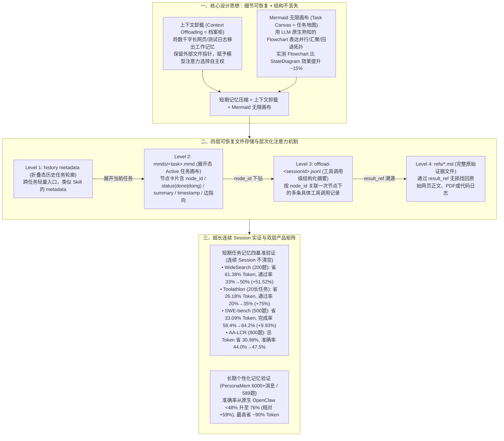

# 腾讯云 Agent Memory 节省 61% Token 提升 52%成功率的诀窍：Mermaid 无限画布 × 上下文卸载

## 1. TL;DR

1. **核心公式：短期记忆压缩 = 上下文卸载（档案柜）+ Mermaid 无限画布（任务地图）**：针对长周期、多任务连续 Session 中工具输出撑爆上下文导致“注意力腐烂与目标遗忘”的痛点，TencentDB Agent Memory 将庞杂的原始结果卸载至外部文件系统，同时用所有 LLM 预训练熟知的 **Mermaid Flowchart** 将离散摘要组织为可生长、可折叠的任务拓扑图（实测 Flowchart 相比 StateDiagram 效果提升 **约 15%**）。
2. **四层可恢复存储与层次化注意力下钻**：构建 **第 1 层 `history metadata`（折叠态历史任务入口）→ 第 2 层 `mmds/<task>.mmd`（携带 `node_id / status / summary / result_ref` 的任务卡片画布）→ 第 3 层 `offload-<sessionId>.jsonl`（工具调用级摘要）→ 第 4 层 `refs/*.md`（完整原始文本）** 的文件系统级四层架构；Agent 平时仅凭画布节点摘要即可决策，按需逐层下钻，做到“信息离开上下文窗口，但不离开可达范围”。
3. **四大超长连续 Session 基准实测“既省 Token 又提成功率”**：在多任务不清空上下文的连续评测中，**WideSearch**（200 题网页搜索）节省最高 **61.38% Token**（主模型口径最高省 **63.59%**）、任务通过率从 `33%` 提升至 `50%`（相对提升 **51.52%**）；**Toolathlon**（复杂长任务）通过率从 `20%` 提升至 **35%**（相对提升 **75%**）、节省 **26.18% Token**；**SWE-bench**（500 题代码修复）节省 **33.09% Token**、完成率从 `58.4%` 提升至 **64.2%**（相对提升 **9.93%**）；**AA-LCR**（800 题长文分析）总 Token 节省 **30.98%**、准确率提升至 **47.5%**。
4. **短期任务记忆与长期个性化记忆双层布局**：除服务于办公调研、编程修复的短期任务记忆外，TencentDB Agent Memory 的长期记忆模块在 **PersonaMem**（`6,000+` 条消息、`589` 道题）上将准确率从原生 OpenClaw（“龙虾”）记忆的 `< 48%` 提升至 **76%**（相对提升 **59%**，部分场景节省近 **90% Token**），并已在 GitHub 开源。

## 2. 问题定义与背景

### 2.1 长周期 Agent 的“办公桌困境”与两类极端做法的缺陷
当 Agent 连续执行网页搜索、读取代码、运行测试与修改文档时，单次搜索返回的 `2,000 tokens` 原文中往往只有 `80 tokens` 是核心结论，其余 `1,920 tokens` 均为 UI 碎片与格式噪音。把上下文窗口比作一张物理办公桌，传统处理方式存在两个极端：
- **极端一：全部堆在桌上（不压缩）**：旧日志、网页正文与无关代码片段填满上下文，导致 Token 迅速耗尽、注意力被嚴重稀释，模型在任务后半程忘记初始目标或重复调用相同工具。
- **极端二：粗暴摘要后丢弃原文（不可恢复有损压缩）** 或 **仅做线性上下文卸载（无拓扑结构）**：
  - 若只保留线性 JSONL 摘要列表（如依次列出“搜索了港大学费”、“搜索了港中文学费”、“搜索了港科大学费”），就像把文件塞进没有目录看板的档案柜，Agent 难以一眼看出“三校搜索是并行分支、口径确认依赖三者汇总”的任务拓扑；
  - 若只画简略流程图而丢弃底层原文，当后续需要核对具体招生简章条款或报错行号时，Agent 因找不到原始证据只能重新调用工具。

### 2.2 符号化压缩的三大选型原则：为什么选择 Mermaid Flowchart？
1. **原则一：必须是所有主流 LLM 在预训练阶段大量接触过的通用开放格式**（自创紧凑密文如 `T1:HKU:FIN:462K` 或生僻黑话会导致跨模型/跨上下文理解退化）。
2. **原则二：生成与理解的认知负担必须极低且对称**（避免多层嵌套的复杂自定义编码规则）。
3. **原则三：表达自由度高，能自然刻画并行分支、汇聚节点、回退路径与多步依赖**——团队实测表明，自由度更高的 **Mermaid Flowchart 相比严格受限的 StateDiagram（状态图）任务效果提升了约 15%**。

## 3. 知识框架

## 4. 核心内容拆解

### 4.1 记忆的折叠与展开：四层文件系统存储架构

TencentDB Agent Memory 将任务执行过程中的状态外部化拆解为四个逐级关联的层级，全部基于标准文件系统持久化：
1. **第一层（鸟瞰层）：`history metadata`（历史任务元信息）**
   - 当某个子任务完成或暂时挂起时，其画布从展开态切换为**折叠态**，仅在上下文中保留一行极轻量的任务轮廓（类似 Skill 的 Level 1 Metadata），告知 Agent“这里曾做过什么任务、存放在哪个 `.mmd` 文件”。
2. **第二层（任务拓扑层）：`mmds/<task>.mmd`（Active Mermaid 任务画布）**
   - 当前正在执行的任务以 `flowchart TD` 形式驻留在上下文中。注意：**每个 MMD 节点不是只有标题的空框，而是一张高密度“任务卡片”**，内含：
     - `node_id`（如 `003-N4`）与任务阶段名称（如 `timeseries-module-structure`）；
     - `status`（`done` / `doing`）；
     - `summary`（阶段性结论摘要，如“列出 timeseries 目录，确认核心模块分布”）；
     - 下游指向与关联引用编号。
3. **第三层（操作流水层）：`offload-<sessionId>.jsonl`（工具调用级摘要）**
   - 单个 MMD 节点背后往往对应多次具体的工具调用（例如节点 `002-N3 搜索复试分数线` 下挂载了 JSONL 记录 1 搜索自划线、记录 2 打开北大公告、记录 3 读取清华招生 PDF、记录 4 核对专业代码）。当画布节点摘要不足以支撑判断时，Agent 通过 `node_id` 检索对应的 JSONL 记录。
4. **第四层（原始证据层）：`refs/*.md`（无损原文归档）**
   - 每次工具返回的数千字网页正文、完整测试报错日志或文件内容被原样保存在 `refs/*.md` 中。唯有当 JSONL 摘要仍不够用时，Agent 才通过 `result_ref` 精确读取对应的原始文件。

### 4.2 四大基准超长连续 Session 实验拆解

为了真实模拟生产级 Agent 长时间运行、多任务交替导致上下文持续膨胀的高压环境，实验采用 **连续执行不清空上下文的超长 Session 模式**（注：绝对分数因此低于单题独立清空上下文的榜单，核心看有/无插件的相对增益）：

| 评测基准 | 任务规模与主模型 | Offload 辅助模型 / 方案 | 任务成功率 / 准确率变化 | Token 消耗与节省比例 |
| :--- | :--- | :--- | :--- | :--- |
| **SWE-bench**（代码修复） | 500 题 / 主模型 `Claude 4.5-haiku` | 无插件基线 插件 + `Opus 4.6` 插件 + `MiniMax 2.7` 插件 + `GLM 5.1` | `58.4%`（基线） `63.2%`（相对 `+8.22%`） `61.8%`（相对 `+5.82%`） **`64.2%`（相对 `+9.93%`）** | `3474.1` `2399.4`（省 `30.93%`） **`2324.4`（省 `33.09%`）** `2375.4`（省 `31.63%`） |
| **Toolathlon**（复杂长链路任务） | 20 个长链路任务 / 主模型 `Claude Opus 4.6` | 无 Offload 基线 Offload `Opus 4.6` Offload `MiniMax 2.7` Offload `GLM 5.1` / 自部署 | `20%`（4/20 通过） `30%`（6/20，相对 `+50.0%`） **`35%`（7/20，相对 `+75.0%`）** **`35%`（7/20，相对 `+75.0%`）** | `50.81M` `41.17M`（省 `18.97%`） **`37.51M`（省 `26.18%`）** `44.23M`（省 `12.95%`）/ `48.28M`（`4.98%`） |
| **WideSearch**（多轮网页搜索） | 200 题 / 主模型 `Claude 4.5-haiku` | 无插件基线 插件 + `Opus` 插件 + `GLM 5.1` | 总体最高相对提升 **`+51.52%`**（`33% → 50%`；单子项 `8.5% → 12%`） | 总口径 `221.51M → 85.64M`（**省 `61.38%`**；单子项 `174.31M → 63.46M` 省 `63.59%`） |
| **AA-LCR**（长文总结与分析） | 800 题（有/无插件各测 400 题）/ `4.5-haiku` | 无插件基线 有插件方案 | `44.0%`（176/400） **`47.5%`（190/400，多对 14 题，相对 `+7.95%`）** | 主模型 `112.03M → 70.94M`（省 `36.67%`） 含 Offload 总计 **`77.28M`（净省 `30.98%`）** |

- **核心归因**：为什么压缩后成功率不降反升？因为长任务后半段失败的主因不是模型能力不足，而是旧网页、旧报错日志塞满上下文引发注意力分散与重复工具调用；将已完成过程折叠进 Mermaid 画布后，主模型能始终聚焦于当前任务拓扑与未完成节点。

### 4.3 短期任务记忆 vs 长期个性化记忆的双层产品协同

TencentDB Agent Memory 将记忆能力明确划分为解决“任务内注意力聚焦”的 **短期任务记忆** 与解决“跨会话懂用户”的 **长期个性化记忆**：
- **长期个性化记忆实测（PersonaMem 基准）**：在包含 **6,000+ 条消息、589 道测试题** 的 PersonaMem 数据集上，接入 TencentDB Agent Memory 后的回答准确率从原生 OpenClaw（“龙虾”）记忆机制的 **不到 48% 跃升至 76%（相对提升 59%）**，且在个性化追问场景下可节省高达 **近 90% 的 Token**。
- **典型业务落地场景**：在量化交易回测（自动记住用户“默认计入交易成本、必对比 LSTM/Transformer/Chronos、输出含阈值与收益曲线”的固定习惯）、行业深度研报（WideSearch 型多源检索）、长报告多轮改写（AA-LCR 型）与大型仓库 Bug 修复（SWE-bench 型）中形成完整闭环。

## 5. 数据速查表

| 指标 | 原文数值 | 语境 / 条件 |
| :--- | :--- | :--- |
| **单次网页搜索原文的稀疏度算例** | `2,000 tokens` 原文中仅 `80 tokens` 核心结论 | 其余 `1,920 tokens`（占比 `96%`）为 UI 碎片、广告、重复内容与格式标记 |
| **Mermaid Flowchart 相比 StateDiagram 增益** | 任务效果提升 `约 15%` | Flowchart 能更自由地表达并行分支、汇聚节点与多步回退依赖 |
| **WideSearch 网页搜索评测收益** | 最高节省 `61.38%` Token（`221.51M → 85.64M`），通过率相对提升 `51.52%`（`33% → 50%`） | 200 个网页搜索任务连续 Session 评测（主模型 `4.5-haiku`，Opus Offload 子项省 `63.59%`） |
| **SWE-bench 代码修复评测收益** | 最高节省 `33.09%` Token（`3474.1 → 2324.4`），完成率相对提升 `9.93%`（`58.4% → 64.2%`） | 500 题连续代码修复测试（MiniMax 2.7 最省 Token，GLM 5.1 完成率最高） |
| **Toolathlon 复杂长任务评测收益** | 最高节省 `26.18%` Token（`50.81M → 37.51M`），通过率从 `20%` 升至 `35%`（相对 `+75%`） | 20 个高难度长链路任务，主模型 `Opus 4.6`，通过数从 `4 个` 提升至 `7 个` |
| **AA-LCR 长文分析评测收益** | 主模型省 `36.67%` Token，含 Offload 总 Token 净省 `30.98%`（`112.03M → 77.28M`） | 800 题测试（各 400 题），准确率从 `44.0%`（176/400）升至 `47.5%`（190/400，相对 `+7.95%`） |
| **PersonaMem 长期记忆评测收益** | 准确率从 `< 48%` 提升至 `76%`（相对提升 `59%`），最高省 `~90%` Token | 含 `6,000+` 条消息、`589` 道题的长期用户画像评测集（对比原生 OpenClaw 记忆） |

## 6. 踩坑与教训 / 可迁移的设计原则

| 错误做法 | 失败表现或原因 | 原文应对（可迁移的设计原则） |
| :--- | :--- | :--- |
| **发明一套自定义的紧凑缩写编码（如 `T1:HKU:FIN:462K`）来做极限 Token 压缩** | 模型在预训练阶段从未见过该编码规则，跨模型或长上下文下解码极不稳定，且多层嵌套编码导致生成与理解端认知错位 | **选用 LLM 原生熟知的通用拓扑符号（Mermaid Flowchart）**：语法极简（节点+箭头+标签），生成与理解负担对称，且比 StateDiagram 效果高 `15%` |
| **只做上下文卸载（将原文存文件，在上下文留一串线性 JSONL 摘要列表）** | 像把材料塞进没有目录看板的档案柜，Agent 只能看到流水账，看不出哪些步骤是并行分支、哪些步骤已汇聚完成 | **“档案柜（上下文卸载）+ 任务地图（Mermaid 画布）”双剑合璧**：用 Mermaid 画布维护全局任务拓扑，用 JSONL 与 `refs/*.md` 保存可下钻的底层细节 |
| **把 Mermaid 画布做成只有节点标题的空壳流程图** | Agent 看到节点标题仍不知道该步骤得出了什么结论，被迫每一步都重新去读底层文件，失去压缩意义 | **将 MMD 节点设计为高密度“任务卡片”**：在节点内直接嵌入 `status`、`summary`（阶段性核心结论）与 `node_id` 索引，让 Agent 绝大多数时候仅看画布即可推进 |
| **任务完成后仍将整张庞大的 Mermaid 画布一直留在主上下文中** | 连续执行几十个任务后，多张历史画布本身也会累积成新的上下文负担 | **画布动态折叠机制（Active MMD → History Metadata）**：当前任务展开完整画布，历史已完成任务自动折叠为一行轻量 `metadata` 入口，按需重新展开 |
| **仅在“单题独立清空上下文”的理想环境下评测记忆与压缩方案** | 掩盖了真实生产环境中多任务连续运行、历史工具垃圾累积导致的后半程崩盘问题 | **采用超长连续 Session 评测基准**：在数百道题连续不断上下文的高压测试中，同时核算包含 Offload 辅助模型在内的净 Token 节省率与成功率变化 |

## 7. 记忆锚点

- **“上下文卸载是档案柜，Mermaid 画布是任务地图”**：单有档案柜找不到任务关系，单有地图找不到原始证据；把两者结合成 `metadata → .mmd → .jsonl → refs/*.md` 四层阶梯，才真正实现“压缩不是让 Agent 少知道，而是让 Agent 少背负”。
- **“省 61% Token、提 52% 通过率的反直觉双赢”**：在 WideSearch、SWE-bench、Toolathlon、AA-LCR 四大超长连续 Session 测试中，卸载冗长工具噪音不仅大幅砍掉 `26%~61%` 的 Token 账单，反而因为消除了上下文腐烂让任务成功率全面上涨。
- **“短期记忆管专注（防做着做着忘目标），长期记忆管懂你（PersonaMem 48% → 76%）”**：清晰切分任务内工作记忆压缩与跨会话用户画像沉淀两条产品线。

## 8. 复习卡片

1. 为什么在长周期 Agent 任务中，单独使用“上下文卸载”或单独使用“Mermaid 画布”都不够？::单独使用上下文卸载（仅保留线性摘要列表）像没有目录看板的档案柜，Agent 会丢失并行分支、汇聚依赖等任务整体结构；单独使用 Mermaid 画布像没有档案支撑的地图，压缩过狠导致 Agent 在需要核对具体原文细节时找不到原始证据。
2. 在设计压缩符号载体时应遵循哪三条原则？为什么 Mermaid Flowchart 比自定义缩写编码和 StateDiagram 更优？::三条原则是：① 必须是所有主流 LLM 预训练大量接触过的通用公开格式；② 生成与理解的认知负担极低且对称；③ 表达自由度足够高。自定义缩写模型未见过易解码出错，而 Flowchart 比严格受限的 StateDiagram 更能自由表达并行分支与汇聚节点，实测效果提升约 `15%`。
3. TencentDB Agent Memory 的四层可恢复存储架构分别包含哪四层，Agent 是如何按需检索信息的？::由上至下依次为：① `history metadata`（折叠态历史任务轻量入口）；② `mmds/<task>.mmd`（当前任务的 Mermaid 画布，每个节点是含 `node_id`、`status`、`summary` 的任务卡片）；③ `offload-<sessionId>.jsonl`（工具调用级摘要）；④ `refs/*.md`（完整原始文本）。Agent 先看画布节点摘要，不够时按 `node_id` 查 JSONL，仍不够时按 `result_ref` 读 `refs` 原文。
4. 在超长连续 Session 实验中，为什么加入了短期记忆压缩插件后，SWE-bench、Toolathlon、WideSearch 和 AA-LCR 的任务成功率不仅没降反而显著提升？::因为在连续长任务后半段，未压缩的旧网页正文、报错日志和冗余代码片段会严重稀释模型注意力，导致模型忘记初始目标或重复调用工具；压缩插件将已完成的过程折叠并移出主上下文，使模型始终聚焦于清晰的 Mermaid 任务结构与关键证据。
5. 在 AA-LCR（800 题长文总结分析）评测中，如何科学核算引入 Offload 辅助模型后的真实 Token 收益？::不仅要看主模型的 Token 下降（从 `112.03M` 降至 `70.94M`，节省 `36.67%`），还必须把 Offload 辅助模型生成摘要与画布本身消耗的 Token 加总进去（总计 `77.28M`），核算得出净节省仍达 `30.98%`，同時准确率从 `44.0%` 提升至 `47.5%`。
6. TencentDB Agent Memory 的“短期任务记忆”与“长期个性化记忆”分别解决什么问题？长期记忆在 PersonaMem 评测集上表现如何？::短期任务记忆解决“任务执行过程中如何集中注意力、防上下文腐烂与断点恢复”；长期个性化记忆解决“跨会话再见面时如何记住用户的历史偏好、习惯与分析口径”。在含 6,000+ 条消息、589 道题的 PersonaMem 评测中，长期记忆将准确率从原生 OpenClaw 的不到 `48%` 提升至 `76%`（相对提升 `59%`）。

## 9. 知识关联

- **本仓库主题索引**：[Agent长期记忆](../../20_topics/Agent%E9%95%BF%E6%9C%9F%E8%AE%B0%E5%BF%86.md) · [Agent成本与上下文预算](../../20_topics/Agent%E6%88%90%E6%9C%AC%E4%B8%8E%E4%B8%8A%E4%B8%8B%E6%96%87%E9%A2%84%E7%AE%97.md) · [Agent任务恢复](../../20_topics/Agent%E4%BB%BB%E5%8A%A1%E6%81%A2%E5%A4%8D.md) · [Agent评测与反馈](../../20_topics/Agent%E8%AF%84%E6%B5%8B%E4%B8%8E%E5%8F%8D%E9%A6%88.md)
- **候选双链概念**：[[Mermaid无限画布]] · [[上下文卸载Context-Offloading]] · [[四层可恢复任务记忆]] · [[层次化注意力机制]] · [[PersonaMem个性化记忆]]

## 10. 原文参考资料

1. TencentDB Agent Memory 开源仓库：[https://github.com/Tencent/TencentDB-Agent-Memory](https://github.com/Tencent/TencentDB-Agent-Memory)
2. 评测基准数据集：SWE-bench（500 题代码修复）、Toolathlon（20 个复杂长任务）、WideSearch（200 题网页搜索）、AA-LCR（800 题长文总结分析）、PersonaMem（6,000+ 消息 / 589 题个性化长记忆基准）。
3. Anthropic, *Claude Code Context Compaction Practices*（文内 §3.1 对照引用）。

> [!note]- 校对报告
> - **校对状态**：已按原文逐页核对通过（共 30 页 PDF）。
> - **核心数据与页码溯源**：
>   - 最高节省 `61.38%` Token（摘要写 `61%`）、通过率从 `33%` 提升至 `50%`（相对提升 `51.52%` / `52%`）及 GitHub 开源地址：见 `p.1`。
>   - 语言压缩本质、`2,000 tokens` 搜索原文仅 `80 tokens` 核心结论（`1,920 tokens` 稀疏噪音）、MBTI 符号压缩与自定义编码 `T1:HKU:FIN:462K` 反例：见 `p.2–5`。
>   - 线性 JSONL 摘要局限、Mermaid 三大选型原则、Flowchart 相比 StateDiagram 效果提升 `约 15%`、无限画布折叠与层次化注意力机制：见 `p.6–14`。
>   - 上下文卸载（档案柜）与 Mermaid 画布（任务地图）互补性，以及四层文件存储架构（`refs/*.md`、`offload-<sessionId>.jsonl`、`mmds/<task>.mmd`、`history metadata`）：见 `p.15–22`。
>   - 四大超长 Session 评测结果表（SWE-bench 500 题：基线 `58.4% / 3474.1` vs GLM 5.1 `64.2% [+9.93%]`、MiniMax 2.7 省 `33.09%`；Toolathlon 20 题：基线 `20% [4/20] / 50.81M` vs MiniMax 2.7 `35% [7/20, +75%] / 37.51M [省 26.18%]`；WideSearch 200 题：省 `61.38%` [`221.51M → 85.64M`]、通过率 `+51.52%`，单子项 `174.31M → 63.46M` 省 `63.59%`、`8.5% → 12%`；AA-LCR 800 题：准确率 `44.0% [176/400] → 47.5% [190/400]`，主模型 Token `112,029,517 → 70,944,374` 省 `36.67%`，总 Token `77,283,611` 净省 `30.98%`）：见 `p.23–26`。
>   - 短期任务记忆 vs 长期个性化记忆双层布局、PersonaMem（`6,000+` 条消息、`589` 道题）准确率从 `<48%` 提升至 `76%`（相对提升 `59%`）、最高省 `~90%` Token：见 `p.26–29`。
