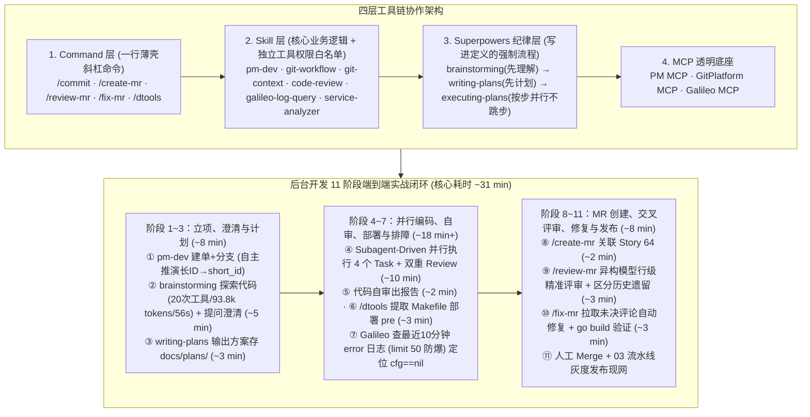

# 从 Vibe Coding 到 Agentic Engineering：重构后台开发全流程

## 1. TL;DR

1. **核心转变：从“跨 5 大平台手动横跳”到“单终端 11 阶段全流程闭环”**：针对后台开发在 PM（TAPD）、GitPlatform、编辑器、DevOps（dtools）与 Galileo 监控平台间频繁切换丢失上下文的痛点，作者基于 Claude Code 构建了 **Skill（核心业务与权限白名单）+ Command（薄壳斜杠命令）+ Superpowers（强制工程纪律）+ MCP（透明底层调用）** 四层体系，将从一句口述需求到 MR 评审修复的 **10 个核心自动化阶段压缩至约 31 分钟**（阶段 11 合入与灰度发布保留人工把关）。
2. **先理解、再计划、后并行执行（Subagent-Driven）**：通过 `pm-dev` 自动创建需求单与特性分支（AI 甚至自主推演出长 ID `1012345678001900001` 到 `short_id` `131900001` 的转换规律），强制调用 `brainstorming` 探索代码（`20 tool uses · 93.8k tokens · 56s`）并提问澄清，生成方案存入 `docs/plans/`；审批后由 `superpowers:execute-plan` 派发多个子 Agent 并行完成 4 个开发 Task，每个 Task 自动跑 Spec Review 与 Code Quality Review。
3. **AI 辅助代码评审与修复闭环（`/create-mr` → `/review-mr` → `/fix-mr`）**：`/create-mr` 自动提取分支 Story ID 并分析全部 Commit 生成规范描述；`/review-mr` 仅审查新增/修改行，用 `git show` 校验精确行号并主动对比 `master` 分支区分“本次引入”与“历史遗留”（实测 **Claude 定位行号最准，DeepSeek 易找错行号**）；同时提出 **“异构模型交叉审查”**（Claude 写则用 Codex/Gemini 审）与人工逐条把关原则。
4. **半自动 Galileo 日志/Profile 排障与防上下文爆炸设计**：部署预发后，AI 自动从 `Makefile / go.mod / trpcprotocol` 提取服务元数据，调用 Galileo API 按 `level:error` 且默认限制 **`limit 50`** 防止日志撑爆上下文（查不到时自动降级至 Galileo MCP `ask_question`），精准定位 `redeem_reward.go:48` 的 `cfg == nil` 缺陷与线上 OOM 根因。

## 2. 问题定义与背景

### 2.1 后台开发者的日常痛点：五平台横跳与 Vibe Coding 的脆弱性
传统后台开发一个需求（如 Golang `trpc-go` 框架下的“RedeemReward 上报逻辑变更新增错误码”），工程师必须在 **PM 需求平台、GitPlatform、IDE 编辑器、dtools 部署工具、Galileo 日志监控平台** 之间来回切换，每次切换都在丢失上下文。而缺乏流程约束的 Vibe Coding 完全依赖运气，无法应对生产级后台对规范、编译、测试与 MR 评审的严苛要求。

### 2.2 Agentic Engineering 的核心分工：人是编排者（Orchestrator），AI 是自主执行者
- **人类负责（关键决策点）**：口述初始目标、回答 2~3 个澄清问题、审批实施计划、确认部署参数、把关 AI 评审意见取舍、最终点击 Merge 与灰度发布。
- **AI 负责（结构化流程内自主执行）**：建需求单与分支、探索代码库、拆解并派发 Subagent 编码、格式化 Commit、拉起 dtools 部署、查 Galileo 错误日志、生成 MR 描述、行级精确评论与自动修复回复。

## 3. 知识框架

## 4. 核心内容拆解

### 4.1 阶段 1～7：从一句话需求到 Subagent 并行编码与 Galileo 排障

1. **阶段 1～3：需求建单、代码探索与方案固化（约 8 分钟）**
   - **AI 的 Aha Moment（自主推导 ID 映射规则）**：开发 `pm-dev` Skill 时，PM MCP 不支持将链接里的 19 位长 ID（`1012345678001900001`）转为创建特性管理值所需的 9 位 `short_id`（`131900001`）；AI 通过对比历史数据直接推演出转换规则（连人类老开发都未曾留意）。
   - **先读代码再提问（`brainstorming`）**：面对一句话需求，AI 先自动调用 **20 次工具（消耗 `93.8k tokens`、耗时 `56s`）** 摸清 `RedeemReward` 现有实现，再抛出 2~3 个精准架构问题，确认后将设计方案写入 `docs/plans/` 并自动 Commit。
2. **阶段 4～5：Subagent-Driven 并行开发与自审（约 12 分钟）**
   - 选择 `Subagent-Driven` 模式后，`superpowers:execute-plan` 将计划拆为 4 个独立 Task 派发给子 Agent 执行（升级 `report_data v1.0.180 → v1.0.182`、新增 `ErrCode/ErrMsg` 字段、重构无论成败均上报逻辑），每个 Task 完成后自动执行 Spec Review 与 Code Quality Review，生成 3 个规范 Commit。
   - 阶段 5 自审对 `git diff master...HEAD`（3 个文件，`+21 -11` 行）生成分级报告（`Critical / Major / Minor / Suggestion`），支持一键自动修复全部或指定编号问题（如 `C1, M2`）。
3. **阶段 6～7：`/dtools` 智能部署与 Galileo 日志防爆排查**
   - 输入 `/dtools`，AI 自动从 `Makefile` 提取 `APP/SERVER` 参数并修正过期实例配置，3 分钟部署至 `pre` 环境。
   - **Galileo 日志排障设计**：自动从 `Makefile`、`go.mod`、`trpcprotocol` 提取服务标识，内置**防上下文爆炸机制（默认 `limit 50`，优先过滤 `level:error`）**，脚本未命中时自动降级调用 Galileo MCP 的 `ask_question` 接口；实战中秒级定位出 `redeem_reward.go:48` 在获取配置失败（`cfg == nil`）时漏传默认空 Config 的 Bug，并曾辅助分析 Galileo Profile 快速定位线上 OOM。

### 4.2 阶段 8～11：GitPlatform MR 全自动流转与跨模型 Code Review

1. **阶段 8：`/create-mr` 终结手写 MR 描述之痛（约 2 分钟）**
   - 复用 `git-context` 的 `project-context` 模块解析 `feature/alice_131900001` 提取 Story ID，拉取 PM 标题组装 `--story=131900001`，分析全部分支 Commit 与 Diff 自动生成含“变更说明”与“影响范围”的规范 MR（`#64`），并按项目规则自动分配必要评审人。
2. **阶段 9：`/review-mr` 行级精准评审的三大工程细节（约 3 分钟）**
   - **细节一：主动对比 `master` 区分“本次引入”与“历史遗留”**：审查中 AI 发现 `asyncReportRedeemReward` 虽带 `async` 前缀但实为同步调用，随即主动拉取 `master` 分支源码比对，确认属历史遗留问题而非本次 MR 引入，避免乱报噪音。
   - **细节二：用 `git show {source_branch}:{file_path}` 强校验行号 + 模型选型经验**：AI 提交行级评论最怕行号漂移；实测表明 **Claude 模型定位行号最精准，而 DeepSeek 模型经常算错行号评论到错误位置**。
   - **细节三：异构模型交叉审查 + 人类终审铁律**：同一个模型写的代码让它自己审极易陷入相同思维盲区，应采用 **“Claude 写代码 → Codex / Gemini 做评审”** 的交叉策略；且鉴于 AI 曾将正确错误处理误判为“缺少 error check”、将刻意空实现误判为“未完成代码”，Reviewer 必须人工过脑筛选后再批量提交。
3. **阶段 10～11：`/fix-mr` 自动修复闭环与人工灰度发布**
   - 输入 `/fix-mr`，AI 拉取 `resolve_states=[1]` 的未决评论，读取目标行前后各 **10 行** 上下文，补回 `ChannelID: 3` 的魔法数字注释、用 `gofmt` 对齐缩进，自动跑 `go build ./...` 验证通过后推送并逐条回复评论；最后阶段 11 的 Merge 与 `03 流水线` 现网灰度发布严格保留由人工操作。

## 5. 数据速查表

| 指标 | 原文数值 | 语境 / 条件 |
| :--- | :--- | :--- |
| **端到端开发流程阶段总数与核心耗时** | 共 `11 个` 阶段；前 10 个核心阶段人工+AI 耗时约 `31 分钟` | 澄清 `~5m` + 计划 `~3m` + 4 Task 并行开发 `~10m` + 自审 `~2m` + 部署 `~3m` + 建 MR `~2m` + 评审 `~3m` + 修复 `~3m` |
| **`brainstorming` 代码探索阶段开销** | `20 次` 工具调用、`93.8k` Tokens、耗时 `56 秒` | 自动摸清 `RedeemReward` 现有实现与上报链路 |
| **PM 需求长短 ID 自动推导示例** | 19 位长 ID `1012345678001900001` → 9 位 `131900001` | AI 在 MCP 无转换接口时自主发现规律完成特性管理值创建 |
| **Galileo 日志检索防爆默认上限** | `limit 50`（默认最多返回 50 条），优先过滤 `level:error` | 防止海量线上日志一次性塞爆 LLM 上下文窗口 |
| **`/fix-mr` 读取代码上下文窗口半径** | 目标行前后各 `10 行` 上下文 | 读取未解决评论（`resolve_states=[1]`）对应源码并生成修复方案 |

## 6. 踩坑与教训 / 可迁移的设计原则

| 错误做法 | 失败表现或原因 | 原文应对（可迁移的设计原则） |
| :--- | :--- | :--- |
| **让同一个模型既写业务代码又做该 MR 的 Code Review** | 陷入完全相同的思维盲区——写代码时漏考虑的边界条件，自己审查时同样看不出来 | **异构模型交叉审查（Cross-Model Review）**：用 Claude 写的代码交给 Codex 或 Gemini 审，利用不同模型的知识结构互补提高缺陷检出率 |
| **使用行号计算能力较弱的模型（如实测中的 DeepSeek）直接向 Git 平台提交行级评论** | 频繁算错 Diff 行号，把甲函数的评审意见贴到乙函数的代码行上，造成评审混乱 | **优选 Claude 执行行级定位 + `git show` 源码行号二次校验**：提交前强制用 `git show {branch}:{file}` 核对目标行内容，且单条评论提交失败不阻塞其余批次 |
| **不加限制地将 AI 审查出的所有评论全量自动刷到同事的 MR 页面上** | AI 会将历史遗留代码误判为本次引入，或把刻意的空实现、正确的错误处理当成 Bug 乱报 | **AI 自动拉 `master` 过滤历史遗留 + 人类 Reviewer 逐条勾选放行**：AI 只做初筛与代码建议生成，由人类决定最终提交哪几条（如仅勾选准确的 Minor + Suggestion） |
| **让排障 Skill 直接拉取线上服务全量日志塞进上下文** | 后台服务短短 10 分钟即可产生数万行日志，瞬间烧光 Token 额度并冲垮上下文注意力 | **查询条件收敛 + 默认 `limit 50` 硬截断 + 多级降级**：先从 `Makefile/go.mod` 自动提取精确服务名，默认加 `level:error` 与 `limit 50`，未命中再降级调 MCP `ask_question` |
| **把每个斜杠命令（`/commit`、`/create-mr`）都写成一套独立耦合的重型脚本** | 自然语言对话无法触发，且多个命令重复实现 Git 分支解析与工作区检查逻辑 | **Command 仅做 1 行薄壳 + 底层 Skill 模块化组合**：所有 `/xxx` 命令仅用 1 行委托给 `git-workflow` 对应模块，并统一复用 `git-context` 做前置解析，支持斜杠与自然语言双触发 |

## 7. 记忆锚点

- **“Vibe Coding 依赖运气，Agentic Engineering 依赖流程（Superpowers 三纪律：先理解、先计划、按步并行）”**：把跨 5 个平台的后台研发收敛进 1 个终端的 11 个标准阶段，31 分钟跑完从口述需求到修完 CR 的全套动作。
- **“谁写的就换别的模型审、Claude 找行号最准、Galileo 查日志必加 `limit 50`、阶段 11 合入发布坚决留给人”**：四条来自鹅厂一线后台研发实战的高含金量避坑经验。

## 8. 复习卡片

1. 在作者构建的后台 Agentic Engineering 体系中，Skill、Command、Superpowers 和 MCP 四层分别是如何分工协作的？::Command 是仅有一行的薄壳斜杠命令（如 `/create-mr`），委托给底层 Skill 执行；Skill 封装核心业务逻辑与独立工具权限白名单（且高度可组合，如复用 `git-context`）；Superpowers 将“先理解（`brainstorming`）、先计划（`writing-plans`）、按步并行执行（`executing-plans`）”固化为不可跳过的强制纪律；MCP 则在底层对用户透明地完成 PM、GitPlatform 与 Galileo 的 API 调用。
2. 在阶段 7（Galileo 日志排查）中，系统是如何做到自动化定位并防止日志撑爆上下文的？::Skill 自动从项目的 `Makefile`、`go.mod`、`trpcprotocol` 路径中提取 `appid/server` 标识，支持按 `trace_id`、关键词、时间范围与级别查询；内置防上下文爆炸机制（默认 `limit 50`，优先用 `level:error` 缩小范围），当脚本查不到结果时自动降级调用 Galileo MCP 的 `ask_question` 接口。
3. 在阶段 9（`/review-mr` AI 辅助代码评审）中，有哪些提升评审准确率与避免骚扰的关键工程技巧？::① AI 主动拉取 `master` 分支源码对比，区分“本次 MR 引入的问题”与“历史遗留问题”；② 使用 `git show {source_branch}:{file_path}` 验证行号准确性，且实测选用行号定位最准的 Claude 模型（避免 DeepSeek 找错行号）；③ 采用“跨模型交叉审查”（如 Claude 写代码用 Codex/Gemini 审）破除同模型盲区；④ 必须经人类 Reviewer 审核筛选后才提交到 MR 页面。
4. `/fix-mr` 命令是如何实现 MR 评审意见自动修复闭环的？::① 通过 `git-context` 定位当前分支 MR 并切到源分支拉取最新代码；② 调用 GitPlatform MCP 拉取所有未解决评论（`resolve_states=[1]`）；③ 读取对应文件目标行前后各 `10 行` 上下文生成修复方案；④ 人工确认后修改代码，自动执行 `go build ./...` 与 `gofmt` 验证，通过后推送代码并自动回复每条 MR 评论。
5. 为什么在 11 个阶段中，阶段 7（触发测试请求）和阶段 11（Merge 合入与灰度发布）目前仍保留了人工操作？::阶段 7 是因为 AI 尚不了解整条微服务调用链的上下游依赖，无法凭空构造有效的全链路测试请求（计划后续在代码加 tRPC 模拟入口）；阶段 11 是因为代码合入主干与现网灰度发布直接关系线上生产安全，高风险决策必须由人类工程师最终把控。

## 9. 知识关联

- **本仓库主题索引**：[AI研发协同](../../20_topics/AI%E7%A0%94%E5%8F%91%E5%8D%8F%E5%90%8C.md) · [Agent工程循环](../../20_topics/Agent%E5%B7%A5%E7%A8%8B%E5%BE%AA%E7%8E%AF.md) · [Agent评测与反馈](../../20_topics/Agent%E8%AF%84%E6%B5%8B%E4%B8%8E%E5%8F%8D%E9%A6%88.md)
- **候选双链概念**：[[Agentic-Engineering]] · [[Superpowers工程纪律]] · [[跨模型交叉Code-Review]] · [[Subagent-Driven并行开发]] · [[日志检索防上下文爆炸]]

## 10. 原文参考资料

1. 核心工具与框架：Claude Code、`superpowers`（`brainstorming`、`writing-plans`、`execute-plan`）、`trpc-go`、TAPD (PM MCP)、GitPlatform MCP、Galileo 日志与性能监控平台、`dtools` 部署工具。

> [!note]- 校对报告
> - **校对状态**：已按原文逐页核对通过（共 26 页 PDF）。
> - **核心数据与页码溯源**：
>   - 跨 5 平台（PM、GitPlatform、编辑器、DevOps、Galileo）痛点、Skill 与 Command 架构表、`pm-dev` 自动推导长 ID（`1012345678001900001`）到 `short_id`（`131900001`）：见 `p.1–5`。
>   - `Explore` 代码探索（`20 tool uses · 93.8k tokens · 56s`）、方案保存至 `docs/plans/`、阶段 4 `Subagent-Driven` 并行执行 4 个 Task（`report_data v1.0.180 → v1.0.182`）、阶段 5 代码自审（`+21 -11 行`）、阶段 6 `/dtools` 从 `Makefile` 提取参数部署 `pre`：见 `p.6–12`。
>   - 阶段 7 Galileo 日志排查（定位 `redeem_reward.go:48` `cfg == nil`、从 `Makefile/go.mod/trpcprotocol` 提取标识、默认 `limit 50` 防上下文爆炸、降级 `ask_question` 及排查 OOM）：见 `p.13–14`。
>   - 阶段 8 `/create-mr`（`git-context`、`MR #64`）、阶段 9 `/review-mr`（`git show` 验证行号、对比 `master` 识别 `asyncReportRedeemReward` 为历史遗留、实测 Claude 行号最准而 DeepSeek 易找错行号、把正确错误处理误判为缺 check 反例、跨模型审查 Claude vs Codex/Gemini）：见 `p.14–19`。
>   - 阶段 10 `/fix-mr`（拉取 `resolve_states=[1]`、读前后 `10 行`、`go build ./...`、`gofmt`）、阶段 11 人工合入与 `03 流水线` 灰度发布、全流程 10 阶段耗时统计表（`5+3+10+2+3+2+3+3 = ~31 min`）及 Command 薄壳 / Skill 组合 / Superpowers 纪律总结：见 `p.19–23`。
