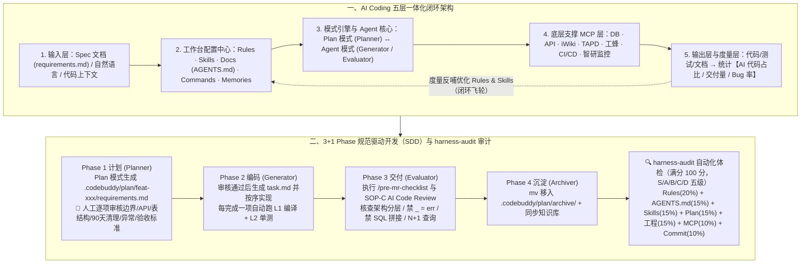

# 驾驭 AI Coding：一份面向团队的 Harness Engineering 落地规范

## 1. TL;DR — 核心结论速览

1. **“交付代码的成本已接近免费，但交付好代码的成本依然很高”**：没有工程约束的裸 Vibe Coding 必然经历“起步极快 → 中期架构混乱 → 超过 **`50` 个文件后上下文雪崩**（第 1 天叫 `user_id`、第 3 天变 `uid`）→ 后期黑盒不可维护”的崩盘路径。基于 `Agent = Model + Harness` 理念，团队必须把“好代码的标准”固化进工具链，实现**“流水的工具，铁打的规范”**。
2. **Harness 六大支柱与“钥匙—动作—说明书”铁三角**：
   - **六大支柱**：`① 上下文管理（~100 行 AGENTS.md 索引 + Spec + 知识库）`、`② 工具系统（MCP + Skills + 知识库）`、`③ 执行编排与多 Agent 协作（3+1 Phase：Planner → Generator → Evaluator → Archiver）`、`④ 状态与记忆（会话/Memories/Git Spec/Spec Deltas）`、`⑤ 四层评估观测（L1 语法 → L2 逻辑 → L3 规范 → L4 架构）`、`⑥ 三级约束与恢复（硬红线 Rules / 软约束 Skills / 安全策略 Safety）`。
   - **核心协同隐喻**：**“MCP 是开门的钥匙（连外部 DB/API/工蜂/TAPD），Skills 是开门后做的事（装专家 SOP），知识库是进门前读的说明书（注业务上下文）”**。
3. **三阶段渐进落地路线图与全套实操标准**：
   - **阶段一（基础建设，`1～2 周`）**：安装 CodeBuddy 与三款内网 CLI（需 `Node.js >= 20`），按敏感度分流模型（复杂非敏用 `Claude-4.6/GPT-5.4`，敏感业务强制用内网 `DeepSeek-V3.2/GLM-4.7/HY-2.0` 确保代码不出域），搭建 **`team-harness` 单一真源仓库**（通过 `sync-harness.sh` 同步至业务仓），配置 `User / Team / Project` 三级 Rules（如 Go 单函数 `≤ 80 行`）、`~100 行` `AGENTS.md` 以及 Knot 知识库与 `AI Wiki`（`24h` 内完成索引）。
   - **阶段二（工具接入，`2～4 周`）**：接入 `P0/P1/P2` 级 MCP（优先推荐 `streamable-http`），在 Knot 平台配置自主规划智能体（支持企微机器人 `5～8s` 极速接入等 7 大渠道）与 CodeBuddy **5 大专业 SubAgent**，跑通 **`Plan → 人工审核 requirements.md → Agent 执行 task.md → 归档 archive/`** 四阶 SDD 闭环及三套日常 SOP（新需求、单 PR 单 Bug 修复、AI CR）。
   - **阶段三（持续优化）**：通过五层架构底部的**度量层（AI 代码占比、交付量、Bug 率）**反哺配置中心，形成知识飞轮。
4. **自研 `harness-audit` Skill 实现 100 分制一键体检**：将整套规范转化为覆盖 **7 大维度**（`Rules 20%`、`AGENTS.md 15%`、`Skills 15%`、`Plan 模式 15%`、`工程规范 15%`、`MCP 10%`、`Commit 规范 10%`）的自动化审计工具，按 `S/A/B/C/D` 五级打分并开具 `P0/P1` 药方（如 30 分钟接入 DB MCP 提升 SQL 准确率 `30%+`，20 分钟配 `commit-msg hook` 将规范率从 `70%` 拉升至 `95%+`）。

---

## 2. 核心理念与架构蓝图：为什么团队必须从 Vibe Coding 走向 Harness？

### 2.1 OpenAI 标杆启示与裸 Vibe Coding 的三大死穴
- **OpenAI Codex 标杆**：2026 年 2 月 OpenAI 披露其 `3 人`（后扩至 `7 人`）工程团队在**完全禁止手写代码**的约束下，靠完备的 Harness 体系在 **`5 个月` 内产出超 `100 万行` 代码、合入 `1,500 个` PR，研发效率提升约 `10 倍`**。
- **无约束 Vibe Coding 的三大致命问题**：
  1. **架构混乱**：Agent 喜走捷径，功能 A 用库 X、功能 B 换库 Y，毫无 Controller/Service/Repository 分层概念，换底层库即推倒重来；
  2. **上下文雪崩**：项目一旦超过 **`50 个文件`**，Agent 开始严重忘事——第 1 天字段叫 `user_id`，第 3 天突然变成 `uid`，修一个 Bug 冒出两个新 Bug；
  3. **可维护性丧失**：开发过程成黑盒，人类接手时面对几千行异味代码还不如重写。

---

### 2.2 Harness 六大支柱与工具链映射总表

| 六大支柱 | 解决的核心问题 | 对应核心工具与载体 | 团队落地实践要点 |
| :--- | :--- | :--- | :--- |
| **1. 上下文管理** (Context Architecture) | AI 在有限且昂贵的窗口里该看什么？ | `AGENTS.md`（`~100 行`）+ `Spec` 文档 + `changes/` + `Skills` + 知识库（`iWiki`/工蜂/`AI Wiki`） | **拒绝几千行巨型 `AGENTS.md`**（OpenAI 亲测失败），改用 `~100 行` 目录索引按需下钻；将仓库作为 System of Record |
| **2. 工具系统** (Tool System) | AI 如何触达外部世界并具备领域专家能力？ | **`MCP`（钥匙）+ `Skills`（动作）+ `知识库`（说明书）** | `DB/API/工蜂/TAPD/运维 MCP` 实时拿元数据；`Skills`（如 `rainbow-config`、`skill-creator`、`find-skills` 搜 `80,000+` 技能库）固化 SOP；`Knot` 共享业务知识库 |
| **3. 执行编排与多 Agent** (Execution Orchestration) | 复杂任务按什么顺序做？谁来做？ | **`3+1 Phase` 流程** + **四大角色**（`Planner / Generator / Evaluator / Archiver`）+ `SubAgent` | Phase 1 计划（`requirements.md` 人工审）$\to$ Phase 2 编码（`task.md`）$\to$ Phase 3 交付（AI CR）$\to$ Phase 4 沉淀（归档更新知识库） |
| **4. 状态与记忆** (State & Memory) | 长周期开发如何保持前后一致性？ | 会话短期记忆 + `Memories` 中期记忆 + Git `Spec` 长期记忆 + `Spec Deltas` (`changes/`) | 每次变更归档后自动更新 `.codebuddy/plan/archive/`，通过 Git 追踪规范演进 |
| **5. 评估与观测** (Evaluation & Observability) | 如何验证 AI 写出的代码靠谱？ | **四层评估体系（`L1 语法 → L2 逻辑 → L3 规范 → L4 架构`）** | `L1` (`go build`/`golangci-lint`) $\to$ `L2` (`go test`) $\to$ `L3` (AI 自动查 Rules 合规) $\to$ `L4` (人机联合架构 CR) |
| **6. 约束与恢复** (Guardrails & Recovery) | 如何防越界？出错如何秒级恢复？ | **三级约束（硬红线 `Rules` / 软约束 `Skills` / 兜底 `Safety`）** + Git 回滚 | 数据库变更必先生成 SQL 脚本并确认；编译失败自动回退上一稳定状态 |

---

## 3. 知识框架 — AI Coding 五层一体化闭环架构与 `3+1 Phase` 工作流

---

## 4. 三阶段落地实操与配置精要

### 4.1 第一阶段（1～2 周）：基础建设与 `team-harness` 单一真源仓库

1. **工具链安装与信息安全模型路由策略**：
   - 支持 VSCode（`.vsix`）与 JetBrains 全家桶（`.zip` 直接安装，注意关闭 Mac Safari“下载后自动解压”），以及基于 **`Node.js >= 20`** 的三款司内 CLI（`claude-internal`、`gemini-internal`、`codex-internal`）。
   - **分级模型选择红线**：
     - **复杂非敏感编码任务**：可选用 `Claude-4.6-Sonnet/Opus` 或 `GPT-5.4`；
     - **简单问题 / 核心敏感业务**：**强制使用内部部署的 `DeepSeek-V3.2`、`GLM-4.7`、`HY-2.0`，确保代码上下文绝不出域**；不确定时选 `Auto` 模式。
2. **四大高频斜杠指令（`Commands`）**：
   - `/init`（分析代码库自动在 `.codebuddy/rules/` 下生成带 `type: always` 的宏观架构与常用命令规则文件 `global.md`）、`/pre-mr-checklist`（提 PR 前安全与漏洞检测）、`/spec-create`（创建需求 Spec）、`/spec-plan`（基于 Spec 生成任务清单）。
3. **搭建 `team-harness` 团队规范仓库与自动同步脚本（`sync-harness.sh`）**：
   - 统一维护 `rules/{global,golang,python,frontend}`、`skills/{common,business}`、`templates/{AGENTS.md,project.md}`；业务项目通过 `sync-harness.sh`（或 CI 流水线前置步骤）自动拉取最新规范到 `.codebuddy/rules/` 和 `.codebuddy/skills/`。
4. **三级 `Rules` 体系（`User / Team / Project`）与 Go 后端红线示例**：
   - **User Rules**（个人偏好，如中文回复/注释）$\to$ **Team Rules**（Knot 平台统一下发，`type: always / manual`）$\to$ **Project Rules**（`.codebuddy/rules/*.md`，带 `globs: "**/*.go"` 与 `alwaysApply: true`）。
   - **Go 后端硬性规范要点**：严格单向分层 `Controller → Service → Repository → Model`（严禁在 Controller 写业务逻辑，严禁在 Service 直接写 SQL）；严禁使用 `_` 忽略 error；**单个函数不超过 `80 行`（超长必拆）**；敏感配置必走七彩石等配置中心。
5. **精简 `AGENTS.md`（控制在 `~100 行` 以内）与开通 `AI Wiki`**：
   - `AGENTS.md` 只做目录导航索引（指向 `docs/ARCHITECTURE.md`、`.codebuddy/rules/go-backend.md`、`.codebuddy/plan/`）；
   - 在 Knot 平台挂载 **`P0`（团队技术文档 iWiki、tRPC/七彩石/北极星公共库工蜂仓）、`P1`（PRD、项目 `AI Wiki`——开通后 `24h` 内自动完成全仓结构化索引）、`P2`（运维手册）**，关联 TAPD、工蜂、iWiki 与智研监控四大源。

---

### 4.2 第二阶段（2～4 周）：MCP 接入、Knot 智能体、SubAgent 与 Plan 模式 SDD

1. **MCP 协议选型与接入边界**：
   - **何时不该用 MCP**：写简单脚本调单个 API、纯逻辑推理或引入复杂度大于收益时绝不盲目上 MCP（防止挂载十几个 MCP 导致 Token 暴增）。
   - **三种传输协议演进**：本地 CLI 工具用 `stdio`（注意 `args` 数组必须拆开）；远程服务**优先推荐使用 `streamable-http`**（CLI 端字段写 `httpUrl`）；旧版 `sse` 逐步废弃。`timeout` 默认 `10,000 ms`（10s），最大 `300s`，且仅在 **Agent 模式**下生效。
   - **接入优先级**：**`P0`（DB MCP 只读账号 + 工蜂 MCP）** $\to$ **`P1`（iWiki MCP + TAPD MCP）** $\to$ **`P2`（CI/CD MCP）**。
2. **Knot 自主规划智能体（7 大渠道）与 CodeBuddy 5 大专业 `SubAgent`**：
   - Knot 智能体支持 **网页对话、企微智能机器人（手动创建 API 模式填 Bot ID 与 Secret，`5～8s` 即可显示已连接）、API 调用、独立 URL、Knot CLI、蓝盾/QCI 流水线、定时运行** 7 种渠道。
   - CodeBuddy 内置推荐配置 **5 个高内聚 `SubAgent`**：`需求分析专家`（连 TAPD MCP）、`架构设计专家`（连 AI Wiki）、`数据库专家`（连 DB MCP）、`Code Review 专家`（连工蜂 MCP）、`运维排障专家`（连监控 MCP）。**提效窍门**：在 SubAgent 的 `description` 中显式写明强触发句式（如*“当用户提出与数据库/数据查询/报表/EDA 相关的请求时，必须调用我”*），且关联知识库坚持“少而精”。

---

### 4.3 日常研发三大 SOP、五大协作红线与八大反模式

1. **三大日常标准操作流程（SOP）**：
   - **`SOP-A` 新需求开发**：**`< 半天` 工作量**的简单需求可直接在 Agent 模式按明确指令开发；**`≥ 半天` 工作量**必须走 4 阶段 Plan 模式（先在 `.codebuddy/plan/feat-xxx/` 生成 `requirements.md` $\to$ 人工审核边界/接口/表结构/如“90天日志过期清理”方案/异常/可测验收标准 $\to$ 生成 `task.md` 逐项编码编译 $\to$ `mv` 移入 `archive/`）。
   - **`SOP-B` Bug 修复三铁律**：**一个 PR 只修一个 Bug（严禁夹带其他修改）** + **必须编写能复现该 Bug 的单元测试** + **标准 Commit 格式 `fix: [模块名] 修复 xxx 问题 (#issue 编号)`**。
   - **`SOP-C` AI 辅助 Code Review**：提交前自查或 Review 他人 PR，重点排查分层越界、未复用 `pkg/`、`_ = err` 吞错、缺单测、SQL 拼接注入、硬编码密钥、`N+1` 查询与全表扫描。
2. **八大典型反模式纠偏表**：

| 序号 | 反模式名称 | 错误表现 | 规范应对做法 |
| :---: | :--- | :--- | :--- |
| **1** | **巨型 Prompt** | 一次性把几千字杂乱需求直接丢给 AI | 先用 Plan 模式生成 `requirements.md`，拆解后分步执行 |
| **2** | **跳过审核直接编码** | 觉得需求简单，不写 Spec 直接让 AI 改代码 | **半天以上工作量需求强制走 Plan 模式**，先 Spec 后 Code |
| **3** | **Rules 写了不维护** | 规则文件写完丢一边，半年后与实际代码严重脱节 | 建立**月度 Review 会议**定期巡检更新 `team-harness` |
| **4** | **MCP 过度接入** | 一次性挂载十几个 MCP Server，每轮 Token 消耗暴增 | **只接入 `P0 / P1` 优先级且当前必需的 MCP** |
| **5** | **Skill 不原子化** | 一个 Skill 里塞满互不相干的多类大杂烩功能 | 保持单一职责，一个 Skill 只解决一类明确问题 |
| **6** | **盲目信任 AI 输出** | AI 生成的代码不经审查直接合入主干 | 所有 AI 生成代码必须经过人工 Code Review 与单测验证 |
| **7** | **Chat 历史当文档** | 重要需求细节与设计变更全留在聊天框里随风而逝 | 需求与设计决策必须持久化落盘至 `.codebuddy/plan/` |
| **8** | **一个 PR 改所有** | 让 AI 在一次提交里顺手修改多个不相关的功能或 Bug | 严控变更半径，**一个 PR 只解决一个问题** |

---

### 4.4 合规性自检：用自制 `harness-audit` Skill 给项目一键体检打分

为解决“规范写完容易、执行落地难”的痛点，团队开发了 **`harness-audit` Skill**，将整套文档转化为满分 **100 分**（分 `S [90-100] / A [75-89] / B [60-74] / C [40-59] / D [<40]` 五级）的自动化体检工具，报告输出至 `.codebuddy/reports/harness-audit-{项目名}-{日期}.md`：

| 审计维度 | 权重占比 | 对应规范章节 | 核心检查点与真实项目（`go_scaffolding_svr`）体检发现示例 |
| :--- | :---: | :--- | :--- |
| **1. `AGENTS.md` 说明书** | **`15%`** | §4.4 | 是否存在、是否精简（`~100 行`）、是否含概述/架构/目录/常用命令（实测 78 行，得 `14/15` 分） |
| **2. `Rules` 约束体系** | **`20%`** | §4.3 | `.codebuddy/rules/` 目录、Frontmatter 规范、架构/风格/安全约束完整性（得 `18/20` 分） |
| **3. `Skills` 技能沉淀** | **`15%`** | §5.4 | `.codebuddy/skills/` 数量、`SKILL.md` 规范性、业务相关性（沉淀 `rainbow-config` 等 5 个，得 `12/15` 分） |
| **4. `MCP` 上下文扩展** | **`10%`** | §5.1 | `mcp.json` 是否存在、协议配置规范、密钥是否环境变量化（缺失 `mcp.json` 得 `0/10` 分 $\to$ **30 分钟补齐 DB MCP 可使 SQL 准确率提升 `30%+`**） |
| **5. `Plan 模式` (SDD)** | **`15%`** | §5.5 | `.codebuddy/plan/` 目录、`requirements.md / task.md` 完整性及 `archive/` 归档（未建 `archive/` 得 `12/15` 分 $\to$ **5 分钟补齐**） |
| **6. 项目工程规范** | **`15%`** | §6 | 标准目录结构（`cmd/internal/pkg/api`）、分层架构、README、`.gitignore`（得 `13/15` 分） |
| **7. Commit 规范与协作** | **`10%`** | §6.2 / §7 | Commit 格式（`type: [scope] description`）与粒度（近 50 条有 `30%` 写模糊 `"update"/"fix bug"` 得 `6/10` 分 $\to$ **20 分钟配 `commit-msg hook` 可将规范率从 `70%` 提至 `95%+`**） |

---

## 5. 数据速查表

| 指标 / 规范阈值 | 原文数值 | 语境 / 条件 |
| :--- | :--- | :--- |
| **OpenAI Codex 标杆实验成效** | **`3 人`（后扩至 `7 人`）/ `5 个月` / `>100 万行` 代码 / `1,500` PR / 提效约 `10 倍`** | 全程禁止手写代码，依靠完备 Harness 体系交付 |
| **裸 Vibe Coding 上下文雪崩临界点** | **项目超过 `50 个` 文件** | 开始遗忘命名约定（如第 1 天 `user_id`，第 3 天变 `uid`） |
| **`AGENTS.md` 推荐行数上限** | **控制在 `~100 行` 以内（实测标杆案例为 `78 行`）** | 仅作目录导航索引，绝不写成几千行的百科全书 |
| **`find-skills` 可检索社区技能库规模** | **`80,000+` 个技能** | 搜索发现类元技能 |
| **落地路线图三阶段周期** | **第一阶段 `1–2 周` / 第二阶段 `2–4 周` / 第三阶段 `持续`** | 基础建设 $\to$ 工具接入与 SDD $\to$ 度量与知识飞轮 |
| **CLI 工具前置依赖与 MCP 超时阈值** | **`Node.js >= 20` / MCP `timeout` 默认 `10s`（10000ms），最大 `300s`** | 企微智能机器人 API 模式连接耗时约 **`5–8s`**；`AI Wiki` 索引耗时 **`< 24h`** |
| **Go 后端单函数长度硬红线** | **单个函数不超过 `80 行`** | 超过则必须拆分（写入 `.codebuddy/rules/go-backend.md`） |
| **是否走 Plan 模式（SDD）的工作量分界线** | **`< 半天` 可直走 Agent 模式；`≥ 半天` 必须走 Plan 模式** | 先生成 `requirements.md` 经人工审核后再生成 `task.md` |
| **`harness-audit` 评分维度与权重** | **共 `7` 个维度，满分 `100 分`（S/A/B/C/D 五级）** | Rules `20%`、AGENTS.md `15%`、Skills `15%`、Plan `15%`、工程 `15%`、MCP `10%`、Commit `10%` |
| **三项 Quick Wins 整改耗时与收益** | • 接 DB MCP：**`30 分钟` $\to$ SQL 准确率 `+30%+`** • 建 `archive/`：**`5 分钟`** • 配 `commit-msg hook`：**`20 分钟` $\to$ Commit 规范率 `70% → 95%+`** | `go_scaffolding_svr`（总分 `75/100` A 级）真实审计优化建议 |

---

## 6. 踩坑与教训 / 可迁移的设计原则

1. **把所有规范塞进一个几千行的巨型 `AGENTS.md`，或把需求和设计决策留在聊天记录里 → 每次对话白烧海量 Token 且模型抓不住重点，换个会话历史决策全丢 → 将 `AGENTS.md` 严控在 `~100 行` 充当目录索引，并将每次需求沉淀为 Git 追踪的 `.codebuddy/plan/feat-xxx/{requirements.md, task.md}`**
   - **可迁移原则**：**Git 仓库才是团队唯一的“系统记录（System of Record）”**，聊天窗口只是随时会挥发的临时草稿纸。
2. **让每位团队成员各自在本地手工维护 `.codebuddy/rules/` 和 `skills/` → 几周后团队每个人的规则版本五花八门，规范形同虚设 → 建立独立的 `team-harness` 唯一真源仓库，通过 `sync-harness.sh` 脚本或 CI 流水线自动向所有业务项目分发同步，并辅以月度 Review 会议**
   - **可迁移原则）**：“让各类工具去适配团队统一的规范仓库，而不是靠个人去手工适配各类工具”。
3. **无论什么需求都直接切 Agent 模式一段大 Prompt 开干，或一个 PR 顺手改十几个地方 → 半天以上复杂需求极易偏离架构，且大杂烩 PR 导致人类无法 Code Review、回滚困难 → 以“半天工作量”划界，复杂需求强制执行 `Planner → Generator → Evaluator → Archiver`（3+1 Phase），且严守“一个 PR 只解决一个问题 / 只修一个 Bug”**
   - **可迁移原则**：AI 生成代码越快，越要通过 **“Plan 模式前置审方案 + 小颗粒度原子 PR”** 把人类的审查重心从“大海捞针看几千行代码”前移到“花 5 分钟审 `requirements.md`”。
4. **写完了精美的团队 AI 研发规范文档，却没有配套的自动化检查手段 → 规范沦为挂在墙上的口号，不知道哪个项目没配 MCP、哪个项目 Commit 乱写 → 将规范本身编码为一个可执行的 `harness-audit` Skill（7 维度 100 分制量化体检 + Quick Wins 药方）**
   - **可迁移原则**：**“Skill 就是规范的可执行版本”**——任何面向团队推行的工程规范，都必须配套一个能一键打出体检报告并给出复制即用修复命令的 Audit Skill（且切记：体检分数用于发现短板，绝不当作 KPI 考核，防止触发刷分反模式）。

---

## 7. 记忆锚点 — 一句话 / 一张图记住全文

- **一句话锚点**：**团队级 Harness Engineering 就是用“钥匙（MCP）+ 动作（Skills）+ 说明书（知识库）”武装模型，靠 `team-harness` 仓同步 `~100行 AGENTS.md` 与三级 `Rules`（Go 函数 `≤80行`），按 `Planner → Generator → Evaluator → Archiver`（3+1 Phase）跑通 SDD，再用 7 维度 100 分制的 `harness-audit` Skill 定期体检，把“好代码的标准”焊进系统里。**
- **核心浓缩公式**：
  $$\text{Team Harness} = \underbrace{\text{MCP (钥匙)} + \text{Skills (动作)} + \text{KB (说明书)}}_{\text{工具铁三角}} \times \underbrace{\text{Planner}\to\text{Generator}\to\text{Evaluator}\to\text{Archiver}}_{\text{3+1 Phase SDD 闭环}} \times \underbrace{\texttt{harness-audit}\text{ (7维100分)}}_{\text{可执行规范体检}}$$

---

## 8. 复习卡片（Spaced Repetition）

1. 没有 Harness 约束的裸 Vibe Coding 会遇到哪三个致命问题？其中“上下文雪崩”通常在什么规模下触发？::三个问题：① 架构混乱（随意混用库、无分层概念）；② 上下文雪崩（项目超过 **`50` 个文件**后，Agent 开始忘事，如第 1 天用 `user_id`、第 3 天变成 `uid`）；③ 可维护性丧失（开发过程黑盒，人类接手不如重写）。
2. 作者用什么比喻来区分工具系统中 `MCP`、`Skills` 和 `知识库` 三者的角色定位？::“**MCP 是开门的钥匙**（连接 DB、API、工蜂、TAPD 等外部世界），**Skills 是开门后做的事情**（封装七彩石接入等专家 SOP），**知识库是进门前读的说明书**（挂载 iWiki、公共 SDK 与 AI Wiki 注入业务上下文）”，三者缺一不可。
3. 规范中定义的“3+1 Phase”标准化工作流包含哪四个阶段与对应的四个 Agent 角色？::① `Phase 1: 计划`（**Planner** 角色，用 Plan 模式生成 `requirements.md`，经人工审核后创建 `task.md`）；② `Phase 2: 编码`（**Generator** 角色，加载 Rules/Skills/MCP 编写源码与单测）；③ `Phase 3: 交付`（**Evaluator** 角色，执行合规检查与 AI Code Review）；④ `Phase 4: 沉淀`（**Archiver** 角色，将 Spec 归档至 `.codebuddy/plan/archive/` 并更新知识库）。
4. 在团队模型选择与代码安全规范中，外部模型与内部模型应如何分流？Go 后端 Project Rules 中有哪些代表性硬性指标？::复杂且非敏感的编码任务可用外部模型（如 `Claude-4.6-Sonnet/Opus`、`GPT-5.4`）；简单问题或**敏感业务必须使用内部部署模型（`DeepSeek-V3.2`、`GLM-4.7`、`HY-2.0`）确保代码不出域**。Go 后端硬性指标包括：严格遵循 `Controller → Service → Repository → Model` 分层、禁止用 `_` 忽略 error、**单个函数不超过 `80 行`**、敏感配置禁硬编码。
5. 配置 `MCP` 时支持哪三种协议类型？推荐优先使用哪种？有哪些关键配置注意事项？::三种类型：`stdio`（本地命令行工具）、`streamable-http`（**推荐用于远程服务**，CLI 配置中字段需写为 `httpUrl`）、`sse`（逐步废弃）。注意事项：`timeout` 单位为 ms（默认 `10s`，最大 `300s`）；`stdio` 的 `args` 必须拆开不能合并为一个字符串；MCP 仅在 Agent 模式下生效；切忌过度接入低优 MCP 耗费 Token。
6. 团队自研的 `harness-audit` Skill 从哪 7 个维度（含各自权重）对项目进行 100 分制合规体检？::① `Rules` 约束体系（`20%`）、② `AGENTS.md` 说明书（`15%`，检查是否精简在 `~100 行` 内）、③ `Skills` 技能沉淀（`15%`）、④ `Plan 模式 / SDD`（`15%`）、⑤ 项目工程规范（`15%`）、⑥ `MCP` 上下文扩展（`10%`）、⑦ `Commit 规范与协作`（`10%`）。
7. 在 `go_scaffolding_svr` 项目的真实体检报告（75 分 A 级）中，诊断出了哪三项可以快速见效（Quick Wins）的改进点及其量化收益？::① 花 `30 分钟` 创建 `mcp.json` 接入 DB MCP，可使 AI 写 SQL 准确率提升 `30%+`；② 花 `5 分钟` 创建 `.codebuddy/plan/archive/` 归档已完成需求；③ 花 `20 分钟` 配置 `commit-msg hook`（解决近 50 条提交中 `30%` 为模糊描述的问题），可将 Commit 规范率从 `70%` 提升至 `95%+`。

---

## 9. 知识关联

- **对应知识库主题笔记**：[Harness与模型协同](../../20_topics/Harness%E4%B8%8E%E6%A8%A1%E5%9E%8B%E5%8D%8F%E5%90%8C.md)
- **同批相关文章双链**：
  - [[AI_WorkBuddy从入门到精通]]（可对比 CodeBuddy 与 WorkBuddy 在 Rules/Skills/SubAgents/Commands 上的同源生态配置）
  - [[AI_AI原生研发工程实践]]（可对比 `Vibe Flowing` 团队在业务侧落地三层 Rules、SDD 与 Anydev 容器的具体实践）
  - [[AI_腾讯WorkBuddy Agent产品实践]]（可对比构建者视角与使用者视角下的 Harness 六大支柱及熵管理闭环）

---

## 10. 原文参考资料

- **原文标题**：《驾驭 AI Coding：一份面向团队的 Harness Engineering 落地规范》
- **作者**：atreusliu（腾讯技术工程）
- **发布时间**：2026-07-17
- **核心引用与提及平台**：
  1. OpenAI (2026-02): *Harness Engineering: Leveraging Codex in an Agent-First World*（3～7 人团队 5 个月产出 100 万行代码、1,500 个 PR）
  2. 内部工具与生态平台：`CodeBuddy`（IDE 插件 & `claude-internal` / `gemini-internal` / `codex-internal` CLI）、`Knot 平台`（智能体/研效知识库/MCP 市场/Rules 市场/Skills）、`AI Wiki`、`工蜂`、`TAPD`、`iWiki`、`七彩石（Rainbow）`、`北极星（Polaris）`、`智研`、`蓝盾 / QCI`
  3. 团队自研资产：`team-harness` 规范仓库、`sync-harness.sh`、`harness-audit` 合规审计 Skill

> [!note]- 校对报告
> - **原文页数核对**：全文共 42 页（第 41–42 页为总结尾页与留言栏），核心正文贯穿 p.1–41。
> - **关键事实与页码映射**：
>   - OpenAI 2026 年 2 月文章（3 人扩至 7 人，5 个月 100 万行代码、1500 个 PR、提效 10 倍）、`Agent = Model + Harness` 三层结构、裸 Vibe Coding 三大问题（架构混乱、超 `50` 个文件上下文雪崩、可维护性丧失）（p.1–3）。
>   - Harness 六大支柱详解：① 上下文管理（`~100 行` `AGENTS.md`、Spec、`changes/`、知识库）；② 工具系统（“MCP 是开门的钥匙，Skills 是开门后做的事，知识库是进门前读的说明书”，`find-skills` 搜索 `80,000+` 技能库）；③ 执行编排（`3+1 Phase` 与 `Planner/Generator/Evaluator/Archiver` 四角色）；④ 状态与记忆（短期/中期 Memories/长期 Git Spec/变更 Spec Deltas）；⑤ 四层评估（`L1 语法 go build/golangci-lint → L2 逻辑 go test → L3 规范 → L4 架构`）；⑥ 三级约束（硬红线 Rules / 软约束 Skills / 安全策略 Safety）（p.3–9）。
>   - AI Coding 五层一体化闭环架构（输入层 → 配置中心 → 模式引擎 → Agent 核心/MCP 层 → 输出层 → 度量层反馈闭环）与三阶段实施路线图（1-2 周、2-4 周、持续）（p.10–12）。
>   - 第一阶段实操：VSCode/JetBrains 插件与三款内网 CLI（需 `Node.js >= 20`）、模型分流（外部 `Claude-4.6/GPT-5.4` vs 内部 `DeepSeek-V3.2/GLM-4.7/HY-2.0`）、`Memories`、4 个推荐 `Commands`（`/init` 等）、`team-harness` 仓库结构与 `sync-harness.sh`、三级 `Rules`（`User/Team/Project`，Go 单函数 `≤ 80 行`）、`AGENTS.md` 模板、Knot 知识库与 `AI Wiki`（`24h` 索引）（p.12–21）。
>   - 第二阶段实操：MCP 三种协议（`stdio`、推荐 `streamable-http`、废弃 `sse`，`timeout` 默认 `10000ms` 最大 `300s`）、Knot 自主规划智能体与 7 大渠道（企微机器人 `5-8s` 连接）、CodeBuddy 5 大推荐 `SubAgent`、`rainbow-config` Skill 创建与 4 Stage Plan 模式演练（90 天操作日志模块）（p.22–32）。
>   - 日常开发三大 SOP（`<半天` vs `≥半天` 新需求、单 PR 单 Bug 修复、AI CR 检查清单）、五大协作红线、八大反模式（p.32–36）。
>   - `harness-audit` Skill 7 维度权重表（满分 100，S/A/B/C/D 五级）与 `go_scaffolding_svr`（287 commits，总分 `75/100` A 级，AGENTS.md 78 行，近 50 条 commit 中 `30%` 模糊）真实审计报告及三项 Quick Wins（30 分钟接 DB MCP 提准确率 `30%+`、5 分钟建 `archive/`、20 分钟配 `commit-msg hook` 提规范率 `70%→95%+`）（p.36–41）。
> - **纠偏与自检说明**：正文、表格、Mermaid 图及复习卡片已严格剔除所有页码标注（`p.X` / `第X页`），所有权重百分比、目录结构与配置代码均 100% 忠实于原文。
