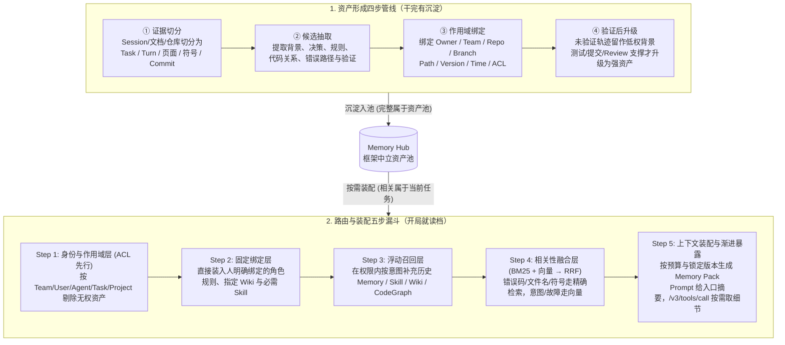

# 任何错误只犯一次：TencentDB Agent Memory 的团队记忆实践

## 1. TL;DR

Coding Agent 虽然显著放大了单人执行速度（如 OPC 一人公司模式），但任务一旦进入多人、多 Agent、跨分支与多权限域的企业环境，瓶颈便转移为**协作带宽**——即“单位时间内，能够在正确权限边界下被相关人或 Agent 正确理解并直接用于任务的有效上下文”。如果说 Spec-driven Development 让单次任务的状态变得“可表达”，**TencentDB Agent Memory** 则致力于让经过验证的任务状态变得“可继承”。系统将团队经验组织为 **Chat Memory（L0–L3 四层）、Wiki、CodeGraph、Skill** 四类与宿主框架解耦的资产，采用**“先做身份与 ACL 过滤 → 固定绑定 → 浮动召回 → BM25+向量 RRF 融合 → Memory Pack 渐进式暴露”**的五步装配管线。通过对 `2,600` 个 Session（`5,081` 个 Task）的离线挖掘、7 位研发访谈与 `35` 个 Redis 真实工单验证，团队证明“语义相关远多于可靠复用（48,114 个候选对中仅 `231` 条可作为强关系）”，并在 SWE-bench 经验继承测试中观察到相关任务完成率从 **`60%` 提升至 `80%`**、Top 50 超长难任务成本降低 **`19%`** 且通过率从 **`17%` 升至 `20%`**。

## 2. 核心概念

### 核心术语与边界定义

- **协作带宽（Collaboration Bandwidth）**：单位时间内，能够在**正确权限边界**下，被相关人或 Agent **正确理解并直接用于任务**的有效上下文（公式简化：$\text{协作成本} \approx \text{交接次数} \times \text{单次交接成本} + \text{冲突消解成本} + \text{权限与合规成本}$）。
- **OPC（One-Person Company，一人公司）**：一名核心决策者带着多个 Agent 在共享上下文中完成研究、开发、内容和运营的组织模型；它因低人际交接展示了 AI Native 执行上限，但企业无法直接照搬，因为企业必须处理角色分工、项目隔离、分支版本、数据安全与责任追溯。
- **三层 AI 组织架构（企业级翻译）**：源自孙天祥“把公司变成 GitHub 模式”演讲，本文将其工程化翻译为：**顶层（Memory Hub）治理信息边界与权限版本 → 中层（Memory Pack）承接人机真实任务现场 → 底层（Memory Assets）保存与框架解耦的可继承组织资产**。
- **Spec vs. 团队记忆（Team Memory）**：
  - **Spec（如 GitHub Spec Kit：`Specify → Plan → Tasks → Implement`）**：解决**当前单次任务**意图、约束、方案与验收标准的外显与对齐（让状态**可表达**）。
  - **团队记忆（TencentDB Agent Memory）**：解决历史任务背景、放弃原因、同类故障、跨分支冲突及权限/版本治理（让经验证的状态**可继承**）。

### 四类可继承资产（Memory Assets）与 Chat Memory L0–L3 分层

| 资产类型 | 主要保存什么 | 回答的典型工程问题 | 任务中的作用与暴露方式 |
|---|---|---|---|
| **Chat Memory** | 背景、约束、决定、偏好和历史交互（内部再分 **L0 Conversation** 原始对话、**L1 Atom** 原子事实/决定、**L2 Scenario** 场景记忆块、**L3 Core/Persona** 稳定认知） | 当时为什么这样判断？哪些错误路径已经试过并排除了？ | 恢复任务状态，避免重新解释；默认先用 L2/L3 建立语境，需核实证据时通过锚点回查 L1/L0 |
| **Wiki** | 产品知识、架构设计、规范、Runbook 和历史结论 | 项目已经知道什么？架构边界和只读规则在哪里？ | 提供稳定事实与设计依据；Prompt 中先注入名称、Summary 与工具入口，按需调用 `/v3/tools/call` 读取 |
| **CodeGraph** | 符号、文件、调用、依赖和影响路径 | 修改这个接口会影响哪些上下游模块与路由？ | 补充仓库结构与变更影响面；通过 `/v3/tools/list` 与 `/v3/tools/call` 按需查询 |
| **Skill** | 可重复执行的方法、工具调用、边界和验证规则 | 这类问题通常怎样处理、按什么清单验收？ | 复用经过验证的工作流；先暴露名称、触发条件与用途，确认适用后再加载完整步骤与资源 |

## 3. 知识框架

## 4. 关键要点与机制详解

### 4.1 为什么企业团队记忆不能用“扁平向量库（传统 RAG）”替代？

**核心主张：完整属于资产池，相关属于当前任务；工作分支、路径或环境的细微差异会让“高语义相似度”的资产酿成生产事故，因此必须先缩窄权限与作用域边界，再做多路融合检索与渐进式暴露。**

- **遇到什么问题**：
  1. **分支与环境细微差异陷阱**：例如两份部署 Skill 描述高度相似，但一份读取 `config/prod/`、另一份分支使用 `conf/prod/`；或两份测试流程调整同一参数，一份乘以 `0.5`、另一份乘以 `2`。若只按语义相似度取最高分，Agent 会流畅地把文件写入错误目录或污染生产环境。
  2. **扁平召回的上下文竞争**：原始对话、抽象结论、固定规则与临时背景混在一个池子里，相似度最高的不一定最可信，且全量塞入 Prompt 会撑爆 Token 预算。
  3. **宿主耦合导致资产清零**：若经验只留在某个账号或特定 Agent 框架的私有缓存里，一旦换人、换模型或换工具入口，团队经验立即归零。
- **采用什么机制**：
  1. **五层递进路由与版本锁定**：严格按 **“① 身份与 ACL 准入（符合 NIST 零信任最小权限，无权资产绝不进候选池，而非召回后删除）→ ② 人工固定绑定（保底线）→ ③ 浮动召回（供弹性）→ ④ BM25 精确检索 + 向量语义检索经 RRF（Reciprocal Rank Fusion）融合 → ⑤ 按 Token 预算与锁定版本生成 Memory Pack”** 执行。
  2. **渐进式暴露（Prompt 给索引，Tool 拿细节）**：Prompt 只告诉 Agent “有什么资产、为什么可能有用”，具体页面、源码、调用链或长步骤由 Agent 通过 `/v3/tools/list` 与 `/v3/tools/call` 按需拉取，并受条数、单项长度、总字符数与超时硬约束。
  3. **框架中立与三路冷启动**：资产跟着 `Team` 而非单个 Agent 走，通过 Gateway / HTTP API / SDK 对接任意 Agent；冷启动同时从**历史 Session（转 Chat Memory 与 Skill）、现有文档（转 Wiki）、代码仓库（转 CodeGraph）**三路导入，无需等几年自然生长。

### 4.2 工程化案例重建：CodeGraph 新增 `impact` 影响面查询工具如何“开局读档”？

**核心主张：团队记忆不是替研发多写几行代码，而是防止“单文件局部修改正确、跨模块系统行为残缺”。**

- **任务背景（工程化重建示例）**：在 `TencentDB Agent Memory` 仓库中为 `CodeGraph` 新增 `impact(symbol, depth)` 影响面查询工具。
- **无团队记忆的干净 Session 痛点**：Agent 搜索命中 `CODE_GRAPH_TOOLS` 数组后直接加一项就以为改完，却漏掉了隐含在多租户改造历史 Session、README 和其他模块中的五条系统级铁律：
  1. Agent 只能调用只读查询工具，`create / delete / sync` 等管理操作严禁进入白名单；
  2. 外部短名 `impact` 进入引擎前必须通过 `toCodeGraphToolName()` 映射为 `codegraph_impact`（漏映射会导致调用时返回 `403 unknown tool`）；
  3. 必须在 `MemoryKnowledge/src/routes/code-graph.ts` 注册直接查询路由并共用 `CODEGRAPH_QUERY_TOOL_NAMES` 单一真相源，最后经 `MemoryKnowledge/src/engines/code/bridge.ts` 进入引擎；
  4. `service_id` 必须从 `x-tdai-service-id` 请求头获取，按 `code_graph_id` 查询时仍须带租户条件，跨租户访问必须返回 `404`；
  5. 当 `CodeGraph` 索引尚未达到 `ready` 状态时，查询必须返回安全的空结果，严禁误用未完成索引。
- **装配 `Memory Pack` 后的协同分工**：
  - `Chat Memory` 提醒“外部短名与内部 `codegraph_` 前缀分离及单一真相源决策”；
  - `Wiki` 明确“只读暴露、管理操作不可暴露”的协议边界；
  - `CodeGraph` 展开 `createToolsRoutes → executeCodeGraphTool → toCodeGraphToolName → executeTool` 完整调用链；
  - `Skill` 提供包含未知工具 `403`、跨租户 `404`、非 `ready` 空返回及 Schema 校验的完整回归清单。

### 4.3 内部 2,600 个 Session 挖掘、研发访谈与 35 个 Redis 真实工单验证

**核心主张：“相关”远多于“可靠复用”；逻辑返工（1,350 次）远多于单纯缺少上下文（269 次），因此记忆资产必须划分置信层级（强关系 / 弱提示 / Shadow 背景）并绑定细粒度作用域与时序边界。**

- **发现一：`38%` 类型精度背后的真相（关联 $\neq$ 复用 $\neq$ 可直接执行）**：
  - 从 `2,600` 个原始 Session 中切分出 **`5,081` 个 Task**（以 Task 而非 Session 为单元，防止“同一仓库/同一用户”掩盖真实问题关系），首轮多信号生成 `48,114` 个候选 Pair，初筛保留 `23,134` 条。
  - 早期抽样显示：`same_problem` 标签的精确类型正确率仅为 **`38%`**（`reusable_sop` 为 `62%`），但样本中“确实存在某种具体关系”的比例高达 **`95%`**（`reusable_sop` 为 `96%`）。说明模型极易发现两个任务“有关系”，却很难区分是“同一工作项、同一问题还是可迁移 SOP”。
  - 经严格二裁、独立重分类与原始 Turn 证据核验后，沉淀出 **`22,361` 条 canonical Relation**：其中**仅 `231` 条被保留为三类强关系**（`42` 条 `same_work_item`、抽样有效率 `95.24%`；`135` 条 `same_problem`、有效率 `69.00%`；`54` 条 `reusable_sop`、有效率 `83.33%`），其余 **`22,130` 条全部降级为仅参与召回的 `related_context Shadow`**。
- **发现二：`2,203` 个卡点分布揭示“逻辑返工是最大损耗”**：
  - `5,081` 个 Task 中有 `1,644` 个出现卡点（占 `32.36%`），`2,600` 个 Session 中有 `1,264` 个出现卡点（占 `48.62%`）。
  - 在 `2,203` 个卡点中，**逻辑返工高达 `1,350` 个（占 61.3%）**，远超缺少上下文（`269`）、意图不一致（`230`）、重复失败（`145`）、状态丢失（`74`）、质量迭代（`65`）、任务拆解问题（`50`）与外部知识缺失（`20`）。这证明团队记忆不能只当“资料搜索器”，必须保存决策理由、已排除的失败路径与验证方式。
- **发现三：7 位 AI Coding 研发深度访谈的五个共识**：
  1. **方案设计与 Code Review 比写代码更耗时**（Diff 只展示改了什么，不解释为什么改及排除了哪些路径）；
  2. **协作模式转为“高内聚独立推进 + 评审/合并时集中同步”**（把上下文恢复压力推迟到了 Review 与维护阶段）；
  3. **存量代码最缺“为什么”**（为何有兼容分支、哪次故障促成该条件，只存在于历史轨迹中）；
  4. **新鲜度、来源、版本与调用透明度决定信任**（拒绝静默注入来历不明的文本）；
  5. **冷启动顺序必须“先证明个人与项目内即时价值（帮本人恢复状态、减少 Review 解释），再等待跨人团队复利”**。
- **发现四：`35` 个 Redis TAPD 真实工单构造的五条工程边界**：
  - 从 `12,574` 个主候选 Pair 中经宽判、严格二裁、逐字原文核验、负例审计与唯一 TAPD ID 锚定，最终为 `18` 个目标任务筛出 **`57` 条相关关系**（`32` 条强关联、`10` 条弱关联、`15` 条背景参考；非 Redis 与时间无效候选均压至 **`0`**）。
  - 确立五条硬约束：**① Scope 必须细化到 Branch/Path/工单/版本/时间；② 强关系（驱动计划/Skill）、弱关系（提示风险）、Shadow（仅助发现）严格分流；③ 严禁未来信息泄漏（目标任务发生后的修复结论不得穿越回作历史经验）；④ 每条结论必须能回溯原始 Turn/工单/代码；⑤ 必须纳入路径相似但实际不适用的负例训练触发边界**。

### 4.4 SWE-bench 经验继承评测与多人治理六大工程问题

- **SWE-bench 经验继承测试（前序 Case 学习 → 后序 Case 验证）**：
  - **三大评测铁律**：① 仅在同仓库或确有关系的任务间迁移；② 严格遵守时间顺序，严禁使用自身答案或未来 Case 信息；③ 靠真实任务测试判成败而非模型自评。
  - **测试结果**：在相关 Case 测试中，四类资产组合使完成率从 **`60%` 提升至 `80%`**（绝对提升 `20` 个百分点，相对提升约 **`33.3%`**）；在 **Top 50 超长难任务连续 Session 测试**中，通过率从 **`17%` 提升至 `20%`**，总成本从 **`$887.64` 降至 `$717.78`**，工具调用总 Turn 数下降近 **`19%`**。
- **多人共享环境的六类治理问题**：**① 冲突**（跨分支/环境操作相反，需作用域过滤与人工确认）；**② 新鲜度**（维护 `valid_from`、`valid_to`、最后验证时间与代码版本）；**③ 权限**（ACL 先于检索）；**④ 溯源**（记录用了哪项资产、来自哪个任务、影响了哪步计划）；**⑤ 负反馈**（误召回可标记、降权、撤回并修正触发规则）；**⑥ 成本**（控制 Token、延迟与隐私暴露面）。

## 5. 数据速查表

| 指标 | 原文数值 | 语境 / 条件 |
|---|---|---|
| 引用外部行业观察数据 | METR 任务时间跨度约每 `7 个月` 翻倍；Claude Code（`40 万`次会话分析）周均使用约 `20 小时`；Carta 2025 单一创始人公司占 `36%`（2024 年为 `31%`） | 第一章用于阐述 Coding Agent 扩展个人执行边界与 OPC 背景的公开数据引用 |
| 内部离线分析样本规模 | `2,600` 个原始 Session → 切分出 `5,081` 个 Task | Task-only 内部分析基准 |
| 候选关系筛选漏斗 | 初始候选 `48,114` Pair → 初筛 `23,134` → canonical Relation `22,361` 条 → **强关系 `231` 条** + **Shadow `22,130` 条** | 231 条强关系含：`42` 条 `same_work_item`、`135` 条 `same_problem`、`54` 条 `reusable_sop` |
| 早期抽样 vs 二裁后强关系有效率 | 早期：`same_problem` 类型精度 `38%`（存在具体关系达 `95%`），`reusable_sop` 精度 `62%`（存在关系 `96%`）；二裁后三类强关系有效率：`95.24%`、`69.00%`、`83.33%` | `same_problem` 的 `69.00%` 比预设 `70%` 门槛少 1 个样本，团队按实保留为已知风险 |
| 卡点识别分布与模型审计指标 | 共 `2,203` 个卡点（涉及 `1,644` 个 Task / `32.36%`，`1,264` 个 Session / `48.62%`）：逻辑返工 `1,350`、缺上下文 `269`、意图不一致 `230`、重复失败 `145`、状态丢失 `74`、质量迭代 `65`、任务拆解 `50`、外部知识缺失 `20` | 模型自动化审计（非人工金标）：正样本独立 Prompt 审计精度 `84%`、目标 Turn 定位 `84%`、原因 Turn 定位 `82%`、零窗口漏判率约 `6.5%` |
| Redis TAPD 真实工单筛选结果 | `35` 个目标任务 → `12,574` 个主候选 Pair → `57` 个最终相关 Pair（覆盖 `18` 个目标任务、`54` 个历史 Task / `45` 个历史 Session） | 分级：`32` 强关联 / `10` 弱关联 / `15` 背景参考；非 Redis 候选 `0`、时间无效候选 `0` |
| SWE-bench 相关 Case 经验继承结果 | 完成率从 **`60%` 升至 `80%`**（绝对 `+20pp`，相对 **`+33.3%`**） | 同仓库/相关任务、严格按时间序前序学习后序验证、四类资产组合使用 |
| SWE-bench Top 50 超长难任务结果 | 通过率 **`17% → 20%`**，成本 **`$887.64 → $717.78`**，工具调用总 Turn 数降低近 **`19%`** | 50 个最难案例拼为单 Session 内连续超长任务测试 |

## 6. 踩坑与教训 / 可迁移的设计原则

### 踩坑与教训（错误做法 → 失败表现或原因 → 原文应对）

1. **直接在 Session 级别计算相似度，并把所有语义相关的历史记录直接塞给 Agent 执行**：
   - **错误做法**：不切分 Task，只要两个 Session 向量相似度高就把历史操作步骤当作可执行 SOP 注入。
   - **失败表现或原因**：长 Session 含多个目标，“同一仓库/同一用户”会制造虚假相似；且实测 `22,361` 条真实相关关系中只有 `231` 条（约 `1%`）能达到驱动执行的强关系标准，盲目复用不同分支（如 `config/prod/` vs `conf/prod/`）的操作会直接污染生产环境。
   - **原文应对**：以 Task 为分析单元，绑定 `Repo/Branch/Path/Version/Time/ACL` 作用域，将关系严格拆分为强资产（231 条）、弱风险提示与仅助发现的 `related_context Shadow`（22,130 条）。
2. **先做全库向量检索，召回后再按权限删掉无权文档**：
   - **错误做法**：把全公司或全团队资产放进同一个向量检索池，先取 Top-K 再过滤权限。
   - **失败表现或原因**：不仅容易发生越权信息泄露风险，而且无权的高相似文档挤占了 Top-K 名额，导致过滤后真正有权且相关的资产被漏掉。
   - **原文应对**：路由装配第一步先走**身份与作用域层（ACL 先行）**，无权限资产从源头不进入候选池。
3. **静默注入无来源、无版本的模型总结文本**：
   - **错误做法**：后台自动把历史对话缩成一段摘要塞进系统提示词，不展示来源任务、适用分支与原始证据。
   - **失败表现或原因**：研发无法区分“模型自由发挥的猜测”与“团队已验证的事实”，一旦历史规则过期还会持续误导且无从回滚。
   - **原文应对**：同时保留上层抽象（L2/L3）与下层证据锚点（L1/L0 原始 Turn、工单、Commit），记录调用溯源并开放负反馈降权/撤回通道。

### 可迁移的设计原则（团队记忆六条核心准则）

1. **记忆的目的是继承状态，而非保存历史聊天**（让换人、换 Session、换 Agent 后目标、约束与未完成状态仍在）。
2. **以“能否降低下一次任务的不确定性”作为资产唯一准入标准**（不以 Memory 条数增长为 KPI）。
3. **抽象与原始证据必须同时保留**（高层 L2/L3 省阅读量，底层 L0/L1 防多轮总结失真）。
4. **原子化、可组合并按任务渐进装配**（Prompt 给入口摘要，工具调用 `/v3/tools/call` 按需拿细节）。
5. **全生命周期治理**（支持新增、Review、发布、Fork、合并、降权、任务期版本锁定、过期与负反馈撤回）。
6. **与具体模型和 Agent 框架解耦**（资产跟着 Team 走，冷启动先服务个人与项目内的状态恢复和 Review 减负，再自然生长出团队复利）。

## 7. 记忆锚点

1. **原文核心金句锚点**：「Spec 让一次任务的状态变得可表达，团队记忆让经过验证的任务状态变得可继承；完整属于资产池，相关属于当前任务。」
2. **架构与数据口诀（助记改写）**：「四类资产（Chat L0-L3 / Wiki / CodeGraph / Skill），五步装配（ACL 先行 → 固定绑定 → 浮动召回 → BM25+向量 RRF → 渐进暴露）；5081 任务筛出 231 强关系，SWE-bench 60% 升 80%、超长难任务省 19% 成本。」

## 8. 复习卡片

原文如何定义企业研发中的“协作带宽”？为什么说 Spec 和团队记忆解决的是前后相接的两个问题？::协作带宽是指“单位时间内，能够在正确权限边界下，被相关人或 Agent 正确理解并直接用于任务的有效上下文”；Spec（如 Spec Kit）让当前单次任务的意图、约束和验收标准变得“可表达”，而团队记忆则跨越成员、Session、分支和权限域，让经过验证的任务状态变得“可继承”。
TencentDB Agent Memory 将可继承的团队资产划分为哪四类？其中 Chat Memory 的 L0 到 L3 各保存什么？::四类资产是 Chat Memory（背景、决定与历史尝试）、Wiki（产品架构、规范与 Runbook）、CodeGraph（符号、依赖与影响路径）和 Skill（可重复执行的方法与验证清单）；Chat Memory 内部划分为 L0 Conversation（原始对话证据）、L1 Atom（结构化事实/约束/决定）、L2 Scenario（项目或场景记忆块）和 L3 Core/Persona（稳定模式与长期画像）。
任务启动时，Memory Pack 的五步路由装配顺序是什么？为什么要把身份与 ACL 放在第一步？::顺序是：① 身份与作用域层（Team/User/Agent/Task/ACL）→ ② 固定绑定层（人工明确绑定的规则/Wiki/Skill）→ ③ 浮动召回层 → ④ 相关性融合层（BM25 精确检索 + 向量检索经 RRF 融合）→ ⑤ 上下文装配层（按预算与锁定版本生成 Memory Pack 并渐进式暴露）；把 ACL 放在第一步是为了符合最小权限原则，从源头杜绝无权资产进入候选池或挤占 Top-K 名额。
在内部 2,600 个 Session（5,081 个 Task）分析中，为什么说“38%”不能被解释为“只有 38% 的知识可复用”？最终关系是如何分层的？::`38%` 只是早期抽样中模型对 `same_problem` 细分类别的精确标签正确率，而样本中“确实存在某种具体关系”的比例高达 `95%`，说明模型容易发现任务相关却难分清关系类型；最终在 `22,361` 条 canonical Relation 中，仅保留 `231` 条高置信强关系（`same_work_item`、`same_problem`、`reusable_sop`），其余 `22,130` 条全部降为只参与召回而不直接驱动执行的 `related_context Shadow`。
2,203 个研发卡点的分布揭示了什么核心问题？它如何影响了团队记忆的设计重心？::在 2,203 个卡点中，“逻辑返工”高达 `1,350` 个，远多于“缺少上下文”的 `269` 个；这说明团队记忆不能只做“找资料的搜索引擎”，还必须保存历史决策理由、已排除的失败路径、适用条件和验证方式，否则 Agent 找到相关资料仍会重复同样的推理错误。
在 35 个 Redis TAPD 真实工单实验中，团队为防止“用错历史经验”确立了哪五条工程边界？::① Scope 必须细化到 Repo、Branch、Path、工单、版本与时间；② 严格区分强关系、弱关系与背景参考；③ 禁止未来信息泄漏（目标任务之后的修复结论不得当成历史经验）；④ 每条结论必须能回溯到原始 Turn、工单和代码；⑤ 引入路径相似但实际不适用的负例来校准触发边界。
在 SWE-bench 经验继承测试与 Top 50 超长难任务测试中，引入团队记忆分别带来了什么量化变化？有哪些解读边界？::在同仓库按时间序“前序学习、后序验证”的相关 Case 测试中，四类资产组合使完成率从 `60%` 升至 `80%`（相对提升约 `33.3%`）；在 50 个最难案例拼成的超长连续任务中，通过率从 `17%` 升至 `20%`、成本从 `$887.64` 降至 `$717.78`、工具调用总 Turn 数下降近 `19%`。这些是特定配置下的内部实验报告，不代表所有研发任务都能无条件提升 20 个百分点。

## 9. 知识关联

### 本库主题入口与已有关联笔记

- [Agent长期记忆](../../20_topics/Agent%E9%95%BF%E6%9C%9F%E8%AE%B0%E5%BF%86.md)：四类团队记忆资产、Chat Memory L0–L3 管线、五步路由装配与生命周期治理。
- [Agent安全与权限](../../20_topics/Agent%E5%AE%89%E5%85%A8%E4%B8%8E%E6%9D%83%E9%99%90.md)：ACL 优先于检索的零信任装配顺序与跨租户 `x-tdai-service-id` 隔离校验。
- [AI研发协同](../../20_topics/AI%E7%A0%94%E5%8F%91%E5%8D%8F%E5%90%8C.md)：OPC 与企业研发边界对比、Spec 到 Team Memory 的衔接与 Code Review 减负。

### 候选双链（供 Obsidian 知识库导航）

- **本库记忆与知识工程系列**：[[Agent团队知识底座]]、[[Agent自进化飞轮]]、[[AI Coding团队经验系统]]、[[上下文工程]]、[[Multi-Agent降本]]
- **核心概念与基准**：[[GitHub Spec Kit]]、[[SWE-bench Verified]]、[[RRF 倒数排序融合]]、[[CodeGraph 代码图谱]]

## 10. 原文参考资料

- **本目录归档文件**：[RAW.pdf](RAW.pdf)｜[MD.md](MD.md)
- **原文提及的开源项目、论文与报告**：
  - 开源仓库：`TencentDB Agent Memory`（GitHub 开源）
  - 行业报告与演讲：红杉汇 / 日行迹智能（Analemma）孙天祥演讲《任何错误只犯一次，AI 时代，要把公司变成 GitHub 模式》及《不是员工不愿协作，是人和人的带宽太小了》、METR 前沿模型任务时间跨度测量、Anthropic 40 万次 Claude Code 会话隐私保护分析、Carta 2025 单一创始人公司统计、NIST 零信任架构
  - 研发规范与学术工作：`GitHub Spec Kit`、*SWE-bench*（Original 2,294 任务 / Verified 500 任务）、*Agent Workflow Memory*

> [!note]- 校对报告
> - **覆盖度核验**：已完整通读 `MD.md`（共 22 页，p.1–20 为六章技术正文与结语，p.21 为公众号阅读量与留言入口，p.22 为空白尾页）并核对 `META.json` 记录。完整覆盖协作带宽与 OPC/三层 AI 组织架构、Spec 与团队记忆关系、四类资产（Chat Memory L0-L3 / Wiki / CodeGraph / Skill）、五步路由装配与渐进暴露、资产形成四步管线与三路冷启动、`CodeGraph` 新增 `impact` 工具完整工程化重建案例、`2,600` Session / `5,081` Task 离线挖掘与 `2,203` 个卡点分布、7 位研发访谈、`35` 个 Redis TAPD 真实工单环境、SWE-bench 两项经验继承实验、六条设计原则与多人环境六类治理问题。
> - **关键数据逐项核对**：
>   1. **外部引用数据**（p.2）：METR 任务完成时间跨度约每 `7 个月` 翻倍；Anthropic 约 `40 万` 次 Claude Code 会话分析显示每周平均使用约 `20 小时`；Carta 样本显示 2025 年成立公司中约 `36%` 由单一创始人领导（高于 2024 年的 `31%`）。
>   2. **内部 Task-only 分析与卡点数据**（p.12–14）：`2,600` 个原始 Session 切出 `5,081` 个 Task；初始候选 `48,114` Pair → 初筛保留 `23,134` 条 → canonical Relation `22,361` 条；三类强关系共 `231` 条（`42` 条 `same_work_item` 抽样有效率 `95.24%`、`135` 条 `same_problem` 有效率 `69.00%`、`54` 条 `reusable_sop` 有效率 `83.33%`），Shadow 关系 `22,130` 条；早期抽样 `same_problem` 精度 `38%`（存在具体关系 `95%`）、`reusable_sop` 精度 `62%`（存在关系 `96%`）；卡点共 `2,203` 个（`1,644` Task / `32.36%`，`1,264` Session / `48.62%`）：逻辑返工 `1,350`、缺少上下文 `269`、意图不一致 `230`、重复失败 `145`、状态丢失 `74`、质量迭代 `65`、任务拆解 `50`、外部知识缺失 `20`；模型自动审计指标为 Prompt 审计精度 `84%`、目标 Turn `84%`、原因 Turn `82%`、零窗口漏判率约 `6.5%`。
>   3. **Redis 真实 Case 与 SWE-bench 指标**（p.15–18）：Redis 目标任务 `35` 个、主候选 Pair `12,574` 个、最终相关 Pair `57` 个（覆盖 `18` 个目标任务、`54` 个历史 Task / `45` 个历史 Session，含 `32` 强 / `10` 弱 / `15` 背景，非 Redis 与时间无效均为 `0`）；SWE-bench 相关 Case 完成率从 `60%` 提升至 `80%`（绝对 `+20pp`，相对约 `33.3%`）；Top 50 超长难任务通过率从 `17%` 升至 `20%`、成本从 `$887.64` 降至 `$717.78`、工具调用总 Turn 数降低近 `19%`。
> - **事实边界与局限说明**：保留了原文对 `CodeGraph impact` 案例“属于工程化重建、非逐字复盘”、模型自动审计“非人工金标”以及 SWE-bench 成绩“取决于 Case 筛选与特定配置，需更多置信区间与跨版本验证”的全部严谨限定。
> - **格式自检**：全文仅 1 个 H1 标题；正文、表格、Mermaid 图与复习卡片均无页码/章节出处标注；复习卡片共 7 条，严格采用单行 `问题::答案` 格式。
