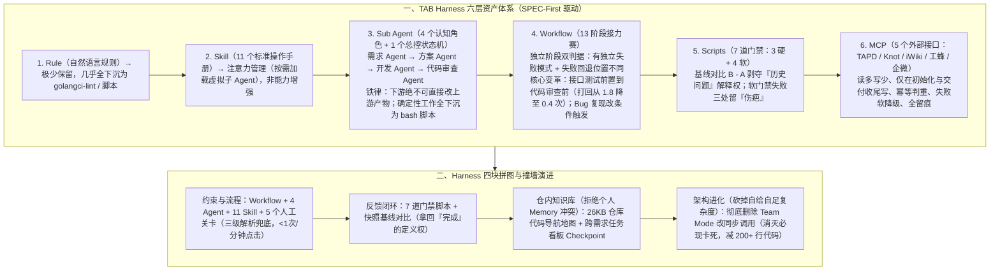

# 从 Vibe Coding 到 Harness——一套大仓 AI 工程化实战

> **原文信息**：作者 `fitchzheng`、`leoshli`（腾讯公司级 A/B 实验平台 TAB 团队），发布于 2026-07-07 02:39（广东），公众号「腾讯技术工程」原创。

---

## 1. TL;DR

1. **大仓痛点与 SPEC-First 纪律** —— 在拥有 **30+ 微服务、10+ 前端微应用**（Go/TS 为主，四层架构 + 7 个横切切面）的 TAB 实验平台大仓中，跑通一个需求的核心瓶颈不是模型写代码不准，而是**协作、流程、信任与收口**（PRD 不可信、方案对不上代码、口头汇报未验证、跨 TAPD/iWiki/工蜂/Knot 交付碎片化）；落地第一步是磨出完整的全链路技术设计文档（**SPEC-First**）。
2. **六层资产与「能写脚本绝不留 Rule / Agent」** —— 整套 Harness 由 **Rule（几乎全部下沉为 lint/脚本）、Skill（11 个，负责注意力管理而非能力增强）、Sub Agent（仅留 4 个认知角色 + 1 个总控 Agent）、Workflow（13 阶段接力赛）、Scripts（7 道软硬门禁）、MCP（5 个外部系统接口）** 组成；核心铁律是「能判定的别留 Rule，能写成 bash 的别让 Agent 跑，下游 Agent 绝不许直接修改上游产物」。
3. **测试前置与半自动人工关卡** —— 将接口测试从验收阶段**前置到代码审查之前**作为硬门禁，并把「开发完成」重新定义为「业务代码 + 单测 + 接口用例文档 + 增量 Go 接口测试代码」，使代码审查平均打回次数从 **1.8 次降至 0.4 次**；鉴于模型对同行产物缺乏「否决欲望」，保留 **5 个人工关卡**（配 UI 按钮/文本关键词/语义识别三级兜底，且严守「每分钟点击不超过 1 次」的体感红线）。
4. **7 道门禁脚本 + 基线对比反作弊 + 软门禁留疤** —— 设置 **3 道硬门禁**（静态检查+安全扫描、沙箱部署、真实 HTTP 接口测试）与 **4 道软门禁**（覆盖率、制品一致性、前端 Playwright 冒烟、日志验收）；开发前冻结门禁快照 `$A$`、开发后跑差异 `$B - A$`，仅「新增失败」阻断流程，彻底剥夺 AI 用「这是历史问题」糊弄的解释权；软门禁失败虽不阻断但强制在状态文件、CR 结论与度量报告中留下醒目警告伤疤。
5. **删掉 Team Mode 自给自足复杂度 + 两层仓内记忆 + 50+ 需求实效** —— 针对人工关卡必现卡死（主控 Agent 本轮对话结束下班导致收件箱消息无人消费），彻底删除从未用到并行能力的 **Team Mode** 改为 IDE 原生同步阻塞调用（主 Agent 少近 **200 多行**代码）；在仓库内维护 **26KB 代码导航地图**（防 80% 改错子仓）与**跨需求任务看板 Checkpoint**；跑通 **50+ 个真实需求**后，端到端耗时 **30–75 分钟**、人工按键仅 **2–3 次**、集成测试一次通过率 **约 70%**。

---

## 2. 核心问题与文章定位

### 2.1 TAB 大仓的工程画像与真实卡点

**TAB（Tencent A/B Test）** 是服务腾讯 PCG、IEG、WXG、CDG 等 **100+ 业务**、日均分流请求达**万亿级别**（第一类错误率控制在 **5% 以内**）的公司级 A/B 实验平台。其工程复杂度体现在：
- **仓库与技术栈**：多工作区 + 多子仓库（**30+ 微服务、10+ 前端微应用**、各平台 SDK），以 **Go、TypeScript** 为主加少量 Python 工具链；单条看似只有一行的 PRD，往往牵动 **3–5 个子仓库（submodule）、改 5 个协议字段、增 8 个服务方法、补 12 个单测、加 2 个接口测试**。
- **架构分层与切面**：胶水层（协议 ↔ 领域对象转换）→ 接口层 → 服务层 → 领域层（数据访问 + 领域模型）；并由 **7 个横切切面**按序串联：`错误 → 日志 → 数据库上下文 → 鉴权 → 参数校验 → 事务 → 出参整形`。
- **四大非模型卡点**：① **PRD 不能被信任**（一句话需求缺失灰度、幂等、下游回收边界）；② **方案对不上代码**（看不出改哪几个服务与协议字段）；③ **改完没人验证**（AI 口头说「改完了」≠ 跑过 Docker Compose 沙箱真实 HTTP 测试且增量覆盖率 $\ge 85\%$）；④ **交付环节碎成一地**（TAPD 改单、iWiki 传方案、工蜂提 MR、Knot 查规范、企微发通知全靠人记）。

---

## 3. 知识框架

---

## 4. 核心内容拆解

### 4.1 六层资产拆解：什么该留给 AI，什么必须下沉为脚本？

1. **Rule（规则）：为什么最后几乎没怎么写？**
   - 自然语言 Rule 存在「解释性执行」天花板——AI 总能用「此场景特殊」「做了等价验证」「这是历史问题」绕过。
   - **能判定的绝不留在 Rule 里**：例如「数据访问层必须用 GORM 不许拼 SQL」「必须用统一错误码包」直接写成 lint 规则；「服务层覆盖率 $\ge 70\%$、数据访问层 $\ge 50\%$」写成脚本强制规定；「写操作必须走事务切面」在 CR 阶段静态扫描。
2. **Skill（11 个标准操作手册）：注意力管理而非能力增强**
   - 若把数据访问层规矩（GORM、mock 单测、增量覆盖率 $\ge 80\%$、错误码前缀等）全塞进主 Prompt，既淹没需求上下文，又难以同步维护；抽成独立 Skill 按需加载，本质是**「无状态的虚拟子 Agent」**，这也是团队不再把开发 Agent 拆成数据访问/服务/处理层三个并行 Agent 的核心原因。
   - **11 个 Skill 分布**：① 脚手架与代码层规范 **4 个**（协议与领域模型脚手架、数据访问层、业务服务层、HTTP 处理层）；② 测试规范 **2 个**（单测规范、沙箱真实 HTTP 接口测试生成）；③ 需求理解内部能力 **3 个**（PRD 完整性 5 维度 `0~100` 自评工具、影响半径分析工具、PRD 模板）；④ 代码审查能力 **2 个**（范围溢出检查、前端增量与视觉审查）。
3. **Sub Agent（4 个专职认知角色 + 1 个总控 Agent）**：
   - **演进四步曲**：从「单 Agent 干到底（上下文 1M 不够用、自我审查不否决、盲目推进）」→ 拆出「需求 Agent + 方案 Agent」并立下头号铁律**「下游 Agent 不可直接修改上游产物，需改只能提阻塞项由总控打回上一棒」** → 拆出「代码审查 Agent（聚焦方案一致性、验收标准覆盖、质量基线、前端增量 4 维度，专抓 AI 擅自改设计）」→ 扩充「开发 Agent（对产物的可验证性负责，一并产出接口用例文档与增量 Go 接口测试代码）」。
   - **为什么只有 4 个？** 流程调度（总控伪代码状态机）、门禁入口、测试执行（沙箱部署/接口测试/前端冒烟）、分支准备与交付收尾全部是纯确定性工作——**「能写成 bash 的就别让 Agent 跑」**。
4. **Workflow（13 个阶段的接力赛）**：
   - **完整 13 棒**：`初始化 → 需求分析 → 需求确认 → [Bug 复现] → 技术方案 → [方案确认] → 方案评审 → 分支准备 → 开发 → 集成测试 → 代码审查 → 验收 → 交付收尾`（方括号为条件触发）。
   - **是否独立成阶段的两条金标准**：① 是否有独立的失败模式？② 失败时回退的位置是否不一样？两条均为「是」则必须独立（例如初始化单独拎出，防止需求分析被打回时反复修改 TAPD 状态）。
   - **关键弯路一（集成测试前置）**：最初接口测试放在代码审查之后的验收阶段，导致审查 Agent 审完 200 行 diff 后因低级接口路径/参数错误被打回重审（最贵的环节背最便宜的锅）；将真实 HTTP 接口测试**前置到代码审查之前**作为硬门禁后，代码审查平均打回次数从 **1.8 次骤降至 0.4 次**。
   - **关键弯路二（Bug 复现由必走变可选）**：许多产品报单已写清请求/期望/实际，强制沙箱复现纯属浪费；改为「仅当 `bugfix` 且用户明确要求复现时才走」，给准备充分的需求留出快车道。

---

### 4.2 半自动人工关卡与 7 道门禁脚本：拿回「完成」的定义权

#### （1）5 个人工关卡与体感红线
- **为什么坚持半自动？** 实测发现模型对自己人生成的产物天然缺乏「否决欲望」（下游 Agent **99%** 的情况觉得上游方案「看上去挺好」），关键节点必须留人。
- **5 个关卡设计**：① **需求确认**（看 5 行摘要，花 10–30 秒，必触发）；② **方案确认**（仅跨子仓库/改协议时弹出，花 30–60 秒，约 **40%** 需求触发）；③ **方案评审打回**（花 1–2 分钟，**<10%** 触发）；④ **前端冒烟选择**（跑/复用/跳三选一，花 5 秒）；⑤ **熔断暂停**（任意阶段连续打回 **$\ge 3$ 次**触发）。
- **体感铁律与三级解析兜底**：严守**「不能让用户每分钟点一次以上」**（曾因调起子 Agent 未显式声明权限模式，导致写文件弹出几十次 `"Are you sure..."`，后通过一行配置声明「自动接受文件编辑」修复）；每个关卡均配备 **UI 按钮（主通道）+ 纯文本关键词（兼容通道）+ 语义识别（降级通道）** 三级兜底，应对 IDE 版本回退或 MCP 客户端按钮渲染异常。

#### （2）7 道门禁脚本（3 硬 + 4 软）、基线对比与留疤设计
- **3 道硬门禁（失败立即中止流程，宁少不多）**：
  1. **静态检查 + 安全扫描**（开发完成时）：`golangci-lint` **12 个检查器** + 硬编码密码 + SQL 拼接 + 哈希校验；
  2. **沙箱部署**（集成测试时）：`make sandbox-platform-full-ensure` + 网关健康检查；
  3. **接口测试**（集成测试时）：真实 HTTP 跑接口用例文档。
- **4 道软门禁（失败留 WARN 痕迹但继续推进，防紧急 hotfix 被非红线阻塞）**：
  1. **覆盖率检查**（开发完成时）：全量 **$\ge 40\%$** 且本次 diff 增量 **$\ge 85\%$**；
  2. **制品一致性检查**（开发完成时）：任务清单勾选项是否全部勾上；
  3. **前端冒烟**（集成测试时条件触发）：Playwright 跑路由级渲染 + DOM 断言 + 截图；
  4. **日志验收**（验收时可选）：关键操作日志存在 + 敏感信息脱敏。
- **反作弊利器——基线对比（`$B - A$`）**：开发启动前先跑一次门禁脚本冻结「基线快照集合 `$A$`」，开发完成后再跑「差异模式集合 `$B$`」，**只有新增的失败（`$B - A$`）才会阻断流程**，彻底剥夺 AI 用「这是历史问题」推脱的解释权。
- **软门禁失败「留伤疤」**：所有软门禁失败虽不阻断，但强制在**门禁状态文件**、**代码审查结论文档**、**最终度量报告「软门禁告警」段**三处同时留下显眼黄色警告——「你不能阻止 AI 偷懒，但可以让偷懒变得很醒目」。

---

### 4.3 Team Mode 卡死复盘：警惕「自给自足的复杂度」

- **症状与三轮错误止血**：在需求确认人工关卡输入「确认继续」后主 Agent 必现毫无反应；前三次先后怀疑「标记文件残留（加清理脚本）」「60 秒虚假超时（改长等待）」「按钮值未匹配（改纯文本）」，全部无效。
- **脊背发凉的真相**：打开 IDE 的 Team 状态目录收件箱才发现——旧架构「启动子 Agent 并等待」使主控 Agent 的本轮对话在抛出确认提示后自然结束（已经下班了），而 IDE 的 Team Mode 仍把后续用户输入的「确认继续」路由到主控 Agent 的收件箱里无人消费（**「消息有目的地，但目的地下班了」**）。
- **彻底根治（YAGNI 原则）**：团队审视架构发现，Harness 的 4 个 spawn 点全部是「串行单个」模式，**从未用过 Team Mode 的并行 spawn、互发消息或跨 turn 共享能力**，却为了维护它引入了三步调起协议、三通道返回和 3 个清理等待辅助脚本（典型的**「复杂度自给自足」陷阱——一个机制的存在主要是为了 fix 它自己引入的副作用时，有 80% 概率该被删掉**）。最终彻底删除 Team Mode，改用 **IDE 原生项目级自定义子 Agent + 同步阻塞调用**，卡死彻底消失，主 Agent 代码反而精简了**将近 200 多行**。

---

### 4.4 两层仓内项目记忆与 5 个 MCP 交付闭环

1. **让 AI 带上「整个项目的记性」（拒绝存个人 Memory）**：
   - 为什么必须落进代码仓库而非 AI 工具的个人 Memory？因为大仓里 4 个工程师同时跑不同需求时，个人 Memory 看不见、对不齐且会互相矛盾；**团队要对齐的共识必须落到仓库，Memory 只放纯个人偏好（如「回答用中文」）**。
   - **第一层：仓库代码导航地图（约 26KB，谁动谁更新）**：记录功能落点、服务注册风格（`trpc-go` vs `chi`）、下游牵动链路与标准写法；需求 Agent 启动先读其「全景索引」段，**避免了 80% 的「在错的子仓库里改」**。
   - **第二层：跨需求任务看板（总控维护的 Checkpoint 文件）**：记录在跑需求、所处阶段、产物路径与上轮设计结论，**使「新需求把旧设计冲掉」的概率降低了一个量级**。
2. **5 个 MCP 打通交付闭环（TAPD / Knot / iWiki / 工蜂 / 企微）**：
   - 将过去纯靠人工半小时完成的动作（改 TAPD 状态 `TODO → DOING → REVIEWING → DONE`、关联分支、批量上传 `proposal/specs/design/tasks` 等 **7 份制品**到 iWiki、工蜂提 MR 贴度量推 reviewer、企微群通知）收敛为受控的 MCP 调用。
   - **MCP 四大工程纪律**：① **读多写少，写操作仅限「初始化」与「交付收尾」两阶段触发**（杜绝 AI 半路改坏外部状态）；② **写操作必须幂等**（如 TAPD 关联分支按 `(仓库, 分支)` 二元组判重）；③ **任何 MCP 失败均软降级（只警告不阻断主流程）**；④ **全留痕且弃用 Python 子进程 OAuth2 双通道**，统一收敛至 MCP。

---

## 5. 数据速查表

| 指标 | 原文数值 | 语境 / 条件 |
| :--- | :--- | :--- |
| TAB 大仓工程规模 | **30+ 微服务、10+ 前端微应用** | 服务腾讯 100+ 业务、日均万亿级分流请求（第一类错误率 `<5%`） |
| 后端服务横切关注点切面数 | **7 个切面** | `错误 → 日志 → 数据库上下文 → 鉴权 → 参数校验 → 事务 → 出参整形` |
| 单行 PRD 典型牵动范围示例 | **跨 3–5 个子仓库、改 5 个协议字段、增 8 个方法、补 12 个单测、加 2 个接口测试** | 体现跨子仓业务工程的真实协同复杂度 |
| Harness 核心资产配置数量 | **11 个 Skill / 4 个认知 Sub Agent (+1 总控) / 13 阶段 Workflow / 7 道门禁 (3 硬 4 软) / 5 个 MCP** | TAB 工程化落地后的精简收敛形态 |
| 代码审查平均打回次数降幅 | **从 1.8 次降至 0.4 次** | 将沙箱真实 HTTP 接口测试从验收阶段**前置到代码审查之前**作为硬门禁后的效果 |
| 覆盖率门禁与规范阈值 | **门禁全量 $\ge 40\%$ 且 diff 增量 $\ge 85\%$（规范：服务层 $\ge 70\%$、DAO $\ge 50\%$ / $\ge 80\%$）** | 开发完成时的软门禁及各层测试覆盖率要求 |
| 静态检查硬门禁检查器数量 | **`golangci-lint` 12 个检查器** | 外加硬编码密码、SQL 拼接与哈希校验 |
| 人工关卡配置与熔断阈值 | **5 个关卡，连续打回 $\ge 3$ 次触发熔断暂停** | 交互红线为「不能让用户每分钟点一次以上」，方案确认约 **40%** 需求触发、评审打回 **<10%** |
| 删除 Team Mode 减少代码量 | **主 Agent 代码减少将近 200 多行（辅助脚本 3 个 → 0 个）** | 砍掉「自给自足复杂度」改用 IDE 原生项目级子 Agent 同步调用 |
| 仓库代码导航地图体积与效果 | **约 26KB，避免 80%「在错的子仓库里改」** | 由开发 Agent 维护（「谁动谁更新」），需求 Agent 启动必读全景索引段 |
| 交付收尾批量上传 iWiki 制品数 | **7 份制品** | 含 `proposal / specs / design / tasks` 等研发过程文档 |
| 50+ 真实需求实测运营指标 | **耗时 30–75 分钟（不含人工等待） / 人工按键 2–3 次 / 集成测试一次通过率约 70% / CR 阻塞率约 25%** | 跑通 50+ 个真实需求后的统计数据 |

---

## 6. 踩坑与教训 / 可迁移的设计原则

| 错误做法 | 失败表现或原因 | 原文应对 |
| :--- | :--- | :--- |
| 依赖大量自然语言 Rule 约束 AI，或相信 AI 口头汇报「我改完了 / 这是历史问题」 | Rule 越多 AI 解释性执行空间越大，且无法每次人工翻 `git log` 核实历史问题 | 将可判定规则全部下沉为 lint 与 **7 道门禁脚本**；引入开发前快照 `$A$` 与开发后 `$B - A$` **基线对比**剥夺解释权，软门禁失败三处留「伤疤」 |
| 把接口测试放在代码审查之后的验收阶段执行 | 审查 Agent 耗费高昂 Token 审完 200 行 diff 后，因低级接口路径/参数错误被打回重审（平均打回 1.8 次） | **让产生问题的人同时产生验证手段**：开发 Agent 一并产出接口测试代码，将沙箱真实 HTTP 接口测试前置为代码审查前的硬门禁（打回降至 0.4 次） |
| 允许下游方案 Agent 觉得上游需求文档不严谨时「顺手直接修改」上游产物 | 代码审查阶段彻底分不清哪句验收标准是产品要的、哪句是方案 Agent 自己加的，责任边界崩塌 | 确立铁律：**下游 Agent 绝不可直接修改上游产物**，需修改时只能提阻塞项由总控打回上一棒 |
| 盲目启用复杂的 `Team Mode`（异步启动子 Agent + 消息收件箱 + 标记文件清理）跑串行任务 | 主控 Agent 本轮对话结束「下班」后，用户输入的「确认继续」躺在收件箱无人消费，导致人工关卡必现卡死 | 警惕**「自给自足的复杂度」**与遵循 YAGNI：既然从未用过并行能力，直接彻底删除 Team Mode 改用 IDE 原生同步调用，代码反减 200+ 行 |
| 调起子 Agent 时未显式声明写文件权限模式，或把所有检查都设为硬门禁 | 写文件触发几十次弹窗审批使半自动退化为全人工；非红线问题（如前端冒烟）阻塞紧急 hotfix 导致团队弃用工具退回 Vibe Coding | 显式声明「自动接受文件编辑」，严守**「每分钟点击不超过 1 次」**红线；硬门禁宁少不多（仅留 3 道质量红线），其余设为留痕软门禁 |
| 将大仓的子仓库架构认知与历史需求上下文存在 AI 工具的个人 `Memory` 中 | 多名工程师并行开发时个人 Memory 不可见且互相冲突，AI 频繁在公共包已有方法时重复造轮子或改错子仓库 | **团队共识必须落入代码仓库**：在仓内维护约 **26KB 代码导航地图**（防 80% 改错仓）与**跨需求任务看板 Checkpoint**，个人 Memory 仅放纯个人偏好 |

---

## 7. 记忆锚点

1. **六句实战金句**：
   - 「**能判定的就别留在 Rule 里，能写成 bash 的就别让 Agent 跑，能用 Skill 解决的就别再开一个 Agent**。」
   - 「**下游能改上游，整条流程的责任边界就崩了**。」
   - 「**让产生问题的人，同时产生验证手段**（开发完成 = 业务代码 + 单测 + 接口用例文档 + 增量接口测试代码）。」
   - 「**你不能阻止 AI 偷懒，但你可以剥夺它的解释权（`$B - A$` 基线对比），让偷懒变得很醒目（软门禁三处留疤）**。」
   - 「**当一个机制的存在主要是为了 fix 它自己引入的副作用时（如 Team Mode），它有 80% 的概率应该被删掉**。」
   - 「**仓库里的文档是团队共识，能审计、能交接；Memory 是个人偏好，看不见、对不齐**。」

---

## 8. 复习卡片

1. 在 TAB 实验平台这样跨 30+ 微服务、10+ 前端微应用的大仓中，搭建 Harness 的六层核心资产分别是什么，为什么 Rule 和 Sub Agent 数量被压到极少？::六层资产是 Rule、Skill（11 个）、Sub Agent（4 个认知角色 + 1 个总控）、Workflow（13 阶段）、Scripts（7 道门禁）、MCP（5 个）；因为自然语言 Rule 易被 AI「解释性执行」绕过，能判定的约束全部下沉为 lint 和脚本；而流程调度、跑测试、提 MR 等纯确定性工作全部下沉为「总控状态机 + bash 脚本」，且分层规范由无状态 Skill（「虚拟子 Agent」）按需加载解决。
2. 团队是如何判断某个环节是否应该在 Workflow 中独立成一个阶段的，为什么要把「接口测试」前置到「代码审查」之前？::独立阶段有两条判断标准：① 是否有独立的失败模式；② 失败时回退的位置是否不一样（两条均为「是」则必须独立）。原本接口测试在代码审查后的验收阶段，导致最贵的代码审查替几秒钟就能测出的低级接口错误背锅重审；前置为代码审查前的硬门禁并要求开发 Agent 一并产出增量接口测试后，代码审查平均打回次数从 1.8 次降到了 0.4 次。
3. 为什么 TAB Harness 坚持「半自动模式」保留 5 个人工关卡，且在交互体验上定下了什么硬约束与容错机制？::因为实测发现大模型对自己人生成的产物天然缺乏「否决欲望」（99% 情况下觉得上游方案挺好），关键节点必须留人；交互上严守「不能让用户每分钟点一次以上」的体感红线（通过显式声明自动接受文件编辑消除弹窗审批轰炸），并为每个关卡配备「UI 按钮 + 纯文本关键词 + 语义识别」三级解析兜底。
4. TAB 的 7 道门禁脚本是如何设计「基线对比」和「软门禁留疤」来应对 AI 偷懒与狡辩的？::7 道门禁含 3 道硬门禁（静态检查+安全扫描、沙箱部署、真实 HTTP 接口测试）和 4 道软门禁（覆盖率、制品一致性、前端冒烟、日志验收）；开发启动前先冻结门禁快照 `$A$`，开发后跑差异 `$B - A$`，仅「新增失败」阻断流程，剥夺 AI 用「这是历史问题」糊弄的解释权；软门禁失败虽不阻断以保紧急 hotfix 畅通，但强制在状态文件、CR 结论文档和度量报告三处留下显眼警告伤疤。
5. 第七章复盘的「Team Mode 人工关卡必现卡死」根因是什么，为什么最终解法是删掉 Team Mode？::根因是「启动子 Agent 并等待」机制使主控 Agent 在抛出确认提示后本轮对话自然结束（「已经下班了」），导致用户输入的「确认继续」躺在 Team 收件箱里无人消费；团队发现 4 个子 Agent 全部是串行调用，从未用过 Team Mode 的并行或互发消息能力，属于典型的「复杂度自给自足」，彻底删除并改用 IDE 原生同步调用后卡死消失且主 Agent 减少近 200 多行代码。
6. 为了解决 AI 在大仓里「重复造轮子」和「改错子仓库」，团队设计了哪两层项目级记忆，为什么拒绝把它们放进 AI 工具的 `Memory`？::在代码仓库内落了「约 26KB 的仓库代码导航地图」（谁动谁更新，避免 80% 改错子仓库）和「跨需求任务看板 Checkpoint」（降低新需求冲掉旧设计的概率）；因为多人并行开发时个人 `Memory` 看不见、对不齐且会互相矛盾，团队共识必须落入仓库可审计交接，`Memory` 只放纯个人偏好。
7. 在接入 TAPD、Knot、iWiki、工蜂、企微 5 个 MCP 打通交付闭环时，团队总结了哪些安全与工程原则？::① 先跑稳开发闭环再接 MCP；② 读多写少，写操作严格限制在「初始化」和「交付收尾」两阶段触发，杜绝半路改坏外部状态；③ 写操作必须幂等（如按 `(仓库, 分支)` 二元组判重）且全部留痕；④ 任何 MCP 失败均软降级（只警告不阻断主流程），并弃用 Python 子进程 OAuth2 双通道统一收敛到 MCP。

---

## 9. 知识关联

- **已有主题**：[Harness与模型协同](../../20_topics/Harness%E4%B8%8E%E6%A8%A1%E5%9E%8B%E5%8D%8F%E5%90%8C.md) · [Agent工程循环](../../20_topics/Agent%E5%B7%A5%E7%A8%8B%E5%BE%AA%E7%8E%AF.md) · [Agent任务恢复](../../20_topics/Agent%E4%BB%BB%E5%8A%A1%E6%81%A2%E5%A4%8D.md) · [Agent长期记忆](../../20_topics/Agent%E9%95%BF%E6%9C%9F%E8%AE%B0%E5%BF%86.md)
- **候选新主题**：[[大仓AI工程化]] · [[基线对比与软硬门禁]] · [[复杂度自给自足反模式]]

---

## 10. 原文参考资料

1. **TAB（Tencent A/B Test）实验平台**：腾讯自研公司级 A/B 实验平台，支持标准 A/B、层域实验、MAB 智能调优、Interleaving 排序实验、配置/开关实验与 Agent 实验，服务全公司 100+ 业务、日均万亿级分流请求。
2. **核心工具链与外部系统**：`golangci-lint`、Docker Compose 沙箱、Playwright、TAPD、iWiki、工蜂（Git 代码托管）、Knot（知识库管理）、企业微信及 MCP（Model Context Protocol）。

> [!note]- 校对报告
> - **校对状态**：已根据 `MD.md` 全文（共 30 页 PDF 转写文本）逐一核对。
> - **核心数据与事实页码溯源**：
>   - TAB 大仓规模（30+ 微服务、10+ 前端微应用、跨 5 个 submodule、四套外部系统）、工程画像表（Go/TS、四层架构、7 个切面顺序链、Docker Compose 沙箱）、单行 PRD 牵动数字（3 子仓/5 协议字段/8 服务方法/12 单测/2 接口测试）、四大真实痛点与 SPEC-First：见 PDF 第 1–4 页。
>   - 六层资产组成：Rule 下沉为 lint/脚本（服务层 $\ge 70\%$、数据访问层 $\ge 50\%$）、11 个 Skill 分四组（数据访问层增量覆盖率 $\ge 80\%$，Skill 是注意力管理）、4 个 Sub Agent 契约表 + 1 个总控 Agent（「能写成 bash 的就别让 Agent 跑」）、13 阶段接力赛 Workflow、5 个 MCP：见 PDF 第 4–8 页。
>   - 13 阶段不可合并原因表、集成测试从后置挪到前置（代码审查平均打回次数从 1.8 次降到 0.4 次，「开发完成」定义重构）、Bug 复现改为条件触发、阶段切分两条判断标准：见 PDF 第 8–11 页。
>   - 4 个 Agent 四阶段演进、铁律「下游 Agent 不可直接修改上游产物」、代码审查 4 个维度（专抓 AI 解释性执行）、为什么不继续按层拆 Agent：见 PDF 第 11–13 页。
>   - 半自动模式理由（下游 99% 觉得上游方案挺好）、5 个人工关卡表（连续打回 $\ge 3$ 次熔断）、「不能让用户每分钟点一次以上」硬约束、自动接受文件编辑权限修复、三级解析兜底：见 PDF 第 13–15 页。
>   - 7 道门禁脚本表（3 道硬门禁 + 4 道软门禁，全量 $\ge 40\%$ 且增量 $\ge 85\%$，`golangci-lint` 12 个检查器）、基线对比（`$B - A$` 新增失败才阻断）、软门禁失败三处留「伤疤」：见 PDF 第 15–18 页。
>   - Team Mode 必现卡死复盘（三轮错误修复、主控 Agent 下班收件箱无人消费、「复杂度自给自足」陷阱、彻底删除 Team Mode 改 IDE 原生同步调用减少近 200 多行代码、YAGNI 原则）：见 PDF 第 18–21 页。
>   - 两层仓内项目级索引（约 26KB 仓库代码导航地图防 80% 改错子仓库、跨需求任务看板 Checkpoint、仓库文档 vs 个人 Memory 纪律）：见 PDF 第 21–23 页。
>   - 5 个 MCP 交付闭环（上传 7 份制品到 iWiki、读多写少、仅初始化与交付收尾触发写操作、`(仓库, 分支)` 二元组幂等判重、失败软降级、弃用 Python 子进程 OAuth2）：见 PDF 第 23–25 页。
>   - 四块拼图总表、50+ 个真实需求运行指标（耗时 30–75 分钟、人工介入 2–3 次、集成测试一次通过率约 70%、CR 阻塞率约 25%、开发打回 0.4 次）、六不准清单与金句、TAB 平台介绍（万亿级流量、第一类错误率 `<5%`、100+ 业务）：见 PDF 第 25–28 页。
