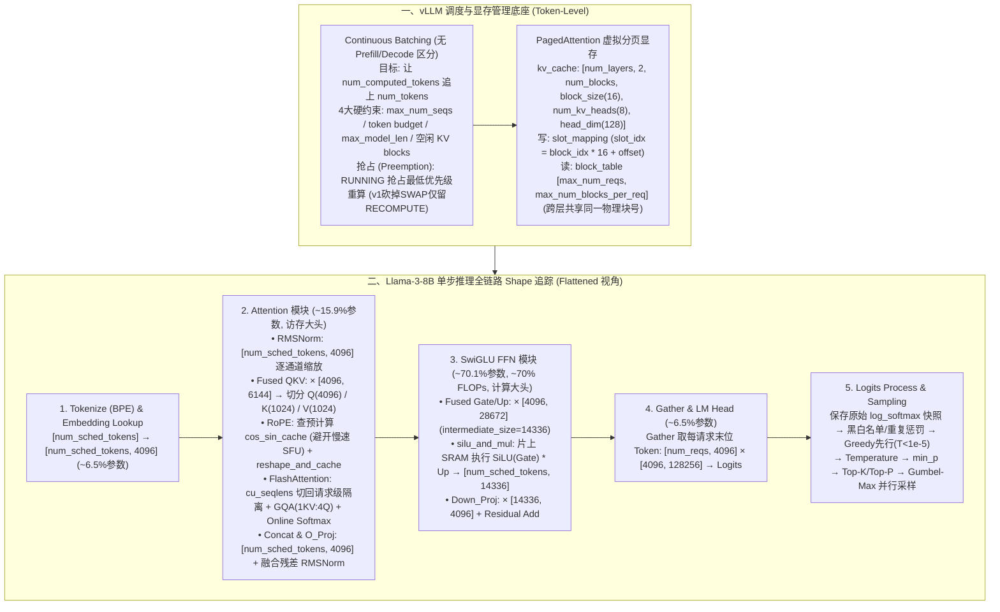

# AI Infra入门干货总结：大模型是如何高效推理的

## 1. TL;DR

1. **vLLM 两大基石：Continuous Batching 与 PagedAttention**：vLLM 调度器将批处理从 Request 级下沉至 **Token 级（Flattened 布局，彻底消除 Padding）**，不再区分 Prefill 与 Decode 阶段，单步目标仅是在四大硬约束下让 `num_computed_tokens` 追上 `num_tokens`；同时通过 `block_table`（记录请求物理块 ID）与 `slot_mapping`（定位 `slot_idx = block_idx * block_size + block_offset`）实现 `[num_layers, 2, num_blocks, block_size, num_kv_heads, head_dim]` 的虚拟分页 KV Cache，并以默认 `block_size = 16` 平衡显存碎片消除与块内合并访存（Coalesced Access）。
2. **以 Llama-3-8B 为基准的全链路张量维度（Shape）追踪**：从 `Embedding Lookup`（`[num_sched_tokens] → [num_sched_tokens, 4096]`）、`RMSNorm`（逐通道缩放）、**Fused QKV 列拼接**（`4096(Q) + 1024(K) + 1024(V) = 6144`）、**RoPE 预计算查表**（规避吞吐仅为 FP32 ALU `1/4` 的 SFU 实时计算 `sin/cos`）、`FlashAttention`（借 `cu_seqlens` 切回请求级隔离并用 `Online Softmax` 消除 $O(N^2)$ HBM 读写）、`O_Proj` 与 **融合残差 RMSNorm**，到 **SwiGLU FFN**（`Fused Gate/Up` 拼接为 `28672` 宽矩阵 + `silu_and_mul` 片上激活 + `Down_Proj`），最终经 Gather 抽取末位 Token 进入 `LM Head`（`[num_reqs, 128256]`）。
3. **Prefill vs Decode 的 Roofline 本质与权重/访存分布**：在 Llama-3-8B 中，**MLP 层占约 `70.1%` 参数量与 `~70%` FLOPs**（计算绝对大头），而 **Attention 层仅占 `~15.9%` 参数量却独占动态增长的 KV Cache**（访存带宽绝对大头）；Continuous Batching 能让 Decode 阶段的 `QKV_Proj / O_Proj / MLP` 跨请求复用权重变回 GEMM，唯独 Attention 因各请求 KV Cache 无法共享而始终受限于 $O(N)$ 访存带宽。
4. **vLLM v0→v1 架构演进与采样并行化**：vLLM v1 将 Prefill 与 Decode 统一为单次 `flash_attn_varlen_func`（全走 Paged Cache 换取对 Prefix Cache 与 Chunked Prefill 的原生支持），并在抢占（Preemption）时**彻底砍掉 `SWAP` 路径、仅保留 `RECOMPUTE`**（因 PCIe 双向搬运在大 Batch + FA 下比 Chunked 重算更贵）；采样阶段通过 **Greedy 先行（`temperature < 1e-5`）→ Temperature 缩放 → `min_p`（唯一 Argmax-invariant 处理器）→ Top-K / Top-P → Gumbel-Max 加噪并行采样** 消除词表前缀和串行依赖。

## 2. 问题定义与背景

### 2.1 生成式 LLM 推理的核心矛盾
批处理（Batching）提升 GPU 利用率的本质是 **通过跨 Token 复用模型权重来均摊 HBM 内存访问开销，从而提升算术强度（Arithmetic Intensity）**（减少 Kernel Launch 开销与利用海量 Warp 隐藏延迟仅是次要收益）。然而生成式 LLM 面临两大矛盾：
- **请求级静态批处理的步调不一致**：不同请求的输入长度与自回归生成的输出长度不可预测且差异悬殊，若按 Request 级对齐等待并填充 Padding，会导致严重的算力空转与显存浪费。
- **预分配连续 KV Cache 导致显存碎片化**：若按模型的最大序列长度（`max_model_len`）为每个请求一次性预分配物理连续的 KV Cache 显存，会产生大量内部与外部显存碎片，极易触发 OOM 并限制并发 Batch Size。

### 2.2 核心破局思路：从请求级下沉到 Token 级
1. **调度粒度下沉 → Continuous Batching**：将调度从 Request 级下沉到 Token 级，每轮推理将所有请求待计算的 Token 拼接为一维打平数组（`Flattened`，维度 `[num_sched_tokens]`），彻底消灭 Padding。
2. **显存分配下沉 → PagedAttention**：借鉴操作系统虚拟内存分页机制，按固定大小的物理块（默认 `block_size = 16`）动态按需分配 KV Cache，用 `block_table` 维护逻辑块到物理块的映射。

## 3. 知识框架

## 4. 核心内容拆解

### 4.1 Continuous Batching、抢占策略与 PagedAttention 寻址

1. **vLLM 调度器的统一视角與四大硬约束**：
   - 调度器内部**不区分 Prefill 与 Decode 阶段**，每个请求仅维护两个核心计数器：`num_computed_tokens`（已计算 Token 数，含 Prefix Cache 命中部分）与 `num_tokens`（`prompt + 已生成 output` 总数）。每步调度的唯一目标就是受限于预算让 `num_computed_tokens` 追上 `num_tokens`。
   - **四大硬约束**：① 最大并发请求数 `max_num_seqs`；② 单步 Token 预算 `max_num_scheduled_tokens`（Fallback 为 `max_num_batched_tokens`）；③ 模型最大上下文 `max_model_len`；④ 空闲物理 KV Cache Blocks 数量。
2. **抢占机制（Preemption）与 vLLM v1 砍掉 `SWAP` 的原因**：
   - **RUNNING vs WAITING 优先级法则**：`RUNNING` 请求已消耗算力与显存（有沉没成本），当 KV Block 不足时会牺牲最低优先级的 `RUNNING` 请求（释放 KV Cache、`num_computed_tokens = 0`、放回 `waiting` 队列头部，且本轮立即跳过 `WAITING` 队列调度以防恶性循环）；而 `WAITING` 请求尚无沉没成本，显存不足时直接停止调度。
   - **v0 `SWAP + RECOMPUTE` → v1 仅保留 `RECOMPUTE`**：v1 彻底废弃了 `swap_space`（GPU HBM ↔ Host RAM 搬运），因为：① 在 FlashAttention 与大 Batch 下，PCIe 双向搬运加主机内存管理开销往往**比重新算一次 Prefill 还贵**；② `Chunked Prefill` 允许被抢占请求分多步重算追赶，摊平了延迟；③ 砍掉 SWAP 使 Prefix Caching / Chunked Prefill / Continuous Batching 的架构交互大幅简化。
3. **PagedAttention 寻址公式与跨层共享设计**：
   - 全局 `kv_cache` 形状为 `[num_layers, 2, num_blocks, block_size, num_kv_heads, head_dim]`。
   - **为什么 `block_table` 和 `slot_mapping` 不含 `num_layers` 维度？** 因为同一请求的第 $k$ 个 Token 在第 `0` 层到第 `31` 层都被存储在相同编号的物理块与相同块内偏移处。
   - **具体寻址算例**：设 `block_size = 16`，请求 0 的 `block_table = [5, 8, 12]`，当前处理第 `25` 个 Token（0-indexed）：
     1. 虚拟块索引：`virtual_block_idx = 25 // 16 = 1`；
     2. 查页表得物理块 ID：`physical_block_id = block_table[0, 1] = 8`；
     3. 块内偏移：`block_offset = 25 % 16 = 9`；
     4. 最终写入槽位：`slot_idx = 8 * 16 + 9 = 137`。
   - **带宽折损 Trade-off**：跨物理块读取历史 KV 会触发非合并离散访存（Uncoalesced Access）并降低 L2 Cache 命中率；设定 `block_size = 16` 可保证单个块内 16 个 Token 物理连续（支持高效合并访存），以微小带宽折损换取消除 OOM 后的系统总吞吐大幅跃升。

### 4.2 Transformer Block 全链路计算与算子级优化（以 Llama-3-8B 为例）

1. **Embedding Lookup 与 RMSNorm**：
   - `Embedding` 将一维 Flattened 输入 `[num_sched_tokens]` 查表映射为 `[num_sched_tokens, 4096]`（本质是索引取值而非 GEMM）。
   - `RMSNorm` 相比传统 LayerNorm **砍掉了均值平移操作**，仅保留一维权重向量 `[4096]` 的逐通道尺度缩放，防止深层前向传播方差膨胀与数值溢出；在 vLLM 中，层间 `Residual Add`（残差相加）与下一层的 `RMSNorm` 被**融合成单一 CUDA Kernel**，省去中间结果读写 HBM。
2. **Fused QKV 投影与 RoPE 预计算查表（空间换算力）**：
   - **Fused QKV**：Llama-3-8B 采用 GQA（`num_heads = 32`、`num_kv_heads = 8`、`head_dim = 128`），将 $W_Q(4096) + W_K(1024) + W_V(1024)$ 按列拼接为 `[4096, 6144]` 宽矩阵执行单次 GEMM，输出切分为 Q、K、V。
   - **RoPE 规避 SFU 瓶颈**：虽然 RoPE 通过逐元素 $\sin/\cos$ 避免矩阵乘法，但超越函数在 GPU 上由 **特殊函数单元（SFU）** 执行，而 **SFU 的吞吐量通常仅为 FP32 ALU 的 `1/4`**。因此 vLLM 在引擎初始化时预先计算好 `[max_position_embeddings, rotary_dim]` 的 `cos_sin_cache`（仅占几 MB 到几十 MB 显存），运行时按 `positions` 查表做逐元素乘加，消除每次 Forward 数百万次 SFU 调用。
3. **FlashAttention：请求级隔离、Online Softmax 与 v0/v1 演进**：
   - **从 Flattened 切回请求级隔离**：除 Attention 外所有算子均可按 `[num_sched_tokens, ...]` 全局打平计算，唯独 Attention 必须在请求内部独立计算（不同请求的 KV Cache 严禁交叉）。vLLM 通过传入 **`cu_seqlens`（累积序列长度数组）**，在 CUDA 算子层确保不同请求绝不分配到同一个 Thread Block，无需物理 Reshape 即可实现变长序列隔离；GQA 广播（`1 KV Head → 4 Q Head`）也仅通过索引映射 `kv_head_idx = q_head_idx // 4` 实现零显存复制。
   - **Online Softmax 打破内存墙**：传统 Attention 需在 HBM 中落盘 $O(N^2)$ 的注意力分数矩阵 $S$ 与概率矩阵 $P$；FlashAttention 引入 **Online Softmax**（维护局部 `Running Max` 与 `Running Sum`，读入新分块时用动态缩放因子 `Rescaling Factor` 修正旧累加值），将 `Q·K^T → Scale → Causal Mask → Softmax → ×V` 融合进单个 CUDA Kernel 的片上 SRAM 分块计算中。
   - **vLLM v0 vs v1 的 Attention 路径统一**：v0 中 Prefill（直接读临时连续 HBM Buffer，不读 Paged Cache）与 Decode（走 `paged_attention_v1/v2`）分走两条独立分支；**v1 将二者统一为单次 `flash_attn_varlen_func` 调用**，Prefill 也先写入 Paged Cache 再通过 `block_table` 读取——虽多一次间接寻址，但天然支持了 **Prefix Cache** 与 **Chunked Prefill**。
4. **SwiGLU FFN 与 LM Head 的最后一层优化空间**：
   - **Fused Gate/Up + `silu_and_mul`**：将 `gate_proj` 与 `up_proj`（`intermediate_size = 14336`，约为 `hidden_size` 的 `3.5 倍`）按列拼接为 `[4096, 28672]` 执行单次 GEMM，随后由 `silu_and_mul` Kernel 在片上 SRAM 直接完成 $\text{SiLU}(\text{Gate}) \odot \text{Up}$ 点乘并输出 `[num_sched_tokens, 14336]`，最后经 `down_proj` 映射回 `4096`。
   - **LM Head 前的 Gather 与最后一层理论优化**：Prefill 阶段进入 `LM Head`（`[4096, 128256]`，通常按列切分 TP）前会执行 `Gather`，仅保留每个请求最后一个 Token（维度从 `[num_sched_tokens, 4096]` 降为 `[num_reqs, 4096]`）。作者指出：理论上 Transformer **最后一层（第 31 层）** 只需为所有 Token 计算 $K$ 和 $V$（存入 KV Cache 供后续 Decode 使用），而 $Q$ 投影、Attention、Post-Attn RMSNorm 与庞大的 MLP 理论上都只需计算最后一个 Token（vLLM 目前为保持工程统一性仍计算了全部 `query_lens`）。

### 4.3 采样流水线（Sampling）与分布式并行映射

1. **7 步采样流水线设计精髓**：
   - **快照前置**：若用户请求 `logprobs`，在任何后处理前先对原始 Logits 做一次 `log_softmax` 快照，确保返回真实模型分布。
   - **Step 1 Greedy 先行**：在除以 `temperature` 之前先算一次 `argmax` 存为 `greedy_sampled`；若全 Batch 均为 Greedy（`temperature < 1e-5`）则直接返回，避免无谓的浮点除法精度损失与后续开销。
   - **Step 2~5 缩放与截断**：依次执行 `Logits / Temperature` → **`min_p` 过滤**（唯一 Argmax-invariant 处理器，淘汰概率低于 $\text{min\_p} \times p_{\max}$ 的词，模型确定时如 $p_{\max}=0.9, \text{min\_p}=0.1$ 阈值为 `0.09` 砍得多，模型不确定时如 $p_{\max}=0.08$ 阈值为 `0.008` 保留探索空间）→ `Top-K` → `Top-P`。
   - **Step 6~7 Gumbel-Max 并行采样**：用 `probs.div_(q.exponential_()).argmax(dim=-1)` 替代传统轮盘赌（需串行计算词表前缀和），将采样转化为完全独立的 Element-wise 并行运算；最后通过 `where(temperature < 1e-5, greedy_sampled, random_sampled)` 合并输出。
2. **张量并行（TP）与长上下文切分全景对标**：
   - **TP 切分法则**：`Fused QKV` 与 FFN `Fused Gate/Up` 采用 **列切分（Column Parallelism）**；`O_Proj` 与 FFN `Down_Proj` 采用 **行切分（Row Parallelism）** 并在末尾执行一次跨卡 `AllReduce`。
   - **长上下文三大技术分工**：**Chunked Prefill** 解决超长 Prompt 阻塞正在运行的 Decode 请求（降低 ITL 抖动）；**Flash-Decoding（Split-K）** 沿 KV 序列维度切块并行计算，解决 Decode 阶段 `query_lens = 1` 导致 GPU SM 利用率不足的问题；**Sequence Parallelism（SP）** 解决单卡显存塞不下超长 KV 上下文的问题（Flash-Decoding 与 SP 均依赖 `Log-Sum-Exp` 实现跨 SM 或跨卡归约）。

## 5. 数据速查表

| 指标 | 原文数值 | 语境 / 条件 |
| :--- | :--- | :--- |
| **PagedAttention 默认块大小（`block_size`）** | `16` 个 Token / Block | 块内 16 个 Token 物理显存连续，兼顾消除显存碎片与合并访存效率 |
| **GPU SFU（特殊函数单元）吞吐比例** | 仅为 FP32 ALU 的 `1/4` | 解释为何 vLLM 不在 RoPE Kernel 中实时算 `sin/cos`，而改用几 MB 预计算 `cos_sin_cache` 查表 |
| **Llama-3-8B 核心架构超参数** | `layers=32`, `hidden=4096`, `q_heads=32`, `kv_heads=8`, `head_dim=128` | GQA 分组比 `4:1`（`kv_channels = 1024`，`Fused QKV = 6144`），`rope_theta = 500000.0` |
| **Llama-3-8B FFN 与词表维度** | `intermediate_size = 14336`，`Fused Gate/Up = 28672`，`vocab_size = 128256` | FFN 升维约为 `hidden_size` 的 `3.5 倍`（经典 Transformer 为 `4 倍` 或 `8/3 倍`） |
| **Llama-3-8B 各模块参数量与计算占比** | MLP `~70.1%`（FLOPs `~70%`）、Attention `~15.9%`、Embedding `~6.5%`、LM Head `~6.5%`、Norm `<0.01%` | MLP 是计算与静态参数绝对大头（促生 MoE）；Attention 是动态 KV 访存绝对大头（促生 MLA/FA） |
| **Greedy 采样判定温度阈值** | `temperature < 1e-5`（`0.00001`） | 低于该阈值直接走 Step 1 `greedy_sampled`，跳过除法与随机采样 |
| **`min_p` 自适应截断算例阈值** | `min_p = 0.1` 时：$p_{\max}=0.9 \Rightarrow 0.09$；$p_{\max}=0.4 \Rightarrow 0.04$；$p_{\max}=0.08 \Rightarrow 0.008` | 根据模型当前分布确定性动态收放候选集宽度，且最高概率 Token 永不被砍 |

## 6. 踩坑与教训 / 可迁移的设计原则

| 错误做法 | 失败表现或原因 | 原文应对（可迁移的设计原则） |
| :--- | :--- | :--- |
| **按 `[batch_size, max_seq_len]` 规整三维张量填充 Padding 执行批处理推理** | 短请求被迫陪跑长请求，Padding 消耗大量无效 FLOPs，且按最大长度预分配 KV Cache 极易 OOM | **Flattened 一维 Token 布局 + PagedAttention**：全局打平为 `[num_sched_tokens, hidden_size]` 消除 Padding，仅在进入 FlashAttention 时用 `cu_seqlens` 逻辑隔离各请求 |
| **在每个 RoPE CUDA Kernel 中直接调用硬件 `sinf() / cosf()`** | 超越函数挤占吞吐仅为 FP32 ALU `1/4` 的 SFU 单元，成为高频算子瓶颈 | **空间换算力（预计算 `cos_sin_cache`）**：初始化时生成 `[max_position_embeddings, rotary_dim]` 缓存表（仅数 MB），Kernel 运行时按位置索引转化为普通乘加 |
| **分別启动 3 次独立 GEMM 计算 Q、K、V 或 2 次 GEMM 计算 Gate、Up** | 矩阵偏瘦无法跑满 Tensor Core，且多次 Kernel Launch 与重复读取输入激活值 $X$ 浪费显存带宽 | **同输入算子列拼接融合（Fused QKV & Fused Gate/Up）**：加载权重时按列拼接为宽矩阵执行单次 GEMM，并在片上 SRAM 直接融合 `silu_and_mul` 或 `Residual + RMSNorm` |
| **在显存不足发生抢占（Preemption）时盲目把 KV Cache Swap 到 CPU 内存** | 在 FlashAttention + 大 Batch 下，PCIe 双向拷贝耗时与 Host RAM 维护成本往往高于直接重算 Prefill | **vLLM v1 精简为纯 `RECOMPUTE` + Chunked Prefill**：直接释放被抢占请求的 GPU Blocks，依靠分块 Prefill 在后续步骤平滑追赶，且抢占当步暂停调度 `WAITING` 队列防雪崩 |
| **在采样阶段先对所有请求除以 `temperature` 再判断 Greedy，或用传统前缀和轮盘赌采样** | Greedy 请求除以极小温度会造成浮点精度损失甚至除零；12.8 万词表上串行前缀和严重拖慢采样延迟 | **Greedy 前置快照 + Gumbel-Max 加噪并行化**：缩放前先算 `argmax`；随机采样改用指数分布加噪求 `argmax`，化串行前缀和为 Element-wise 完全并行 |

## 7. 记忆锚点

- **“70% 参数在 MLP 催生了 MoE，16% 参数在 Attention 催生了 MLA 与 FlashAttention”**：一张 Llama-3-8B 权重占比表道破大模型架构演进的两条主线——拆解 `70.1%` 的 FFN 算力大头就是稀疏专家（MoE），压缩 `15.9%` Attention 背后的动态 KV Cache 带宽就是 PagedAttention / FlashAttention / MLA。
- **“全局打平算线性层，`cu_seqlens` 隔离算 Attention，末位 Gather 算 LM Head”**：记住这三个张量维度跳变点（`[num_sched_tokens, 4096]` ↔ `cu_seqlens` 请求级 ↔ `[num_reqs, 4096]`），就彻底看懂了 vLLM 源码的数据流骨架。
- **“三个经典软硬协同 Trick：SFU 慢就查 RoPE 表、HBM 慢就跑 Online Softmax、轮盘赌串行就换 Gumbel-Max”**：全链路处处体现根据 GPU 硬件微架构（SFU 吞吐 `1/4`、SRAM vs HBM 带宽差、Element-wise 并行度）重构数学公式的 AI Infra 思维。

## 8. 复习卡片

1. 在 vLLM 调度器视角下，是如何统一处理 Prefill 和 Decode 的？单步调度受哪 4 个硬性约束限制？::vLLM 调度器不区分 Prefill 和 Decode，每个请求只维护 `num_computed_tokens`（已计算数）和 `num_tokens`（总拥有数），每步目标是在约束下让前者追上后者；受限于 4 个硬约束：最大并发请求数 `max_num_seqs`、单步最大调度 Token 预算 `max_num_scheduled_tokens`、模型最大序列长度 `max_model_len` 以及空闲 KV Cache Blocks 数量。
2. 在 PagedAttention 中，为什么 `block_table` 和 `slot_mapping` 不需要 `num_layers` 维度？若 `block_size=16`、`block_table=[5, 8, 12]`，第 25 个 Token 的 `slot_idx` 如何计算？::因为同一个请求的某个 Token 在模型第 0 层到最后一层都存储在相同编号的物理块和相同的块内偏移位置；第 25 个 Token 的虚拟块索引为 `25 // 16 = 1`，查 `block_table` 得物理块 ID 为 `8`，块内偏移为 `25 % 16 = 9`，因此 `slot_idx = 8 * 16 + 9 = 137`。
3. 为什么 vLLM 不在 RoPE Kernel 中实时计算 `sin` 和 `cos`，而是预计算 `cos_sin_cache`？::因为 `sin/cos` 属于超越函数，在 GPU 上必须由 SM 内的特殊函数单元（SFU）执行，而 SFU 的吞吐量通常只有 FP32 ALU 的 `1/4`；预计算一张几 MB 到几十 MB 的 `cos_sin_cache` 查找表，在运行时按 `positions` 索引转化为逐元素乘加，是用极小显存空间换取算力的经典优化。
4. 为什么其他层都可以按 `[num_sched_tokens, ...]` 全局打平计算，唯独进入 FlashAttention 时必须切回请求级视角？vLLM 是如何实现这种隔离的？::因为不同请求的 KV Cache 严禁互相交叉注意，Attention 必须在单个请求内部独立进行；vLLM 无需将张量物理 Reshape 加 Padding，而是传入累积序列长度数组 `cu_seqlens` 与 `block_table`，在 CUDA 算子层确保不同请求不会被分配到同一个 Thread Block。
5. vLLM v1 相比 v0 在 Attention 调用路径和抢占（Preemption）策略上做了哪两项重大简化，原因是什么？::① Attention 路径上，v1 将 Prefill 和 Decode 统一为单次 `flash_attn_varlen_func` 调用且全部读写 Paged KV Cache，以多一次间接寻址的微小代价换取对 Prefix Cache 和 Chunked Prefill 的天然支持；② 抢占策略上，v1 彻底砍掉了 `SWAP`（搬至 CPU 内存）仅保留 `RECOMPUTE`，因为大 Batch 与 FlashAttention 下 PCIe 双向搬运比配合 Chunked Prefill 重算更昂贵。
6. 在 Llama-3-8B 中，MLP 层和 Attention 层的参数量占比分别是多少？为什么说 Continuous Batching 能把 Decode 阶段的 MLP 变回计算密集型，却救不了 Attention 的访存瓶颈？::MLP 层参数量占约 `70.1%`（FLOPs 也占约 `70%`），Attention 层参数量仅占约 `15.9%`；Decode 阶段通过 Continuous Batching 可让多个请求的 Token 共享并复用同一份 MLP/QKV/O_Proj 模型权重，从而将 GEMV 变回高算术强度的 GEMM；但每个请求的 KV Cache 是独占且随上下文长度 $N$ 线性增长的，无法跨请求共享，因此 Decode 阶段的 Attention 始终是访存密集型（Memory-bound）。
7. vLLM 采样器中的 `min_p` 和 `Gumbel-Max` 分别解决了什么问题？::`min_p` 是唯一的 Argmax-invariant 处理器，按最高概率词的 `min_p` 倍设定动态淘汰阈值，实现模型确定时严选、不确定时保留探索空间的自适应截断；`Gumbel-Max` 通过对概率除以指数分布随机数后直接求 `argmax`，替代了传统轮盘赌采样所需的词表串行前缀和计算，实现超大词表（如 128,256）上的完全 Element-wise 并行采样。
8. 在长上下文推理中，Chunked Prefill、Flash-Decoding 和 Sequence Parallelism (SP) 都是对序列进行切分，它们各自解决的核心问题有什么不同？::Chunked Prefill 将超长 Prompt 分块调度，避免新来的长请求长时间阻塞正在运行的 Decode 请求；Flash-Decoding 在 Decode 阶段沿历史 KV 维度切块（Split-K），解决 `query_lens=1` 时并行度不足导致的 GPU SM 闲置问题；Sequence Parallelism (SP) 将长序列切分到多张 GPU 卡上，解决单卡显存容量塞不下超长 KV 上下文的问题。

## 9. 知识关联

- **本仓库主题索引**：[大模型推理与算子优化](../../20_topics/%E5%A4%A7%E6%A8%A1%E5%9E%8B%E6%8E%A8%E7%90%86%E4%B8%8E%E7%AE%97%E5%AD%90%E4%BC%98%E5%8C%96.md)
- **候选双链概念**：[[Continuous-Batching]] · [[PagedAttention]] · [[FlashAttention与Online-Softmax]] · [[Gumbel-Max并行采样]] · [[张量并行与序列并行]]

## 10. 原文参考资料

1. Vaswani et al., *Attention Is All You Need* (2017).
2. Kwon et al., *Efficient Memory Management for Large Language Model Serving with PagedAttention* (vLLM, SOSP 2023).
3. Yu et al., *Orca: A Distributed Serving System for Transformer-Based Generative Models* (OSDI 2022).
4. Dao et al., *FlashAttention / FlashAttention-2 / FlashAttention-3 / FlashAttention-4* 系列论文，以及 *Flash-Decoding for long-context inference*.
5. Agrawal et al., *SARATHI: Efficient LLM Inference by Piggybacking Decodes with Chunked Prefills*.
6. Williams et al., *Roofline: an insightful visual performance model for multicore architectures*；Gholami et al., *AI and Memory Wall*.

> [!note]- 校对报告
> - **校对状态**：已按原文逐页核对通过（共 27 页 PDF，其中 p.22、p.27 为空白页）。
> - **核心数据与页码溯源**：
>   - 2 个月业余时间精读 vLLM 源码、Decoder-Only 架构、Llama 3 示例、Request level → Token level（Continuous Batching 与 PagedAttention）：见 `p.1–2`。
>   - `num_computed_tokens` 与 `num_tokens`、4 个硬性调度约束（`max_num_seqs`、`max_num_scheduled_tokens / max_num_batched_tokens`、`max_model_len`、空闲 KV blocks）及 Flattened 数组：见 `p.3–4`。
>   - PagedAttention `kv_cache` 维度、`block_table` 与 `slot_mapping` 不含 `num_layers` 的原因、`block_size = 16` 下第 25 个 Token 寻址算例（`slot_idx = 8 * 16 + 9 = 137`）及 Uncoalesced Access 权衡：见 `p.4–5`。
>   - BPE 分词、Embedding Lookup（`[num_sched_tokens, hidden_size]`）、RMSNorm、Fused QKV（`4096 + 1024 + 1024 = 6144`）、RoPE 预计算 `cos_sin_cache`（SFU 吞吐仅为 FP32 ALU 的 `1/4`）：见 `p.5–9`。
>   - FlashAttention 请求级隔离（`cu_seqlens`）、GQA 索引映射（`1 KV Head : 4 Q Head`）、Online Softmax（Running Max / Running Sum / Rescaling Factor）及 vLLM v0 vs v1 `flash_attn_varlen_func` 路径演进：见 `p.9–11`。
>   - Prefill（Compute-bound）vs Decode（Memory-bound）本质对比、Multi-Head Concat、`O_Proj`、Residual Add + RMSNorm 融合、Fused Gate/Up（`intermediate_size` 4 倍或 8/3 倍）、`silu_and_mul`、`Down_Proj`：见 `p.12–14`。
>   - LM Head 前的 Gather、最后一层（Last Layer）只算末位 Token 的理论分析、`vocab_size = 128256`：见 `p.15`。
>   - Logprobs 快照、Logits Process（JSON Schema bitmask、Repetition Penalty）及 7 步采样流程（`temperature < 1e-5` Greedy 先行、`min_p` 自适应阈值算例 `0.09 / 0.04 / 0.008`、Top-K/Top-P、Gumbel-Max 并行采样）：见 `p.15–18`。
>   - TP 列切分/行切分、Chunked Prefill / Flash-Decoding / SP 对比、附 1~3 Llama-3-8B 参数与权重占比表（MLP `~70.1%`、Attention `~15.9%`、Embedding `~6.5%`、LM Head `~6.5%`、Norm `<0.01%`）及附 4 抢占策略（v0 SWAP + RECOMPUTE → v1 仅保留 RECOMPUTE）：见 `p.18–25`。
