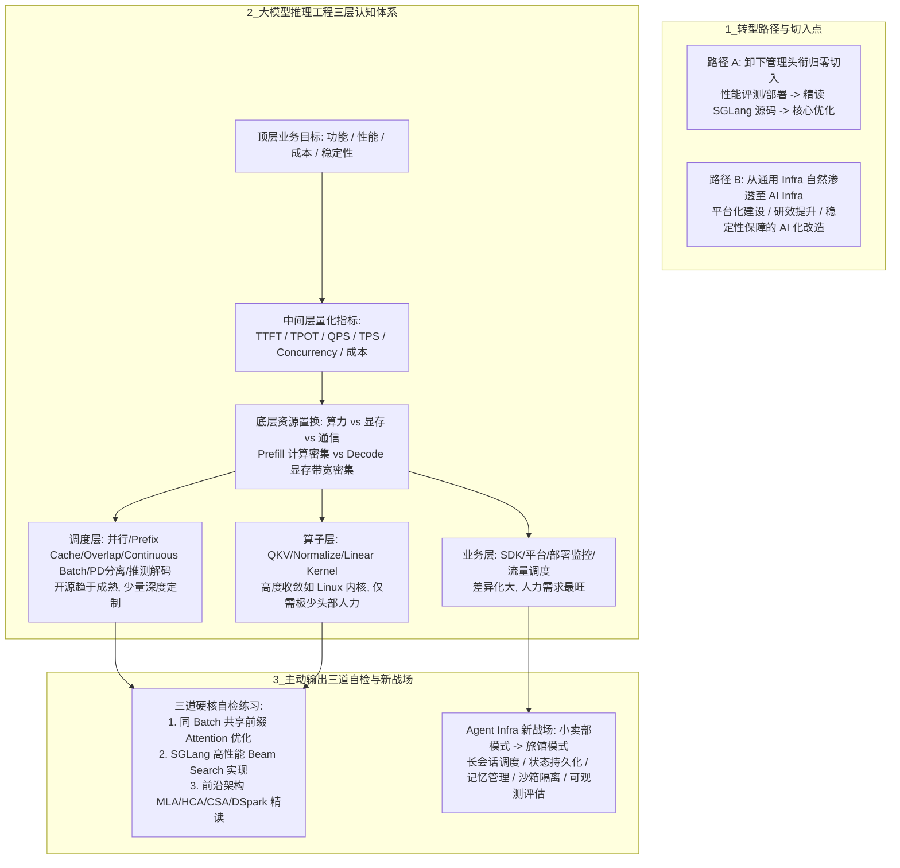

# 腾讯15年资深后台工程师，转战大模型推理的抉择

## 1. TL;DR

本文由一名拥有 15 年后台研发经验（腾讯 T12 资深搜索后台工程师）的技术管理者撰写，系统复盘了其在 2025 年初卸下管理头衔、归零转战大模型推理工程团队的认知路径与实战总结。全文围绕三条主线展开：一是**技术管理者的破局抉择**（在“沦为脱离细节的职业经理人”与“全情投入核心底座技术”之间选择贴近 AI 算力底座，或从通用 Infra 自然渗透至 AI Infra）；二是**大模型推理工程的“先总后分”入门体系与三道硬核自检题**（以算力、显存、通信三者权衡为核心，建立业务层/调度层/算子层三层视图，并通过同批次共享前缀 Attention 优化、SGLang 高性能 Beam Search 实现与前沿架构阅读检验真实掌握度）；三是**通用 Infra 与 AI / Agent Infra 的同源与分野**（剖析 PagedAttention 与虚拟内存等系统思想继承，指出“越底层越收敛、越上层需求越旺”的分层规律，并提出从无状态“小卖部模式”向长会话有状态“旅馆模式”演进的 Agent Infra 是传统后台工程师发挥系统功底的最佳新战场）。

## 2. 核心概念

- **大模型推理工程的核心矛盾（算力 / 显存 / 通信权衡）**：大模型推理并非单纯的模型包装部署，而是受硬件约束的复杂系统工程——**Prefill 阶段是计算密集型，Decode 阶段是显存带宽密集型**；KV Cache、Continuous Batch、Prefix Cache、TP（张量并行）等核心技术，本质都是在算力、显存与通信之间做资源置换，以最低成本换取更高吞吐与更低时延。
- **推理工程三层架构（业务层 / 调度层 / 算子层）**：将支撑核心指标（TTFT、TPOT、QPS、TPS、Concurrency、成本）的实现手段划分为对上对接的**业务层**（SDK、平台、部署监控、流量调度）、决定核心运行时性能的**调度层**（分布式并行、Prefix Cache、Overlap Scheduler、Continuous Batch、Chunked Prefill、Speculative Decoding）和聚焦单点计算性能的**算子层**（QKV、Normalize、Linear）。
- **同批次共享前缀注意力优化（Intra-Batch Shared Prefix）**：不同于跨请求/跨批次的 Prefix Cache，针对同一 Batch 内多个请求带有相同公共前缀（如推荐打分场景中的 `user_info + doc_N`），在 Attention Kernel 与 KV Cache 层面避免对公共前缀重复做 Prefill 计算与重复显存写入。
- **小卖部模式（传统 API 服务）vs 旅馆模式（Agent 服务）**：传统后台 API 服务是“短请求、无状态、耗时极低、即调即走、资源即时释放”的小卖部模式；而 Agent 服务是“多轮交互、长耗时、有状态、长生命周期、会话持续驻留且频繁调用记忆与外部工具”的旅馆模式。

## 3. 知识框架

以下流程图按正文整理，展示作者从转型路径选择、大模型推理三层技术体系、三道自检练习到 AI / Agent Infra 演进判断的整体框架：

## 4. 关键要点与机制详解

### 4.1 资深工程师与管理者的两条 AI 切入路径

**核心主张**：面对工业革命级的技术浪潮，技术管理者若不愿退化为只靠信息差生存、答不出技术细节的“挂名经理人”，要么卸下包袱归零钻研底层核心，要么以通用 Infra 的系统功底为支点向 AI Infra 渗透。

- **为什么选择大模型推理工程作为切入点**
  - 两三年前搜索产品虽贴近大模型应用，但内部召回、排序仍大量沿用传统技术，且多轮对话、长上下文、Agent Runtime 的上层产品形态尚在迷雾中；而**算力与推理加速底座**无论上层产品如何演进都不可或缺。
- **两条可行的转型路径对比**
  1. **路径一（作者亲历的归零重来路线）**：在组织合并与“以事为先”契机下卸下高阶管理头衔，先用 3 个月独立代码重构摸清主链路，进入推理团队后从性能评测、服务部署等周边琐事做起，同步精读 `SGLang`、`nano-vLLM`、`mini-sglang` 源码，再切入核心特性研发（如将高性能 Beam Search 贡献合入 `SGLang v0.5.19`）。
  2. **路径二（通用 Infra 自然渗透路线）**：AI Infra 绝不等同于单纯的 GPU 算子加速，其背后高度依赖平台化建设、CI/CD 研效提升、容量规划与高可用稳定性保障；资深后台工程师从熟悉的通用基础设施入手做“AI 化改造”，是一条无需推倒重来的顺畅演进路线。

### 4.2 大模型推理工程“先总后分”的四步入门体系

**核心主张**：攻克大模型推理工程应遵循“模型结构认知 → 推理评估与三层架构 → 算法与工程协同趋势 → 高 ROI 细分方向深挖”的四步法，透过源码和 Demo 发现微观性能暗礁。

- **第一步：对模型结构建立体系化认知**
  - 掌握 Transformer 核心组件（Embedding、Attention、FFN、Normalize、Residual、LM Head）并能画出结构简图；理解感知机、多层网络、梯度下降、反向传播、CNN/RNN/Seq2Seq/Attention 演进脉络（作者推荐结合《深度学习入门：基于 Python 的理论与实现》《深度学习进阶：自然语言处理》《深度学习革命》系统补齐）。
- **第二步：明确推理评估指标与三层工程架构**
  - 先立住两个锚点：“要解决什么问题”与“用什么指标评估”（核心指标为 **TTFT、TPOT、QPS、TPS、Concurrency 与成本**）。
  - 理解业务层、调度层、算子层的职责边界（规模较小的团队无需机械切分，可跨层工作），并通过精读轻量级实现 `nano-vLLM`、`mini-sglang` 掌握 Prefix Cache、Overlap Scheduler 等机制的代码落地。
- **第三步：看懂算法创新与工程优化融合的模型演进趋势**
  - 大模型演进本质上是一门“实验科学”（当创新点子变得廉价，决定成败的是 Infra 能否更快更好地完成实验验证）。
  - 从 `Full Attention + Dense FFN` 演进到稀疏注意力、线性注意力、混合架构、MoE，以及 Pre-Norm、RoPE、MLA、KV Cache 跨层复用，核心动机都是在提升智能的同时**大幅降低计算复杂度、压缩显存占用（如 KV Cache 从 305 GB 压至 7.4 GB）以适配长上下文与高吞吐**。典型代表如 DeepSeek 的注意力层 MLA、HCA、CSA 设计与 DSpark 推测解码。
- **第四步：深挖三个高投入产出比（高 ROI）的细分方向**
  1. **Prefill / Decode（PD）分离**：将计算密集的 Prefill 与显存带宽密集的 Decode 解耦部署，显著提升整机吞吐与卡资源利用率（开源虽有实现，但结合自身业务流量特征调至最佳性能极具挑战）。
  2. **分布式 KV Cache**：面向多轮交互与长上下文场景，大幅提高跨机 Prefix Cache 命中率、削减重复计算。
  3. **推测解码（Speculative Decoding）**：如 DSpark 架构，利用 Decode 阶段算力未饱和（受限于显存带宽）的特点，用小成本草稿验证换取系统吞吐大幅提升。
  4. **微观机制深挖反例（Overlap Scheduler 的暗礁）**：顺着底层执行链路写 Demo 深挖会发现，在特定约束下，旨在隐藏 CPU 调度开销的 **Overlap Scheduler 反而可能破坏 Continuous Batch 的批处理效率**。

### 4.3 摆脱“虚假掌握感”的三道硬核自检练习

**核心主张**：在 AI 随手能生成概念解释的今天，唯有通过“同批次共享前缀优化、工业级 Beam Search 落地、前沿论文独立拆解”三道主动输出练习，才能检验是否真正打通了算法、算子与显存管理。

| 自检练习题                               | 典型业务场景与问题定义                                                                                                                                        | 必须融会贯通的底层技术点                                                                                                                                                                                                                                                                                   |
| ----------------------------------- | -------------------------------------------------------------------------------------------------------------------------------------------------- | ---------------------------------------------------------------------------------------------------------------------------------------------------------------------------------------------------------------------------------------------------------------------------------------------- |
| **练习 1：同批次（Intra-Batch）共享前缀的注意力优化** | 个性化推荐文档打分中，同一 Batch 内多个请求形如 `user_info + doc_N`（如请求 1 为 `[a,b,c,1,2,3]`，请求 2 为 `[a,b,c,4,5,6]`），如何避免对公共前缀 `[a,b,c]` 重复做 Prefill 计算与 KV Cache 重复写入？ | ① 深刻理解因果掩码（Causal Mask）构造 ② 代码层熟练掌握 KV Cache 申请与使用 ③ 理解 FlashAttention / FlashInfer 等主流 Attention Kernel 接口设计 ④ 了解 GPU Thread Block 并行特点，并处理与个性化模型结构/业务系统的工程嵌合                                                                                                                     |
| **练习 2：推理引擎中的高性能 Beam Search 工程实现** | 搜广推生成式推荐（如快手 OneRec）中，每步保留多条候选子路径，按整条路径累积对数概率（`logprob`）排序保留前 `Beam Width` 条迭代，直至选出最佳路径                                                            | ① **KV Cache 复用**：同一请求扩散出的多条子路径如何高效共享前缀 KV Cache ② **高效率剪枝**：当 `Beam Width` 很大（如 `BW=1024`）时，需从 `1024 × Vocabulary Size` 个候选中统一计算筛选出最佳 1024 个，计算量极大 ③ **约束解码**：推荐场景限制只能生成合法 `DocID`，每步如何做高性能词表约束 ④ **框架解耦**：如何避免相对小众的 Beam Search 成为主流 Greedy 解码迭代的负担（作者实现最终重构合入 `SGLang v0.5.19`） |
| **练习 3：独立读懂前沿大模型技术论文与架构分析**         | 不依赖浅层二手摘要，直接阅读前沿模型结构与推理优化报告                                                                                                                        | 能够独立看懂 HCA / CSA、混合架构、DSpark 等技术论文或深度架构拆解的基本原理与工程取舍                                                                                                                                                                                                                                            |

### 4.4 通用 Infra 与 AI / Agent Infra 的同源、分野与人力格局

**核心主张**：AI Infra 的系统思想大量继承自传统 CPU 系统工程；随着算子与开源调度引擎收敛，“底层标准化、上层差异化”使业务层定制与“旅馆模式”的 Agent Infra 成为传统后台工程师真正的主战场。

- **同源：传统系统工程思想向 GPU 推理的直接映射**
  - 仅懂 `vLLM / SGLang` 只能搭出 Demo；一旦用户规模增长，流量预估、容量规划、机房集群规划、风险隔离、CI/CD、容器调度、全链路可观测及有状态/无状态边界划分全靠传统 Infra 底座支撑。
  - 核心推理技术均可在传统系统工程中找到源头：

| AI Infra 核心技术          | 对应的传统通用 Infra 系统思想    | 机制同构性说明                                                          |
| ---------------------- | --------------------- | ---------------------------------------------------------------- |
| **PagedAttention**     | **操作系统虚拟内存与页表管理**     | 将逻辑上连续的 KV Cache 切分为固定大小的页块，通过块表（Block Table）映射到物理上离散的显存页，消除显存碎片 |
| **TP / CP 等模型分布式并行**   | **传统分布式计算拆分与负载均衡**    | 拆分大规模矩阵计算、分摊单机显存与算力负载                                            |
| **CUDA Stream 多流机制**   | **CPU 多线程并发与异步流水线**   | 通过多流并发实现计算与数据传输重叠                                                |
| **分布式 KV Cache 分片与淘汰** | **分布式存储系统的分片与生命周期管理** | 跨节点缓存路由、冷热淘汰与一致性治理                                               |

- **分层人力需求规律：越往底层需求越少，越往上层需求越多**
  - **算子层（人力需求极少）**：模型结构与硬件生态趋于收敛，新算子适配类似 Linux 内核迭代，虽全行业复用价值极高，但仅需极少数头部团队维护。
  - **推理引擎调度层（人力需求有限）**：通用调度能力已被 vLLM / SGLang 等开源生态成熟覆盖，仅少数强业务绑定场景需定制。
  - **业务层与 Agent Infra（人力需求最旺盛）**：结合业务场景的链路打磨、稳定性保障，以及千差万别的 Agent 运行时基础设施（从科研万级 Agent 求解 NS 方程到海量个人轻量表格 Agent），是传统后台工程师发挥架构功底与代码品味（规避 AI 生成代码的混乱与冗余）的主战场。
- **分野：从传统 API“小卖部模式”到 Agent Infra“旅馆模式”的范式重构**

| 对比维度            | 传统后台 API 服务（“小卖部模式”） | Agent 时代基础设施（“旅馆模式”）                         |
| --------------- | -------------------- | -------------------------------------------- |
| **交互与生命周期**     | 短请求、即调即走、耗时极低        | 多轮交互、长耗时、长生命周期、会话持续驻留                        |
| **状态与资源模型**     | 无状态为主，请求结束资源即时释放     | **强有状态**，状态频繁变更，需跨轮次持有外部资源                   |
| **核心外部依赖**      | 常规微服务 RPC 与数据库读写     | 依托长短记忆存储、动态工具调用、沙箱环境交互完成闭环                   |
| **全新 Infra 挑战** | 常规高并发负载均衡与无状态扩缩容     | **长会话调度、状态持久化、长短记忆管理、工具沙箱隔离、Agent 可观测与效果评估** |

## 5. 数据速查表

| 指标 / 事件节点 | 原文数值 | 语境 / 条件 |
|---|---|---|
| 作者背景与转型时间线 | 15 年研发经验；2016 年入职腾讯；2022 年凭搜索中台晋升 T12；2024 年团队合并并耗时 3 个月独立重构主链路；2025 年初转入大模型推理工程团队（前 3 个月做评测部署并精读 SGLang 源码） | 作者个人职业转型时间轴 |
| KV Cache 架构演进对比示例 | 从 $305\text{ GB}$ 降至 $7.4\text{ GB}$ | 原文推荐阅读《从 305 GB 到 7.4 GB：大模型 KVCache 架构演进全景》提及的显存压缩幅度 |
| Beam Search 大宽度剪枝规模示例 | 当 `Beam Width = 1024` 时，每步需从 $1024 \times \text{Vocabulary Size}$ 个候选中筛选最佳 $1024$ 个 | 搜广推生成式推荐（如 OneRec）场景下的高并发剪枝计算瓶颈 |
| SGLang Beam Search 贡献合入版本 | `SGLang v0.5.19` | 官方开发者基于作者实现的高性能 Beam Search 分支重构融合后合入的版本 |
| 科研级多 Agent 调度规模示例 | 万级 Agent | 原文提及 OpenAI 在科研场景调度万级 Agent 求解 NS（Navier-Stokes）方程 |

## 6. 踩坑与教训 / 可迁移的设计原则

### 常见踩坑与应对

| 错误做法 | 失败表现或原因 | 原文应对策略 |
|---|---|---|
| **顶着高阶管理头衔浅尝辄止地学新技术，或挂名汇报** | 精力分散导致技术学习流于表面、管理水平也滑坡，在问答环节答不出具体实现细节 | 面对重大技术变革，要么彻底卸下管理包袱归零扎进源码与一线研发，要么聚焦通用 Infra 的 AI 化改造做实项目贡献 |
| **只靠 AI 问答被动输入，不看源码也不写 Demo 验证** | 陷入“看时全都会，做时全不会”的虚假掌握感，发现不了微观机制冲突（如 Overlap Scheduler 在特定约束下破坏 Continuous Batch 效率） | 先通过经典书籍建立体系，再精读 `nano-vLLM`、`mini-sglang`、`SGLang` 源码，并用独立 Demo 和三道自检题做主动输出验证 |
| **误以为掌握 `vLLM / SGLang` 就等于能交付生产级推理服务** | 系统停留在 Demo 阶段，面对大规模真实流量时在容量规划、故障隔离、发布回滚与可观测性上全面失守 | 用传统分布式 Infra 体系（流量预估、集群规划、CI/CD、全链路可观测、有状态/无状态拆分）托底推理引擎 |
| **在引擎中实现小众定制功能（如推荐 Beam Search）时侵入主流路径** | 破坏主流 Greedy 解码的代码整洁度与迭代效率，成为框架长期维护负担 | 注意与推理框架解耦，在高效复用 KV Cache 与词表约束的同时，避免小众功能拖累主流解码主干 |
| **招聘与团队建设只迷信算子/训推背景，低估传统后台工程师** | 算子与通用调度层需求高度收敛，而真正缺人的业务层适配与 Agent Infra 缺乏扎实系统架构把控，且易被 AI 生成的劣质代码腐蚀架构 | 重视传统后台工程师的系统设计功底与代码品味，引导其将 CPU 分布式/存储/OS 思维迁移至业务层优化与 Agent Infra 建设 |

### 可迁移的设计原则

- **“先问目标与评估体系，再看组件”的领域拆解法**：进入任何复杂技术新领域（如大模型推理），第一步不是背诵零散名词，而是先立住顶层目标（功能、性能、成本、稳定性）和中间层量化标尺（TTFT、TPOT、QPS、TPS、Concurrency、成本），再把底层一切花哨技术（PD 分离、MLA、推测解码）还原为“算力、显存、通信三者之间的资源置换”。
- **顺着“底层收敛、上层分化”的产业规律配置工程精力**：当底层算子与通用调度已被开源社区标准化后，工程团队的高价值产出点必然上移到强业务耦合的推理定制（如同批次共享前缀、受限词表 Beam Search）以及长生命周期、强状态的“旅馆模式” Agent Infra。

## 7. 记忆锚点

- **原文推理本质锚点**：“Prefill 阶段是计算密集型，Decode 阶段是显存带宽密集型；围绕评估指标在系统层面做的每一项优化，都可以归纳为算力、显存、通信三者之间的资源置换。”
- **服务范式演进锚点（原文比喻）**：“传统 API 服务是‘小卖部模式’（短请求、无状态、即调即走）；Agent 服务是‘旅馆模式’（多轮交互、长耗时、有状态、会话持续驻留）。”

## 8. 复习卡片

大模型推理工程在 Prefill 与 Decode 两个阶段的硬件瓶颈有何不同，核心系统优化的本质是什么？::Prefill 阶段属于计算密集型，Decode 阶段属于显存带宽密集型；围绕 TTFT、TPOT、QPS、TPS、Concurrency 与成本所做的一切优化（如 KV Cache、Continuous Batch、Prefix Cache、TP），本质都是在算力、显存、通信三者之间做资源置换。
作者将大模型推理工程的实现手段划分为哪三层，各层的人力需求呈现什么规律？::划分为业务层（SDK、平台、部署监控、流量调度）、调度层（分布式并行、Prefix Cache、Continuous Batch、PD 分离、推测解码等）和算子层（QKV、Normalize、Linear）；人力需求呈“底层标准化、上层差异化”特征——算子层高度收敛需求极少，通用调度层多由开源覆盖需求有限，而业务层定制与 Agent Infra 人力需求最旺盛。
为什么说大模型结构演进与推理 Infra 深度耦合，当前模型结构演进的核心动机是什么？::因为从 Full Attention + Dense FFN 走向稀疏/线性注意力、MoE、MLA、HCA/CSA 及 KV Cache 跨层复用，核心动机都是在提升智能的同时大幅降低计算复杂度与显存占用以适配长上下文和高吞吐；同时大模型结构演进是实验科学，点子廉价而快速验证昂贵，高度依赖前瞻性 Infra 支撑。
为什么推测解码（Speculative Decoding）和 PD 分离能提升推理系统吞吐与资源利用率？::PD 分离将计算密集的 Prefill 与显存带宽密集的 Decode 解耦部署，避免两类不同瓶颈相互干扰；推测解码则利用 Decode 阶段受限于显存带宽、GPU 算力未饱和的特点，通过并行验证多个候选 token 大幅提升吞吐。
推荐打分场景中的“同批次共享前缀（`user_info + doc_N`）”优化与常规 Prefix Cache 有何不同，需要打通哪些底层知识？::常规 Prefix Cache 处理跨请求/跨批次复用，而同批次共享前缀需在同一 Batch 内部避免对公共前缀重复做 Prefill 计算与 KV Cache 重复写入；实现它必须打通因果掩码构造、KV Cache 显存申请与使用、FlashAttention/FlashInfer Kernel 接口设计及 GPU Thread Block 并行机制。
在搜广推大模型推理引擎中实现高性能 Beam Search 需要解决哪四个关键工程挑战？::一是同一请求扩散出的多条子路径如何高效复用公共前缀 KV Cache；二是大束宽（如 `BW=1024`）下如何从 `1024 × 词表大小` 个候选中高效合并剪枝；三是推荐场景如何做高性能合法 `DocID` 词表约束解码；四是如何与主干框架解耦，避免小众功能拖累主流 Greedy 解码迭代。
AI Infra 中的 PagedAttention、CUDA Stream 与分布式 KV Cache 分别继承了传统 CPU 系统工程的什么思想？::PagedAttention 继承了操作系统虚拟内存页表思想（将逻辑连续的 KV Cache 切页并通过 Block Table 映射到离散物理显存）；CUDA Stream 对标 CPU 多线程异步并发；分布式 KV Cache 的分片与淘汰则借鉴了传统分布式存储系统的生命周期管理。
为什么作者将传统 API 服务称为“小卖部模式”，将 Agent 服务称为“旅馆模式”，后者给 Agent Infra 带来了哪些新挑战？::传统 API 是短请求、无状态、即调即走、资源即时释放的“小卖部模式”；Agent 服务是多轮交互、长耗时、强状态、会话持续驻留并频繁调用记忆与工具的“旅馆模式”，由此带来长会话调度、状态持久化、长短记忆管理、工具沙箱隔离以及 Agent 可观测与效果评估等全新基础设施挑战。

## 9. 知识关联

- **推理加速与算子优化**：[[大模型推理与算子优化]]（[大模型推理与算子优化](../../20_topics/大模型推理与算子优化.md)）、[[模型架构与训练]]（[模型架构与训练](../../20_topics/模型架构与训练.md)）、[[推荐系统与多模态评测]]（[推荐系统与多模态评测](../../20_topics/推荐系统与多模态评测.md)）
- **系统架构与工程师成长**：[[操作系统与内存管理]]（[操作系统与内存管理](../../20_topics/操作系统与内存管理.md)）、[[分布式计算与数据管道]]（[分布式计算与数据管道](../../20_topics/分布式计算与数据管道.md)）、[[Harness与模型协同]]（[Harness与模型协同](../../20_topics/Harness与模型协同.md)）、[[自我认识]]（[自我认识](../../20_topics/自我认识.md)）
- **本篇原始与转写材料**：[补采完整 PDF](RAW_补采001.pdf) · [补采逐页转写](MD_补采001.md) · [早期采集 PDF](RAW.pdf) · [早期转写](MD.md)

## 10. 原文参考资料

原文提及的书籍、开源项目与参考文章如下（仅作原文线索保留，未外部联网访问核验）：

- **推荐书籍**：《深度学习入门：基于 Python 的理论与实现》、《深度学习进阶：自然语言处理》、《深度学习革命》
- **开源项目与论文**：`SGLang`（含 `SGLang v0.5.19`）、`vLLM`、`nano-vLLM`、`mini-sglang`、`FlashAttention`、`FlashInfer`、快手 `OneRec Technical Report`、DeepSeek（MLA / HCA / CSA / DSpark）
- **延伸文章线索**：《The Big LLM Architecture Comparison》、《从 305 GB 到 7.4 GB：大模型 KVCache 架构演进全景》，以及作者撰写的《从词向量到大模型：NLP 技术演进浅记》、《基于 nano-vLLM 学习大模型推理关键功能》、《基于 mini-sglang 学习大模型推理关键功能》、《大模型推理加速：Overlap Scheduling 的深入剖析与性能权衡艺术》、《大模型推理加速：共享前缀优化技术的全面解析》、《大模型推理引擎中的 Beam Search：工程挑战、主流实现与 SGLang 深度优化》

> [!note]- 校对报告
> **覆盖度**：基于 `MD_补采001.md` 与 `META.json` 完整覆盖补采版 PDF 第 1–9 页全部正文（1. 前言 p.1；2. 大模型推理工程的零级新人：AI 时代的选择、管理者的技术困境、组织变化的契机 p.1–3；3. 大模型推理工程入门指引：模型结构认知、推理工程评估指标与三层架构、主流模型结构演进趋势、深入细分优化方向 p.3–5；4. 入门自检练习：同批次共享前缀注意力优化、Beam Search 工程实现、读懂技术文章 p.5–7；5. AI Infra 传统版图的自然扩张：传统 Infra 底座、系统思想继承、分层人力需求与 Agent Infra 小卖部 vs 旅馆模式 p.7–9；6. 结语 p.9）。第 10 页为公众号阅读量与读者留言，已核对排除。
>
> **一致性抽查**：
>
> | 核对项 | 笔记值 | 原文值与位置 | 结果 |
> |---|---|---|---|
> | 作者资历与转型节点 | 工作 15 年、2016 入职腾讯、2022 晋升 T12、2025 年初转大模型推理 | p.1、p.3 | 一致 |
> | 推理评估核心指标 | TTFT、TPOT、QPS、TPS、Concurrency、成本 | p.4 | 一致 |
> | 推理工程三层划分 | 业务层、调度层、算子层 | p.4、p.8 | 一致 |
> | KV Cache 演进文章标题数据 | 从 305 GB 到 7.4 GB | p.5 | 一致 |
> | Beam Search 剪枝算例与合入版本 | `BW=1024` 需从 `1024 * Vocabulary Size` 中选 1024 个；合入 `SGLang v0.5.19` | p.6–7 | 一致 |
> | 服务范式比喻 | 传统 API“小卖部模式” vs Agent 服务“旅馆模式” | p.8–9 | 一致 |
>
> **推断与异常**：未引入超出原文的技术推断。文末行业人才需求判断与职业选择建议均按原文保留为作者个人经验与观点（p.8–9）。
>
> **日期与格式**：发布日期依据 PDF 第 1 页页眉 `Sep 22, 2026, 3:55 AM`，frontmatter `date` 记为 `2026-09-22`；全文保持唯一 H1，正文、表格、图注与复习卡片均不含页码与章节出处标注；复习卡片共 8 条，均为单行 `问题::答案` 格式；Mermaid 图表未实际渲染。
