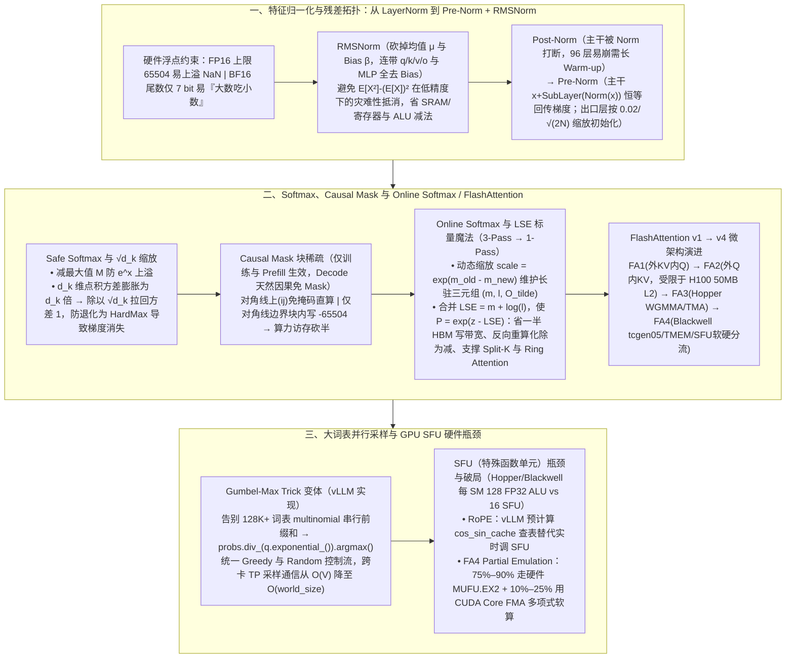

# 拆解大模型几项核心操作背后的数学与 Infra 优化逻辑

> **原文信息**：作者 `binnnliu`，发布于 2026-06-17 02:33（广东），公众号「腾讯技术工程」。

---

## 1. TL;DR

1. **核心主旨：用数学等价变换或适度精度妥协换取极致硬件效率** —— 神经网络真正关心的并非数值的「绝对大小」，而是特征之间的「相对差异」；针对 **FP16（数值上限仅 `65504`，易上溢 NaN/Inf）** 与 **BF16（尾数仅 `7 bit`，方差过大易「大数吃小数」）** 的物理局限，大模型 Infra 优化通过 **RMSNorm、Safe/Online Softmax、块稀疏 Causal Mask、Gumbel-Max 采样** 等设计，将串行依赖与多次 HBM 往返转化为单次流式访存与高并发规约。
2. **从 LayerNorm 到 RMSNorm 与 Pre-Norm 架构演进** —— 语言模型弃用 BatchNorm（跨请求干扰且训推不一致）；**RMSNorm**（Zhang et al., 2019）砍掉了贡献微弱的减均值（平移 $\mu$）及后续 Linear 层的 Bias $\beta$（包括 `q/k/v/o_proj` 与 `gate/up/down_proj` 全无 Bias），虽现代 Fused LayerNorm 也可借 $E[X^2]-(E[X])^2$ 或 Welford 算法做到 1-Pass HBM，但 RMSNorm 避免了低精度下的「灾难性抵消」并大幅削减了 SRAM/寄存器与 ALU 减法开销；架构上从 **Post-Norm**（主干梯度被 Norm 截断，堆到 96 层易崩溃，依赖长 Warm-up）转向 **Pre-Norm**（主干 $x+\dots$ 恒等映射无损回传梯度，虽有深层「表征坍塌」但契合现有算子生态），并在残差出口层（`o_proj/down_proj`）按 **$\text{std} = 0.02 / \sqrt{2N}$** 初始化防累加爆炸。
3. **Safe Softmax、$\sqrt{d_k}$ 缩放、Online Softmax 与 LSE 标量魔法** —— ① 减去最大值 $M$（**Safe Softmax**）使指数项 $\le e^0=1$ 彻底消除上溢；② $d_k$ 维独立点积累加使方差膨胀为 $d_k$ 倍，除以 **$\sqrt{d_k}$** 将方差拉回 $1$ 防止 Softmax 退化为 HardMax 导致梯度消失（导数 $\propto p(1-p)$）；③ **Online Softmax** 维护局部 $(m_i, \ell_i)$ 并用动态缩放因子 $\text{scale} = e^{m_{\text{old}} - m_{\text{new}}}$ 边走边修正，将 3-Pass HBM 降为 1-Pass，支撑 **FlashAttention** 长驻未归一化三元组 $(m, \ell, \tilde{O})$；④ 进一步将 $(m, \ell)$ 合并为单一标量 **$\text{LSE} = m + \log \ell$**（使 $P_{ij} = e^{z_{ij} - \text{LSE}_i}$），省一半 HBM 写带宽、化反向重算除法为减法，并支撑 **Flash-Decoding Split-K** 与 **Ring Attention** 跨卡在线缝合。
4. **块稀疏 Causal Mask 与 Gumbel-Max 并行采样** —— **Causal Mask** 仅在训练与推理 Prefill 阶段生效（Decode 阶段 Query 长度为 1 天然满足因果律，配合 vLLM PagedAttention 页表直取无需任何 Mask）；FlashAttention 利用**块稀疏（Block-Sparsity）**直接跳过对角线以上分块（$i<j$），将 Attention 计算与访存直接砍半；在 **Sampling** 阶段，针对大词表（如 Llama 3 的 `128,256`）`torch.multinomial` 前缀和串行瓶颈，vLLM 采用 **Gumbel-Max Trick 变体**（`probs.div_(q.exponential_()).argmax()`，等价于 $\arg\max(\ln p_i - \ln(-\ln u_i))$），将采样转化为无依赖逐元素除法 + 并行 `argmax`，跨卡张量并行通信量从 **$O(V)$ 骤降至 $O(\text{world\_size})$**。
5. **FlashAttention v1→v4 演进与 SFU 软硬协同分流** —— 从 FA1（外 KV 内 Q，中间 $O$ 频繁写回 HBM）到 FA2（外 Q 内 KV，寄存器原地累加 + 依赖 L2 Cache，但长文超 H100 50MB L2 时命中率从 ~99% 跌破 80%），再到 FA3/FA4 的 **Persistent Kernel + TMA Multicast + TMEM**；针对 Hopper/Blackwell 每个 SM 有 **128 个 FP32 ALU 却仅有 16 个 SFU（特殊函数单元）**导致 $e^x$ 成为流水线瓶颈，vLLM 预计算 `cos_sin_cache` 规避 RoPE 实时调 SFU，而 **FlashAttention-4** 首创**软硬协同分流（Partial Emulation：75%–90% 走硬件 `MUFU.EX2`，溢出 10%–25% 用通用 CUDA Core FMA 多项式逼近）**。

---

## 2. 问题定义与背景

### 2.1 为什么要写这篇？

大模型（Transformer）的训练与生成看似充满概率不确定性，但其底层算子与硬件执行完全建立在严谨的数学等价变换之上。本文系统拆解了除矩阵乘法外最核心的四大操作——**RMSNorm（均方根归一化）**、**Softmax（含 Safe/Online Softmax 与 LSE）**、**Causal Mask（序列因果掩码）**、**Sampling（Gumbel-Max 采样）**，并延伸至 **FlashAttention v1–v4 硬件微架构演进**与 **GPU SFU（特殊函数单元）物理瓶颈**，揭示 AI Infra 如何打破 HBM 内存墙、寄存器压力与指令吞吐瓶颈。

---

## 3. 知识框架

---

## 4. 核心内容拆解

### 4.1 RMSNorm 与 Pre-Norm：数值稳定、硬件访存与残差梯度的权衡

1. **为什么不用 MAD（平均绝对误差）和 BatchNorm？**
   - **MAD vs 方差/标准差**：绝对值函数 $|x-\mu|$ 在尖端处不可导，而平方 $(x-\mu)^2$ 是平滑抛物线（导数为 $2x$），开根号还原物理量纲后即为**标准差 $\sigma$**（几何意义是 $N$ 维空间中数据向量到均值向量的勾股定理直线距离）。
   - **BatchNorm vs LayerNorm/RMSNorm**：BatchNorm 跨请求统计且需补零、推理用全局历史均值导致训推不一致；LayerNorm/RMSNorm 严格在**单个 Token 内部（`Hidden Size` 维度）闭环**，训推完全一致。
2. **LayerNorm vs RMSNorm 的底层 Infra 真相**：
   - **LayerNorm 的 1-Pass 陷阱**：虽然数学上方差可展开为 $\text{Var}(X) = E[X^2] - (E[X])^2$，且 `Hidden Size`（如 `4096` 或 `8192`，约 `8–16 KB`）可塞进单个 SM 的 Shared Memory 做到 HBM 层面的 1-Pass 读写，但在 FP16/BF16 下当 $E[X^2]$ 与 $(E[X])^2$ 接近时极易引发**灾难性抵消（Catastrophic Cancellation）**算出负方差导致 `NaN`，迫使算子使用复杂的 **Welford 算法**或升 FP32。
   - **RMSNorm 的彻底简化**（$\text{RMS}(x) = \sqrt{\frac{1}{d}\sum_{i=1}^d x_i^2 + \epsilon}$，默认 $\epsilon = 10^{-6}$ 或 $10^{-5}$）：直接砍掉均值 $\mu$ 与偏置 $\beta$，并且现代开源大模型连带将 **`q_proj, k_proj, v_proj, o_proj` 及 MLP 的 `gate_proj, up_proj, down_proj` 的 Bias 全部砍掉**（PaLM 论文证实无 Bias 训练更稳定，且位移可被下一层 Norm 或 SwiGLU 门控吸收），大幅节省寄存器/SRAM 占用与 ALU 减法指令。
3. **Post-Norm vs Pre-Norm 与残差权重缩放初始化**：
   - **Post-Norm**（$x_{l+1} = \text{Norm}(x_l + \text{SubLayer}(x_l))$，如原始 Transformer、BERT 12/24 层）：主干路径被 Norm 截断，堆到 GPT-3 的 **96 层**时深层梯度过大、浅层梯度消失，必须靠长周期 **Warm-up** 打补丁。
   - **Pre-Norm**（$x_{l+1} = x_l + \text{SubLayer}(\text{Norm}(x_l))$，对标何恺明 2016 年 ResNet-v2 恒等映射）：主干变为纯粹的 $x_0 + \sum f_i(x_i)$，反向传播导数恒有 $+1$ 实现梯度无损回传；代价是前向传播到深层时主干方差越来越大导致**表征坍塌（Representation Collapse，砍掉最后几层性能下降不明显）**。尽管微软提出 **DeepNorm** 可将 Post-Norm 扩至 1000 层，但因放弃了业界针对 `Pre-Norm + RMSNorm` 极致优化的现成算子而未被主流采用。
   - **权重初始化工程真相**：理论上为维持方差为 $1$ 应按 $\text{Var}(W) = 1/d_{\text{in}}$ 初始化，但实际代码（`PreTrainedModel._init_weights`）普通层直接写死经验值 **`mean=0.0, std=0.02`**；而针对残差分支出口层（**`o_proj`、`down_proj`**），由于 $L$ 层 Transformer 共有 **$N = 2L$ 个残差支流**（如 80 层共 160 个支流），遵循 GPT-2 论文按 **$\text{scaled\_std} = \frac{0.02}{\sqrt{2 \times \text{num\_hidden\_layers}}}$** 缩放初始化，防止残差累加引发方差爆炸。

---

### 4.2 Softmax、Causal Mask、Online Softmax 与 LSE 标量设计

1. **Safe Softmax（$-M$ 平移）与 $\frac{1}{\sqrt{d_k}}$ 缩放**：
   - **$-M$ 平移防上溢**：$e^{x_i - M} / \sum e^{x_j - M}$（其中 $M = \max(x)$），保证指数输入 $\le 0$，最大项为 $e^0=1$。
   - **除以 $\sqrt{d_k}$ 防梯度消失**：若 $q_i, k_i$ 独立且均值 $0$、方差 $1$，则单项乘积方差 $\text{Var}(q_i k_i) = 1$，$d_k$ 项累加后点积总方差膨胀为 **$d_k$**（标准差为 $\sqrt{d_k}$）；若不缩放，大维度下 Logits 差距拉大（如 $[100, 200, 300]$），Softmax 退化为 $[0, 0, 1]$ 的 HardMax，因其导数 $\propto p(1-p)$，当 $p \to 0$ 或 $1$ 时导数趋近 $0$ 引发梯度消失。除以 $\sqrt{d_k}$ 即可根据 $\text{Var}(cX) = c^2\text{Var}(X)$ 将方差重新锁回 $1$。
2. **Causal Mask 的块稀疏（Block-Sparsity）与生命周期边界**：
   - **物理实现**：不用在 HBM 中物化 $O(N^2)$ 掩码矩阵，FlashAttention 在 Tile 调度层按行列索引分为三类：① **对角线以上（$i < j$）完全跳过**（不搬运 K/V、不算 GEMM）；② **对角线以下（$i > j$）直接正常计算**（零掩码指令开销）；③ **仅在极少数横跨对角线的边界 Block 内**于 SRAM/寄存器对右上角写入 $-\infty$（FP16 下取最小安全值 **`-65504`**，或 `-1e9`），直接将 Attention 计算量与访存量**砍掉接近 50%**。
   - **关键边界**：**Causal Mask 仅在训练和推理 Prefill 阶段生效！** 在推理 **Decode 阶段**，当前 Query 长度仅为 $1$，所有历史 KV Cache 天然属于过去式（配合 vLLM 的 **Request-level isolation** 与 **Block Table 页表指针**直接 Gather 离散 KV 块，连 Padding Mask 也一并省去）。
3. **Online Softmax 与 FlashAttention 的 $(m, \ell, \tilde{O})$ 流式更新**：
   - 朴素 Softmax 需 3 趟 HBM 读写（Pass 1 找最大值 $m$ → Pass 2 算分母 $\ell$ → Pass 3 算结果）；Online Softmax 利用重缩放因子 **`scale = exp(m_old - m_new)`** 边遍历边修正历史累加和：
     $$\ell_{\text{new}} = \ell_{\text{old}} \cdot e^{m_{\text{old}} - m_{\text{new}}} + \sum e^{S_{\text{local}} - m_{\text{new}}}$$
     $$\tilde{O}_{\text{new}} = \tilde{O}_{\text{old}} \cdot e^{m_{\text{old}} - m_{\text{new}}} + e^{S_{\text{local}} - m_{\text{new}}} V_{\text{block}}$$
     遍历完所有 KV Block 后仅需一次 $O_{\text{final}} = \tilde{O}_{\text{new}} / \ell_{\text{new}}$。
4. **为什么 FlashAttention 要存单一标量 $\text{LSE} = m + \log \ell$ 而不是分别存 $(m, \ell)$？**
   - 通过恒等变形：$$\text{Softmax}(z_i) = \frac{e^{z_i - m}}{\ell} = \frac{e^{z_i - m}}{e^{\log \ell}} = e^{z_i - (m + \log \ell)} = e^{z_i - \text{LSE}}$$
   - **三大工程杀手锏**：
     1. **省一半 HBM 写带宽**：每个 Query 行只需写回 1 个 FP32 标量（`LSE`）而非 2 个 FP32（`m, l`）；
     2. **反向传播重计算（Recomputation）化除为减**：前向不存 $O(N^2)$ 的 $P$ 矩阵，只存 $O(N)$ 的 `LSE`；反向重算时通过 $P_{ij} = \exp(S_{ij} - \text{LSE}_i)$（一条 FMA + `exp2`）直接还原，省去了昂贵的 GPU 硬件除法指令；
     3. **完美支撑 Flash-Decoding Split-K 与百万上下文 Ring Attention**：当长 KV Cache 被切分到多个 SM（Split-K）或多张 GPU（Ring Attention 环形 P2P 传 KV）时，各分片只需携带局部 $\tilde{O}_k$ 与局部 $\text{LSE}_k$，即可通过 $\text{LSE} = \log \sum_k e^{\text{LSE}_k}$ 与 $O = \sum_k e^{\text{LSE}_k - \text{LSE}} O_k$ 无损缝合。

---

### 4.3 FlashAttention v1→v4 微架构演进与 GPU SFU 软硬协同

1. **FA1 vs FA2 及 L2 Cache 脆弱性拐点**：
   - **FA1（外 K/V，内 Q）**：Grid 仅 `(batch_size, num_heads)`，长文小 Batch 下 SM 严重闲置，且内层全部 Q 的状态塞不下 SRAM 需反复写回 HBM。
   - **FA2（外 Q，内 K/V）**：Grid 扩为 `(⌈seqlen_q / BLOCK_M⌉, batch_size, num_heads)`，每个 Warp 独占一部分 Q 行，未归一化状态 $\tilde{O}$ 直接长驻在 Tensor Core MMA 指令的物理寄存器（**C-fragment**）中原地累加，消除跨 Warp Barrier 同步。
   - **FA2 的 L2 隐患与破局**：FA2 中各 Q tile CTA 独立读全量 KV，依赖同一 wave 内命中 GPU **L2 Cache**（H100 下 L2 带宽 **~12 TB/s** 是 HBM **~3 TB/s** 的 4 倍）；但 H100 的 L2 仅 **50 MB**，一旦出现 wave 断层或长文 GB 级 KV 挤爆 L2，命中率会从 **~99% 退化至 80% 以下**。因此顶级算子通过 **Tile Scheduler 软件主动编排 swizzle** + **Persistent Kernel（常驻 SM 自取任务）+ TMA Multicast（SM90+ 硬件多播共享一次 HBM 读）** 将软期望升级为软件定义调度。
2. **FA1 / FA2 / FA3 / FA4 四代核心特征对照**：
   - **FA3（2024，SM90 Hopper）**：1D Persistent Grid（H100 通常 `132` SM）、`WGMMA` 异步指令、硬件 `TMA`、Warp-Group 级 Producer/Consumer 专门化、跨轮次 PV 与 QK Ping-Pong 重叠。
   - **FA4（2026，SM100/SM110 Blackwell）**：B200 通常 `148` SM、支持 `1-CTA / 2-CTA cluster` 的 **`tcgen05.mma`（第 5 代 Tensor Core）**、$O$ 与 $P$ 矩阵直接驻留 **`TMEM`（张量内存，免 RF/SMEM 中转）**、**物理 6 组 Warp 级专门化**（MMA warp 12 / Softmax-0 0–3 / Softmax-1 4–7 / Correction 8–11 / Epilogue 13 / 专属 Load warp 14）以及 `split_P`（写入 3/4 时提前 arrive）多级流水。
3. **GPU SFU（特殊函数单元）瓶颈与 FA4 软件模拟 `exp`**：
   - 无论是代数函数 $\frac{1}{\sqrt{x}}$（`rsqrt`）还是超越函数 $e^x$（`exp2`）与 $\sin/\cos$，在 GPU 上均脱离常规 ALU 交由独立硬件模块 **SFU**（基于硬件查表 LUT + 多项式插值）执行；在 Hopper 与 Blackwell 中，**每个 SM 有 128 个常规 FP32 ALU，却仅有 16 个 SFU（吞吐仅为 ALU 的 1/8 至 1/4）**。
   - **两大破局实战**：
     1. **vLLM RoPE `cos_sin_cache`**：不在 Kernel 内实时调 SFU 算 `sin/cos`，而是初始化时预计算 `[max_position_embeddings, rotary_dim]` 缓存表（几 MB 到几十 MB），以空间换算力；
     2. **FlashAttention-4 软硬协同分流（Partial Emulation）**：因 Blackwell Tensor Core 算力翻倍而 SFU 未同比扩展，导致算 Softmax $e^x$ 的耗时快赶上矩阵乘法；FA4 保留 **75%–90%** 的指令调原生硬件 SFU（`MUFU.EX2`），将溢出瓶颈的 **10%–25%** 数据分流给通用 CUDA Core，通过多项式逼近用基础 **FMA** 指令软算模拟（不全用 ALU 软算是为了防止寄存器溢出 Spill）。

---

### 4.4 Gumbel-Max Trick：打破 128K+ 词表采样的串行前缀和瓶颈

1. **传统 `torch.multinomial` 的痛点**：对长达 **128,256（Llama 3 词表）** 甚至 **256K** 的概率数组计算累加前缀和（Cumulative Sum）具有强串行依赖，极不利于 GPU 线程并行且跨卡张量并行通信昂贵。
2. **vLLM 中的指数分布 Gumbel-Max 变体**：
   - 代码仅三行：`probs = logits.softmax(dim=-1)` → `q.exponential_()`（生成标准指数分布 $q_i \sim \text{Exp}(1)$）→ **`probs.div_(q).argmax(dim=-1)`**。
   - **数学等价证明**：因 $\ln$ 单调递增，且 $q_i = -\ln(u_i)$（$u_i \sim \text{Uniform}(0,1)$），故：
     $$\arg\max_i \left(\frac{p_i}{q_i}\right) = \arg\max_i \left(\ln p_i - \ln q_i\right) = \arg\max_i \left(\ln p_i + (-\ln(-\ln u_i))\right)$$
     其中 $g_i = -\ln(-\ln u_i)$ 恰好是标准 Gumbel 噪声！
   - **三大 Infra 收益**：① 随机数生成与逐元素除法完全独立无依赖；② **统一了 Greedy（贪心）与 Random（随机）采样的底层控制流**（最终全都调 `argmax`，彻底消灭 Kernel 分支发散 Branch Divergence）；③ 在词表张量并行（Vocab Parallel）下，由于 `max` 满足结合律，每张卡只需算本地 shard 最大值与索引，再做一次廉价的 `All-Reduce(MAX with index)`，**跨卡通信量从 $O(V)$ 骤降至 $O(\text{world\_size})$**。

---

## 5. 数据速查表

| 指标 | 原文数值 | 语境 / 条件 |
| :--- | :--- | :--- |
| FP16 与 BF16 硬件物理特征 | **FP16 数值上限仅 `65504` / BF16 尾数仅 `7 bit`** | FP16 易上溢 NaN/Inf；BF16 方差大时加法易引发「大数吃小数」截断误差 |
| RMSNorm 默认防除零常数 $\epsilon$ | **`1e-6`（或 `1e-5`）** | 对应 `config.rms_norm_eps` 配置 |
| 隐藏层维度与单 SM 缓存占用示例 | **Hidden Size `4096` 或 `8192`（约 `8–16 KB`）** | 完全可塞进单个 SM 的 Shared Memory 中实现单次 HBM 读写 |
| Post-Norm 训练崩溃层数对比 | **12/24 层（BERT）尚可，堆到 96 层（GPT-3）易崩溃** | Pre-Norm（及 ResNet-v2）通过恒等映射轻松突破 **100 层**（DeepNorm 可达 **1000 层**） |
| 权重初始化标准差与残差出口缩放 | **基础 `std = 0.02`；出口层 `o_proj/down_proj` 为 $0.02 / \sqrt{2 \times \text{num\_layers}}$** | 80 层 Transformer 共 $2 \times 80 = 160$ 个残差支流 |
| Causal Mask 块稀疏收益与 FP16 极小值 | **Attention 计算量与访存量降低接近 50% / FP16 掩码值 `-65504`（或 `-1e9`）** | 对角线以上分块（$i<j$）完全跳过不搬运不计算 |
| H100 L2 Cache 容量、带宽与命中率拐点 | **容量仅 `50 MB`；L2 带宽 `~12 TB/s` vs HBM `~3 TB/s`（约 4 倍）；退化时命中率从 `~99%` 跌至 `<80%`** | 解释 FA2 为什么在长上下文下需要 Tile Scheduler 与 TMA Multicast |
| H100 与 B200 典型 SM 数量 | **H100 通常 `132` SM / B200 通常 `148` SM** | FA3 与 FA4 Persistent Kernel 的 1D Grid 基准规模 |
| Hopper / Blackwell 单 SM 计算单元配比 | **每 SM `128` 个常规 FP32 ALU vs 仅 `16` 个 SFU（吞吐约为 ALU 的 `1/4`）** | 导致超越函数 $e^x$ 在高算术强度下成为流水线瓶颈 |
| FlashAttention-4 SFU 软硬分流比例 | **`75%–90%` 原生硬件 SFU（`MUFU.EX2`）+ `10%–25%` CUDA Core FMA 多项式软算** | 既打破 SFU 硬件吞吐瓶颈，又避免 100% 软算引发寄存器溢出（Spill） |
| 大模型词表规模与 Gumbel-Max 跨卡通信降维 | **Llama 3 词表 `128,256`（主流 `128K~256K`）；通信量从 $O(V)$ 降至 $O(\text{world\_size})$** | 利用 `argmax` 结合律仅传每卡局部最大值与索引 |

---

## 6. 踩坑与教训 / 可迁移的设计原则

| 错误做法 | 失败表现或原因 | 原文应对 |
| :--- | :--- | :--- |
| 在 FP16/BF16 下直接用 $\text{Var}(X) = E[X^2] - (E[X])^2$ 实现 1-Pass LayerNorm | 当两项数值接近时引发**灾难性抵消（Catastrophic Cancellation）**，算出负方差并在开根号时产出 `NaN` | 架构上直接改用无需减均值的 **RMSNorm**（并砍掉所有 Linear Bias），或在 LayerNorm Kernel 中使用 Welford 算法/强制升 FP32 累加 |
| 在百层大模型中沿用 Post-Norm 且不对残差分支出口层做缩放初始化 | 梯度每次穿过 Norm 被衰减，深层梯度巨大而浅层消失；且 80 层 160 条残差支流累加导致前向激活值爆炸溢出 FP16 | 采用 **Pre-Norm** 保证主干恒等梯度回传，并对 `o_proj` 和 `down_proj` 按 **$0.02 / \sqrt{2L}$** 缩放初始化权重 |
| 在显存（HBM）中显式生成 $O(N^2)$ 的 Causal Mask 矩阵，或在 Decode 阶段仍执行掩码指令 | 长文本下 $N \times N$ 掩码读写引发灾难性访存瓶颈；Decode 阶段 Query 长度为 1 算 Mask 纯属浪费 | Prefill 阶段在 Tile 调度层采用**块稀疏**（对角线上整块跳过，仅边界块内寄存器写 `-65504`）；Decode 阶段配合 PagedAttention 页表直取**彻底省去 Mask** |
| 在 FlashAttention 前向传播和 Split-K 归约中分别存储或写回局部最大值 $m$ 和分母 $\ell$ 两个变量 | 增加一倍的 HBM 写带宽开销，且反向传播重算 $P = e^{S-m}/\ell$ 时需执行昂贵的 GPU 硬件除法指令 | 存储单一合并标量 **$\text{LSE} = m + \log \ell$**，使 $P = \exp(S - \text{LSE})$，砍半写带宽并将除法降维为减法 |
| 在 128K+ 大词表及多卡张量并行下使用传统 `torch.multinomial` 轮盘赌采样 | 计算长达十多万元素的前缀和（Prefix-sum）严重阻碍 GPU 并行，且跨卡需 `all-gather` 整张 Logits | 采用 **Gumbel-Max 变体（`probs.div_(q.exponential_()).argmax()`）**，消除串行依赖、统一 Greedy/Random 控制流，并将跨卡通信压至 $O(\text{world\_size})$ |
| 在 RoPE 中每轮实时计算 `sin/cos`，或在 Blackwell FA4 中让所有 $e^x$ 擠在 16 个硬件 SFU 上（或 100% 改为 ALU 软算） | 硬件 SFU 吞吐仅占 FP32 ALU 的 1/4，引发严重排队；若 100% 用 ALU 软算则会耗尽寄存器引发 Spill | RoPE 预计算 **`cos_sin_cache`** 查表；FA4 采用 **`75%–90%` 硬件 SFU + `10%–25%` CUDA Core FMA 多项式软算**的 Partial Emulation 策略 |

---

## 7. 记忆锚点

1. **四大算子数学等价变形全景**：
   - **RMSNorm**：砍均值 $\mu$、砍偏置 $\beta$、砍全网 Linear Bias，出口层缩放 $0.02/\sqrt{2L}$；
   - **Safe & Online Softmax**：减 $M$ 防上溢，除 $\sqrt{d_k}$ 压方差防梯度消失，`scale = exp(m_old - m_new)` 边走边修正；
   - **LSE 标量恒等式**：$\text{LSE} = m + \log \ell \implies P = e^{z - \text{LSE}}$（1 个标量撑起反向重算、Split-K 与 Ring Attention）；
   - **Gumbel-Max 变体**：$\arg\max(p_i / \text{Exp}(1)) = \arg\max(\ln p_i + \text{Gumbel})$（前缀和串行变逐元素并行 + 跨卡 $O(\text{world\_size})$ 归约）。
2. **硬件微架构三对数字**：
   - **FP16 `65504` vs BF16 `7 bit` 尾数**；
   - **H100 L2 `50 MB`（`12 TB/s`）vs HBM（`3 TB/s`）**；
   - **每 SM `128` FP32 ALU vs `16` SFU（FA4：`75%–90%` 硬件 + `10%–25%` 软算）**。

---

## 8. 复习卡片

1. 为什么现代大语言模型普遍选择「Pre-Norm + RMSNorm + 无 Bias 线性层」的组合，且在残差出口层（`o_proj/down_proj`）要做特殊的权重初始化？::Post-Norm 的主干路径被 Norm 层截断，堆到 96 层时深层梯度过大、浅层梯度消失；Pre-Norm 将 Norm 移入支路使主干成为恒等映射无损回传梯度。RMSNorm 砍掉了贡献微弱的减均值操作及偏置 $\beta$（连带 `q/k/v/o` 与 MLP 线性层全去 Bias），既避免了 1-Pass LayerNorm 在低精度下的灾难性抵消，又减少了寄存器与 ALU 开销。针对 $L$ 层共 $2L$ 条残差支流累加引发的方差爆炸，出口层按 $\text{std} = 0.02 / \sqrt{2L}$ 缩放初始化。
2. Attention 计算中为什么要除以 $\sqrt{d_k}$，如果不除是如何一步步导致梯度消失的？::假设 $q_i, k_i$ 独立且均值 0、方差 1，则单个乘积项方差为 1，$d_k$ 个独立乘积项累加后的点积总方差会膨胀为 $d_k$ 倍（标准差为 $\sqrt{d_k}$）；如果不加缩放，高维点积会产生绝对值极大的 Logits，经过指数放大后触发极端「赢家通吃」，使 Softmax 退化为输出接近 $1$ 和 $0$ 的 HardMax；而 Softmax 导数正比于 $p(1-p)$，当 $p \to 1$ 或 $0$ 时导数趋近于 0，导致梯度消失。除以 $\sqrt{d_k}$ 可将方差重新锁回 $1$。
3. Online Softmax 是如何将 3-Pass HBM 访存降为 1-Pass 的，FlashAttention 为什么选择存储单一标量 $\text{LSE} = m + \log \ell$ 而不是分别存 $(m, \ell)$？::Online Softmax 在遍历 KV 分块时维护局部最大值 $m$ 和局部指数和 $\ell$，每当新块到来时用缩放因子 $\text{scale} = e^{m_{\text{old}} - m_{\text{new}}}$ 动态校正历史分母 $\ell$ 与未归一化输出 $\tilde{O}$。FlashAttention 将 $(m, \ell)$ 合并为 $\text{LSE} = m + \log \ell$（使 $P = e^{z - \text{LSE}}$），一是省去一半 HBM 写带宽（1 个 FP32 替 2 个 FP32），二是在反向传播重算 $P$ 时化昂贵的硬件除法为减法，三是让 Flash-Decoding Split-K 与 Ring Attention 能跨 SM/跨卡直接在线缝合局部结果。
4. Causal Mask 在训练/Prefill 与 Decode 阶段的处理有何本质区别，FlashAttention 是如何利用「块稀疏」优化它的？::Causal Mask 仅在训练和推理 Prefill 阶段生效；在推理 Decode 阶段，Query 长度仅为 1，所有历史 KV 天然属于过去式（配合 vLLM 页表直取无需执行任何掩码指令）。在 Prefill 阶段，FlashAttention 不在 HBM 生成 $O(N^2)$ 掩码矩阵，而是在 Tile 调度层直接跳过对角线以上分块（$i<j$）、正常计算对角线以下分块（$i>j$），仅在横跨对角线的边界块内于 SRAM/寄存器写入 `-65504`，将计算量和访存量双双砍半。
5. 为什么传统 `torch.multinomial` 在大词表下效率低下，vLLM 是如何通过 Gumbel-Max Trick 变体解决这一问题的？::传统轮盘赌采样需对 128K–256K 词表计算累加前缀和（Prefix-sum），串行依赖强且跨卡通信重；vLLM 利用 `probs.div_(q.exponential_()).argmax(dim=-1)`（数学上等价于给对数概率加上标准 Gumbel 噪声 $-\ln(-\ln u)$ 后取最大值），将采样转化为完全独立的逐元素除法加并行 `argmax` 规约，不仅统一了 Greedy 与 Random 的底层控制流（消灭分支发散），还将跨卡张量并行通信量从 $O(V)$ 降到了 $O(\text{world\_size})$。
6. 什么是 GPU 中的 SFU（特殊函数单元）瓶颈，vLLM 的 RoPE 和 Blackwell 架构下的 FlashAttention-4 分别是如何突破该瓶颈的？::GPU 的 `rsqrt`、$e^x$、`sin/cos` 等非线性运算均由独立硬件模块 SFU 执行，而 Hopper/Blackwell 每个 SM 有 128 个 FP32 ALU 却仅有 16 个 SFU；vLLM 在引擎初始化时预计算 `cos_sin_cache` 查表以避免 RoPE 实时调用 SFU；FlashAttention-4 面对 Tensor Core 算力翻倍导致 Softmax $e^x$ 成为瓶颈，采取了软硬协同分流（Partial Emulation）：保留 75%–90% 走原生硬件 `MUFU.EX2`，将溢出的 10%–25% 交给通用 CUDA Core 用基础 FMA 指令做多项式逼近模拟（避免 100% 软算引发寄存器 Spill）。

---

## 9. 知识关联

- **已有主题**：[Agent成本与上下文预算](../../20_topics/Agent%E6%88%90%E6%9C%AC%E4%B8%8E%E4%B8%8A%E4%B8%8B%E6%96%87%E9%A2%84%E7%AE%97.md) · [异常监控与稳定性](../../20_topics/%E5%BC%82%E5%B8%B8%E7%9B%91%E6%8E%A7%E4%B8%8E%E7%A8%B3%E5%AE%9A%E6%80%A7.md) · [Harness与模型协同](../../20_topics/Harness%E4%B8%8E%E6%A8%A1%E5%9E%8B%E5%8D%8F%E5%90%8C.md) · [大模型推理与算子优化](../../20_topics/%E5%A4%A7%E6%A8%A1%E5%9E%8B%E6%8E%A8%E7%90%86%E4%B8%8E%E7%AE%97%E5%AD%90%E4%BC%98%E5%8C%96.md) · [模型架构与训练](../../20_topics/%E6%A8%A1%E5%9E%8B%E6%9E%B6%E6%9E%84%E4%B8%8E%E8%AE%AD%E7%BB%83.md)
- **候选新主题**：[[OnlineSoftmax与LSE]] · [[Gumbel-Max并行采样]] · [[FlashAttention微架构演进]]

---

## 10. 原文参考资料

1. **归一化与残差连接经典论文**：Biao Zhang et al. (2019) *Root Mean Square Layer Normalization*；Kaiming He et al. (2015/2016) *Deep Residual Learning* & *Identity Mappings in Deep Residual Networks*；Ruibin Xiong et al. (2020) *On Layer Normalization in the Transformer Architecture*；微软 *DeepNorm*；Google *PaLM* 论文；OpenAI *GPT-2 / GPT-3* 论文。
2. **Attention 与推理系统核心文献**：Milakov & Gimelshein (2018) *Online normalizer calculation for softmax*；Tri Dao et al. *FlashAttention (v1/v2/v3/v4)* & *Flash-Decoding*；Hao Liu et al. *Ring Attention*；Kwon et al. *vLLM (PagedAttention)*；Shunyu Yao et al. *Tree of Thoughts (ToT)*。

> [!note]- 校对报告
> - **校对状态**：已根据 `MD.md` 全文（共 36 页 PDF 转写文本）逐一核对。
> - **核心数据与事实页码溯源**：
>   - FP16 数值上限 `65504`、BF16 尾数仅 `7 bit`、城市 A/B（`20℃` vs `60℃/-20℃`，方差 `1600` 平方摄氏度，标准差 `40℃`）、勾股定理几何意义、Z-score 推导：见 PDF 第 1–6 页。
>   - LayerNorm vs BatchNorm（Token 级闭环 vs 跨请求干扰与 Running Mean 割裂）、RMSNorm（Biao Zhang et al., 2019，`eps = 1e-6` 或 `1e-5`）、去掉 $\beta$ 与 `q/k/v/o_proj` 及 MLP `gate/up/down_proj` 全无 Bias、$\text{Var}(X)=E[X^2]-(E[X])^2$ 在低精度下的灾难性抵消与 Welford 算法：见 PDF 第 6–9 页。
>   - Post-Norm（12/24 层可训练、96 层易崩与 Warm-up 补丁）vs Pre-Norm（何恺明 2016 ResNet-v2 恒等映射、突破 100 层、表征坍塌与 DeepNorm 1000 层取舍）：见 PDF 第 9–11 页。
>   - Safe Softmax（$-M$ 平移）、$\sqrt{d_k}$ 方差膨胀推导、权重初始化 `std = 0.02` 与残差出口层 `o_proj/down_proj` 按 `0.02 / sqrt(2 * num_layers)`（80 层共 160 个残差支流）缩放：见 PDF 第 11–17 页。
>   - Causal Mask 块稀疏（对角线上跳过、对角线下直算、边界块写 `-65504`，计算与访存降近 50%）、Decode 阶段免 Mask 与 vLLM Request-level isolation + Block Table：见 PDF 第 17–19 页。
>   - Online Softmax 推导、FlashAttention $(m, \ell, \tilde{O})$ 更新伪代码、FA1 vs FA2（外 Q 内 KV、C-fragment 原地累加、H100 50MB L2 Cache `~12 TB/s` vs HBM `~3 TB/s` 及命中率从 `~99%` 跌至 `<80%`、Tile Scheduler 与 Persistent Kernel + TMA Multicast）：见 PDF 第 19–22 页。
>   - $\text{LSE} = m + \log \ell$ 与 $\text{Softmax}(z_i) = e^{z_i - \text{LSE}}$ 推导、省一半 HBM 写带宽、反向重算化除为减、Flash-Decoding Split-K 与 Ring Attention 跨卡在线缝合：见 PDF 第 23–25 页。
>   - Multinomial Sampling 在 Llama 3 词表 `128,256` 下的前缀和瓶颈、vLLM Gumbel-Max 变体（`probs.div_(q.exponential_()).argmax()`）推导、跨卡通信从 $O(V)$ 降至 $O(\text{world\_size})$ 及汇总表：见 PDF 第 25–28 页。
>   - 附 1（伯努利 1683 复利极限与欧拉 1720 年代定义常数 $e \approx 2.71828$）、附 2（FlashAttention v1–v4 硬件与微架构对比全表：H100 132 SM / B200 148 SM、`WGMMA` vs `tcgen05.mma`、`TMEM`、物理 6 组 Warp 专门化、`split_P`）、附 3（Hopper/Blackwell 每 SM 128 个 FP32 ALU vs 16 个 SFU、vLLM RoPE `cos_sin_cache`、FA4 `75%–90%` 硬件 SFU + `10%–25%` CUDA Core FMA 多项式软算）：见 PDF 第 30–35 页。
