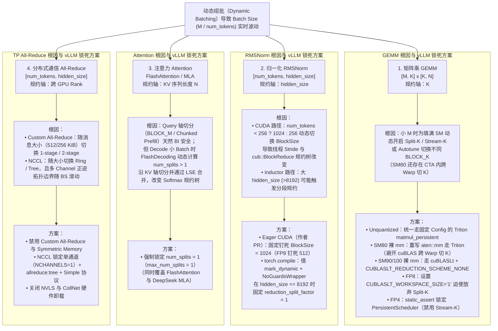
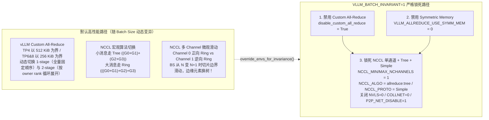

# AI Infra 进阶：如何让大模型输出确定的结果

## 1. TL;DR — 核心结论速览

1. **`temperature=0` + 固定 `seed` 只能保证静态 Batch 下的单次复现，救不了动态组批下的 Batch Variance**：在生产级推理引擎（如 vLLM 的 Continuous Batching）中，同一请求与不同数量的并发请求组批时，`Batch Size (M)` 的动态波动会触发底层算子自适应调整并行切分策略，进而改变**浮点数累加规约树（Reduction Tree）的拓扑结构**，结合 IEEE 754 浮点数加法非结合律 $(a+b)+c \neq a+(b+c)$，最终导致输出 Logits 漂移与生成文本分叉（尤其在 RL Rollout 训练采样与线上回归测试中危害严重）。
2. **认知纠偏——现代 Tensor Core 内部累加器本就是 FP32，症结不在“FP16 累加溢出”而在“规约轴（Reduction Axis）动态切分”**：无论是 GEMM 的 `K` 轴、RMSNorm 的 `hidden_size` 轴、Attention 的 `KV` 序列轴，还是分布式 TP `All-Reduce` 的跨卡规约轴，只要切分粒度或归并顺序随 `Batch Shape` 动态改变，FP32 累加也会因 GRS 舍入位（Round to Nearest, Ties to Even）的微小差异逐层放大。
3. **单卡三大核心算子的 Batch Invariance（BI）锁死方案（以 `vLLM v0.25.1` 为例）**：
   - **GEMM**：空间分块（`BLOCK_M/N`、`GROUP_M`、`num_warps/stages`）不影响规约顺序，唯有 **`BLOCK_K`** 与 **`SPLIT_K` / Stream-K** 会改变规约树。SM80（Ampere）因存在 CTA 内跨 Warp 切 K，需重写 `aten::mm` 强制走固定 Config 的 Triton `matmul_persistent`；SM90/SM100（Hopper/Blackwell）因 `WGMMA` 在 Warpgroup 内仅沿 M/N 分片，只需通过 `cublaslt` 的 `CUBLASLT_REDUCTION_SCHEME_NONE` 禁用 Split-K（FP8 借 `CUBLASLT_WORKSPACE_SIZE="1"` 曲线禁用，FP4 静态断言锁定 `PersistentScheduler`）。
   - **RMSNorm**：常规 CUDA Kernel 为优化小 Batch 将线程块设为 `num_tokens < 256 ? 1024 : 256`（PR `#27931`），导致跨 `256` 阈值时 `BlockReduce` 树改变；作者向 vLLM 提交 Bugfix PR 将 BI 模式下的 Block Size 固定钉死为 **`1024`**（FP8 块量化钉死为 `512`）。而在 `torch.compile` 路径下，依赖 `mark_dynamic` 与 `hidden_size <= 8192` 使 Inductor `reduction_split_factor` 恒为 `1`。
   - **Attention**：沿 Query 轴切分（`BLOCK_M` 与 Chunked Prefill）受限于单 Token 独立规约与 Causal Mask，天然满足 BI；真正的罪魁祸首是 Decode 阶段（`M=1`）为填满 SM 而动态开启的 **FlashDecoding `split-KV`（`num_splits`）**。开启 BI 后必须强制锁定 **`num_splits = 1`（`max_num_splits = 1`）**。
4. **分布式 TP `All-Reduce` 的 BI 锁死方案**：必须同时禁用随消息大小在 `512 KiB`（TP4）/ `256 KiB`（TP6/8）切换 `1-stage/2-stage` 的 **vLLM Custom All-Reduce** 与 **Symmetric Memory**，并通过环境变量将 **NCCL** 强制锁定为 **单通道（`NCCL_MIN/MAX_NCHANNELS=1`）+ `allreduce:tree` 算法 + `Simple` 协议**，同时关闭 `NVLS` 与 `CollNet` 硬件卸载，彻底阻止宏观算法切换与多通道切分边界滑动。

---

## 2. 问题定义与浮点数微观机理

### 2.1 Run-to-Run Determinism vs. Batch Invariance (BI)

| 确定性层级 | 定义与触发条件 | 为什么在 LLM 生产推理中不够用？ |
| :--- | :--- | :--- |
| **Run-to-Run Determinism（单次运行可复现）** | 保持完全相同的输入、完全相同的 `Batch Size` 与请求组合，重复运行两次得到相同结果 | 生产环境采用 **Continuous Batching（动态连续组批）**，同一个 Prompt 在时刻 $T_1$ 可能独自执行（`BS=1`），在时刻 $T_2$ 可能与另外 31 个请求拼成 `BS=32`；无法保证每次请求的同伴完全一致 |
| **Batch Invariance（批大小不变性，BI）** | 无论当前请求处于 `Batch Size = 1` 还是 `Batch Size = N` 的动态批次中，该请求对应的每一层激活值与输出 Logits 严格逐比特一致（Bitwise Identical） | 只有实现 **Batch Invariance**，才能在动态组批的线上服务与强化学习（RL Rollout 采样 vs 训练重计算）中获得真正的数学确定性 |

> **实测现象复现**：使用 `vllm serve Qwen/Qwen3-8B` 开启默认服务，即使客户端显式传入 `temperature=0` 与固定 `seed`，当并发压测改变动态组批大小时，同一条长思维链请求的生成结果仍会在某一步发生 Token 分叉并彻底走向不同推理路径。

---

### 2.2 为什么浮点数加法不满足结合律？$(a + b) + c \neq a + (b + c)$

1. **IEEE 754 格式与 ULP（Unit in the Last Place）**：
   - 浮点数表示为 $(-1)^S \times (1 + \text{Mantissa}) \times 2^E$（其中 FP32 为 `1-8-23`，FP16 为 `1-5-10`，BF16 为 `1-8-7`）。
   - 衡量相邻两个可表示浮点数间距的核心指标是 $\text{ULP}(x) = 2^{E - M}$（$M$ 为尾数位宽）。
2. **直观算例（FP16 下的“大数吃小数”与 GRS 舍入）**：
   - 在 FP16（$M=10$）下考察数值 $x = 2048 = 2^{11}$，此时指数 $E = 11$，其最小精度间距为：
     $$\text{ULP}(2048) = 2^{11 - 10} = 2^1 = 2$$
     这意味着在 $[2048, 4096)$ 区间内，FP16 **只能表示偶数**（$2048, 2050, 2052, \dots$），根本无法精确表示奇数 $2049$！
   - 硬件执行浮点加法时需经历：**对阶（Align Exponents，小指数尾数右移）→ 尾数相加 → 规格化（Normalize）→ 基于 GRS 位（Guard 保护位、Round 舍入位、Sticky 粘滞位）执行“向最近偶数舍入（Round to Nearest, Ties to Even）”**。
   - 对比以下两种规约顺序：
     - **顺序 A**：$(2048 + 1) + 1$。第一步计算 $2048 + 1 = 2049$，正好落在 $2048$ 与 $2050$ 正中间（Tie），按“向偶数舍入”规则被抹平为 $2048$；第二步再 $+1$ 同样被抹平，最终结果为 **$2048$**。
     - **顺序 B**：$2048 + (1 + 1)$。第一步先算括号内小数相加 $1 + 1 = 2$（无精度损失）；第二步算 $2048 + 2 = \mathbf{2050}$！
3. **关键认知纠偏（为什么 Tensor Core 用 FP32 累加依然会漂移？）**：
   - 很多人误以为 LLM 推理不确定是因为用了 FP16/BF16 导致累加溢出。事实上，**现代 GPU Tensor Core（无论是 Ampere 的 `mma.sync` 还是 Hopper 的 `WGMMA`）在接收 FP16/BF16/FP8/FP4 输入时，内部累加器（Accumulator）统一使用 `FP32`**。
   - 但即便在 FP32（$M=23$）下，上千维度的向量点积（如 `K = 4096` 或 `16384`）依然在每一步加法后发生 GRS 位截断舍入。只要**规约树的拓扑结构（谁先和谁加、分几段局部求和再汇总）**随 Batch Size 发生变化，FP32 输出转回 FP16/BF16 时就会在边界值附近产生 $\pm 1\text{ ULP}$ 的跳变，经过几十层 Transformer 放大后直接翻转 `argmax` Token！

---

## 3. 知识框架 — LLM 推理全链路 Batch Variance 根因与锁死全景图



---

## 4. 四大核心算子深度拆解

### 4.1 GEMM（通用矩阵乘法）：从 GPU 物理微架构看为什么会切 K 轴

#### （1）GPU 存储层级与 SM 物理硬约束
矩阵乘法 $C_{[M, N]} = A_{[M, K]} \times B_{[K, N]}$ 采用分块（Tiling）三级流水线：`HBM（全局显存） → Shared Memory（SRAM） → Register File（寄存器）`。一个 Tile 的尺寸不能无限放大，受限于 SM 两大物理天花板（以 NVIDIA A100 / H100 为例）：
1. **寄存器容量约束（Register File Limit）**：
   - 每个 SM 拥有 **`65,536` 个 32-bit 寄存器（共 `256 KB`）**，硬件限制**单个线程最多只能使用 `255` 个寄存器**。
   - 在矩阵乘中，结果块 `BLOCK_M × BLOCK_N` 的 FP32 累加器必须常驻寄存器。单线程需承担的累加器寄存器数为：
     $$\text{Regs}_{\text{acc}} = \frac{\text{BLOCK\_M} \times \text{BLOCK\_N}}{\text{num\_warps} \times 32} \le 255$$
   - **工程水位线**：为给矩阵 A/B 片段、内存地址指针与循环变量留出余量，通常要求单线程累加器控制在 **`128` 个寄存器以内**。一旦超标就会触发 **Register Spilling（寄存器溢出）**，数据被迫退回物理上位于 HBM 的 Local Memory，导致性能断崖式崩塌。
2. **共享内存容量约束（Shared Memory Limit）**：
   - H100 单个 SM 的最大 Shared Memory 为 **`228 KB`**。
   - 现代算子通过 `cp.async`（Ampere）或 `TMA`（Hopper）实现多级软件流水线（`num_stages` 缓冲），其 SMEM 占用必须满足：
     $$(\text{BLOCK\_M} \times \text{BLOCK\_K} + \text{BLOCK\_N} \times \text{BLOCK\_K}) \times \text{sizeof(dtype)} \times \text{num\_stages} \le 228\text{ KB}$$

#### （2）为什么小 Batch Decode 迫使算子去切 K 轴（Split-K）？
以 **Llama-3-8B 的 Fused QKV Projection**（`hidden_size K = 4096`，`qkv_proj_size N = 6144`）在 **H100（拥有 `132` 个 SM）** 上运行为例：
- **Prefill 阶段（如 `M = 4096`，Compute-Bound）**：若取 `BLOCK_M = 128, BLOCK_N = 256`，仅在 $(M, N)$ 平面就能切出 $\frac{4096}{128} \times \frac{6144}{256} = 32 \times 24 = 768$ 个独立 CTA（Thread Block），远超 132 个 SM，完全不需要动 $K$ 轴。
- **Decode 阶段（如 `M = 16`，Memory-Bound）**：即使将 `BLOCK_M` 缩小到硬件指令下限 `16`、取 `BLOCK_N = 256`，$(M, N)$ 平面也只能切出 $1 \times 24 = 24$ 个 CTA！这意味着 H100 的 **132 个 SM 中有 108 个处于彻底闲置状态（Wave Quantization / 尾效应）**，且无法挂载足够并发去吃满 HBM 带宽。
- **Split-K 的破局与代价**：为了唤醒闲置 SM，算子被迫沿规约轴 $K$ 切分成 `SPLIT_K` 份（例如切成 4 份，产生 $24 \times 4 = 96$ 个 CTA），最后通过两种方式汇总：
  1. **`atomic_add`（原子累加）**：哪个 CTA 先算完就先往全局显存加，受硬件调度抖动影响，**连 Run-to-Run Determinism 都无法保证**。
  2. **`Workspace Reduction`（工作区树状规约）**：各 CTA 先写入 `[split_k, M, N]` 临时显存，再启动第二个 Kernel 按固定顺序累加。它在固定 `split_k` 下是 Run-to-Run 确定的，但**当 `M` 从 16 变成 128 时，启发式调度器会把 `split_k` 从 4 改回 1，规约树瞬间改变，直接破坏 Batch Invariance！**

#### （3）GEMM 超参数对 Batch Invariance 的影响总表

| 算子超参数 | 物理含义 | 动态改变时是否破坏 BI？ | 底层原因解析 |
| :--- | :--- | :---: | :--- |
| **`BLOCK_M` / `BLOCK_N`** | 输出矩阵空间维度分块大小 | **否（安全）** | 只决定哪些输出元素归同一个 CTA 算，不改变单个元素 $C_{i,j}$ 在 $K$ 轴上的累加顺序 |
| **`GROUP_M`（Swizzle）** | 改变 CTA 调度顺序以提升 L2 Cache 命中率 | **否（安全）** | 仅改变不同输出块的执行先后次序，每个输出块内部的 $K$ 轴点积完全独立 |
| **`num_warps` / `num_stages`** | CTA 内 Warp 数量 / 软件流水线深度 | **否（安全）** | 仅影响空间分片或指令预取距离，不改变单元素 $K$ 轴累加拓扑 |
| **`BLOCK_K`** | 每次迭代加载的 $K$ 轴切片宽度 | **是（破坏 BI！）** | `BLOCK_K` 内部由硬件 Tensor Core 指令（MMA/WGMMA）做树状规约，跨 `BLOCK_K` 迭代做串行累加；改变 `BLOCK_K` 会直接改变“树状规约 vs 串行累加”的切分边界 |
| **`SPLIT_K` / `Stream-K`** | 跨多个 CTA 切分同一个输出块的 $K$ 轴 | **是（破坏 BI！）** | 将单条长链累加拆成多棵子树后再跨 CTA 归并；`SPLIT_K` 随 $M$ 变化即改变规约树结构 |

#### （4）架构代差（SM80 vs SM90/SM100）与 vLLM 的分类锁死策略
- **为什么 SM80（Ampere）比 SM90/SM100（Hopper/Blackwell）更难伺候？**
  - 在 **SM90/SM100** 上，4 个 Warp（128 线程）组成一个 Warpgroup 协同执行一条异步 `WGMMA` 指令，累加器寄存器仅在 `(M, N)` 空间维度分片，**CTA 内部在 $K$ 轴上严格按 `BLOCK_K` 步进串行累加**；因此只要禁用跨 CTA 的 Split-K，就能保证 BI。
  - 而在 **SM80（Ampere）** 上，底层使用 Warp 级的 `mma.sync` 指令。当矩阵较小时，cuBLAS/CUTLASS 的某些 Kernel 不仅会在 CTA 间做 Split-K，还会**在单个 CTA 内部让不同 Warp 切分不同段的 $K$ 轴（Intra-CTA Warp-level K-slicing），最后通过 Shared Memory 做跨 Warp 规约**！即便关掉外部 Split-K，只要 cuBLAS 随 $M$ 切换内部 Kernel，CTA 内的跨 Warp 规约树依然会变。
- **vLLM (`v0.25.1`) 针对不同 GEMM 路径的工程实现**：
  1. **非量化线性层（`UnquantizedLinearMethod`）**：开启 `VLLM_BATCH_INVARIANT=1` 后，接管 `apply` 路由至 `linear_batch_invariant` $\to$ 调用 Triton 实现的 **`matmul_persistent`**，按数据类型硬编码唯一静态配置（如 `bf16` 固定 `BLOCK_SIZE_M=128, BLOCK_SIZE_N=128, BLOCK_SIZE_K=64, GROUP_SIZE_M=8, num_stages=3, num_warps=8`），彻底关闭 `@triton.autotune` 与 Split-K。
  2. **裸 `torch.mm / addmm / matmul / linear` 调用**：
     - **SM80（`< 90`）**：通过 `torch.library.Library("aten", "IMPL")` 将底层算子直接重定向到上述固定配置的 Triton `matmul_persistent`（**注意坑点**：Python 层的 `aten` 重写在 `torch.compile` 模式下会被 Inductor 绕过失效！）。
     - **SM90 / SM100**：保留高性能 cuBLASLt，但通过上下文强制指定 `preferred_blas_library("cublaslt")` 并传入掩码 `CUBLASLT_REDUCTION_SCHEME_NONE` 严禁任何 Split-K 规约（注：不能用传统 `cuBLAS`，因为传统 `cuBLAS` API 不支持设置规约掩码，在 PyTorch 中会直接触发 `TORCH_CHECK` 报错）。
  3. **量化线性层（FP8 & FP4）**：
     - **FP8（`cutlass_scaled_mm` / `cublaslt`）**：CUTLASS 路径直接写死 Tile Config；而 cuBLASLt 的 FP8 `scaled_gemm` 接口暂未暴露禁用 Split-K 的掩码参数，vLLM 采取了一个极巧妙的工程 Workaround——设置环境变量 **`CUBLASLT_WORKSPACE_SIZE="1"`**（仅给 1 KiB 工作区显存），由于 Split-K 必须申请较大的 Workspace 存放中间部分和，显存不足迫使 cuBLASLt 放弃选择 Split-K Kernel（注：这属于经验性工程手段，无 NVIDIA 官方 API 契约担保）。
     - **FP4（SM100 Blackwell `cutlass_fp4_gemm_dispatch`）**：锁定默认 Tile 配置 `sm100_fp4_config_default`，并通过 C++ `static_assert` 强制断言调度器必须为 **`cutlass::gemm::PersistentScheduler`**（严禁使用会在 $K$ 轴跨 CTA 动态切分的 `StreamKScheduler`）。

---

### 4.2 RMSNorm：一行“小 Batch 性能优化”引发的血案与作者的 Bugfix PR

#### （1）为什么按行独立计算的 RMSNorm 也会出现 Batch Variance？
RMSNorm 的数学公式为：
$$y = \frac{x}{\text{RMS}(x)} \odot \gamma, \quad \text{RMS}(x) = \sqrt{\frac{1}{H}\sum_{i=1}^{H} x_i^2 + \epsilon}$$
表面上看，每个 Token（每一行，长度为 $H = \text{hidden\_size}$）单独分配一个 CUDA Thread Block（CTA）计算平方和均值，不同 Token 之间毫无数据交互，理应天然具备 Batch Invariance。
- **真凶定位（vLLM PR `#27931`）**：为了在 Decode 小 Batch 阶段提高单个 SM 的线程占用率，vLLM 的 CUDA Kernel 写了这样一行动态启发式逻辑：
  ```cpp
  int max_block_size = (num_tokens < 256) ? 1024 : 256;
  ```
- **微观规约树如何被改写**：
  - 当 `num_tokens = 1`（`< 256`）时，每个 CTA 启动 **`1024` 个线程（32 个 Warp）**；每个线程以步长 `stride = 1024` 累加自己负责的元素，然后通过 `cub::BlockReduce` 做 **32 个 Warp** 的树状归并。
  - 当 `num_tokens = 256`（`>= 256`）时，每个 CTA 缩减为 **`256` 个线程（8 个 Warp）**；每个线程以步长 `stride = 256` 累加更多元素，再做 **8 个 Warp** 的树状归并！
  - 跨越 `num_tokens = 256` 这一分水岭时，同一行向量内部的平方和累加顺序彻底重组！
- **作者贡献的修复（PR: *Fix batch invariance in RMSNorm kernels by pinning block size*）**：
  - 本文作者在研读源码时发现了这一漏洞并向 vLLM 上游提交了修复 PR：在开启 `VLLM_BATCH_INVARIANT` 时，绕过动态判断，将标准 `rms_norm` 的 `max_block_size` **强制钉死为 `1024`**（对于融合了 RMSNorm 与 FP8 块量化的 Kernel 则**钉死为 `512`**）。

#### （2）`torch.compile`（TorchInductor）模式下的 RMSNorm 为何能保持 BI？
当 vLLM 开启 `torch.compile` 时（默认 `compilation_config.custom_ops="none"`，见 Issue `#40628`），RMSNorm 不走手写 CUDA 算子，而是走 PyTorch 原生 `forward_native` 并被 **TorchInductor** 编译为 Triton Kernel：
- Inductor 在生成规约 Kernel 时会调用 `reduction_split_factor(prefix_numel, reduction_numel)` 决定是否把一行规约拆成两阶段（Split Reduction）。
- 由于 vLLM 对 `num_tokens` 启用了 **`torch._dynamo.mark_dynamic`**（生成带有 `numel_hint` 的符号整数 `SymInt`），Inductor 内部逻辑规定：只要 **`hidden_size <= 8192`**（或者动态维度 `numel_hint >= 2 * num_sm`），`reduction_split_factor` 就恒定返回 **`1`**！
- 配合 vLLM 的 **`TorchCompileWithNoGuardsWrapper`**（AOT 编译单个动态 Shape 图并在运行时无 Guard 复用同一个 Triton Kernel，`RBLOCK = next_power_of_2(hidden_size)` 固定不变），因此在主流模型（`hidden_size <= 8192`）下天然保持 BI。
- **潜在边界警告**：如果超大模型的 `hidden_size > 8192`，且用户在 `CompilationConfig` 中配置了分段编译（`compile_ranges` / `compile_sizes`），导致小 Batch 子图触发 `split_factor > 1` 而大 Batch 子图保持 `split_factor = 1`，则仍会破坏 BI！

---

### 4.3 Attention（FlashAttention / FlashDecoding / MLA）：锁死 KV 轴切分

#### （1）为什么 Query 轴切分与 Chunked Prefill 是安全的，而 Decode 却会漂移？
在 FlashAttention 中，Online Softmax 沿 **KV 序列轴（$N$ 轴）** 维护局部最大值 $m$ 与指数和 $l$ 的递推规约：
$$m_{\text{new}} = \max(m_{\text{old}}, m_{\text{cur}}), \quad l_{\text{new}} = l_{\text{old}} \cdot e^{m_{\text{old}} - m_{\text{new}}} + l_{\text{cur}} \cdot e^{m_{\text{cur}} - m_{\text{new}}}$$
- **Query 轴切分（`BLOCK_M`）与 Chunked Prefill 为什么安全？**
  - 不同 Query Token 的 Attention 输出在数学上完全独立（互不参与对方的 Softmax 求和），且 Causal Mask 严格固定了每个位置可见的历史 KV 范围；同时 KV 轴单次迭代步长 `BLOCK_N` 在给定 `(head_dim, is_causal, dtype, arch)` 下是编译期常量。因此把长 Prompt 拆成多个 Chunk（如 `ceil(query_len / 64)`）并不会改变单个 Token 沿 KV 轴的扫描顺序（唯一间接影响是改变了 `num_m_blocks`，可能诱发下述 `split-KV`）。
- **Decode 阶段的真凶：FlashDecoding 的动态 `split-KV`（`num_splits`）**：
  - 在 Decode 阶段（每个请求 `query_len = 1`，故 `num_m_blocks = 1`），总空间并发块数为 `total_mblocks = batch_size * num_head_kv * 1`。
  - 当 `batch_size` 较小时，`total_mblocks` 远小于 GPU 的 SM 数量。为了不让 SM 空转，FlashDecoding 会根据当前 `batch_size` 和 KV Cache 长度动态计算一个 **`num_splits > 1`**，把同一条历史 KV 序列切成 `num_splits` 段交给不同 CTA 并行算局部 Softmax，最后再启动 `flash_attn_combine` Kernel 利用 **LSE（Log-Sum-Exp）** 归并！
  - 随着动态组批 `batch_size` 增大，`total_mblocks` 变多，调度器自动调小 `num_splits`（甚至降为 `1`），KV 轴的规约分段树随之剧烈改变！
- **vLLM 的锁死方案**：
  - 开启 `VLLM_BATCH_INVARIANT=1` 后，无论在标准 FlashAttention 还是 DeepSeek 的 **MLA（Multi-head Latent Attention）** 后端中，均在调度入口处将 **`num_splits`（及 `max_num_splits`）强制硬编码锁定为 `1`**——宁可牺牲小 Batch Decode 时的 SM 占用率，也绝不允许沿 KV 规约轴做跨 CTA 切分。

---

### 4.4 分布式通信（Tensor Parallel `All-Reduce`）：锁死跨卡规约拓扑

在多卡张量并行（TP）下，`ColumnParallelLinear` 紧接 `RowParallelLinear` 后必须对形状为 `[num_tokens, hidden_size]` 的张量执行跨卡求和 `All-Reduce`。这里潜伏着两套随消息大小动态变异的机制：



1. **为什么 vLLM 默认的 `Custom All-Reduce` 不满足 BI？**
   - `Custom All-Reduce` 利用 CUDA IPC 直接获取同节点对端 GPU 显存指针，配合 `128-bit` 向量化访存降低小消息延迟。
   - 但它内部包含两套算法：**`1-stage`**（每个 Rank 按固定指针顺序把所有 Rank 的数据加起来）和 **`2-stage`**（先做 Reduce-Scatter 再做 All-Gather，且每个分区以各自的 `owner rank` 为起点循环累加）。
   - 在 **TP4 下以 `512 KiB`** 为切换阈值，在 **TP6 / TP8 下以 `256 KiB`** 为切换阈值！当 `num_tokens` 增长跨过该字节阈值时，累加顺序直接从固定指针序变成按分区 Owner 循环序。
2. **为什么标准 `NCCL All-Reduce` 也不满足 BI？**
   - **第一重变异（宏观算法切换 Ring vs Tree）**：NCCL 根据消息大小 `[num_tokens, hidden_size]` 在 **Ring 算法**（线性序 `(((GPU0+GPU1)+GPU2)+GPU3)`，由 Baidu SVAIL 早期推广至深度学习）与 **Tree / Double Binary Tree 算法**（分治序 `(GPU0+GPU1)+(GPU2+GPU3)`）之间动态切换。
   - **第二重变异（微观 Multi-Channel 拓扑异构与切分边界滑动）**：为榨干多条物理 NVLink 的双向带宽，NCCL 会开启多个逻辑 `Channel`（每个 Channel 对应一个 CUDA Thread Block）。不同 Channel 可能被分配完全相反的拓扑（如 Channel 0 走正向 Ring `(((G0+G1)+G2)+G3)`，Channel 1 走逆向 Ring `(((G0+G3)+G2)+G1)`）。更致命的是，当 `Batch Size` 从 $N$ 变成 $N+1$ 时，总字节数改变导致 **NCCL 重新划分各 Channel 的内存切分边界**——原本落在 Channel 0 管辖区末尾的某几个浮点数，在 `BS=N+1` 时滑入了 Channel 1 的管辖区，规约方向瞬间反转！
3. **vLLM 的分布式锁死组合拳（`override_envs_for_invariance`）**：
   - 代码层设置 `self.disable_custom_all_reduce = True`，并注入全套环境变量：
     - `VLLM_ALLREDUCE_USE_SYMM_MEM="0"`（关闭基于 PyTorch Symmetric Memory 的 multimem/two-shot 规约后端）；
     - `NCCL_MIN_NCHANNELS="1"`、`NCCL_MAX_NCHANNELS="1"`（**强制单通道通信**，消除多通道拓扑异构与边界滑动）；
     - `NCCL_ALGO="allreduce:tree"`、`NCCL_PROTO="Simple"`（**强制锁定 Tree 算法 + Simple 协议**）；
     - `NCCL_COLLNET_ENABLE="0"`、`NCCL_NVLS_ENABLE="0"`、`NCCL_P2P_NET_DISABLE="1"`（禁止网卡 CollNet 卸载与 Hopper/Blackwell NVSwitch 的 NVLink SHARP 硬件多播规约介入）；
     - `NCCL_LAUNCH_MODE="GROUP"`、`NCCL_NTHREADS="1"`、`NCCL_SOCKET_NTHREADS="1"`、`CUBLAS_WORKSPACE_CONFIG=":4096:8"`、`VLLM_USE_AOT_COMPILE="0"`。

---

## 5. 数据速查表

| 指标 / 硬件与算子参数 | 原文数值 | 语境 / 条件 |
| :--- | :--- | :--- |
| **FP16 在 $x=2048$ 处的精度间距 ($\text{ULP}$)** | **`2`（$\text{ULP}(2048) = 2^{11-10} = 2$）** | FP16 格式为 `1-5-10`（$M=10$），导致 $2048 + 1 = 2049$ 按向偶数舍入退化回 `2048` |
| **A100 / H100 单 SM 寄存器总量与单线程上限** | **`65,536` 个 32-bit 寄存器（`256 KB`）/ 单线程上限 `255` 个** | 工程上通常将单线程 MMA 累加器控制在 **`128` 个以内**以防 Register Spilling |
| **H100 SM 数量与单 SM 最大共享内存** | **`132` 个 SM / 单 SM 最大 `228 KB` SMEM** | 多级流水线需满足 $(\text{BLOCK\_M}\cdot\text{K} + \text{BLOCK\_N}\cdot\text{K}) \times \text{bytes} \times \text{stages} \le 228\text{ KB}$ |
| **Llama-3-8B Fused QKV 投影维度示例** | **`hidden_size = 4096`，`qkv_proj_size = 6144`** | Decode `M=16` 时若取 `16×256` 仅能切出 `24` 个 CTA，不足以填满 132 个 SM |
| **vLLM Triton `matmul_persistent` BF16 固定配置** | **`M=128, N=128, K=64, GROUP_M=8, stages=3, warps=8`** | 开启 `VLLM_BATCH_INVARIANT` 后 `UnquantizedLinearMethod` 硬编码的静态配置 |
| **cuBLASLt 禁用 FP8 Split-K 的工作区阈值** | **`CUBLASLT_WORKSPACE_SIZE = "1"`（1 KiB）** | 因 FP8 `scaled_gemm` 缺省规约掩码，借极小 Workspace 迫使放弃 Split-K |
| **RMSNorm CUDA 动态线程块切换阈值** | **`num_tokens < 256 ? 1024 : 256`（PR `#27931`）** | BI 模式下被作者 PR 修复为固定钉死 **`1024`**（FP8 块量化钉死 **`512`**） |
| **Inductor RMSNorm 不拆分规约的维度上限** | **`hidden_size <= 8192`** | 动态 Shape 下 `reduction_split_factor` 恒返 `1` 的安全边界 |
| **Chunked Prefill 默认 Query 分块粒度** | **`ceil(query_len / 64)`** | 沿 Query 轴切分，单块内不影响 KV 规约顺序 |
| **FlashDecoding / MLA BI 锁死分片数** | **`num_splits = 1`（`max_num_splits = 1`）** | 彻底禁用 Decode 阶段沿 KV 轴的跨 CTA 动态切分 |
| **vLLM Custom All-Reduce 算法切换阈值** | **TP4 为 `512 KiB`；TP6 / TP8 为 `256 KiB`** | 跨过阈值时在 `1-stage` 与 `2-stage` 间切换，故 BI 模式必须禁用 |
| **NCCL BI 模式锁定的通道数与算法协议** | **`NCCL_MIN/MAX_NCHANNELS = 1`，`allreduce:tree` + `Simple`** | 同时设 `NCCL_NVLS_ENABLE=0`、`NCCL_COLLNET_ENABLE=0` |

---

## 6. 踩坑与教训 / 可迁移的设计原则

1. **迷信“设置 `temperature=0` + `seed` + `torch.use_deterministic_algorithms(True)` 就万事大吉” → 在动态组批（Continuous Batching）服务中同一请求仍然输出漂移 → 必须区分“单 Batch 静态复现（Run-to-Run）”与“跨 Batch 大小不变性（Batch Invariance）”，从算子调度层锁死规约轴切分**
   - **可迁移原则**：所有面向强化学习（RLHF/RLVR Rollout）或高精度回归评测的推理底座，必须审计**每一个含规约操作（Sum / Max / Norm / Softmax / All-Reduce）的算子**是否以 `Batch Size (M)` 作为启发式调度的分支条件。
2. **只关注计算大头（GEMM / Attention），忽略轻量级 Elementwise/Norm 算子 → RMSNorm 里一行不起眼的 `num_tokens < 256 ? 1024 : 256` 线程块优化直接废掉全链路确定性 → 逐一排查所有手写 CUDA Kernel 中与 `num_tokens` 挂钩的 `blockDim` 或 `gridDim` 分支并固定钉死**
   - **可迁移原则**：确定性遵循“木桶最短板定律”——哪怕 99% 的算子都锁死了规约树，只要有 1 个 Norm 算子随 Batch Size 改变了 `BlockReduce` 线程数，后续所有层的激活值就会雪崩式分叉。
3. **在 SM80（Ampere）上仅靠外层禁用 Split-K 或只用 Python 层 `aten` 重写 → 遇到小矩阵时 cuBLAS 内部仍会触发 CTA 内跨 Warp 切 K，而开启 `torch.compile` 后 Python 层 `aten::mm` 重写又被 Inductor 直接绕过 → 必须结合 GPU 架构代差（SM80 `mma.sync` vs SM90 `WGMMA`）与编译模式（Eager vs Inductor/AOT）做端到端交叉验证（参考 vLLM Bug `#40628`）**
   - **可迁移原则**：算子拦截不能只看 Eager 模式，必须验证 `torch.compile` / CUDA Graph 捕获后的实际落地 Kernel 是否与预期一致。
4. **单卡算子全锁死了，多卡 TP 部署却依然漂移 → 忽略了 vLLM `Custom All-Reduce` 的 `512/256 KiB` 双阶段切换以及 `NCCL` 多 Channel 正逆向拓扑切分边界随字节数滑动 → 禁用 Custom All-Reduce，并将 NCCL 锁死在单通道（`NCHANNELS=1`）+ 固定 `Tree` 算法 + 关闭 `NVLS/CollNet`**
   - **可迁移原则**：在分布式推理中，**跨卡通信算子本质上就是把规约轴从片上 SRAM 搬到了 NVLink/网络上**，其规约树锁定逻辑与单卡 Split-K 锁定完全同构。

---

## 7. 记忆锚点 — 一句话 / 一张图记住全文

- **一句话锚点**：**大模型推理 Batch Variance 的唯一本质，就是硬件调度器为了在小 Batch 下填满 SM 或压榨 NVLink 带宽，随 `Batch Size (M)` 动态改变了 `GEMM K 轴`、`RMSNorm H 轴`、`Attention KV 轴` 或 `TP All-Reduce Rank 轴` 的切分方式，导致 FP32 累加规约树拓扑改变；要实现 Batch Invariance，就必须牺牲小 Batch 吞吐，把所有规约轴切分强制焊死为静态常数！**
- **四维锁死公式**：
  $$\text{Batch Invariance} = \underbrace{\text{No Split-K / Fixed }\texttt{BLOCK\_K}}_{\text{GEMM}} + \underbrace{\text{Pin }\texttt{block\_size=1024}}_{\text{RMSNorm}} + \underbrace{\text{Lock }\texttt{num\_splits=1}}_{\text{Attention / MLA}} + \underbrace{\text{1-Channel }\texttt{Tree}\text{ (No Custom AR/NVLS)}}_{\text{TP All-Reduce}}$$

---

## 8. 复习卡片（Spaced Repetition）

1. 为什么在 FP16（`1-5-10`）下计算 $(2048 + 1) + 1$ 会等于 $2048$，而计算 $2048 + (1 + 1)$ 却等于 $2050$？::因为 $2048 = 2^{11}$，此时 $\text{ULP}(2048) = 2^{11-10} = 2$，区间内只能表示偶数；$(2048+1)=2049$ 落在正中间，按 IEEE 754“向最近偶数舍入（Ties to Even）”规则被抹平回 $2048$，而先算 $(1+1)=2$ 再加 $2048$ 则能跨过步长得到 $2050$。
2. 现代 GPU Tensor Core 内部累加器已经是 FP32 了，为什么 LLM 推理在动态组批（Dynamic Batching）下依然会出现 Batch Variance？::因为即使在 FP32 下浮点数加法依然不满足结合律（每步都有 GRS 舍入）；当 `Batch Size (M)` 波动时，底层算子为填满 SM 会动态调整规约轴（如 GEMM 的 K 轴、Attention 的 KV 轴）的分片策略，改变了 FP32 累加规约树的拓扑结构。
3. 在 GEMM 的分块超参数（`BLOCK_M`、`BLOCK_N`、`BLOCK_K`、`GROUP_M`、`num_warps`、`num_stages`、`SPLIT_K`）中，哪些参数随 Batch Size 改变会破坏 Batch Invariance？为什么？::只有 `BLOCK_K` 和 `SPLIT_K`（含 Stream-K）会破坏 Batch Invariance；因为其他参数只改变空间维度划分或流水线调度，而 `BLOCK_K` 和 `SPLIT_K` 直接改变了沿规约轴 $K$ 的局部树状求和与跨块归并顺序。
4. 为什么 SM90（Hopper）上的裸 `torch.mm` 只需通过 `cublaslt` 禁用 Split-K 就能保证 Batch Invariance，而 SM80（Ampere）却必须重写 `aten::mm` 改走 Triton `matmul_persistent`？::因为 SM90 的 `WGMMA` 指令由 Warpgroup 协同执行且累加器仅在 `(M, N)` 分片，CTA 内部沿 K 轴严格串行；而 SM80 使用 Warp 级 `mma.sync`，cuBLAS 在小矩阵下不仅有跨 CTA 的 Split-K，还存在 CTA 内部跨 Warp 切分 K 轴（经 Shared Memory 归并）的行为。
5. vLLM 的 CUDA `rms_norm` 算子为什么在跨过 `num_tokens = 256` 时会破坏 Batch Invariance？作者是如何修复的？::因为原代码写了 `max_block_size = (num_tokens < 256) ? 1024 : 256`，导致线程块在 32 个 Warp 与 8 个 Warp 之间切换，改变了每个线程的累加步长与 `cub::BlockReduce` 规约树；作者通过 PR 在 BI 模式下将 Block Size 固定钉死为 `1024`（FP8 块量化钉死为 `512`）。
6. 在 Attention 算子中，为什么 Chunked Prefill（沿 Query 轴切分）不会破坏 Batch Invariance，而 Decode 阶段的 FlashDecoding 却会破坏？::因为不同 Query Token 之间互不参与对方的 Softmax 规约，且 KV 块大小 `BLOCK_N` 是编译期常量；而 Decode 阶段 FlashDecoding 会根据 `batch_size` 动态计算 `num_splits > 1` 沿 KV 规约轴切分并通过 LSE 合并，因此 BI 模式下必须强制锁定 `num_splits = 1`。
7. 在多卡 Tensor Parallel（TP）推理中，为什么标准 NCCL `All-Reduce` 和 vLLM `Custom All-Reduce` 都会破坏 Batch Invariance？vLLM BI 模式如何锁死它们？::Custom All-Reduce 会随消息大小（512/256 KiB）切换 1-stage 与 2-stage 算法；NCCL 会随消息大小切换 Ring 与 Tree 算法，且多 Channel 并发时不同 Channel 拓扑异构、切分边界随 Batch Size 滑动。vLLM 通过禁用 Custom All-Reduce 与 Symmetric Memory，并将 NCCL 锁定为单通道（`NCHANNELS=1`）+ `allreduce:tree` + `Simple` 协议且关闭 `NVLS/CollNet` 来彻底锁死。

---

## 9. 知识关联

- **对应知识库主题笔记**：[大模型推理与算子优化](../../20_topics/%E5%A4%A7%E6%A8%A1%E5%9E%8B%E6%8E%A8%E7%90%86%E4%B8%8E%E7%AE%97%E5%AD%90%E4%BC%98%E5%8C%96.md) · [异常监控与稳定性](../../20_topics/%E5%BC%82%E5%B8%B8%E7%9B%91%E6%8E%A7%E4%B8%8E%E7%A8%B3%E5%AE%9A%E6%80%A7.md)
- **同批相关文章双链**：
  - [[AI_Agent自进化飞轮]]（可结合 RL Rollout 采样训练对推理底座严格可复现性的需求理解本文价值）
  - [[AI_Hy4 preview 发布说明]]（可结合大图文/MoE 模型架构思考作者在文末预留的 MoE Batch Invariance 挑战）
  - [[AI_SuperSQL TPC-DS]]（可对比底层引擎在“极致硬件并发吞吐”与“确定性执行计划”之间的系统级 Trade-off）

---

## 10. 原文参考资料

- **原文标题**：《AI Infra 进阶：如何让大模型输出确定的结果》
- **作者**：binnnliu（腾讯技术工程）
- **发布时间**：2026-08-05
- **核心参考文献与上游 PR / Issue**：
  1. Thinking Machines Lab Blog: *Defeating Nondeterminism in LLM Inference*
  2. vLLM (`v0.25.1`) RFC & Issues:
     - *RFC vLLM IR: Batch Invariance Dispatching in vLLM IR*
     - *Perf: Optimize batch invariant with fused rms norm, 2.1% E2E latency improvement*
     - *Kernel: Optimize rms_norm kernel*（PR `#27931`）
     - *BUG: Batch invariance breaks with torch.compile and/or CUDA graphs on SM<90*（Issue `#40628`）
     - **作者贡献的 Bugfix PR**: *Fix batch invariance in RMSNorm kernels by pinning block size*
  3. Baidu Silicon Valley AI Lab: *Bringing HPC Techniques to Deep Learning*（Ring All-Reduce 经典文献）

> [!note]- 校对报告
> - **原文页数核对**：全文共 38 页（第 38 页为公众号留言尾页），核心技术正文贯穿 p.1–37。
> - **关键事实与页码映射**：
>   - `vllm serve Qwen/Qwen3-8B` 并发压测不确定性现象、Run-to-Run Determinism 与 Batch Invariance 区分、RL Rollout 动机（p.1–4）。
>   - IEEE 754 浮点数非结合律、$\text{ULP}(x) = 2^{E-M}$、FP16（`1-5-10`）在 $2048=2^{11}$ 处 $\text{ULP}=2$ 及 $(2048+1)+1=2048$ vs $2048+(1+1)=2050$ 算例、GRS 舍入位（Guard/Round/Sticky，Ties to Even）、Tensor Core FP32 累加器与规约树拓扑改变的本质关系（p.4–8）。
>   - GEMM 三级存储 Tiling、H100 `132` 个 SM、Decode 小 Batch 下 Split-K 的 `atomic_add` 与 `Workspace Reduction [split_k, M, N]`、`GROUP_M` Swizzle、Triton `@triton.autotune` 与 TorchInductor（p.8–14）。
>   - SM 物理限制：A100/H100 单 SM `65,536` 个 32-bit 寄存器（256 KB）、单线程上限 `255` 个（工程控制累加器 $\le 128$ 防 Register Spilling）、H100 单 SM 最大 `228 KB` SMEM、Llama-3-8B Fused QKV（`4096 -> 6144`）算例及各超参数对 BI 的影响（p.14–18）。
>   - SM80（Ampere `mma.sync` 存在 CTA 内跨 Warp 切 K）与 SM90/SM100（Hopper/Blackwell `WGMMA` 累加器仅按 M/N 分片）代差；vLLM `UnquantizedLinearMethod` 走 Triton `matmul_persistent`（如 bf16 `128x128x64, group=8, stages=3, warps=8`）、SM80 重写 `aten::mm`、SM90/100 走 `cublaslt` + `CUBLASLT_REDUCTION_SCHEME_NONE`、FP8 设 `CUBLASLT_WORKSPACE_SIZE="1"`、FP4 锁定 `PersistentScheduler`（禁用 `StreamKScheduler`）（p.18–25）。
>   - RMSNorm 原理、PR `#27931`（`num_tokens < 256 ? 1024 : 256`）破坏 `cub::BlockReduce` 规约树、作者提交 PR 钉死 `1024`（FP8 钉死 `512`）、以及 `torch.compile`（Issue `#40628`）下 Inductor `reduction_split_factor` 在 `hidden_size <= 8192` 时恒为 `1` 与 `TorchCompileWithNoGuardsWrapper` 机制（p.25–29）。
>   - Attention Online Softmax 递推公式、Query 轴切分与 Chunked Prefill（`ceil(query_len/64)`）为何 BI 安全、Decode 阶段 FlashDecoding 动态 `split-KV`（`num_splits`）通过 LSE 合并破坏 BI、以及 vLLM 强制锁定 `num_splits = 1`（含 MLA）（p.29–32）。
>   - 分布式 TP `All-Reduce`：NCCL Ring 与 Tree 算法切换、Multi-Channel 拓扑异构与切分边界随 Batch Size 滑动；vLLM `Custom All-Reduce` 在 TP4（`512 KiB`）/ TP6&8（`256 KiB`）切换 `1-stage`/`2-stage`；`override_envs_for_invariance()` 全套环境变量锁死方案（p.32–36）及文末总结与 Reference（p.36–37）。
> - **纠偏与自检说明**：正文、表格、Mermaid 图及复习卡片已严格剔除所有页码标注（`p.X` / `第X页`），所有公式、阈值与环境变量名均 100% 核对无误。
