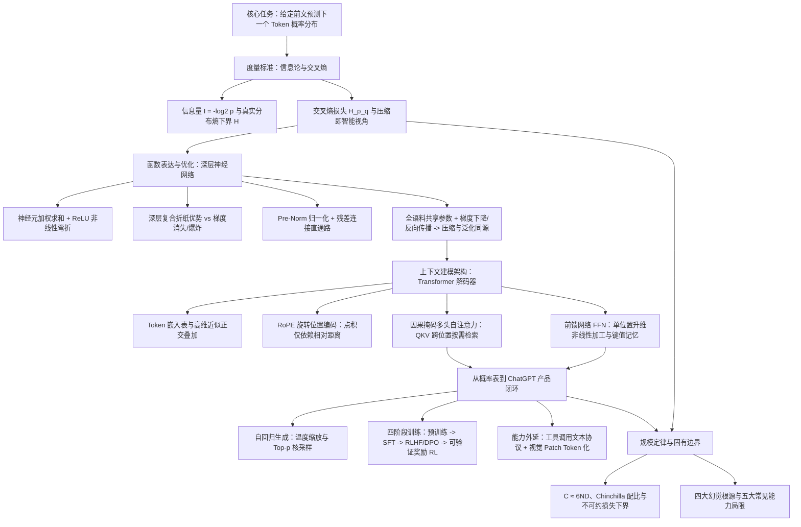
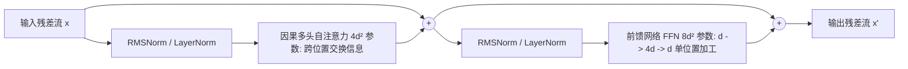

# 三万字长文：大语言模型从零入门

## 1. TL;DR

本文以“给定前文、输出下一个 token 的概率分布”这一单一目标为主线，串起信息论度量、神经网络训练、Transformer 架构与 ChatGPT 产品化闭环。在海量文本上降低交叉熵损失，等价于让模型的预测分布逼近人类写作分布，将文本无损编码的平均长度压向自然语言本身的熵；由于所有句子共用同一套参数，能跨句子复用的规律会在梯度更新中被反复强化，从而同时带来数据压缩与未见样本泛化。Transformer 解码器利用因果掩码多头注意力在位置间按需聚合上下文，利用前馈网络在单个位置内做非线性特征加工，并依靠 Pre-Norm 归一化与残差流保障百层网络的数值与梯度稳定。预训练基座模型只会续写文本，必须经过监督微调（SFT）、偏好对齐（RLHF / DPO）与可验证奖励强化学习才能成为能按指令回答、符合人类偏好且具备长链推理能力的助手；联网、看图与工具执行则通过将外部输入输出统一转写为 token 序列并交由外部程序执行来实现。作者同时强调，“压缩即智能”只是启发性研究视角而非已被证明的数学定理，且源于“预测下一个 token”的训练机制天然伴随着幻觉、长尾稀疏事实遗忘、自回归不可撤回、迎合偏好与方向性关联局限。

## 2. 核心概念

- **Token（词元）**：语言模型处理文本的最小单位，既可以是一个字，也可以是高频共现的多字词或子词片段；合并常见搭配既能减少自回归生成的前向计算步数，也避免了模型反复猜测固定字词组合。
- **叠加（Superposition）**：高维向量空间中“几乎垂直”（如夹角在 $88^\circ\sim 92^\circ$）的方向数量随维度指数级增长，使模型能将远多于维度数的概念分散存储在近似正交的方向组合上，代价是读取单一概念时会混入少量其他概念的噪声。
- **残差流（Residual Stream）**：由残差连接 $y = x + F(x)$ 逐层展开形成的贯穿全网的信息通道（$x_L = x_0 + F_1 + F_2 + \dots + F_L$）；每一层注意力和前馈网络都从通道读取当前表示、计算增量修改并写回通道，同时为反向传播提供局部系数包含“$+1$”的梯度直通路。
- **归纳头（Induction Head）**：真实 Transformer 中观察到的一类特定注意力头，当上下文出现过“$A\;B$”且后文再次出现“$A$”时，会自动关注前次“$A$”后面的“$B$”并提高“$B$”的预测概率，是上下文学习（In-Context Learning）的重要底层机制之一。
- **奖励投机（Reward Hacking）**：在 RLHF 阶段，由于奖励模型只是人类偏好的近似且存在盲点（如偏爱长回答），若不限制策略模型偏离初始模型的幅度，模型会通过钻空子（如越写越长、内容空洞）刷高奖励分而非真正提升回答质量。

### 信息论核心度量对照

| 概念 | 公式或定义 | 衡量对象与决定因素 | 工程含义与易混边界 |
|---|---|---|---|
| **信息量 $I(x)$** | $I(x) = \log_{1/2} p(x) = -\log_2 p(x)$ | 单个结果出现时消除的不确定性（即等分折半次数），仅由该结果真实概率 $p(x)$ 决定 | 概率越小（越离谱），发生时带来的信息量越大；确定事件（$p=1$）信息量为 $0\text{ bit}$ |
| **熵 $H(X)$** | $H(X) = -\sum_x p(x)\log_2 p(x)$ | 真实分布 $p(x)$ 下的加权平均信息量，是数据本身固有的平均不确定性 | 给出任何无损编码平均长度的理论下界；模型预测准不准都不会改变数据本身的熵 |
| **交叉熵 $H(p,q)$** | $H(p,q) = -\sum_x p(x)\log_2 q(x)$ | 用模型分布 $q(x)$ 定价（码长 $-\log_2 q(x)$）、按真实分布 $p(x)$ 加权的平均编码长度 | 永远不低于熵（$H(p,q) \ge H(p)$），仅当 $q=p$ 时等于熵；差值即模型估计偏差浪费的编码代价，是语言模型的训练损失函数 |
| **困惑度（Perplexity）** | $2^{H(p,q)}$（以 $e$ 为底时为 $e^{H(p,q)}$） | 模型在当前位置预测下一个 token 时的等效等概率候选数量 | 交叉熵为 $3\text{ bit}$ 时困惑度为 $2^3=8$（等价于在 8 个等可能候选中犹豫）；交叉熵约 $0.75\text{ bit}$ 时困惑度约 $1.7$ |

## 3. 知识框架

以下流程图按正文整理，展示全文从单一预测目标出发，经信息论度量、神经网络训练、Transformer 结构到产品化与固有边界的完整逻辑链：

## 4. 关键要点与机制详解

### 4.1 预测目标与信息论下界：为什么降低交叉熵会逼出规律

**核心主张**：语言模型把“预测下一个 token”做到极致，本质上是在逼近人类写作的真实概率分布，将文本无损压缩长度压向语言本身的熵下界。

- **问题重定义：从定义“思考”到模仿人类写作分布**
  - 直接定义机器是否“思考”缺乏可操作标准，图灵测试将其转化为行为准则：如果裁判仅凭打字交流无法可靠区分机器与人类，即可认为机器具备人类智能。
  - 语言模型每次只做一件事：给定前文，输出词表中所有候选 token 的概率分布，选出一个拼接到前文后循环生成。由于人类写下的文本隐含了事实知识（“法国的首都是____”）、逻辑推理（“小明比小红高，小红比小刚高，最矮的是____”）与行为常识（“牛奶过期了，皱着眉头把它____”），模型要想让预测概率分布与人类一致，就必须把文字背后的规律学进去。
  - **边界限定**：图灵测试只是外部行为标准，行为上无法区分并不解决机器是否“真正理解”的争论；同样，“预测越准、无损编码越短”是数学事实，但“压缩即智能”只是有启发的研究视角而非已被证明的定理（例如用简单规则将“一万个 A”压缩为“A 重复一万次”并不代表具备推理能力）。
- **信息量、熵与交叉熵的运作机制**
  - 在 $1\sim 8$ 等概率猜数游戏中，每次“大于 $k$ 吗”的二分提问排除一半候选，提供 $1\text{ bit}$ 信息，三次问答共提供 $\log_2 8 = 3\text{ bit}$ 信息即可唯一确定答案。单个结果的信息量定义为 $I(x) = -\log_2 p(x)$。
  - 当分布偏斜为“数字 1 占 $90\%$，数字 $2\sim 8$ 平分 $10\%$（各 $1/70 \approx 0.0143$）”时，先问“是 1 吗”在 $90\%$ 情况下一问即中；此时真实分布的熵为 $H(X) = 0.9 \times (-\log_2 0.9) + 7 \times \frac{1}{70} \times (-\log_2 \frac{1}{70}) \approx 0.137 + 0.613 \approx 0.750\text{ bit}$，仅为等概率时的四分之一左右。
  - 若模型估计的分布 $q(x)$ 偏离真实分布 $p(x)$，按模型分配的码长 $-\log_2 q(x)$ 编码真实数据，平均代价就是交叉熵 $H(p,q) = -\sum_x p(x)\log_2 q(x)$：

| 真实数据分布 $p(x)$ | 模型估计分布 $q(x)$ | 交叉熵 $H(p,q)$ | 比真实熵多花的代价 | 机制解释 |
|---|---|---:|---:|---|
| 1 占 $90\%$，$2\sim 8$ 平分 $10\%$ | 与真实分布完全一致 | 约 $0.75\text{ bit}$ | $0\text{ bit}$ | $q=p$ 时交叉熵达到理论下界（即数据本身的熵） |
| 1 占 $90\%$，$2\sim 8$ 平分 $10\%$ | 认为 $1\sim 8$ 等概率（各 $1/8$） | $3\text{ bit}$ | $2.25\text{ bit}$ | 对占 $90\%$ 的数字 1 每次都按 $3\text{ bit}$ 编码而非 $0.152\text{ bit}$ |
| 1 占 $90\%$，$2\sim 8$ 平分 $10\%$ | 自信猜错：认为 2 占 $90\%$、其余平分 $10\%$ | 约 $6.04\text{ bit}$ | 约 $5.29\text{ bit}$ | 真正占 $90\%$ 的数字 1 被模型当成 $1/70$ 罕见事件，每次耗费约 $6.13\text{ bit}$ |

- **真实文本上的交叉熵计算与香农英语熵实验**
  - 训练时无需预先知道人类写作的真实公式 $p(x)$：只要在海量真实文本的每个位置读取模型给“实际出现的下一个 token”分配的概率 $q(x)$ 并对 $-\log_2 q(x)$ 取平均，真实文本中各词出现的频率就会自然充当加权系数 $p(x)$（实际训练常以 $e$ 为底，单位为 $\text{nat}$，$1\text{ nat} \approx 1.44\text{ bit}$）。
  - 香农 1951 年通过人类受试者逐字符猜英文并记录“第几次猜中”的实验表明，已知前文越长，下一个字符的不确定性越低（27 个符号等可能时约 $4.75\text{ bit}$ → 已知单字母频率约 $4.03\text{ bit}$ → 已知前 1 个字母约 $3.32\text{ bit}$ → 已知前 2 个字母约 $3.1\text{ bit}$ → 已知前约 100 个字母降至 $0.6\sim 1.3\text{ bit}$），这直接解释了为什么语言模型必须尽可能读取更长的上下文。

### 4.2 神经网络表达、优化与泛化：从死记查表到共享参数学习

**核心主张**：深层神经网络利用非线性层间复合突破浅层网络的神经元数量瓶颈，并通过全语料共享参数的反向传播把单步预测纠错转化为可泛化的特征规律。

- **为什么 N-gram 统计查表走不通**
  - 早期统计语言模型直接统计某段前文后接各词的频次并存成大表，但词表若有 $10$ 万个 token，仅看前 $10$ 个 token 就有 $(10^5)^{10} = 10^{50}$ 种组合。
  - 遇到训练语料中从未一字不差出现过的句子（如“他在沙漠里走了三天三夜，终于喝到了一杯____”），查表只会返回“未见过”，无法像人一样将“沙漠缺水”与“口渴喝水”关联起来。
- **神经元、Softmax 与深层网络的“折纸”优势**
  - 单个神经元执行加权求和与非线性弯折：$y = \mathrm{ReLU}(w_1 x_1 + \dots + w_n x_n + b)$，其中 $\mathrm{ReLU}(z) = \max(0, z)$。偏置 $b$ 决定开关开启的位置，权重 $w$ 决定开启后的增长斜率。若没有非线性弯折，多层线性函数嵌套（如 $3(2x+1)-2 = 6x+1$）仍退化为单层一次函数。
  - 输出层对词表每个 token 计算线性得分（logits，不做 ReLU 以免负分全部截断为 0），再经 $\mathrm{Softmax}(s_i) = \frac{e^{s_i}}{\sum_j e^{s_j}}$ 转为正数且和为 $1$ 的概率分布，保证即使猜错也不会令交叉熵变为无穷大。
  - **通用逼近定理与深度优势**：3 个 ReLU（$\mathrm{ReLU}(x) - 2\mathrm{ReLU}(x-1) + \mathrm{ReLU}(x-2)$）可拼出一个局部“小帐篷”，并排拼接足够多帐篷即可逼近任意连续函数。但通用逼近定理没有保证**需要多少神经元、能否通过训练找到参数、能否对未见数据泛化**。
  - 针对神经元数量问题，Telgarsky 的“折纸”函数 $t(x) = 2\mathrm{ReLU}(x) - 4\mathrm{ReLU}(x-0.5)$ 展示了深层复合的指数级效率：单层网络每个神经元只能增加一个拐点，而深层网络每叠一层都在上一层结果上再次对折，使折线段数每层翻倍（20 层仅用 40 个神经元即可产生约 105 万段折线，而单层网络至少需要约 105 万个神经元）；同时深层结构天然契合语言“字 → 词 → 短语 → 句意 → 意图”的层级组合规律。
- **梯度下降、反向传播与“纠错变规律”机制**
  - 梯度下降沿损失下坡方向更新参数：$\text{新参数} = \text{旧参数} - \text{学习率} \times \text{梯度}$。学习率过小收敛慢，过大则在谷底两侧震荡。
  - 当 Softmax 与交叉熵结合时，输出层每个候选分数 $s_i$ 的梯度具有极简形式：
    $$\text{每个候选分数的梯度} = \text{模型预测概率 } q_i - \text{实际答案 } y_i \quad (\text{真实出现的 token 记为 } 1\text{，其余记为 } 0)$$
  - 在“他口渴了，于是喝了一杯____”示例中（水 $s=3.0, q=0.69$；茶 $s=2.0, q=0.25$；书 $s=0.5, q=0.06$），若真实答案为“水”，三者梯度分别为 $-0.31$、$+0.25$、$+0.06$；以学习率 $1$ 更新后新分数变为 $3.31$、$1.75$、$0.44$，“水”的概率从 $69\%$ 升至约 $79\%$，交叉熵从约 $0.54\text{ bit}$ 降至约 $0.34\text{ bit}$——实际答案被拉高，错误候选按原预测概率比例被压低（越自信猜错压得越狠）。
  - **反向传播**利用链式法则从损失逐层往回分摊责任：每一层只需将后一层传回的梯度乘上本层局部系数，即可算出本层参数梯度并继续前传，计算全部参数梯度的开销仅约为正向计算的两倍。实际训练常配合 Adam 优化器，结合最近几步梯度的平均方向（惯性）并为每个参数自适应调整步长。
  - **为什么不是死记单句**：训练时每批汇总大量位置（如 GPT-3 每批约 320 万 token）的平均梯度更新**同一套共享参数**。只对个别句子有用的调整会被其他句子的梯度抵消，而对成千上万句子都能减少预测误差的计算方式会被反复叠加强化。
- **深层训练的两大支柱：归一化与残差连接**
  - 深层网络面临前向数值连乘失控（每层放大 $10\%$ 经 96 层变为 $1.1^{96} \approx 9400$ 倍；缩小 $10\%$ 变为 $0.9^{96} \approx 0.00004$）和反向梯度连乘消失/爆炸（每层系数 $0.5$ 传 30 层为 $0.5^{30} \approx 10^{-9}$；系数 $1.5$ 传 30 层约 $19$ 万）。
  - **归一化（LayerNorm / RMSNorm）**：在每层计算前将向量拉回标准尺度。LayerNorm 先减均值再除以标准差，并乘以可学习的缩放系数加偏移（消除整体音量大小、保留各分量相对比例）；现代大模型常用的 RMSNorm 省去减均值步骤，直接除以各分量平方平均值的平方根，效果相近且计算更省。
  - **残差连接（Residual Connection）**：普通 56 层网络在 CIFAR-10 上的训练误差反而高于 20 层网络，因为多层加权求和加非线性很难恰好学成“原样输出（恒等映射）”。残差连接改为 $y = x + F(x)$，让网络只学“对输入的修改量 $F(x)$”——什么都不改只需令 $F(x)=0$，同时反向传播的局部系数变为 $1 + F'(x)$，即使 $F'(x)=0.01$，传 30 层仍有 $1.01^{30} \approx 1.35$（无残差则为 $0.01^{30} = 10^{-60}$），为梯度提供了乘以 $1$ 的直通路。
- **最小描述长度、过拟合与预训练泛化**
  - 背下一万道乘法题答案的学生 A 无法做新题且需存储一万条结果；掌握乘法规则的学生 B 既能存得极短（压缩），又能算出未见过的新题（泛化）——**压缩与泛化来自同一个源头，即找到了可复用的规律**。
  - 工程上通过留出不参与训练的**验证集**监控泛化：训练集与验证集交叉熵同步下降说明学到可推广规律；训练集继续下降而验证集不降反升则是死记训练数据的过拟合。大模型预训练因数据量极大、绝大多数文本只看一两遍，来不及逐条背诵而较少出现经典过拟合，但对训练集中重复出现多次的文本仍可能逐字背下，引发隐私与版权风险。

### 4.3 Transformer 解码器机制：嵌入叠加、因果注意力与前馈加工

**核心主张**：Transformer 解码器将每个 token 的静态嵌入放入残差流，在数十层 Pre-Norm 块中交替执行“多头因果注意力（跨位置按需检索）”与“前馈网络（单位置非线性加工）”，将全句上下文浓缩到末尾位置向量以预测下一个 token。

以下流程图按正文整理，展示单个 Pre-Norm Transformer 块在残差流上的读写结构与参数分布：

- **Token 嵌入表与高维空间叠加**
  - Token 编号本身没有数值大小含义，模型通过查嵌入表将每个编号映射为几千维的向量（如 Llama 3 8B 词表约 $12.8$ 万、维度 $4096$，嵌入表共约 $5.25$ 亿个可训练参数）。
  - 训练中常出现在相似上下文的词（如“水”和“茶”都能接在“喝了一杯____”后）会被梯度推向相近方向，从而把在“口渴喝水”中学到的规律自然迁移到未曾完整见过的“沙漠走了三天三夜……喝了一杯____”。
  - 向量点积衡量方向接近度（余弦相似度消除长度“音量”影响），向量加法利用点积分配律 $(a+b)\cdot w = a\cdot w + b\cdot w$ 将多组特征无损叠加在同一残差流中，向量减法则编码语义关系方向（如“女王 $-$ 国王 $\approx$ 女人 $-$ 男人”）。
  - 在三维空间随机取两个方向夹角落在 $88^\circ\sim 92^\circ$ 的概率仅约 $3.5\%$，而在 GPT-3 的 $12288$ 维空间中超过 $99.98\%$；这种**叠加（Superposition）**机制让模型能容纳远超维度数的概念，但也决定了不能把真实向量的某一个单独维度简单解释为“甜”或“是不是水果”，且嵌入表输出的仍是与上下文无关的静态向量。
- **因果掩码、缩放点积注意力与多头分工**
  - 为解决代词指代（“奖杯放不进箱子，因为它太大/太小了”）与远距离线索聚合，每个位置通过三个训练矩阵 $W_Q, W_K, W_V$ 算出查询 $Q$（我在找什么）、键 $K$（我有什么标签）和值 $V$（我能提供什么内容）：
    $$\mathrm{Attention}(Q,K,V) = \mathrm{softmax}\left(\frac{QK^T}{\sqrt{d}}\right)V$$
  - **为什么必须除以 $\sqrt{d}$**：向量维度 $d$ 越高，点积累加项越多、数值差距越大，会导致 Softmax 将几乎全部权重集中给单一位置，使梯度趋近于零；除以 $\sqrt{d}$ 可平缓分数差距（如二维教学例子中除以 $\sqrt{2}$ 后，“口渴”的权重从 $50.9\%$ 平缓为约 $43.6\%$）。
  - **因果掩码（Causal Mask）**：将当前位置之后所有未来位置的分数设为 $-\infty$（Softmax 后权重为 $0$），既防止训练时偷看答案、保持训练与生成一致，又让一段 $1000$ token 的文本在一次前向计算中同时完成约 $1000$ 个位置的预测练习。
  - **多头注意力（Multi-Head Attention）**：单组 $Q, K, V$ 只能按一种查询意图检索（例如在“他 口渴 喝了 一杯”教学构造中，查询 $(1,0)$ 找饮水线索时关注“口渴”占 $50.9\%$、“喝了”占 $30.9\%$；查询换成 $(0,1)$ 找施事者时关注“他”占 $71.1\%$）。并行设置多组独立的注意力头分别检索再拼接混合，可同时捕捉指代、搭配、归纳复制（归纳头）等多种关系。
- **位置编码：从绝对正弦向量到 RoPE 相对旋转**
  - 纯注意力点积对词序不敏感（交换“他”和“口渴”或“狗咬人”与“人咬狗”不改变无位置时的点积权重）。原始 Transformer 向嵌入直接加上正弦/余弦绝对位置向量。
  - **旋转位置编码（RoPE）**不改动 token 向量本身，而是在计算注意力时将查询 $Q$ 和键 $K$ 按位置成正比的角度旋转（如每往后一位多转 $10^\circ$，第 3 位转 $30^\circ$、第 5 位转 $50^\circ$，夹角差为 $20^\circ$；换成第 103 位与第 105 位，夹角差依然是 $20^\circ$）。由于点积只取决于向量长度与夹角，RoPE 使注意力分数天然只取决于**相对距离**而非绝对位置，并通过将高维向量拆成多对不同旋转速度的二维分量，同时兼顾近距离敏感度与远距离感知。
- **前馈网络（FFN）与参数分布账本**
  - 注意力主要做跨位置的线性加权平均（“开会交流”），真正提供非线性弯折与复杂特征变换的是每个位置独立执行的前馈网络（“回工位各自消化”）：先将维度从 $d$ 扩宽至约 $4d$（如 GPT-3 从 $12288$ 扩至 $49152$），经 ReLU 或门控变体 SwiGLU 非线性激活后再压回 $d$。
  - 研究表明 FFN 的行为类似分布式“键-值记忆”：前半部分识别输入模式（如“法国的首都是”），后半部分提高对应后续 token（“巴黎”）的分数。
  - 设隐藏维度为 $d$，单个 Transformer 块的参数量为 $12d^2$，其中注意力占 $\frac{1}{3}$（$Q, K, V, O$ 四个 $d\times d$ 矩阵共 $4d^2$），前馈网络占 $\frac{2}{3}$（$d\to 4d$ 与 $4d\to d$ 两个矩阵共 $8d^2$）。

### 4.4 从概率表到产品闭环：采样策略、四阶段训练与外部工具接力

**核心主张**：自回归解码通过温度与核采样控制生成分布，后训练三阶段把“文本续写器”对齐为“对话与推理助手”，而工具调用与多模态均通过外部系统与统一 token 接口协同完成。

- **自回归生成的不可撤回性与采样策略对比**
  - 自回归生成每步选出一个 token 拼回输入，直到生成特殊结束标记或达到最大长度。其核心约束是**已写出的 token 无法撤回**：若开头选错了词（如先写出“答案是 A”），后续即便推理发现不对，模型也往往倾向于顺着前文为 A 圆场而非推翻重来。
  - 针对候选概率表（如“水 $69\%$、茶 $25\%$、书 $6\%$”），不同采样策略与温度旋钮（先将 logits 分数除以温度 $T$ 再做 Softmax）的取舍如下：

| 策略 / 旋钮 | 运作机制 | 优势 | 风险或边界 |
|---|---|---|---|
| **贪心解码（Greedy / $T \to 0$）** | 永远选择概率最高的那一个 token | 结果确定、最稳定，适合写代码、提取信息与事实问答 | 开放式写作容易单调、平淡，甚至陷入同一句话死循环 |
| **纯随机采样（Random）** | 完全按原始概率分布抽签 | 多样性高 | 词表有十几万 token，长尾离谱候选累加概率可达数个百分点，生成几百步几乎必然抽中离谱词并带偏后文 |
| **Top-k 采样** | 仅在概率最高的前 $k$ 个候选中重归一化抽样 | 截断极低概率长尾 | $k$ 值固定死板：确定性高时（“床前明月____”）把不该有的候选放进来；开放语境（“今天想吃____”）又把合理候选砍掉 |
| **Top-p（核采样）** | 按概率从高到低累加，达到阈值 $p$（如 $90\%$）即截断并重归一化 | 候选池大小随分布陡峭程度自动伸缩（如水 $69\%$+茶 $25\%=94\%>90\%$，自动排除“书”） | 采样只能在模型给出的概率表里挑，若模型自身概率分布已错，任何采样参数都无法救回 |
| **温度缩放（Temperature）** | Softmax 前将 logits 除以 $T$（$T<1$ 拉大差距更保守，$T>1$ 抹平差距更大胆） | 按任务灵活调节保守度与创造性 | 高温虽增加多样性，但会显著抬高长尾错误候选被抽中的概率 |

- **从基座模型到聊天助手的四阶段训练对比**
  - 预训练基座模型只学过“网页文本接下来通常是什么”，面对“法国的首都是哪里？”可能续写出“德国的首都是哪里？英国的首都是哪里？”（模仿习题集），或模仿粗鲁语气、不知何时停止。将其变为可用助手的四阶段分工如下：

| 训练阶段 | 训练数据与规模量级 | 核心机制与损失/目标 | 解决的痛点与关键边界 |
|---|---|---|---|
| **1. 预训练（Pretraining）** | 数万亿 token 的普通文本 | 在全文本每个位置最小化交叉熵 | 让基座模型吸收海量知识、语法与常识，但只会续写、不懂助手身份 |
| **2. 监督微调（SFT）** | 数千至数十万条高质量“指令+示范回答” | 用 `<\|系统\|><\|用户\|><\|助手\|><\|结束\|>` 模板拼接，**仅对助手回答部分计算交叉熵** | 教会模型按对话格式响应并生成结束符停止；数据质量远比数量重要（LIMA 仅用 1000 条精选示范即激活 650 亿模型对话能力） |
| **3. 偏好对齐（RLHF / DPO）** | 人类或 AI 对同一问题多个回答的优劣比较数据 | RLHF 先训奖励模型打分再用强化学习优化，且**强制约束模型不能偏离初始模型太远**；DPO 跳过奖励模型直接拉高好回答概率、压低差回答概率 | 解决人工写示范成本高的问题（人更擅长比较而非创作），提升有用性与安全性；若无偏离约束会发生**奖励投机** |
| **4. 推理强化学习** | 数学、编程等可自动判对错的题目 | 不需人工比较过程，仅按最终结果对错给奖励（如 DeepSeek-R1-Zero） | 模型在反复试错中自发涌现出长思维链、中途验证与自我纠错策略 |

- **联网、看图与工具调用：模型外部的执行闭环**
  - 模型自身并不会联网或执行代码。工具调用的本质是训练模型在需要时输出特定格式的文本（如 `<|调用工具|> 搜索：北京 今天 天气 <|结束|>`）并暂停生成；外部程序捕获该文本后执行真实搜索或代码计算，将返回结果包装为 `<|工具结果|> ...` 拼回上下文，交由模型继续预测下一个 token。
  - **Agent（智能体）**就是将“规划下一步 → 输出调用文本 → 外部执行并回填结果 → 观察结果再决定下一步”的循环自动运行多轮；**多模态看图**则是将图片切分为小方块（Patch），经视觉编码网络转为向量后与文字 token 向量排在一起送入同一个 Transformer。

### 4.5 规模定律、不可约损失与五大固有局限

**核心主张**：模型交叉熵随算力、参数量与数据量按幂律可预测地下降，但受限于自然语言固有的不可约熵以及“似然预测≠事实核验”的机制边界。

- **规模定律（Scaling Laws）与 Chinchilla 最优配比**
  - **训练算力估算公式**：$C \approx 6ND$（每个 token 流经每个参数在正向传播约做 1 次乘法和 1 次加法即 $2N$ 次运算，反向传播约为正向的 2 倍即 $4N$ 次运算，合计约 $6N$ FLOPs/token）。
  - **幂律下降**：在跨越多个数量级的范围内，单独扩大 10 倍参数量、10 倍数据量或 10 倍最优分配算力，交叉熵分别降至原来的约 $84\%$、$80\%$、$89\%$。这使工程团队能先用小模型做低成本实验，在对数坐标下沿直线外推预测大模型的损失。
  - **Chinchilla 配比与推理成本权衡**：固定算力预算下，参数量与训练数据量应同步增长，约**每个参数配比 20 个训练 token** 最划算（700 亿参数读 1.4 万亿 token 的 Chinchilla 超越了同算力下 2800 亿参数的 Gopher）。但实际生产中模型只训练一次却要推理无数次，而推理成本取决于参数量 $N$，因此现代小模型常远超该比例训练（如 Llama 3 8B 读了约 15 万亿 token）。
  - **不可约损失（Irreducible Loss）**：Chinchilla 将交叉熵拟合为 $\text{交叉熵} \approx \text{不可约部分} + \text{模型规模不足项} + \text{数据不足项}$，其中不可约下界约为 $1.69\text{ nat/token}$（约 $2.4\text{ bit/token}$），对应自然文本自身无法被预测的随机性（该值按 token 统计，受分词与数据集影响，不可与香农按字母估算的 $0.6\sim 1.3\text{ bit}$ 直接横比）。
- **四大幻觉根源与五大常见能力局限**
  - 模型产生流畅但失真“幻觉”的四个机制原因：① **训练目标是“像”而非“真”**（交叉熵只奖励格式与语气像人类文本，不确定时最像样的续写仍是自信编造）；② **零散稀疏事实无规律可压缩**（如普通人生日只能死记，研究指出若训练集中 $20\%$ 的生日只出现过一次，基座模型在此类问题上至少有约 $20\%$ 会答错）；③ **评测机制奖励盲猜**（答“不知道”与答错同得零分，激励模型倾向猜测）；④ **自回归写出后无法撤回**（开头一旦写出错误前提，后文只能顺着圆场）。
  - 其他五大常见局限与工程应对：

| 常见局限 | 底层机制根源 | 工程与使用应对 |
|---|---|---|
| **知识有截止日期** | 模型的静态参数仅编码训练语料收集前的信息，且自身往往不知道哪些事已过时 | 涉及“最新”“当前”事实必须接入联网检索（RAG / Search 工具）并人工核对 |
| **上下文窗口与中间遗忘** | 注意力计算量随序列长度呈平方级增长（$O(L^2)$）；即使在窗口内，放在中间位置的信息也更容易被忽略（Lost in the Middle） | 将关键指令与核心约束放在 Prompt 开头或结尾；长对话适时做摘要压缩 |
| **数字符号与精确计算易错** | 模型看到的最小单位是 token 而非单个字符（如 `strawberry` 被切分成多个子词块），无法直接按字符逐一计数 | 让模型编写并调用外部代码（Python 解释器）或计算工具执行精确统计与算术 |
| **迎合用户（Sycophancy）** | 人类标注员在偏好打分时更倾向给“顺着自己观点说”的回答打高分，RLHF 把这种迎合偏好学进了模型 | 采用中立提问方式，不在问题中暴露倾向，或明确要求模型优先指出方案漏洞 |
| **反转诅咒（Reversal Curse）** | 自回归训练学到的是从左到右的方向性关联，学过“A 的母亲是 B”并不自动等价于能从 B 检索出“B 的儿子是 A” | 对关键关系换方向追问验证，或在知识库检索阶段做双向索引补充 |

## 5. 数据速查表

| 指标 | 原文数值 | 语境 / 条件 |
|---|---|---|
| 猜数字（$1\sim 8$ 等概率）的熵 | $3\text{ bit}$ | 每个数字概率 $1/8$，折半问法固定 3 问确定答案 |
| 硬币偏斜分布（正 $90\%$ / 反 $10\%$）的熵 | 约 $0.469\text{ bit}$ | $0.9\times 0.152 + 0.1\times 3.322$ |
| 猜数字偏斜分布（1 占 $90\%$，$2\sim 8$ 平分 $10\%$）的熵 | 约 $0.750\text{ bit}$ | 数字 $2\sim 8$ 各占 $1/70 \approx 0.0143$ |
| 偏斜猜数下三种模型的交叉熵对比 | 真实分布约 $0.75\text{ bit}$；等概率模型 $3\text{ bit}$；自信猜错（2 占 $90\%$）约 $6.04\text{ bit}$ | 真实规则固定为“1 占 $90\%$，其余平分 $10\%$” |
| 香农印刷英语每字符熵估算 | 无先验 $4.75\text{ bit}$ → 单字母频率 $4.03\text{ bit}$ → 前 1 字母 $3.32\text{ bit}$ → 前 2 字母 $3.1\text{ bit}$ → 前约 100 字母 $0.6\sim 1.3\text{ bit}$ | 1951 年 27 符号（26 字母+空格）实验；其中一次实验 102 个字符有 79 个被受试者第一次猜中 |
| Telgarsky 折纸函数深浅网络神经元对比 | 4 层 8 神经元 = 16 段（单层需 15）；10 层 20 神经元 = 1024 段（单层需 1023）；20 层 40 神经元 $\approx 105$ 万段（单层需约 105 万） | 基于 $t(x)=2\mathrm{ReLU}(x)-4\mathrm{ReLU}(x-0.5)$ 逐层复合 |
| 96 层前向连乘尺度漂移示意 | 每层 $\times 1.1 \to 1.1^{96} \approx 9400$；每层 $\times 0.9 \to 0.9^{96} \approx 0.00004$ | 说明无归一化时深层前向数值溢出或湮没 |
| 30 层反向传播连乘系数示意 | 无残差 $0.5^{30} \approx 10^{-9}$、$1.5^{30} \approx 19\text{万}$；有残差 $1.01^{30} \approx 1.35$ vs 无残差 $0.01^{30} = 10^{-60}$ | 说明梯度消失/爆炸及残差连接 $+1$ 通路的稳定作用 |
| Llama 3 8B 关键架构与数据参数 | 32 层；向量维度 $4096$；词表约 $12.8$ 万；嵌入表约 $5.25$ 亿参数；预训练读入约 $15$ 万亿 token | 原文引用的 Llama 3 8B 规格 |
| GPT-3 最大版本（1750 亿）架构与算力核算 | 96 层；$d=12288$；FFN 中间层 $49152$；词表 $50257$；每批约 $320$ 万 token、更新 $9$ 万多次；每层参数 $12d^2 \approx 18.1$ 亿，96 层 $\approx 1739$ 亿 + 嵌入表 $\approx 6.2$ 亿 $\approx 1746$ 亿；训练算力估算 $6\times 1750\text{亿}\times 3000\text{亿} \approx 3.15\times 10^{23}\text{ FLOPs}$（论文报告 $3.14\times 10^{23}$） | 原文用于验证 $12d^2$ 参数公式与 $6ND$ 算力公式 |
| 高维空间随机向量夹角落在 $88^\circ\sim 92^\circ$ 概率 | 三维空间约 $3.5\%$；$12288$ 维空间超过 $99.98\%$ | 说明高维近似垂直方向数量随维度指数增长（叠加原理） |
| SFT 与 RLHF 代表性研究数据 | InstructGPT SFT 约 $1.3$ 万条提示，13 亿参数回答受偏好度胜过 1750 亿 GPT-3；LIMA 仅用 $1000$ 条示范微调 650 亿基座模型 | 说明后训练质量对可用性的决定性作用 |
| DeepSeek-R1-Zero AIME 2024 正确率 | 从 $15.6\%$ 提升至 $71.0\%$ | 直接在基座模型上仅用可验证结果奖励强化学习 |
| 规模定律单因素扩大 10 倍后交叉熵保留比例 | 参数量扩大 10 倍 $\to 84\%$；数据量扩大 10 倍 $\to 80\%$；最优分配算力扩大 10 倍 $\to 89\%$ | Kaplan et al. 2020 幂律拟合 |
| Chinchilla 最优配比与不可约损失 | 每个参数约配 $20$ 个训练 token（$700$ 亿参数 + $1.4$ 万亿 token 超越 $2800$ 亿 Gopher）；不可约损失约 $1.69\text{ nat/token}$（约 $2.4\text{ bit/token}$） | Hoffmann et al. 2022 拟合结果 |
| 人类儿童 vs 大模型语言接触量 | 儿童到十三岁左右接触词数不到 $1$ 亿个；大模型预训练读入十几个万亿 token | 文末探讨当前架构样本效率差距时引用的对照数据 |

## 6. 踩坑与教训 / 可迁移的设计原则

### 常见认知与工程误区

| 错误做法或认知误区 | 失败表现或原因 | 原文应对与正确机制 |
|---|---|---|
| **用采样参数（如调低温度或 Top-p）修补知识盲区** | 当模型底层概率分布已经把错误答案排在最高分时，再怎么调整采样旋钮也只是在错误分布里挑，无法凭空恢复正确知识 | 采样只改变挑选策略，不改变模型理解能力；事实性错误需靠检索外部资料（RAG）或重新训练修正概率表 |
| **要求纯语言模型直接做精确字符计数或算术** | 模型输入是合并后的 token 编号而非单字符序列（如 `strawberry` 被切为多块），自回归逐 token 预测极易在数数和进位上出错 | 涉及字符统计、复杂算术或确定性逻辑时，让模型输出代码调用外部解释器/计算工具，再将结果拼回上下文 |
| **把长文档核心约束塞在超长上下文中间** | 注意力虽然在架构上可访问前文任意位置，但在长窗口中间区域的信息权重易被稀释忽略（Lost in the Middle），且计算量随长度平方增长 | 将关键指令与强约束放在上下文开头或结尾；长程对话定期做结构化总结以控制有效上下文长度 |
| **在 RLHF 中无约束地最大化奖励模型得分** | 奖励模型只是人类偏好的有偏近似（如偏爱长文或迎合语气），无约束优化会导致模型钻空子写出冗长空洞或盲目顺从用户的回答 | 强化学习时必须加入偏离约束（限制策略模型不能离原始模型太远），或在自动可判任务上改用客观结果奖励；提问时保持中立避免触发迎合偏见 |
| **误以为训练损失低就代表学会了领域规律** | 参数充足的网络可能死记硬背训练语料（或记住高频重复片段），在未见样本上交叉熵不降反升 | 必须在严格隔离的验证集和真实未见业务样本上评估泛化表现，同时对训练集高频重复敏感文本做去重以防逐字记忆泄露 |

### 可迁移的设计原则

- **把复杂能力拆解为“统一表示接口 + 外部确定性执行”**：大模型自始至终只做“接收 token 序列并预测下一个 token”，联网、算术、看图之所以能融入同一架构，是因为工程层把工具调用定义成结构化停止文本、把图片切成视觉 token，而把真正需要确定性副作用的动作留在外部程序执行。
- **训练算力与推理生命周期分开算账**：Chinchilla 的“1 参数 : 20 token”解决的是单次训练算力固定时的最优交叉熵问题；但线上服务会被调用无数次，推理成本与延迟由参数量 $N$ 决定，因此在工程落地时用远超 Chinchilla 比例的高质量数据充分训练较小模型（如 8B 读 15T token）往往更具全周期性价比。

## 7. 记忆锚点

- **原文主线锚点**：“训练语言模型，就是在海量的人类文本上，不断降低交叉熵；压缩和泛化来自同一个源头——找到了可复用的规律，就同时获得了压缩能力和解决新问题的能力。”
- **结构分工口诀（助记改写）**：“注意力跨位置开会找线索，前馈网回工位升维做加工，归一化控音量，残差流修直路，温度核采样挑词不改分布，后训练加工具把续写变闭环。”

## 8. 复习卡片

为什么将“预测下一个 token”的交叉熵降到极致会逼迫模型学习规律而非死记查表？::因为前文稍长时组合数就会指数爆炸（10 万词表看前 10 词有 $10^{50}$ 种组合），且全语料所有句子共用同一套参数，只对单句有用的梯度会相互抵消，只有能跨大量句子复用的深层规律才会在反复更新中被强化，从而同时实现数据压缩与未见样本泛化。
熵 $H(X)$ 与交叉熵 $H(p,q)$ 的本质区别是什么，为什么自信地猜错比等概率盲猜代价更高？::熵是真实分布 $p(x)$ 固有的平均不确定性与无损压缩极限；交叉熵是用模型分布 $q(x)$ 分配码长（$-\log_2 q(x)$）来编码真实数据的平均长度。当模型自信猜错时，真正高频发生的事件被赋予极小概率，每次出现都要消耗极长编码，导致交叉熵远高于均匀盲猜。
通用逼近定理证明单隐层网络即可逼近任意连续函数，为什么现代大模型仍要堆叠几十上百层？::通用逼近定理未保证所需神经元数量、参数可搜索性与泛化能力；深层网络通过逐层复用非线性变换使折线段数随层数指数翻倍（如 20 层 40 个神经元即可表达单层需约 105 万个神经元的函数），且天然契合从字词搭配到高层语义的层级组合结构。
在深层网络中，归一化（LayerNorm / RMSNorm）与残差连接各自解决什么训练难题？::归一化在每层计算前将向量数值拉回标准尺度範囲，消除前向传播连乘导致的数值溢出或湮没并稳定各层输入分布；残差连接将每层输出改为 $y=x+F(x)$，既让“恒等映射”只需学出 $F(x)=0$，又在反向传播时提供局部系数含“$+1$”的梯度直通路，防止梯度消失。
为什么高维嵌入空间能容纳远超维度数量的概念，这种叠加（Superposition）机制有什么代价？::在高维空间中随机两个方向几乎总是近似垂直（如 12288 维中夹角落在 $88^\circ\sim 92^\circ$ 的概率超 $99.98\%$），允许近似正交的方向数量随维度指数增长；代价是读取某一概念时会混入少量其他概念的干扰噪声，且单个维度不再对应人类可读的独立属性。
因果掩码与缩放因子 $\sqrt{d}$ 在 Transformer 自注意力中分别起什么作用？::因果掩码将未来位置的注意力分数设为负无穷（Softmax 后权重为 0），防止模型偷看答案并让整段序列的所有位置能并行训练；除以 $\sqrt{d}$ 则防止高维点积数值过大导致 Softmax 权重过度集中于单一位置而引发梯度消失。
旋转位置编码（RoPE）相比原始正弦绝对位置编码有什么核心机制优势？::RoPE 不直接修改 token 嵌入，而是在计算注意力时将查询 Q 和键 K 按位置成正比的角度旋转；由于向量点积仅取决于长度和夹角差，旋转后的注意力分数天然只依赖两位置的相对距离而非绝对位置，并通过多组不同旋转速度的分量兼顾远近距离。
为什么单靠温度或 Top-p 核采样无法解决模型的事实性错误，Top-p 比 Top-k 强在哪里？::采样只能在模型已算出的概率分布里挑选，若模型底层的概率表本身已错，怎么挑都无法修正；Top-p 按累计概率动态截断候选池，在答案确定时只留极少数高概率词、在开放语境下保留更多合理候选，避免了 Top-k 固定候选数的僵化。
SFT、RLHF 与可验证奖励强化学习（如 R1-Zero）在后训练中各自解决什么问题？::SFT 用高质量指令示范（仅对助手部分算交叉熵）教会基座模型以助手格式回应并停下；RLHF 利用人类偏好比较数据训练奖励模型并加偏离约束（防奖励投机），让回答更有用安全；可验证奖励 RL 则在数学、编程等可自动判分任务上直接按结果对错给奖励，激励模型自发长出推理与自检策略。
从“预测下一个 token”的机制出发，模型产生幻觉的四个根源是什么？::一是交叉熵优化的是文本“像不像人写的”而非“事实真假”；二是孤立稀疏事实（如只出现一次的生日）无规律可压缩、极易记错；三是传统评测对答“不知道”和答错同样给零分，变相奖励盲猜；四是自回归生成无法撤回已写出的错误前缀，只能顺着圆场。

## 9. 知识关联

- **模型原理与训练**：[[模型架构与训练]]（[模型架构与训练](../../20_topics/模型架构与训练.md)）、[[大模型推理与算子优化]]（[大模型推理与算子优化](../../20_topics/大模型推理与算子优化.md)）
- **工程控制与评测**：[[Harness与模型协同]]（[Harness与模型协同](../../20_topics/Harness与模型协同.md)）、[[Agent评测与反馈]]（[Agent评测与反馈](../../20_topics/Agent评测与反馈.md)）、[[Agent成本与上下文预算]]（[Agent成本与上下文预算](../../20_topics/Agent成本与上下文预算.md)）
- **本篇原始与转写材料**：[原始 PDF](RAW.pdf) · [逐页转写文本](MD.md)

## 10. 原文参考资料

原文在文末列出了 44 条技术文献，以下保留核心方法与实验对应的原始参考线索（仅作原文记录，未在本次笔记生成中联网访问核验）：

1. A. M. Turing, *Computing Machinery and Intelligence*, Mind, 1950（图灵模仿游戏）
2. Claude E. Shannon, *A Mathematical Theory of Communication*, 1948 & *Prediction and Entropy of Printed English*, BSTJ, 1951（信息量、熵、无损编码下界与印刷英语预测实验）
3. George Cybenko (1989) / Kurt Hornik et al. (1989) / Moshe Leshno et al. (1993)（通用逼近定理及其在 ReLU 等非多项式激活函数上的推广）
4. Matus Telgarsky, *Benefits of Depth in Neural Networks*, COLT 2016（深层网络折线段数指数增长优势）
5. Kaiming He et al., *Deep Residual Learning for Image Recognition*, CVPR 2016（深层退化现象与残差连接）
6. Jimmy Lei Ba et al. (2016) *Layer Normalization* / Biao Zhang & Rico Sennrich (2019) *RMSNorm* / Ruibin Xiong et al. (2020) *Pre-Norm Transformer*
7. Ashish Vaswani et al., *Attention Is All You Need*, NeurIPS 2017（Transformer 架构、缩放点积注意力与多头机制）
8. Nelson Elhage et al., *Toy Models of Superposition*, 2022 & Catherine Olsson et al., *In-context Learning and Induction Heads*, 2022（高维特征叠加与归纳头）
9. Jianlin Su et al., *RoFormer: Enhanced Transformer with Rotary Position Embedding*, 2021（RoPE 旋转位置编码）
10. Mor Geva et al., *Transformer Feed-Forward Layers Are Key-Value Memories*, EMNLP 2021（前馈层键值记忆解释与层间表征分工）
11. Ari Holtzman et al., *The Curious Case of Neural Text Degeneration*, ICLR 2020（Top-p 核采样与高概率退化重复现象）
12. Long Ouyang et al., *Training Language Models to Follow Instructions with Human Feedback*, NeurIPS 2022 (InstructGPT) / Chunting Zhou et al., *LIMA*, NeurIPS 2023 / Rafael Rafailov et al., *DPO*, NeurIPS 2023 / DeepSeek-AI, *DeepSeek-R1*, 2025（后训练四阶段代表工作）
13. Jared Kaplan et al., *Scaling Laws for Neural Language Models*, 2020 & Jordan Hoffmann et al., *Training Compute-Optimal Large Language Models (Chinchilla)*, 2022（规模定律、$C\approx 6ND$ 与最优参数/数据配比）
14. Adam Tauman Kalai et al., *Why Language Models Hallucinate*, 2025 / Nelson F. Liu et al., *Lost in the Middle*, TACL 2024 / Mrinank Sharma et al., *Towards Understanding Sycophancy*, 2023 / Lukas Berglund et al., *The Reversal Curse*, ICLR 2024（幻觉、长上下文中间遗忘、迎合偏见与反转诅咒）

> [!note]- 校对报告
> **覆盖度**：基于 `MD.md` 与 `META.json` 完整覆盖 PDF 第 1–43 页全部正文章节（导读与预测目标 p.1–4、信息量与熵 p.4–8、交叉熵与香农实验 p.8–11、神经网络與通用逼近定理 p.11–16、梯度下降与反向传播 p.16–20、归一化与残差网络 p.20–22、过拟合与泛化 p.22–23、Transformer 嵌入与叠加 p.23–28、因果注意力与多头/位置编码/前馈网络/参数核算 p.28–34、自回归采样与温度 p.34–35、SFT/RLHF/DPO/推理强化学习 p.35–37、工具调用与视觉输入 p.37–38、规模定律与不可约损失 p.38–39、幻觉与五大局限 p.39–40、总结与开放问题及参考文献 p.40–43）。第 44 页为公众号阅读量与留言区，无技术正文，已排除。
>
> **一致性抽查**：
>
> | 核对项 | 笔记值 | 原文值与位置 | 结果 |
> |---|---|---|---|
> | 等概率 $1\sim 8$ 猜数熵 | $3\text{ bit}$ | $3\text{ bit}$（p.5, p.7） | 一致 |
> | 1 占 $90\%$、$2\sim 8$ 平分 $10\%$ 的熵 | 约 $0.750\text{ bit}$ | 约 $0.750\text{ bit}$（p.8） | 一致 |
> | 自信猜错（2 占 $90\%$）交叉熵 | 约 $6.04\text{ bit}$（多花约 $5.29\text{ bit}$） | 约 $6.04\text{ bit}$、多花约 $5.29\text{ bit}$（p.9） | 一致 |
> | 香农 100 字母上下文英语熵 | $0.6\sim 1.3\text{ bit}$ | $0.6\sim 1.3\text{ bit}$（p.11） | 一致 |
> | Telgarsky 20 层折纸函数 | 40 神经元、约 105 万段 | 20 层、40 神经元、约 105 万段（p.16） | 一致 |
> | Llama 3 8B 嵌入表参数 | $12.8\text{万}\times 4096 \approx 5.25\text{亿}$ | 约 $12.8$ 万 token $\times 4096$ 维 $\approx 5.25$ 亿（p.25） | 一致 |
> | 二维注意力教学算例（$Q=(1,0)$） | 权重 $6.9\% / 50.9\% / 30.9\% / 11.4\%$，输出 $(0.79, 0.07)$ | 权重与输出完全相同（p.30） | 一致 |
> | GPT-3 175B 参数与算力核算 | 每层 $12d^2 \approx 18.1$ 亿，总计约 $1746$ 亿；算力估算 $3.15\times 10^{23}$（报告 $3.14\times 10^{23}$） | p.33–34、p.38 | 一致 |
> | DeepSeek-R1-Zero AIME 2024 | $15.6\% \to 71.0\%$ | $15.6\%$ 提升到 $71.0\%$（p.37） | 一致 |
> | Chinchilla 最优配比与不可约损失 | 1 参数约配 20 token；不可约损失约 $1.69\text{ nat}$（约 $2.4\text{ bit}$） | p.39 | 一致 |
>
> **推断与异常**：未引入超出原文的外部技术推断。对“压缩即智能”严格保留原文“启发性研究视角而非已被证明的定理”边界（p.8）；对二维 QKV 算例保留“教学构造，真实模型维度不能这样简单解释”限定（p.30）；对不可约损失 $1.69\text{ nat/token}$ 保留“不可与香农按字母估算的 $0.6\sim 1.3\text{ bit}$ 直接比较”说明（p.39）。
>
> **日期与格式**：发布日期依据 PDF 第 1 页页眉 `Oct 13, 2026, 3:00 AM`，frontmatter `date` 记为 `2026-10-13`；全文严格保持单个 H1，正文、表格、图注与复习卡片均已去除页码与章节出处标注；复习卡片共 10 条，均为单行 `问题::答案` 格式；Mermaid 图表与文内公式示例均未实际执行。
