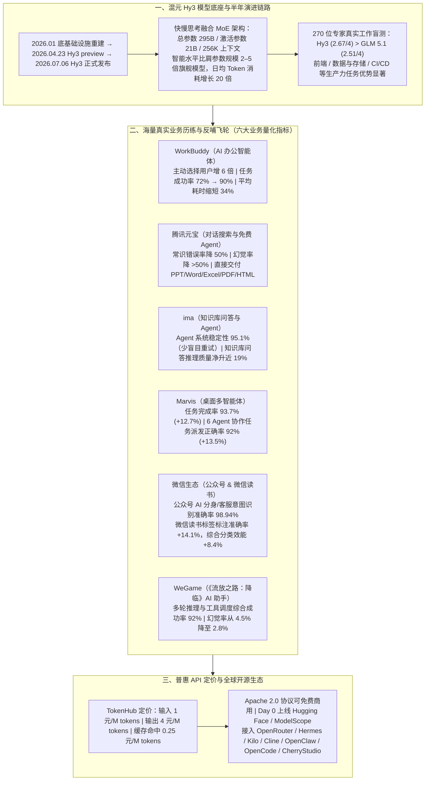

# 腾讯混元 Hy3 发布：Agent 能力和产品体验跃升

> **原文信息**：发布于 2026-07-06 01:05（广东），公众号「腾讯技术工程」。

---

## 1. TL;DR

1. **模型架构与核心定位** —— 2026 年 7 月 6 日正式发布的**腾讯混元 Hy3** 是快慢思考融合的 **MoE 模型**，**总参数 295B、激活参数 21B，支持 256K 上下文长度**；继 2026 年 1 月底基础设施重建、4 月 23 日发布首个重建版本 `Hy3 preview` 后，Hy3 通过扩大后训练算力规模与数据质量/多样性，以较小尺寸首次比肩参数规模 **2–5 倍**的国内外旗舰模型。
2. **内部真实盲测与使用量爆发** —— 在内部 **270 位专家**基于真实工作的模型盲测中，Hy3（**均分 2.67 / 4**）超越 **GLM 5.1**（**均分 2.51 / 4**），在前端、数据与存储、CI/CD 等类别优势显著；自 preview 上线以来日均 Token 消耗量增长 **20 倍**。
3. **四大核心 Agent 与办公产品矩阵实测跃升** ——
   - **WorkBuddy**：自主选择 `Hy3 preview` 用户数增长 **6 倍**；内部办公场景测评任务成功率从 **72% 升至 90%**，平均耗时缩短 **34%**。
   - **元宝**：常识错误率较 preview 下降**一半**，幻觉率下降**超过一半**；同步上线免费 Agent 功能，可直接交付 PPT、Word、Excel、PDF、HTML 文件。
   - **ima**：Agent 任务系统稳定性高达 **95.1%**（大幅减少盲目重试与应止未止）；知识库问答推理质量净提升**近 19%**。
   - **Marvis**：核心场景任务完成率达 **93.7%**（较 preview **+12.7%**），6 个 Agent 协作下任务派发正确率达 **92%**（较 preview **+13.5%**）。
4. **微信生态与游戏垂直场景全面反哺** —— 微信公众号 AI 分身与客服意图识别准确率升至 **98.94%**；微信读书标签标注准确率提高 **14.1%**、综合分类效能提升 **8.4%**；WeGame《流放之路：降临》AI 游戏助手多轮推理与工具调度综合成功率升至 **92%**，幻觉率从 **4.5% 降至 2.8%**。
5. **高性价比定价与 Apache 2.0 全面开源** —— API 定价为**输入 1 元 / 百万 tokens、输出 4 元 / 百万 tokens、输入命中缓存 0.25 元 / 百万 tokens**（已上线腾讯云 TokenHub）；采用商业友好的 **Apache 2.0 协议**开源，Day 0 接入 Hugging Face 与 ModelScope，并陆续上线 OpenRouter、Hermes、Kilo、Cline、OpenClaw、OpenCode、CherryStudio 等海外与开发者平台。

---

## 2. 核心问题与文章定位

### 2.1 为什么要写这篇？

大模型研发正从单纯刷榜转向真实复杂生产力与 Agent 闭环落地。腾讯混元团队自 **2026 年 1 月底**启动底层基础设施重建，于 **4 月 23 日**推出首个重建版本 `Hy3 preview`，并在 **7 月 6 日**正式发布 **混元 Hy3**——用不到半年时间跑通了「底层重构 → 海量产品真实场景历练反馈 → 模型迭代反哺全业务矩阵」的正向飞轮。本文全面披露了 Hy3 的模型架构规格、专家盲测结果、在腾讯各大核心业务（WorkBuddy、元宝、ima、Marvis、微信、WeGame）中的量化提升指标，以及其普惠 API 定价与开源生态布局。

---

## 3. 知识框架

---

## 4. 核心内容拆解

### 4.1 模型底座规格与半年重构跃升

1. **核心架构参数**：
   - **混合专家（MoE）+ 快慢思考融合**：总参数 **295B**，激活参数 **21B**，原生支持 **256K** 上下文长度。
   - **跨级挑战大尺寸旗舰**：通过提升后训练算力规模以及数据质量与多样性，以 21B 激活参数的轻量级推理成本，首次比肩参数规模为其 **2–5 倍**的国内外大尺寸旗舰模型。
2. **半年研发冲刺时间线**：
   - **2026 年 1 月底**：启动混元底层基础设施重建；
   - **2026 年 4 月 23 日**：发布重建后首个版本 `Hy3 preview`，相较 `Hy2` 在复杂推理、指令遵循、上下文学习、代码生成与 Agent 能力上实现质变；
   - **2026 年 7 月 6 日**：正式发布 `Hy3`，自 preview 上线以来日均 Token 消耗量激增 **20 倍**。
3. **内部 270 位专家真实工作盲测**：
   - 在软件开发、办公生产、金融建模、前端设计、游戏制作等生产力任务上进步显著；
   - 经内部 **270 位专家**基于真实工作场景盲测，Hy3 取得 **2.67 / 4** 的均分，优于 **GLM 5.1**（均分 **2.51 / 4**），尤其在**前端、数据与存储、CI/CD** 等工程类别优势明显。

---

### 4.2 腾讯多元产品矩阵历练与量化实测表现

1. **WorkBuddy / CodeBuddy（AI 办公与研发智能体）**：
   - 依托自动化脚本生成、工作流编排等复杂需求迭代模型；自发布以来，WorkBuddy 上自主选择 `Hy3 preview` 的用户数增长了 **6 倍**。
   - 在 WorkBuddy 办公场景内部测评中，**任务成功率从 72% 跃升至 90%**，**平均耗时缩短 34%**。
2. **腾讯元宝（长文搜索除幻觉 + 免费交付多格式办公文档）**：
   - 针对长文与 AI 搜索的幻觉痛点，通过细粒度数据清洗与训练约束让模型在复杂证据下可靠输出：基于真实日志评测，**常识错误率较 preview 下降一半，幻觉率下降超过一半**。
   - 同步上线 **元宝 Agent 功能**（综合办公与生活服务内部评估已超过 GLM 5.1 等国产模型），用户在日常对话中提需求即可直接执行复杂任务并免费交付 **PPT、Word、Excel、PDF、HTML** 等文件。
3. **ima（知识库问答与 Agent 工具编排）**：
   - 在 Agent 任务评测中，**系统稳定性高达 95.1%**，工具编排能力大幅减少了「盲目重试、应止未止」等无效操作，使复杂办公任务规划一步到位；
   - 在知识库问答场景中，**推理质量净提升近 19%**，长文写作与方案生成的结构完整度显著增强。
4. **Marvis（桌面 6 小马 Multi-Agent 协同）**：
   - 在文件编辑/生成、文件管理、电脑诊断与操作等核心场景评测中，**任务完成率达 93.7%**（较 preview **提升 12.7%**）；
   - 在 **6 个 Agent 协作**下的**任务派发正确率达 92%**（较 preview **提升 13.5%**），显著改善了执行稳定性、低延迟体验与成本。
5. **微信生态与 WeGame 游戏业务**：
   - **微信公众号 AI 分身与客服专项评测**：**意图识别准确率提升至 98.94%**，面对残缺表达能结合账号定位与上下文合理判断，不脑补过度或机械套模板；
   - **微信读书**：相较 `Hy3 preview`，**标签标注准确率提高 14.1%**，**综合分类效能提升 8.4%**；
   - **WeGame《流放之路：降临》AI 游戏助手**：接入 Hy3 后，**多轮推理与工具调度综合成功率提升至 92%**，**幻觉率从 4.5% 降至 2.8%**。

---

### 4.3 高性价比开放定价与全球开源生态

1. **极具竞争力的 API 定价（腾讯云 TokenHub 已上线）**：
   - **输入价格**：**1 元 / 百万 tokens**；
   - **输出价格**：**4 元 / 百万 tokens**；
   - **输入命中缓存价格**：**0.25 元 / 百万 tokens**（仅为普通输入价格的 1/4）。
2. **Apache 2.0 协议开源与全球开发者工具生态接入**：
   - 采用高商业友好度的 **Apache 2.0 开源协议**，支持全球开发者下载与免费商用；
   - **Day 0 同步上线**：Hugging Face（`tencent/Hy3`）、ModelScope 魔搭平台、GitHub、GitCode；
   - **海外与 Agent 工具生态陆续接入**：覆盖 **OpenRouter、Hermes、Kilo、Cline、OpenClaw、OpenCode、CherryStudio** 等主流平台与开发工具。

---

## 5. 数据速查表

| 指标 | 原文数值 | 语境 / 条件 |
| :--- | :--- | :--- |
| 模型架构与参数规模 | **MoE 架构，总参数 295B / 激活参数 21B** | 快慢思考融合模型，比肩参数规模 **2–5 倍**的旗舰模型 |
| 最大上下文窗口长度 | **256K** | Hy3 原生支持的上下文长度 |
| 关键研发里程碑时间线 | **2026.01 底重建 → 04.23 preview → 07.06 正式版** | 不到半年跑通底层基础设施重建到正式版发布与业务反哺 |
| 内部真实工作专家盲测得分 | **Hy3 均分 2.67/4 vs GLM 5.1 均分 2.51/4** | 内部 270 位专家盲测，前端、数据与存储、CI/CD 优势显著 |
| 日均 Token 消耗量增幅 | **增加 20 倍** | 自 `Hy3 preview` 上线以来的日均 Token 消耗增长倍数 |
| WorkBuddy 办公场景评测表现 | **成功率 72% → 90%，平均耗时缩短 34%** | 自主选择 `Hy3 preview` 用户数增长 **6 倍** |
| 元宝真实日志评测错误与幻觉降幅 | **常识错误率降 50%，幻觉率降 >50%** | 相比 preview 版本在长文和 AI 搜索场景下的真实日志评测 |
| ima 评测表现 | **Agent 系统稳定性 95.1%，问答推理质量净升近 19%** | 线上知识库问答与 Agent 两大核心场景实测 |
| Marvis 评测表现 | **任务完成率 93.7% (+12.7%)，6 Agent 派发正确率 92% (+13.5%)** | 文件编辑/生成/管理、电脑诊断操作及 6 小马多智能体协同评测 |
| 微信公众号与微信读书提升 | **公众号意图识别 98.94%；微信读书标签准确率 +14.1%、分类效能 +8.4%** | 微信公众号 AI 分身/客服专项评测及微信读书对比 preview |
| WeGame 游戏助手评测表现 | **多轮推理与工具调度成功率 92%，幻觉率 4.5% → 2.8%** | 《流放之路：降临》AI 游戏助手接入 Hy3 后的实测数据 |
| API 定价（腾讯云 TokenHub） | **输入 1 元 / 输出 4 元 / 缓存命中 0.25 元（每百万 tokens）** | 开源协议为 **Apache 2.0**（支持免费商用） |

---

## 6. 踩坑与教训 / 可迁移的设计原则

| 错误做法 | 失败表现或原因 | 原文应对 |
| :--- | :--- | :--- |
| 盲目堆砌超大稠密参数规模，导致推理延迟高、调用成本难以支撑高频 Agent 循环 | 办公与桌面 Agent 需高频多步调用工具，高昂单价与高延迟阻碍大规模普惠落地 | 采用 **MoE 快慢思考融合架构（总参 295B / 激活 21B，256K 上下文）**，以小激活规模比肩 2–5 倍大尺寸旗舰模型，并将缓存命中价压至 **0.25 元/百万 tokens** |
| 在长文与 AI 搜索场景中放任模型自由发挥 | 面对复杂或残缺证据时极易产生常识错误、幻觉或过度脑补、机械套模板 | 通过**细粒度数据清洗与训练约束**强化复杂证据下的可靠输出，使元宝幻觉率下降超 50%、公众号客服意图识别达 98.94% |
| Agent 工具编排缺乏停止边界与规划精度 | 执行复杂办公任务时频繁出现「盲目重试、应止未止」等无效操作，拖慢耗时且拉高失败率 | 结合 WorkBuddy、ima、Marvis 等海量真实 Agent 链路反馈针对性优化后训练，使 ima 系统稳定性达 **95.1%**、WorkBuddy 耗时缩短 **34%** |
| 模型研发与业务产品各自为战，仅用静态开源榜单衡量模型好坏 | 静态刷榜无法反映前端、数据存储、CI/CD 及多 Agent 派发等真实生产力表现 | 构建**「多元产品矩阵真实反馈 ↔ 模型能力泛化反哺」**良性循环（如对话意图优化赋能 Agent，Agent 工具调用提升反哺搜索），并由 **270 位专家**基于真实工作盲测检验 |

---

## 7. 记忆锚点

1. **底座规格三数字**：「**295B 总参 / 21B 激活 / 256K 上下文**（MoE 快慢思考融合，比肩 2–5 倍旗舰，Apache 2.0 开源）」。
2. **API 定价三数字**：「**输入 1 元 / 输出 4 元 / 缓存命中 0.25 元**（每百万 tokens）」。
3. **业务实测「90+ 军团」**：
   - **WorkBuddy**：成功率 **72% → 90%**（耗时 **-34%**，用户 **×6**）；
   - **ima**：Agent 稳定性 **95.1%**（问答推理 **+19%**）；
   - **Marvis**：任务完成率 **93.7%**（6 Agent 派发正确率 **92%**）；
   - **微信 & 游戏**：公众号意图识别 **98.94%**，WeGame 调度成功率 **92%**（幻觉 **4.5% → 2.8%**）。

---

## 8. 复习卡片

1. 腾讯混元 Hy3 的核心模型架构参数是什么，它在半年内经历了怎样的研发演进节奏？::采用快慢思考融合的 MoE 架构，总参数 295B、激活参数 21B，支持 256K 上下文长度，智能水平比肩参数规模 2–5 倍的旗舰模型；研发节奏上，从 2026 年 1 月底基础设施重建，到 4 月 23 日发布首个重建版 `Hy3 preview`，再到 7 月 6 日正式发布 `Hy3`，日均 Token 消耗量增长了 20 倍。
2. 在内部真实工作盲测中，混元 Hy3 的表现如何，在哪些工程领域优势尤为明显？::在内部组织的 270 位专家基于真实工作的模型盲测中，Hy3 取得 2.67 / 4 的均分，优于 GLM 5.1（均分 2.51 / 4），尤其在软件开发中的前端、数据与存储、CI/CD 等生产力任务类别上优势显著。
3. 混元 Hy3 在 WorkBuddy 和 Marvis 两大 Agent 产品中的核心实测提升数据分别是什么？::在 WorkBuddy 中，自主选择 `Hy3 preview` 的用户数增长 6 倍，办公场景测评任务成功率从 72% 升至 90%，平均耗时缩短 34%；在 Marvis 中，核心场景任务完成率达 93.7%（较 preview 提升 12.7%），6 个 Agent 协作下任务派发正确率达 92%（较 preview 提升 13.5%）。
4. 混元 Hy3 在腾讯元宝和 ima 两大产品中分别解决了什么核心痛点，取得了哪些量化指标？::在元宝中通过细粒度数据清洗与训练约束使常识错误率下降一半、幻觉率下降超过一半，并支撑免费元宝 Agent 直接生成交付 PPT/Word/Excel/PDF/HTML 文件；在 ima 中大幅减少盲目重试与应止未止等无效操作，Agent 系统稳定性达 95.1%，知识库问答推理质量净提升近 19%。
5. 混元 Hy3 的 API 定价、开源协议以及支持的国内外开发者平台分别是什么？::API 定价为输入 1 元 / 百万 tokens、输出 4 元 / 百万 tokens、输入命中缓存 0.25 元 / 百万 tokens（已上线腾讯云 TokenHub）；采用可免费商用的 Apache 2.0 协议开源，Day 0 接入 Hugging Face 与 ModelScope，并陆续上线 OpenRouter、Hermes、Kilo、Cline、OpenClaw、OpenCode、CherryStudio 等平台。

---

## 9. 知识关联

- **已有主题**：[模型与开发工具发布](../../20_topics/%E6%A8%A1%E5%9E%8B%E4%B8%8E%E5%BC%80%E5%8F%91%E5%B7%A5%E5%85%B7%E5%8F%91%E5%B8%83.md) · [Agent评测与反馈](../../20_topics/Agent%E8%AF%84%E6%B5%8B%E4%B8%8E%E5%8F%8D%E9%A6%88.md) · [因果推断与评测归因](../../20_topics/%E5%9B%A0%E6%9E%9C%E6%8E%A8%E6%96%AD%E4%B8%8E%E8%AF%84%E6%B5%8B%E5%BD%92%E5%9B%A0.md) · [异常监控与稳定性](../../20_topics/%E5%BC%82%E5%B8%B8%E7%9B%91%E6%8E%A7%E4%B8%8E%E7%A8%B3%E5%AE%9A%E6%80%A7.md)
- **候选新主题**：[[腾讯混元Hy3]] · [[MoE快慢思考模型]] · [[模型与业务飞轮协同]]

---

## 10. 原文参考资料

1. **Hy3 官方技术报告与主页**：`https://hy.tencent.com/research/hy3`
2. **Hy AI Studio & 腾讯云 TokenHub**：`https://aistudio.tencent.com/` 及 `https://console.cloud.tencent.com/tokenhub/models/detail?modelId=hy3&regionId=1`
3. **开源仓库与模型社区地址**：
   - GitHub：`https://github.com/Tencent-Hunyuan/Hy3`
   - Hugging Face：`https://huggingface.co/tencent/Hy3`
   - ModelScope：`https://modelscope.cn/models/Tencent-Hunyuan/Hy3`
   - GitCode：`https://ai.gitcode.com/tencent_hunyuan/Hy3`

> [!note]- 校对报告
> - **校对状态**：已根据 `MD.md` 全文（共 5 页 PDF 转写文本）逐一核对。
> - **核心数据与事实页码溯源**：
>   - 7 月 6 日正式发布、比肩参数规模 2–5 倍旗舰模型、快慢思考融合 MoE 架构（总参数 295B、激活参数 21B、256K 上下文长度）、4 月 23 日发布重建后首个版本 `Hy3 preview`：见 PDF 第 1 页。
>   - 270 位专家真实工作模型盲测（Hy3 均分 2.67/4 vs GLM 5.1 均分 2.51/4）、日均 Token 消耗量增长 20 倍、WorkBuddy 自主选择用户增长 6 倍及任务成功率 72%→90%、耗时缩短 34%：见 PDF 第 2 页。
>   - 元宝（常识错误率降一半、幻觉率降超一半、免费交付 PPT/Word/Excel/PDF/HTML）、ima（Agent 系统稳定性 95.1%、知识库问答推理质量净升近 19%）、Marvis（任务完成率 93.7% 提升 12.7%、6 Agent 协作派发正确率 92% 提升 13.5%）、微信公众号（意图识别准确率 98.94%）、微信读书（标签标注准确率 +14.1%、综合分类效能 +8.4%）、WeGame《流放之路：降临》（综合成功率 92%、幻觉率 4.5%→2.8%）：见 PDF 第 2–3 页。
>   - API 定价（输入 1 元 / 输出 4 元 / 缓存命中 0.25 元每百万 tokens）、Apache 2.0 协议、2026 年 1 月底基础设施重建时间线及 7 个官方链接：见 PDF 第 3–4 页。
