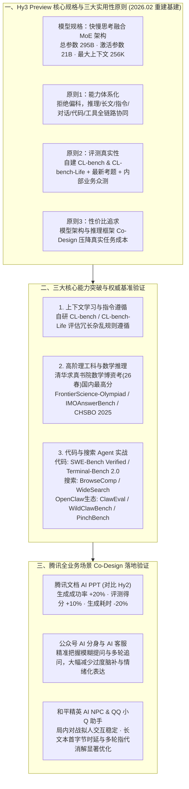

# 腾讯混元新里程碑：Hy3 preview 发布开源，Agent 表现全面提升

## 1. TL;DR

1. **混元基建重建后的首款旗舰开源模型**：2026 年 4 月 23 日发布的 **腾讯混元 Hy3 preview** 是快慢思考融合的混合专家（MoE）模型，**总参数 295B、激活参数 21B，最大支持 256K 上下文长度**；这是 2026 年 2 月混元重建预训练与强化学习基础设施、腾讯首席 AI 科学家姚顺雨确立三大实用性原则后的首个里程碑产出。
2. **确立大模型追求实用性的三大原则**：① **能力体系化**（拒绝单点刷榜偏科，强调推理、长文、指令、对话、代码、工具的深度协同）；② **评测真实性**（跳出易被刷榜的公开基准，自建 **CL-bench / CL-bench-Life**、引入最新高校资格考与产品众测检验真实战斗力）；③ **性价比追求**（架构与推理框架 Co-Design 降低单任务成本）。
3. **复杂推理、上下文学习与代码/搜索 Agent 全面突破**：在最新 **清华大学求真书院数学博士资格考试（26 春）** 中取得国内最高分，并在 `FrontierScience-Olympiad`、`IMOAnswerBench`、全国中学生生物学联赛（`CHSBO 2025`）表现优异；代码与智能体方向在 `SWE-Bench Verified`、`Terminal-Bench 2.0`、`BrowseComp`、`WideSearch` 及 OpenClaw 生态基准（`ClawEval`、`WildClawBench`、`PinchBench`）中全面跃升。
4. **腾讯核心业务场景 Co-Design 实效验证**：已在腾讯云、元宝、ima、CodeBuddy 上线；在 **腾讯文档 AI PPT 场景** 中相比上一代 Hy2 **生成成功率提升 20%、评测得分提升 10%、生成耗时缩短 20%**；在公众号 AI 分身/客服、和平精英 AI NPC 及 QQ AI 助手小 Q 中均实现低幻觉与高稳定性升级。

## 2. 问题定义与背景

### 2.1 刷榜高分与真实业务体感脱节的行业困局
在大模型军备竞赛中，单纯针对公开静态基准做专项优化（“偏科刷榜”）往往导致模型进入真实生产环境后暴露短板：
- **复杂业务规则遵循困难**：真实生产与生活场景中，输入往往是杂乱冗长的非结构化上下文，且附带多变、严苛的隐式业务规则，传统评测集难以衡量这种长上下文学习（Context Learning）能力。
- **Agent 复合能力木桶效应**：哪怕只是单一的代码智能体或 OpenClaw 桌面助手应用，也同时依赖长文理解、多步推理、指令遵循、代码编写与开放搜索整合，任何一块短板都会导致端到端任务失败。

### 2.2 2026 年 2 月混元基建重建与三大实用性原则
腾讯混元团队于 2026 年 2 月全面重构了底层预训练与强化学习（RL）基础设施，并提出指导研发的三条铁律：**能力体系化（不偏科）**、**评测真实性（反刷榜）** 与 **性价比追求（模型与推理框架深度协同）**。

## 3. 知识框架

## 4. 核心内容拆解

### 4.1 模型底座与三大核心能力维度突破

1. **快慢思考融合的 295B/21B MoE 架构**：
   - 采用总参数 **295B**、单 Token 激活参数 **21B** 的稀疏混合专家架构，原生支持 **256K** 超长上下文窗口，兼顾高阶慢思考深度推理与日常快思考高吞吐响应。
2. **上下文学习（Context Learning）：自研 `CL-bench` 与 `CL-bench-Life`**：
   - 针对真实生产与生活场景中“在杂乱冗长上下文里即时学习并遵循复杂多变规则”的核心痛点，混元团队受内部业务启发构建了创新基准 **CL-bench** 与 **CL-bench-Life**，显著强化了 Hy3 preview 的长文规则提取与指令遵循精度。
3. **复杂数理与科学推理：未泄露最新考题实测检验**：
   - 为规避公开题库污染，直接采用最新的 **清华大学求真书院数学博士资格考试（2026 春）** 与 **全国中学生生物学联赛（CHSBO 2025）** 进行检验，其中清华数学博资考取得**国内模型最高分**；同时在 `FrontierScience-Olympiad` 与 `IMOAnswerBench` 上表现突出。
4. **代码与开放域搜索 Agent 双轮驱动**：
   - 依托重构后的强化学习框架与大规模 RL 任务训练，在开发环境执行基准（**SWE-Bench Verified**、**Terminal-Bench 2.0**）、开放信息检索整合基准（**BrowseComp**、**WideSearch**）以及面向 OpenClaw 真实智能体工作流的 **ClawEval**、**WildClawBench** 与 **PinchBench** 上实现跨越式提升。

### 4.2 腾讯四大核心业务场景的 Co-Design 实测表现

| 落地业务场景 | 核心评估维度 | 相比上一代（Hy2）的实测提升表现 |
| :--- | :--- | :--- |
| **腾讯文档 AI PPT** | 模板选择、色彩匹配、大纲生成、内容补充全链路 | **生成成功率提升 `20%`、人工评测得分提升 `10%`、端到端生成耗时缩短 `20%`**，无幻觉且视觉契合度高 |
| **公众号 AI 分身 & AI 客服** | 模糊提问理解、短句追问承接、知识库与用户记忆融合 | 过度脑补、主观代入和情绪化表达显著减少，回复更贴近“可信、自然、高效”的角色设定 |
| **《和平精英》AI NPC** | 局外人设扮演增量对话、局内复杂对战实时语音/文字交互 | 局外开放性话题关联度高，局内快节奏对战下回复节奏高度贴近真实玩家聊天体验 |
| **QQ AI 助手“小 Q”** | 长文本首字节时延（TTFT）、流式输出效率、多轮指代消解 | 响应速度显著优化，数学推理、工具调用推理与 **OpenClaw 官方 PinchBench QQ 智能体场景** 测试表现突出 |

## 5. 数据速查表

| 指标 | 原文数值 | 语境 / 条件 |
| :--- | :--- | :--- |
| **Hy3 preview 总参数与激活参数** | 总参数 `295B`，激活参数 `21B` | 快慢思考融合的混合专家（MoE）架构，激活比约 `7.1%` |
| **最大支持上下文窗口长度** | `256K` Tokens | 原生支持长文档、代码仓库与多轮 Agent 轨迹输入 |
| **混元底层基建重建启动时间** | `2026 年 2 月`（模型发布于 `2026 年 4 月 23 日`） | 重建预训练与强化学习基础设施，确立三大实用性原则 |
| **清华求真书院数学博资考（26 春）排名** | **国内分数最高** | 搭配 `CHSBO 2025`、`FrontierScience-Olympiad`、`IMOAnswerBench` 验证泛化推理 |
| **腾讯文档 AI PPT 场景三大收益** | 生成成功率 `+20%`、评测得分 `+10%`、生成耗时 `-20%` | 相比上一代混元模型（Hy2）在生产环境的实测对比 |

## 6. 踩坑与教训 / 可迁移的设计原则

| 错误做法 | 失败表现或原因 | 原文应对（可迁移的设计原则） |
| :--- | :--- | :--- |
| **为刷高单一榜单分数而做“偏科式”后训练** | 在真实代码或桌面 Agent 场景中，因长文规则理解、多轮对话或工具格式一处拉胯导致端到端可用性归零 | **坚持“能力体系化”与复合 Agent 基准验证**：将推理、长文、指令、代码与搜索融合训练，用 `ClawEval / WildClawBench / PinchBench` 等端到端智能体基准检验 |
| **过度依赖发布已久的静态公开评测集指导模型迭代** | 静态题库易受预训练数据污染或被针对性过拟合，高分无法转化为真实业务收益 | **用最新闭卷考试 + 自建业务基准（`CL-bench`）+ 内部产品众测替代刷榜**：引入当季最新高校资格考（如 26 春清华数学博资考）与真实产品 A/B 评测 |
| **在 AI 客服与角色分身中放任模型自由发散生成** | 模型在面对短句或模糊提问时容易“过度脑补”、强行主观代入或产生不当情绪化表达 | **结合知识库与用户记忆强化角色边界对齐**：在后训练中重点抑制无根据脑补，确保多轮追问下的事实克制与人设稳定 |

## 7. 记忆锚点

- **“295B 总参 / 21B 激活 / 256K 上下文”**：混元 2026 年 2 月推倒重建预训练与 RL 基建后的第一颗果实，主打“能力体系化、评测真实性、性价比追求”。
- **“AI PPT 成功率 +20%、得分 +10%、耗时 -20%”**：模型架构与推理框架 Co-Design 在腾讯文档真实生产场景交出的“又快又好”量化成绩单。

## 8. 复习卡片

1. 腾讯混元 Hy3 preview 的核心参数规格是什么，它在研发方法论上遵循了哪三个实用性原则？::总参数 `295B`、激活参数 `21B`、最大支持 `256K` 上下文长度的快慢思考融合 MoE 模型；遵循三个原则：① 能力体系化（拒绝偏科，强调推理/长文/指令/对话/代码/工具协同）；② 评测真实性（跳出刷榜，结合自建题库、最新考试与产品众测）；③ 性价比追求（模型架构与推理框架深度 Co-Design）。
2. 为评估模型在真实生产与生活场景中的上下文学习能力，混元团队自建了哪两个评测基准？在数学与科学推理上通过了哪些高难度检验？::自建了 `CL-bench` 和 `CL-bench-Life` 评测基准；在最新的清华大学求真书院数学博士资格考试（26 春）中取得国内最高分，并在 `FrontierScience-Olympiad`、`IMOAnswerBench` 和全国中学生生物学联赛（`CHSBO 2025`）中取得优异成绩。
3. Hy3 preview 在代码智能体、搜索智能体和 OpenClaw 生态评测中分别覆盖了哪些核心基准？::代码智能体覆盖 `SWE-Bench Verified` 与 `Terminal-Bench 2.0`；搜索智能体覆盖 `BrowseComp` 与 `WideSearch`；OpenClaw 智能体生态覆盖 `ClawEval`、`WildClawBench` 以及 QQ 智能体场景的 `PinchBench`。
4. 在腾讯文档 AI PPT 和公众号 AI 分身/客服两个真实业务场景中，Hy3 preview 相比上一代 Hy2 带来了哪些具体提升？::在腾讯文档 AI PPT 场景中，生成成功率提升 `20%`、评测得分提升 `10%`、生成耗时缩短 `20%`；在公众号 AI 分身与客服场景中，显著提升了模糊提问理解与多轮对话承接能力，大幅减少了过度脑补、主观代入和情绪化表达。
5. 为什么说代码能力与搜索能力共同决定了模型在复杂智能体场景（如 OpenClaw）中的可用性？::因为在数字世界中，代码能力决定了模型在开发环境中的工具与脚本执行能力，而搜索能力决定了模型在开放信息空间中的检索、筛选与整合能力，只有两者深度协同，智能体才能真正独立闭环现实任务。

## 9. 知识关联

- **本仓库主题索引**：[模型与开发工具发布](../../20_topics/%E6%A8%A1%E5%9E%8B%E4%B8%8E%E5%BC%80%E5%8F%91%E5%B7%A5%E5%85%B7%E5%8F%91%E5%B8%83.md) · [Harness与模型协同](../../20_topics/Harness%E4%B8%8E%E6%A8%A1%E5%9E%8B%E5%8D%8F%E5%90%8C.md) · [Agent评测与反馈](../../20_topics/Agent%E8%AF%84%E6%B5%8B%E4%B8%8E%E5%8F%8D%E9%A6%88.md)
- **候选双链概念**：[[混元Hy3-Preview]] · [[快慢思考融合MoE]] · [[CL-bench上下文学习评测]] · [[ClawEval与WildClawBench]] · [[模型与产品Co-Design]]

## 10. 原文参考资料

1. 腾讯混元 Hy3 preview 官方发布与开源仓库（已同步上线腾讯云、腾讯元宝、ima、CodeBuddy 等平台）。
2. 文内评测基准体系：`CL-bench`、`CL-bench-Life`、`FrontierScience-Olympiad`、`IMOAnswerBench`、`SWE-Bench Verified`、`Terminal-Bench 2.0`、`BrowseComp`、`WideSearch`、`ClawEval`、`WildClawBench`、`PinchBench`。

> [!note]- 校对报告
> - **校对状态**：已按原文逐页核对通过（共 4 页 PDF）。
> - **核心数据与页码溯源**：
>   - `4 月 23 日` 发布开源、快慢思考融合 MoE、总参数 `295B`、激活参数 `21B`、最大上下文 `256K`、`2026 年 2 月` 重建预训练与强化学习基建、三大实用性原则及首席 AI 科学家姚顺雨致辞：见 `p.1`。
>   - `CL-bench` 与 `CL-bench-Life`、清华大学求真书院数学博资考（26 春）国内最高分、`CHSBO 2025`、`FrontierScience-Olympiad`、`IMOAnswerBench`、`SWE-Bench Verified`、`Terminal-Bench 2.0`、`BrowseComp`、`WideSearch`、`ClawEval`、`WildClawBench`：见 `p.2`。
>   - 公众号 AI 分身与客服、和平精英 AI NPC、腾讯文档 AI PPT（较 Hy2 生成成功率 `+20%`、评测得分 `+10%`、生成耗时 `-20%`）及 QQ AI 助手小 Q（`PinchBench`）：见 `p.3`。
