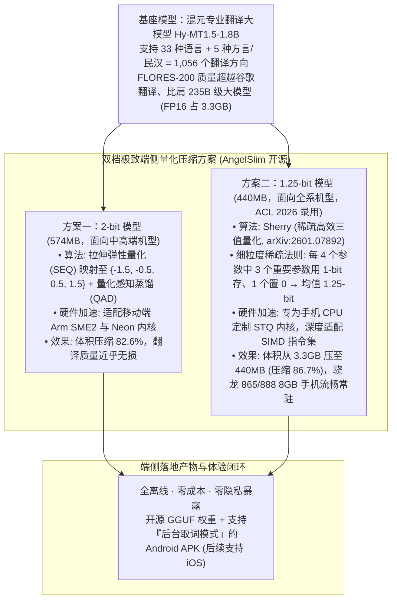

# 腾讯混元推出轻量翻译大模型，无需联网，手机直接运行！

## 1. TL;DR

1. **1.8B 参数比肩 235B 级大模型，440MB 装进手机全离线运行**：腾讯混元基于专业翻译大模型 **Hy-MT1.5-1.8B**（原生支持 **33 种语言、5 种方言/民汉及 1,056 个翻译方向**，在 FLORES-200 等基准上超越谷歌翻译并比肩 `235B` 级大模型），推出极致量化压缩版 **Hy-MT1.5-1.8B-1.25bit**，将原始 **3.3GB（FP16）** 的模型体积压缩 **86.7% 至 440MB**，在骁龙 865/888（8GB 内存）等主流及老旧手机上实现零流量、零隐私暴露的秒级本地翻译。
2. **中高端机型方案（2-bit SEQ 量化，574MB）**：采用 **拉伸弹性量化（SEQ，Stretching Elastic Quantization）** 将参数映射至 `{-1.5, -0.5, 0.5, 1.5}` 四值集合，结合 **量化感知蒸馏（QAD）**，在压缩至 **574MB** 的同时保持近乎无损的翻译质量，并深度适配移动端 **Arm SME2** 与 Neon 指令集加速。
3. **全系机型普惠方案（ACL 2026 录用 Sherry 1.25-bit 量化，440MB）**：采用被 NLP 顶会 **ACL 2026** 录用的 **Sherry（稀疏高效三值量化，Sparse High-Efficiency Ternary Quantization）** 技术，通过“**3:4 细粒度结构化稀疏**”（每 4 个参数中 3 个最重要参数用 `1-bit` 存储，1 个置 `0`，平均每参数仅需 **1.25-bit**），配合专为手机 CPU SIMD 指令集设计的 **STQ 内核**，实现后台常驻与取词即译。
4. **AngelSlim 全栈开源**：2-bit 与 1.25-bit 模型权重、GGUF 格式文件、技术报告及支持“后台取词模式”的 Android Demo APK 已在 HuggingFace 与魔搭社区（`AngelSlim` 组织下）全面开源。

## 2. 问题定义与背景

### 2.1 移动离线场景下的“断网绝望”与端侧内存墙
在异国自驾遇突发盘问、国际航班、偏远无信号区或高敏商务邮件阅读等场景下，依赖云端 API 的传统翻译软件一旦断网即彻底失效，或存在个人隐私上传顾虑。然而将高质量翻译大模型直接部署到手机端面临严峻的 **“内存墙”**：
- **FP16 原始体积过大**：即便是轻量化的 `Hy-MT1.5-1.8B` 模型，在 16 位浮点数（`FP16`）精度下仍需占用 **3.3GB 内存**；在 8GB 内存的普通智能手机上无法后台常驻，且访存带宽开销导致解码缓慢。
- **传统低比特量化掉点严重**：常规 INT4 以下的极低比特量化（如 2-bit 或 1-bit）往往伴随剧烈的精度坍塌，尤其在藏语、蒙古语等低资源民汉互译及长难句语法对齐上极易出现乱码或漏译。

## 3. 知识框架

## 4. 核心内容拆解

### 4.1 基座能力：以 `1.8B` 参数越级挑战 `235B` 大模型

**Hy-MT1.5-1.8B** 是腾讯混元专门针对多语言互译打造的垂直基座模型：
- **语种与方向广度**：原生覆盖 **33 种国际语言**（中、英、法、日、阿、俄等）以及 **5 种方言与少数民族语言**（含藏语、蒙古语等民汉互译），合计支持 **1,056 个翻译方向**。
- **越级翻译质量**：在权威多语言基准 **FLORES-200** 中外互译评测中，仅凭 `1.8B` 参数量即取得超越 Google Translate 等主流商业系统的高分，翻译表现比肩 **235B 级** 通用巨型大模型。

### 4.2 双轨极低比特量化与移动端 CPU 内核协同

为了将 `3.3GB` 的 FP16 模型塞进手机运存并实现秒级响应，腾讯团队（`AngelSlim`）针对不同算力档位的移动设备设计了两套软硬协同方案：

| 对比维度 | 2-bit 均衡无损方案（`Hy-MT1.5-1.8B-2bit`） | 1.25-bit 极致压缩方案（`Hy-MT1.5-1.8B-1.25bit`） |
| :--- | :--- | :--- |
| **压缩后模型体积** | **574 MB**（相比 3.3GB 缩减 `82.6%`） | **440 MB**（相比 3.3GB 缩减 `86.7%`） |
| **核心量化算法** | **拉伸弹性量化（SEQ）** + 量化感知蒸馏 | **Sherry（稀疏高效三值量化，ACL 2026 录用）** |
| **数值编码机制** | 均匀对称弹性网格：`{-1.5, -0.5, 0.5, 1.5}` | **3:4 细粒度稀疏**：每 4 个参数中 3 个用 `1-bit` 存、1 个置 `0` |
| **移动端算子内核** | 适配 **Arm SME2**（可伸缩矩阵扩展）与 **Neon** 内核 | 专为手机 CPU 定制的 **STQ 内核**（完美对齐 **SIMD** 指令集） |
| **目标适用机型** | 支持 Arm SME2 等新指令集的中高端智能手机 | **全系机型**（实测高通骁龙 865 / 骁龙 888 `8GB` 内存及骁龙 7+ Gen2 `16GB` 均丝滑运行） |

- **Sherry 1.25-bit 的位宽计算逻辑**：在三值/二值稀疏表示中，每 4 个连续权重参数组成一个微块，通过选择其中最重要的 3 个参数进行 `1-bit` 极性编码、将最不重要的 1 个参数直接稀疏化置 `0`（配合稀疏位置索引），使平均每个参数的存储位宽精准控制在 **1.25-bit**；同时规避了非规则稀疏在手机 CPU 上无法利用 SIMD 向量化指令的缺陷，由定制 **STQ（Sparse Ternary Quantization）内核** 实现硬件级对齐加速。

## 5. 数据速查表

| 指标 | 原文数值 | 语境 / 条件 |
| :--- | :--- | :--- |
| **Hy-MT1.5 原生支持语种与方向** | `33 种` 语言 + `5 种` 方言/民汉，共 `1,056 个` 翻译方向 | 涵盖中英法日阿俄及藏语、蒙古语等少数民族语言互译 |
| **基座参数量与越级对标规模** | `1.8B` 参数量，效果比肩 `235B 级` 大模型 | 在 FLORES-200 基准上超越谷歌翻译等主流商业系统 |
| **FP16 原始模型内存占用** | `3.3 GB` | 未量化压缩前的 16-bit 原始权重大小 |
| **2-bit（SEQ）模型体积与量化值集** | `574 MB`；量化至 `{-1.5, -0.5, 0.5, 1.5}` | 结合量化感知蒸馏，适配 Arm SME2 与 Neon 内核 |
| **1.25-bit（Sherry）模型体积与稀疏比** | `440 MB`；每 `4 个` 参数中 `3 个` 用 1-bit、`1 个` 用 0 存 | 体积缩减 `86.7%`，论文被 ACL 2026 录用（`arXiv:2601.07892`） |
| **实测基准移动设备配置** | 高通骁龙 `865`（8GB）、骁龙 `888`（8GB）、骁龙 `7+ Gen2`（16GB） | 几年前的老旧 8GB 内存安卓旗舰也能后台常驻流畅运行 |

## 6. 踩坑与教训 / 可迁移的设计原则

| 错误做法 | 失败表现或原因 | 原文应对（可迁移的设计原则） |
| :--- | :--- | :--- |
| **试图把百亿参数通用大模型直接搬上端侧，或仅做简单训练后静态截断量化（PTQ）到 2-bit 以下** | 通用大模型端侧内存装不下，而直接简单截断至 `<2-bit` 会导致小模型特征表达崩塌、翻译严重失真 | **垂直专精小基座（1.8B）+ 拉伸弹性量化（SEQ）/ 量化感知蒸馏**：先训出超越商业 API 的 1.8B 专精翻译基座，再用 `{-1.5, -0.5, 0.5, 1.5}` 弹性网格配合蒸馏锁住精度 |
| **采用非结构化的随机稀疏（Unstructured Sparsity）压缩端侧模型权重** | 虽然理论非零参数变少，但随机稀疏索引破坏了内存对齐，手机 CPU 的 SIMD 指令集无法向量化加速，实际推理反而变慢 | **Sherry 3:4 细粒度规则稀疏 + 定制 STQ 内核**：以每 4 个参数保留 3 个 1-bit、1 个置 0 的规整粒度配合专属 STQ 算子，完美吃满手机 CPU 的 SIMD 向量流水线 |
| **所有机型一刀切只提供一个量化版本** | 老旧 8GB 手机嫌 600MB+ 后台常驻略重，而支持最新 Arm SME2 的旗舰机又希望能榨取极致硬件矩阵指令吞吐 | **双档位分级交付（2-bit 574MB + 1.25-bit 440MB）**：中高端机走 2-bit + SME2/Neon 享近乎无损画质，全系/老机型走 1.25-bit + STQ 享 440MB 极致轻量常驻 |

## 7. 记忆锚点

- **“3.3GB → 574MB（2-bit SEQ）→ 440MB（1.25-bit Sherry）”**：端侧翻译大模型的三级瘦身跳水，让支持 33 种语言、1,056 个方向的 1.8B 模型在五年前的骁龙 865（8GB）手机上也能后台常驻秒译。
- **“每 4 个参数留 3 个 1-bit、1 个置 0，搭 STQ 内核喂饱手机 SIMD”**：ACL 2026 录用算法 Sherry 的一句话核心原理。

## 8. 复习卡片

1. 混元翻译大模型 `Hy-MT1.5-1.8B` 支持多少种语言和翻译方向，其 FP16 原始体积与量化后的两个版本体积分别是多少？::原生支持 `33 种` 语言、`5 种` 方言/民汉互译及 `1,056 个` 翻译方向，翻译质量在 FLORES-200 上超越谷歌翻译并比肩 `235B` 级大模型；其 FP16 原始体积为 `3.3GB`，经 2-bit 量化后压缩至 `574MB`，经 1.25-bit 量化后压缩至 `440MB`。
2. `Hy-MT1.5-1.8B` 的 2-bit 量化方案采用了什么核心技术与硬件加速指令集？::采用拉伸弹性量化（SEQ，Stretching Elastic Quantization），将模型参数映射至 `{-1.5, -0.5, 0.5, 1.5}` 并结合量化感知蒸馏，在移动端针对支持 Arm `SME2` 及 `Neon` 内核的中高端设备进行了专门加速。
3. 被 ACL 2026 录用的 `Sherry`（1.25-bit）量化方案是如何实现平均每参数 1.25-bit 的，又是如何在手机 CPU 上高效执行的？::Sherry（稀疏高效三值量化）采用“细粒度稀疏”策略：每 `4 个` 模型参数中，挑选 `3 个` 最重要的参数用 `1-bit` 存储，剩下 `1 个` 用 `0` 存储，从而使平均每参数仅需 `1.25-bit`；同时配合腾讯专为手机 CPU 设计的 `STQ` 内核，实现了对移动端 `SIMD` 指令集的对齐加速。
4. 端侧离线运行 `Hy-MT1.5-1.8B-1.25bit` 相比传统云端翻译软件有哪些核心优势，对手机硬件门槛要求如何？::具备全离线（无信号可用）、零订阅与 API 成本、零隐私暴露（本地处理不上传个人信息）以及支持“后台取词模式”随叫随到等优势；440MB 的体积使其在高通骁龙 865、骁龙 888（8GB 内存）等老旧机型上也能顺滑常驻运行。
5. 混元团队开源的端侧翻译模型资产包含哪些格式与组件？::在 HuggingFace 与魔搭社区的 `AngelSlim` 组织下全面开源了 2-bit 与 1.25-bit 的原始模型权重、`GGUF` 端侧推理格式模型、Hy-MT1.5 技术报告、Sherry 算法论文以及可直接安装的 Android Demo APK。

## 9. 知识关联

- **本仓库主题索引**：[模型与开发工具发布](../../20_topics/%E6%A8%A1%E5%9E%8B%E4%B8%8E%E5%BC%80%E5%8F%91%E5%B7%A5%E5%85%B7%E5%8F%91%E5%B8%83.md) · [大模型推理与算子优化](../../20_topics/%E5%A4%A7%E6%A8%A1%E5%9E%8B%E6%8E%A8%E7%90%86%E4%B8%8E%E7%AE%97%E5%AD%90%E4%BC%98%E5%8C%96.md)
- **候选双链概念**：[[Sherry三值稀疏量化]] · [[拉伸弹性量化SEQ]] · [[端侧离线大模型]] · [[Arm-SME2与SIMD算子]] · [[AngelSlim模型压缩]]

## 10. 原文参考资料

1. Sherry 算法论文（ACL 2026 录用）：[https://arxiv.org/abs/2601.07892](https://arxiv.org/abs/2601.07892)
2. HuggingFace 开源地址（`AngelSlim`）：`https://huggingface.co/AngelSlim/Hy-MT1.5-1.8B-2bit`、`https://huggingface.co/AngelSlim/Hy-MT1.5-1.8B-1.25bit` 及对应 `-GGUF` 与 `Hy-MT-demo.apk`。
3. 魔搭社区（ModelScope）开源地址：`https://modelscope.cn/models/AngelSlim/Hy-MT1.5-1.8B-2bit` 与 `1.25bit` 系列仓库。

> [!note]- 校对报告
> - **校对状态**：已按原文逐页核对通过（共 8 页 PDF）。
> - **核心数据与页码溯源**：
>   - `Hy-MT1.5-1.8B-1.25bit` 压缩至 `440MB`、支持 `33 种` 语言、`5 种` 方言/民汉及 `1056 个` 翻译方向、比肩 `235B` 级大模型与超越谷歌翻译、骁龙 865（8GB）演示：见 `p.1–2`。
>   - FP16 原始模型占用 `3.3GB` 内存、FLORES-200 评测、2-bit 拉伸弹性量化（SEQ，`{-1.5, -0.5, 0.5, 1.5}`）+ 量化感知蒸馏压缩至 `574MB`、适配 Arm `SME2` 与 `Neon` 内核：见 `p.3–4`。
>   - 1.25-bit `Sherry`（稀疏高效三值量化，ACL 2026 录用，`arXiv:2601.07892`）、每 4 个参数中 3 个用 1-bit 存 + 1 个用 0 存、手机 CPU `STQ` 内核适配 `SIMD` 指令集、骁龙 888（8GB）与骁龙 7+ Gen2（16GB）演示、后台取词模式及 HuggingFace / 魔搭社区开源链接：见 `p.4–7`。
