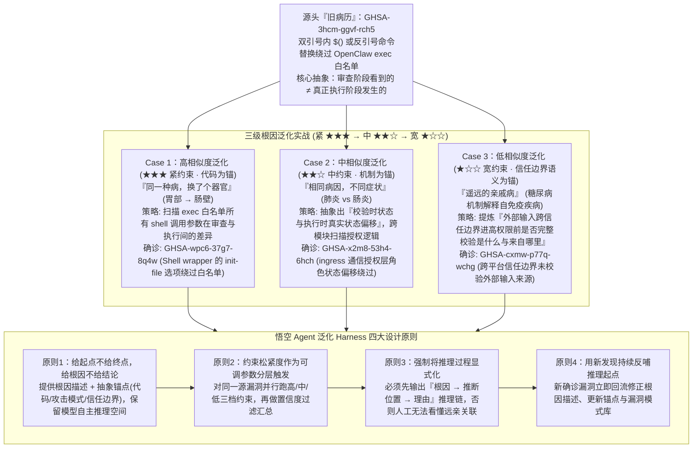

# “龙虾”也需要看病？一张旧病历，引出三个新确诊

## 1. TL;DR

1. **从“单点挖洞深度”走向“同源漏洞泛化广度”**：攻击者只需赢一次，而防守方必须找出所有同族变种才算安全；腾讯悟空代码安全团队（已在开源界发现并确认 **400+ 个 0day 漏洞**）提出 **漏洞泛化（Generalization）** 范式——以单个已知漏洞（“一张旧病历”）为起点，顺藤摸瓜识别出代码相邻的“近亲变种”与表面毫无关联、底层认知盲区一致的“远亲漏洞”。
2. **OpenClaw 实战：从 1 个源头漏洞（`GHSA-3hcm-ggvf-rch5`）顺藤摸出 3 个全新高危 CVE/GHSA**：以 OpenClaw 中“双引号内 `$()` 命令替换绕过 `exec` 白名单”为源头，通过 **紧（★★★）、中（★★☆）、宽（★☆☆）** 三级泛化策略，成功挖出 **Case 1 高相似度**（`GHSA-wpc6-37g7-8q4w`，Shell `init-file` 参数绕过 `exec` 白名单）、**Case 2 中相似度**（`GHSA-x2m8-53h4-6hch`，跨模块发现 `ingress` 授权层校验态与执行态偏移）与 **Case 3 低相似度**（`GHSA-cxmw-p77q-wchg`，跨平台/跨攻击面发现外部输入进入高权限上下文前未验证“来自哪里”），均已获官方确认并修复。
3. **泛化 Harness 四大工程设计原则**：为什么 LLM 内置了泛化能力却在实战中表现不稳？根源在于 Harness 设计——必须遵循 **① 给起点不给终点（给根因与抽象锚点，不直接喂结论）**、**② 约束松紧度分层触发（高/中/低三档独立运行再按置信度过滤汇总）**、**③ 强制推理过程显式化（输出 `根因 → 推断位置 → 理由` 辅助人工关联远亲）**、**④ 新发现持续反哺推理起点（动态更新锚点与漏洞模式库）**。

## 2. 问题定义与背景

### 2.1 攻防博弈的不对称性与“深度 vs 广度”
Anthropic Claude 在 FreeBSD 内核测试中挖掘出未知漏洞并生成 Exploit，展示了 AI 在单一目标上的纵向挖掘 **深度**。然而在真实安全防御中，攻防规则极度不对称——**攻击者只需找到 1 个突破口即可全盘皆赢，而防御者修补掉 1 个漏洞后，只要仓库里还残留着第 2、第 3 个同源变种，系统就依然形同虚设**。
- **传统工具的局限**：静态分析（SAST）或简单的代码 Diff 只能做字面语法模式匹配，顶多找出同一函数附近的“高相似度变种”，对跨模块、跨协议层但源于同一设计盲区的“远亲漏洞”完全无能为力。

### 2.2 源头“旧病历”剖析：`GHSA-3hcm-ggvf-rch5`
在爆火的开源智能体框架 **OpenClaw**（“龙虾”）中，源头漏洞 `GHSA-3hcm-ggvf-rch5` 的机制是：攻击者在命令的双引号中植入特殊命令替换语法（`$()` 或反引号），系统的白名单审查阶段看到的是一条“合规命令”，但底层 Shell 真正执行时却悄悄运行了隐藏的额外指令。

## 3. 知识框架

## 4. 核心内容拆解

### 4.1 OpenClaw 三次“新确诊”：从代码变种到跨模块认知盲区

悟空代码安全 Agent 从同一份源漏洞报告 `GHSA-3hcm-ggvf-rch5` 出发，通过逐步提升根因抽象层级、放宽模块约束，在 OpenClaw 最新代码中挖出 3 个已被官方确认并修复的新漏洞：

| 泛化等级与类比 | 确诊漏洞编号 | 约束松紧度与泛化锚点 | 悟空 Agent 泛化推理路径与技术突破 |
| :--- | :--- | :--- | :--- |
| **Case 1：高相似度泛化** （“同一种肿瘤，从胃部长到肠壁”） | **`GHSA-wpc6-37g7-8q4w`** （Shell `init-file` 选项绕过 `exec` 白名单） | **★★★ 紧约束** （同一模块、同一攻击面，以具体代码模式为锚） | 在 `exec` 白名单匹配逻辑内，系统性扫描所有 Shell 调用形态中可在“审查阶段”与“执行阶段”插入差异的参数，从“双引号内命令替换”顺藤摸瓜抓出相邻的 `shell wrapper init-file` 参数绕过 |
| **Case 2：中相似度泛化** （“同一种细菌，引发肺炎与肠炎”） | **`GHSA-x2m8-53h4-6hch`** （`ingress` 授权层角色状态偏移漏洞） | **★★☆ 中约束** （跨模块，攻击面从命令执行跳向通信层授权） | 将根因从“命令解析被欺骗”向上抽象为 **“校验对象/校验时状态与执行对象/执行时状态不一致”** 的通用模型，投影到 `ingress` 通信授权模块，发现校验时依赖的角色状态与执行时真实状态存在可被利用的偏移 |
| **Case 3：低相似度泛化** （“糖尿病机制解释跨科室自免疫病”） | **`GHSA-cxmw-p77q-wchg`** （外部输入跨信任边界未验证来源） | **★☆☆ 宽约束** （跨平台、跨技术栈、跨攻击面，以顶层信任边界为锚） | 源漏洞本质是“外部输入越过信任边界时未完整解析它**是什么**”；Agent 进一步追问全仓所有平台信任边界处“进入高权限上下文前是否完整校验了它是什么、以及**它来自哪里**”，挖出跨平台的来源未校验漏洞 |

### 4.2 泛化 Harness 的四条核心工程原则

大模型天生具备跨领域抽象联想能力，但在安全实战中要么“缩手缩脚找不到远亲”，要么“天马行空满屏误报”，关键在于 **Harness 如何划定推理舞台**：
1. **原则一：给起点，不给终点；给根因，不给结论**
   - 若直接告诉模型“去某文件找某函数参数漏洞”，会严重压缩其推理空间使其退化为机械正则执行器。
   - **正确做法**：只喂给模型 **根因描述 + 对应抽象层级的推理锚点**（高相似用代码片段做锚，中相似用状态一致性模式做锚，低相似用信任边界定义做锚），让模型自主走完中间推导链路。
2. **原则二：将“约束松紧度”作为主动调节的设计参数（分层触发）**
   - 约束过紧（★★★）准确率高但漏掉跨模块远亲；约束过松（★☆☆）能抓出天花板级漏洞但噪音激增。
   - **正确做法**：不再纠结选哪一档，而是对同一个源头漏洞**同时按高、中、低三档约束独立并行运行**，最后通过置信度评分模型过滤汇总。
3. **原则三：将推理过程显式化（`根因 → 推断位置 → 理由`）**
   - 强制要求模型在输出漏洞结论前必须完整呈现三段式推理链。这不仅通过思维链提升了模型自身的定位精度，更解决了**人工安全审计的信任难题**——若无显式推理链，人类安全工程师看到两个表面毫无关系的模块根本无法理解它们为何是“亲戚病”。
4. **原则四：用新发现持续反哺推理起点（自进化飞轮）**
   - 每次泛化确诊的新漏洞（如从“未校验是什么”泛化出的“未校验来自哪里”）不是终点，而是立即回流更新根因描述与漏洞模式库，作为下一轮泛化的新起点。

## 5. 数据速查表

| 指标 | 原文数值 | 语境 / 条件 |
| :--- | :--- | :--- |
| **单源漏洞泛化确诊新漏洞数** | `1 张` 旧病历引出 `3 个` 新确诊漏洞 | 均在 OpenClaw 中发现并获官方确认修复（`GHSA-wpc6...` / `GHSA-x2m8...` / `GHSA-cxmw...`） |
| **泛化等级与约束松紧度档位** | `3 个` 等级（高相似度 `★★★ 紧`、中相似度 `★★☆ 中`、低相似度 `★☆☆ 宽`） | 按攻击面跨度、技术难度与传统工具可及性分级 |
| **泛化 Harness 核心设计原则数** | `4 条` 原则 | 给起点不给终点、松紧度分层触发、推理链显式化、新发现反哺起点 |
| **腾讯悟空 Agent 累计 0day 发现量** | 累计发现并确认 `400+ 个` 0day 漏洞 | 获微软、英伟达、Apache 等致谢，曾发布项目级安全评测集 `A.S.E` |

## 6. 踩坑与教训 / 可迁移的设计原则

| 错误做法 | 失败表现或原因 | 原文应对（可迁移的设计原则） |
| :--- | :--- | :--- |
| **修完一个安全漏洞后只做局部点状打补丁，不做同源系统性筛查** | 攻击者顺着相同的设计盲区在相邻参数或跨模块授权层轻松找到第 2、第 3 个突破口 | **将每次历史漏洞转化为“根因病历”驱动全仓泛化排查**：从代码变种（紧约束）一直扫到跨模块状态偏移（中约束）与信任边界缺失（宽约束） |
| **在 Prompt 中直接给安全 Agent 下达死板的搜索结论或单一固定约束** | 给死结论会让 LLM 退化为低效规则匹配器；单一紧约束漏掉远亲，单一宽约束又被误报淹没 | **“给根因锚点不给结论” + 高/中/低三档约束并行分层触发**：用不同抽象粒度的锚点并行探索，再经置信度漏斗收敛结果 |
| **只让安全 Agent 输出疑似有漏洞的文件名和行号，省略中间推导逻辑** | 面对跨模块的低相似度“远亲漏洞”，人类审计员看不懂它与源漏洞的关联，直接当成误报丢弃 | **强制显式化三段式推理链（`根因 → 推断位置 → 理由`）**：既提高模型推理质量，又为人类安全专家提供可秒级复核的因果桥梁 |

## 7. 记忆锚点

- **“一张旧病历（`GHSA-3hcm`），三次新确诊（`wpc6` 换器官、`x2m8` 同病因不同症状、`cxmw` 跨科室远亲）”**：生动展现 AI 安全 Agent 如何从“双引号命令替换”一路泛化到“Shell init-file 参数”、“Ingress 授权状态偏移”再到“跨平台输入来源校验”。
- **“给根因不给结论、松紧度分三档并跑、推理链显式化、新确诊反哺起点”**：不仅适用于挖漏洞，同样可迁移至任何“从线上单个故障 Case 排查全系统同类隐患”的工程排障 Agent。

## 8. 复习卡片

1. 在安全攻防中，为什么除了纵向挖洞的“深度”，横向的“漏洞泛化（广度）”同样甚至更加关键？::因为攻防博弈极不对称——攻击者只需找到 1 个漏洞就能攻破系统，而防御者只修掉 1 个已知漏洞毫无意义，必须顺藤摸瓜将该漏洞背后的所有同族变种（包括代码相邻的近亲与底层逻辑相通的远亲）全部识别并消除，才能实现真正的安全。
2. 悟空 Agent 以 OpenClaw 的 `GHSA-3hcm-ggvf-rch5`（双引号内 `$()` 绕过 `exec` 白名单）为源头，通过哪三个泛化等级分别找出了哪三个新漏洞？::① 高相似度泛化（★★★ 紧约束，同模块）：找出 Shell `init-file` 选项绕过 `exec` 白名单（`GHSA-wpc6-37g7-8q4w`）；② 中相似度泛化（★★☆ 中约束，提炼“校验态与执行态不一致”跨模块扫描）：找出 `ingress` 授权层角色状态偏移漏洞（`GHSA-x2m8-53h4-6hch`）；③ 低相似度泛化（★☆☆ 宽约束，提炼“跨信任边界未完整校验输入是什么与来自哪里”）：找出跨平台未验证外部输入来源漏洞（`GHSA-cxmw-p77q-wchg`）。
3. 为什么传统静态分析工具（SAST）无法完成中、低相似度的漏洞泛化，而大模型可以？::因为传统工具只能做语法或代码结构的字面匹配（最多覆盖高相似度近亲），而中、低相似度泛化需要将具体漏洞向上抽象为“状态偏移”或“信任边界认知盲区”等深层语义命题，再跨模块、跨技术栈投影到完全不同的代码实现上。
4. 悟空代码安全团队总结的“泛化 Harness 四大核心设计原则”是什么？::① 给起点，不给终点；给根因，不给结论（提供根因描述与对应抽象层级的推理锚点，保留模型自主推理空间）；② 将约束松紧度作为可调参数分层触发（高/中/低三档独立运行再按置信度过滤汇总）；③ 将推理过程显式化（强制先输出 `根因 → 推断位置 → 理由`）；④ 用新发现持续反哺推理起点（动态更新锚点与漏洞模式库）。
5. 为什么在泛化 Harness 中必须强制模型先输出“根因 → 推断位置 → 理由”的显式推理链？::一方面显式推理链能引导模型严谨推导、显著提升结论准确性；另一方面，对于表面毫无关联的跨模块“远亲”漏洞，若没有中间推理链作为桥梁，人工审核员往往无法理解其内在关联而难以高效复核。

## 9. 知识关联

- **本仓库主题索引**：[Harness与模型协同](../../20_topics/Harness%E4%B8%8E%E6%A8%A1%E5%9E%8B%E5%8D%8F%E5%90%8C.md) · [Agent评测与反馈](../../20_topics/Agent%E8%AF%84%E6%B5%8B%E4%B8%8E%E5%8F%8D%E9%A6%88.md) · [异常监控与稳定性](../../20_topics/%E5%BC%82%E5%B8%B8%E7%9B%91%E6%8E%A7%E4%B8%8E%E7%A8%B3%E5%AE%9A%E6%80%A7.md) · [Agent安全与权限](../../20_topics/Agent%E5%AE%89%E5%85%A8%E4%B8%8E%E6%9D%83%E9%99%90.md)
- **候选双链概念**：[[漏洞根因泛化]] · [[三级约束分层触发]] · [[信任边界校验]] · [[TOCTOU校验与执行态偏移]] · [[悟空代码安全Agent]]

## 10. 原文参考资料

1. OpenClaw 官方安全公告（GitHub Security Advisories）：源漏洞 `GHSA-3hcm-ggvf-rch5`，及腾讯悟空 Agent 泛化发现并获确认修复的 `GHSA-wpc6-37g7-8q4w`、`GHSA-x2m8-53h4-6hch`、`GHSA-cxmw-p77q-wchg`。
2. 腾讯悟空代码安全团队前期研究：《AI 生成代码在野安全风险研究》与项目级安全评测集 `A.S.E`。

> [!note]- 校对报告
> - **校对状态**：已按原文逐页核对通过（共 7 页 PDF）。
> - **核心数据与页码溯源**：
>   - Anthropic Claude 挖掘 FreeBSD 漏洞、挖掘深度 vs 泛化广度、OpenClaw 源漏洞 `GHSA-3hcm-ggvf-rch5`（双引号内 `$()` 或反引号绕过 `exec` 白名单）：见 `p.1–2`。
>   - 三个泛化确诊案例（Case 1 高相似度 `★★★ 紧`：`GHSA-wpc6-37g7-8q4w` Shell `init-file` 绕过；Case 2 中相似度 `★★☆ 中`：`GHSA-x2m8-53h4-6hch` `ingress` 授权层状态偏移；Case 3 低相似度 `★☆☆ 宽`：`GHSA-cxmw-p77q-wchg` 跨信任边界未验证输入“来自哪里”）及三级泛化对比表：见 `p.2–4`。
>   - 泛化 Harness 四大原则（给起点不给终点/给根因不给结论、约束松紧度分层触发、推理过程显式化 `根因 → 推断位置 → 理由`、用新发现持续反哺推理起点）及悟空团队累计确认 `400+` 0day 漏洞背景：见 `p.4–6`。
