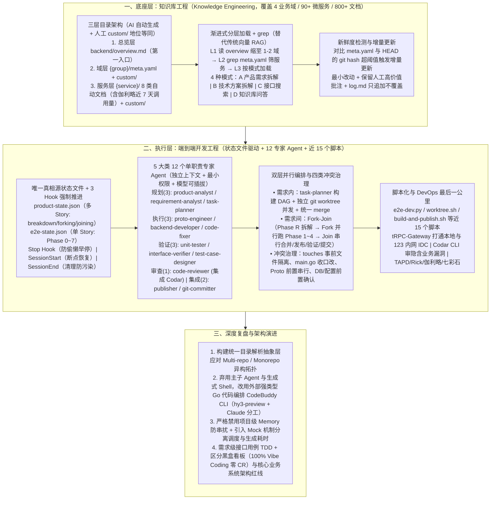

# 从 AI Coding 到 Harness Engineering 的端到端工程开发实践

> **原文信息**：作者 `zimingxing`、`kinglongli`、`yifhao`（腾讯应用宝活动平台团队），发布于 2026-07-03 02:36（广东），公众号「腾讯技术工程」原创。

---

## 1. TL;DR

1. **为什么从对话式 AI Coding 走向 Harness Engineering？** —— 对话式 AI Coding（`CodeBuddy + Plan Mode + Rules + Prompt`）在应用宝活动平台系统重构中暴露出四大瓶颈：**单窗口上下文快速膨胀与有损压缩遗忘**、**缺乏完整跨服务业务知识**、**缺乏从分析到部署验证的自动化闭环**、**单窗口无法并行开发**；为此团队构建了「**知识库工程 ✖ 端到端开发工程**」双层架构，涵盖后台 **90+ 个微服务、800+ 结构化文档、12 个专家 Agent、30+ 业务相关 Skill 及 10+（近 15 个）固定流程脚本**。
2. **知识库工程（Knowledge Engineering）** —— 借鉴 LLM Wiki 与 Obsidian-Wiki，构建「**总览层 `overview.md` → 域层 `{group}/meta.yaml + custom/` → 服务层 8 类自动生成文档 + 手工补充文档**」三层结构；通过 `gen-project-docs` / `batch-doc-generator` 追踪 `import` 与 `go.mod` 生成文档，结合**伽利略近 7 天接口调用量**标注活跃度，并以**三层渐进式加载 + `grep`**（4 种查询模式）替代传统向量 RAG，同时基于 **`meta.yaml` 与 `HEAD` 的 `git hash` 对比**触发增量更新（保留人工批注，向 `log.md` 只追加不覆盖）。
3. **状态文件驱动 + 3 大生命周期 Hook** —— 用两类结构化状态文件（多 Story 并行的 **`product-state.json`** 与单 Story Phase 0~7 的 **`e2e-state.json`**）替代易被有损压缩的对话历史作为唯一真相源；并在 `Stop`（防主调度器偷懒提前停止）、`SessionStart`（跨会话断点自动恢复）、`SessionEnd`（清理残留防污染）注入 Hook 脚本确保流程确定性。
4. **12 个单职责专家 Agent + DAG Worktree / Fork-Join 并行与四类冲突治理** —— 遵循单一职责、上下文隔离、工具最小权限、结构化 I/O 与模型可插拔原则划分 **5 大类 12 个专家 Agent**；通过 `task-planner` 构建 DAG 拓扑并分配独立 **`git worktree`** 实现需求内多任务并发，通过 **Fork-Join** 实现多 Story 并行开发（Phase 1~4 并发）与串行收口（合并→发布→验证→提交），并针对 `Merge Conflict`、`Shared file (main.go)`、`Proto 变更`、`DB/配置变更` 制定「能事前隔离就事前隔离，必须共享就串行收口」策略。
5. **脚本化确定性执行 + DevOps 全链路集成 + 架构演进复盘** —— 践行「**AI 负责认知，脚本负责执行**」，将状态机解析（`e2e-dev.py`）、`worktree.sh`、`build-and-publish.sh` 等近 15 个步骤脚本化，并打通 **tRPC-Gateway**（本地调 123 平台内网 IDC）、**Codar CLI**（AI 审 AI 代码查隐含业务漏洞）、TAPD/Rick/七彩石（除 `tconf` 集群外）/伽利略；在复盘中更进一步在知识库工程中**弃用主子 Agent 改用外部强类型 Go 代码直接编排 CodeBuddy CLI**（`hy3-preview` 写局部服务文档 + `Claude` 写域及全局综述）、**严格禁用项目级 Memory**，并提出「需求级接口用例 TDD」与「高容错看板黑盒 Vibe Coding vs 核心在线系统人守架构红线」的边界洞察。

---

## 2. 核心问题与文章定位

### 2.1 对话式 AI Coding 的四大结构性痛点

应用宝活动平台系统支撑应用宝内 App、PC、手助等产品的所有日常与节假日活动（后台横跨活动、福利、商城、增长等 **4 个业务领域、90+ 个微服务**）。在今年上半年对整套系统进行完整重构时，团队发现传统的「单窗口对话式 AI Coding」在面对规模化复杂业务时撞上四堵墙：
1. **单窗口上下文快速膨胀**：每次启动窗口还没输入需求，就已经塞入大量背景文档与 `rules`；多轮交互后触发有损压缩，导致遗忘早期约束、不按规则生成。
2. **缺乏完整的业务知识**：跨多业务、多微服务的调用串联全靠人工在 Prompt 里一次性喂给 AI，换个需求或关掉窗口又要从零开始。
3. **缺乏工程上的自动化闭环**：AI 仅停留在写代码环节，需求拆解、测试环境部署、接口验证等仍高度依赖人工切换执行。
4. **单窗口无法并行**：面对三个独立接口开发，要么单窗口串行等待，要么人开三个窗口来回充当人肉调度器。

---

## 3. 知识框架

---

## 4. 核心内容拆解

### 4.1 Knowledge Engineering：让 AI 真正懂业务的「三层结构 + 渐进式检索 + 新鲜度自愈」

1. **三层目录结构与「AI 生产 + 人工补充 + AI 消费」双轨融合**：
   - **总览层（`backend/overview.md`）**：描述所有业务域（如 `private_domain` 商城会员域、`activity` 活动平台域、`yybgame` 福利平台域、增长域等）的关键词与服务范围，作为查询第一入口。
   - **域层（`{group}/meta.yaml` + `{group}/custom/`）**：机器可读的服务注册索引（记录文档状态与 `git hash`）+ 跨服务业务流程手工沉淀。
   - **服务层（`{service}/*.md` + `{service}/custom/`）**：每个服务自动生成 **8 类标准文档**：
     1. `overview.md`（定位、核心能力、技术栈、目录结构）；
     2. `interfaces.md`（所有接口、参数、业务说明、以及从**伽利略查询的近 7 天调用量**，用以区分线上活跃接口与废弃/低频接口）；
     3. `architecture.md`（核心数据流、定时任务、Kafka 消费者、关键设计模式）；
     4. `dependencies.md`（上游服务依赖及调用方式）；
     5. `storage.md`（MySQL / Redis / Kafka 等存储组件）；
     6. `config.md`（Rainbow 七彩石 / Wuji 无极 / DB 动态配置）；
     7. `pitfalls.md`（开发坑点、位置、避坑建议）；
     8. `log.md`（文档变更历史，**每次生成只追加、严禁覆盖**）。
   - **手工沉淀文档（地位等同）**：服务级 `{service}/custom/`、域级 `{group}/custom/` 与跨业务域公共库 `backend/common/`（含 `conventions/` 开发规范、`lib_usage/` 常用库指南、`tech/` 技术专题），`kb-query` 查询时同等检索。
2. **自动化生成流水线（`gen-project-docs` & `batch-doc-generator`）**：
   - 从服务入口文件出发，通过 `import` 追踪找到所有接口注册点，再从 `go.mod` 定位 `proto` 包提取接口定义；支持从 Git URL 直接一键 clone 导入新仓库并自动归属业务域、更新 `meta.yaml`。
3. **为什么用「渐进式分层加载 + `grep`」替代传统向量 RAG？**
   - **四大优势**：① **精准定位而非模糊匹配**（基于真实逻辑与引用寻址，剔除无关噪声）；② **自顶向下按需吸收**（全局大纲→核心摘要→底层明细，省 Token 不迷失）；③ **变「被动查」为「主动探索」**（顺藤摸瓜多步跳转）；④ **零向量库同步维护成本**。
   - **三层检索过程**：L1 必读极小的 `overview.md` 缩小到 **1–2 个业务域** → L2 用 `grep` 在 `meta.yaml` 精确筛选目标服务 → L3 按 **4 种查询模式**（模式 A 产品需求拆解输出 `output/prd-breakdown-YYYYMMDD.md`、模式 B 技术方案拆解、模式 C 接口搜索**连 `overview.md` 都不读**、模式 D 知识库问答）只加载必要文档。
4. **文档新鲜度检测：「过期知识比没有知识更危险」**
   - **真实踩坑**：曾因知识库未更新，AI 调用了一个废弃老接口，整条链路看似跑通却一直拿不到预期结果，耗费大量时间排查。
   - **机制**：定时对比 `meta.yaml` 中的 `git_hash` 与仓库当前 `HEAD` 的 `hash`，超阈值（天数或 commit 数）即派发 CodeBuddy CLI 以**增量模式**（将 `git diff` 喂给模型，遵循**最小改动原则 + 保留人工高价值批注**）更新文档，并向 `log.md` 追加记录。

---

### 4.2 端到端开发工程：状态文件驱动、12 专家 Agent 与双层并行冲突治理

1. **状态文件唯一真相源 + 3 大生命周期 Hook**：
   - **`product-state.json`**（管理多 Story 的 `breakdown` 拆解、`forking` 并行分叉、`joining` 合并收口）与 **`e2e-state.json`**（管理单 Story 的 **Phase 0~7** 进度、每步产出与接口验证结果）。
   - **3 个强制 Hook**：**`Stop Hook`**（防止主调度器偷懒提前终止流程）、**`SessionStart Hook`**（跨会话断点自动恢复）、**`SessionEnd Hook`**（会话结束后清理残留状态，不污染下一个无关会话）。
2. **5 大类 12 个单职责专家 Agent 体系**（遵循单一职责、上下文隔离、工具最小权限、确定性结构化 I/O、模型可插拔）：
   - **规划智能体（3 个）**：`product-analyst`（拆 N 个子需求 + `kb-query` + 多轮澄清 + 初始化 `product-state`）、`requirement-analyst`（需求澄清 + 技术方案 + 初始化 `state`）、`task-planner`（任务拆解 + DAG 拓扑 + 全局变更确认）。
   - **执行智能体（3 个）**：`proto-engineer`（Rick 平台 proto 变更 + 桩代码同步）、`backend-developer`（单任务 `worktree` 开发、波次收口 `merge`、集成收口接线编译）、`code-fixer`（复用型修复：P4 改完只编译+回归单测；P7 改完编译+发布）。
   - **验证智能体（3 个）**：`unit-tester`（codegen 单测 + 增量覆盖率）、`interface-verifier`（经 `trpc-gateway` 调接口 + 断言 + 伽利略根因分析，**只诊断不改**）、`test-case-designer`（设计用例，识别字段三分类）。
   - **审查智能体（1 个）**：`code-reviewer`（调用 `codar-local` 评审输出 `BLOCKER` 清单，**只评不改**）。
   - **集成智能体（2 个）**：`publisher`（`dtools` 发布 `test` + 框架配置重启）、`git-committer`（用户确认后提交工蜂 + push + 发起 MR）。
3. **DAG + `git worktree` 与 Fork-Join 双层并行及四类冲突治理**：
   - **需求内并发**：`task-planner` 构建 DAG 拓扑分层，同层无依赖任务分配独立 `git worktree` 并发开发后统一 `merge`；
   - **需求间并发（Fork-Join）**：`Phase R（产品需求拆解） → Fork 段（每个子需求并行跑 Phase 1 任务拆解 → Phase 2 波次并发开发 → Phase 3 单测 → Phase 4 代码审查） → Join 段（串行合并 → 发布 → 验证 → 提交）`。
   - **四类并行冲突治理（「能事前隔离就事前隔离，必须共享就串行收口」）**：
     1. **`Merge Conflict`**：由 `task-planner` 的 `touches` 字段做事前文件级隔离；真发生冲突时正常解决，**绝不用 `--no-verify` 或丢弃方式绕过**；
     2. **`Shared file`（如 `main.go` 等入口）**：严禁在并行阶段修改，统一收敛到集成收口阶段由单个 Agent 修改；
     3. **`Proto 协议修改`**：前置且串行——仅当 `has_pb_change=true` 时由 `proto-engineer` 在 Rick 平台统一变更并生成桩代码，下游基于桩代码开发；
     4. **`DB / 配置变更`**：在 `task-planner` 阶段一次性全局前置确认，由专门 Agent 落地。
4. **近 15 个确定性脚本 + DevOps 最后一公里打通**：
   - **沉淀近 15 个脚本**：包括状态机解析脚本 `e2e-dev.py`、多任务并发 `worktree.sh / sub_worktree.sh`、通用编译发布 `build-and-publish.sh`、知识库初始化 `kb-init.sh` 等。
   - **DevOps 跨平台打通**：① **`tRPC-Gateway`** 解决本地电脑 AI 调通 123 平台内网 IDC 环境接口难题（免逐服务申请白名单）；② **`Codar CLI`** 嵌入 CR 环节识别隐含业务逻辑漏洞；③ 集成 TAPD、Rick、123、伽利略、Knot、03、无极、七彩石（注：**例外坑点**——123 平台默认业务配置嵌入页走的是七彩石的 **`tconf` 集群**，而七彩石 MCP 暂不支持 `tconf` 集群，此类配置无法走 MCP 读写）。

---

### 4.3 深度复盘与架构演进：从 Agent 驱动转向强类型 Go 代码编排

在第五章复盘中，团队披露了四项极具参考价值的工程演进决策：
1. **构建统一目录解析抽象层应对异构拓扑**：业务中同时存在 Multi-repo（单仓单服务）、单仓多独立服务目录、以及共享 `go.mod` 但多 `main.go` 入口的 Monorepo，直接靠 Agent Skill 兼容会成倍放大调试成本，必须在初期建立统一目录解析抽象层。
2. **调度架构演进：弃用主子 Agent 与生成式 Shell，改用强类型 Go 代码编排**：
   - 早期用 Claude + Skill 构建知识库更新流时存在指令依从性隐患，为控成本引入 `hy3-preview` 后更出现**子 Agent 越界接管主链路**等问题；且大模型生成的 **Shell 脚本常潜藏隐性语法或边界漏洞**，往往在长链路末端才抛异常。
   - **根治方案**：在知识库工程中**弃用主子 Agent 模式**，改由外部主程序通过代码直接调度 CodeBuddy CLI（实现模型混合分工：**`hy3-preview` 专注局部服务文档生成，`Claude` 负责高维度的域 Domain 及全局架构综述**）；并**弃用生成式 Shell 脚本，将驱动层全面重构为强类型 Go 代码**。
3. **严格禁用项目级 Memory + 引入 Mock 机制**：
   - 全局 `Memory` 会引入不可控的上下文串扰，导致 Agent 偏离职责并破坏单子任务的幂等性与可复现性，必须**彻底关闭**；
   - 针对「调度逻辑最复杂、大模型生成最耗时」的矛盾，及早引入 **Mock 机制**跳过大模型实际生成环节，低成本快速验证调度链路。
4. **三大开放性思考（TDD 落点、AI 架构分层、「忘记代码」的边界）**：
   - **AI 时代的 TDD**：代码级单测受限于协议与字段未定极易返工，因此 TDD 应落在**需求方案设计阶段生成的「需求级接口测试用例」**上；
   - **「代码为王」到「架构为王」的边界**：即使使用 **Claude Opus 4.8**，放任迭代代码腐化依然极快。团队在 **With 平台**搭建的活动全生命周期监控看板（结果导向、高容错、无强一致性要求）实现了 **100% 由 AI 通过对话式 Vibe Coding 生成、零人工 CR**；但对于高并发、多微服务的**核心在线业务系统**，现阶段人必须守住代码架构红线。

---

## 5. 数据速查表

| 指标 | 原文数值 | 语境 / 条件 |
| :--- | :--- | :--- |
| 知识库覆盖的业务领域与微服务规模 | **4 个业务领域（活动/福利/商城/增长）、90+ 个微服务、800+ 份结构化文档** | 应用宝游戏研发后台 Harness 知识库工程当前沉淀规模 |
| 端到端研发体系资产规模 | **12 个专家 Agent、30+ 业务相关 Skill、10+（近 15 个）固定流程脚本** | 应用宝活动平台端到端开发工程核心组件数量 |
| 知识库目录层级与单服务自动文档数 | **3 层目录结构 / 每个服务 8 类自动生成文档** | `overview / interfaces / architecture / dependencies / storage / config / pitfalls / log.md` |
| 接口活跃度标注的观测窗口 | **伽利略近 7 天调用量** | 生成 `interfaces.md` 前查询伽利略调用信息以区分活跃与废弃接口 |
| 知识库渐进式检索层级与查询模式 | **3 层加载（第 1 层缩至 1–2 个业务域）+ 4 种查询模式（A/B/C/D）** | 替代传统向量 RAG，模式 C 接口搜索连 `overview.md` 都不读 |
| 单 Story 端到端状态机阶段跨度 | **Phase 0~7（其中 Fork 段并发跑 Phase 1~4）** | 持久化在 `e2e-state.json` 与 `product-state.json` 中 |
| 专家 Agent 分类构成 | **5 大类共 12 个** | 规划类 3 个、执行类 3 个、验证类 3 个、审查类 1 个、集成类 2 个 |
| 并行开发冲突治理覆盖类型 | **4 类冲突** | `Merge Conflict`、`Shared file (main.go)`、`Proto 协议修改`、`DB/配置变更` |
| 活动监控看板 Vibe Coding 生成比例 | **100% 由 AI 生成，0 人工 CR** | 在 With 平台搭建的活动全生命周期集成看板（高容错非核心交易场景） |

---

## 6. 踩坑与教训 / 可迁移的设计原则

| 错误做法 | 失败表现或原因 | 原文应对 |
| :--- | :--- | :--- |
| 知识库只做一次性全量生成，缺乏新鲜度检测与人工批注保护 | 代码迭代后文档过期（曾导致 AI 调用废弃老接口排查极久），或全量重生成冲掉人工写的业务背景 | 对比 `meta.yaml` 与 `HEAD` 的 `git hash` 超阈值触发增量更新，遵循**最小改动 + 保留人工高价值批注**，且 `log.md` 只追加不覆盖 |
| 使用传统向量数据库 RAG 检索微服务代码与业务知识库 | 向量相似度模糊匹配易引入无关噪声污染上下文，且代码天天更新导致向量库同步维护成本极高 | 采用**三层渐进式分层加载 + `grep`**（`overview.md` → `meta.yaml` → 按 A/B/C/D 四模式按需读取），精准寻址且零向量库维护成本 |
| 依赖对话窗口历史记忆推进长链路研发，或放任主调度器自行决定何时停止 | 对话历史触发有损压缩导致遗忘规则、窗口关闭无法恢复，且 AI 常在流程未完时「偷懒」提前终止 | 用 `product-state.json` 与 `e2e-state.json` 作为唯一真相源，并挂载 **`Stop / SessionStart / SessionEnd` 三个生命周期 Hook** 强制推进与恢复 |
| 让多个并行开发 Agent 同时自由修改 `main.go`、Proto 协议或数据库配置 | 引发严重的 Merge 冲突、编译失败或互相覆盖 | 制定**四类冲突治理铁律**：`task-planner` 通过 `touches` 事前隔离文件、入口 `main.go` 留到收口阶段单 Agent 改、Proto 由 `proto-engineer` 前置串行生成桩代码、DB/配置前置全局确认 |
| 在知识库更新流中依赖主子 Agent 软约束与大模型动态生成的 Shell 脚本 | 引入轻量模型（`hy3-preview`）后子 Agent 越界接管主链路；生成的 Shell 潜藏隐性语法漏洞且在长链路末端才报错 | **弃用主子 Agent 与生成式 Shell**，将驱动层全面重构为**强类型 Go 代码**直接编排 CLI（`hy3-preview` 写服务文档 + `Claude` 写域综述），并引入 **Mock 机制**联调调度流 |
| 开启项目级全局 `Memory` 跑强确定性的多 Agent 自动化流水线 | 全局 Memory 引入不可控的跨任务上下文串扰，导致 Agent 越界干扰主流程并破坏子任务幂等性与可复现性 | 在强确定性自动化工程中**严格禁用项目级 Memory**，全部依赖显式落盘的结构化状态文件与结构化知识库 |

---

## 7. 记忆锚点

1. **六条端到端 Harness 核心准绳**：
   - **AI 负责认知，脚本负责执行**（近 15 个脚本 + 强类型 Go 编排）；
   - **长链路必须状态化**（`product-state.json` + `e2e-state.json` + `Stop/SessionStart/SessionEnd` 3 Hook）；
   - **知识库必须结构化且保鲜**（3 层目录 + 8 类服务文档 + 伽利略 7 天调用量 + `git hash` 增量更新 + 渐进式 `grep` 替代向量 RAG）；
   - **Agent 必须职责隔离**（5 类 12 专家 Agent + 禁用项目级 Memory）；
   - **并行冲突事前隔离、共享资源串行收口**（Worktree + Fork-Join + 4 类冲突策略）；
   - **Workflow 比 Prompt 更重要**（高容错看板可 100% Vibe Coding 零 CR，核心在线系统人必须守住架构红线）。

---

## 8. 复习卡片

1. 应用宝活动平台构建的 Harness Engineering 体系包含哪两大核心工程模块，整体资产规模如何？::包含「知识库工程（Knowledge Engineering）」和「端到端开发工程」两大部分；目前已覆盖后台 4 个业务领域、90+ 个微服务、800+ 份结构化文档，沉淀了 12 个专家 Agent、30+ 个业务相关 Skill 以及近 15 个固定流程脚本。
2. 知识库工程的「三层目录结构」是如何组织的，如何区分线上活跃接口与废弃接口，又如何保证文档不过期？::分为总览层（`backend/overview.md`）、域层（`{group}/meta.yaml + custom/`）和服务层（每个服务 8 类自动生成文档 + `custom/` 手工文档）；生成 `interfaces.md` 前会查询伽利略近 7 天接口调用量来标注接口是否活跃；通过对比 `meta.yaml` 记录的 `git_hash` 与当前 `HEAD` 的 `hash`，超阈值时触发增量更新（遵循最小改动原则并保留人工批注，同时向 `log.md` 只追加不覆盖）。
3. 为什么团队在知识库检索中放弃传统的向量 RAG，改用「三层渐进式加载 + `grep`」？::因为传统向量 RAG 依赖相似度模糊匹配易污染上下文、为一次性被动检索且每日更新同步维护成本高；渐进式加载先读极小的 `overview.md` 缩至 1–2 个域，再用 `grep` 查 `meta.yaml` 精筛服务，最后按 A（需求拆解）、B（方案拆解）、C（接口搜索，连 `overview.md` 都不读）、D（知识库问答）四模式按需读取，精准且省 Token。
4. 端到端开发工程是如何通过「状态文件」和「Hook 机制」解决单窗口上下文有损压缩与 AI 偷懒提前停止问题的？::使用 `product-state.json`（管理多 Story 的 `breakdown/forking/joining`）和 `e2e-state.json`（管理单 Story 的 Phase 0~7）作为唯一真相源持久化进度；并在 `Stop`（防主调度器偷懒提前停止）、`SessionStart`（跨会话断点自动恢复）、`SessionEnd`（会话结束清理残留防污染）三个事件中注入 Hook 脚本强制推进。
5. 面对多任务并发与多 Story 并行开发（DAG `worktree` + `Fork-Join`），团队是如何治理四类代码与环境冲突的？::遵循「能事前隔离就事前隔离，必须共享就串行收口」原则：① `Merge Conflict` 由 `task-planner` 的 `touches` 做事前文件级隔离，冲突时严禁用 `--no-verify` 绕过；② `main.go` 等共享入口文件不在并行中修改，留到集成收口阶段由单 Agent 修改；③ `Proto 协议修改` 由 `proto-engineer` 在 Rick 平台前置串行变更并生成桩代码；④ `DB/配置变更` 在 `task-planner` 阶段一次性前置全局确认。
6. 在第五章工程复盘中，为什么团队在知识库更新流里「弃用主子 Agent 模式」「弃用生成式 Shell 脚本」并「严格禁用项目级 Memory」？::因为引入 `hy3-preview` 后暴露出子 Agent 越界接管主链路的问题，且大模型生成的 Shell 脚本常潜藏隐性语法漏洞并在链路末端才报错，因此改为用外部强类型 Go 代码直接调度 CLI（`hy3-preview` 写局部服务文档 + `Claude` 写域及全局综述）；同时全局 `Memory` 会导致跨任务上下文串扰、破坏幂等性与可复现性，必须严格关闭。
7. 团队对于 AI 时代的「TDD」以及「忘记代码的存在（Vibe coding in prod）」给出了怎样的实践边界？::代码级单测因协议未定易返工，因此 TDD 应落地在方案设计阶段生成的「需求级接口测试用例」上；对于 With 平台上的活动监控看板这类结果导向、高容错、无强一致性要求的系统，团队已实现 100% 对话式 Vibe Coding 生成且零人工 CR，但对于高并发多微服务的核心在线业务系统（哪怕用 Claude Opus 4.8 也会快速腐化），现阶段人仍必须守住代码架构红线。

---

## 9. 知识关联

- **已有主题**：[Harness与模型协同](../../20_topics/Harness%E4%B8%8E%E6%A8%A1%E5%9E%8B%E5%8D%8F%E5%90%8C.md) · [Agent工程循环](../../20_topics/Agent%E5%B7%A5%E7%A8%8B%E5%BE%AA%E7%8E%AF.md) · [Agent任务恢复](../../20_topics/Agent%E4%BB%BB%E5%8A%A1%E6%81%A2%E5%A4%8D.md) · [Agent长期记忆](../../20_topics/Agent%E9%95%BF%E6%9C%9F%E8%AE%B0%E5%BF%86.md) · [AI研发协同](../../20_topics/AI%E7%A0%94%E5%8F%91%E5%8D%8F%E5%90%8C.md)
- **候选新主题**：[[结构化知识库工程]] · [[渐进式分层检索]] · [[DAG与Fork-Join并行研发]]

---

## 10. 原文参考资料

1. **知识库组织方法论参照**：LLM Wiki、Obsidian-Wiki、GBrain。
2. **内部研发与运维工具链**：CodeBuddy（及 CodeBuddy CLI）、Codar（AI 代码审查流水线与 CLI）、tRPC-Gateway、TAPD、Rick（Proto 协议平台）、123 平台（部署与服务管理）、03 平台、Knot 平台、伽利略（可观测与调用量统计）、七彩石（Rainbow 配置中心及 `tconf` 集群）、无极（Wuji）、With 平台（活动全生命周期监控看板）。
3. **外部演讲与模型参照**：Anthropic 研究员演讲《Vibe coding in prod》、Claude（含 Claude Opus 4.8 与 Claude Workflow 模式）、腾讯混元 `hy3-preview`。

> [!note]- 校对报告
> - **校对状态**：已根据 `MD.md` 全文（共 21 页 PDF 转写文本）逐一核对。
> - **核心数据与事实页码溯源**：
>   - 应用宝活动平台系统重构背景、对话式 AI Coding 四大痛点（单窗口上下文膨胀、缺乏完整业务知识、缺乏自动化闭环、单窗口无法并行）：见 PDF 第 1–2 页。
>   - 整体双层架构（知识库工程 ✖ 端到端开发工程）、10 步端到端流程、核心规模数据（800+ 结构化文档、90+ 个微服务、12 个专家 Agent、30+ 业务相关 Skill、10+ 个固定流程脚本）：见 PDF 第 2–3 页。
>   - 知识库工程三大难点、借鉴 LLM Wiki / Obsidian-Wiki / GBrain、三层目录结构（`backend/overview.md`、`{group}/meta.yaml + custom/`、单服务 8 类自动生成文档表 + 手工文档表）、`gen-project-docs` 与 `batch-doc-generator`、伽利略近 7 天调用量标注：见 PDF 第 3–6 页。
>   - 渐进式分层加载 + `grep` 替代传统向量 RAG 的 4 大原因、三层检索过程与 A/B/C/D 四种查询模式、调用废弃老接口踩坑案例、`meta.yaml` 与 `HEAD` 的 `git hash` 对比增量更新（最小改动+保留人工批注+`log.md` 只追加不覆盖）、覆盖活动/福利/商城/增长 4 个业务领域：见 PDF 第 6–8 页。
>   - 端到端开发工程五大举措、`product-state.json` 与 `e2e-state.json`（Phase 0~7）、`Stop / SessionStart / SessionEnd` 三个 Hook：见 PDF 第 8–10 页。
>   - 专家 Agent 五大设计原则与 5 大类 12 个专家 Agent 职责表、DAG + `git worktree` 并发、Fork-Join（Phase R → Fork 并行跑 Phase 1~4 → Join 串行收口）、四类并行冲突治理表（`Merge Conflict`、`Shared file main.go`、`Proto 协议修改`、`DB/配置变更`）：见 PDF 第 11–14 页。
>   - 近 15 个确定性脚本（`e2e-dev.py`、`worktree.sh`、`build-and-publish.sh`、`kb-init.sh`）、tRPC-Gateway 本地调 123 内网 IDC、Codar CLI 代码审查、七彩石 `tconf` 集群不支持 MCP 例外说明：见 PDF 第 14–16 页。
>   - 第五章复盘（异构拓扑统一目录解析抽象层、弃用主子 Agent 与生成式 Shell 改用强类型 Go 代码编排 CodeBuddy CLI 并由 `hy3-preview` 与 `Claude` 分工、严格禁用项目级 Memory、引入 Mock 机制、6 条核心工程原则、需求级接口用例 TDD、Claude Opus 4.8 代码腐化与 With 平台 100% Vibe Coding 零 CR 看板对比）：见 PDF 第 16–19 页。
