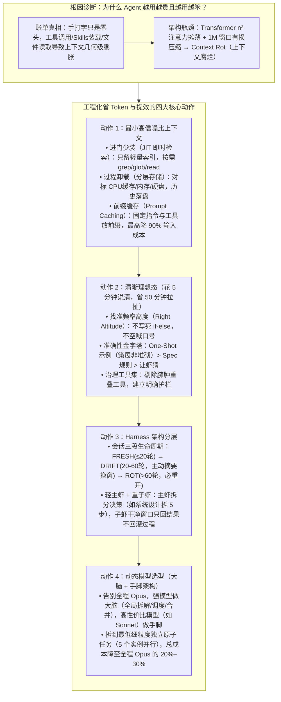

# 精打细算虾养成指南：省 Token 和把 AI 用好，从来就是一件事

> **原文信息**：作者 `Kario Chen`，发布于 2026-07-08 02:36（广东），公众号「腾讯技术工程」。

---

## 1. TL;DR

1. **核心认知：省 Token 与把 AI 用好是同一件事** —— 进入「龙虾（Agent）」时代后，手打输入的提示词在总账单中只是零头，真正的成本大头是工具多次调用、Skills 反复装载与本地文件不断读取引发的**历史上下文几何级膨胀**；受限于 Transformer 的 $n^2$ 注意力摊薄效应，上下文越长模型召回率越低（即 **Context Rot 上下文腐烂**），工程化管理上下文既省钱又提智。
2. **动作一：最小上下文（JIT 即时检索 + 分层存储卸载 + Prompt Caching）** —— 寻找「最小的、信号最强的 Token 集合（`the smallest set of high-signal tokens`）」：进来时采用 **JIT（Just-in-Time）** 只维护轻量索引（路径/查询/链接）按需用 `grep/glob/read` 现场读取；会话膨胀时对标计算机「CPU 缓存/内存/硬盘」做分层卸载落盘；并将固定系统指令与工具定义放前缀触发 **Prompt Caching**（最多降低 **90%** 输入成本）。
3. **动作二：清晰理想态（花 5 分钟策展，省 50 分钟拉扯）** —— 写提示词需找准「合适的频率高度（`right altitude`）」，避免过低硬编码 `if-else` 或过高空喊口号；遵循「**给示例（One-Shot）> 给规则（Spec/约束）> 让虾猜（光提需求）**」的准确性金字塔，精选多样化代表性样板而非堆砌边缘情况，并精简重叠臃肿的工具集。
4. **动作三：Harness 架构分层（三段会话生命周期 + 轻主虾/重子虾）** —— 认识单会话三阶段生命周期：**`FRESH`（前 20 轮，清醒）→ `DRIFT`（20–60 轮，漂移，需主动摘要压缩+保留最近文件重开窗口）→ `ROT`（超过 60 轮，腐烂，必须重开）**；面对月级复杂长任务，采用「**轻主虾（决策调度）+ 重子虾（干净窗口执行最小原子任务，只交结果不回灌过程）**」。
5. **动作四：动态选型（大脑 + 手脚架构）** —— 告别「从头到尾全程开最强模型（如 Opus）」，除了按阶段切换模型外，更优雅的是用强模型当主 Agent（大脑，只做全局理解、拆解、调度与汇总），将任务拆到**最低细粒度的独立原子单元**并发派给便宜高性价比模型（如 Sonnet 等手脚）并行完成，整体成本可降至全程 Opus 的 **20%–30%**。

---

## 2. 核心问题与文章定位

### 2.1 为什么要写这篇？

为什么在 Agent（文中昵称「龙虾」）时代，AI 往往「越用越贵，还越用越笨」？
- **账单结构的剧变**：在早期 ChatBot 时期，模型输入仅包含预设系统提示词、用户输入与少量多轮对话；而在 Agent 时代，工具循环调用、Skills 反复装载、本地文件频繁读取，使手打的那几个字在 Token 看板上沦为冰山一角，历史上下文呈几何级数膨胀。
- **物理与架构瓶颈（Context Rot）**：当前上下文最大的模型也就在 **1M** 左右。如果不加干预，只能依赖工具自带的**有损上下文压缩**，导致早期定好的约束丢失、反复询问已确认事项；更本质的根因在于 **Transformer 架构的 $n^2$ 两两关联机制**——$n$ 个 Token 之间存在 $n^2$ 关联，上下文越长，注意力被摊得越薄，无效噪声直接冲淡高价值信息，导致召回准确率持续下滑。
- **核心破局命题**：真正的省 Token 不是削减投入或降低预算，而是用结构化工程方法替代蛮力输入——**「在合适的时间，把合适的上下文，装载进合适的模型。」**

---

## 3. 知识框架

---

## 4. 核心内容拆解

### 4.1 动作一：最小上下文——别让 AI「读全文」，要让它「按需取」

1. **核心定义**：好的上下文不是喂得越多越好，而是找到**最小的、信号最强的 Token 集合（`the smallest set of high-signal tokens`）**。
2. **进来时少装：JIT（Just-in-Time，即时检索）**：
   - 借鉴代码仓库索引方案，绝不把整个代码库一股脑塞进上下文，只维护一套**轻量索引（文件路径、查询语句、链接）**，真正用到时再通过 `grep` / `glob` / `read` 现场搜索读取。
3. **长会话膨胀治理：分层存储与上下文卸载**：
   - 将 AI 上下文当成计算机多层存储系统来管理——对标 **CPU 缓存（最快但最小）→ 内存（次之）→ 硬盘（最慢但容量无限）**，做到「缓存该缓存，落盘该落盘」，将低频长历史卸载到外部文件。
4. **经常被忽略的降本利器：Prompt Caching（提示缓存命中）**：
   - 将**固定的系统指令和工具定义放在前缀**，使重复部分只按零头计费；启用 Prompt Caching **最多可降低 90% 的输入成本**（作者实测使用 DeepSeek 模型执行任务时账单性价比尤为惊艳）。

---

### 4.2 动作二：清晰理想态——越约束越自由，花 5 分钟说清楚省 50 分钟拉扯

1. **消灭「猜来猜去」的返工黑洞**：
   - 扔一句模糊的「帮我写个登录页」，AI 只能靠猜，来回拉扯五六轮烧掉大量 Token 仍未做好。
2. **调收音机法则：找到合适的频率高度（`right altitude`）**：
   - **太低**：硬编码一堆脆弱的 `if-else`；
   - **太高**：只说一句空洞的「请专业地完成任务」；
   - **刚刚好**：给清目标和约束边界，别把每一步都规定死。
3. **信息传递准确性金字塔**：
   - **第一层（最准确）：给示例（One-Shot）** —— 一个真实的例子比一千字的文字描述更高效；但务必遵循**「策展（Curation）而非堆砌」**原则，不要塞一长串边缘情况试图覆盖所有规则，而是精心挑选几个多样化、有代表性的样板。
   - **第二层（次之）：给规则（Spec / 约束）** —— 明确边界与验收标准。
   - **第三层（最差）：让虾猜（光提需求）**。
4. **工具集精简护栏**：如果工具集臃肿、功能重叠、规则模糊，连人类工程师都说不清该调哪个工具，AI 也绝不可能猜对；**`约束越精确 → AI 越不用猜 → 一次到位 → 返工越少 → Token 越省且质量越高`**。

---

### 4.3 动作三：Harness 架构分层——活太大，就别让一个脑子硬扛

#### （1）主动压缩：单会话的三段生命周期
随着对话轮次增加，Agent 的表现会经历明确的三个阶段，核心原则是**绝不硬撑，在 `DRIFT` 期主动介入**：
- **`FRESH`（清醒期，前 20 轮）**：状态最好，输入输出精准、理解深度到位、响应快速，此时放心使用不用省。
- **`DRIFT`（漂移期，20～60 轮）**：上下文开始变乱，开始重复犯同一种错、遗忘早期约定、输出变啰嗦；**此时必须动手主动压缩**——保留历史摘要 + 最近的几个核心文件，开启新会话窗口继续服务。
- **`ROT`（腐烂期，超过 60 轮）**：风格突变、答非所问、逻辑混乱，此时已彻底无法挽救，必须重开。

#### （2）子智能体架构：轻主虾 + 重子虾
- **为什么需要？** 面对月级长期项目或需中途频繁改需求、改方案的复杂任务，单会话哪怕按阶段压缩仍会被细节压垮。
- **核心分工**：**主虾只做决策和调度**（理解全局、拆分任务、整合结论）；**子虾做具体执行**（各自拿一个明确的、最小粒度的原子任务，使用干净的上下文窗口，**完成后只交回结果，不回灌中间执行过程**）。
- **实战对比（以「写复杂系统设计文档」为例）**：
  - *旧方法*：一个 Opus 在单会话内包揽 `需求分析 → 架构设计 → 代码框架 → 文档输出`，后期上下文堆积如山，新需求改动极易被忽视。
  - *新方法*：主虾拆成 **5 个子任务**派给子虾（① 理解需求、② 梳理关键决策点、③ 设计核心架构、④ 给出代码参考、⑤ 生成文档框架），子虾干完交回结论由主虾汇总。

---

### 4.4 动作四：动态选型——告别「全程 Opus」，构建「大脑 + 手脚」高内聚低耦合架构

1. **初级方案：按阶段切换模型** —— 简单任务用快模型，关键任务才切最强模型；上手快但手动切换繁琐，且难以应对全程需精细决策的任务。
2. **高阶方案：「大脑 + 手脚」架构与原子级任务拆分**：
   - **角色编制**：用最强模型（如 Opus）当主 Agent（**大脑**），唯一职责是理解全局、拆分任务、调度执行、汇总决策；用高性价比模型（如 Sonnet 或更便宜模型）当 Sub-Agent（**手脚**）。
   - **拆分粒度铁律**：不是把大任务粗略砍成五六个中等阶段，而是**拆到最低细粒度的原子任务**——每个单元完全独立、无需跨轮上下文积累、可用中等模型一把搞定（例如：「给这段代码补充单测 / 加注释」「校验这个 JSON 字段有没有缺」「从这篇文档里提取核心决策点」）。
   - **三大工程收益**：
     1. **大脑永不疲劳**：强模型只在决策点出场，即使项目跑数千行代码，主虾上下文从不积压；
     2. **手脚高度并行 + 需求变更无痛**：5 个原子任务可同时派给 **5 个便宜模型实例并行完成**，中途改需求只需重拆对应子虾；
     3. **成本剧降**：整体成本降至「全程 Opus」的 **20%–30%**。

---

## 5. 数据速查表

| 指标 | 原文数值 | 语境 / 条件 |
| :--- | :--- | :--- |
| 当前主流大模型最大上下文窗口上限 | **约 1M 左右** | 解释放任上下文膨胀最终必然触发有损压缩与 Context Rot 的物理背景 |
| Transformer 注意力关联复杂度 | **$n^2$（两两关联）** | $n$ 个 Token 之间存在 $n^2$ 关联，导致上下文越长注意力被摊得越薄 |
| Prompt Caching 输入成本最高降幅 | **最多可降低 90%** | 将固定系统指令与工具定义放在前缀，重复部分仅按零头计费 |
| 前置想清楚约束与减少返工的时间比 | **花 5 分钟说清楚，省 50 分钟拉扯** | 出发前用 One-Shot 示例与清晰规则替代模糊需求多轮盲猜 |
| 会话生命周期 `FRESH`（清醒期） | **前 20 轮** | 输入输出精准、理解到位、响应快速的最佳窗口期 |
| 会话生命周期 `DRIFT`（漂移期） | **20～60 轮** | 开始重复犯错、忘早期约定、输出变啰嗦，需主动摘要+带最近文件开新窗 |
| 会话生命周期 `ROT`（腐烂期） | **超过 60 轮** | 风格突变、答非所问、逻辑混乱，已无法挽救必须重开 |
| 系统设计文档拆分子任务示例数 | **5 个子任务（可 5 实例并行）** | ①理解需求、②梳理关键决策点、③设计核心架构、④给出代码参考、⑤生成文档框架 |
| 「大脑 + 手脚」架构总成本占比 | **降至全程 Opus 的 20%–30%** | 强模型仅做主虾调度，子虾用 Sonnet 或更便宜模型并行执行独立原子任务 |

---

## 6. 踩坑与教训 / 可迁移的设计原则

| 错误做法 | 失败表现或原因 | 原文应对 |
| :--- | :--- | :--- |
| 把整个代码仓库或大文件一股脑全文塞进上下文 | 触发 Transformer $n^2$ 注意力摊薄，既烧掉巨额 Token 又冲淡关键信息导致召回率暴跌 | 采用 **JIT（即时检索）** 只维护文件路径/查询/链接等轻量索引，按需用 `grep/glob/read` 现场拉取，并配合分层存储卸载与前缀 **Prompt Caching** |
| 扔一句模糊需求（如「帮我写个登录页」）让 Agent 自己猜，或塞一长串边缘情况规则 | 来回拉扯五六轮烧光 Token 仍不对路；堆砌边缘规则超出模型最佳频率高度（`right altitude`） | 遵循 **One-Shot 示例 > Spec 规则 > 盲猜** 金字塔，精选多样化代表性样板（「策展」而非「堆砌」），并清理重叠臃肿的工具集 |
| 在单个会话窗口里硬撑超过 60 轮，完全依赖工具自带的自动压缩 | 工具自带压缩是有损压缩，会丢掉早期确认的约束，进入 `ROT`（腐烂）期后答非所问 | 严格监控会话三段生命周期，在 **20～60 轮 `DRIFT`（漂移）期**主动生成摘要并携带最近几个文件开启新会话 |
| 让一个强模型（Opus）在单会话里从需求分析、架构设计一路干到代码与文档输出 | 上下文越堆越厚，模型被早期执行细节压垮，中途改需求时极易忽略新指令且全程单价高昂 | 采用**「轻主虾（大脑）+ 重子虾（手脚）」架构**：主虾只管拆解调度与合并，子虾在干净窗口执行**最低细粒度独立原子任务**（只回结果不回灌过程），总成本降至 **20%–30%** |

---

## 7. 记忆锚点

1. **一句话总纲**：「**在合适的时间，把合适的上下文，装载进合适的模型**——省 Token 和把 AI 用好，从来就是一件事。」
2. **数字速记链**：
   - **$n^2$ 与 1M**：注意力摊薄与窗口上限；
   - **90%**：固定前缀触发 Prompt Caching 最高省下的输入成本；
   - **5 分钟 vs 50 分钟**：策展 One-Shot 示例省下的拉扯时间；
   - **20 / 60 轮**：`FRESH`（≤20 轮）→ `DRIFT`（20–60 轮，主动摘要换窗）→ `ROT`（>60 轮，必重开）；
   - **20%–30%**：大脑（Opus 决策）+ 手脚（Sonnet 并行跑最小原子任务，只交结果不回灌过程）相对于全程 Opus 的最终成本。

---

## 8. 复习卡片

1. 为什么在 Agent（龙虾）时代，用户的手打提示词只是账单零头，且上下文越长模型反而「越用越笨」？::因为 Agent 运行中工具多次调用、Skills 反复装载和本地文件不断读取会导致历史上下文几何级膨胀；而 Transformer 架构中 $n$ 个 Token 存在 $n^2$ 两两关联，上下文越长注意力被摊得越薄（加上逼近 1M 上限时的有损压缩丢失早期约束），从而引发 Context Rot（上下文腐烂），导致召回准确率持续下降。
2. 什么是「好的上下文」，如何通过「JIT」「分层卸载」和「Prompt Caching」在入口和过程中节省 Token？::好的上下文是「最小的、信号最强的 Token 集合（`the smallest set of high-signal tokens`）」；入口处用 JIT（即时检索）只维护轻量索引并通过 `grep/glob/read` 按需读取；过程中对标计算机「CPU 缓存/内存/硬盘」将长历史分层卸载落盘；同时把固定系统指令和工具定义放在前缀触发 Prompt Caching，最多可降低 90% 的输入成本。
3. 在编写提示词避免多轮拉扯时，什么是「合适的频率高度（`right altitude`）」与「信息传递金字塔」？::合适的频率高度是不写死脆弱的 `if-else`（太低）、也不只喊一句「请专业完成」（太高），而是给清目标与约束边界；准确性金字塔依次为「给示例（One-Shot）> 给规则（Spec/约束）> 让虾猜」，且给示例时要「策展而非堆砌」（挑多样化代表性样板而非穷举边缘情况）。
4. 单次 Agent 会话的「三段生命周期」是如何划分的，应该在哪个阶段采取什么动作？::分为三个阶段：① `FRESH`（前 20 轮，状态清醒精准，放心用）；② `DRIFT`（20～60 轮，开始重复犯错、忘早期约定、输出变啰嗦，此时必须主动做摘要压缩并带上最近几个核心文件启动新会话）；③ `ROT`（超过 60 轮，风格突变、逻辑混乱，已没救必须重开）。
5. 「轻主虾（大脑）+ 重子虾（手脚）」架构是如何运作的，为什么它能把成本降到「全程 Opus」的 20%–30%？::用强模型（如 Opus）当主虾（大脑），只负责理解全局、拆分任务、调度和汇总，上下文绝不积压；将任务拆到「最低细粒度的独立原子任务」（如补单测、校验 JSON 字段、提取决策点），并发派给多个高性价比模型实例（如 Sonnet 手脚）在干净窗口中执行，完成后只交回结果、不回灌中间过程。

---

## 9. 知识关联

- **已有主题**：[Agent成本与上下文预算](../../20_topics/Agent%E6%88%90%E6%9C%AC%E4%B8%8E%E4%B8%8A%E4%B8%8B%E6%96%87%E9%A2%84%E7%AE%97.md) · [Harness与模型协同](../../20_topics/Harness%E4%B8%8E%E6%A8%A1%E5%9E%8B%E5%8D%8F%E5%90%8C.md) · [Agent长期记忆](../../20_topics/Agent%E9%95%BF%E6%9C%9F%E8%AE%B0%E5%BF%86.md) · [Agent任务恢复](../../20_topics/Agent%E4%BB%BB%E5%8A%A1%E6%81%A2%E5%A4%8D.md) · [Agent工程循环](../../20_topics/Agent%E5%B7%A5%E7%A8%8B%E5%BE%AA%E7%8E%AF.md) · [AI研发协同](../../20_topics/AI%E7%A0%94%E5%8F%91%E5%8D%8F%E5%90%8C.md)
- **候选新主题**：[[上下文腐烂ContextRot]] · [[大脑与手脚多模型路由]] · [[JIT即时检索与缓存]]

---

## 10. 原文参考资料

1. **Claude Opus / Sonnet & DeepSeek 模型**：文中对比「全程 Opus」与「Opus 主虾 + Sonnet 子虾」动态路由成本（降至 20%–30%），以及实测 DeepSeek 模型结合 Prompt Caching 的高性价比账单表现。
2. **Anthropic Context Engineering 概念体系**：文中引用的 `the smallest set of high-signal tokens`、`right altitude`（合适频率高度）、`Context Rot`（上下文腐烂）及 `JIT (Just-in-Time)` 即时检索理念。

> [!note]- 校对报告
> - **校对状态**：已根据 `MD.md` 全文（共 9 页 PDF 转写文本，第 9 页为空白页）逐一核对。
> - **核心数据与事实页码溯源**：
>   - 龙虾时代 Token 账单结构（手打输入只是零头，工具调用/Skills 装载/文件读取导致历史上下文几何级膨胀）、「在合适的时间，把合适的上下文，装载进合适的模型」核心主张：见 PDF 第 1 页。
>   - 最大上下文 1M 左右、有损压缩导致 Context Rot（上下文腐烂）、Transformer $n$ 个 Token 间 $n^2$ 两两关联导致注意力摊薄、`the smallest set of high-signal tokens`、JIT（`grep / glob / read` 即时检索）：见 PDF 第 2 页。
>   - 上下文分层存储卸载（对标 CPU 缓存/内存/硬盘）、Prompt Caching（固定系统指令与工具定义放前缀，最多降低 90% 输入成本，DeepSeek 账单体验）：见 PDF 第 3 页。
>   - `right altitude`（合适频率高度）、花 5 分钟说清楚省 50 分钟拉扯、准确性金字塔（One-Shot 示例 > Spec 规则 > 让虾猜，策展而非堆砌）、工具集精简护栏：见 PDF 第 3–4 页。
>   - 会话三段生命周期（`FRESH` 前 20 轮、`DRIFT` 20～60 轮主动摘要+保留最近文件开新窗、`ROT` 超过 60 轮必须重开）：见 PDF 第 4–5 页。
>   - 轻主虾 + 重子虾（写系统设计文档拆 5 个子任务、子虾完成后只交回结果不回灌过程）、大脑 + 手脚架构（拆到最低细粒度独立原子任务、5 个实例并行、成本降至全程 Opus 的 20%–30%）：见 PDF 第 5–6 页。
