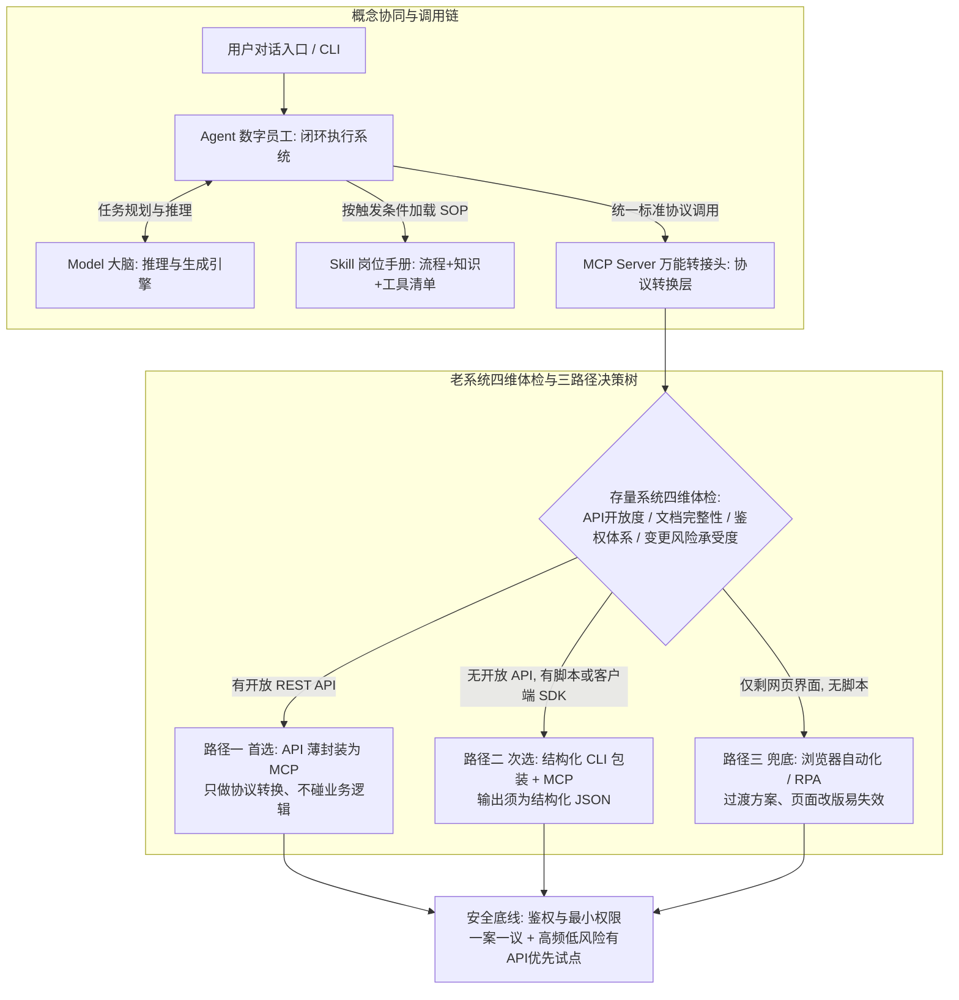
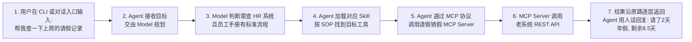

# Agent、MCP、Skill、Cli、Model 一次讲透：老系统接入 AI 的概念地图与三条路径

## 1. TL;DR

企业推进“让 AI 深入老业务系统”不同于采购一套全新 AI 系统，前者是存量工程改造问题，核心难点在于厘清概念调用关系并找到低侵入、高稳定的改造切口。本文用“新入职数字化团队”与“传统软件架构映射”拆解五个核心概念：Model 是负责推理与生成的大脑，Agent 是负责“感知—规划—行动—观察—再规划”闭环的数字员工系统，Skill 是封装流程与领域知识的岗位 SOP 手册，MCP 是统一连接 AI 与外部系统的开放标准协议转接头，CLI 则是指令清晰、回执明确且可被 MCP 内部嵌套封装的命令行交互通道。针对跑了多年的存量系统，文章提出“先做四维体检，再走三条路径决策树”：首选将开放 API 薄封装为 MCP Server（严守只做协议转换、不碰业务逻辑的纪律），次选将运维脚本或客户端 SDK 包装为返回 JSON 的结构化 CLI 再套 MCP，仅剩网页界面时才用浏览器自动化/RPA 作过渡兜底。在协议与治理层面，必须区分 MCP 传输方式（原文口径将官方标准定为 `stdio` 与 `Streamable HTTP`，将 `HTTP+SSE` 归为存量迁移方案）与网关等部署架构，并对用户身份传递、最小权限、审计和敏感操作人工确认执行“一案一议”评审，从高频、低风险、有 API 的系统切入打赢首战。

## 2. 核心概念

### 五大概念角色与传统软件架构映射

| 概念 | 数字化团队角色 | 传统软件世界映射 | 核心职责 | 易混边界与关键约束 |
|---|---|---|---|---|
| **Model（大模型）** | 大脑 | —（推理引擎部件） | 负责“想”：具备参数量、上下文窗口、多模态属性，执行推理与生成 | 大脑没有手脚，模型本身碰不到数据库里的一行数据，只是 Agent 系统的一个部件 |
| **Agent（智能体）** | 数字员工 | 微服务 | 负责“干”：接收目标后自主拆任务、找工具、执行、看结果、再调整（感知—规划—行动—观察—再规划闭环） | Agent 是一整套闭环执行系统，不能与底层的单个 Model 混为一谈 |
| **Skill（技能包）** | 岗位技能手册 | 内部 Wiki / SOP | 负责“会”：由“触发条件 + 操作流程 + 领域知识 + 工具清单”组成，让通用员工变成领域熟手 | Prompt 是随口叮嘱一句的一次性指令；Skill 是工程化、可版本管理的 SOP 流程资产 |
| **MCP（Model Context Protocol）** | 万能转接头 | OpenAPI / REST | 负责“接”：连接 Agent 与任意外部系统（数据库、API、文件、设备）的开放标准协议 | MCP 是面向 AI 的统一接口标准外壳，不等于底层业务 API 本身，且协议逻辑与传输方式无关 |
| **CLI（命令行接口）** | 对讲机 | SDK / 命令行 | 负责“说”：指令清晰、回执明确、可记录的交互通道；给工程师用是高效操作，给 Agent 用是结构化调用 | **MCP 与 CLI 可嵌套**：CLI 管工具怎么执行，MCP 管怎么把工具标准地暴露给 AI（如 MCP Server 内部封装 `git bash`） |

## 3. 知识框架

以下流程图按正文整理，展示五个概念的调用关系、老系统四维体检与三条改造路径决策树：

## 4. 关键要点与机制详解

### 4.1 一次工具调用的完整接力：各组件怎样协同运转

**核心主张**：用户的一句自然语言指令之所以能操作企业老系统，靠的不是模型直接读写数据库，而是 Agent 协调 Model、Skill、MCP 与存量接口完成的分层接力。

以下流程图按正文整理，复现“帮我查一下上周的请假记录”在五个概念与老系统之间的完整调用链路：

- **机制拆解与职责边界**
  - **为什么模型不能跳步直连**：Model 只负责根据上下文判断“这件事该查 HR 系统、遵循哪套流程”，并不直接持有系统凭证或发起网络请求。
  - **为什么需要 Skill 与 MCP 配合**：Skill 告诉 Agent 查请假记录的标准作业流程（SOP）及应调用的工具名称；MCP Server 则把老系统千差万别的底层接口屏蔽在标准协议外壳之后，使 Agent 无需感知背后调的是 REST API、命令行脚本还是本地客户端 SDK。

### 4.2 老系统改造方法论：四维体检、三档路径与安全冷水

**核心主张**：存量系统接入 AI 没有万能模板，必须先从四个维度做系统体检，再按“API 封装 → CLI 包装 → RPA 兜底”的递减优先级选择路径，并将“一案一议”的鉴权设计前置写入项目计划。

- **第一步：动刀前的四维体检**
  - 在选择技术路径前，先对存量老系统评估四个维度：**API 开放程度**、**文档完整性**、**鉴权体系**、**变更风险承受度**。
- **第二步：三条改造路径决策树对比**
  - 三条路径从上到下，**改造深度递减、脆弱性递增**：

| 改造路径与优先级 | 适用体检条件 | 核心实现机制与工程纪律 | 优势、代价与边界 |
|---|---|---|---|
| **路径一：API 封装为 MCP（首选）** | 系统已有开放 API（如 REST API） | 直接在存量 API 前面加一层 MCP Server 薄封装层；🔥 **核心纪律：封装层只做协议转换，绝不触碰业务逻辑** | 改动最小、最稳定、支持灰度发布；老系统本身无需改动代码 |
| **路径二：CLI 包装 + MCP（次选）** | 没有开放服务端 API，但有命令行、运维脚本或客户端自带 API/SDK | 先把脚本或本地接口封装成结构化 CLI，外面再包一层 MCP（如封装 `git bash`）；🔥 **技术硬要求：CLI 输出必须结构化，最好是 JSON，Agent 才消费得动** | 能在不改造老系统服务端的前提下打通能力；需额外维护本地或旁路 CLI 包装层 |
| **路径三：浏览器自动化 / RPA（兜底）** | 只剩一个网页界面，连运维脚本都没有 | 用浏览器自动化模拟人工点击与表单操作 | 能快速跑通演示，但极脆弱，页面一改版就失效；**只能作为过渡方案，绝不能当作终态** |

- **第三步：安全与鉴权的“一案一议”原则**
  - 当 Agent 代替人去操作业务系统时，接口能调通不等于安全合规。每个系统上线前必须单独评审四个核心安全问题：
    1. **身份传递**：用户身份怎么从对话入口传给 Agent、再传给目标老系统？
    2. **最小权限**：Agent 执行动作时的权限如何收敛到最小范围？
    3. **操作审计**：代操作行为如何留下完整可追溯的审计日志？
    4. **敏感确认**：涉及修改、审批等敏感动作是否强制要求人工确认？
  - 作者明确强调，行业目前拿不出能直接套用所有企业的通用标准鉴权方案，必须把鉴权按“一案一议”写进项目计划，不能当意外处理。
- **第四步：试点切入的四象限排序**
  - 绘制“**使用频次—业务价值**”四象限图，优先挑选**高频、低风险、已有开放 API** 的系统动手。工程落地的现实逻辑是“第一场仗必须赢，还得赢得便宜”。

### 4.3 MCP 实现形式全景：解耦协议逻辑、传输方式与部署架构

**核心主张**：MCP 本质上是传输无关的协议（协议逻辑不变，变的只是消息怎么跑腿），选型时必须先分清官方标准传输、历史遗留传输、社区扩展与部署架构四个层次。

> [!note] 原文时效口径说明
> 原文指出：MCP 官方规范里只有 `stdio` 和 `Streamable HTTP` 两种标准传输方式，`SSE`（HTTP + SSE）自 2025 年 3 月起已被取代，属于只做存量迁移、不再新建的历史方案。该判断为原文 2026 年 10 月写作口径，本笔记忠实记录原文分类，未对外部官方规范做联网核验。

### MCP 四大版图与传输选型对比

| 分类层级 | 具体形式 | 运作机制 | 适用场景与选型口诀 | 代价、风险或处置动作 |
|---|---|---|---|---|
| **官方标准传输（默认选项）** | **`stdio`** | 宿主程序直接拉起本地子进程，通过标准输入输出（stdin/stdout）通信 | **本地开发与桌面 Agent 的标准姿势** | 单机单客户端，信任关系仅停留在本地进程级，无法直接跨机多团队共享 |
| **官方标准传输（默认选项）** | **`Streamable HTTP`** | 单个 HTTP 端点，`POST` 发请求、`GET` 建流收推送，支持会话保持与断线恢复，配合 OAuth 2.0 | **企业内集中部署、多团队共享的唯一官方推荐远程方式** | 需配套规划企业级网关与 OAuth / SSO 鉴权对接 |
| **历史遗留传输** | **`HTTP + SSE`** | 早期双端点方案 | **只做存量系统迁移，严禁新建** | 见到存量 SSE 的唯一动作是规划向 `Streamable HTTP` 迁移 |
| **社区扩展传输** | **`WebSocket` / `WebRTC` / 进程内 RPC** | 生态在官方标准外长出的扩展；如 WebSocket 提供全双工低延迟通信 | **留给实时交互与浏览器桥接场景**（如 Agent 连接 Chrome 扩展做浏览器自动化） | 负载均衡需配置粘性会话（Sticky Session），且企业防火墙可能拦截协议升级握手 |
| **部署架构（非新协议）** | **MCP Gateway / Proxy / 托管 MCP** | 在传输层之上提供路由、代理或托管能力 | 企业级集中治理与统一接入 | 属于部署架构而非传输方式，切忌与 `stdio` / `Streamable HTTP` 等传输协议混为一谈 |

### 4.4 B/S 与 C/S 双架构实战案例对照

**核心主张**：存量系统无论采用 B/S 还是 C/S 架构，核心成功要素都是将封装层控制在薄转换层，并直接复用企业现有 SSO 或客户端登录态。

| 对照维度 | 案例一：某头部车企请假销假系统（B/S 架构） | 案例二：某欧洲商用车企 PLM 系统（C/S 架构） |
|---|---|---|
| **存量系统形态** | Java Web 系统，已有开放 REST API，属 HR 高频场景 | 传统桌面客户端，无开放服务端 REST API，但客户端自带本地 API 与 SDK |
| **原有业务痛点** | 员工查假期余额需登录系统点击 5 步；HR 每月需人工对账 | 数据孤岛严重，工程师需在系统间人工搬运 BOM 表与图纸信息 |
| **所选改造路径** | **路径一（API 薄封装为 MCP）** | **路径二（本地接口结构化包装 + MCP）** |
| **具体架构与鉴权实现** | 在原有 REST API 前加一层 MCP Server，采用 `Streamable HTTP` 集中部署，鉴权直接对接企业 SSO | 在 PLM 桌面客户端旁部署一个本地封装服务，将客户端 API 包装成结构化接口后再包一层 MCP，会话与权限直接沿用客户端已有的登录态 |
| **侵入性与落地效果** | 老系统一行代码未动；员工在对话窗口说一句“帮我请明天下午半天年假”，5 步操作变成 1 句话 | 在不触碰 PLM 服务端源码与权限体系的前提下，打通 BOM 与图纸信息的结构化读取 |

## 5. 数据速查表

| 指标 | 原文数值 | 语境 / 条件 |
|---|---|---|
| 客户交流方案胶片体量 | 42 页 PPT | 面向国内某大型整车集团研究院 IT 团队的交流材料 |
| 核心概念拆解数量 | 5 个（Model / Agent / Skill / MCP / CLI） | 构成“数字化团队”的概念地图 |
| 工具调用接力示例返回值 | 上周请了 2 天年假，剩余额度 8.5 天 | “帮我查一下上周的请假记录”经 MCP Server 调 HR 系统 REST API 后的返回示例 |
| 老系统改造前置体检维度 | 4 个维度 | API 开放程度、文档完整性、鉴权体系、变更风险承受度 |
| 老系统接入 AI 路径档数 | 3 条路径 | API 封装为 MCP（首选）→ CLI 包装 + MCP（次选）→ 浏览器自动化/RPA（兜底） |
| MCP 官方标准传输方式数量 | 2 种（`stdio` 与 `Streamable HTTP`） | 原文口径：SSE 自 2025 年 3 月起被取代，归入历史遗留方案 |
| B/S 请假销假系统改造效果 | 老系统改代码 0 行；员工操作从 5 步变为 1 句话 | Java Web + REST API + `Streamable HTTP` MCP Server + 企业 SSO |

## 6. 踩坑与教训 / 可迁移的设计原则

### 常见踩坑与应对

| 错误做法 | 失败表现或原因 | 原文应对策略 |
|---|---|---|
| **不看系统条件直接上 RPA 或单一方案（拿着锤子找钉子）** | 有 API 的系统被做重，或把页面改版即碎的 RPA 当成长期架构，维护成本失控 | 动刀前先做四维体检（API、文档、鉴权、风险），严格按 API → CLI → RPA 决策树选路 |
| **在 MCP 封装层里塞入大量业务规则与数据加工逻辑** | 封装层变成新的重业务黑盒，老系统或规则一变两边都要改，“封装层越厚项目死得越快” | 严守薄封装纪律：MCP Server 只做协议转换与结构化包装，绝不触碰存量业务逻辑 |
| **直接把面向人类阅读的原始命令行文本塞给 Agent** | 自由文本格式不固定、噪声多，Agent 解析不稳甚至消费不动 | 走路径二封装 CLI 时，强制要求 CLI 输出结构化数据（最好是 JSON），外面再包 MCP |
| **听信“有现成通用安全套件”，把鉴权留到上线前才补** | 企业老系统权限模型各异，身份透传、最小权限与审计无法对齐，导致项目卡死在安全评审 | 鉴权与安全坚持“一案一议”，在立项阶段就把身份传递、最小权限、审计与敏感操作确认写进项目计划 |
| **混淆 MCP 传输方式与部署架构，或新建项目仍用 SSE** | 把 MCP Gateway/Proxy 当成新协议，或采用已被替代的双端点 SSE 增加后续迁移负担 | 立住“MCP 协议与传输解耦”认知：本地用 `stdio`，企业远程共享用 `Streamable HTTP` + OAuth，SSE 仅做存量迁移 |

### 可迁移的设计原则

- **先赢下最便宜的第一场仗**：在企业内部推广 AI 接入存量系统时，用“使用频次—业务价值”四象限筛选出**高频、低风险、已有开放 API** 的系统作为首个试点（如请假销假查询），用零代码侵入的薄封装快速交付可见价值，再向复杂 C/S 系统推进。
- **客户端旁路伴生封装模式**：面对无服务端开放 API、但桌面客户端自带 SDK/API 且已登录的传统 C/S 工业软件（如 PLM），无需硬啃服务端改造，可在客户端同机旁路部署本地封装服务，复用客户端既有登录态会话并向上暴露本地 MCP 接口。

## 7. 记忆锚点

- **原文嵌套分工锚点**：“CLI 管工具怎么执行，MCP 管怎么把工具标准地暴露给 AI。”
- **老系统改造三原则（原文总结）**：“先体检再选路径，别拿着锤子找钉子；封装要薄，不碰业务逻辑，封装层越薄项目死得越慢；鉴权一案一议，把它写进项目计划，别当意外处理。”

## 8. 复习卡片

在企业 AI 架构中，Model、Agent 与 Skill 各自承担什么职责，为什么不能混为一谈？::Model 是只负责推理与生成的大脑部件，自身碰不到业务数据；Agent 是包含“感知、规划、行动、观察、再规划”的完整闭环执行系统；Skill 则是包含触发条件、操作流程、领域知识和工具清单的可版本化岗位 SOP 手册，不同于一次性叮嘱的 Prompt。
MCP 与 CLI 是什么关系，为什么说它们可以嵌套？::CLI 是面向高效操作与结构化调用的命令行执行通道，解决“工具怎么执行”；MCP 是统一连接 Agent 与外部系统的开放标准协议，解决“怎么把工具标准地暴露给 AI”。一个 MCP Server 内部可以封装一个 CLI（如封装 `git bash`），Agent 只需通过 MCP 外壳调用而无需关心底层实现。
老系统接入 AI 前需要先做哪四个维度的体检，三条改造路径的优先级顺序是什么？::需先体检 API 开放程度、文档完整性、鉴权体系和变更风险承受度四个维度；随后按“API 薄封装为 MCP（首选）→ 脚本包装为结构化 CLI 再套 MCP（次选）→ 浏览器自动化/RPA（兜底过渡）”的顺序选择，越往下改造越脆弱。
为什么走路径一（API 封装）必须坚持“薄封装”，走路径二（CLI 包装）有什么硬性技术要求？::路径一要求 MCP Server 只做协议转换、绝不碰业务逻辑，这样改动最小、老系统无需改代码且易于灰度；路径二要求被包装的 CLI 输出必须是结构化格式（最好是 JSON），否则 Agent 难以稳定消费。
为什么浏览器自动化或 RPA 只能作为老系统接入 AI 的兜底过渡方案而不能当终态？::因为 RPA 依赖模拟网页界面上的人工操作，前端页面一旦改版就会失效，脆弱性极高，仅适合在既无 API 也无脚本时作临时过渡。
按原文口径，MCP 的实现形式分为哪四类，不同场景下的传输选型口诀是什么？::分为官方标准（`stdio`、`Streamable HTTP`）、历史遗留（`HTTP+SSE`）、社区扩展（`WebSocket`、`WebRTC`、进程内 RPC）和部署架构（Gateway、Proxy、托管 MCP）；选型口诀是“本地开发用 `stdio`，企业共享用 `Streamable HTTP` 加 OAuth，`SSE` 只做存量迁移，`WebSocket` 留给实时和浏览器场景”。
当企业老系统为传统 C/S 桌面客户端（无服务端 REST API，但客户端自带 API/SDK）时，如何接入 MCP？::采用客户端旁路封装模式：在桌面客户端旁边部署一个本地封装服务，将客户端自带的 API/SDK 包装成结构化接口后再套一层 MCP，并直接沿用客户端已有的登录态与会话权限。
Agent 代替人操作企业老系统时，必须在项目计划中逐系统评审哪四个安全与鉴权问题？::必须逐系统评审：用户身份如何从用户传到 Agent 再传到目标系统、权限如何收敛到最小、操作如何记录审计、以及敏感动作是否需要人工确认。

## 9. 知识关联

- **工具协议与运行时控制**：[[Harness与模型协同]]（[Harness与模型协同](../../20_topics/Harness与模型协同.md)）、[[桌面Agent与工作流]]（[桌面Agent与工作流](../../20_topics/桌面Agent与工作流.md)）、[[Skill设计与治理]]（[Skill设计与治理](../../20_topics/Skill设计与治理.md)）
- **企业研发与安全治理**：[[AI研发协同]]（[AI研发协同](../../20_topics/AI研发协同.md)）、[[Agent安全与权限]]（[Agent安全与权限](../../20_topics/Agent安全与权限.md)）、[[模型与开发工具发布]]（[模型与开发工具发布](../../20_topics/模型与开发工具发布.md)）
- **本篇原始与转写材料**：[原始 PDF](RAW.pdf) · [逐页转写文本](MD.md)

## 10. 原文参考资料

原文基于作者团队面向国内某大型整车集团研究院 IT 团队的 42 页技术交流方案整理，文中涉及的技术规范包括 Model Context Protocol（MCP）的 `stdio`、`Streamable HTTP`、`HTTP+SSE` 传输定义，未附外部论文链接。文末关于“腾讯智慧出行合作车企与 Workbuddy / Codebuddy / ADP / 乐享产品”的品牌推广段落不属于技术论证，未纳入本笔记技术结论。

> [!note]- 校对报告
> **覆盖度**：基于 `MD.md` 与 `META.json` 完整覆盖 PDF 第 1–6 页全部技术正文（一、事情的起因 p.1；二、五个概念构成一支团队及 MCP-CLI 嵌套关系 p.1–2；三、一次工具调用接力与传统软件架构映射 p.2–3；四、老系统四维体检、三档改造路径、一案一议安全评审与四象限试点排序 p.3–4；五、MCP 四类实现形式与传输选型口诀 p.4–5；六、B/S 请假销假与 C/S PLM 两个实战案例及三条复用经验 p.5–6；七、交流效果复盘 p.6）。第 6 页末尾品牌宣传、第 7 页公众号留言区及第 8 页空白页已核对排除。
>
> **一致性抽查**：
>
> | 核对项 | 笔记值 | 原文值与位置 | 结果 |
> |---|---|---|---|
> | 交流 PPT 页数 | 42 页 | 42 页的 PPT（p.1） | 一致 |
> | 请假查询返回示例 | 上周请了两天年假，剩余额度 8.5 天 | 请了两天年假，剩余额度 8.5 天（p.3） | 一致 |
> | 传统软件与 AI 映射 | 微服务→Agent，OpenAPI/REST→MCP，内部 Wiki/SOP→Skill，SDK/命令行→CLI | p.3 映射表 | 一致 |
> | 老系统体检四维度 | API 开放程度、文档完整性、鉴权体系、变更风险承受度 | p.3 | 一致 |
> | MCP 官方标准与 SSE 节点 | 官方标准 `stdio` 与 `Streamable HTTP`；`SSE` 从 2025 年 3 月起被取代 | p.4–5 | 一致 |
> | B/S 与 C/S 案例细节 | B/S 五步变一句话、老系统一行代码没动；C/S 客户端旁部署本地封装服务、沿用客户端已有登录态 | p.5 | 一致 |
>
> **推断与异常**：未引入超出原文的技术推断。原文关于 MCP 官方传输规范（如 SSE 于 2025 年 3 月被取代）的陈述具有时效性，已在正文中明确标明为原文口径，未作外部联网核验。
>
> **日期与格式**：发布日期依据 PDF 第 1 页页眉 `Oct 12, 2026, 2:36 AM`，frontmatter `date` 记为 `2026-10-12`；全文保持唯一 H1，正文、表格、图注与复习卡片均不含页码与章节标注；复习卡片共 8 条，严格采用单行 `问题::答案` 格式；Mermaid 图表与文内命令示例均未实际执行。
