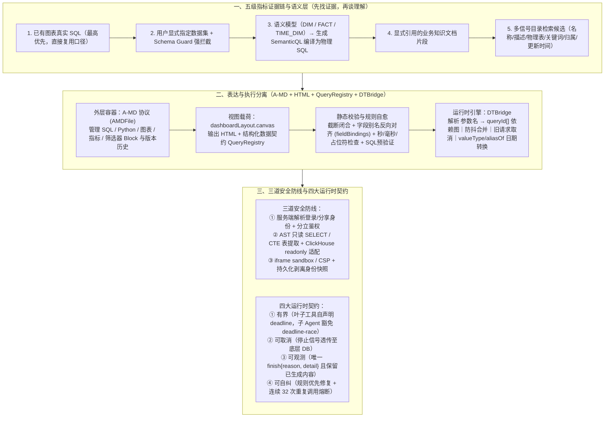

# 腾讯 Omega：下一代“AI BI”的答案?

## 1. TL;DR — 核心结论速览

1. **聊天框（ChatBI）不是 BI 的下一代，把“AI 画出的静态图”变成“活的数据产品”才是核心命题**：许多 AI 看板直接把查询结果硬编码进 HTML（`const data = [...]`），导致换时间不刷新、切筛选各算各的、改一张图重画整页。腾讯 DataTalk 团队推翻 2024 年的 ChatBI 形态，由 **3～4 人核心团队**于 2026 年 1 月中旬从零打造 **Omega（内测版「马尔摩斯 / marmos」）**，让 AI 接管从理解数据、指标规划、生成交互式看板到持续监控推送的完整分析工作流。
2. **表达与执行解耦（`HTML + QueryRegistry + DTBridge`）**：AI 生成页面时不仅输出 HTML，还必须生成结构化数据契约 **`QueryRegistry`**（声明 `queryId`、`datasetId`、`sqlTemplate`、`params`、`fieldBindings`），并交由 **`DTBridge` 运行时**解析出 `参数名 → queryId[]` 依赖图，实现按需局部并发刷新、防抖合并、旧请求取消、级联筛选以及秒/毫秒/分区日期（`valueType` + `aliasOf`）统一转换，并通过反向校验 SQL 输出别名与页面读取字段消灭“查询成功但图表空白”的静默失败。
3. **指标不靠猜、安全不靠 `iframe`**：
   - **五级指标证据链**：按“已有图表真实 SQL $\to$ 用户指定数据集（受 **Schema Guard** 强拦截保护）$\to$ 语义模型（区分 `DIM/FACT/TIME_DIM` 生成 `SemanticQL` 免猜物理 JOIN）$\to$ 明确引用的业务知识 $\to$ 多维检索候选”的优先级就近取证。
   - **三道安全防线与快照剥离**：① 服务端解析真实登录/分享身份并按 Schema、查询、打开文件独立鉴权；② 按引擎能力执行 **AST 只读单语句校验**（含 CTE/子查询表提取与行数上限）或驱动级 `readonly` + 超时控制（如 ClickHouse）；③ `iframe sandbox` + `CSP` 隔离，且**持久化保存时剥离临时脚本与查看者身份，打开/分享时再动态注入**。
4. **用 Harness 抹平 30 倍模型成本差，并以“四大运行时契约”兜底线上稳定性**：在同一看板生成与修改任务上，`Claude 4.6`（约 `14.2 元`）与 `混元 Hy3`（约 `0.47 元`）成本相差约 **30 倍**。Omega 通过规则优先修复（截断闭合、字段对齐、时间格式）+ 语义定向重试赋能高性价比模型；针对“耗时 `110～130 秒` 的慢 SQL 被 `120 秒` 空闲看门狗误杀且后端跑满 `30 分钟`”及“同一工具连续重复调用 `32 次`”等真实事故，提炼出 **有界（子 Agent 豁免 `deadline-race`）、可取消（信号透传到底层查询）、可观测（唯一类型化 `finish{reason, detail}`）、可自纠（重复调用熔断）** 四大运行时契约。

---

## 2. 背景与演进：为什么“聊天框 + SQL”走不通？

### 2.1 从 2024 ChatBI 到 2026 Omega 的范式重构

| 阶段 / 形态 | 核心交互方式 | 暴露出的致命短板 |
| :--- | :--- | :--- |
| **传统 BI** | 找数据 $\to$ 选字段 $\to$ 拖组件 $\to$ 配筛选器 $\to$ 调样式 | 专业性强但门槛高：要求用户事先清楚分析路径，并手动把业务问题翻译成几十步 GUI 操作 |
| **ChatBI（2024 年 DataTalk 侧边栏实践）** | 用户在侧边栏提问 $\to$ AI 生成单条 SQL $\to$ 返回单张图表 | **只缩短了一次查询，接不住完整分析流**：真实分析永远伴随着连续追问（为什么华南掉得厉害？客单价还是订单数？），AI 与原 BI 系统割裂成两张皮 |
| **演示型 AI 看板（静态 HTML 生成）** | 上传 Excel 敲一句话 $\to$ AI 把查询结果硬编码进 `const data = [...]` 画出精美页面 | **“首日惊艳，次日作废”**：换时间范围数字不动、点筛选器各算各的、表多一列整页空白、改个柱状图顺手把确认好的布局全重画了 |
| **Omega（2026 年 1 月中旬立项，3～4 人团队）** | 自然语言理解数据源与规划多维指标 $\to$ 生成 `HTML + QueryRegistry` 动态看板 $\to$ 局部微调 / GUI 混排 / 监控推送 | **前 2 个月跑通演示主链路，后续数月死磕“离开演示环境后仍然像个产品”**——解决动态数据管道、口径证据、权限边界与运行时容错 |

---

## 3. 知识框架 — Omega 从业务提问到持续运行的架构全链路

---

## 4. 核心架构与工程实践拆解

### 4.1 看板如何真正“活着”：`QueryRegistry` 数据契约与 `DTBridge` 运行时

#### （1）拒绝硬编码数据，拆解“AI 表达意图”与“系统稳定执行”
如果让大模型在生成的 HTML 里自己手写每个筛选器的 `addEventListener`、自己拼接 SQL `WHERE` 字符串、自己处理空值与日期格式，单段代码看似简单，组合在一块看板里却极易发生**无报错的静默失败（Silent Failure）**。
- **典型线上静默 Bug 案例**：某次生成的看板中，SQL 明明成功查出了数据，数据库零报错，浏览器控制台也零异常，但图表却是全空的。排查发现：**页面 JS 回调读取的字段名叫 `总上报量`，而 SQL 输出的列名却是 `total_pv`**。
- **Omega 的契约化解法（`QueryRegistry`）**：
  Omega 要求生成页面时，除了视图 HTML 外，必须配套生成一份结构化的 **`QueryRegistry`** 数据契约（注：原文代码片段右侧略有截断，核心契约字段如下）：
  - `queryId`：页面组件与后端查询之间的唯一稳定引用（如 `q_sales_trend`）；
  - `datasetId`：将请求路由到已登记的受控数据集；
  - `sqlTemplate`：带参数占位符（如 `{{startDate}}`）的 SQL 模板；
  - `params`：定义参数名、类型（如 `date`）、筛选器类型（`dateRange`）、成对关系（`pairWith: "endDate"`）、级联来源、选项查询及目标格式（`valueType: "str_YYYY-MM-DD"`）；
  - `fieldBindings`：**显式绑定 SQL 输出列别名（`alias`）、业务角色（`dimension` / `metric`）与图表目标槽位（`chart-axis` / `chart-series`）**。生成后系统会从页面真实读取的字段反向校验 `fieldBindings` 与 SQL 输出别名，彻底堵死“列名错位导致白图”的漏洞。

#### （2）联动筛选的本质是一张查询依赖图（`参数名 → queryId[]`）
1. **精准局部刷新**：`DTBridge` 加载时扫描所有 `sqlTemplate` 中的占位符，自动构建一张 **`参数名 → queryId[]` 的依赖映射表**。例如当 `region` 参数同时出现在销售趋势、品类结构、客户排行和地图 4 条查询中时，用户切换地区筛选器，系统直接算出受影响集合并**仅并发刷新这 4 张图**，而与 `region` 无关的库存卡片纹丝不动。
2. **异构日期格式运行时归一（`valueType` + `aliasOf`）**：企业数仓中，同一个日期筛选值在事实表时间戳字段里可能要求是 `2026-07-22 00:00:00`，而在物理分区字段里却要求是整型或字符串 `20260722`。`QueryRegistry` 通过 `valueType` 声明各自所需格式，并用 `aliasOf` 让两个 SQL 参数共享同一个筛选器的标准值，由 `DTBridge` 在运行时统一完成转换。
3. **防抖、取消与级联（Cascading Filters）**：用户连续拖动或快速切换筛选器时，变更先经**防抖合并**；同一查询尚未返回的旧请求会被**主动取消**；省市级联筛选（如切换“省份”后，先触发依赖省份参数的“城市选项查询”，再刷新依赖城市的图表）同样沿着同一张依赖图自动拓扑执行。

---

### 4.2 AI 怎么找对指标？——“五级指标证据链”与语义模型 `SemanticQL`

面对“看一下上个月各地区的销售额”，难点不在于写 `SUM()`，而在于企业内部“销售额”究竟含不含税、扣不扣退款、按支付时间还是下单时间统计。Omega 确立了铁律：**离用户当前工作现场越近的证据，优先级越高**，绝不让 LLM 凭通用常识替企业瞎编口径：

| 证据优先级 | 证据来源 | 系统执行机制与强约束护栏 |
| :---: | :--- | :--- |
| **优先级 1（最高）** | **当前正在修改的已有图表 SQL** | 系统将当前图表的 `datasetId`、查询说明、数据库引擎和**已跑通的真实 SQL**（如 `SUM(pay_amount - refund_amount)` 或 `COUNT(DISTINCT buyer_id)`）一并交给 Agent，后续加维度或换图型必须**直接复用该口径** |
| **优先级 2** | **用户在消息中明确指定的数据集** | 生成前 Agent 必须先调用 `Schema` 工具获取物理字段、展示名、类型、说明、分区与引擎路由；外层设有硬性的 **`Schema Guard`**——若用户指定了数据但模型没读 Schema 就试图生成页面，流程直接被拦截！ |
| **优先级 3** | **企业已治理的语义模型（Semantic Model）** | 拒绝把字段注释塞进 Prompt 让模型瞎猜多表物理 `JOIN`！系统将语义模型字段按维度 `DIM`、指标 `FACT`、时间维度 `TIME_DIM` 分类；Agent 只基于治理好的逻辑对象写出针对 `MODEL('<modelCode>')` 的 **`SemanticQL`**，交由后端语义查询服务编译为物理 SQL。若报 `Unknown identifier`，将错误、上一版 `SemanticQL` 与真实字段列表一并退回做有限次有据修复 |
| **优先级 4** | **明确引用的业务知识文档** | 用户引用的指标字典、分析方法或业务文档片段会被带入当前轮上下文（如“有效成交额需扣除全额退款”），与字段元数据共同参与规划 |
| **优先级 5** | **工作空间与数据目录多信号检索** | 仅当用户未指定数据时，综合名称、描述、物理表名、关键词覆盖、归属与更新时间从数千个数据集中召回去重后的候选；若缺乏口径证据，诚实暴露候选或向用户确认 |

---

### 4.3 安全不是一个 `iframe` 属性：三道防线与快照身份剥离

生成的 HTML 页面既然能实时拉取生产数据，如何防止越权访问与注入攻击？Omega 构建了纵深防御体系：
1. **第一道边界：服务端身份解析与分立授权**
   - 绝不信任前端页面自己传来的 `userId`，查询身份一律由服务端从当前登录态或分享关系链中解析。
   - **权限粒度拆解**：读取数据集 Schema、执行数据查询、打开文件分别独立做权限校验——绝不能因为 Agent 在前序步骤拿到了某个 `datasetId` 或文件 ID，就默认后续查询或覆盖写入天然合法。
2. **第二道边界：尊重数据源差异的只读 SQL 闸门**
   - **标准 SQL 方言**：后端通过 **AST（抽象语法树）解析**强制保证单条、只读 `SELECT` 语句，拦截多语句拼接与危险函数，递归提取包含子查询与 `CTE` 在内的所有真实物理表引用以核验表级权限，并统一追加返回行数上限。
   - **特殊引擎适配（如 `ClickHouse`）**：针对无法完全复用同一通用 AST 解析器的 OLAP 引擎，采用轻量只读检查，并叠加数据库驱动层的 `readonly` 模式、查询超时与结果集上限。
3. **第三道边界：受控运行环境与“持久化身份剥离”**
   - 生成的 HTML 绝不包含任何数据库账号、密码或密钥，所有数据请求必须走服务端受控查询代理；前端运行在 `iframe sandbox` 与严格 `CSP` 策略下（独立预览模式进一步收紧网络连接范围）。
   - **极其关键的生命周期细节（持久化剥离）**：当看板被持久化保存为快照时，系统会**自动剥离临时注入的运行时脚本与当前查看者身份信息**；直到下一次被某位用户真正打开或通过分享链接访问时，服务端才按当次访问者的权限动态注入唯一一份 `QueryRegistry`、`DTBridge SDK` 与本次会话参数——**“数据契约可以保存，运行时身份绝不能被永久烘焙进快照”**。

---

### 4.4 生成后的人机接力（`A-MD` 协议）与审美基础设施（“薄配置，厚引擎”）

#### （1）`A-MD` 文件协议：自然语言、GUI 拖拽与 `Plan Mode` 协同
- 外层采用自研的 **`A-MD` 协议（`AMDFile`）**：统一承载 SQL、Python、图表、指标、筛选器、说明文字等 `Block` 以及多视图 `Layout`；而生成式看板 `Canvas` 则是挂载在 `dashboardLayout.canvas` 下的视图载荷（核心保存 HTML 与 `QueryRegistry`）。
- **三种修改颗粒度**：小改动直接对 AI 说“把第二张图换成折线图”（局部精准替换，且只改视觉风格时强制复用已验证过的 `QueryRegistry`，防止换色顺手改坏指标口径）；精细排版直接用鼠标在 GUI 编辑器里拖拽；大范围重构则先进入 **`Plan Mode`** 列出修改清单，人工确认后再执行。

#### （2）打破 AI 的“审美平均脸”：23 种风格 × 18 种引擎的“薄配置，厚引擎”
- 放任大模型自由发挥画十张看板，大概率会得到十张千篇一律的“白底 + 蓝色柱状图 + 四个 KPI 卡片排一行”（深色模式则是熟悉的紫色渐变）。
- Omega 沉淀了 **`23` 种视觉风格**与 **`18` 种可视化引擎**，采用 **“薄配置，厚引擎”** 架构：一份内置风格的源配置仅约 **`120 字`**（定义核心色值、字体、关键词与简短调性），由后端引擎自动展开为一份约 **`800 字`** 的完整设计规格书（补齐图表色板、文字层级关系、边框、留白密度、布局网格与动效约束），让赛博朋克监控大屏、移动端经营日报与极简财务报告真正形成结构级差异。

---

### 4.5 Harness 工程：抹平 30 倍模型成本差与“慢 SQL 事故”催生的四大契约

#### （1）为什么不能只靠“换更贵的模型”？（`14.2 元` vs `0.47 元`）
团队在内部固定样例（生成并修改一次复杂看板）上实测对比发现：**`Claude 4.6` 单次任务调用费用约为 `14.2 元`，而腾讯 `混元 Hy3` 仅约 `0.47 元`，两者相差约 `30 倍`**！要让高性价比模型也能稳定交付复杂看板，必须依靠模型外部的 **Harness**：
- **渐进式工具加载（Progressive Tool Selection）**：工具层与特定 Agent 框架解耦；运行时根据当前 Canvas、文件类型、用户选择与计划阶段**自动预激活高置信度工具**，其余工具由模型通过 `select_tools` 按需加载，避免几十份工具 Schema 同时塞爆上下文。
- **规则优先修复，语义问题才回炉**：大模型最危险的不是报错，而是交出“看似完成实则截断或绑定错位”的半成品。Omega 坚持**“规则能修的，绝不让模型重写”**——HTML 截断自动裁剪残片并补齐闭合标签；字段别名、秒/毫秒时间戳、筛选器选项优先用确定性规则修复；只有规则无法判定的语义错误，才带上精确错误上下文让 Agent 做定向修复（绝不笼统地让模型“检查并修复整段代码”）。

#### （2）一条 `COUNT(DISTINCT)` 慢 SQL 引发的连环事故与四大运行时契约
- **真实线上事故复盘**：
  1. 用户发起分析，其中一条 SQL 对高基数字段计算 `COUNT(DISTINCT)`，正常执行需 **`110～130 秒`**，且执行期间数据库不会返回任何中间流式字节。
  2. 当时系统配了一个 **`120 秒` 的空闲看门狗（Idle Watchdog）**：见 120 秒无数据返回，误以为连接卡死，直接斩断了前端连接！
  3. **双重灾难后果**：前端用户毫无报错提示，只看到回答写到一半突然卡死停住；而后端的停止信号根本没有透传到底层数据库，那条没人要的慢 SQL 继续在后台空耗资源，直到 **`30 分钟`** 后才触发数据库硬超时！
- **Omega 提炼的四大运行时契约（Runtime Contracts）**：

| 运行时契约 | 核心解决的问题 | 具体工程实现机制 |
| :--- | :--- | :--- |
| **1. 有界（Bounded）** | 每一步最多执行多久？长流式子 Agent 如何防误杀？ | 叶子工具（如 SQL）由工具自身声明 `deadline` 并由统一适配层执行；而持续流式输出的子 Agent（`delegate_agent_*` 及标记为 `backend_agent` 的工具）被**明确豁免 `deadline-race`**（且禁止运维配置重新武装），改用整轮生命周期上限、活性检测（Liveness）与流式心跳管理 |
| **2. 可取消（Cancellable）** | 用户点击停止后，底层计算资源能否真正释放？ | 取消信号从前端一路向下透传至真正执行查询的数据库驱动层，立即终止底层在途 SQL |
| **3. 可观测（Observable）** | 无论怎么结束，前端能否拿到明确原因并保住已有成果？ | 每轮运行无论正常完成、超时还是被取消，**必须返回且只能返回一个类型化的 `finish{reason, detail}`**；异常终止时前端保留已生成内容而非清空整段回答 |
| **4. 可自纠（Self-Correcting）** | 局部超时或模型陷入死循环时如何自救？ | 工具超时后将明确原因喂回模型以便缩小查询范围；针对线上曾出现**模型对同一工具连续发起 `32 次` 完全相同请求**的死循环，引入“先提醒换路、达阈值直接熔断”的防重护栏 |

---

### 4.6 对话结束之后：监控告警、有记录降级的定时推送与开放生态

一张看板真正的价值在于“下周、下个月还能继续替人盯数据”：
1. **多卡组合监控告警**：支持在单张图卡或跨多张卡片设置复合告警规则（如“转化率低于 `5%`，并且订单量高于 `1000`”），后台定时重跑查询并通过企业微信或邮件触发通知。
2. **绕过缓存的定时推送与“有记录降级”**：按周/按月定时推送时，系统强制绕过旧缓存、用最新数据重新渲染截图；**若某一部分查询失败，绝不让整次推送悄无声息地消失**，而是将正常跑通的图表照常发出，并将失败详情记录在推送日志中（“有记录地降级，比悄悄什么都不给更有用”）。
3. **版本 Diff、跨空间重授权与 Skills / MCP 接入**：每次编辑保留版本 Diff 与回滚能力；复制或发布到新空间时，版本历史随产物迁移，但**权限绝不原样照搬，必须在目标空间重新授权**；同时通过 **Skills** 与 **MCP** 将分析能力接入企业微信机器人与外部 Agent。

---

## 5. 数据速查表

| 指标 / 阈值 | 原文数值 | 语境 / 条件 |
| :--- | :--- | :--- |
| **DataTalk 早期尝试 ChatBI 时间** | **`2024 年`** | 侧边栏提问生成 SQL 画图，因无法承接连续分析被推翻重构 |
| **Omega 核心研发团队规模与启动时间** | **长期仅 `3～4 人` / `2026 年 1 月中旬`开工** | 前 **`2 个月`** 跑通主链路（能演示），后续数月打磨产品化可靠性 |
| **视觉风格与可视化引擎储备量** | **`23` 种视觉风格 / `18` 种可视化引擎** | 解决 AI 默认生成“白底+蓝柱状图+四张 KPI 卡片”的平均脸问题 |
| **“薄配置，厚引擎”审美规格膨胀比** | **约 `120 字` 源配置 $\to$ 展开为约 `800 字` 设计规格** | 源配置仅存色值/字体/关键词/调性，后端补齐色板/层级/边框/动效 |
| **前沿模型与高性价比模型单任务成本对比** | **`Claude 4.6` 约 `14.2 元` vs `混元 Hy3` 约 `0.47 元`（相差约 `30 倍`）** | 内部固定样例：完成同一份生成并修改一次看板的任务调用费用 |
| **慢 SQL 事故中的查询耗时 vs 看门狗阈值** | **`COUNT(DISTINCT)` 耗时 `110～130 秒` vs 空闲看门狗 `120 秒`** | 导致正常慢查询被误判为僵尸连接杀掉，而后端残留 SQL 跑满 **`30 分钟`** 才超时 |
| **线上模型重复调用死循环极端记录** | **对同一工具连续发起 `32 次` 完全相同的请求** | 促使团队加入“先提醒换路、达阈值直接熔断”的重复调用护栏 |
| **复合监控告警规则示例阈值** | **转化率 `< 5%` 且 订单量 `> 1000`** | 支持单卡或跨多张图卡组合条件定时巡检并推送企微/邮件 |
| **对外发布内测产品代号与域名** | **「马尔摩斯 / marmos」（`marmos.qq.com`）** | 文末披露的 Omega 内测版名称 |

---

## 6. 踩坑与教训 / 可迁移的设计原则

1. **让大模型把查询结果直接硬编码进生成的 HTML 或手写前端联动 JS → 数据凝固无法刷新，或因 SQL 别名（`total_pv`）与前端读取字段（`总上报量`）不一致造成零报错空白页 → 拆分为 `HTML + QueryRegistry（结构化契约）+ DTBridge（运行时）`，并做字段绑定反向静态校验**
   - **可迁移原则**：在一切 Generative UI / AI 生成应用（Vibe Coding）场景中，**必须将“UI 视图呈现”与“数据获取/状态联动契约”在架构上彻底剥离**——让 AI 只写声明式配置（Declarative Contract），由确定性的前端 Runtime SDK 负责事件监听、参数注入与局部刷新。
2. **把字段注释塞进 Prompt 就号称“支持数据语义理解” → 面对同名不同义的企业指标或复杂多表关系，模型随意猜测物理 `JOIN` 与聚合公式 → 建立“五级就近指标证据链 + `Schema Guard` 硬拦截 + 基于 `DIM/FACT/TIME_DIM` 的 `SemanticQL` 编译层”**
   - **可迁移原则**：LLM 可以降低消费数据的门槛，但**绝不能替企业补完从未做过的数据治理**；当缺乏上游口径定义时，系统必须通过 Guard 拦住盲目生成，优先复用已有图表真实 SQL 或通过语义层收口物理关联。
3. **误以为加了 `iframe sandbox` 就是完整的数据安全方案，或把运行时身份直接存进页面文件 → 分享或复制看板时造成凭证/身份泄漏或越权复用 → 实施服务端登录态/分享链身份解析、分立操作鉴权、按数据库引擎能力定制 AST/驱动只读检查，并在持久化时剥离运行时身份快照**
   - **可迁移原则**：生成式产物（Artifact）在落盘持久化时必须是**“无状态、无身份（Identity-Free Snapshot）”**的纯契约，所有执行态 SDK 与访问者上下文必须在每次打开渲染时由服务端动态重注入。
4. **遇到生成代码/查询错误就让模型“请检查并修复所有问题”，或一味切换昂贵模型（相差 30 倍成本） → 全量重写既昂贵又不可测试，极易修好一处改坏三处 → 构建“规则优先修复（截断闭合、别名对齐、秒/毫秒转换）+ 细分错误类型定向语义重试”的 Harness**
   - **可迁移原则**：把模糊的“生成失败”拆解为可枚举的确定性错误类型——语法闭合与契约对齐交给零成本的编译器/规则引擎自愈，只有真正的业务逻辑冲突才调用 LLM 局部重修。
5. **用散落的固定 `120 秒` 空闲看门狗一刀切管理所有工具与子 Agent → 耗时 `110～130 秒` 的高基数 `COUNT(DISTINCT)` 被误杀，前端半截卡死而后端孤儿查询跑满 `30 分钟` → 确立“有界、可取消、可观测、可自纠”四大运行时契约，对流式子 Agent 豁免 `deadline-race` 并打通到底层 DB 的取消信号链**
   - **可迁移原则**：Agent 运行时的超时治理必须区分**“无流式中间字节的阻塞型叶子工具（按自身声明 deadline + 底层可取消）”**与**“长周期流式子 Agent（豁免看门狗抢跑，改用流式心跳与活性检测）”**，且任何终止都必须收敛为唯一类型化的 `finish{reason, detail}`。

---

## 7. 记忆锚点 — 一句话 / 一张图记住全文

- **一句话锚点**：**Omega 之所以能让 AI 生成的看板“第二天还能接着用”，是因为它拒绝让模型硬编码数据和交互，而是向下靠 `五级证据链 + SemanticQL + 三道服务端安全边界` 锁死数据口径与权限，中间靠 `QueryRegistry 契约 + DTBridge 依赖图 + A-MD 协议` 解耦视图与局部联动，向外靠 `规则自愈 Harness + 四大运行时契约（有界/可取消/可观测/可自纠）` 用 1/30 的模型成本兜住线上极端慢查询与静默失败。**
- **浓缩架构等式**：
  $$\text{活的 AI BI (Omega)} = \underbrace{\text{HTML} + \texttt{QueryRegistry}}_{\text{声明式契约 (防静默白图)}} \times \underbrace{\texttt{DTBridge} + \texttt{SemanticQL}}_{\text{确定性运行时 & 语义编译}} \times \underbrace{\text{有界/可取消/可观测/可自纠}}_{\text{抗慢SQL/防32次死循环 Harness}}$$

---

## 8. 复习卡片（Spaced Repetition）

1. 为什么许多演示惊艳的 AI 看板“第二天就不能用了”？Omega 是如何通过架构解耦解决这一问题的？::因为演示型看板往往将查询结果硬编码进 HTML（`const data = [...]`）或让模型手写联动 JS，导致无法动态刷新且极易静默出错；Omega 将页面拆分为 `HTML` + 结构化数据契约 `QueryRegistry`（声明查询模板、参数与字段绑定），并将实际查询执行、参数依赖计算与局部刷新交给确定性的 `DTBridge` 运行时。
2. Omega 曾遇到“SQL 查出了数据、控制台无报错，但图表全空”的典型问题，根因是什么？系统如何从机制上根治？::根因是页面回调读取的字段名（`总上报量`）与 SQL 输出的列别名（`total_pv`）不一致；Omega 在 `QueryRegistry` 中引入 `fieldBindings`，并在生成后从页面真实读取字段反向校验 SQL 输出别名（同时校验秒/毫秒时间格式、参数占位符与 `queryId` 存在性）。
3. 当用户在 Omega 中提出指标分析需求时，系统遵循怎样的“五级指标证据链”优先级？什么是 `Schema Guard`？::优先级从近到远依次为：① 当前修改图表的真实已执行 SQL → ② 用户明确指定的数据集 → ③ 企业语义模型（`DIM/FACT/TIME_DIM` 生成 `SemanticQL`）→ ④ 明确引用的业务知识文档 → ⑤ 多信号检索候选。`Schema Guard` 是外层硬拦截机制：若用户指定了数据集但模型未先调用 Schema 工具读取真实字段就开始生成页面，流程会被直接拦住。
4. 在联动筛选中，`DTBridge` 是如何做到“只刷新受影响图表”以及处理同一个日期在不同表中的格式差异（如时间戳 vs 分区字符串）的？::`DTBridge` 加载时扫描每条 SQL 模板的占位符，构建 `参数名 → queryId[]` 依赖图，筛选器变化时只并发刷新依赖该参数的图卡；针对日期格式差异，`QueryRegistry` 用 `valueType` 记录各自目标格式（如 `2026-07-22 00:00:00` 与 `20260722`），并用 `aliasOf` 让多个 SQL 参数共享同一筛选器标准值，在运行时统一转换。
5. Omega 的数据安全体系包含哪三道防线？在看板持久化保存与打开分享时，如何管理运行时身份？::三道防线：① 服务端从登录态/分享关系解析身份，并对 Schema、查询、打开文件独立鉴权；② 按数据源能力做 AST 只读单条 `SELECT` 校验（含提取 CTE/子查询表名及行数上限）或驱动级 `readonly` + 超时限制；③ 页面无凭证运行于受限 `iframe sandbox` 与 `CSP` 中。持久化保存时会剥离临时运行时脚本与查看者身份，真正打开或分享时再动态注入 `QueryRegistry`、`DTBridge SDK` 与当次访问参数。
6. Omega 内部实测 `Claude 4.6` 与 `混元 Hy3` 完成同一看板任务的成本差距是多少？所谓的“薄配置，厚引擎”审美系统是如何工作的？::`Claude 4.6` 约 `14.2 元`，`混元 Hy3` 约 `0.47 元`，相差约 30 倍。审美系统积累了 23 种视觉风格与 18 种可视化引擎，“薄配置，厚引擎”指源配置仅保留约 120 字的核心色值、字体、关键词与调性，由后端自动展开为约 800 字的完整设计规格（补齐色板、文字关系、边框、布局和动效约束）。
7. 哪起真实线上慢 SQL 事故促使 Omega 总结出“有界、可取消、可观测、可自纠”四大运行时契约？这四个契约各自包含什么核心机制？::事故：一条正常耗时 110～130 秒的高基数 `COUNT(DISTINCT)` 查询被 120 秒空闲看门狗误杀，前端半截停住无报错，后端因未收到取消信号继续跑到 30 分钟超时。四大契约：① 有界（叶子工具自声明 deadline，流式子 Agent `delegate_agent_*`/`backend_agent` 豁免 `deadline-race` 改用流式心跳与活性检测）；② 可取消（停止信号透传到底层 DB 查询）；③ 可观测（每轮必返唯一 `finish{reason, detail}` 并保留已生成内容）；④ 可自纠（超时反馈原因换路，对连续 32 次重复调用做提醒与熔断）。

---

## 9. 知识关联

- **对应知识库主题笔记**：[Agent数据分析](../../20_topics/Agent%E6%95%B0%E6%8D%AE%E5%88%86%E6%9E%90.md) · [Harness与模型协同](../../20_topics/Harness%E4%B8%8E%E6%A8%A1%E5%9E%8B%E5%8D%8F%E5%90%8C.md) · [决策知识结构化](../../20_topics/%E5%86%B3%E7%AD%96%E7%9F%A5%E8%AF%86%E7%BB%93%E6%9E%84%E5%8C%96.md)
- **同批相关文章双链**：
  - [[AI_LLM到Harness]]（可对比 Agent Harness 中工具渐进激活、Schema Guard 与熔断自愈的通用架构设计）
  - [[AI_Multi-Agent降本]]（可对比如何通过架构改造与大小模型协同大幅降低单次任务 Token 与调用成本）
  - [[AI_SuperSQL TPC-DS]]（可结合底层 OLAP 查询引擎与统一 SQL 路由理解企业级 BI 底座的高性能查询挑战）

---

## 10. 原文参考资料

- **原文标题**：《腾讯 Omega：下一代“AI BI”的答案?》
- **作者**：jiaxingjin（腾讯技术工程，DataTalk / Omega 团队）
- **发布时间**：2026-08-03
- **核心产品与协议**：
  - **腾讯 DataTalk / Omega**（对外内测版本名称：**「马尔摩斯 / marmos」**，`marmos.qq.com`）
  - **核心内部组件与协议**：`QueryRegistry`（结构化数据查询契约）、`DTBridge`（前端数据联动运行时）、`A-MD`（`AMDFile` 多块分析文档与视图容器协议）、`SemanticQL`（基于治理语义模型的逻辑查询语言）、`Schema Guard`

> [!note]- 校对报告
> - **原文页数核对**：全文共 13 页（第 12–13 页为公众号尾页与阅读留言栏），核心技术与产品复盘贯穿 p.1–11。
> - **关键事实与页码映射**：
>   - 演示型 AI 看板“次日失效”痛点、2024 年 DataTalk 内置 ChatBI 的局限、Omega 3～4 人团队于 2026 年 1 月中旬开工（前两个月跑通演示主链路）（p.1–2）。
>   - 硬编码 `const data = [...]` 的弊端、`HTML + QueryRegistry + DTBridge` 职责分离、`总上报量` vs `total_pv` 静默空白 Bug 与字段绑定反向校验（p.3）。
>   - 从业务问题到运行页面的 6 步链路、五级指标证据链（已有图表真实 SQL → 用户指定数据集 + `Schema Guard` → 语义模型 `DIM/FACT/TIME_DIM` 与 `SemanticQL` → 业务知识 → 多维目录检索候选）（p.4–5）。
>   - `QueryRegistry` JSON 结构声明（注：原文 p.5–6 代码块右侧存在截断，笔记如实概括其契约字段未虚构截断部分）、`参数名 → queryId[]` 依赖图局部刷新、`valueType` 与 `aliasOf` 统一转换 `2026-07-22 00:00:00` 与 `20260722`、防抖与取消及省市级联筛选（p.5–6）。
>   - 三道安全防线（服务端身份解析与分立鉴权、AST 只读 `SELECT`/CTE 表提取与 ClickHouse `readonly` 适配、`iframe sandbox`/`CSP` 与持久化剥离运行时身份快照）（p.7）。
>   - `A-MD`（`AMDFile`）外层文件协议与 `dashboardLayout.canvas`、局部修改/GUI 拖拽/`Plan Mode`、以及“23 种视觉风格 + 18 种可视化引擎”的“薄配置（~120 字），厚引擎（展开为 ~800 字）”审美基础设施（p.7–9）。
>   - 固定样例成本对比（`Claude 4.6` 约 `14.2 元` vs `混元 Hy3` 约 `0.47 元`，相差约 `30 倍`）、工具预激活与 `select_tools` 渐进选择、规则优先修复（截断闭合/别名/时间格式）与语义定向重试（p.9–10）。
>   - `COUNT(DISTINCT)` 慢查询（`110～130 秒`）被 `120 秒` 空闲看门狗误杀且后端跑满 `30 分钟` 事故、四大运行时契约（有界、`delegate_agent_*`/`backend_agent` 豁免 `deadline-race`、可取消、唯一 `finish{reason, detail}`、连续 `32 次` 重复调用熔断）（p.10–11）。
>   - 图卡监控告警（如转化率 `< 5%` 且订单量 `> 1000`）、绕过缓存的定时截图推送与“有记录降级”、版本 Diff、跨空间重授权、Skills/MCP 接入及内测版「马尔摩斯 / marmos」（`marmos.qq.com`）（p.11）。
> - **纠偏与自检说明**：正文、表格、Mermaid 图及复习卡片已严格剔除所有页码标注（`p.X` / `第X页`），所有数值与架构术语均 100% 忠实于原文。
