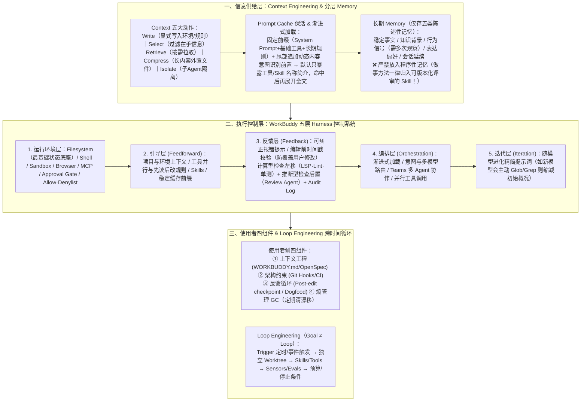

# 腾讯 WorkBuddy 实践：如何把 Agent 做成可用产品

## 1. TL;DR — 核心结论速览

1. **模型只是“无状态文本生成函数”，产品级可靠性取决于外围的 `Context — Memory — Harness — Loop` 四层工程**：大语言模型（LLM）本身既不保留跨轮次状态，也无法直接感知训练截止日后的实时信息或执行外部操作（真正持有 API Key、发起请求与修改数据的是 **Agent 执行层**而非模型）。**“模型决定能力上限；上下文和 Harness 决定这个上限能否稳定落地。”**
2. **厘清 `Function Call / MCP / Skill / Plugin` 四大外接能力原语的边界**：
   - **`Function Call`**：模型请求动作的基础协议；**`System Prompt` 只能引导、不能强制**，高危拦截必须落在工程层。
   - **`MCP`（模型上下文协议）与 `MCP Apps`（2026 扩展）**：包含由应用驱动的 **`Resources`**、模型驱动的 **`Tools`**、用户驱动的 **`Prompts`** 三类原语；`MCP Apps` 支持将交互式 UI（看板/表单/确认框）直接交给前端渲染而不塞入模型上下文；MCP 工具应**按用户意图组织而非照搬底层 REST API**。
   - **`Skill` vs `Plugin`**：Tool 管“一个动作”，**`Skill` 管“一类任务的完整做法与验收标准”**，**`Plugin` 管“连接（MCP）+ 流程（Skills）+ 规则（Rules）+ 钩子（Hooks）+ 模板的打包分发”**。
3. **Context 与 Memory 的核心纪律——“渐进披露保缓存，程序性策略进 Skill 不进 Memory”**：
   - **Context 五类动作**：`写入（Write）、选择（Select）、检索（Retrieve）、压缩（Compress）、隔离（Isolate）`；通过“固定前缀 + 尾部追加 + 意图识别前置 + 渐进式加载”保住 **Prompt Cache 命中率**，并在截断长工具输出时显式告知总量与偏移（防模型把前 `100` 条当全部）。
   - **Memory 准入与分流**：长期记忆仅收录 **五类陈述性记忆**（稳定事实、知识背景、多次观察到的行为信号、表达偏好、会话延续），并按 **五级作用域**（当前轮 $\to$ Thread $\to$ Workspace $\to$ 用户 $\to$ 团队）分层注入；**严禁将“做事方法（Procedural Memory）”放入自动长期记忆**，工作方法必须沉淀为可版本化、可评审、可回滚的 **`Skill`**。
4. **Harness 五层控制系统与业务正确性边界**：WorkBuddy 将 Harness 拆为 **运行环境层、引导层（Feedforward）、反馈层（Feedback，含防覆盖的“编辑前时间戳校验”与左移确定性检查）、编排层、迭代层**，以及使用者侧的 **上下文工程、架构约束、反馈循环、熵管理（GC）** 四大组件；同时直面当前尚未解决的**业务功能组合正确性缺口**（如“已置顶会话能否归档”的隐式决策与同源测试偏差）及老系统 **Harnessability（可驾驭性）** 改造难题。

---

## 2. 基础抽象与能力层：从无状态模型到四大外接原语

### 2.1 模型调用的函数抽象与两条根本约束
经历预训练（预测下一个 Token）、后训练（指令遵循与工具/安全边界）、偏好优化与强化学习（RL）后，一次模型调用在产品侧可抽象为无状态纯函数：
$$\text{输出} = \text{Model}(\text{System Prompt} + \text{Tools} + \text{会话历史} + \text{其他上下文} + \text{用户指令})$$
1. **约束一：模型无状态，产品有状态**——对话连续性、Memory、工作进度均由 WorkBuddy 在模型外部持久化并按需注入。
2. **约束二：权限与副作用在 Agent 层，不在模型层**——模型只负责吐出结构化的 JSON 调用意图，真正持有密钥、读写磁盘、发请求的是 Agent 宿主；因此**参数校验、Sandbox 隔离、Approval Gate 审批与审计日志必须由模型外部的工程代码强制执行**（System Prompt 只能引导，不能替代强制护栏）。

---

### 2.2 `工具调用 / MCP / Skill / Plugin` 四大概念全景对比

| 能力形态 | 解决的核心问题 | 驱动者 / 消费者 | 典型包含内容 | WorkBuddy 选型与设计准则 |
| :--- | :--- | :--- | :--- | :--- |
| **1. 工具调用 (`Function Call`)** | 模型如何请求执行单个外部动作？ | 模型生成请求 + Agent 执行 | 名称、用途描述、参数 JSON Schema、返回结果 | 读文件、跑命令等高频低延迟操作优先做成**内置 Tool** |
| **2. `MCP`（模型上下文协议）** | 外部系统（GitHub/腾讯文档/乐享/IMA）如何标准化接入？ | **三类原语驱动方不同**： • `Resources`：应用/Agent 驱动（按 URI 直拼消息） • `Tools`：模型驱动 • `Prompts`：用户驱动（斜杠命令） | 资源 URI、工具函数、预设提示模板 + **`MCP Apps` 交互式 UI** | **按用户意图封装工具，切忌照搬底层碎 API**（如把创建/加描述/加标签/加附件合为一个 `create_issue`，或用 `action` 枚举收敛） |
| **3. `Skill`（技能）** | **一类任务**应该按什么标准流程做？ | Agent 按需读取并执行 | 适用场景、步骤、脚本、失败分支处理、完成验收标准 | Tool 负责“一个动作”，**Skill 负责“一类任务的做法”**（如提 PR 需先读规范 $\to$ 查 `git status` $\to$ 跑测试 $\to$ 确认授权再 push） |
| **4. `Plugin`（插件）** | 如何把一整套团队研发/办公能力打包安装与分发？ | 用户 / 团队 / 产品作用域 | `MCP + Skills + Rules + Hooks + 模板资产`（如 `team-dev-workflow`） | MCP 是跨产品开放协议；Plugin 是产品层的能力组合与分发单位 |

> **`MCP Apps`（2026 官方扩展）的上下文减负价值**：外部工具返回的数据并非都要塞给模型看——`MCP Apps` 允许工具将摘要文本回流进模型上下文供继续推理，同时将看板、图表、表单、审批确认框等 `structuredContent` 直接分流给前端 UI 渲染，既升级了交互体验，又大幅节省了上下文 Token。

---

## 3. 知识框架 — WorkBuddy 从 Context/Memory 到五层 Harness 与 Loop 的完整架构

---

## 4. 核心工程实践深度拆解

### 4.1 Context Engineering：五大动作、Prompt Cache 纪律与长结果截断协议

WorkBuddy 将 Context Engineering 精确定义为：**在一次模型决策前，设计哪些信息进入上下文、以什么形式进入、放在什么位置、何时更新或移出，以提高模型做出正确下一步决策的概率**。
1. **严格区分五类基本动作**：
   - **写入（Write）**：把操作系统（Win/Mac/Linux）、Shell 类型、当前时间时区（模型天生无时间感）、打开文件、Workspace 规则与未完成 Todo 显式写进上下文，不让模型瞎猜。
   - **选择（Select，即 `filter`）**：从已在手的候选中只挑当前步必需的放进窗口。
   - **检索（Retrieve，即 `pull`）**：从历史会话、知识库、工具目录按需拉取不在手的信息。
   - **压缩（Compress）**：将超长内容外置落盘为文件，窗口内只留核心结论与证据路径指针，清理过期重复内容。
   - **隔离（Isolate）**：如调研 OpenAI / Anthropic / LangChain 实践时，派发给 3 个独立 `Sub-agent` 在各自干净窗口内阅读海量资料，主 Agent 只接收统一格式的结构化结论、证据与来源。
2. **保住 Prompt Cache 命中率的五条硬规则**：
   - `System Prompt`、基础工具定义、长期规则放在最前面，严格保持内容与顺序不变；
   - 对话历史采用纯追加（Append-only）方式，绝不原地修改已发送消息；
   - 当前文件、任务进度、时间、工具结果、新加载的 Skill 等动态内容一律追加在尾部；
   - 工具与 Skill 按需渐进加载，避免每轮重排完整能力列表；
   - 仅在上下文过长触发 Compaction 或必须纠正致命错误时，才接受前缀重算。
3. **长工具结果截断防误判协议**：
   - 当 `Tool Result` 超长被分页或截断时，必须显式向模型注入 **`“结果未完整”` 标记 + 总条数 + 当前截断位置 + 继续读取的方法**——否则模型会想当然地把前 `100` 条结果当成全量数据做出错误统计！

---

### 4.2 Memory 系统：为什么坚决把“程序性记忆（Procedural Memory）”挡在门外？

#### （1）聊天历史 $\neq$ 工作记忆 $\neq$ 长期记忆（Memory）
长期记忆的核心是**准入判断（Admission Control）**——只有被允许在未来任务发起前默认代入上下文、影响结果走向的高可信信息才配进入 Memory。WorkBuddy 将“存什么（5 类陈述性记忆）”与“在哪里生效（5 级作用域）”正交解耦：
- **五类陈述性记忆（Declarative Memory）**：
  1. **稳定事实（Semantic）**：去情境化的长期事实（如所在城市、常用语言），可作默认推理前提；
  2. **用户知识背景**：熟悉领域（如熟悉 Context Engineering），仅调节解释深度与术语密度，不改变事实结论；
  3. **行为信号（Behavior Signal）**：从多次真实交互观察到的习惯（如“回答前先看当前工作空间”）——**比用户显式偏好更谨慎，单次要求绝不升级为长期规则，需多次稳定观察并支持用户查看/纠正**；
  4. **表达偏好（Style）**：如“先给结论、少说空话”，只管怎么说；
  5. **会话延续信息**：当前仍有价值的决策、进度与未完成项。
- **五级作用域与分阶段注入**：
  - 作用域从窄到宽依次为：`当前轮临时上下文 → 会话/Thread 记忆 → 项目/Workspace 记忆 → 用户级记忆 → 团队/组织记忆`（范围越大，写入与晋升门槛越高）。
  - 注入分四拍：冷启动只注极少量高置信摘要 $\to$ 请求理解时按 Query 激活候选 `memory cards`（保留来源与置信度，不当绝对前提）$\to$ 执行中需证据时回查原始文件/会话 $\to$ 收尾时从结果与用户纠正中提取、去重、判冲突。

#### （2）关键架构抉择：为什么不把“做事方法（Procedural Memory）”放进长期记忆？
比如“用户熟悉 Python”是陈述性记忆；而*“遇到所有调试任务，都先重启服务再查日志”*则是**程序性记忆（Procedural Memory）**。如果让 Agent 自动把单次任务的做事步骤塞进长期记忆并在后续默认注入，会引发四大灾难：
1. **局部经验被误升为通用策略**：在 A 项目有效的临时偏方，到 B 项目可能直接搞挂服务；
2. **干扰当前证据推理**：模型不再根据眼前报错选路径，而是机械套用历史老套路陷入局部最优；
3. **隐性篡改系统行为**：程序性记忆实质上等价于动态改写 `System Prompt`，却没有任何版本号、离线评测、人工审批与一键回滚机制；
4. **积累偏见不可控**：缺乏稳定 Reward 与 Eval 的自动学流程，分不清是在进化还是在固化坏习惯。
> **WorkBuddy 的黄金分流法则**：**用户事实与历史状态放进 `Memory`；经过验证的工作方法必须提炼保存为 `Skill`（有明确适用边界与完成标准，可版本化、可评审、可测试、可回滚、按需加载）！**

---

### 4.3 Harness Engineering：三类能力、业界三大标杆与 WorkBuddy 五层控制系统

#### （1）词源三能力与业界三大家（OpenAI / Anthropic / LangChain）实践对标
Harness 原指套在马身上的整套马具，拆解为 **驾驭（Steer，控方向与拆解）、约束（Constrain，控安全边界与沙箱审批）、整合（Integrate，配齐工具与编排协同）**。

| 业界标杆 | 核心实践案例与机制 | 关键量化数据 / 核心洞见 |
| :--- | :--- | :--- |
| **OpenAI (Codex 团队)** | **3 人小组**从空仓库起步，**全程零手写代码**；让 Codex 直连浏览器读 DOM/日志/指标，用 Linter + 结构测试卡死架构分层与文件大小，`AGENTS.md` 作目录入口按需查 `docs/`，后台定时扫代码漂移自动提重构 PR | **`5 个月` 产出约 `100 万行` 代码、`1,500 个` PR** 并投入生产；把 Agent 受阻视为“环境缺工具/护栏/文档”的信号，且让 Codex 自己写修复补丁 |
| **Anthropic (长程开发两篇)** | • **第一篇**：用 `初始化 Agent + Coding Agent` 跨会话交接，开局拆出 **`200+` 条** JSON 行为清单（标 `pass/fail`，禁删条目或降标准），统一 `init.sh`，每次只做一项。 • **第二篇**：针对临近上下文上限时模型偷懒降标与自我评估失真，借鉴 GAN 构建 **`Planner → Generator → Evaluator`** 三角色，由独立 Evaluator 用 `Playwright` 像真人一样点击验收并定位 Bug 行号打回 | 彻底分离“执行”与“验收”（尤其针对前端 UI 等缺乏简单确定性测试的场景） |
| **LangChain** | 提出广义公式 **`Agent = Model + Harness`**；强调文件系统是最基础持久底座，给 Agent 配计算机（Bash+代码执行），用 Compaction / Tool Offloading / **Ralph Loop**（Hook 拦截提前结束信号并在新窗口重注目标继续跑）对抗 Context Rot | **模型与 Harness 共同进化**：同一个模型换个工具名、Patch 格式或错误回传方式表现就会剧变，Eval 必须把“模型 + Harness”绑在一起测 |

#### （2）WorkBuddy 构建者视角的“五层 Harness”与使用者视角的“四大组件”
- **控制论视角（前馈 Feedforward + 反馈 Feedback，计算型优先于推断型）**：
  - **计算型控制（Computational）**：LSP、类型检查、Linter、单元测试、结构测试、Codemod——快、便宜、确定性高，**尽量左移**到每次编辑后立即运行；
  - **推断型控制（Inferential）**：Review Agent、架构审查 Agent、AI Judge——慢、贵、有波动，放在集成合并前后；持续漂移交给周期性传感器。
- **反馈层极具巧思的工程细节——“编辑前的时间戳校验（Pre-edit Timestamp Check）”**：
  - Agent 调用写文件工具修改代码前，系统会强制比对 **“Agent 上次读取该文件的时间戳”** 与 **“磁盘上该文件的最后修改时间（mtime）”**；如果发现读取后用户手动改过该文件，系统立即**拒绝写入并强制要求 Agent 重新读取最新版本**，彻底杜绝 AI 静默覆盖人类刚写好的代码！
- **WorkBuddy 团队自身作为使用者的四大落地组件**：
  1. **上下文工程**：根目录 `AGENT.md` / `WORKBUDDY.md` + 子仓局部规则 + `OpenSpec`（大改先写规范）+ `Skills` + `Slash` 命令；
  2. **架构约束**：本地检查 + Git Hooks + CI 门禁；
  3. **反馈循环**：`Post-edit checkpoint`（每次编辑后查行数、架构合规、注释完整性）+ `/team:mr` 工作流（构建验证 $\to$ 生成 changeset $\to$ 创建 MR $\to$ 关联 Issue）+ `Dogfood Skill` + `Agent Browser`；
  4. **熵管理（Garbage Collection）**：周期性扫描 `WORKBUDDY.md` / `OpenSpec` 与代码是否脱节、清理重复实现与过期依赖。

---

### 4.4 Loop Engineering 与尚未解决的三大深水区边界

1. **Loop Engineering（`Goal ≠ Loop`）**：
   - 仅保存一个长期目标（Goal）只是状态组件；一个真正可跨时间自运转的 Loop 必须配齐 8 大要素：**触发器（Trigger，如每天 `09:00` 定时触发）+ 独立执行环境（Isolated Worktree）+ Skills + Tools/MCP + Sub-agents + Memory/持久产物 + 验证传感器（Sensors/Evals）+ 停止条件与预算（Stop Conditions/Budget）**。
2. **清醒认知边界——当前还没有成熟解法的两大硬骨头**：
   - **硬骨头一：功能与业务正确性的验证缺口（Business Correctness Gap）**
     - **需求组合盲区**：例如 PRD 分别定义了会话“置顶”和“归档”，各自单测全绿，但没写**“已经置顶的会话能不能归档？”** Agent 会自作主张替产品做决定，并把这个未经确认的假设同时写进业务代码和单元测试里！
     - **同源误解共振**：同一个 Agent 既写实现又写测试，理解偏差会同时污染两边，导致“测试 100% 全绿，业务意图完全跑偏”。
     - **自治度分级准则**：一次性脚本/内部工具（**高自治**）$\to$ 公开 API/跨系统改动（**中自治**）$\to$ 支付/风控/订单等核心业务逻辑（**低自治，必须人类强介入确认**）。
   - **硬骨头二：老旧代码库的 `Harnessability`（可驾驭性）困境**
     - 老大难 Monorepo 往往模块边界模糊、跑一次新规则报出数千个历史违例、隐式副作用多、且缺乏埋点与链路追踪（反馈层失明）。
     - **务实破局路径**：先解循环依赖与模块边界、补齐核心链路日志与监控看板 $\to$ 挑一个结构清晰、修改高频、可观测性好的子模块先行试点 $\to$ **“新人新办法、老人老办法”（先只拦截新增与修改代码，再渐进消化存量违例）**。

---

## 5. 数据速查表

| 指标 / 标杆案例 | 原文数值 / 设定 | 语境 / 条件 |
| :--- | :--- | :--- |
| **MCP 协议发布与 `MCP Apps` 扩展时间** | **2024 年底发布 MCP / `2026 年` 发布 `MCP Apps` 官方扩展** | MCP 含 `Resources`、`Tools`、`Prompts` 三原语；`MCP Apps` 支持直接渲染交互式 UI |
| **长工具结果截断防误判典型阈值** | **防止模型把前 `100 条` 误当成全部数据** | 截断时必须显式附带“结果未完整”、总条数、截断位置与继续读取方式 |
| **WorkBuddy 长期记忆分类与作用域** | **`5 类` 陈述性记忆 × `5 级` 作用域分层** | 严禁将程序性记忆（做事方法）放入长期 Memory，一律沉淀为 `Skill` |
| **OpenAI Codex 纯 AI 研发实验规模** | **`3 人` 小组 / `5 个月` / 约 `100 万行` 代码 / `1,500 个` PR** | 从空仓库开始全程不手写代码，依靠浏览器观测、架构 Linter 与定时重构 PR |
| **Anthropic 跨会话长任务功能清单规模** | **开局拆解为 `200+ 条` 具体行为描述的 JSON 清单** | 每条标 `pass/fail`，严禁删除条目或降低标准，每次只处理一项并配 `init.sh` |
| **每日依赖安全更新 Loop 定时触发示例** | **每天 `09:00` 定时触发，创建独立 `worktree`** | 自动查漏洞 $\to$ 改 `lockfile` $\to$ 跑类型/单测/构建/扫描 $\to$ 生成 PR 草稿交人审批 |

---

## 6. 踩坑与教训 / 可迁移的设计原则

1. **把所有安全约束和工作规范全塞进 `System Prompt`，指望模型“自觉遵守” → `System Prompt` 只能引导不能强制，且塞满规则会挤占上下文、降低注意力 → 将权限校验、Sandbox、Approval Gate、以及“编辑前时间戳比对（防覆盖用户刚改的文件）”下沉到确定性的 Agent 执行层强制拦截**
   - **可迁移原则**：凡是涉及“不能做什么（不可逆删除/外发/覆盖未读变更）”的底线，必须写成宿主环境的硬代码门禁，绝不能只写一句 Prompt 祈祷模型听话。
2. **接入外部系统时直接把底层 REST API 一对一暴露为 MCP Tool，或把长工具结果静默截断 → 工具数量爆炸导致模型选错，且模型把截断返回的前 100 条数据当成全量真相 → 按“用户意图”聚合封装高层工具（如单工具多 `action`），并在截断结果尾部强制追加“未完整 + 总量 + 游标读取指引”元数据**
   - **可迁移原则**：面向 Agent 设计的接口（Agent-First API）应当是**粗粒度、语义完整、自带分页与纠错引导提示**的，而不是面向前端微观控件的碎接口。
3. **让 Agent 自动从历史对话中提炼“做事步骤（Procedural Memory）”塞进长期记忆默认注入 → 单次偶发排障偏方被误升为全局铁律，无版本无评测地隐性篡改 Agent 行为 → 严格执行“陈述性事实进 `Memory`、程序性方法进 `Skill`”的分流铁律**
   - **可迁移原则**：凡是会改变 Agent 推理路径与操作顺序的流程性知识，必须走类似软件代码的工程生命周期（写成 `Skill`：明确触发条件、版本控制、测试验证、支持回滚、按需加载）。
4. **让同一个 Agent 既写业务实现代码、又写配套单元测试，看到测试全绿就认为业务正确 → 模型对 PRD 组合场景（如“已置顶的会话能否归档”）的隐式误解同时写进了实现和测试里，形成“自洽的错误” → 借鉴 Anthropic `Planner → Generator → Evaluator` 分离执行与验收，并对高风险核心业务（支付/风控/订单）降低自治度、保留人类业务确认**
   - **可迁移原则**：计算型检查（Lint/Typecheck/单测）只能证明“代码自洽”，不能证明“符合真实业务意图”；工程严谨度必须转移到验收标准定义与独立环境验证上（*Relocating Rigor*）。

---

## 7. 记忆锚点 — 一句话 / 一张图记住全文

- **一句话锚点**：**把 Agent 做成可用产品，就是把无状态模型装进“用 `Write/Select/Retrieve/Compress/Isolate` 和渐进加载保 `Prompt Cache` 的上下文引擎 + 只存陈述事实、把做事流程交给 `Skill` 的分层 `Memory` + 前馈引导与左移确定性反馈结合的五层 `Harness` + 跨时间触发收敛的 `Loop`”四层壳体里，让模型决定上限、让工程兑现下限。**
- **全链路核心公式**：
  $$\text{可用 Agent 产品} = \text{Stateless Model} + \underbrace{\text{Context (5动作 + Cache保活)}}_{\text{此刻看什么}} + \underbrace{\text{Memory (仅陈述事实) / Skill (程序方法)}}_{\text{过去留什么}} + \underbrace{\text{Harness (前馈 + 时间戳/Lint反馈)}}_{\text{单次怎么控}} + \underbrace{\text{Loop (Trigger + Worktree)}}_{\text{长期怎么跑}}$$

---

## 8. 复习卡片（Spaced Repetition）

1. 在 Agent 产品中，为什么说“持有 API Key、发起请求、修改数据的是 Agent 而不是模型”？这对安全设计有什么决定性意义？::因为大模型本身只是一个接收文本输入、输出结构化调用请求（Function Call）的无状态函数，真正执行外部操作的宿主是 Agent；因此权限校验、Sandbox 隔离、Approval Gate 审批、防覆盖时间戳检查与审计日志都必须由模型外部的工程系统强制执行（System Prompt 只能引导，不能强制）。
2. MCP（Model Context Protocol）提供的 `Resources`、`Tools`、`Prompts` 三种原语在驱动方式上有何本质区别？2026 年的 `MCP Apps` 扩展解决了什么问题？::① `Resources` 是应用/Agent 驱动的（按 URI 读取只读内容直接拼进消息，不经 tool）；② `Tools` 是模型驱动的（模型推理时自主决定调用）；③ `Prompts` 是用户驱动的（如用户点选斜杠命令模板）。`MCP Apps` 允许工具返回可直接渲染在对话中的交互式 UI（看板/图表/表单），将面向模型的摘要留给上下文、面向用户的界面数据直接交前端渲染，兼顾交互体验与节省 Token。
3. WorkBuddy 定义的 Context Engineering 包含哪五类核心动作？为了保证 Prompt Cache 高命中率应遵循哪些上下文排序规则？::五类动作：① 写入（Write）、② 选择（Select，过滤已在手信息）、③ 检索（Retrieve，按需拉取外部信息）、④ 压缩（Compress，长内容外置文件只留结论与位置）、⑤ 隔离（Isolate，用 Sub-agent 隔离旁支任务）。Prompt Cache 规则：将 System Prompt、基础工具定义、长期规则固定在最前面；对话历史纯追加不改写；当前文件、时间、工具结果与按需加载的 Skill 追加在尾部。
4. 为什么 WorkBuddy 明确拒绝把“程序性记忆（Procedural Memory，即做事方法）”放进长期记忆，而是只保留五类陈述性记忆？::因为程序性记忆（如“所有调试先重启服务”）一旦自动注入长期记忆，会导致局部经验被误升为通用策略、干扰基于当前证据的推理、且相当于缺少版本/评测/审批/回滚的隐性 System Prompt。因此 WorkBuddy 将用户事实（稳定事实/知识背景/行为信号/表达偏好/会话延续）放进 Memory，而将经过验证的工作方法保存为可版本化、可测试、按需加载的 `Skill`。
5. WorkBuddy 构建者视角的“五层 Harness”包含哪五层？其中反馈层的“编辑前时间戳校验”是如何防止代码被误覆盖的？::五层结构：① 运行环境层（文件系统/Shell/Sandbox/审批门禁）、② 引导层（Feedforward 前馈信息与规则）、③ 反馈层（Feedback 错误纠正与验证信号）、④ 编排层（渐进加载/多模型路由/Sub-agent）、⑤ 迭代层（随模型升级精简或调整约束）。编辑前时间戳校验：Agent 修改文件前比对“上次读取该文件的时间”与“文件最后修改时间”，若发现读取后被用户修改过则拒绝写入并要求重新读取。
6. OpenAI Codex（3人5个月100万行代码）与 Anthropic 长程 Agent 实践（两篇）在 Harness 设计上各有何核心亮点？::OpenAI Codex 侧重代码内部质量与自动化护栏（直连浏览器读 DOM/日志、Linter+结构测试卡架构分层、`AGENTS.md` 作目录索引、后台定时扫代码漂移提重构 PR）。Anthropic 第一篇采用“初始化 Agent + Coding Agent”配 `200+` 条 JSON 行为清单（禁删改降标，一次做一项）；第二篇借鉴 GAN 采用 `Planner → Generator → Evaluator` 三角色，由独立 Evaluator 用 Playwright 像真人一样点击验收应用并定位 Bug 行号打回。
7. 为什么说当前工程检查（Linter/单测全绿）仍无法解决“功能与业务正确性验证缺口”？老旧代码库提升 `Harnessability` 的务实路径是什么？::因为：① PRD 往往漏掉功能组合边界（如“已置顶会话能否归档”），Agent 会自作主张做业务决策；② 同一个 Agent 既写实现又写单测会导致理解偏差同时进入两边（错的实现+全绿的测试）。老系统改造路径：先治理循环依赖与模块边界并补齐核心链路日志/监控看板 → 选结构清晰、高价值、可观测性好的子模块试点 → 先约束新增与修改代码，再逐步清理存量违例。

---

## 9. 知识关联

- **对应知识库主题笔记**：[Harness与模型协同](../../20_topics/Harness%E4%B8%8E%E6%A8%A1%E5%9E%8B%E5%8D%8F%E5%90%8C.md) · [桌面Agent与工作流](../../20_topics/%E6%A1%8C%E9%9D%A2Agent%E4%B8%8E%E5%B7%A5%E4%BD%9C%E6%B5%81.md) · [Agent长期记忆](../../20_topics/Agent%E9%95%BF%E6%9C%9F%E8%AE%B0%E5%BF%86.md) · [Agent任务恢复](../../20_topics/Agent%E4%BB%BB%E5%8A%A1%E6%81%A2%E5%A4%8D.md)
- **同批相关文章双链**：
  - [[AI_WorkBuddy从入门到精通]]（前者面向用户手把手教你用好 WorkBuddy，本文从策略产品经理视角深度拆解背后的设计哲学与架构取舍）
  - [[AI_LLM到Harness]]（可对比从单次模型调用演进到六层 Harness 的底层代码实现）
  - [[AI_Loop到Graph Engineering]]（可对比 Prompt / Context / Harness / Loop / Graph 多层演进模型与独立 Verifier 设计）

---

## 10. 原文参考资料

- **原文标题**：《腾讯 WorkBuddy 实践：如何把 Agent 做成可用产品》
- **作者**：Anne（腾讯 WorkBuddy 团队策略产品经理，官网：`www.workbuddy.cn`）
- **发布时间**：2026-07-24
- **核心引用文献与行业标杆**：
  1. Andrej Karpathy: *Software Is Changing (Again)*（*"Can we just build for agents?"*）
  2. Anthropic: *Model Context Protocol (MCP)* & *MCP Apps (2026)*
  3. OpenAI: *Codex Harness Engineering Experiment*（3 人小组 5 个月 100 万行代码、1500 个 PR，*"Humans steer. Agents execute."*）
  4. Anthropic: *Effective harnesses for long-running agents*（Initializer + Coding Agent，`200+` 条 JSON 功能清单）& *Harness design for long-running application development*（Planner / Generator / Evaluator + Playwright 独立验收）
  5. LangChain: *Agent = Model + Harness*（Ralph Loop、Tool Call Offloading、文件系统底座）
  6. Chad Fowler (*"Relocating Rigor"*) & Addy Osmani (*"The danger is stopping having an opinion when loops run autonomously."*)

> [!note]- 校对报告
> - **原文页数核对**：全文共 32 页（第 31 页为官网链接与读者留言，第 32 页为空白页），核心正文贯穿 p.1–30。
> - **关键事实与页码映射**：
>   - 模型三阶段训练（预训练、后训练、偏好优化与强化学习）、无状态函数抽象与两条根本约束（p.1–3）。
>   - 四大外接概念：`Function Call`（Agent 持有 API Key 并执行权限/审批/审计）、`System Prompt`（只能引导不能强制）、`MCP`（2024 年底发布，`Resources / Tools / Prompts` 三类原语及 2026 年 `MCP Apps` 扩展，按用户意图组织工具如 `create_issue`）、Karpathy 引言、`Skill`（一类任务的做法）与 `Plugin`（`team-dev-workflow` 打包分发）对比表（p.3–10）。
>   - 全景调研任务 8 步流程（检查 Workspace $\to$ 读 Memory/Skill $\to$ 查内部资料 $\to$ 派 Sub-agent 并行调研 OpenAI/Anthropic/LangChain $\to$ 汇总 $\to$ 生成大纲）（p.10–12）。
>   - Context Engineering 五类动作（写入 Write、选择 Select、检索 Retrieve、压缩 Compress、隔离 Isolate）、Prompt Cache 五条保活规则、长工具结果截断防误判（防把前 `100` 条当全部）、意图识别 + 渐进式加载（p.12–15）。
>   - Memory 系统：五类陈述性记忆（稳定事实、用户知识背景、行为信号、表达偏好、会话延续）、为什么坚决不把 `Procedural Memory`（程序性记忆）放进长期记忆而归入 `Skill`、五级作用域（当前轮 $\to$ Thread $\to$ Workspace $\to$ 用户 $\to$ 团队）与四阶段注入（p.15–18）。
>   - Harness Engineering：构建者与使用者同心圆、三类能力（驾驭 Steer / 约束 Constrain / 整合 Integrate）、三家标杆实践（OpenAI 3 人 5 个月 100 万行代码 1500 PR；Anthropic 200+ 条 JSON 清单与 Planner/Generator/Evaluator；LangChain `Agent = Model + Harness` 与 Ralph Loop）（p.18–22）。
>   - WorkBuddy 五层 Harness（运行环境层、引导层 Feedforward、反馈层 Feedback 含编辑前时间戳比对、编排层、迭代层）与使用者侧四大组件（上下文工程、架构约束、反馈循环、熵管理 GC）（p.22–26）。
>   - Loop Engineering（四层定位、`Goal ≠ Loop`、每日 `09:00` 依赖安全更新 9 步循环）与尚未解决的问题（业务正确性验证缺口如“置顶+归档”冲突、老代码库 `Harnessability` 四大原因与改造路径、Chad Fowler 与 Addy Osmani 引言）（p.26–30）。
> - **纠偏与自检说明**：正文、表格、Mermaid 图及复习卡片已严格剔除所有页码标注（`p.X` / `第X页`），所有概念定义、架构分层与引文均 100% 忠实于原文。
