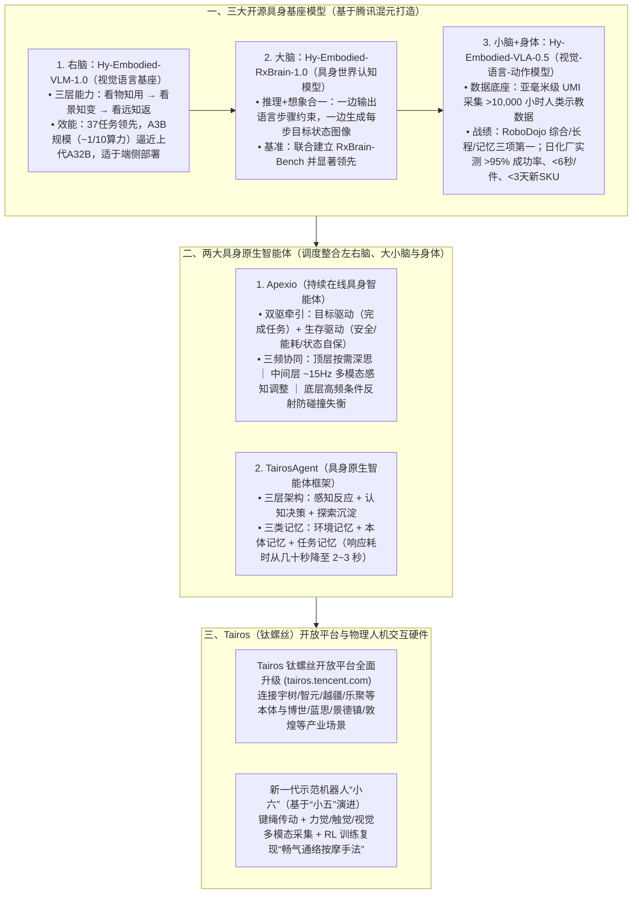

# 腾讯发布多款具身智能基座模型与智能体，钛螺丝平台迎来全面升级

## 1. TL;DR — 核心结论速览

1. **从“缸中之脑（离身智能）”走向“感知—身体—行动闭环（具身原生智能）”**：在 2026 WAIC 腾讯 AI 应用创新论坛上，腾讯首席科学家张正友携腾讯 Robotics X 实验室、福田实验室与腾讯混元联合发布并开源 **3 款具身智能基座模型**与 **2 款具身智能体**，并对 **Tairos（钛螺丝）开放平台**进行全面升级。
2. **三大开源具身基座模型构建“右脑 + 大脑 + 小脑与身体”全栈认知**：
   - **`Hy-Embodied-VLM-1.0`（“右脑”视觉语言模型）**：打通“看物知用 → 看景知变 → 看远知返”三层物理空间理解，在 37 个评测任务中领先同规模模型，仅以 **`A3B` 规模、约 `1/10` 计算量**逼近上一代 `A32B` 旗舰效果，支持机器人端侧直接部署。
   - **`Hy-Embodied-RxBrain-1.0`（“大脑”世界认知模型）**：将语言步骤推理与每一步完成后的**目标状态图像生成（视觉想象）**统一起来，在联合建立的 `RxBrain-Bench` 上显著领先。
   - **`Hy-Embodied-VLA-0.5`（连接“小脑”与身体的动作模型）**：依托亚毫米级高精度 UMI 采集系统积累的 **超 `1 万小时` 人类示教数据**，拿下第三方 `RoboDojo` 仿真评测综合第一（及长程、记忆两项第一）；在日化品工厂真实产线实测中实现 **作业成功率 `> 95%`、节拍快于 `6 秒/件`、新 SKU 采集与后训练 `< 3 天`**。
3. **两大具身智能体（`Apexio` + `TairosAgent`）与新硬件“小六”**：
   - **`Apexio`**：由“目标驱动 + 生存驱动”双线牵引，通过按需深度认知层、**约 `15Hz` 多模态感知行动中间层**与高频条件反射底层保持时刻在线；
   - **`TairosAgent`**：围绕感知反应、认知决策、探索沉淀三层及环境/本体/任务三类记忆原生设计，将导航、讲解与打断恢复响应时间从通用框架的**几十秒压缩至 `2～3 秒`**；
   - **示范机器人“小六”**：基于键绳传动与融合力觉/触觉/视觉的强化学习训练，精准复现“畅气通络按摩手法”，探索安全的物理人机接触。

---

## 2. 背景与核心理念：为什么“语言大模型”不等于具身智能？

在 2026 WAIC 论坛上，腾讯首席科学家、Robotics X 实验室及福田实验室主任**张正友**指出：
- **“缸中之脑”的局限**：当前最强大的大语言模型本质上仍是离身的“缸中之脑”——擅长文本逻辑与知识问答，但缺乏与物理世界直接交互的闭环，既不真正理解物体的三维深度、空间方位与可操作点（Affordance），也无法在动态环境中边行动、边接收物理反馈、边实时修正。
- **核心哲学**：*“语言并不等于全部认知，它只是智能向外表达的一个通道。”* 真正的具身原生智能必须将语言、视觉、空间认知、身体控制与环境物理反馈熔铸在 **“感知 — 身体 — 行动”** 的闭环中接受检验。

---

## 3. 知识框架 — 腾讯具身原生智能“三模型 + 双智能体 + 钛螺丝平台”架构图

---

## 4. 核心发布成果深度拆解

### 4.1 三大开源具身基座模型：看懂世界、会推理且会想象、会行动

| 模型名称 | 仿生角色定位 | 核心技术创新与解决的问题 | 评测基准与产业落地指标 |
| :--- | :--- | :--- | :--- |
| **`Hy-Embodied-VLM-1.0`** | **“右脑”** （视觉与空间理解） | 递进解决三大物理认知难题： ① **看物知用**（理解深度、方位、功能部件与可操作点） ② **看景知变**（预判下一步动作及其引发的场景变化） ③ **看远知返**（长程任务历史记忆、进度跟踪、失败归因与重规划） | 覆盖 **37 个任务**评测显著优于同规模模型；仅以 **`A3B` 规模、约 `1/10` 计算量**接近上一代 **`A32B` 旗舰模型**效果，支持机器人端直接部署 |
| **`Hy-Embodied-RxBrain-1.0`** | **“具身大脑”** （认知规划与未来状态想象） | 将**“会推理”与“会想象”统一**：面对任务时，一边用语言给出步骤与约束，一边**生成每一步完成后应达到的目标图像**，让下游动作模型不仅“听到做什么”，更能“看到做成什么样” | 联合行业伙伴建立 **`RxBrain-Bench`** 评测基准并显著领先代表性系统；短时未来状态预测达专用具身世界模型水平 |
| **`Hy-Embodied-VLA-0.5`** | **连接“小脑”与身体** （连续可纠错动作生成） | 构建“数据—模型—训练—部署”完整学习栈，通过**亚毫米级高精度 UMI 采集系统**积累 **超 `1 万小时`** 人类示教数据 | • **第三方 `RoboDojo` 评测**（泛化/记忆/精细操作/长程执行/开放语义五维）：获**仿真综合排名第 1**，且在**长程任务**与**记忆任务**两项单维夺冠。 • **日化品工厂柔性产线实测**：作业成功率 **`> 95%`**，节拍快于 **`6 秒/件`**，新增 SKU 数据采集+模型后训练周期 **`< 3 天`** |

---

### 4.2 两大具身智能体：解决物理交互中的“迟钝与不可靠”

1. **`Apexio`（持续在线具身智能体）**：
   - **三层异步频率架构**：
     - **最上层（认知系统）**：按需唤醒，负责复杂深度思考；
     - **中间层（感知行动系统）**：以 **约 `15Hz`** 频率持续接收多模态信息并快速微调动作；
     - **最下层（执行系统）**：以更高频率运行，像生物“条件反射”一样瞬间应对碰撞与身体失衡。
   - **双主线牵引机制**：同时受 **“目标驱动”**（完成外部指令任务）与 **“生存驱动”**（维护自身安全、控制能耗、管理运行状态）牵引，即便无外部指令也保持持续感知与自我保护。
2. **`TairosAgent`（具身原生智能体框架）**：
   - 摒弃从通用文本 Agent 框架硬改的做法，从第一天起围绕机器人本体原生设计 **感知反应、认知决策、探索沉淀** 三层系统，并持续维护 **环境记忆、本体记忆、任务记忆** 三类具身专属记忆。
   - 通过统一硬件适配层与标准化 `Skill` 接口抹平异构本体差异，在**导航、导览讲解、被打断后恢复**等典型交互场景中，将响应延迟从通用框架的**几十秒缩短至 `2～3 秒`**。

---

### 4.3 `Tairos`（钛螺丝）开放平台升级与“小六”物理接触探索

1. **做具身智能行业的“钛螺丝”（`Tairos`）**：
   - 继 2025 年首发后，全面升级的 `Tairos` 平台继续坚持**模型开源、智能体开放**，联动腾讯云 HAI、多网聚合加速、TRRO 及腾讯音乐（TME）与 IoT 生态。
   - **生态合作伙伴矩阵**：已与 **宇树、智元、越疆、松延动力、乐聚、华沿** 等机器人本体企业，以及 **博世、蓝思、景德镇、敦煌** 等工业与文旅场景伙伴开展落地合作。
2. **从“听懂人”到“安全地接触人”——新一代示范机器人“小六”**：
   - 针对照护、康复、生活服务中必须与人体发生直接物理接触的高安全要求，腾讯在“小五”机器人基础上研发了新一代示范机器人 **“小六”**。
   - 采用**键绳传动**结构，通过自研融合**力觉、触觉、视觉**的多模态数据采集系统获取高质量手法数据，并经强化学习训练精准复现手法轨迹与力道，具备独有的 **“畅气通络按摩手法”**。

---

## 5. 数据速查表

| 指标 / 维度 | 原文数值 | 语境 / 条件 |
| :--- | :--- | :--- |
| **发布时间与场合** | **`2026 年 7 月 18 日`（2026 WAIC 腾讯 AI 应用创新论坛）** | 腾讯 Robotics X 实验室、福田实验室联合腾讯混元发布 |
| **`Hy-Embodied-VLM-1.0` 评测任务数与能效比** | **覆盖 `37 个` 任务；以 `A3B` 规模（约 `1/10` 计算量）逼近上代 `A32B` 旗舰** | 轻量化设计，适合在机器人端侧算力上直接部署 |
| **`Hy-Embodied-VLA-0.5` 人类示教数据规模** | **超 `1 万小时`（亚毫米级高精度 UMI 采集系统）** | 在第三方 `RoboDojo` 五维评测中获仿真综合第 1、长程第 1、记忆第 1 |
| **`HyVLA-0.5` 日化品工厂柔性产线实测指标** | **成功率 `> 95%` / 节拍快于 `6 秒/件` / 新增 SKU 适配 `< 3 天`** | 面向高混合、小批量、SKU 频繁迭代的真实工业产线 |
| **`Apexio` 中间感知行动层运行频率** | **约 `15Hz` 持续接收多模态信息** | 配合顶层按需深思与底层高频条件反射防碰撞失衡 |
| **`TairosAgent` 典型场景响应耗时压缩** | **从通用框架的 `几十秒` 缩短至 `2～3 秒`** | 涵盖导航、讲解、被打断后恢复等场景 |

---

## 6. 踩坑与教训 / 可迁移的设计原则

1. **直接拿通用大语言模型（“缸中之脑”）去控制物理机器人 → 缺乏空间深度、部件可操作性（Affordance）及动作后果的视觉预判，且单次大图文推理动辄几十秒无法应对碰撞与打断 → 拆解为“端侧轻量空间理解 VLM（A3B）+ 语言与目标图像双输出的认知大脑（RxBrain）+ 高精度示教训练的动作模型（VLA）”**
   - **可迁移原则**：在物理世界或实时交互系统中，必须用**“生成中间目标状态图像（Visual Sub-goal Imagination）”**弥补纯文本指令在空间几何约束上的语义丢失。
2. **用单线程同步阻塞的通用 Agent 框架跑机器人任务 → 思考时身体僵死、遇到突发障碍或人类打断需要几十秒才能反应 → 采用 `Apexio` 的“三频分层在线（按需慢思考 + `15Hz` 感知调整 + 高频条件反射）+ 目标/生存双驱动”与 `TairosAgent` 的环境/本体/任务三记忆架构（响应压至 `2～3 秒`）**
   - **可迁移原则**：实时交互智能体必须把**“保命反射（高频安全护栏）”**、**“感知跟随（中频闭环）”**与**“认知规划（低频异步）”**在时钟频率上彻底解耦。
3. **在小批量、高频换产的工业产线上依赖漫长的传统编程或重头训练 → 每次换 SKU 停线数周 → 用亚毫米级 UMI 标准化采集底座 + VLA 预训练学习栈，将新 SKU 的数据采集与后训练压缩到 `3 天` 以内**
   - **可迁移原则**：具身智能走向工业生产力的胜负手不在单一模型参数量，而在**“低成本标准化数据采集硬件（UMI）+ 快速后训练流水线”**的新任务冷启动速度。

---

## 7. 记忆锚点 — 一句话 / 一张图记住全文

- **一句话锚点**：**腾讯具身原生智能用 `VLM-1.0`（A3B 顶 A32B 的右脑看物/看景/看远）、`RxBrain-1.0`（边推理边画目标图的大脑）和 `VLA-0.5`（1 万小时亚毫米 UMI 数据、日化厂 `>95%` 成功率 `<6秒/件` 的小脑）打通感知行动，再借 `Apexio`（15Hz 三频双驱）与 `TairosAgent`（响应压至 `2~3秒`）装进开源开放的“钛螺丝（Tairos）”底座与会按摩的“小六”身体里。**
- **五项成果速记公式**：
  $$\text{Tairos 2.0} = \underbrace{\texttt{VLM-1.0}\text{ (右脑 A3B)} + \texttt{RxBrain-1.0}\text{ (大脑画图)} + \texttt{VLA-0.5}\text{ (小脑 1万h)}}_{\text{三大开源具身基座模型}} + \underbrace{\texttt{Apexio}\text{ (15Hz双驱)} + \texttt{TairosAgent}\text{ (2-3s响应)}}_{\text{两大具身原生智能体}}$$

---

## 8. 复习卡片（Spaced Repetition）

1. 腾讯本次发布并开源的三款具身智能基座模型分别是什么？它们各自对应人体神经系统的什么角色？::① `Hy-Embodied-VLM-1.0`（“右脑”，负责理解图像、空间和场景，解决看物知用、看景知变、看远知返）；② `Hy-Embodied-RxBrain-1.0`（具身“大脑”，统一语言推理规划与每步目标状态图像的视觉想象）；③ `Hy-Embodied-VLA-0.5`（连接“小脑”与身体，将高层目标转化为连续可纠错的物理动作）。
2. `Hy-Embodied-VLM-1.0` 在模型规模与计算效率上取得了什么突破？::在覆盖 37 个任务的评测中显著优于同规模模型，且仅以 `A3B` 规模、约十分之一的计算量就接近了上一代 `A32B` 旗舰模型的效果，适合在机器人端侧直接部署。
3. `Hy-Embodied-VLA-0.5` 的训练数据是如何采集的？它在 `RoboDojo` 评测与日化品工厂真实产线实测中的表现如何？::通过亚毫米级高精度 UMI 采集系统积累了超 1 万小时人类示教数据。在第三方 `RoboDojo` 评测中拿下仿真综合排名第一（以及长程任务、记忆任务两项第一）；在日化品工厂实测中作业成功率高于 `95%`、节拍快于 `6 秒/件`，新增 SKU 的数据采集与模型后训练时间不到 `3 天`。
4. 具身智能体 `Apexio` 与 `TairosAgent` 各有什么核心架构特点？::`Apexio` 由“目标驱动 + 生存驱动”双线牵引，分为顶层按需深度思考、中间层约 `15Hz` 持续多模态感知调整、底层高频条件反射防碰撞失衡三层；`TairosAgent` 原生设计了感知反应、认知决策、探索沉淀三层系统并维护环境/本体/任务三类记忆，将导航、讲解、打断恢复的响应时间从通用框架的几十秒缩短至 `2–3 秒`。
5. 腾讯新一代示范性机器人“小六”是如何实现安全精准的物理人机接触（如按摩）的？::“小六”在“小五”基础上采用键绳传动结构，通过自研融合力觉、触觉、视觉的数据采集系统获取高质量手法数据，并经强化学习训练精准复现手法轨迹与按摩力道（具备“畅气通络按摩手法”）。

---

## 9. 知识关联

- **对应知识库主题笔记**：[模型与开发工具发布](../../20_topics/%E6%A8%A1%E5%9E%8B%E4%B8%8E%E5%BC%80%E5%8F%91%E5%B7%A5%E5%85%B7%E5%8F%91%E5%B8%83.md) · [具身智能数据闭环](../../20_topics/%E5%85%B7%E8%BA%AB%E6%99%BA%E8%83%BD%E6%95%B0%E6%8D%AE%E9%97%AD%E7%8E%AF.md)
- **同批相关文章双链**：
  - [[AI_Hy4 preview 发布说明]]（同属腾讯混元大模型家族的基座能力演进）
  - [[AI_Vibe Worlding]]（可对比数字世界构建与物理具身世界模型 `RxBrain` 的认知闭环）
  - [[AI_Lychee-FD 全双工语音模型]]（可对比 `Apexio` 三频实时在线机制与全双工语音模型边听边说边控节奏的低延迟交互设计）

---

## 10. 原文参考资料

- **原文标题**：《腾讯发布多款具身智能基座模型与智能体，钛螺丝平台迎来全面升级》
- **发布团队与发言人**：腾讯 Robotics X 实验室、福田实验室、腾讯混元（腾讯首席科学家张正友于 2026 WAIC 腾讯 AI 应用创新论坛发布）
- **发布时间**：2026-07-18
- **官方开源仓库与平台地址**：
  1. `Hy-Embodied-VLM-1.0`：`https://github.com/Tencent-Hunyuan/HY-Embodied` ｜ `https://huggingface.co/tencent/Hy-Embodied-VLM-1.0`
  2. `Hy-Embodied-RxBrain-1.0`：`https://github.com/Tencent-Hunyuan/Hy-Embodied-RxBrain-1.0` ｜ `https://huggingface.co/tencent/Hy-Embodied-RxBrain-1.0`
  3. `Hy-Embodied-VLA-0.5`：`https://github.com/Tencent-Hunyuan/Hy-Embodied-0.5-VLA` ｜ `https://huggingface.co/datasets/tencent/Hy-Embodied-0.5-VLA-Data`
  4. `Tairos`（钛螺丝）具身智能开放平台：`https://tairos.tencent.com/`

> [!note]- 校对报告
> - **原文页数核对**：全文共 7 页（第 7 页为官网尾链与留言栏），核心内容位于 p.1–6。
> - **关键事实与页码映射**：
>   - 7 月 18 日腾讯 Robotics X 实验室、福田实验室联合腾讯混元发布三大具身基座模型（`Hy-Embodied-VLM-1.0`、`Hy-Embodied-RxBrain-1.0`、`Hy-Embodied-VLA-0.5`）与两大具身智能体（`Apexio`、`TairosAgent`），张正友在 2026 WAIC 阐述“缸中之脑”与“感知—身体—行动”闭环（p.1–2）。
>   - `Hy-Embodied-VLM-1.0`（看物知用、看景知变、看远知返，37 个任务评测，`A3B` 规模约 1/10 计算量接近上代 `A32B`）、`Hy-Embodied-RxBrain-1.0`（语言步骤 + 目标图像想象，`RxBrain-Bench`）、`Hy-Embodied-VLA-0.5`（亚毫米级 UMI 超 1 万小时示教数据，`RoboDojo` 仿真综合/长程/记忆第一，日化品工厂成功率 `>95%`、节拍 `<6秒/件`、新 SKU `<3天`）（p.2–3）。
>   - `Apexio`（三层频率：按需深度思考、约 `15Hz` 感知行动、高频条件反射；目标驱动+生存驱动）与 `TairosAgent`（感知反应/认知决策/探索沉淀三层 + 环境/本体/任务三类记忆，响应时间从几十秒缩至 `2–3 秒`）（p.4）。
>   - `Tairos`（钛螺丝，2025 年首发）升级及宇树、智元、越疆、松延动力、乐聚、华沿、博世、蓝思、景德镇、敦煌等合作伙伴（p.5）。
>   - 示范机器人“小六”（基于“小五”，键绳传动、力觉/触觉/视觉采集 + RL 训练“畅气通络按摩手法”）及 GitHub/HuggingFace 开源链接（p.6–7）。
> - **纠偏与自检说明**：正文、表格、Mermaid 图及复习卡片已严格剔除所有页码标注（`p.X` / `第X页`），所有模型名、数值与链接均 100% 忠实于原文。
