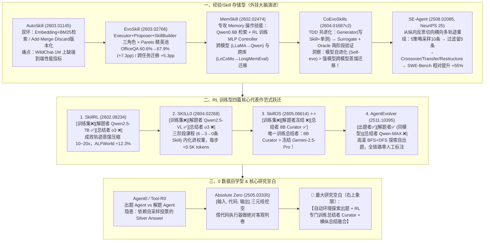

# Agent 开始“自我进化”：会出题、会反思，还会自己长出新技能

## 1. TL;DR — 核心结论速览

1. **自进化 Agent（Self-Evolving Agent）的三维核心诉求与三大技术路线**：为突破大模型静态知识冻结、上下文有限、重复犯错与重训昂贵四大瓶颈，自进化 Agent 围绕 **“能存、能用、能进化”** 演化出三大路线（涵盖 14 篇前沿论文）：
   - **第一类：经验/Skill 存储型（不更新模型权重 ❌，依赖任务/人工数据 ❌）**——给冻结的基座模型配“外挂工作笔记”（代表作：`AutoSkill`、`EvoSkill`、`MemSkill`、`CoEvoSkills`、`SE-Agent`）。
   - **第二类：RL 训练型（更新模型权重 ✅，除 `AgentEvolver` 外依赖训练数据 ❌）**——将提炼的技能通过强化学习（RL）训进模型权重或训练专门的技能管理员（代表作：`EvolveR`、`SAGE`、`SkillRL`、`SKILL0`、`SkillOS`、`AgentEvolver`）。
   - **第三类：0 数据自学型（更新模型权重 ✅，完全不依赖人工数据 ✅）**——连外部题库都不要，靠出题 Agent 与解题 Agent 左右互搏自演进（代表作：`Agent0`、`Tool-R0`、`Absolute Zero`）。
2. **第一类（外挂存储型）的三大工程启示**：
   - **测试驱动进化（TDD for Skills）与模型风格耦合（`CoEvoSkills`）**：用 `Surrogate Verifier`（沙箱单测）+ `Oracle Verifier`（真实 Agent 端到端验证）筛选技能；实测发现 **小模型自己自进化（Self-evo）的效果显著优于直接迁移强模型（如 `Opus 4.6`）蒸馏出的 Skill**，证明 Skill 与模型自身风格强耦合。
   - **从“单轨迹纵向反思”到“多轨迹横向重组”（`SE-Agent`）**：用 5 种性格采样 10 条轨迹，经评分过滤后做**交叉（Crossover）、迁移（Transfer）、重构（Restructure）**，在 `SWE-Bench Verified` 上取得最高 **`+55%` 相对提升**。
3. **第二类（RL 训练型）的四步范式跃迁（`SkillRL → SKILL0 → SkillOS → AgentEvolver`）**：
   - `SkillRL` 用冻结 `o3` 提炼成功/失败轨迹（压缩 `10～20x`）指导 `7B` 模型 GRPO 训练（`ALFWorld` `+12.3%`）；
   - `SKILL0` 通过**三阶段渐进撤回课程（`6条 → 3条 → 0条`）**把外挂 Skill 彻底内化进模型参数，实现每步 **`< 0.5K tokens`** 的零样本执行；
   - `SkillOS` **冻结解题者 Executor，专门用 GRPO 训练 `8B Curator` 管理技能库（增/改/删）**，证明**“训练过的 8B 小总结者 > 冻结的 Gemini-2.5-Pro 大总结者”**；
   - `AgentEvolver` 用同一个 `7B/14B` 模型打通“高温 BFS+DFS 探索自出题 → 自解题 → 自总结”全闭环。
4. **最显眼的研究空白**：当前几乎所有工作都把最关键的“经验/Skill 总结者”外包给冻结的闭源大模型（`o3`、`Claude`、`Qwen-MAX`）；在“题目自动生成 × 总结者 RL 训练”二维空间中，**“既自动出题（如 `AgentEvolver`）、又专门训练总结者（如 `SkillOS`），并融合横向+纵向总结”的右上象限仍是完全空白**。

---

## 2. 全景分类框架：三大技术路线与 14 篇代表作坐标

### 2.1 三大路线核心维度对比

| 技术路线 | 是否更新基座/管理权重？ | 是否脱离外部人工数据集？ | 形象比喻 | 涵盖代表性论文（含 arXiv 编号） |
| :--- | :---: | :---: | :--- | :--- |
| **第一类：经验 / Skill 存储型** | ❌ 不更新（MemSkill 仅训轻量 MLP Controller） | ❌ 依赖交互或训练集信号 | 给 Agent 配一本不断迭代的**“外挂工作笔记”**，本体不动、按需翻阅 | `AutoSkill` (2603.01145)、`EvoSkill` (2603.02766)、`MemSkill` (2602.02474)、`CoEvoSkills` (2604.01687v2)、`SE-Agent` (2508.02085)、`Hermes` |
| **第二类：RL 训练型自进化** | ✅ 更新权重（训 Executor 或训 Curator） | ❌ 依赖数据集（唯独 `AgentEvolver` 自出题） | 把“工作笔记”上的经验通过 RL **训进肌肉记忆（权重）**或训出专职图书管理员 | `EvolveR` (2510.16079)、`SAGE` (2512.17102)、`SkillRL` (2602.08234)、`SKILL0` (2604.02268)、`SkillOS` (2605.06614)、`AgentEvolver` (2511.10395) |
| **第三类：0 数据自学型** | ✅ 更新权重 | ✅ 完全零人工数据 | 连老师和题库都不要，**出题人与答题人左右互搏** + 解释器判卷 | `Agent0` (2511.16043)、`Tool-R0` (2602.21320)、`Absolute Zero` (2505.03335) |

---

## 3. 知识框架 — 自进化 Agent 技术演进脉络与研究空白象限

---

## 4. 三大技术路线深度拆解

### 4.1 第一类：经验 / Skill 存储型——从“无脑存文件”到“TDD 验证与横向基因重组”

1. **`AutoSkill`（基础双环 CRUD）**：
   - **左环（在线使用）**：查询重写 $\to$ 混合检索（`Embedding` 语义 + `BM25` 词频）$\to$ 注入 Prompt；
   - **右环（离线进化）**：抽取候选 Skill $\to$ 判定 `Add / Merge / Discard` $\to$ 语义并集版本化合并。
   - **局限**：在 `WildChat-1M` 上只统计了抽出的 Skill 数量，**缺乏下游任务性能评估**。
2. **`EvoSkill`（“失败即学习”三角色 + Pareto 精英池）**：
   - **三 Agent 流水线**：`Executor`（运行并完整记录失败轨迹与报错）$\to$ `Proposer`（诊断医生成因分析，决定新建或修改 Skill）$\to$ `SkillBuilder`（落地为含元信息、步骤、辅助脚本的文件夹并跑小样本校验）。
   - **Pareto Frontier 精英池**：新 Skill 必须在多维指标的**至少一个维度上严格优于现有 Skill** 才能入池，保证“精而不滥”。
   - **实测战绩**：在美国财政部公告 89K 页扫描文档数值推理基准 `OfficeQA` 上，靠自学出的 `Data extraction validation`（防表格单元格错位）和 `Quantitative analysis with checkpoints`（数值计算插校验点）两条技能，准确率从 **`60.6%` 跃升至 `67.9%`（`+7.3pp`）**；将在 `SealQA` 上学到的 `search persistence protocol` 零样本迁移至 `BrowseComp` 直接带来 **`+5.3pp`** 提升。
3. **`MemSkill`（专门进化“操作记忆的技能” + 训练轻量 Controller）**：
   - 架构拆为 `Qwen0.6B Emb` 检索器 + **接受 RL 训练的 MLP `Controller`** + 冻结的 Executor/Designer/Base LLM。
   - 双环并行：一环用下游 `F1 / Success Rate` 做奖励训练 `Controller` 选技能；另一环将遇到的 Hard Case 交给 `Designer` 更新技能库。验证了从 `LLaMA → Qwen` 跨模型、以及从 `LoCoMo → LongMemEval` 跨数据集的可迁移性。
4. **`CoEvoSkills`（把软件工程 TDD 单元测试搬进 Skill 进化）**：
   - **核心痛点**：模型总结出的 Skill 到底靠不靠谱不能靠自觉。
   - **Generator + Verifier 共进化双子星**：`Skill Generator` 提炼候选 Skill 时**必须同步编写配套单元测试**；`Skill Surrogate Verifier` 在隔离沙箱中运行测试并返回带失败原因与修改建议的结构化反馈，同时迭代修正过严或过松的 Test。
   - **两阶段验证漏斗**：先过廉价快速的 **Surrogate 沙箱单测**，再交由 **Oracle 验证**（在真实 `Claude Code` / `CodeX` 上跑端到端任务，真正解决问题才准入库）。
   - **颠覆性实验结论（Self-evo > Cross-model Transfer）**：
     - 强模型自己用自己进化的 Skill（Self-evo）提升巨大：`Opus 4.6` 从 **`30.6% → 71.1%`（`+40.5pp`）**，`GPT-5.2` 从 **`29.6% → 69.8%`（`+40.2pp`）**；
     - 但把 `Opus 4.6` 总结的顶级 Skill 直接迁移给弱模型（`Haiku 4.5`、`Qwen3-Coder`、`DeepSeek V3`、`Mistral Large 3`），效果明显不如让弱模型**自己自进化（Self-evo）**（例如 `Mistral Large 3` 接收迁移后仅 `43.1%`）！
     - **工程启示**：**Skill 与模型自身的推理风格强耦合**——与其花高价用 GPT-5 / Claude 4.6 给线上小模型蒸馏 Skill，不如让线上模型自己闭环进化。
5. **`SE-Agent`（NeurIPS 2025：从“纵向单轨反思”切向“横向多轨基因重组”）**：
   - **直击单轨迹 Self-Refine 盲区**：若一条轨迹开局就选错大方向，在单条链上再怎么纵向反思也跳不出局部最优。
   - **五阶段横向融合流**：
     1. **多策略轨迹生成**：用 5 种编程性格（`P-greedy` 贪心快出、`P-tests-first` 测试先行、`P-linter-aware` 风格敏感、`P-defensive` 防御式、`P-minimal` 最小可行）采样 `10` 条不同轨迹；
     2. **纵向反思修订（Revision）**：单轨独立修补偏差；
     3. **质量过滤**：按 $\text{Reward}(t,T) = \alpha\cdot\text{TaskCompletion} + \beta\cdot\text{ReasoningQuality} + \gamma\cdot\text{Efficiency}$ 打分，从 **`10 条` 砍留前 `5 条`**；
     4. **跨轨迹重组（Recombination ⭐ 核心创新）**：对 5 条高分轨迹执行 **交叉（Crossover，如嫁接轨迹 A 的精确定位与轨迹 B 的测试覆盖）、迁移（Transfer，如借用防御式策略的 `try-except`）、重构（Restructure，统一抽象全局漏掉的 `type-safe` 比较）** 生成 5 条新混合轨迹；
     5. **择优迭代**：从 `10` 个候选（5 原始 + 5 重组）中选最高分，通常迭代 **`N = 4` 轮**收敛，在 `SWE-Bench Verified` 上实现最高 **`+55%` 的相对提升**。

---

### 4.2 第二类：基于 RL 的训练型自进化——四大代表作的“三角色”横向对决

从 `EvolveR`（离线提炼策略原则 + 在线 RL）和 `SAGE`（提出 **Sequential Rollout** 在单次 RL Rollout 内串行跑相似任务并配 `Skill-integrated Reward`）出发，第二类工作在 **`SkillRL → SKILL0 → SkillOS → AgentEvolver`** 四篇代表作上完成了从“学用技能”到“内化技能”、再到“学管技能”与“全自主出题”的四级跳：

#### （1）四篇核心代表作“三角色（出题者 / 解题者 / 总结者）”全景对比表

| 论文 | 训练题目来源 | 出题者（训练？） | 解题者 Executor（训练？） | Skill/经验总结者（训练？） | 核心机制与实验高光 |
| :--- | :--- | :--- | :--- | :--- | :--- |
| **`SkillRL`** (2602.08234) | 官方训练集 (`ALFWorld` 7.5k, `WebShop` 2.4k, 7个 `Search-QA`) | 无独立出题者 ❌ | `Qwen2.5-7B-Instruct` **✅ 训练** (Cold-start SFT $\to$ GRPO) | `OpenAI o3` **❌ 不训练** | 成败轨迹双向提炼（压缩比 **`10–20×`**），技能库从 `55 → 100` 条；`ALFWorld` **`89.9%` (`+12.3%`)**、`WebShop` **`72.7%` (`+6.6%`)**、`Search-QA` **`47.1%` (`+8.6%`)** |
| **`SKILL0`** (2604.02268) | 直接继承 `SkillRL` 的 `SkillBank` 与训练集 | 无 ❌ | `Qwen2.5-VL-3B/7B` **✅ 训练**（三阶段渐进课程） | 继承 `o3` **❌ 不训练** | **技能参数内化**：`Stage 1 (6条) → Stage 2 (3条) → Stage 3 (0条)` 渐进撤掉外挂上下文，最终实现零检索开销的零样本执行（**每步 `< 0.5K tokens`**） |
| **`SkillOS`** (2605.06614) ⭐⭐ | `ALFWorld` + `WebShop` + `DeepMath-103k` (采样 3.3 万条，按 `group_size=8` 聚类) | `Gemini-2.5-Pro` 仅离线标注属性分组 ❌ | **Executor 完全冻结 ❌**（训练用 `Qwen3-8B`，测试横跨 8B/32B/Gemini） | `Qwen3-8B Curator` **✅ GRPO RL 训练**（**唯一训练总结者！**） | 专门训练 `Curator` 增/改/删技能库： ① **训练后的 `8B Curator` 击败冻结的 `Gemini-2.5-Pro` 总结者**； ② **解题者完全不动，仅靠进化 Curator 就能大幅涨点** |
| **`AgentEvolver`** (2511.10395) | 环境探索全自动生成 (`Self-Questioning`) | **LLM 自身 ✅**（与解题者同一模型） | `Qwen2.5-7B/14B` **✅ 训练**（步骤级信用分配） | `Experience Manager` **❌ 不训练**（底层调 `Qwen-MAX API` / 阿里 `Reme`） | **四步自出题**：高温 BFS ($N_b$步)+DFS 探索环境 $\to$ 蒸馏合成任务与参考解 $\to$ 词法/语义/可行性筛选 $\to$ 混合；同一模型实现出题与解题能力双螺旋提升 |

---

### 4.3 第三类：0 数据自学型——如何解决“自出题自判卷”的幻觉死穴？

当完全抛弃人工数据集、让出题 Agent（Curriculum/Generator）与解题 Agent（Executor/Solver）左右互搏时，最大的工程隐患在于**“标准答案从哪来？”**

1. **`Agent0` (2511.16043) 与 `Tool-R0` (2602.21320) 的“银标隐患（Silver Answer Problem）”**：
   - `Agent0`（面向数学 `GSM8K`/`AIME`）用“解题 Agent 的不确定性 + 工具调用频率”奖励出题者；`Tool-R0`（面向通用工具 `ToolAlpaca`/`SealTool`/`NexusRaven`）用“格式 + 工具合法性（禁幻觉工具）+ 适中难度”奖励出题者。
   - **共同软肋**：两者的判卷标准答案都是由出题/生成 Agent 自己多次采样投票产生的 **Silver Answer（银标答案）**——一旦模型在难题上产生群体性幻觉，就会把错误答案当成真理喂给解题者！
2. **`Absolute Zero` (2505.03335) 的破局妙招——外包给绝对客观的“代码执行器”**：
   - **单模型双角色 + 难度防摆烂奖励**：出题奖励设为 $R_{\text{proposer}} = 1 - \text{SR}_{\text{solver}}$，但**当解题成功率 $\text{SR}_{\text{solver}} = 0$ 时强制将出题奖励置为 `0`**（防止出题者故意造出无解死题）。
   - **`[输入, 代码, 输出]` 三元组挖空法**：出题时构造合法的 `[Input, Code, Output]` 三元组，随机遮盖其中一项让解题 Agent 预测（知输入代码猜输出 / 知输入输出写代码 / 知代码输出反推输入），并**将最终判分完全交给确定性的 Python/代码执行器（Code Executor）**——彻底根除了 Silver Answer 的幻觉污染，在代码（`HumanEval`/`MBPP`/`LCB`）与数学（`AIME24/25`/`MATH-500`/`Olympiad`）基准上均获验证。

---

## 5. 数据速查表

| 论文 / 模型 / 基准 | 原文关键数值 | 语境 / 条件 |
| :--- | :--- | :--- |
| **`EvoSkill` 在 `OfficeQA` 上的提升** | **`60.6% → 67.9%`（`+7.3pp`）** | 基于美国财政部公告 **89K 页**扫描财务文档的复杂数值推理 |
| **`EvoSkill` 跨任务零样本迁移收益** | **`+5.3pp`** | 将 `SealQA` 学到的 `search persistence protocol` 直接迁至 `BrowseComp` |
| **`CoEvoSkills` 强模型自进化（Self-evo）幅度** | **Opus 4.6：`30.6% → 71.1%` (`+40.5`)；GPT-5.2：`29.6% → 69.8%` (`+40.2`)** | 跨模型迁移给弱模型（如 `Mistral Large 3` 仅 `43.1%`）不如弱模型自己 Self-evo |
| **`SE-Agent` 多策略横向重组参数与收益** | **5 种策略采 `10` 条 $\to$ 过滤留 `5` 条 $\to$ `N=4` 轮收敛；最高 `+55%` 相对改善** | 主战场为 `SWE-Bench Verified`（GitHub 真实代码修复） |
| **`SkillRL` 轨迹蒸馏压缩比与技能库增长** | **压缩比 `10–20×`；Skill 库从 `55 → 100` 条（通用 `12→20`，专属 `43→80`）** | SFT 数据：`ALFWorld` `7,500` 条、`WebShop` `2,400` 条 |
| **`SkillRL` 相比 GRPO 基线的准确率提升** | **ALFWorld `+12.3%` (`77.6%→89.9%`) / WebShop `+6.6%` (`66.1%→72.7%`) / Search-QA `+8.6%` (`38.5%→47.1%`)** | 解题者为 `Qwen2.5-7B-Instruct`，总结者为冻结 `OpenAI o3` |
| **`SKILL0` 三阶段内化课程与推理开销** | **Stage 1 (`6`条) $\to$ Stage 2 (`3`条) $\to$ Stage 3 (`0`条)；每步 `< 0.5K tokens`** | 将外挂 Skill 彻底内化进 `Qwen2.5-VL-3B/7B` 权重，消除检索开销 |
| **`SkillOS` 训练数据预处理规模** | **`DeepMath-103k` 随机采样 `33,000` 条，按相似度分组 `group_size = 8`** | 训练出的 `Qwen3-8B Curator` 击败冻结的 `Gemini-2.5-Pro Curator` |

---

## 6. 踩坑与教训 / 可迁移的设计原则

1. **迷信“用最贵的旗舰大模型（GPT-5 / Opus 4.6）提炼一套顶级 Skill 直接塞给线上小模型用” → 强模型写的精巧步骤超出小模型的理解与执行风格，迁移天花板远低于预期 → 遵循 `CoEvoSkills` 揭示的耦合定律：让目标线上模型在自带 TDD 验证器（Surrogate + Oracle）的闭环里自己进化（Self-evo）**
   - **可迁移原则**：Skill 不是完全模型无关的静态代码，而是带有强烈模型认知偏好的“思维脚手架”；谁在生产线上干活，就应该让谁参与 Skill 的生成与验证闭环。
2. **只做单条轨迹上的纵向自我反思（Self-Refine） → 当初始方向选错时，无论反思多少轮都在死胡同里打转 → 引入 `SE-Agent` 的“多策略人格采样 + 跨轨迹横向重组（Crossover / Transfer / Restructure）”**
   - **可迁移原则**：在复杂代码修复与推理任务中，用不同系统提示词（如“测试先行” vs “防御式编程”）并行跑出多样性轨迹，再把各轨迹中通过验证的高分片段“杂交”拼装，远胜于单线程硬憋。
3. **把所有精力花在微调庞大的执行模型（Executor）上，而把“总结管理经验（Curator）”随便交给一个未经训练的通用 Prompt → 技能库越攒越臃肿、冗余冲突频发 → 借鉴 `SkillOS`：冻结 Executor，专门用长周期任务奖励通过 RL 训练一个轻量级的 `8B Curator` 来管理技能库的增删改**
   - **可迁移原则）**：“如何提炼与管理知识”本身是一项独立于“如何执行任务”的可学习元能力（Meta-Skill）；升级一个 8B 的“记忆管理员”比反复重训百亿参数的“业务执行者”更轻量且跨模型通用。
4. **外挂 Skill 库越积越多导致每步推理检索慢、Token 消耗高 → 借鉴 `SKILL0` 的“三阶段渐进撤回课程（`6条 → 3条 → 0条`）”将高频稳定 Skill 从上下文蒸馏内化进模型参数 → 实现外挂记忆（快迭代）向参数记忆（低延迟 `<0.5K tokens`/步）的平滑固化**
   - **可迁移原则**：构建“外挂检索（探索期）$\to$ 渐进撤回课程蒸馏（成熟期）$\to$ 零样本参数执行（稳态期）”的技能生命周期管道。

---

## 7. 记忆锚点 — 一句话 / 一张图记住全文

- **一句话锚点**：**自进化 Agent 正沿着“外挂存文件（`EvoSkill` 精英池 / `CoEvoSkills` 单测共进化 / `SE-Agent` 横向杂交）$\to$ RL 训权重（`SkillRL` 强蒸馏 / `SKILL0` 6-3-0 渐进内化 / `SkillOS` 专训 8B Curator / `AgentEvolver` 自出题）$\to$ 零数据互搏（`Absolute Zero` 代码三元组客观判卷）”三大阶梯演进，而下一个皇冠明珠正是“全自主出题 + 专门 RL 训练总结者 + 横纵融合”的右上空白象限！**
- **四篇 RL 代表作一行速记口诀**：
  $$\begin{aligned}
  \texttt{SkillRL} &: [\text{训练集 }\times]\;[\text{解题者 }\checkmark]\;[\text{总结者 }\times] \quad (\text{o3 提炼，7B 学用}) \\
  \texttt{SKILL0} &: [\text{训练集 }\times]\;[\text{解题者 }\checkmark]\;[\text{总结者 }\times] \quad (6\to 3\to 0\text{ 渐进内化进权重}) \\
  \texttt{SkillOS} &: [\text{训练集 }\times]\;[\text{解题者 }\times]\;[\mathbf{\text{总结者 }\checkmark}] \quad (\text{唯一专训 8B Curator 击败 Gemini-2.5-Pro}) \\
  \texttt{AgentEvolver} &: [\mathbf{\text{出题者 }\checkmark}]\;[\text{解题者 }\checkmark]\;[\text{总结者 }\times] \quad (\text{高温 BFS+DFS 自出题自解题})
  \end{aligned}$$

---

## 8. 复习卡片（Spaced Repetition）

1. 自进化 Agent（Self-Evolving Agent）的三大核心诉求是什么？按“是否更新模型权重”和“是否依赖人工数据”可划分为哪三大技术路线？::三大诉求：能存、能用、能进化。三大路线：① 经验/Skill 存储型（不更新权重、依赖交互/任务数据，如 `AutoSkill`/`EvoSkill`/`CoEvoSkills`/`SE-Agent`）；② RL 训练型（更新权重、除 `AgentEvolver` 外依赖训练数据，如 `SkillRL`/`SKILL0`/`SkillOS`）；③ 0 数据自学型（更新权重、完全零人工数据，如 `Agent0`/`Tool-R0`/`Absolute Zero`）。
2. `CoEvoSkills` 是如何解决“模型总结的 Skill 质量不可靠”问题的？它在跨模型迁移实验中得出了什么反直觉结论？::它引入类似软件工程 TDD 的双子星架构：`Skill Generator` 同时生成 Skill 和单元测试，经隔离沙箱的 `Surrogate Verifier` 快速迭代和真实 Coding Agent 的 `Oracle Verifier` 端到端验证通过后才入库。反直觉结论：将强模型（`Opus 4.6`）自进化出的 Skill 直接迁移给弱模型，效果明显低于让弱模型自己自进化（Self-evo），说明 Skill 与模型自身风格强耦合。
3. `SE-Agent` 提出的“横向总结”与传统 Self-Refine 的“纵向总结”有何区别？其跨轨迹重组（Recombination）包含哪三种具体操作？::纵向总结仅在单条历史轨迹上找错修补，一旦初始策略选错就陷入局部最优；`SE-Agent` 用 5 种策略采样 10 条轨迹，过滤出前 5 条后做横向跨轨迹重组：① `Crossover`（交叉嫁接不同轨迹的优势步骤）、② `Transfer`（将某策略的异常处理迁移到另一策略）、③ `Restructure`（识别多条轨迹共有的全局缺陷做系统级重写）。
4. 对比 `SkillRL`、`SKILL0`、`SkillOS`、`AgentEvolver` 四篇 RL 代表作，它们在“出题者、解题者、总结者”三个角色的训练分工上有何核心差异？::① `SkillRL`：训解题者（`7B`），冻结总结者（`o3`）；② `SKILL0`：训解题者（通过 `6→3→0` 三阶段渐进课程将外挂 Skill 内化进权重，每步 `<0.5K tokens`），冻结总结者；③ `SkillOS`：冻结解题者，**唯一专门用 GRPO 训练总结者（`8B Curator`）**管理技能增删改；④ `AgentEvolver`：用同一模型同时训练出题者（Self-Questioning）与解题者，总结者调冻结 API。
5. `SkillOS` 论文得出了哪两个对后续自进化 Agent 研究极具启发性的核心实验结论？::结论 1：**训练过的小模型总结者优于冻结的大模型总结者**（经 RL 训练的 `Qwen3-8B Curator` 效果超过直接用冻结的 `Gemini-2.5-Pro` 当 Curator）；结论 2：**不动解题者，性能也能涨**（在 Executor 完全冻结的情况下，仅训练 Curator 管理技能库就能让整体任务性能大幅提升）。
6. 在第三类“0 数据自学型”工作中，`Absolute Zero` 是如何克服 `Agent0` 和 `Tool-R0` 依赖自采样“银标答案（Silver Answer）”的可靠性隐患的？::`Absolute Zero` 将题目设计为 `[输入, 代码, 输出]` 三元组并随机挖空其中一项让解题者预测，将最终判分完全外包给绝对客观的**代码执行器（Code Executor）**；同时将出题奖励设为 $1 - \text{解题成功率}$（且当解题成功率为 `0` 时出题奖励也为 `0`，防止出无解死题）。
7. 作者在文末指出的当前自进化 Agent 领域最显眼的两个“研究空白”是什么？::① 在“题目自动生成 × 总结者训练”二维象限中，右上角**“既自动探索环境生成题目（如 `AgentEvolver`）、又专门用 RL 训练总结者（如 `SkillOS`）”**的工作目前完全空白；② 第一类中的“横向多采样总结（`SE-Agent`）”与第二类中的“纵向轨迹总结”尚未实现融合。

---

## 9. 知识关联

- **对应知识库主题笔记**：[Agent工程循环](../../20_topics/Agent%E5%B7%A5%E7%A8%8B%E5%BE%AA%E7%8E%AF.md) · [Agent长期记忆](../../20_topics/Agent%E9%95%BF%E6%9C%9F%E8%AE%B0%E5%BF%86.md) · [Agent评测与反馈](../../20_topics/Agent%E8%AF%84%E6%B5%8B%E4%B8%8E%E5%8F%8D%E9%A6%88.md) · [Agent成本与上下文预算](../../20_topics/Agent%E6%88%90%E6%9C%AC%E4%B8%8E%E4%B8%8A%E4%B8%8B%E6%96%87%E9%A2%84%E7%AE%97.md)
- **同批相关文章双链**：
  - [[AI_Agent自进化飞轮]]（从工业界工程落地视角拆解“评测 → 记忆 → 落地 → 控制”四步飞轮，与本文学术全景综述完美互补）
  - [[AI_AI Coding团队经验系统]]（可对比工程实践中 `Review / Dedup / Merge` 三层治理与本文中 `EvoSkill` Pareto 精英池、`SkillOS` Curator 的同构思想）
  - [[AI_大模型输出确定性]]（可结合第二类 GRPO RL Rollout 训练理解为什么推理底座必须保证严格的 Batch Invariance）

---

## 10. 原文参考资料

- **原文标题**：《Agent 开始“自我进化”：会出题、会反思，还会自己长出新技能》
- **作者与团队**：horacebao、ashexie（腾讯 PCG 大数据平台部；文末展示团队研发的全链路数据 AI 助手 **Dola**）
- **发布时间**：2026-07-27
- **原文系统梳理的 14 篇核心论文索引**：
  - **第一类（经验/Skill 存储型）**：`AutoSkill` (`arXiv: 2603.01145`)、`EvoSkill` (`arXiv: 2603.02766`)、`MemSkill` (`arXiv: 2602.02474`)、`CoEvoSkills` (`arXiv: 2604.01687v2`)、`SE-Agent` (`arXiv: 2508.02085`, NeurIPS 2025)
  - **第二类（RL 训练型）**：`EvolveR` (`arXiv: 2510.16079`)、`SAGE` (`arXiv: 2512.17102`)、`SkillRL` (`arXiv: 2602.08234`)、`SKILL0` (`arXiv: 2604.02268`)、`SkillOS` (`arXiv: 2605.06614`)、`AgentEvolver` (`arXiv: 2511.10395`)
  - **第三类（0 数据自学型）**：`Agent0` (`arXiv: 2511.16043`)、`Tool-R0` (`arXiv: 2602.21320`)、`Absolute Zero` (`arXiv: 2505.03335`)

> [!note]- 校对报告
> - **原文页数核对**：全文共 25 页（p.1–22 为自进化 Agent 综述与附录 A/B 索引表，p.22–24 为腾讯 PCG 大数据平台部全链路数据 AI 助手 Dola 介绍与金叉买入法股票回测样例，p.25 为公众号阅读尾页）。
> - **关键事实与页码映射**：
>   - 自进化 Agent 定义（能存、能用、能进化）、四大背景痛点与三大技术路线分类表（p.1–2）。
>   - 第一类详解：`AutoSkill` (`2603.01145`, `WildChat-1M`)、`EvoSkill` (`2603.02766`, Executor/Proposer/SkillBuilder + Pareto 精英池，`OfficeQA` 89K 页文档 `60.6% -> 67.9%` `+7.3pp`，`SealQA -> BrowseComp` `+5.3pp`)、`MemSkill` (`2602.02474`, `Qwen0.6B Emb` + RL 训练 MLP Controller，`LLaMA -> Qwen` & `LoCoMo -> LongMemEval`)、`CoEvoSkills` (`2604.01687v2`, Surrogate + Oracle 两阶段验证，Self-evo 优于 Cross-model Transfer：`Opus 4.6` `30.6% -> 71.1%`、`GPT-5.2` `29.6% -> 69.8%`、`Mistral Large 3` `43.1%`)、`SE-Agent` (`2508.02085`, 5 策略采 10 条留 5 条，Crossover/Transfer/Restructure 横向重组，`SWE-Bench Verified` 最高 `+55%` 相对改善）（p.2–10）。
>   - 第二类详解：`EvolveR` (`2510.16079`)、`SAGE` (`2512.17102`, Sequential Rollout + `Skill-integrated Reward`)、`SkillRL` (`2602.08234`, `Qwen2.5-7B` + `o3` 总结压缩 `10–20×`，技能库 `55 -> 100`，`ALFWorld` `89.9%` `+12.3%`、`WebShop` `72.7%` `+6.6%`、`Search-QA` `47.1%` `+8.6%`)、`SKILL0` (`2604.02268`, `Stage 1: 6 -> Stage 2: 3 -> Stage 3: 0` 渐进内化，每步 `<0.5K tokens`)、`SkillOS` (`2605.06614`, 冻结 Executor 专训 `Qwen3-8B Curator` 击败冻结 `Gemini-2.5-Pro`，`DeepMath-103k` 采样 `33,000` 条 `group_size=8`)、`AgentEvolver` (`2511.10395`, Self-Questioning 四步法 + `Qwen-MAX API` / 阿里 `Reme`)（p.10–16）。
>   - 第三类详解：`Agent0` (`2511.16043`)、`Tool-R0` (`2602.21320`) 的 Silver Answer 隐患，以及 `Absolute Zero` (`2505.03335`) 的 `[输入, 代码, 输出]` 三元组挖空 + 代码执行器客观判卷（p.16–18）。
>   - 四篇代表作横向对比、一行式速记、“总结者训练 × 题目自动生成”二维象限研究空白及附录 A/B 索引表（p.18–22）。
> - **纠偏与自检说明**：正文、表格、Mermaid 图及复习卡片已严格剔除所有页码标注（`p.X` / `第X页`），所有 arXiv 编号、数据集名称与实验数据均 100% 忠实于原文。
