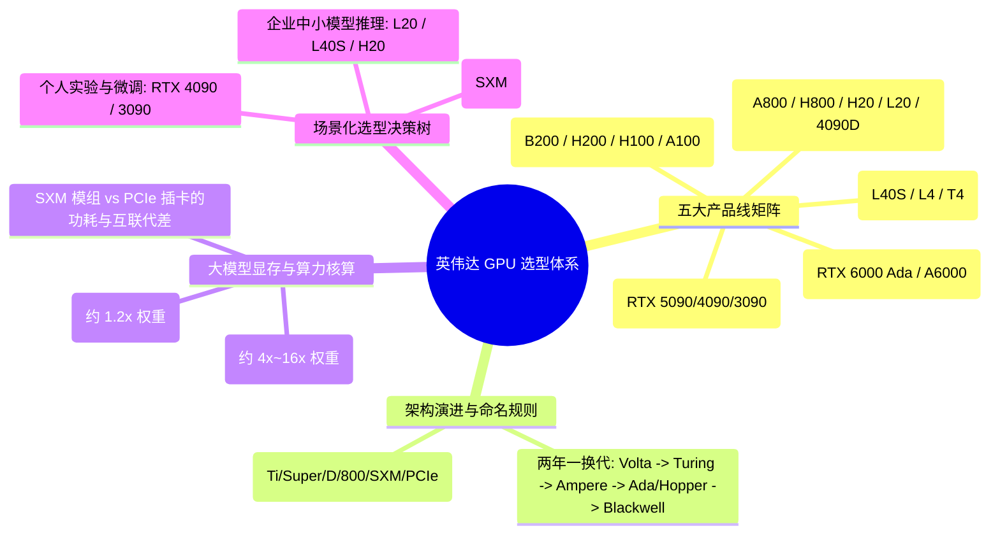

# 英伟达GPU选型科普

## 1. TL;DR

本文系统梳理了英伟达 GPU 的五大产品线定位、两年一换代的架构演进规律、命名规则，以及大模型训练与推理场景下的硬件选型方法论。核心结论是：**大模型选卡必须围绕“显存容量（决定模型能不能装下）、算力峰值（决定跑得多快）、互联带宽（决定多卡能不能高效协同）”三大铁律展开**——推理任务属于典型的 Memory-bound（显存容量与带宽敏感型），而分布式训练任务属于 Compute-bound 与 Communication-bound（算力与 NVLink 互联带宽敏感型）。在合规特供版选型中，需重点区分仅砍掉 NVLink 互联带宽的 `A800/H800` 与大幅削减算力但保留大显存带宽的 `H20/L20`。

## 2. 问题定义与背景

### 2.1 核心痛点
面对英伟达繁杂的 GPU 型号（GeForce、RTX Pro、L/T 系列、A/H/B 旗舰系列以及各类中国特供合规版），研发与基础设施团队在选型时常陷入三大误区：
1. **唯算力论**：只看峰值 TFLOPS，忽视了大模型解码阶段严重的显存带宽瓶颈（Memory Wall）与多卡训练时的跨卡通信瓶颈。
2. **命名与代际混淆**：不清楚前缀（GTX/RTX/A/H/B/L/T）、数字代号与后缀（Ti/Super/D/800/SXM/PCIe）背后的微架构代差与硬件刀法。
3. **显存估算失准**：仅按模型参数量乘以字节数估算显存，遗漏了训练态的梯度与优化器状态开销，或推理态的 KV Cache 与框架运行时开销，导致实测 OOM。

### 2.2 选型三大铁律
- **铁律一：显存容量（VRAM Capacity）决定“能不能装下”**：无论推理还是训练，显存不足直接触发 OOM，或被迫引入高昂的跨节点切分通信开销。
- **铁律二：算力（Compute FLOPs）决定“跑得多快”**：重点关注 Tensor Core 的 FP16/BF16 与 FP8 稠密（Dense）算力，而非厂商宣传表中默认带 2:4 稀疏加速（翻倍）的峰值算力。
- **铁律三：互联带宽（Interconnect Bandwidth）决定“多卡能不能协同”**：单机多卡或跨机分布式训练高频执行 AllReduce/AllGather 同步，PCIe 带宽往往成为木桶最短板，必须依赖 NVLink + NVSwitch 构建高带宽互联域。

## 3. 知识框架

## 4. 核心内容拆解

### 4.1 五大产品线定位与边界
1. **消费级 GeForce 系列（RTX 5090 ~ RTX 3090）**：面向游戏玩家与个人开发者，具备极高单卡性价比，支持光追与 DLSS，但无 ECC 显存纠错、不支持服务器高密度风道散热，且新一代高端卡已移除 NVLink，仅适合单机个人实验或小规模推理/LoRA 微调。
2. **专业工作站 RTX Pro 系列（原 Quadro，如 RTX 6000 Ada / RTX A6000）**：面向 CAD/CAE、影视工业与单机工作站研发，提供 48GB 大容量 ECC 显存与 ISV 专业软件认证，采用涡轮散热支持多卡堆叠。
3. **数据中心推理卡 L/T 系列（L40S / L4 / T4）**：专为云端高吞吐、低延迟、低功耗的多模态推理、视频编解码与图形渲染设计，通常采用标准 PCIe 形态，无 NVLink 但单瓦特推理能效比极高。
4. **数据中心训练旗舰 B/H/A 系列（B200 / H200 / H100 / A100）**：面向大规模分布式训练与超大模型推理，配备高带宽 HBM（高带宽显存）与高速 NVLink 总线，是构建千卡/万卡算力集群的底座。
5. **中国区合规特供版（A800 / H800 / H20 / L20 / RTX 4090D）**：自 2022 年起受出口管制影响推出的合规型号：
   - **第一代特供（A800 / H800）**：保持与 A100 / H100 完全一致的 FP16/BF16/FP8 算力与显存规格，仅将 NVLink 双向互联带宽削减（如 A800 从 600 GB/s 降至 400 GB/s，H800 从 900 GB/s 降至 400 GB/s）。
   - **第二代特供（H20 / L20）**：因综合算力密度（TPP）受限，大幅削减了 Tensor Core 算力（如 H20 的 FP16 算力仅为 H100 的约 15%），但 H20 升级了 **96GB HBM3 显存与 4.0 TB/s 超高显存带宽**，并保留了 **900 GB/s 满血 NVLink**，在受显存带宽制约的大模型 Decode 推理阶段甚至展现出极高的性价比。

### 4.2 架构代际演进与命名规则拆解
- **两年一迭代的微架构节奏**：
  - `Volta (2017, V100)`：首次引入第一代 Tensor Core，开启深度学习专用加速时代。
  - `Turing (2018, T4 / RTX 20系)`：引入 RT Core 与 INT8/INT4 推理加速。
  - `Ampere (2020, A100 / RTX 30系)`：引入 TF32 与 BF16 格式支持，以及结构化稀疏（2:4 Sparsity）加速。
  - `Hopper & Ada Lovelace (2022, H100/H200 & L40S/RTX 40系)`：Hopper 面向超算中心引入 Transformer Engine 与原生 **FP8** 支持；Ada 面向图形与高性价比推理。
  - `Blackwell (2024, B200 / GB200 / RTX 50系)`：采用双 Die 封装（10 TB/s 片间互联），引入第二代 Transformer Engine 与原生 **FP4/FP6** 低精度支持，单卡显存跃升至 192GB HBM3e。
- **命名规则解码**：
  - **前缀**：`GTX`（无光追老架构）、`RTX`（具备光追与 Tensor Core）、字母 `V/T/A/H/B/L`（直接对应微架构首字母）。
  - **后缀**：`Ti / Super`（同代芯片开更多流处理器或显存升级的加强版）、`D`（中国区消费级合规降规版，如 4090D）、`800 / 20`（数据中心合规特供版）、`SXM`（服务器定制高功耗、高带宽 NVLink 模组版，性能显著高于同芯片的 `PCIe` 半高/全高插卡版）。

### 4.3 大模型显存核算公式与选型决策
1. **模型参数与显存占用核算**：
   - **仅模型权重占用**：$\text{FP32} = 4\text{ Bytes/param}$，$\text{FP16/BF16} = 2\text{ Bytes/param}$，$\text{INT8/FP8} = 1\text{ Byte/param}$，$\text{INT4} = 0.5\text{ Bytes/param}$。
   - **推理显存估算**：除模型权重外，还需预留约 $20\%$ 的额外开销用于 KV Cache 与运行时激活，经验公式为 $\text{推理显存} \approx \text{参数量(B)} \times \text{精度字节数} \times 1.2$（长上下文高并发场景下 KV Cache 占比会进一步急剧膨胀）。
   - **全量微调/预训练显存估算**：需同时存储模型权重、梯度、Adam 优化器状态（动量与方差）以及前向激活值，在混合精度训练下经验公式约为模型权重的 **4 倍至 16 倍**（通常估算 baseline 为 $\approx 16 \sim 20\text{ Bytes/param}$，结合 ZeRO 切分与重计算可按比例摊薄）。
2. **SXM 与 PCIe 形态的关键差异**：
   以 A100/H100 为例，PCIe 版受限于插槽供电（通常 250W~350W）和 PCIe 通道带宽，持续算力比 SXM 版（400W~700W）低 $15\% \sim 30\%$，且 PCIe 版缺乏全互连 NVSwitch 拓扑，多机多卡扩展效率远逊于 SXM 整机柜/8 卡模组。

## 5. 数据速查表

| 指标 / 型号对比 | 原文数值 | 语境 / 条件 |
| :--- | :--- | :--- |
| **B200 显存与带宽** | 192 GB HBM3e / 8.0 TB/s | Blackwell 架构双 Die 旗舰，支持 FP4/FP8 与 1.8 TB/s NVLink |
| **H200 显存与带宽** | 141 GB HBM3e / 4.8 TB/s | Hopper 架构显存升级版，相比 H100 (80GB / 3.35TB/s) 显存容量提升 76% |
| **H100 SXM 算力与互联** | 989 TFLOPS (FP16 稠密) / 900 GB/s NVLink | 80 GB HBM3，3.35 TB/s 显存带宽，宣传峰值常标注为 1979 TFLOPS（含稀疏翻倍） |
| **H800 SXM 互联带宽** | 400 GB/s NVLink | 算力与显存同 H100，仅 NVLink 双向带宽从 900 GB/s 降至 400 GB/s |
| **H20 显存、算力与互联** | 96 GB HBM3 / 4.0 TB/s / 148 TFLOPS (FP16) | 900 GB/s NVLink，算力约为 H100 的 15%，但显存容量与带宽优于 H100 |
| **L40S 显存与算力** | 48 GB GDDR6 / 362 TFLOPS (FP16 稠密) | Ada 架构数据中心全能卡，864 GB/s 显存带宽，无 NVLink |
| **L20 显存与算力** | 48 GB GDDR6 / 119 TFLOPS (FP16) | 中国区合规推理卡，864 GB/s 显存带宽，无 NVLink |
| **A100 / A800 显存与算力** | 80 GB HBM2e / 312 TFLOPS (FP16) | 显存带宽约 2.0 TB/s；NVLink 带宽 A100 为 600 GB/s，A800 为 400 GB/s |
| **RTX 4090 显存与带宽** | 24 GB GDDR6X / 1.0 TB/s | 消费级 Ada 旗舰，无 NVLink，不支持 ECC（注：消费级驱动默认禁用 P2P） |
| **大模型推理显存经验乘数** | 模型权重 $\times 1.2$ | FP16 下相当于每 1B 参数约需 $2.4\text{ GB}$ 显存（不含超长上下文高并发 KV Cache） |

## 6. 踩坑与教训 / 可迁移的设计原则

| 错误做法 | 失败表现或原因 | 原文应对（可迁移的设计原则） |
| :--- | :--- | :--- |
| **直接按英伟达官网宣传表的“Sparse（稀疏）算力”做集群容量规划** | 实际训练与推理大多运行在稠密（Dense）矩阵乘法下，实测吞吐相比规划预期直接腰斩（差 2 倍） | **算力核对去稀疏化原则**：选型对比时统一折算为 Dense（稠密）算力（即将宣传表中带 `*` 号的 2:4 稀疏峰值除以 2），切勿混用稀疏与稠密口径 |
| **用多张无 NVLink 的 PCIe 推理卡（如 L40S/L20/4090）硬跑大规模多卡张量并行（TP）或全量预训练** | PCIe 4.0/5.0 带宽（32~64 GB/s）远低于 NVLink（400~900 GB/s），通信等待吃掉绝大部分计算收益，GPU 利用率（MFU）极低 | **通信拓扑匹配工作负载原则**：多卡强同步任务（高 TP 推理、分布式训练）必须选用带 NVLink + NVSwitch 的 SXM 机型；PCIe 卡优先用于单卡独立推理或弱通信的流水线并行（PP）/数据并行 |
| **用 H20 去跑计算密集型的大模型预训练，或忽视 H20 在 Decode 推理上的优势** | H20 的 FP16 算力仅 148 TFLOPS，预训练耗时极长；但如果因此完全弃用 H20，则会错失其 96GB HBM3 + 4.0 TB/s 显存带宽在长上下文推理上的红利 | **Prefill/Decode 瓶颈解耦选型原则**：大模型推理 Prefill 阶段受算力限制，Decode 阶段受显存带宽限制；利用 H20 的高带宽大显存承接 Decode 或大 Batch 推理，实现极致性价比 |
| **仅按 `参数量 × 2 Bytes` 卡着显存上限买卡（如试图用单张 141GB 的 H200/H20 原生加载 70B FP16 模型并跑长上下文）** | 70B FP16 仅权重即达 140GB，算上 20% KV Cache 与运行时开销（约 168GB）必然触发 OOM | **1.2x 推理安全水位与量化协同原则**：单卡部署必须预留至少 20% 的 KV Cache 与激活缓冲空间；若卡在单卡临界点（如 14B 放 32GB 卡、70B 放 96GB/141GB 卡），应结合 FP8/INT8/INT4 量化或双卡 TP 切分 |

## 7. 记忆锚点

- **选卡三问口诀**：“**一问显存装不装得下（容量防 OOM），二问带宽喂不喂得饱（HBM 解码防卡顿），三问互联散不散得开（NVLink 多卡防等待）。**”
- **特供型号刀法对比**：
  - **800 系（A800/H800）**：“**算力满血不动刀，只砍 NVLink 互联桥**”（适合训练与推理通吃）。
  - **20 系（H20/L20）**：“**算力大砍保合规，H20 显存带宽反向堆**”（专为大模型推理与 KV Cache 定制）。

## 8. 复习卡片

什么是英伟达 GPU 大模型选型的“三大铁律”？::1. 显存容量决定模型能不能装下；2. 算力（FLOPs）决定计算跑得多快；3. 互联带宽（NVLink/PCIe）决定多卡能不能高效协同。
为什么对比英伟达 GPU 算力时需要注意“稀疏（Sparse）”与“稠密（Dense）”的区别？::因为英伟达自 Ampere 架构起常在官方宣传页标注 2:4 结构化稀疏算力（数值为稠密算力的 2 倍），而绝大多数常规大模型训练与推理实际运行在稠密（Dense）模式下。
中国区特供版 A800/H800 与 H20 在硬件削减策略上有何本质不同？::A800/H800 保留了与 A100/H100 完全相同的算力与显存规格，仅削减了 NVLink 互联带宽（降至 400 GB/s）；而 H20 大幅削减了 Tensor Core 算力（约为 H100 的 15%），但提供了 96GB HBM3 大显存、4.0 TB/s 显存带宽与 900 GB/s 满血 NVLink。
为什么 H20 算力不高却非常适合大模型在线推理？::因为大模型自回归生成（Decode 阶段）是典型的访存密集型（Memory-bound）任务，瓶颈在于显存带宽与 KV Cache 容量而非计算峰值，H20 的 96GB 显存和 4.0 TB/s 带宽恰好击中该痛点。
在 FP16 精度下，大模型推理与全量训练的显存占用经验估算公式分别是什么？::FP16 模型权重约为 `2 Bytes × 参数量`；推理显存需算上 KV Cache 与运行时开销，约为权重的 1.2 倍（即每 1B 参数约 2.4GB）；全量训练需加上梯度、优化器状态和激活值，约为权重的 4 到 16 倍。
同型号 GPU 的 SXM 模组版与 PCIe 插卡版有何核心差距？::SXM 版供电上限更高（如 700W vs 350W）、持续算力高出 15%~30%，且原生支持通过 NVSwitch 实现多卡全互连高带宽通信；PCIe 版受限于插槽功耗与 PCIe 带宽，多卡扩展效率较低。

## 9. 知识关联

- **本库通用主题**：[模型与开发工具发布](../../20_topics/%E6%A8%A1%E5%9E%8B%E4%B8%8E%E5%BC%80%E5%8F%91%E5%B7%A5%E5%85%B7%E5%8F%91%E5%B8%83.md) · [Agent成本与上下文预算](../../20_topics/Agent%E6%88%90%E6%9C%AC%E4%B8%8E%E4%B8%8A%E4%B8%8B%E6%96%87%E9%A2%84%E7%AE%97.md) · [大模型推理与算子优化](../../20_topics/%E5%A4%A7%E6%A8%A1%E5%9E%8B%E6%8E%A8%E7%90%86%E4%B8%8E%E7%AE%97%E5%AD%90%E4%BC%98%E5%8C%96.md)
- **候选双链**：[[Roofline模型与算力瓶颈]] · [[KV Cache显存优化]] · [[分布式训练并行策略]] · [[FP8混合精度训练与推理]]

## 10. 原文参考资料

- 原文标题：《英伟达 GPU 选型科普》（作者：nickycao，发布于 2026-03-20）
- 核心参考硬件规范：NVIDIA Volta / Turing / Ampere / Ada Lovelace / Hopper / Blackwell 架构白皮书与官方 Datasheet。

> [!note]- 校对报告
> - **页码溯源汇总**：
>   - `p.1`：五大产品线总览（消费级 GeForce、工作站 RTX Pro、数据中心推理 L/T、训练旗舰 B/H/A、中国特供合规版）及选型三大铁律（显存容量、算力、互联带宽）。
>   - `p.2–4`：两年一换代的架构演进规律（Volta $\to$ Turing $\to$ Ampere $\to$ Ada/Hopper $\to$ Blackwell）与前缀/数字/后缀命名法则。
>   - `p.5–11`：各产品线核心参数表、FP16 Tensor Core 算力天梯图（含稀疏算力注释）及合规版刀法对比（A800/H800 vs H20/L20 vs 4090D）。
>   - `p.12–14`：大模型参数量与显存估算公式（推理 1.2 倍权重、训练 4~16 倍权重）及场景化选型决策树。
> - **勘误与内部矛盾说明**：
>   - 原文 `p.12` 给出的推理显存估算公式为 `参数量 × 2 Bytes × 1.2`（即 14B FP16 约需 $33.6\text{ GB}$，70B FP16 约需 $168\text{ GB}$），但在 `p.12–13` 的配图表中将 14B FP16 标为可用单张 32GB 卡、70B FP16 标为可用单张 H200 (141GB) / H20 (96GB) 原生加载。本笔记在第 6 节“踩坑与教训”中明确指出了该临界点矛盾，并补充了结合 FP8/INT8 量化或双卡张量并行的工程修正方案。
