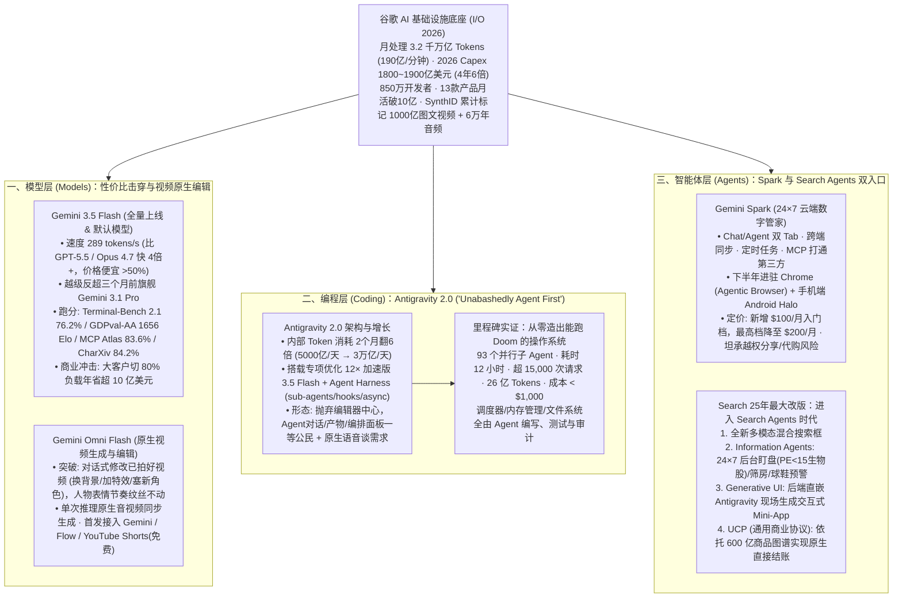

# 三个关键词，2026谷歌I/O大会全说透了

## 1. TL;DR

1. **三大战略支点（Models, Coding, Agents）与恐怖规模底座**：Google I/O 2026（时长 `1 小时 51 分钟`）亮出底层规模——月处理 Token 从 `9.7 万亿` 暴增至 **3.2 千万亿（每分钟 190 亿 Tokens）**，Capex 资本开支四年翻 6 倍达 **1,800~1,900 亿美元**，坐拥 `13 个` 月活破 10 亿产品（AI Overviews 月活 `25 亿`、AI Mode 上线一年月活破 `10 亿`）。
2. **模型层：Gemini 3.5 Flash 越级反超上代 Pro，Gemini Omni 原生改视频**：全量上线并成为 Gemini App 与 Search AI Mode 默认模型的 **Gemini 3.5 Flash**，输出速度达 **289 tokens/s**（比 GPT-5.5、Claude Opus 4.7 快 **4 倍以上**，价格便宜超一半），在 Terminal-Bench 2.1（`76.2%`）、GDPval-AA（`1656 Elo`）、MCP Atlas（`83.6%`）、CharXiv（`84.2%`）上全面反超三个月前的自家旗舰 Gemini 3.1 Pro（企业将 `80%` 负载切至 3.5 Flash 每年可省超 **10 亿美元**）；**Gemini Omni Flash** 则首次实现“不破坏原有人物表情与节奏的对话式视频编辑”及原生音视频同步生成。
3. **编程层：Antigravity 2.0 携 93 个子 Agent 用 12 小时从零造出能跑 Doom 的操作系统**：由前 Windsurf CEO Varun Mohan 操盘的 **Antigravity 2.0** 彻底抛弃传统 IDE 编辑器形态，转向“Agent 对话/产物/编排面板一等公民”的独立桌面应用（内部日处理 Token 两个月翻 6 倍达 **3 万亿/天**，内置 **12× 加速版** 3.5 Flash）；现场展示 **93 个并行子 Agent** 在 **12 小时** 内发起超 `15,000 次` 请求、处理 `26 亿` Tokens、花费 **不到 1,000 美元**，从零写出含调度器、内存管理与文件系统的完整 OS 并跑通 Doom。
4. **Agent 层：Gemini Spark + Search Agents + UCP 商业协议**：推出 24×7 云端数字管家 **Gemini Spark**（Chat/Agent 双 Tab、打通 MCP、下半年落地 Chrome 成为 Agentic Browser 及手机端 Android Halo，AI Ultra 新增 `$100/月` 入门档、最高档降至 `$200/月`）；Google Search 迎来 25 年最大改版，集成 **Information Agents**（后台 24×7 盯盘/筛房）、**Generative UI**（后台嵌 Antigravity 现场生成交互式 Mini-App）以及依托 **600 亿商品图谱** 的 **UCP（通用商业协议）**。

## 2. 问题定义与背景

### 2.1 AI 下半场的核心命题：从“对话框跑分”走向“10 亿人日常代办”
在 OpenAI Agent 平台、Anthropic Conway 与微软 Agent 365 同台竞技的 2026 年，Sundar Pichai 在演讲第 16 分钟用三个词框定了谷歌的决胜战场：**Models（模型）、Coding（编程）、Agents（智能体）**。
- **行业痛点**：前沿旗舰模型推理昂贵且延迟高，限制了高并发 Agent 循环的商业可行性；视频模型只能“从零抽卡生成”而无法精准修改实拍素材；多 Agent 编程仍受困于传统 IDE 插件形态；通用 Agent 缺乏触达十亿级普通用户的天然入口与跨商户交易协议。
- **谷歌的规模护城河**：月处理 Token 规模从 `9.7 万亿` 跃升至 **3.2 千万亿（3.2 Quadrillion，每分钟 190 亿 Tokens）**；全球拥有 **850 万** 开发者；2026 年资本开支（Capex）高达 **1,800~1,900 亿美元**（较 2022 年的 `310 亿美元` 增长 **6 倍**）；旗下 **13 款产品月活破 10 亿**（其中 `5 款` 破 30 亿），AI Overviews 月活达 **25 亿**，AI Mode 上线仅一年月活即突破 **10 亿**（查询量每季度翻倍）。

## 3. 知识框架

## 4. 核心内容拆解

### 4.1 模型层：Gemini 3.5 Flash 的“跨代降维打击”与 Gemini Omni

1. **Gemini 3.5 Flash：用经济款价格反超三个月前的旗舰 Pro**
   - **发布节奏**：大会当天全量开放 API，并直接成为 Gemini App 与 Google Search AI Mode 的默认模型（Gemini 3.5 Pro 于次月跟进）。
   - **速度与成本杀伤力**：输出速度高达 **289 tokens/秒**，比同期的 GPT-5.5 与 Claude Opus 4.7 **快 4 倍以上**，API 价格比同级前沿模型**便宜超过一半**。皮查伊指出，大型企业客户若将 **80% 的日常工作负载切换至 3.5 Flash，一年可节省超过 10 亿美元** 的 API 成本。
   - **四大核心基准全面反超 Gemini 3.1 Pro**：
     - **Terminal-Bench 2.1（终端编码能力）**：**76.2%**；
     - **GDPval-AA（真实世界 Agent 任务）**：**1656 Elo**；
     - **MCP Atlas（大规模工具调用）**：**83.6%**；
     - **CharXiv Reasoning（多模态科学图表推理）**：**84.2%**。
2. **Gemini Omni Flash：从“生成视频”跨越到“编辑已有视频”**
   - DeepMind CEO Demis Hassabis 揭晓原生视频模型家族 **Gemini Omni**（首发 Omni Flash，后续推出 Omni Pro）。
   - **核心技术突破**：不同于 Veo 从零生成视频，Omni 能像 Nano Banana 编辑图片一样，通过“一句自然语言 Prompt + 一张参考图”**直接修改一段已经拍好的实拍视频**（例如替换背景、叠加特效、插入新角色），而**原视频中人物的面部表情、肢体语言与说话节奏纹丝不动**；同时支持单次推理原生生成同步的画面、配乐与音效（无需多模型拼接），并对 YouTube Shorts 创作者免费开放。
   - **SynthID 防伪水印护栏**：鉴于研究表明人类仅能识别约 **25%** 的高质量深伪视频，谷歌 SynthID 水印系统累计已为 **1,000 亿张图像/视频** 以及 **6 万年时长** 的音频打上防伪水印。

### 4.2 编程层：Antigravity 2.0 与“1,000 美元 12 小时手搓操作系统”

前 Codeium / Windsurf 创始人兼 CEO Varun Mohan 登台发布了定位为 *"Unabashedly agent first（毫不掩饰地 Agent 优先）"* 的 **Antigravity 2.0**：
1. **内部吞吐暴增与 12× 专属加速引擎**：
   - Antigravity 在谷歌内部的日均 Token 处理量从 2026 年 3 月的 `5,000 亿/天` 飙升至 5 月的 **3 万亿/天（两个月翻 6 倍）**。
   - 底层搭载 **Gemini 3.5 Flash × Antigravity Agent Harness**（原生内置 `sub-agents`、`hooks`、`async` 三大原语），其中的 3.5 Flash 为专项优化的 **12× 加速版**。
2. **三大产品形态革新**：
   - **全新独立桌面应用**：彻底抛弃传统 IDE“代码编辑器 + 侧边栏插件”的旧壳，将 **Agent 对话面板、Agent 产物面板、多 Agent 编排面板** 提升为一等公民；
   - **CLI + SDK + 原生语音编程**：直接接入 Gemini Audio 模型，支持开发者用语音对话与 Antigravity 讨论需求与架构；
   - **Android、Firebase、AI Studio 全栈原生打通**。
3. **王炸实验：93 个子 Agent 在 12 小时内从零构建能跑 Doom 的操作系统**
   - **实验参数**：并行调度 **93 个子 Agent**，连续运行 **12 小时**，发起超过 **15,000 次** 模型请求，累计处理 **26 亿 Tokens**，API 总账单 **不到 1,000 美元**。
   - **交付成果**：从零编写、测试并审计了包含进程调度器、内存管理与文件系统的完整操作系统（过去需整支系统团队研发半年）；现场演示不仅跑通了 Linux 经典 `sl` 小火车彩蛋，还在发现缺少 Doom 驱动时由 Antigravity 现场自主修复并成功运行 Doom——印证了 *"Multiday engineering efforts are collapsing into hours, if not minutes"*。

### 4.3 Agent 层：Gemini Spark、Search Agents 与 UCP 通用商业协议

1. **Gemini Spark：7×24 小时云端数字管家与风险自白**
   - 采用 **Chat / Agent 双 Tab** 设计，支持跨端同步、定时任务（如“每周一早 8 点整理上周会议纪要”）与 MCP 第三方工具接入；数据视野打通 Google 全家桶、聊天记录、已登录网站、Personal Intelligence 个人画像与实时位置。
   - **终端演进与订阅改版**：2026 下半年直接嵌入 Chrome 成为 **Agentic Browser**（即 Chrome Auto Browse 的正式落地），并在手机端推出专门的 Agent 基地 **Android Halo**；Google AI Ultra 订阅新增 **$100/月** 入门档（开通 Spark Beta 最低门槛），最高档从原价下调至 **$200/月**，Gemini App（代号 `Neural Expressive`）同步改为按算力计费。
   - **罕见的官方安全风险坦白**：谷歌在安全说明中明确警告，Spark 虽被设计为在敏感操作前征求许可，但仍**可能在未询问的情况下分享用户信息或代为完成购买**，严禁依赖其做医疗、法律、财务等专业决策。
2. **Search 25 年最大改版：三大新物种与 UCP 协议**
   - **全新多模态混合搜索框**：原生支持文本、图像、文件、视频混合输入，AI Overviews 与 AI Mode 无缝切换；
   - **Information Agents（24×7 后台监控智能体）**：持续在后台替用户盯盘（如监控“市盈率 `< 15`、正现金流、低负债”的生物科技股）、筛选新挂牌租房房源或球鞋发售预警；
   - **Generative UI in Search（搜索即生成临时 App）**：将 **Antigravity 直接嵌入 Search 后端**，面对“黑洞引力波原理”实时生成可交互物理可视化 Mini-App，或结合 Gmail/Photos/Calendar 现场生成可一键同步全家日历的“周末家庭计划器”（今夏免费开放）；
   - **UCP（Universal Commerce Protocol，通用商业协议）**：依托 Google Shopping Graph 收录的 **600 亿条商品** 底盘，将商户商品目录、优惠券、会员积分与售后客服封装为开放协议，让用户在 Search 与 Gemini 中直接原生结账。

## 5. 数据速查表

| 指标 | 原文数值 | 语境 / 条件 |
| :--- | :--- | :--- |
| **谷歌月度与每分钟 Token 处理量** | 月处理 `3.2 千万亿`（从 `9.7 万亿` 跃升），每分钟 `190 亿` Tokens | Google I/O 2026 披露的全局大模型调用规模 |
| **谷歌年度资本开支（Capex）演进** | 2022 年 `310 亿美元` → 2026 年 `1,800~1,900 亿美元` | 四年增长约 `6 倍` |
| **十亿级产品矩阵与搜索 AI 月活** | `13 个` 产品月活破 `10 亿`（`5 个` 破 `30 亿`）；AI Overviews `25 亿`、AI Mode `10 亿` | 全球开发者达 `850 万`，AI Mode 查询量每季度翻倍 |
| **Gemini 3.5 Flash 推理速度与降本** | 输出 `289 tokens/秒`（比 GPT-5.5 / Opus 4.7 快 `4 倍+`）；切 `80%` 负载年省 `> 10 亿美元` | API 价格比同级前沿模型便宜超 `50%`，全面反超 Gemini 3.1 Pro |
| **Gemini 3.5 Flash 四大基准成绩** | Terminal-Bench 2.1 `76.2%`、GDPval-AA `1656 Elo`、MCP Atlas `83.6%`、CharXiv `84.2%` | 涵盖终端编码、真实世界 Agent、大规模 MCP 工具调用与多模态推理 |
| **SynthID 防伪水印累计覆盖规模** | `1,000 亿张` 图像/视频、`6 万年` 时长音频 | 应对人类仅能正确识别约 `25%` 高质量深伪视频的安全挑战 |
| **Antigravity 内部日处理 Token 增速** | 从 3 月 `5,000 亿/天` 飙升至 5 月 `3 万亿/天`（`2 个月翻 6 倍`） | 开发者拿到的 Antigravity 内置 `12× 加速版` 3.5 Flash |
| **Antigravity 手搓 Doom OS 实验数据** | `93 个` 子 Agent、`12 小时`、超 `15,000 次` 请求、`26 亿` Tokens、成本 `< $1,000` | 从零写出含调度器、内存管理、文件系统的操作系统并成功运行 Doom |
| **Google AI Ultra 订阅价格调整** | 新增 `$100/月` 入门档（Spark Beta 门槛），最高档降至 `$200/月` | Gemini App（代号 `Neural Expressive`）同步改为按算力计费 |
| **Google Shopping Graph 商品规模** | 收录 `600 亿条` 商品 | 支撑 UCP（通用商业协议）实现 AI 跨商户原生结账的底层资产 |

## 6. 踩坑与教训 / 可迁移的设计原则

| 错误做法 | 失败表现或原因 | 原文应对（可迁移的设计原则） |
| :--- | :--- | :--- |
| **把企业 100% 的日常 Agent 工作流全部绑死在昂贵慢速的超大旗舰 Pro/Opus 模型上** | 单步推理延迟高、多 Agent 并发账单失控，且 2026 年的小尺寸 Flash 级模型已在编码与工具调用基准上追平甚至反超上代旗舰 | **高频主干切 Flash（80% 负载）+ 专项吞吐加速**：利用 `289 tokens/s` 的高吞吐 Flash 模型承接 80% 的 Agent 循环与工具调用，将多日工程压缩至小时级且大幅削减 API 成本 |
| **做多 Agent 编程工具时仍拘泥于“传统代码编辑器 + 侧边聊天框插件”形态** | 当 93 个子 Agent 并行工作 12 小时编写整套系统时，单文件文本编辑器根本无法承载任务编排、产物审阅与异步状态监控 | **“Agent First”工作台重构（Antigravity 2.0）**：将 Agent 对话面板、产物面板与多 Agent 编排面板升格为一等公民，底层原语直接提供 `sub-agents`、`hooks` 与 `async` |
| **认为搜索引擎的 AI 化只是把“10 条蓝色链接”换成“一段总结文字”** | 静态文本无法满足复杂交互探索（如物理模拟、家庭行程排期）与持续动态监控需求 | **Generative UI（搜索即临时 App）+ Information Agents**：在搜索后端直接挂载代码生成引擎，针对单次复杂查询实时写出交互式 Mini-App，并用后台常驻 Agent 7×24 盯盘推送 |
| **对全自主生活管家 Agent 的越权与幻觉风险避而不谈，诱导用户托管高危决策** | 赋予了读取邮件、聊天记录与支付权限的 Agent 一旦发生幻觉，极易在未获确认时泄露隐私或错误下单 | **显式风险提示 + 敏感领域禁入红线**：在产品说明中坦承“可能未询问即分享信息或代购”的实验性风险，明确禁止用于医疗、法律、财务决策，并全量普及 SynthID 内容水印 |

## 7. 记忆锚点

- **“3.5 Flash 打翻上代 3.1 Pro，289 tokens/s 快 4 倍省一半”**：模型演进的性价比拐点——三个月前的旗舰能力被塞进秒级响应的 Flash 档位，直接解锁了大规模多 Agent 并发的经济可行性。
- **“93 个子 Agent、12 小时、26 亿 Token、不到 1,000 美元造出 Doom OS”**：Antigravity 2.0 最震撼的工程坐标，宣告需整个团队开发半年的系统工程正坍缩为千元级算力的半日并发任务。
- **“Search 不再给答案页，而是现场给你写一个临时 App（Generative UI）+ 600 亿商品 UCP 结账”**：谷歌把模型（Omni/Flash）、编程（Antigravity）和入口（Search/Spark）彻底咬合成一体。

## 8. 复习卡片

1. Gemini 3.5 Flash 在推理速度、价格和核心基准跑分上表现如何？它对企业 API 账单有什么影响？::输出速度达 `289 tokens/秒`（比 GPT-5.5、Claude Opus 4.7 快 4 倍以上），价格便宜超一半；在 Terminal-Bench 2.1（`76.2%`）、GDPval-AA（`1656 Elo`）、MCP Atlas（`83.6%`）和 CharXiv（`84.2%`）上全面对标并反超自家三个月前的旗舰 Gemini 3.1 Pro；大客户若将 `80%` 工作负载切至 3.5 Flash，每年可省下超 `10 亿美元` API 成本。
2. Gemini Omni Flash 相比传统视频生成模型（如 Veo）最大的技术跨越是什么？谷歌配套了什么防伪安全机制？::最大跨越是从“从零生成视频”迈向“对话式编辑已有实拍视频”（通过一句 Prompt + 参考图即可换背景、加特效、塞新角色，同时保持原人物表情、肢体语言与说话节奏纹丝不动），并支持单次推理音视频同步生成；配套了 SynthID 防伪水印（已累计标记 `1,000 亿` 张图文视频与 `6 万年` 音频，应对人类仅能识别约 `25%` 深伪视频的挑战）。
3. Antigravity 2.0 在产品形态与底层引擎上做了哪些“Agent First”设计？其构建 Doom 操作系统的实验指标是多少？::抛弃传统编辑器中心形态，将 Agent 对话面板、产物面板与多 Agent 编排面板做成独立桌面应用的一等公民，支持原生语音谈需求，底层基于 `12× 加速版` 3.5 Flash 与内置 `sub-agents / hooks / async` 的 Agent Harness；实验中用 `93 个` 并行子 Agent、耗时 `12 小时`、发起超 `15,000 次` 请求、处理 `26 亿` Tokens、花费不到 `1,000 美元`，从零写出含调度器、内存管理与文件系统的完整 OS 并跑通 Doom。
4. Gemini Spark 的定位是什么，它将如何与 Chrome 及 Android 系统融合，官方披露了什么安全风险？::定位为托管在谷歌云上的 `24×7` 个人数字管家（采用 Chat/Agent 双 Tab，支持定时任务与 MCP 工具）；下半年将嵌入 Chrome 成为 Agentic Browser（Chrome Auto Browse），并在手机端推出 Android Halo 基地；官方坦承其虽设计为敏感操作前征求许可，但仍可能未询问即分享信息或代为完成购买，严禁用于医疗、法律、财务决策。
5. Google Search 在“Search Agents”时代的改版包含哪四项核心能力创新？::① 全新多模态混合搜索框（支持图文音视频输入，无缝切换 AI Overviews 与 AI Mode）；② Information Agents（24×7 在后台替用户盯盘选股、筛房源、球鞋发售预警）；③ Generative UI in Search（后端直接嵌入 Antigravity，针对用户问题现场生成交互式可视化 Mini-App 或家庭行程计划器）；④ UCP 通用商业协议（基于 `600 亿` 商品图谱打通跨商户原生结账）。

## 9. 知识关联

- **本仓库主题索引**：[模型与开发工具发布](../../20_topics/%E6%A8%A1%E5%9E%8B%E4%B8%8E%E5%BC%80%E5%8F%91%E5%B7%A5%E5%85%B7%E5%8F%91%E5%B8%83.md) · [Harness与模型协同](../../20_topics/Harness%E4%B8%8E%E6%A8%A1%E5%9E%8B%E5%8D%8F%E5%90%8C.md) · [Agent成本与上下文预算](../../20_topics/Agent%E6%88%90%E6%9C%AC%E4%B8%8E%E4%B8%8A%E4%B8%8B%E6%96%87%E9%A2%84%E7%AE%97.md) · [Agent安全与权限](../../20_topics/Agent%E5%AE%89%E5%85%A8%E4%B8%8E%E6%9D%83%E9%99%90.md)
- **候选双链概念**：[[Gemini-3.5-Flash]] · [[Antigravity-2.0]] · [[Generative-UI]] · [[通用商业协议UCP]] · [[SynthID防伪水印]]

## 10. 原文参考资料

1. Google I/O 2026 Keynote（主讲人：Sundar Pichai、Demis Hassabis、Varun Mohan、Liz Reid、Vidhya Srinivasan，Shoreline Amphitheatre，时长 1 小时 51 分钟）。
2. 核心发布产品与协议：Gemini 3.5 Flash / Pro、Gemini Omni Flash / Pro、SynthID、Antigravity 2.0、Gemini Spark、Android Halo、Google Search Information Agents & Generative UI、UCP (Universal Commerce Protocol)。

> [!note]- 校对报告
> - **校对状态**：已按原文逐页核对通过（共 14 页 PDF）。
> - **核心数据与页码溯源**：
>   - 演讲时长 `1 小时 51 分钟`、第 `16 分钟` 三个关键词（Models, coding, and agents）、月处理 Token `9.7 万亿 → 3.2 千万亿`、每分钟 `190 亿` tokens、全球开发者 `850 万`、`13 个` 月活破 10 亿产品（`5 个` 超 30 亿）、AI Overviews 月活 `25 亿`、AI Mode 月活 `10 亿`、Capex 从 2022 年 `310 亿美元` 升至 2026 年 `1800–1900 亿美元`（四年 `6 倍`）：见 `p.1–2`。
>   - Gemini 3.5 Flash 输出 `289 tokens/秒`（快 `4 倍+`、便宜超一半）、四大基准成绩（Terminal-Bench 2.1 `76.2%`、GDPval-AA `1656 Elo`、MCP Atlas `83.6%`、CharXiv Reasoning `84.2%`）、切 `80%` 工作年省超 `10 亿美元`：见 `p.2–3`。
>   - Gemini Omni Flash 视频编辑、音视频同步生成、YouTube Shorts 免费开放、SynthID（`1000 亿` 图文视频、`6 万年` 音频，人类仅能识别约 `25%` 深伪视频）：见 `p.4–5`。
>   - Antigravity 2.0（Varun Mohan、内部 Token 从 3 月 `5000 亿/天` 升至 `3 万亿/天`、`12× 加速版` Flash、`sub-agents / hooks / async` 原语、`93 个` 子 Agent、`12 小时`、超 `15,000 次` 请求、`26 亿` tokens、不到 `1000 美元` 造出跑 Doom 的 OS）：见 `p.5–7`。
>   - Gemini Spark（`24×7`、Chat/Agent 双 Tab、MCP、Chrome Agentic Browser、Android Halo、AI Ultra 新增 `$100/月` 档、最高档降至 `$200/月`、`Neural Expressive` 按算力计费及安全说明警告）：见 `p.7–9`。
>   - Search 25 年最大改版（Information Agents 盯 `PE<15` 生物科技股/租房/球鞋、Generative UI 嵌 Antigravity 写黑洞引力波 Mini-App 与周末家庭计划器、UCP 通用商业协议与 `600 亿` 条商品 Shopping Graph）：见 `p.9–11`。
