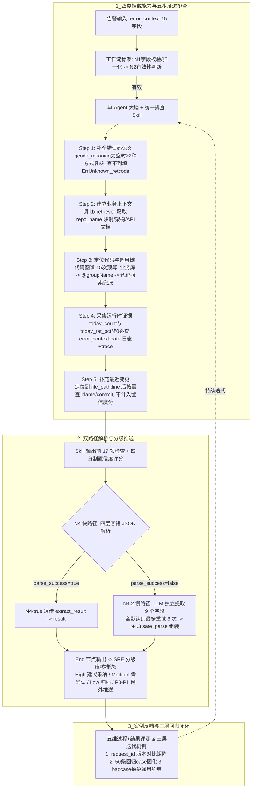

# 错误码排查从 3～8 小时到分钟级，Agent怎么做到的？

## 1. TL;DR

面对 SRE 每天处理数百条去重错误码告警、人工跨系统拼凑上下文耗费 $3\sim 8$ 小时且转交开发后仍需二次排查的痛点，作者团队基于智能体编排平台构建了“错误码治理 Agent”，将 SRE 从“告警搬运工”升级为“修复建议审核员”。方案放弃多 Agent 拆分，选择**单 Agent 挂载知识库、代码关系图谱、可观测平台和代码托管平台四类能力**，并将五步渐进式排查流程、工具调用硬边界与输出契约收敛进单一 Skill，以保留完整上下文做跨源交叉验证。工程底座通过 **11 节点双路径工作流（四层容错快路径解析 + LLM 9 字段独立提取慢路径兜底）** 与 **17 项输出前自检** 保障结构化结果稳定交付，并基于 4 分制证据充分性模型输出分级置信度（High 建议采纳、Medium 需确认、Low 仅归档、P0/P1 例外推送）。经过 50 条真实 case 的 5 轮对比调优（如将加白判定改为“先排除禁止场景再判加白”的三步法），`action_type` 与人工标注一致率从 $66\%$ 提升至 $88\%$，硬冲突率从 $20\%$ 降至 $0\%$；但作者明确指出，该 50 条样本同时用于调优与回归，不能直接代表对未见新错误码的泛化能力。

## 2. 核心概念

- **修复建议审核模式（人机协同边界）**：Agent 不直接自动改线上代码，而是分钟级产出带证据链、代码位置与根因分类的修复建议，交由 SRE 按置信度分级审核后推送开发（High 标注“建议采纳”，Medium 标注“参考，需确认”，Low 仅归档，P0/P1 例外推送）。
- **单 Agent 渐进式探索 vs 多 Agent 拆分**：错误码排查属于“根据上一步发现决定下一步查什么”的强耦合探索（如查到 handler 后追上游、看到日志限流后再核对错误码定义），采用单 Agent + 单一 Skill 可避免多 Agent 通信丢失上下文或子 Skill 切换依赖模型自觉的问题。
- **静态代码与运行时证据交叉验证**：“代码怎么写”不等于“现场怎么跑”（例如静态代码显示 A 调用 B，唯有结合 trace 才能区分是 A 内部多次串行调用累积超时，还是请求到达 B 后由 B 报错），必须用可观测日志与 trace 验证代码推断。
- **快慢双路径解析（Fast/Slow Path Parsing）**：工作流层应对 LLM 输出格式不稳定的兜底设计——快路径先按四层容错规则尝试本地 JSON 解析；失败则转入慢路径，由小模型/LLM 独立提取 9 个目标字段（保证单个字段缺失不清空其他已有字段），最多重试 3 次。
- **加白（Whitelist）**：将预期内或无需人工响应的错误码加入告警豁免清单、不再触发告警推送的治理动作；因误加白会掩盖真实故障，判定时必须遵循“先排除禁止加白场景，再匹配加白条件”的防呆顺序。

## 3. 知识框架

以下流程图按正文整理，展示错误码治理 Agent 的架构分工、五步渐进式排查、11 节点双路径解析工作流与回归评测闭环：

## 4. 关键要点与机制详解

### 4.1 架构选型与四类数据源硬边界：为什么用单 Agent + 单 Skill

**核心主张**：错误码排查的瓶颈在于跨系统证据分散且下一步查询强依赖上一步发现，因此用“工作流做确定性骨架、单 Agent 做渐进式大脑、四类工具设严格调用边界”最能兼顾上下文完整性与稳定性。

- **传统链路痛点与四类缺失信息**
  - 传统链路（告警推 SRE → 查文档/代码/日志 → 转开发 → 开发重查 → 修复）之所以耗时 $3\sim 8$ 小时，是因为单独查到某一部分仍无法定因：错误码只是数字（缺业务规则与职责）、不知哪个仓库抛出（缺仓库映射、handler 与上下游关系）、静态代码不代表现场（缺错误日志、trace 与实际耗时）、现象转述无法直接执行（缺代码位置、根因分类与修复动作）。
- **单 Agent vs 多 Agent 选型取舍**

| 对比维度     | 多 Agent 协作方案                      | 单 Agent 挂载全部能力方案（本文采用）                 |
| -------- | --------------------------------- | -------------------------------------- |
| **组织结构** | 知识库、代码、运行时 Agent 各自独立，汇总 Agent 收敛 | 一个 Agent 自主按需调用四类能力，规则沉淀于单一 Skill      |
| **核心优势** | 职责切分清晰，适合可独立执行、并行验证的子任务           | **上下文完整保留，便于跨源证据交叉验证与动态追查**            |
| **工程代价** | 通信与编排复杂，跨 Agent 传递易丢失关键现场细节       | Prompt 较复杂，必须在 Skill 中明确界定每类工具的调用边界与预算 |

  - 作者曾尝试按排查路径拆分为多个子 Skill，但发现子 Skill 切换高度依赖 Agent 自觉，且通用规则需在多处重复维护，故最终收敛为单 Agent + 单一 Skill。
- **四类挂载能力的证据职责与硬约束**
  - 为防止 Agent 盲目试探、超时或伪造证据，Skill 对四类工具施加了严格的参数与触发约束：

| 挂载能力                       | 提供的证据职责                         | 🔥 关键调用硬约束与兜底路径                                                                                                             |
| -------------------------- | ------------------------------- | --------------------------------------------------------------------------------------------------------------------------- |
| **1. 知识库（`kb-retriever`）** | 前后端仓库映射、业务架构、API 文档、历史排查经验      | `repo_name` **必须从知识库获取**，严禁直接用 `service_name` 猜测试探仓库名                                                                       |
| **2. 代码关系图谱**              | 定位 handler、拉取源码、追查上下游调用关系与错误码定义 | 仓库参数只填别名，禁止枚举全部仓库或传不支持的参数；固定检索三级路径：**业务仓库查询 → 未命中时用 `@<groupName>` 多仓库模式 → 代码托管平台搜索兜底**；调用预算设为 **15 次**（5 次易截断调用链，30 次易超时）  |
| **3. 可观测平台**               | 错误日志及 tag 分布、trace 与完整调用链路、前端洞见 | 当 `today_count` 和 `today_ret_pct` 均不为 0 时**必须调用**，且日志和 trace 都要查；时间窗口强制使用 `error_context.date`（而非默认最近 24 小时）；查询失败显式跳过，不参与重试 |
| **4. 代码托管平台**              | 行级 `blame`、commit 详情、代码搜索兜底     | 属于可选项，仅在已定位到具体 `file_path:line` 后按需查询填充 `recent_change`；失败直接跳过，未调用不需额外说明，且**不计入置信度得分**                                      |

### 4.2 五步排查法、交叉验证与四分制置信度模型

**核心主张**：可信的根因结论不能靠静态代码猜测或谁最近改了代码来定罪，必须通过五步证据链交叉核验，并由客观取证完整度决定置信度等级。

- **五步渐进式排查（非机械串行，按已有结果动态决定路径）**
  1. **补全错误码语义**：当输入 `gcode_meaning` 为空时，至少用两种方式（文档、代码定义或运行时日志）复核；确实查不到则填 `ErrUnknown_<retcode>`。
  2. **建立业务上下文**：检索前后端仓库映射、业务架构、API 文档与历史经验，确立代码定位起点。
  3. **定位代码与调用链**：定位 handler、拉取源码并追查上下游；若入口函数将错误处理委托给其他函数，必须继续追查到底，不能停在入口。
  4. **采集运行时证据**：按告警日期查日志 tag 分布与 trace 链路；前后端需相互验证（后端报错查前端调用与错误处理，前端报错核对后端返回结构；未获取到前端源码时必须明说，禁止凭后端代码臆断）。
  5. **补充最近变更**：定位到具体代码行后按需查 `blame` 与 `commit` 填充 `recent_change`。所有证据均须标明具体来源标签（如“知识库命中”“代码关系图谱 context”“可观测平台 log”“可观测平台 trace”“代码托管平台 blame”）。
- **四分制置信度计算规则**
  - **计分项（共 4 分）**：**知识库、代码定位、实际源码、运行时证据**各计 $1$ 分。
  - **分级映射**：$3\sim 4$ 分为 `high`，$2$ 分为 `medium`，$0\sim 1$ 分为 `low`。
  - **两项关键约束**：① 若错误码含义无法补全，置信度封顶为 `medium`；② **代码托管平台的变更信息（blame/commit）得 0 分**——因为“知道谁改了代码，不能直接推出根因”，只有运行时日志与 trace 才能证实线上实际故障路径。

### 4.3 11 节点双路径工作流与 17 项输出契约：如何消灭解析失败

**核心主张**：长链路 Agent 输出极易因 Markdown 代码块包裹或非法转义字符导致 `json.loads` 崩溃，必须用“输出前 17 项契约自检”减少犯错，再用“四层快路径 + 9 字段独立提取慢路径”兜底恢复。

- **11 节点双路径编排画布拆解**
  - 工作流共 11 个节点（含 `Start` 与 `End`），按条件分支处理“无效输入、快路径正常解析、慢路径字段修复”三条支路：

| 节点名称                 | 核心职责与分支逻辑                                                                                                                   |
| -------------------- | --------------------------------------------------------------------------------------------------------------------------- |
| `Start`              | 接收 15 个输入字段（其中 `gcode_meaning` 非必填）                                                                                         |
| `N1`                 | 校验核心字段、提取 `service_name`、归一化 `retcode`                                                                                      |
| `N2` → `N2.1`        | 判断输入有效性：无效则进 `N2.1` 直接组装 `failed` 响应；有效则进 `N3`                                                                              |
| `N3`                 | Agent 自主执行五步排查，输出 JSON 文本                                                                                                   |
| `N4`（快路径）            | 执行**四层容错 JSON 解析**：依次尝试 ① 直接解析 → ② 提取代码块 → ③ 寻找最后一个对象边界 → ④ 遍历对象起点；任一成功即置 `parse_success=true`                              |
| `N4.1` → `N4-true`   | 若 `parse_success=true`，经 `N4-true` 将 `extract_result` 透传映射为 `result`                                                        |
| `N4.2` → `N4.3`（慢路径） | 若快路径失败，`N4.2` 由 LLM 修复格式并**独立提取 9 个字段**（非空输入却全得默认值时最多重试 3 次，字段间互不连带清空）；`N4.3` 用 `safe_parse` 解析 5 个 Object 字符串并组装为 `result` |
| `End`                | 汇聚三条入边（`N2.1`、`N4-true`、`N4.3`），原样输出 `result`                                                                               |

- **真实转义踩坑与 17 项输出前检查**
  - **真实故障案例**：某次 case 中 Agent 将 Markdown 表格管道符写成 `\|`，触发 JSON 的 `Invalid \escape` 错误，导致外部四层容错解析全部失败（因为错误在 JSON 字符串内部，仅清理前后缀无法修复）。
  - **对策**：在 Skill 输出契约中明确要求“双引号与换行正确转义、管道符直接写 `|`、反引号不转义、代码块带语言标签”，并在输出前执行 **17 项检查**（JSON 格式 6 项 + Markdown 内容 4 项 + 字段完整性 7 项）。
- **三个极易忽视的工作流工程细节**
  1. 🔥 **分支输出变量名必须对齐**：`N4` 输出变量名为 `extract_result`，而 `End` 节点期望接收 `result`，必须加 `N4-true` 节点做变量透传，否则正常解析成功的支路反而会在 `End` 输出为空。
  2. 🔥 **新增字段必须同步三处**：LLM 提取字段定义、Python 入口函数形参、工作流节点参数映射三处缺一不可；遇到缺必填参数报错时先查工作流映射配置，不要只改 Python 脚本。
  3. **批处理必须具备限频感知**：批量回归评测易触发分钟级配额，日常告警峰值易触发日级配额，调用脚本需内置限频感知与退避等待重试。

### 4.4 案例驱动的 Skill 调优与三层回归评测闭环

**核心主张**：Skill 演进不能靠盲目堆砌提示词，而要靠真实 badcase 显式化判定顺序与修复边界，并用“过程+结果”五维评测防止规则越改越厚、改出退化。

- **判定顺序重构：从并列陈述到“三步排除加白法”**
  - `v3` 版本将“加白条件”和“不能加白场景”并列陈述，导致 Agent 容易先匹配更宽松的加白条件而违规加白。
  - `v4` 改为**显式三步法**：① 先检查禁止加白场景 → ② 全部排除后再判断加白条件 → ③ 最后区分 `whitelist` 与 `whitelist_and_refine`。
  - **具体判定优先级规则**：限流类错误优先判为 `rate_limit_internal/external`（即使 `code_type=exception` 也不能跳过）；兜底通用码先走 `fix_code` 细化而不能直接 `whitelist_and_refine`；超时类问题优先排查代码与配置（`fix_code` / `fix_config`），只有确认云资源本身故障且代码配置无法优化时才选 `handle_cloud_resource`；多因场景下 `action_type` 选最快止血动作，其余长线改造放入 `steps`。
- **修复建议的三条收敛边界（抑制 Agent“多给建议”冲动）**
  - 针对 Agent 爱给所有调用点加 `if-else`、修改未触发问题的入口或为偶发问题乱扩错误码的倾向，强制要求：① 只修改实际触发问题的入口；② 优先复用已有集中处理表或中间件；③ 新增错误码或抽象层前先评估用户处理差异与 ROI。
- **两个代表性调优案例对照**

| 案例场景                 | v3 误判动作                 | v4 修正动作                   | 核心运行时证据与提炼出的通用规则                                                   |
| -------------------- | ----------------------- | ------------------------- | ------------------------------------------------------------------ |
| **限流错误码 `30110013`** | `whitelist`             | `rate_limit_internal`     | 日志明确显示限流计数器触发；规则将限流判断前置到加白判断之前，即便 `code_type=exception` 也不得跳过      |
| **Redis / 网络相关超时**   | `handle_cloud_resource` | `fix_code` 或 `fix_config` | trace 显示 Redis 单次调用并不慢，而是 handler 内部多次串行调用导致累积超时；规则要求优先排查代码瓶颈与超时配置 |

- **五维过程检查点与三层回归机制**
  - 为区分“有证据地判断正确”与“碰巧蒙对”，评测同时检查五个维度：**最终结果**（`action_type` 一致率）、**过程完整性**（五步是否按条件执行）、**工具可靠性**（参数、预算及失败显式降级）、**证据与边界**（是否拉源码、核对反向证据、置信度匹配度）、**效率与稳定性**（耗时、失败率、限频触发率），并将生产 trace、工具调用与人工标签一并固化以防监控数据过期。
  - **已落地的三层迭代机制**：① **版本对比**（按 `request_id` 对齐 `v3/v4` 的 `action_type` 生成迁移矩阵，对照 50 条、7 类人工标注同时看改善与退化）；② **回归 case 固化**（在 Skill 工作区保存关键证据、禁止方向与期望终判，包含原文提到的 6 条“v3 覆盖 v4”重点关注样本：2 条空壳、2 条违规加白、2 条判断分歧）；③ **badcase 反哺通用约束**（如未查运行时证据前禁止锁定根因、混合多类故障的兜底码禁止加白、工具空返回后禁止重复碰运气、禁止只搜支持当前结论的顺风证据）。

## 5. 数据速查表

| 指标                     | 原文数值                                                                                 | 语境 / 条件                                               |
| ---------------------- | ------------------------------------------------------------------------------------ | ----------------------------------------------------- |
| 传统人工排查单条错误码耗时          | $3\sim 8$ 小时                                                                         | SRE 每天面对去重后数百个错误码告警，跨系统检索拼凑上下文                        |
| 上线后治理链路耗时              | 分钟级排查 + $0.5\sim 2$ 天修复                                                              | 对比传统“小时级排查 + 天级修复”                                    |
| 代码图谱单次调用预算             | 从 $5$ 次调整为 $15$ 次                                                                    | $5$ 次易截断调用链分析，$30$ 次易超时，$15$ 次为验证后折中                  |
| 四分制置信度阈值               | $3\sim 4$ 分 `high`；$2$ 分 `medium`；$0\sim 1$ 分 `low`                                  | 知识库、代码定位、实际源码、运行时证据各 1 分；含义未补全最高 `medium`，代码变更不计分     |
| 双路径工作流规模与输出检查          | $11$ 个节点（接收 $15$ 个输入字段）；慢路径提取 $9$ 个字段（解析 $5$ 个 Object 字符串，最多重试 $3$ 次）；输出前执行 $17$ 项检查 | $17$ 项检查含 JSON 格式 $6$ 项、Markdown 内容 $4$ 项、字段完整性 $7$ 项 |
| `v3` vs `v4` 与人工标注一致率  | $66\%$（$33/50$）$\to 88\%$（$44/50$）                                                   | 基于 $50$ 条真实 case、$5$ 轮 Prompt 调优对比                    |
| `v3` vs `v4` 需人工介入率    | $34\%$（$17/50$）$\to 12\%$（$6/50$）                                                    | `action_type` 与人工不一致、需 SRE 复核的比例                      |
| `v3` vs `v4` 硬冲突率与净改善数 | 硬冲突率 $20\%$（$10/50$）$\to 0\%$（$0/50$）；净改善 $11$ 条 case                                | 硬冲突指修复建议与人工判断完全矛盾、无法推送                                |
| 线上运行规模与稳定性指标           | 日均处理数百条去重告警；`high` 置信度占比约 $90\%$；失败率约 $1\%$                                          | 近一个月线上数据，覆盖后端与前端 H5/小程序；$1\%$ 失败主因为工作流 API 限频         |

## 6. 踩坑与教训 / 可迁移的设计原则

### 常见踩坑与应对

| 错误做法                                 | 失败表现或原因                                                                         | 原文应对策略                                                                                     |                                           |
| ------------------------------------ | ------------------------------------------------------------------------------- | ------------------------------------------------------------------------------------------ | ----------------------------------------- |
| **直接用 `service_name` 猜测代码仓库或枚举全量仓库** | 仓库命名与服务名未必一致，盲猜或全量枚举导致查错库或图谱调用超时                                                | 强制要求先调 `kb-retriever` 获取 `repo_name` 映射；图谱检索固定走“业务库 → `@<groupName>` → 代码托管搜索兜底”，预算锁在 15 次 |                                           |
| **把 Git blame/commit 最近变更直接当成故障根因**  | 看到某人最近改过代码就归咎于该变更，忽略了线上真实流量与调用耗时证据                                              | 代码变更信息在置信度模型中计 0 分；必须结合可观测平台在 `error_context.date` 的日志与 trace 交叉验证（如区分单次慢还是串行调用累积超时）       |                                           |
| **仅靠外层正则清理代码块，忽视 JSON 内部非法转义**       | 模型在 JSON 字符串内写出 `\|` 触发 `Invalid \escape`，导致四层快路径解析全部失败                         | 在 Skill 中增设输出契约（管道符直写 `                                                                    | `、反引号不转义）与 17 项输出前检查，并配 LLM 9 字段独立提取慢路径兜底 |
| **将“加白条件”与“禁止加白条件”并列交给模型判断**         | 模型倾向先匹配更宽松的加白条件，把限流或兜底通用错误码违规加白，掩盖线上故障                                          | 改为显式三步法：先逐条排查禁止加白场景（如限流优先判 `rate_limit`、兜底码先 `fix_code`），全部排除后才允许进入加白判断                    |                                           |
| **工作流分支变量未透传或改字段只改 Python 脚本**       | 快路径 `N4` 输出 `extract_result` 未透传为 `End` 所需的 `result` 导致正常分支输出为空；只改脚本漏改节点映射导致报缺参 | 增设 `N4-true` 透传节点统一分支变量名；新增字段强制同步“LLM 提取定义、Python 形参、工作流节点参数映射”三处                          |                                           |

### 可迁移的设计原则

- **契约防错与容错兜底各管一端**：在工程化 Agent 工作流中，Prompt 里的输出契约（17 项自检）负责把格式错误率压低，而工作流里的快慢双路径解析（四层本地解析 + LLM 字段级独立修复）负责在错误发生时保住已产出的有效分析字段，避免因一个字符转义失败丢弃整轮长链路排查结果。
- **调优样本与泛化定性严格脱钩**：50 条固定 case 可以高效支撑 `v3 -> v4` 的迁移矩阵对比与回归防退化，但一旦样本同时参与了规则提炼与调优，就绝不能再拿同一批样本的 $88\%$ 一致率宣称对未见错误码具备同等泛化能力。

## 7. 记忆锚点

- **原文架构分工锚点**：“工作流是‘骨架’，Agent 是‘大脑’，四类能力是‘感官’；Skill 工程设计不是写更多提示词，而是对比驱动、案例驱动、规则显式化。”
- **排查与防呆口诀（助记改写）**：“单脑挂四源，五步交叉验；变更不算分，加白先排险；快慢双路解，评测看过程。”

## 8. 复习卡片

为什么错误码治理选择“单 Agent 挂载四类能力 + 单一 Skill”，而不是拆成多 Agent 或多个子 Skill？::因为错误码排查属于“根据上一步发现决定下一步查什么”的渐进式探索，单 Agent 能完整保留上下文以便做代码与运行时证据的交叉验证；而拆成多 Agent 易在传递中丢失上下文，拆成多子 Skill 又依赖 Agent 自觉切换且需重复维护通用规则。
四类挂载能力（知识库、代码图谱、可观测平台、代码托管平台）各自有哪些关键调用硬边界？::知识库强制提供 `repo_name`（禁止用 `service_name` 盲猜）；代码图谱按“业务库→`@<groupName>`→代码搜索兜底”三级检索且预算设为 15 次；可观测平台在当日告警非 0 时必查告警日期的日志和 trace；代码托管平台仅在定位到具体文件行号后按需查 blame/commit，且失败直接跳过。
为什么静态代码分析和 Git blame 最近变更不能直接作为错误码根因的充分证据？::因为静态代码显示 A 调用 B 时，无法区分是 A 内部多次串行调用累积超时还是 B 自身报错，必须靠 trace 验证；而知道谁最近改了代码也不等于该变更引发了故障，因此在四分制置信度模型中代码变更计 0 分。
四分制置信度模型如何计分，不同置信度对应怎样的 SRE 审核与推送策略？::知识库、代码定位、实际源码、运行时证据各计 1 分（错误码含义未补全时最高为 medium）；3~4 分为 High（标注“建议采纳”），2 分为 Medium（标注“参考，需确认”），0~1 分为 Low（仅归档），P0/P1 告警例外推送。
11 节点工作流中的“快路径”与“慢路径”分别如何处理 Agent 的 JSON 输出？::快路径（N4）依次尝试直接解析、提取代码块、找最后一个对象边界、遍历对象起点四层容错解析；若仍失败则进慢路径（N4.2/N4.3），由 LLM 独立提取 9 个字段（字段间互不连带清空，全默认时最多重试 3 次）并用 `safe_parse` 组装结果。
为什么 JSON 内部写 `\|` 会导致四层快路径解析全部失败，工程上如何根治？::因为 `\|` 在 JSON 字符串内部触发 `Invalid \escape` 语法错误，仅清理 JSON 前后缀或代码块外框无法修复；需在 Skill 输出契约中规定管道符直写 `|`、反引号不转义并执行 17 项输出前检查，同时配合慢路径字段提取兜底。
v4 版本如何重构“加白（whitelist）”判定逻辑以把硬冲突率从 20% 降到 0%？::将 v3 并列陈述加白与禁白条件改为显式三步法：先逐一检查禁止加白场景（如限流错误优先判 `rate_limit_internal/external`、兜底通用码先 `fix_code` 细化），全部排除后再判断加白条件，最后区分 `whitelist` 与 `whitelist_and_refine`。
为什么评测闭环不能只看最终 `action_type` 是否一致，还必须拆解排查过程检查点？::因为只看最终答案无法区分“有证据地判断正确”与“碰巧蒙对”；必须同时检查过程完整性、工具参数与预算可靠性、反向证据核对与置信度匹配度，并固化生产 trace 与工具返回以防监控数据过期无法复现。
为什么原文强调 50 条 case 从 66% 到 88% 的一致率提升不能证明对新错误码的泛化能力？::因为这 50 条样本同时被用于 5 轮 Prompt 规则调优与回归验证，属于调优集/回归集表现，不能直接外推为对未见过的新错误码的泛化准确率。

## 9. 知识关联

- **监控排查与稳定性**：[[异常监控与稳定性]]（[异常监控与稳定性](../../20_topics/异常监控与稳定性.md)）、[[Agent工程循环]]（[Agent工程循环](../../20_topics/Agent工程循环.md)）
- **评测反馈与技能治理**：[[Agent评测与反馈]]（[Agent评测与反馈](../../20_topics/Agent评测与反馈.md)）、[[Skill设计与治理]]（[Skill设计与治理](../../20_topics/Skill设计与治理.md)）、[[Agent长期记忆]]（[Agent长期记忆](../../20_topics/Agent长期记忆.md)）、[[决策方法]]（[决策方法](../../20_topics/决策方法.md)）
- **本篇原始与转写材料**：[补采完整 PDF](RAW_补采001.pdf) · [补采逐页转写](MD_补采001.md) · [早期采集 PDF](RAW.pdf) · [早期转写](MD.md) · [提炼 Skill 节选](SKILL.md)

## 10. 原文参考资料

原文为腾讯技术工程发布的内部智能体编排平台错误码治理实践总结，文中涉及内部组件包括 `kb-retriever`（知识库检索 Skill）、代码关系图谱、可观测平台、代码托管平台及双路径工作流画布，未引用外部公开论文链接。文中关于 Skill 规则的片段已按本库规范单独摘录于同目录 [SKILL.md](SKILL.md) 中，仅作资料保存、不执行安装。

> [!note]- 校对报告
> **覆盖度**：基于 `MD_补采001.md` 与 `META.json` 完整覆盖补采版 PDF 第 1–10 页全部技术正文（一、从告警搬运到修复建议审核 p.1；二、单 Agent vs 多 Agent 选型、四类能力职责约束与图谱预算 p.2–3；三、五步排查、代码与运行时交叉验证及四分制置信度模型 p.3–4；四、11 节点快慢双路径工作流、17 项输出契约与三个工程细节 p.4–6；五、先排除再判加白三步法、修复建议三边界与两个代表性案例 p.6–7；六、50 条 case v3/v4 评测对比与线上运行效果 p.7–8；七、五维过程评测检查点与三层回归机制 p.9–10；结语 p.10）。第 11 页为公众号阅读量与留言区，已核对排除。
>
> **一致性抽查**：
>
> | 核对项 | 笔记值 | 原文值与位置 | 结果 |
> |---|---|---|---|
> | 人工排查耗时 vs 上线后耗时 | 人工 $3\sim 8$ 小时；上线后分钟级排查 + $0.5\sim 2$ 天修复 | p.1、p.8 | 一致 |
> | 图谱调用预算调整 | 从 5 次调至 15 次（30 次易超时） | p.2 | 一致 |
> | 双路径工作流与检查项数 | 11 节点、15 输入字段、慢路径提取 9 字段（5 Object，重试 3 次）、17 项检查（6+4+7） | p.4–5 | 一致 |
> | 50 条 case v3 vs v4 指标 | 一致率 $66\%(33/50)\to 88\%(44/50)$；人工介入 $34\%(17/50)\to 12\%(6/50)$；硬冲突 $20\%(10/50)\to 0\%(0/50)$；净改善 11 条 | p.1、p.7 | 一致 |
> | 线上运行指标 | 日均数百条、high 置信度约 $90\%$、失败率约 $1\%$（主因 API 限频） | p.8 | 一致 |
> | 回归固化特殊样本数 | “v3 覆盖 v4”的 6 条 case（2 空壳、2 违规加白、2 判断分歧） | p.9 | 一致 |
>
> **推断与异常**：未引入超出原文的技术推断。严格保留原文关于“50 条 case 同时用于调优与回归验证，不代表对新错误码的泛化效果”及“线上指标未独立复核”的证据边界（p.7–8）。
>
> **日期与格式**：发布日期依据 PDF 第 1 页页眉 `Sep 23, 2026, 2:30 AM`，frontmatter `date` 记为 `2026-09-23`；全文保持唯一 H1，正文、表格、图注与复习卡片均已去除页码与章节标注；复习卡片共 9 条，均为单行 `问题::答案` 格式；Mermaid 图表与文内规则/代码均未实际执行。
