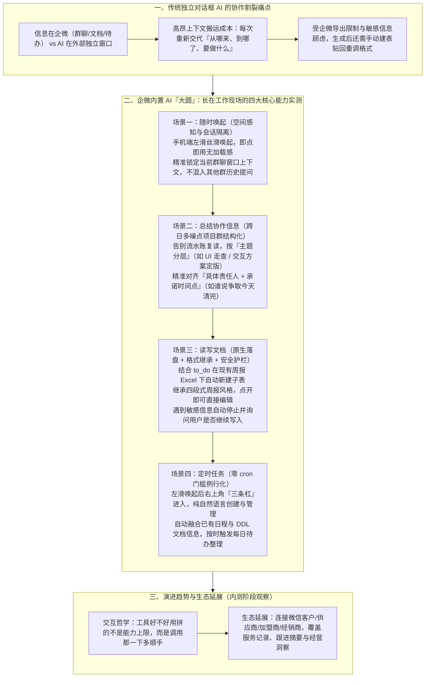

# 大圆实测：你真的需要一个长在企业微信中的 AI

> **原文信息**：作者 `蟹钳`，发布于 2026-07-09 04:18（广东），公众号「腾讯技术工程」原创（基于企业微信内置 AI 助手「大圆」内测版本实测）。

---

## 1. TL;DR

1. **核心痛点：上下文切换成本远大于模型能力短板** —— 传统「信息在企业微信里、AI 在独立对话框里」的协作模式极其割裂，每次都要人工复制聊天记录、上传文件、重新交代「事情从哪来、现在到哪了、要做什么」，再贴回文档调格式（食之无味、弃之可惜）；AI 办公的下一步是**让 AI 直接长在工作现场**。
2. **「大圆」四大官方核心能力** —— 作为直接嵌进企业微信的内置 AI 助手，大圆支持左滑即刻唤起，与企微内的工作上下文和记忆同频，围绕**随时唤起、总结协作信息、读写文档、定时任务**四大核心能力抹平工具切换鸿沟。
3. **群聊感知与结构化协作总结（场景一 & 二）** —— 在手机端群聊内左滑即可丝滑唤起，即点即用无加载等待，且能**严格隔离当前会话窗口上下文**（不串入其他群的历史提问）；面对横跨多日、日均几十条消息的复杂项目群，能按**主题分层 + 责任人 + 具体时间点**输出结构化结论而非流水账复读。
4. **原生可编辑文档生成与敏感信息拦截（场景三）** —— 结合待办（`to_do`）生成周报时，无需提示词显式指定即可在现有周报 Excel 文档下**自动新建子表**，完整继承过往周报的**四段式结构**（本阶段工作完成情况 + 复盘 + 下阶段工作安排 + 总体心得沉淀），且遇到敏感信息会自动停止并询问是否继续写入。
5. **自然语言零门槛定时任务与经营场景延展（场景四 & 展望）** —— 在右上角菜单中直接用自然语言即可配置每日待办整理（无需懂 cron 表达式），基于已有日程与 DDL 文档准时触发；未来依托企业微信连接微信客户、供应商、加盟商、经销商的生态，将从内部办公提效延展至外部经营洞察。

---

## 2. 核心问题与文章定位

### 2.1 为什么要写这篇？

近年来通用与垂直大模型一路狂飙，写方案、做总结、生成 PPT 等单点能力早已成熟，但在真实日常办公中，打工人依然觉得用 AI 很累。作者在下午六点多收到 Leader「把最近几天企微群内意见综合整理一下」的任务时敏锐意识到：**阻碍 AI 办公普及的最大门槛不是模型不够聪明，而是「上下文搬运与切换成本」过高**。
- **传统割裂流**：群聊/文档/待办在企业微信 → 人工复制整理背景 + 脱敏检查 → 切换到外部独立 AI 对话框喂上下文 → 复制 AI 输出 → 回到企微新建文档/表格粘贴 → 手动重调排版格式。
- **嵌入式破局（诺基亚功能机 vs 智能手机隐喻）**：正如当年诺基亚虽能打开孤立浏览器上网，但真正让智能手机普及的是「所有功能长在同一块屏幕里、信息在同一个地方共享」；企业微信内置 AI 助手 **「大圆」** 的核心价值，正是**从「把 AI 放进企业微信」走向「让 AI 接上企业微信里的工作现场」**。

---

## 3. 知识框架

---

## 4. 核心内容拆解

### 4.1 场景一：随时唤起——不退出群聊直接提问，考验「知不知道自己在哪」

- **测试设计**：作者特意挑选了一个话题杂、消息量大的日常工作群，不退出聊天界面，直接**左滑唤起大圆**，输入一句「群里聊了什么」。
- **核心实测表现**：
  1. **丝滑的体感与零等待**：手机端左滑唤起即点即用，没有切换到独立对话框时那种明显的预加载等待感。
  2. **严格的会话窗口上下文隔离**：大圆抓取的确实仅限当前所在群聊的对话内容，**没有将作者之前在别的群问过的问题混杂进来**——验证了嵌入式 Agent 最基础也最关键的「当前现场空间感知」能力。

---

### 4.2 场景二：总结协作信息——跨日杂乱项目群的结构化梳理

- **测试设计**：升级难度，挑选一个话题更杂、讨论周期横跨好几天、每天刷几十条消息的「智能机器人协助项目群」，直接提问：「群里聊了什么，需要我做什么」。
- **核心实测表现**：
  1. **按主题分层而非流水账复读**：自动将跨日讨论拆解为清晰主题层（例如：第一条为「UI 走查」，汇总提了多少个界面还原问题及负责修复人；第二条为「交互方案」，明确最终敲定了哪个版本）。
  2. **责任人与时间点精准对号**：能够把群聊中诸如「我们争取今天清完」的口语化承诺，精确绑定到对应的发言人与具体时间点，而非笼统概括为「有人说要处理」。

---

### 4.3 场景三：读写文档——周报直生、格式继承与敏感信息拦截（体验差距最大的一关）

- **测试设计**：针对每周周报记录分散、汇总耗时痛点，让大圆结合个人 `to_do` 完成一份本周周报。
- **三大实测惊喜点**：
  1. **隐式继承既有文档结构与子表操作**：作者并未在提示词中描述建表细节，大圆直接在作者**现有的周报 Excel 文档下自动新建了一个子表**，并完整继承了以往周报的四段式风格：**`本阶段工作完成情况 + 复盘 + 下阶段工作安排 + 总体心得沉淀`**，内容贴合本周工作范围，仅需小修小改。
  2. **敏感信息主动暂停询问**：在操作过程中遇到敏感信息时，大圆会**自动停止并询问用户是否需要继续写入**，展现出内置的信息安全边界意识。
  3. **彻底省去导出与重排版折腾**：受限于企业微信的信息导出限制，以往用外部 AI 属于「食之无味，弃之可惜」；而大圆产出的直接就是**长在企微里的原生可编辑文档**，点开任意段落即可直接修改。

---

### 4.4 场景四：定时任务——免 Cron 表达式的自然语言例行事务托管

- **测试设计**：左滑唤起大圆后，点击**右上角的「三条杠」菜单**进入定时任务入口，设置「每日工作待办整理」定时任务。
- **核心实测表现**：
  1. **零学习成本的自然语言配置**：无需理解复杂的定时规则或 `cron` 表达式，点击入口后直接用自然语言描述即可创建，并支持在列表中随时编辑与管理。
  2. **多源上下文自动融合**：定时任务按时触发后，输出的具体待办内容能够自动综合用户的**已有日程**以及 **DDL 文档信息**。

---

### 4.5 核心思考与未来生态展望

1. **工具演进的「智能机时刻」**：
   - 唤起、总结、文档、定时这四项能力单拆出来在别的 AI 产品里并不新鲜，大圆的本质差异在于**「不是把 AI 放进企业微信，而是让 AI 接上企业微信里的工作现场」**。
   - 正如诺基亚功能机也能装孤立浏览器上网，但智能手机让所有功能和信息长在同一块屏幕里共享；日常办公工具拼的往往不是模型能力上限，而是「调用它的那一下有多顺手」。
2. **从内部办公走向外部经营现场**：
   - 企业微信不仅服务内部办公，更连接着**微信客户、供应商、加盟商、经销商**等外部伙伴；大圆未来理解的上下文将从「一份文档、一个群聊、一个待办」自然延伸到企业真实经营沉淀的**服务记录、跟进摘要和经营洞察**（注：本文实测基于内测版本，属于作者个人设计的四项体验观察而非终局判断）。

---

## 5. 数据速查表

| 指标 | 原文数值 | 语境 / 条件 |
| :--- | :--- | :--- |
| 大圆官方核心能力数 | **4 项** | 随时唤起、总结协作信息、读写文档、定时任务 |
| 作者实测验证的真实办公场景数 | **4 个** | 一一对应四大核心能力设计的个人内测体验场景 |
| 唤起交互手势与定时任务入口 | **左滑唤起 / 右上角「三条杠」** | 企微群聊/文档/待办现场唤起手势，以及定时任务的管理菜单位置 |
| 项目群日常消息量级 | **一天几十条消息（横跨好几天）** | 场景二中用于测试跨日多主题结构化总结的智能机器人协助项目群 |
| 自动继承的周报四段式结构 | **4 部分** | 本阶段工作完成情况 + 复盘 + 下阶段工作安排 + 总体心得沉淀 |
| 企微连接的外部经营伙伴类型 | **4 类典型外部角色** | 微信客户、供应商、加盟商、经销商（沉淀服务记录、跟进摘要与经营洞察） |

---

## 6. 踩坑与教训 / 可迁移的设计原则

| 错误做法 | 失败表现或原因 | 原文应对 |
| :--- | :--- | :--- |
| 只追求把独立对话框里的模型做得更聪明，忽视用户与工作现场的割裂 | 用户每次使用都需手动复制聊天记录、整理背景、脱敏、再把结果贴回企微文档调格式，切换成本极高（「食之无味，弃之可惜」） | 让 AI 直接长在正在工作的现场（群聊、文档、待办旁左滑即出），与工作上下文和记忆实时同频 |
| 嵌入式 AI 唤起后无差别检索全局历史，把其他群聊或历史提问混入当前回答 | 在多群并行办公场景下造成严重的上下文串味与信息混乱 | 严格锁定**当前具体会话窗口**的上下文边界，确保群内提问只抓取当前群聊对话 |
| 对多日项目群消息只做流水账式的线性摘要复读 | 面对一天几十条杂乱讨论，笼统写「有人说要处理」依然需要人工翻记录确认责任 | 按**主题分层**（如 UI 走查、交互方案定版）输出结构化结论，并将**承诺时间点与具体责任人**精准对号 |
| 生成周报或方案时返回纯文本，或另起炉灶生成脱离用户既有习惯的新文件 | 破坏用户长期维护的表格结构与汇报风格，仍需大量二次排版 | 自动识别并在用户**现有周报 Excel 文档下新建子表**，隐式继承过往四段式结构，且直接产出企微原生可编辑文档 |
| 在自动化读写企业文档时无视内容敏感度直接静默写入 | 企业微信受严格信息导出与合规限制，静默写入敏感数据易引发安全风险 | 在文档读写过程中内置安全检测，**遇到敏感信息自动停止并弹窗询问用户是否继续写入** |
| 要求普通办公用户通过复杂的定时规则或 `cron` 表达式配置例行任务 | 配置门槛过高，把非技术背景的日常打工人挡在门外 | 在右上角菜单提供**纯自然语言描述**的定时任务创建与管理入口，并自动打通已有日程与 DDL 文档 |

---

## 7. 记忆锚点

1. **核心金句**：「**它不是把 AI 放进企业微信，而是让 AI 接上企业微信里的工作现场**——工具好不好用，很多时候拼的不是能力上限，是你调用它的那一下，多顺手。」
2. **四大场景实测记忆链**：
   - **左滑随时唤起** → 认准当前群聊不串台；
   - **项目群总结** → 按主题分层 + 责任人与时间点精准对号；
   - **读写周报文档** → 现有 Excel 自动新建子表 + 继承四段式结构 + 敏感信息暂停询问；
   - **自然语言定时** → 右上角三条杠免 cron 设置 + 联动日程与 DDL 文档。

---

## 8. 复习卡片

1. 作者认为当前 AI 办公普及的最大阻碍是什么，「大圆」的设计思路与传统独立 AI 对话框有何本质不同？::最大阻碍不是模型不够聪明，而是「上下文切换与搬运成本太高」（每次都要复制聊天记录、交代来龙去脉、脱敏、再贴回文档调格式）；大圆不是把独立对话框塞进企微，而是直接长在群聊、文档、待办的工作现场旁（左滑唤起），与工作上下文和记忆同频。
2. 企业微信内置 AI 助手「大圆」官方定义的四大核心能力是什么？::① 随时唤起（左滑即出，感知当前窗口）；② 总结协作信息（跨日群聊结构化梳理）；③ 读写文档（直接生成并操作企微原生可编辑文档/表格）；④ 定时任务（自然语言配置例行事务）。
3. 在「随时唤起」和「总结协作信息」两个群聊实测场景中，大圆展现了哪些关键的上下文处理细节？::在随时唤起场景中，不仅即点即用无加载等待感，还能严格隔离当前群聊窗口上下文，不混入其他群的历史提问；在总结跨日项目群时，不做流水账复读，而是按主题分层（如 UI 走查、交互方案），并将口语承诺的时间点与具体责任人精准对应。
4. 为什么作者认为「读写文档」是大圆与独立 AI 对话框体验差距最大的一项能力？::因为受企微信息导出限制，以往把信息搬去外部 AI 再贴回调格式属于「食之无味，弃之可惜」；而大圆结合 `to_do` 写周报时，能在未显式提示下直接在现有周报 Excel 下新建子表、继承过往四段式结构（完成情况+复盘+下阶段安排+心得沉淀），产出原生可编辑文档，且遇到敏感信息会自动停止并询问是否继续写入。
5. 大圆的「定时任务」是如何降低用户使用门槛并与个人工作流打通的？::用户左滑唤起大圆后点击右上角「三条杠」即可进入，无需理解复杂的定时规则或 `cron` 表达式，直接用自然语言描述即可创建和管理定时任务；触发时能自动结合用户的已有日程和 DDL 文档信息生成每日工作待办整理。
6. 作者用「诺基亚功能机到智能手机的转变」类比大圆，想说明什么产品道理，以及大圆未来在企业微信生态中有何延展空间？::说明真正改变体验的不是孤立功能的增加，而是所有功能与信息长在同一块屏幕里共享、调用顺手；未来大圆依托企业微信连接微信客户、供应商、加盟商、经销商的独特生态，可从内部办公提效延展到外部服务记录、跟进摘要与经营洞察。

---

## 9. 知识关联

- **已有主题**：[Agent工程循环](../../20_topics/Agent%E5%B7%A5%E7%A8%8B%E5%BE%AA%E7%8E%AF.md) · [Agent成本与上下文预算](../../20_topics/Agent%E6%88%90%E6%9C%AC%E4%B8%8E%E4%B8%8A%E4%B8%8B%E6%96%87%E9%A2%84%E7%AE%97.md) · [Agent评测与反馈](../../20_topics/Agent%E8%AF%84%E6%B5%8B%E4%B8%8E%E5%8F%8D%E9%A6%88.md) · [Agent长期记忆](../../20_topics/Agent%E9%95%BF%E6%9C%9F%E8%AE%B0%E5%BF%86.md) · [桌面Agent与工作流](../../20_topics/%E6%A1%8C%E9%9D%A2Agent%E4%B8%8E%E5%B7%A5%E4%BD%9C%E6%B5%81.md)
- **候选新主题**：[[嵌入式办公Agent]] · [[上下文切换成本与同频]] · [[企业微信生态协同]]

---

## 10. 原文参考资料

1. **企业微信内置 AI 助手「大圆」（内测版）**：本文作者围绕「随时唤起、总结协作信息、读写文档、定时任务」四大核心能力进行四关实测的目标产品。

> [!note]- 校对报告
> - **校对状态**：已根据 `MD.md` 全文（共 8 页 PDF 转写文本）逐一核对。
> - **核心数据与事实页码溯源**：
>   - 下午六点多企微群改方案整理意见痛点、信息在企微与 AI 在外部的割裂、左滑唤起大圆与四大官方核心能力（随时唤起、总结协作信息、读写文档、定时任务）：见 PDF 第 1–2 页。
>   - 场景一（随时唤起：手机端左滑丝滑唤起、即点即用无等待感、严格抓取当前群对话不混入别的群提问）：见 PDF 第 2–3 页。
>   - 场景二（总结协作信息：横跨多日、一天几十条消息的智能机器人协助项目群，按主题分层如 UI 走查/交互方案，精准对齐责任人与时间点）：见 PDF 第 3–4 页。
>   - 场景三（读写文档：结合 `to_do` 生成本周周报，在现有周报 Excel 文档下自动新建子表，继承「本阶段工作完成情况+复盘+下阶段工作安排+总体心得沉淀」四段式结构，遇到敏感信息自动停止并询问是否继续写入，对比以往「食之无味，弃之可惜」）：见 PDF 第 4–5 页。
>   - 场景四（定时任务：左滑唤起后右上角三条杠进入，基于已有日程及 DDL 文档信息按时触发每日待办整理，纯自然语言配置无需懂 `cron` 表达式）：见 PDF 第 5–6 页。
>   - 结尾思考（「不是把 AI 放进企业微信，而是让 AI 接上企业微信里的工作现场」、诺基亚功能机与智能手机类比、连接微信客户/供应商/加盟商/经销商的服务记录与经营洞察展望、内测版本声明）：见 PDF 第 6–7 页。
