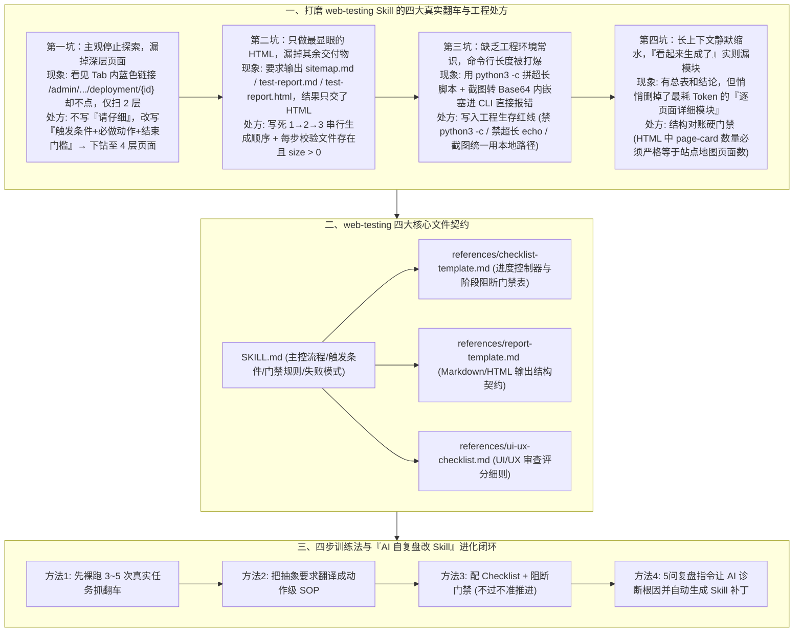

# 让 AI 变成 Super 员工的秘密：高效训练 Skills

## 1. TL;DR

1. **核心理念：训练 Skill 不是抬高 AI 的智力上限，而是抬高业务交付的稳定下限**：大模型天生拥有的是“通用能力”，而非知道“什么算完成、哪些步骤绝不能跳、交付物怎么验收”的“岗位能力”；训练 Skill 的本质是用 **业务 SOP + Checklist + 阻断式门禁** 让 AI 的交付从“靠临场状态”变成“靠确定性机制”。
2. **打磨 `web-testing` Skill 的四大真实翻车与破局铁律**：① **深层页面漏扫（只扫 2 层漏掉 Tab 内 `/admin/product/deployment/{id}`）** → 立下“不要写空泛原则，要写 **触发条件 + 必做动作 + 结束门槛**”铁律（成功下钻至 **4 层页面**）；② **偏爱显眼产物漏交文件（3 个文件只生成了 `test-report.html`）** → 锁死生成顺序并做每步非空文件大小门禁；③ **走捷径拼超长 `python3 -c` + Base64 截图打爆 Shell 命令长度上限** → 补齐“工程生存指南”（禁命令内联长脚本、截图改本地路径引用）；④ **长上下文悄悄缩水漏掉“逐页面详细模块”** → 建立 `HTML page-card 数量 == 站点地图页面数` 的结构对账门禁。
3. **高效训练 Skill 的四步法与“让 AI 自己复盘改 Skill”飞轮**：① 先让 AI 在真实任务裸跑 **3~5 次** 暴露真实翻车点；② 把要求改写成可执行 SOP；③ 配齐 `checklist-template.md` + 阻断式门禁；④ **用 5 问结构化复盘 Prompt 让 AI 自己诊断根因（页面发现/交付完整性/工程约束/结构完整性/消费适配）并自动输出修改后的 Skill 片段**。

## 2. 问题定义与背景

### 2.1 为什么“什么都会一点”的通用 AI 当不了合格的 S 级员工？
OpenClaw 普及后，人手一个通用助手，但拉进复杂工作流后普遍暴露出“聪明但不靠谱”的通病：上下文一长就开始失忆、偷步骤、压缩细节，交付一个“看起来做完了、实际上缺斤少两”的半成品。
- **目标场景（`web-testing` 全自动测试与自修复闭环）**：作者希望打造一个通用 Web 测试 Skill——输入任意网站 URL，AI 自动递归探索每一层页面细节，完成站点地图、UI/UX 审查、功能与 CRUD 全链路测试、逐测试点截图、Bug 分级汇总，同时输出可修改的 `.md` 与美观的 `.html` 报告，经人工确认后驱动 AI 自动修复并二次回归验证。

## 3. 知识框架

## 4. 核心内容拆解

### 4.1 四大典型翻车现场与可迁移的 SOP 改造对比

| 翻车场景与本质原因 | ❌ 失败的“提要求式”坏写法 | ✅ 成功的“SOP + 阻断门禁式”好写法 |
| :--- | :--- | :--- |
| **坑 1：深层页面漏扫** （AI 看见版本详情页 Tab 表格里的蓝色链接 `/admin/product/deployment/{id}` 却主观认为不用点，仅扫出 **2 层** 页面） | “请认真检查页面，尽量仔细，不要遗漏任何页面入口。” | **触发条件 + 必做动作 + 结束门槛**：① 页面必须滚动到底再结束扫描；② 当存在 Tab、展开行、子表格、蓝色链接时，切换后必须重新执行 DOM 枚举与逐链接实际点击验证；③ **只要还存在未验证链接，严禁结束阶段 1**（优化后成功识别 **4 层** 页面并标注只读/CRUD 属性）。 |
| **坑 2：漏交朴素交付物** （要求交付 3 个文件，AI 把注意力全花在最显眼的 `test-report.html` 上，上下文变紧后直接漏掉前两个 `.md`） | “阶段 4 请记得同时生成 `sitemap.md`、`test-report.md` 和 `test-report.html`。” | **顺序即质量控制**：强制写死串行步骤——① 先生成 `sitemap.md` → ② 再生成 `test-report.md` → ③ 最后生成 `test-report.html`；**每生成一个文件必须立即校验文件存在且 `size > 0`**，未通过阻断检查严禁宣告完成。 |
| **坑 3：Shell 命令被打爆** （AI 图省事用 `python3 -c` 拼接长报告并将截图转成 Base64 字符串塞进命令行参数，触发 OS 命令长度上限崩溃） | （未规定底层文件写入与图片引用方式，默认假设 AI 懂工程约束） | **写入“工程生存指南”**：① 严禁使用 `python3 -c` 生成长报告；② 严禁使用超长 `echo "..." > file` 硬写大文件（必须直接写文件或先存 `.py` 脚本再执行）；③ **HTML 报告严禁 Base64 内嵌截图，统一改为本地文件相对路径引用**。 |
| **坑 4：报告结构静默缩水** （报告看似有头有尾，但中间最关键的“逐页面 UI/UX 与功能明细卡片”被悄悄省略） | “请保证输出报告内容完整，包含所有测试页面的详细结果。” | **8 项对账 Checklist 门禁**：强制核对“每页有截图、每页有 UI/UX 审查、每页有功能表、每页有问题汇总、**HTML 中 `page-card` 数量 == 站点地图页面总数**、问题汇总表存在、修复计划表存在、测试脏数据清理记录存在”。 |

### 4.2 四文件目录架构与“让 AI 成为 Skill 共同调参者”的 5 问复盘模板

1. **`web-testing/` 标准四文件结构**：
   - `SKILL.md`：主控入口，定义触发条件、阶段流程、阻断门禁与失败处理；
   - `references/checklist-template.md`：执行过程中的“进度控制器”与阶段门禁表；
   - `references/report-template.md`：锁定最终 `.md` 与 `.html` 报告的章节契约；
   - `references/ui-ux-checklist.md`：UI/UX 专项审查的评分细则。
2. **方法 4 核心杀招：让 AI 自己复盘并修改 Skill 的 5 步结构化指令**
   - 先让 AI 在真实任务中跑 **3~5 次**，当出现不符合预期的结果时，不要自己埋头手改 Prompt，而是直接向 AI 发送以下 **5 问复盘指令**：
     1. *本次执行中哪些输出没有达到预期？*
     2. *这些问题分别属于：**页面发现、交付完整性、工程约束、结构完整性、消费场景适配** 中的哪一类？*
     3. *根因是什么？（是规则缺失、规则不明确、缺少门禁，还是上下文过长导致细节被忽略？）*
     4. *请给出应补充到 Skill 中的具体规则，要求必须包含：**触发条件、必做动作、自检方式、不通过后果**。*
     5. *直接输出修改后的 Skill 片段，并说明本次修改预期解决什么问题。*

## 5. 数据速查表

| 指标 | 原文数值 | 语境 / 条件 |
| :--- | :--- | :--- |
| **页面发现深度优化对比** | 优化前仅识别 `2 层` 页面 → 优化后识别 `4 层` 页面 | 增加 Tab/展开行/蓝色链接强制递归验证规则后，成功扫出 `/admin/product/deployment/{deploymentId}` 等深层 CRUD 页面 |
| **阶段 4 强制串行交付物数量** | `3 个` 文件（`sitemap.md` → `test-report.md` → `test-report.html`） | 每个文件生成后强制校验存在且文件大小 `> 0` |
| **报告完整性对账 Checklist 项数** | `8 项` 必检门禁 | 核心硬指标：`HTML 中 page-card 数量 == 站点地图页面数` |
| **编写 Skill 前的真实裸跑探测次数** | 先真做 `3 ~ 5 次` 真实任务 | 观察漏步骤、偷懒与报错规律，反对闭门造车写空想规则 |
| **`web-testing` 核心能力文件数** | `4 个` 核心文件 | `SKILL.md` + `references/` 下 3 个模板/清单文件 |

## 6. 踩坑与教训 / 可迁移的设计原则

| 错误做法 | 失败表现或原因 | 原文应对（可迁移的设计原则） |
| :--- | :--- | :--- |
| **在 Skill 里写“请仔细检查、不要遗漏、注意质量”等抽象形容词** | AI 面对深层 Tab 或折叠表格时靠主观判断提前停止探索，把“看见了链接”当成“测过了页面” | **不写原则，只写“触发条件 + 必做动作 + 结束门槛”**：将“仔细”拆解为“滚到底部、切换 Tab 重扫 DOM、未验证链接数不为 0 严禁进入下一阶段” |
| **同时要求输出多个轻重不一的交付物却不规定先后顺序** | 模型本能地先做最复杂显眼的产物（如 HTML），等上下文快满时直接把朴素的 `.md` 清单忘掉 | **用固定串行顺序 + 单步非空校验对抗注意力衰减**：先产轻量结构文件（`sitemap.md`），再产正文（`.md`），最后产渲染视图（`.html`），步步验大小 |
| **默认假设大模型天生懂得宿主操作系统的命令行与文件大小限制** | 模型用 `python3 -c` 或 `echo` 拼接含 Base64 截图的兆级 HTML 字符串，直接触发 Shell `ARG_MAX` 崩溃 | **在 Skill 中显式注入“工程生存红线”**：明令禁止 `python3 -c` 与 Base64 内嵌大图，强制改用文件写入工具与本地图片路径引用 |
| **只看最终报告“有头有尾”就放行，不对子模块数量做定量交叉核对** | 长上下文后半程模型会悄悄砍掉中间最繁琐的“逐页面详细卡片”，交出缩水报告 | **建立跨产物的数量守恒硬门禁**：强制校验最终 HTML 中的 `page-card` DOM 节点数必须严格等于 `sitemap.md` 中的页面总数 |

## 7. 记忆锚点

- **“训练 Skill 不是抬高上限，而是抬高下限——让交付从‘靠状态’变成‘靠机制’”**：全文最核心的工程定位。
- **“四句话治四病：禁写‘请仔细’改写触发+动作+门槛（2 层→4 层）；先 `.md` 后 `.html` 防漏交；禁 `python3 -c` 与 Base64 防炸 Shell；`page-card 数 == 页面数` 防缩水”**：可立即复制到任何复杂多步 Skill 中的四条防翻车铁律。

## 8. 复习卡片

1. 作者认为大模型的“通用能力”与业务需要的“岗位能力”有什么区别？训练 Skill 的核心目标是什么？::通用能力解决的是“能不能理解任务、输出一个像样的结果”（决定上限）；岗位能力解决的是“什么才算真正完成、哪些步骤绝不能跳、哪些历史错误不能重犯、交付物怎么验收”（决定下限）。训练 Skill 的核心目标是抬高下限，让 AI 的交付质量从“靠状态”变成“靠机制”。
2. 在 `web-testing` Skill 的页面发现阶段，为什么 AI 最初漏掉了 `/admin/product/deployment/{deploymentId}` 页面？作者是如何通过改写规则让扫描深度从 2 层提升到 4 层的？::因为该链接藏在版本详情页的 Tab 表格内，AI 虽看到了链接却主观停止了递归点击；作者遵循“不要写原则，要写触发条件 + 必做动作 + 结束门槛”，规定页面必须滚到底、Tab 和展开行必须重新做 DOM 枚举并实际点击验证、只要存在未验证链接就禁止结束阶段 1。
3. 为什么 AI 在被要求同时输出 `sitemap.md`、`test-report.md` 和 `test-report.html` 时只生成了 HTML？该如何根治？::因为 HTML 最显眼复杂、最像“最终成果”，吸走了模型的注意力和上下文预算，导致后续两个朴素文件在上下文紧张时被忽略；根治方法是把生成顺序按 `sitemap.md → test-report.md → test-report.html` 写死，且每生成一个文件立即校验文件存在且大小 `> 0`。
4. 为什么作者说“Skill 不仅是业务手册，还得是 AI 的工程生存指南”？文中举了什么具体反例？::因为模型不天然具备当前执行环境的工程常识；例如 AI 为了生成带截图的 HTML 报告，试图用 `python3 -c` 拼接长脚本并将截图转为 Base64 塞进命令行，直接打爆了 Shell 命令长度上限；因此必须在 Skill 中明令禁止 `python3 -c` 写长报告、禁止超长 `echo`、禁止 Base64 内嵌截图（统一改用本地路径引用）。
5. 当发现 Skill 执行效果不理想（如报告静默缩水）时，如何让 AI 成为“共同调参者”来自动迭代 Skill？::先让 AI 在真实任务中跑 `3~5 次`，随后让 AI 按 5 步结构化指令复盘：① 列出未达预期项；② 归类到页面发现/交付完整性/工程约束/结构完整性/消费适配；③ 诊断根因（规则缺失/不明确/无门禁/上下文过长）；④ 编写含“触发条件+必做动作+自检方式+不通过后果”的新规则（如 `HTML page-card 数 == 站点地图页面数`）；⑤ 直接输出修改后的 Skill 补丁并重跑验证。

## 9. 知识关联

- **本仓库主题索引**：[Agent工程循环](../../20_topics/Agent%E5%B7%A5%E7%A8%8B%E5%BE%AA%E7%8E%AF.md) · [Agent评测与反馈](../../20_topics/Agent%E8%AF%84%E6%B5%8B%E4%B8%8E%E5%8F%8D%E9%A6%88.md) · [Agent任务恢复](../../20_topics/Agent%E4%BB%BB%E5%8A%A1%E6%81%A2%E5%A4%8D.md) · [Skill设计与治理](../../20_topics/Skill%E8%AE%BE%E8%AE%A1%E4%B8%8E%E6%B2%BB%E7%90%86.md)
- **候选双链概念**：[[阻断式门禁Checklist]] · [[触发条件-必做动作-结束门槛]] · [[AI自复盘迭代Skill]] · [[Shell工程生存约束]] · [[Web全链路自动化测试Skill]]

## 10. 原文参考资料

1. 作者自研实战项目：`web-testing` 全链路自动化 Web 测试与自修复 Skill（含 `SKILL.md`、`checklist-template.md`、`report-template.md`、`ui-ux-checklist.md`）。

> [!note]- 校对报告
> - **校对状态**：已按原文逐页核对通过（共 13 页 PDF）。
> - **核心数据与页码溯源**：
>   - `web-testing` Skill 目标（站点地图、UI/UX 审查、功能与 CRUD 全链路测试、截图、`.md` 与 `.html` 报告、自动修复闭环）与 4 条核心信念、通用能力 vs 岗位能力：见 `p.1–3`。
>   - 第一坑（漏掉 `/admin/product/deployment/{deploymentId}`、写“触发条件+必做动作+结束门槛”、扫描深度从 `2 层` 提升至 `4 层`）：见 `p.4–5`。
>   - 第二坑（3 个文件 `sitemap.md / test-report.md / test-report.html` 只生成了 HTML、写死顺序并检查文件大小 `> 0`）：见 `p.5–6`。
>   - 第三坑（`python3 -c` 拼长脚本 + Base64 截图打爆 Shell 命令长度上限、四条工程生存规则）：见 `p.6–7`。
>   - 第四坑（逐页面详细模块被静默压缩、8 项 Checklist 门禁含 `HTML 中 page-card 数量 = 页面数`）：见 `p.7–8`。
>   - 四步训练法（先真做 `3~5 次` 真实任务、写 SOP、配 Checklist 与门禁、5 问结构化复盘指令让 AI 自动改 Skill）、`web-testing/` 4 个核心文件目录及“抬高下限”总结：见 `p.8–12`。
