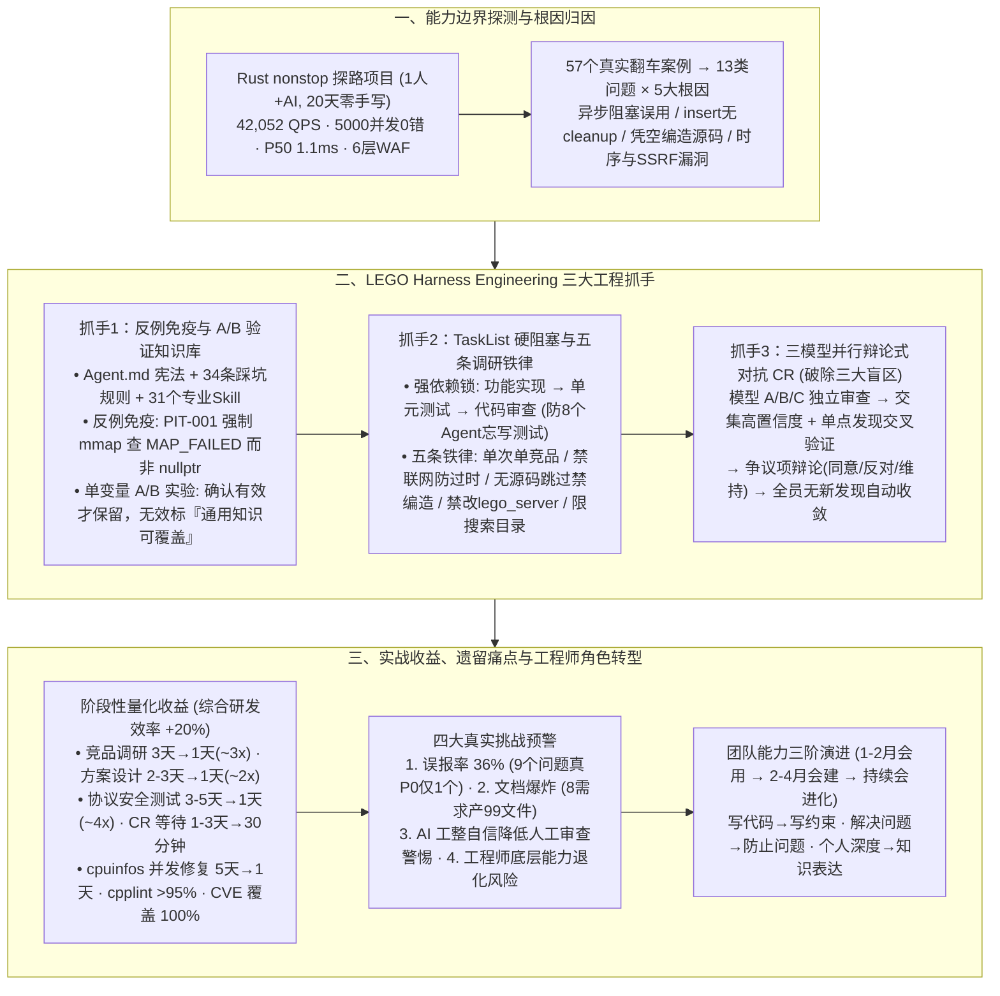

# Harness Engineering：AI能在真正“出事会炸”的后端系统里写代码吗？

## 1. TL;DR

1. **在“一行失误即全网事故”的百万行 C++ 核心网关落地 AI Coding**：面对承载腾讯 CDN 与 EdgeOne 日均万亿级请求、拥有 **100 万行核心 C++ 代码 + 300 万行深度改造第三方库**、理论维度组合高达 **`13,824 × N` 种** 的 LEGO 系统，团队先用 **20 天（1 人 + AI）零人工代码** 交付 Rust 版 `nonstop` 代理框架（实测 **42,052 QPS / 5,000 并发 0 错误 / P50 延迟 1.1ms**）探测能力边界，再提炼出 **57 个真实翻车案例 → 13 类问题 → 5 大根因**。
2. **Harness Engineering 核心策略：将 AI 约束在单模块/单文件/单函数内，靠“反例免疫”与单变量 A/B 验证立规矩**：构建 `Agent.md`（项目宪法）+ 安全纪律（用“错误写法 vs 正确写法”的 **反例免疫** 替代正面说教，如 `PIT-001` 强制 `mmap` 检查 `MAP_FAILED` 而非 `nullptr`）+ **TaskList 依赖阻塞锁**（8 个 Agent 曾漏写测试，改为单元测试阻塞代码审查，物理杜绝跳步），且每条规则必须经 **A/B 实验验证有效** 才保留。
3. **三模型并行“辩论式对抗 CR”破除单模型三大盲区**：针对单模型审查的知识盲区、注意力盲区（`500+ 行` Diff 后半段质量下降）与确认偏差，首创 **3 模型并行独立审查 → 交叉验证高置信度问题 → 争议问题辩论（同意/反对/维持）→ 全员无新发现自动收敛** 的对抗式 Code Review，将审查等待时间从 **1~3 天压缩至 30 分钟**，实现 `cpplint` 通过率 **> 95%**、CVE 防护覆盖 **100%**。
4. **量化收益与清醒反思**：在 `cpuinfos` 多线程读写竞争修复中，AI 对比 3 种并发方案选出零开销的“双缓冲 + atomic 索引”，将开发周期从 **5 天压至 1 天**；纳入人工 Review 与新人学习成本后，团队**综合研发效率净提升 20%**（局部环节提速 `2x~4x`），沉淀 **86,422 行代码、31 个 Skill、34 条踩坑规则**；同时坦诚揭示了 **36% 误报率**（9 个问题中真 P0 仅 1 个）、**8 个需求生成 99 个文件的文档爆炸** 与“AI 工整自信传染导致人工漏审”的真实风险。

## 2. 问题定义与背景

### 2.1 腾讯 CDN LEGO 系统的极端复杂度：为什么不能像写前端页面一样放任 AI？
作为承载腾讯几乎全部 CDN 与 EdgeOne 流量的核心接入层，LEGO 面临极端的工程复杂度与容错红线：
- **规模与架构壁垒**：核心 C++ 代码超 **100 万行**（多线程全异步非阻塞架构），深度改造第三方库超 **300 万行**（OpenSSL、QUIC、Lua、JavaScript 等），日处理请求以**万亿计**。
- **`13,824 × N` 种乘积式组合爆炸**：请求协议（`3 种`：HTTP/1.1, H2, H3）× 回源协议（`2 种`）× TLS 版本（`4 种`）× 缓存状态（`4 种`）× 脚本逻辑（`4 种`）× 安全规则（`4 种`）× 源站行为（`5 种`）× 客户端行为（`3 种`）× 百万级客户域名配置 $N$，叠加出 **$3 \times 2 \times 4 \times 4 \times 4 \times 4 \times 5 \times 3 \times N$（原文计作 `13,824 × N`）** 种组合路径。

### 2.2 先行探路：20 天零人工手写 Rust `nonstop` 项目的惊喜与惊吓
1. **探路成果**：1 名工程师配合 AI 用 **20 天** 零人工手写代码完成了现代代理框架 **`nonstop`**（支持 L4/L7 代理、HTTP/3 QUIC、内置 6 层纵深 WAF、集成 V8 JS Workers、单二进制零停机热加载），实测达到 **42,052 QPS、5,000 并发 0 错误、P50 延迟 1.1ms**。
2. **暴露的致命隐患（57 个案例归纳出 13 类问题与 5 大根因）**：
   - **Critical 级异步语义误用**：在 Rust `tokio` 异步上下文中调用阻塞式 `blocking send`；
   - **Critical 级安全盲区**：遗漏时序攻击防护、SSRF 与 JWT 校验缺陷；
   - **High 级幻觉与改不全**：调用不存在的 API、只写 `insert` 忘了配对 `cleanup` 导致内存泄漏、无本地源码时用训练数据凭空编造“竞品源码分析”。

## 3. 知识框架

## 4. 核心内容拆解

### 4.1 怎么管住 AI：具体约束、反例免疫与单变量 A/B 实验

1. **收缩作用域原则**：在百万行 C++ 系统中，严禁让 AI 跨全局漫游大改，必须将 AI 尽量 **Harness 在单个模块、单个文件、单个函数内** 实现。
2. **用“具体硬约束 + 任务依赖锁”替代“模糊期望”**：
   - ❌ 模糊期望：“写高质量 C++ 代码” → ✅ 硬约束：**“禁止裸 `new`，必须使用 `unique_ptr`”**（AI 遵循率达 100%）；
   - ❌ 模糊期望：“注意高并发性能” → ✅ 硬约束：**“热路径禁止全局 `mutex`，必须用 `per-thread` 或分片锁”**；
   - ❌ 模糊期望：“记得写单元测试”（实测 **8 个 Agent 全忘了写测试**）→ ✅ 工作流硬阻塞：在 `TaskList` 中配置 `单元测试 blockedBy: [功能实现]` 且 `代码审查 blockedBy: [功能实现, 单元测试]`，不跑通测试物理上无法进入下一步。
3. **“反例免疫”与规则的 A/B 实验准入制**：
   - AI 的通用预训练数据中充斥着错误习惯（如认为系统调用失败返回 `nullptr`）。团队建立 **`真实踩坑 → 安全规则 → CR 检查清单 → 单变量 A/B 实验验证`** 闭环：
     - **案例 `PIT-001`**：Linux `mmap` 失败返回的是 `MAP_FAILED`（即 `(void*)-1`）而非 `nullptr`，AI 写成检查 `nullptr` 导致线上 `SIGSEGV` 崩溃；写入 `R2` 反例规则后，AI 100% 改用 `MAP_FAILED`。
     - **案例 `问题 23`**：本地无某竞品源码时，AI 竟用训练记忆编造了一份似是而非的“源码分析”；遂立下 **五条竞品调研铁律**（每次只调 1 个竞品防 C/C++ 混淆、严禁联网防过时信息、本地无源码直接跳过禁编造、严禁修改 `lego_server`、严格限制搜索目录）。
     - **A/B 淘汰机制**：每新增一条规则都做单变量 A/B 实验，确认显著降低错误率才保留，若无显著差异则标注“通用知识可覆盖”并剔除，防止规则集膨胀稀释注意力。

### 4.2 多模型多 Agent 对抗式 Code Review（破除单模型三大盲区）

单模型做 CR 存在三大天然盲区：**知识盲区**（不同模型对 Seastar 异步框架或系统调用理解深浅不一）、**注意力盲区**（面对 **500+ 行 Diff** 时后半部分审查质量断崖下降）与 **确认偏差**（抓到一个内存问题后顺着同一方向死磕，漏掉配置兼容性问题）。

| 对比维度 | GitHub Copilot CR | OpenAI Codex Review | LEGO 对抗式 CR |
| :--- | :--- | :--- | :--- |
| **参与模型数量** | 1 个 | 1~2 个 | **3 个异构模型** |
| **执行与交互方式** | 串行单次静态扫描 | 串行两次静态扫描 | **并行独立审查 + 交叉验证 + 辩论式讨论（同意 / 反对 / 维持）** |
| **终止与收敛机制** | 无（一次性输出） | 固定轮数 | **全员无新发现时自动收敛**（且单模型故障不影响整体产出） |
| **审查标准** | 通用代码规范 | 通用代码规范 | **项目定制 `P0~P3` 分级 + `review-patterns.md` 踩坑库** |

### 4.3 实战案例、量化收益与四大真实风险反思

1. **`cpuinfos` 多线程读写竞争修复实战（5 天 → 1 天）**：
   - 对抗式 CR 快速定位出 `cpuinfos` 存在多线程读写竞争；AI 系统性对比了 **`ReadWriteLock`、`std::atomic<std::shared_ptr>`、双缓冲（Double Buffering）+ `atomic` 索引** 三种方案，最终采用**零性能开销**的双缓冲方案并通过自动化验证，将原本需 **5 人天** 的开发验证压缩至 **1 天**（同时人工复盘也敏锐发现 AI 方案未考虑线程初始化边界，印证了人工兜底的必要性）。
2. **为什么局部提速 `2x~4x`，综合研发效率算下来是 `+20%`？**
   - 局部环节提速显著：竞品调研 `3 人天 → 1 天（~3x）`、方案设计 `2~3 人天 → 1 天（~2x）`、协议安全测试 `3~5 人天 → 1 天（~4x）`、CR 等待 `1~3 天 → 30 分钟`。
   - **诚实的工程核算**：由于高风险后端每一行 AI 代码仍需严格的人工终审（Review 成本），且团队成员（尤其是新人）需要时间跨越学习曲线（按 **第 1~2 月会用 14 条安全规则 → 第 2~4 月会建专属 Skill** 推进），扣除这两项成本后，全流程**综合效率净提升约为 20%**。
3. **直面四大新痛点**：
   - **误报率仍达 36%**：抽样显示 AI 报出的 9 个代码问题中，真正的 `P0` 级致命缺陷仅有 1 个；
   - **文档爆炸**：仅 **8 个需求就生成了 99 个过程文档文件**，超出人类阅读确认极限；
   - **AI 的“工整自信”会传染**：排版极度规范的方案与测试报告容易麻痹人类审查者，降低挑错意愿；
   - **工程师能力退化隐忧**：长期依赖 AI 生成可能导致工程师对底层异步语义与协议细节的掌控力下滑。

## 5. 数据速查表

| 指标 | 原文数值 | 语境 / 条件 |
| :--- | :--- | :--- |
| **腾讯 CDN LEGO 代码库规模** | 核心代码超 `100 万行` + 深度改造第三方库超 `300 万行` | 服务亿级用户、日处理万亿级请求的多线程全异步 C++ 系统 |
| **协议与业务环境组合复杂度** | `13,824 × N` 种理论组合路径 | 3种请求协议 × 2种回源 × 4种TLS × 4种缓存 × 4种脚本 × 4种安全 × 5种源站 × 3种客户端 × 百万域名 $N$ |
| **Rust `nonstop` 探路项目开发与性能** | `1 人 + AI` 用 `20 天` 零人工手写完成；实测 `42,052 QPS`、`5,000 并发 0 错误`、`P50 1.1ms` | 内置 6 层纵深防御 WAF、HTTP/3 QUIC 与 V8 JS Workers |
| **翻车案例库统计规模** | 从 `57 个` 真实案例提炼 `13 类` 典型问题 × `5 大` 根因 | 支撑 LEGO 安全规则与 CR 模式库的实证底座 |
| **单模型 CR 注意力衰减阈值** | `500+ 行` Diff | 超过 500 行 Diff 后单模型对后半部分代码的审查质量明显下降 |
| **各研发环节提速与综合提效幅度** | 调研 `3→1天(~3x)`、设计 `2~3→1天(~2x)`、安全测试 `3~5→1天(~4x)`、CR `1~3天→30分钟`；**综合提效 `~20%`** | `cpuinfos` 修复从 `5 天 → 1 天`；综合提效已扣除人工 Review 与学习成本 |
| **代码规范与漏洞防护达成率** | `cpplint` 通过率 `> 95%`，CVE 防护覆盖率 `100%` | 沉淀 `86,422 行` 代码、`31 个` Skill、`34 条` 踩坑规则、`3 组` A/B 实验 |
| **遗留挑战量化数据** | 误报率 `36%`（9 问中真 P0 仅 1 个）；`8 个` 需求生成 `99 个` 文件 | 文档爆炸与误报筛选仍是后续迭代重点 |

## 6. 踩坑与教训 / 可迁移的设计原则

| 错误做法 | 失败表现或原因 | 原文应对（可迁移的设计原则） |
| :--- | :--- | :--- |
| **在提示词里写“请写出高质量、并发安全的代码，并记得补单元测试”** | 模糊说教对 AI 几乎无效，实测 8 个 Agent 全忘了写单元测试，且照样在热路径乱加全局锁 | **具体反例规则 + TaskList 物理阻塞锁**：直接写明“禁裸 `new` 必用 `unique_ptr`”、“mmap 必查 `MAP_FAILED`”；在任务流中让单元测试阻塞 CR |
| **让调研 Agent 同时分析多个开源竞品并开放公网搜索** | C 与 C++ 代码模式在上下文里互相串味污染，联网搜到过期文章，甚至在本地缺源码时凭空捏造分析报告 | **五条竞品调研硬约束**：每次只调 1 个竞品、严禁联网、本地无源码直接跳过禁编造、禁止触碰主干代码、锁死目录搜索范围 |
| **把想到的所有经验规则一股脑塞进 `Agent.md`，从不验证单条规则是否真有用** | 规则越来越多导致上下文稀释，许多规则与基座模型通用知识重叠，白白消耗 Token | **规则准入的单变量 A/B 实验制**：每条从真实踩坑（如 `PIT-001`）提炼的规则必须过 A/B 实验，显著有效才保留，无效则标“通用知识可覆盖”剔除 |
| **依赖单一模型做一次性静态 Code Review** | 500+ 行 Diff 后半程漏审，且受制于单模型知识盲区与确认偏差 | **三模型并行“辩论式对抗 CR”**：A/B/C 三模型独立找茬 → 交集直接确认为高置信度 → 分歧项展开多轮“同意/反对/维持”辩论直至无新发现收敛 |
| **被 AI 生成的 99 份格式极度工整的文档麻痹而放松人工终审** | AI 的“自信文风”极具迷惑性，容易掩盖像 `cpuinfos` 修复中遗漏线程初始化那样的深层边界缺陷 | **控制过程文档膨胀 + 坚守“架构师把控人机边界”**：警惕工整文档带来的审查懈怠，将工程师核心能力从“手写代码”转向“设计约束与验证闭环” |

## 7. 记忆锚点

- **“百万行 C++、13,824×N 种组合、一行失误全网炸”**：LEGO 证明了 AI 不仅能写玩具前端，只要套上 **单模块/单文件/单函数作用域收缩 + 反例免疫 + TaskList 阻塞锁 + 三模型辩论 CR** 的四重护栏，照样能在最凶险的 CDN 核心接入层稳健产出。
- **“局部提速 3~4 倍，算上人工 Review 与学习曲线综合提效 20%；8 个需求产 99 个文件、误报率 36%”**：全篇最可贵的不吹牛工程实话——既给出 `5 天 → 1 天` 修好 `cpuinfos` 并发竞争的高光，也坦承文档爆炸与“AI 自信传染”的新坑。

## 8. 复习卡片

1. 腾讯 CDN LEGO 系统为什么属于典型的“出事会炸”的高风险后端系统？团队是如何先行探测 AI 编码能力边界的？::因为 LEGO 拥有超 `100 万行` 多线程全异步 C++ 核心代码与 `300 万行` 深度改造第三方库，日处理万亿级请求，多协议与源站/客户端行为叠加出 `13,824 × N` 种组合复杂度；团队先由 1 人+AI 用 `20 天` 零人工手写完成了 Rust 版 `nonstop` 代理框架（实测 `42,052 QPS`、`P50 1.1ms`），并从 `57 个` 真实案例中提炼出 `13 类` 问题与 `5 大` 根因。
2. 在 LEGO 的 Harness 实践中，“反例免疫”和“规则单变量 A/B 实验”是如何运作的？请举一个具体踩坑案例。::反例免疫指不用正面空泛说教，而是为每条规则提供“错误写法 vs 正确写法”反例；例如 `PIT-001` 案例中，AI 误用 `nullptr` 检查 `mmap` 返回值导致 `SIGSEGV`，写入 `R2` 规则强制使用 `MAP_FAILED` 后 AI 100% 遵循；每条规则都需经过单变量 A/B 实验验证，确认有效才保留，效果有限则标注“通用知识可覆盖”以防规则膨胀。
3. 针对单模型 Code Review 的哪三个盲区，LEGO 设计了怎样的“多模型对抗式 CR”流程？::针对单模型的知识盲区、注意力盲区（`500+ 行` Diff 后半段质量下降）和确认偏差；设计了由 `3 个` 模型并行独立审查 → 汇总交集（2 个以上模型同时发现直接列为高置信度）→ 对单模型发现的争议问题开展“同意 / 反对 / 维持”辩论式交叉验证 → 全员无新发现时自动收敛的机制，将 CR 等待从 `1~3 天` 缩短至 `30 分钟`。
4. 在 `cpuinfos` 多线程读写竞争修复案例中，AI 是如何解决问题的，人工复盘发现了什么局限？::对抗式 CR 定位根因后，AI 系统对比了 `ReadWriteLock`、`atomic<shared_ptr>` 与“双缓冲 + atomic 索引”三种方案，最终采用零性能开销的双缓冲方案将开发时间从 `5 天` 压缩至 `1 天`；但人工复盘发现该方案未考虑线程初始化的边界问题，说明高风险系统仍需人类专家把关。
5. 为什么 LEGO 局部环节提速达 2~4 倍，而团队核算的综合研发效率提升是 20%？落地过程中暴露了哪四个新挑战？::因为必须诚实计入高风险代码的人工 Review 成本以及团队成员（尤其是新人）学习适应体系的时间成本；暴露的四个新挑战是：① 审查误报率达 `36%`（9 个问题中真 P0 仅 1 个）；② 文档爆炸（`8 个` 需求生成 `99 个` 文件）；③ AI 格式工整的“自信”会传染并降低人工审查意愿；④ 长期依赖 AI 可能导致工程师专业能力退化。
6. 在 AI Coding 时代，后台开发工程师的能力转型包含哪四个维度，团队建设应遵循怎样的三段式节奏？::能力转型四维度为：从“写代码”转向“写约束”、从“解决问题”转向“防止问题”、从“个人深度”转向“知识表达（转化为 Skill/规则）”、从“全栈开发”转向“人机协作”；团队建设遵循：第 1~2 月“会用”（掌握全流程、对抗 CR 与 14 条安全规则）→ 第 2~4 月“会建”（编写专属 Skill 并做 A/B 验证）→ 持续“会进化”。

## 9. 知识关联

- **本仓库主题索引**：[Harness与模型协同](../../20_topics/Harness%E4%B8%8E%E6%A8%A1%E5%9E%8B%E5%8D%8F%E5%90%8C.md) · [Agent评测与反馈](../../20_topics/Agent%E8%AF%84%E6%B5%8B%E4%B8%8E%E5%8F%8D%E9%A6%88.md) · [Agent工程循环](../../20_topics/Agent%E5%B7%A5%E7%A8%8B%E5%BE%AA%E7%8E%AF.md) · [异常监控与稳定性](../../20_topics/%E5%BC%82%E5%B8%B8%E7%9B%91%E6%8E%A7%E4%B8%8E%E7%A8%B3%E5%AE%9A%E6%80%A7.md)
- **候选双链概念**：[[对抗式Code-Review]] · [[反例免疫规则设计]] · [[规则单变量AB实验]] · [[高风险后端Harness]] · [[AI自信传染效应]]

## 10. 原文参考资料

1. 腾讯 CDN 与 EdgeOne 核心接入层项目：`LEGO`（C++ 架构）与先行探路项目 `nonstop`（Rust 高性能代理框架）。

> [!note]- 校对报告
> - **校对状态**：已按原文逐页核对通过（共 19 页 PDF）。
> - **核心数据与页码溯源**：
>   - LEGO `100 万行` 核心代码 + `300 万行` 第三方库、日处理万亿级请求、`13,824 × N` 种组合复杂度及 9 个复杂度维度表：见 `p.1–3`。
>   - Rust `nonstop` 项目（`20 天` 1 人+AI 零人工代码、`42,052 QPS`、`5000 并发 0 错误`、`P50 延迟 1.1ms`、`6 层` 纵深防御）及 `57 个` 真实案例提炼 `13 类` 问题与 `5 大` 根因：见 `p.4–6`。
>   - Harness 核心理念（限制在单模块/单文件/单函数）、`Agent.md`、反例免疫、TaskList 硬阻塞（8 个 Agent 忘写测试）、5 条竞品调研约束、`PIT-001 (mmap MAP_FAILED)` 与单变量 A/B 验证：见 `p.7–12`。
>   - 单模型 CR 三大盲区（`500+ 行` diff 注意力衰减）、三模型并行辩论式对抗 CR（对比 Copilot CR 与 Codex Review）：见 `p.12–13`。
>   - `cpuinfos` 读写竞争修复（三种方案对比、`5 天 → 1 天`）、综合效率提升 `20%`、分项提速表（调研 `~3x`、设计 `~2x`、安全测试 `~4x`、CR `1-3天 → 30分钟`、`cpplint >95%`、CVE `100%`、`86,422 行` 代码、`31 个` Skill、`34 条` 规则）：见 `p.14–15`。
>   - 四大新挑战（误报率 `36%` [9 问真 P0 仅 1 个]、`8 个` 需求生成 `99 个` 文件、AI 自信传染、能力退化）及工程师角色转型四维度与团队三阶路径（1-2 月会用、2-4 月会建、会进化）：见 `p.16–18`。
