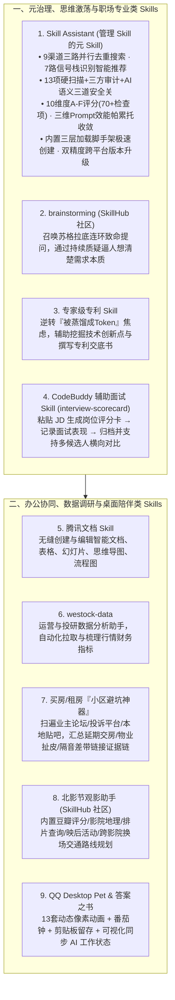

# 装了 N 个 skills 之后，鹅厂员工觉得“最香”的是哪一个？

## 1. TL;DR

1. **鹅厂内部高频使用的 9 大宝藏 Skill 全景盘点**：源自腾讯内部技术社区 KM 的真实员工调研，覆盖研发、运营、设计、招聘与生活决策五大场景——从治理 Skill 膨胀的元技能 **Skill Assistant**、逼人深度思考的苏格拉底追问 **brainstorming**、赋能专利挖掘的 **专家级专利 Skill**、自动生成评分卡的 **面试辅助 Skill（`interview-scorecard`）**，到办公刚需的 **腾讯文档 Skill**、股市分析 **westock-data**、像素陪伴 **QQ Desktop Pet**、全网扒证据链的 **小区避坑神器** 与规划换场路线的 **北影节观影助手**。
2. **最硬核的“管 Skill 的元 Skill”——Skill Assistant**：针对装了大量 Skill 后出现的同质化膨胀、后门隐患与质量参差问题，前端工程师自研 `Skill Assistant`，实现 **9 渠道三路并行搜索去重**、**7 路信号识别项目技术栈智能推荐**、**13 项硬扫描 + 三方审计 + AI 语义判断三道安全关卡**、**10 维度 A-F 评分（70+ 检查项）质量体检** 以及 **三维 Prompt 效能模型（帕累托收敛防过度优化）**。
3. **穿透信息黑箱与重塑工作流的两类高价值范式**：一类是 **“跨源证据链聚合型 Skill”**（如买房小区避坑神器扫遍业主论坛/投诉平台/贴吧生成带链接的延期交房、物业扯皮、隔音差证据链）；另一类是 **“结构化评估与挑战型 Skill”**（如 `LuckyEthan/interview-scorecard` 粘贴 JD 自动生成并保存多候选人对比评分卡，以及 `brainstorming` 召唤苏格拉底连环质疑）。

## 2. 问题定义与背景

### 2.1 “装了 N 个 Skill 却只用那几个”的龙虾综合症
随着 OpenClaw（“养龙虾”）与 CodeBuddy 等支持插件化 Skill 的桌面/编程 Agent 在鹅厂内部普及，工程师们普遍经历了从“疯狂囤积几十个 Skill”到“真正常用的只有寥寥几个”的沉淀过程，同时衍生出两大痛点：
- **Skill 发现、安全与膨胀治理难题**：全网各平台 Skill 质量良莠不齐，既缺乏统一的安全后门扫描与量化评分标准，又容易因装得过多导致上下文膨胀与触发冲突。
- **从“写代码工具”向“全生活/全职场场景”外溢**：除了纯编码辅助，员工迫切需要能解决文档排版、招聘面试打分、专利撰写、看房避坑、影展排片等高信息壁垒或繁琐流程的垂直 Skill。

## 3. 知识框架

## 4. 核心内容拆解

### 4.1 九大鹅厂员工实测“最香” Skill 深度拆解

| 编号与推荐人岗位 | Skill 名称 | 核心解决痛点与功能亮点 |
| :--- | :--- | :--- |
| **01（研发/通用）** | **腾讯文档 Skill** | 打通腾讯文档核心 API，支持在 Agent 对话中直接创建与编辑 **智能文档、表格、幻灯片、思维导图、流程图** 等多种载体 |
| **02（krisjc · 运营开发）** | **`westock-data`** | 高效拉取与分析市场数据，替代人工搜集与表格整理 |
| **03（grey · 前端开发）** | **小区避坑神器（买房/租房调研）** | 打破房产软文信息黑箱，自动全网扫描 **业主论坛、投诉平台、本地贴吧** 的真实声音（延期交房、物业扯皮、哪栋楼隔音差），输出 **带原始链接的完整证据链** |
| **04（zhiwei · 视觉设计）** | **`QQ Desktop Pet`（像素桌面宠物）** | 将像素养成与工作流融合：含 **13 套动态像素动画**、内置 **番茄钟**、**剪贴板自动留存** 以及 **可视化同步 AI 工作状态**（消除等待黑盒焦虑） |
| **05（alineli · 运营规划）** | **`the-book-of-answers`（答案之书）** | 提供轻量级情绪陪伴与每日心理暗示互动 |
| **06（nin · 应用研究）** | **北影节观影助手（基于 `SkillHub`）** | 覆盖 **6 大功能**：按类型/导演/评分推荐影片、地理位置推荐影院、排片查询、多场次日程规划、映后主创/导赏提示、跨影院换场驾车/公交耗时计算 |
| **07（aha · 产业）** | **`brainstorming`（基于 `SkillHub`）** | 扮演“苏格拉底式提问者”，在动手执行前通过连环致命提问不断质疑、挑战与引导，逼迫使用者把模糊想法想透彻 |
| **08（linton · 前端开发）** | **`Skill Assistant`（管 Skill 的元 Skill）** | 一站式解决全网 Skill 搜索、推荐、安全扫描、70+ 项质量体检、帕累托效能调优、三层加载脚手架创建与跨渠道版本更新 |
| **09（aha / eason · 营销/招聘）** | **专家级专利 Skill** & **辅助面试 Skill** | 专利 Skill 辅助提炼技术方案交底；面试 Skill（开源于 `LuckyEthan/interview-scorecard`）支持粘贴 JD 生成评分卡、记录面试并做多候选人对比 |

### 4.2 重点架构剖析：`Skill Assistant`（元技能治理体系）的七大工程模块

针对评论区热议的“套娃式管理 Skill 的 Skill”，`linton` 开发的 **Skill Assistant** 实际上构建了一套完整的 **Skill 供应链治理与生命周期引擎**：
1. **🔍 跨渠道搜索**：支持 **9 个渠道三路并行检索**，实现跨源去重与统一推荐指数排序。
2. **💡 智能推荐**：采集 **7 路信号** 自动识别当前本地项目结构与技术栈，按业务价值主动推荐补齐短板的 Skill。
3. **🛡️ 安全安装（三道防线）**：通过 **13 项硬规则静态扫描 + 第三方安全审计 + AI 语义级后门判断** 三道关卡拦截恶意投毒 Skill。
4. **📊 质量体检**：建立 **10 个维度（A~F 等级）、70+ 个检查项** 的专业静态评分模型，量化评估任意 Skill 的编写质量。
5. **🔧 效能诊断**：基于 **三维 Prompt 效能模型** 与 **帕累托收敛（Pareto Convergence）** 算法，吸取全网同类优秀 Skill 精华改进本地 Skill，同时防止过度优化导致泛化能力退化。
6. **🛠️ 极速创建**：内置标准脚手架、**三层渐进式加载设计** 与质检验证闭环。
7. **🔄 跨平台版本管理**：统一不同社区渠道的版本号，支持双精度更新检测与一键升级。

## 5. 数据速查表

| 指标 | 原文数值 | 语境 / 条件 |
| :--- | :--- | :--- |
| **盘点的典型实用 Skill 数量** | `9~10 个`（编号 `01` 至 `09`，其中 `06` 含两个） | 来自腾讯内部 KM 社区跨岗位员工真实安利 |
| **`QQ Desktop Pet` 动态像素动画数** | `13 套` 动态像素动画 | 集成番茄钟、剪贴板自动留存与 AI 工作状态可视化同步 |
| **北影节观影助手核心功能模块数** | `6 大` 功能模块 | 影片推荐、影院推荐、排片查询、日程规划、映后活动、换场通勤方案 |
| **`Skill Assistant` 跨渠道搜索并发度** | `9 渠道`、`3 路` 并行检索 | 支持跨源去重与统一推荐指数计算 |
| **`Skill Assistant` 智能推荐信号数** | `7 路` 信号 | 自动识别项目目录与技术栈推荐匹配 Skill |
| **`Skill Assistant` 安全安装防线** | `13 项` 硬扫描 + 三方审计 + AI 语义判断（共 `3 道` 关卡） | 防范社区第三方 Skill 隐藏后门与命令注入 |
| **`Skill Assistant` 质量体检规格** | `10 个` 维度（`A-F` 评级）、`70+ 个` 检查项 | 搭配三维 Prompt 效能模型与帕累托收敛防过度优化 |

## 6. 踩坑与教训 / 可迁移的设计原则

| 错误做法 | 失败表现或原因 | 原文应对（可迁移的设计原则） |
| :--- | :--- | :--- |
| **盲目从各个开源仓库手工搜集并直接安装大量未经审计的第三方 Skill** | 造成严重的“Skill 膨胀”污染上下文，且极易引入含隐藏后门的恶意脚本或低质冲突指令 | **引入元治理工具（如 `Skill Assistant`）**：通过 9 渠道去重检索、13 项硬扫描+三道安全关以及 10 维度 70+ 检查项体检，严控准入并吸收精华合并同类项 |
| **在看房、选片等高信息噪音的生活决策中仅靠传统搜索引擎看前几页软文** | 商业软文掩盖了延期交房、物业纠纷或影院换场来不及等真实痛点，人工跨论坛翻帖耗时极长 | **构建“跨源证据链挖掘 + 空间规划”垂直 Skill**：让 Agent 深入业主论坛/投诉平台/贴吧抓取带原始链接的负面证据链，或自动计算跨场馆交通换乘时间窗 |
| **在技术面试或方案构思时完全依赖临场自由发挥，缺乏结构化标尺与反向质询** | 面试多个候选人后印象模糊难以横向对齐；自己写方案容易陷入思维定势漏掉致命前提 | **用 `interview-scorecard` 固化 JD 评分卡 + 用 `brainstorming` 引入苏格拉底反问**：把非结构化面试转化为标准打分存档，让 AI 扮演质疑者逼自己想清逻辑 |

## 7. 记忆锚点

- **“管理 Skill 的元 Skill（Skill Assistant）：9 渠道搜索、7 路信号推荐、13 项扫描三道关、10 维 70+ 项体检”**：当团队 Skill 数量突破两位数时，一套兼顾安全准入、质量体检与帕累托收敛优化的“元治理 Skill”是防止生态腐烂的必备基建。
- **“捅破信息黑箱（小区避坑证据链）、逼人想清楚（苏格拉底 brainstorming）、可视化学伴（QQ 像素宠同步 AI 状态）”**：好 Skill 的三个共同特征——要么替你跑断腿扒完散落全网的真实底牌，要么替你守住结构化思考与评估的纪律。

## 8. 复习卡片

1. 针对大量安装 Skill 后出现的膨胀、质量参差与安全隐患，鹅厂前端工程师开发的 `Skill Assistant` 设计了哪几项核心治理能力？::包含 6 大核心能力：① 跨渠道搜索（`9 渠道`三路并行去重）；② 智能推荐（采集 `7 路` 信号识别项目技术栈）；③ 安全安装（`13 项` 硬扫描 + 三方审计 + AI 语义判断三道关卡）；④ 质量体检（`10 维度` A-F 评分、`70+` 检查项）；⑤ 效能诊断（三维 Prompt 效能模型 + 帕累托收敛防过度优化）；⑥ 内置三层加载脚手架与跨平台双精度版本管理。
2. 文中提到的“小区避坑神器”Skill 是如何帮买房/租房用户打破信息黑箱的？::它不再局限于表面的商业点评软文，而是自动扫遍全网业主论坛、投诉平台和本地贴吧，将散落的真实负面反馈（如楼盘延期交房、物业扯皮、具体楼栋隔音差等）挖掘并整理成带有原始出处链接的完整证据链。
3. `QQ Desktop Pet`（像素桌面宠物）Skill 将经典像素养成与哪些现代 AI 工作流功能进行了结合？::结合了四个维度：① 情绪陪伴（`13 套` 动态像素动画）；② 硬核提效（内置番茄钟实时监督专注力）；③ 数字补给（剪贴板历史自动留存）；④ AI 协同（可视化实时同步后台 AI 的工作状态，缓解等待焦虑）。
4. 开源的 CodeBuddy 辅助面试 Skill（`LuckyEthan/interview-scorecard`）和 `brainstorming` Skill 分别解决了什么职场痛点？::辅助面试 Skill 支持直接粘贴岗位 JD 生成结构化评分卡、根据面试情况填写并保存评分卡，从而支持多候选人横向客观对比；`brainstorming` 则通过扮演苏格拉底进行连环致命提问与质疑，逼迫使用者在动手前把模糊方案想清楚。
5. 腾讯文档 Skill 和北影节观影助手（来自专为中国用户优化的 `SkillHub` 社区）各自支持哪些核心操作？::腾讯文档 Skill 支持在 Agent 中直接创建和编辑智能文档、表格、幻灯片、思维导图、流程图等多种文档类型；北影节观影助手支持按偏好推荐影片、按位置推荐影院、排片查询、日程规划、映后主创活动提示以及跨影院换场的驾车/公共交通耗时计算。

## 9. 知识关联

- **本仓库主题索引**：[AI技术活动与资料](../../20_topics/AI%E6%8A%80%E6%9C%AF%E6%B4%BB%E5%8A%A8%E4%B8%8E%E8%B5%84%E6%96%99.md) · [AI研发协同](../../20_topics/AI%E7%A0%94%E5%8F%91%E5%8D%8F%E5%90%8C.md) · [Skill设计与治理](../../20_topics/Skill%E8%AE%BE%E8%AE%A1%E4%B8%8E%E6%B2%BB%E7%90%86.md)
- **候选双链概念**：[[Skill-Assistant元技能治理]] · [[SkillHub社区]] · [[苏格拉底式Brainstorming]] · [[证据链聚合型Skill]] · [[面试评分卡Skill]]

## 10. 原文参考资料

1. 辅助面试评分卡开源仓库：[https://github.com/LuckyEthan/interview-scorecard](https://github.com/LuckyEthan/interview-scorecard)
2. 社区与平台：腾讯内部技术社区 KM、`SkillHub`（专为中国用户优化的 Skills 社区）、腾讯文档 Skill、CodeBuddy。

> [!note]- 校对报告
> - **校对状态**：已按原文逐页核对通过（共 16 页 PDF，其中 p.11–16 为互动抽奖与读者留言区）。
> - **核心数据与页码溯源**：
>   - 腾讯文档 Skill（智能文档/表格/幻灯片/思维导图/流程图）与 `westock-data`：见 `p.2`。
>   - 小区避坑神器（业主论坛/投诉平台/本地贴吧带链接证据链）与 `QQ Desktop Pet`（`13 套` 动态像素动画、番茄钟、剪贴板留存、AI 状态可视化）：见 `p.3–4`。
>   - `the-book-of-answers`（答案之书）、北影节观影助手（`SkillHub` 社区、6 大功能）、`brainstorming`（苏格拉底连环提问）：见 `p.5–7`。
>   - `Skill Assistant`（`9 渠道`三路并行、`7 路`信号推荐、`13 项`硬扫描+三方审计+AI 语义判断、`10 维度` A-F 评分 `70+` 检查项、三维 Prompt 效能模型与帕累托收敛、三层加载脚手架、双精度更新检测）：见 `p.8`。
>   - 专家级专利 Skill 与 CodeBuddy 辅助面试 Skill（`GitHub - LuckyEthan/interview-scorecard`）：见 `p.9–10`。
