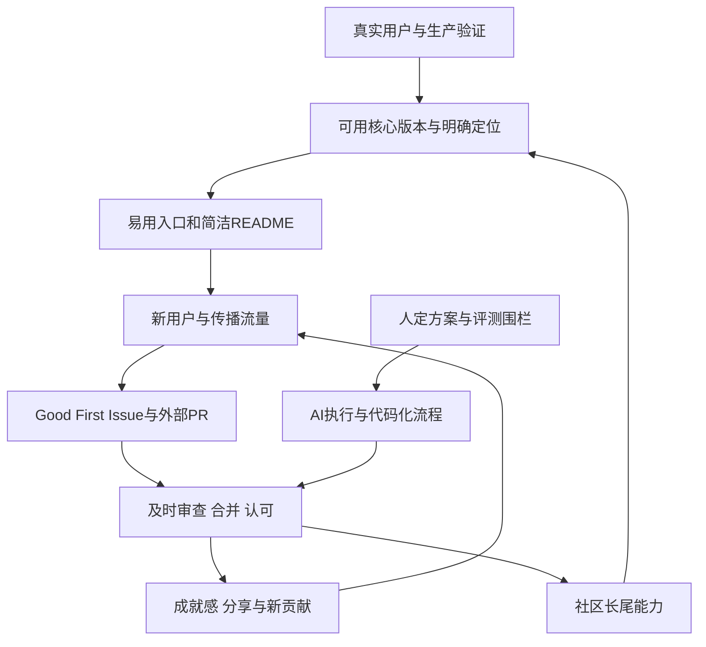

# AI开源工程与社区循环

## TL;DR

作者复盘OpenCodeReview开源后的产品、工程和社区循环：先用真实内部反馈与评测证明价值，再发布可用核心，让社区补齐接入和长尾场景。易用性、简洁入口、明确的Good First Issue与快速响应决定流量能否成为贡献。AI承担代码生成、评审和维护动作，人保留方案约束、最终决策和社区判断；一次核心搜索工具回归促使团队要求核心链路变更跑完200个PR评测。100% AI代码与快速发版建立在代码化流程、测试和评审网之上，本文数据为作者发布时的案例报告，不能把stars或Trending当代码质量证明。（来源：p.1–9）

## 核心概念与定位

**OpenCodeReview（OCR）** 是从内部AI代码审查实践孵化的开源框架。作者给出的混合架构是“确定性工程 × Agent协同”：不能出错的流程环节用工程逻辑约束，AI负责动态决策和上下文召回。文中“数据不出本地”指框架不收用户数据、LLM由用户自行选择，并不在此说明任何外部LLM请求天然留在本地。（来源：p.2）

需求起点是AI代码产量增大后“看不过来、不敢合”。团队已有近两年内部实践、20k月活用户、采纳率30%+、误报率<5%和200个真实PR标注benchmark，因此选择开源经生产验证的方案而非演示。作者引用Faros AI报告的任务量、重写率和审查耗时等统计，是文中引用的外部报告，本文未复核该报告，不能替代本案例因果证据。（来源：p.2）

## 知识框架

按正文整理，来源：p.2–8。传播和维护相互反馈，不是一次发布后自动增长。

## 方法与机制详解

### 1. 先完成，并把可上手算进“完成”

第一版有Go CLI、自定义模型配置与OpenAI/Anthropic兼容、评审命令和内核、Claude Code配套skill、GitHub Action、可观测能力。这组最小交付足以让真实用户跑起来，也给外部贡献者留下参与空间。作者认为窗口期有限，先用真实核心价值占住用户认知，而非把所有可能功能做完才发布。（来源：p.3）

社区随后增加GitLab CI、Gerrit/Jenkins、委托模式、MCP客户端；provider从3扩到14，新增本地Ollama和网关；支持第三种OpenAI Responses协议；新增多语言规则、Web会话查看器、OpenTelemetry/W3C traceparent、可恢复会话、token预算守卫与Windows安装。内部核心团队负责框架骨架，外部场景带来最初难以预见的需求。（来源：p.3）

早期把注意力放内核而忽略LLM配置，流量到来却转化很低；之后内置主流厂商与GUI，让用户配置一个key就可开始。原文未给转化率数值，但明确指出“让用户最快用起来”属于先完成，而非以后再美化。（来源：p.3–4）

### 2. 减少同一用户的选择负担

README从1000行降到200行，只回答“你是谁、为什么选你、如何快速开始”，高阶功能下沉文档站。CLI每添参数会增加用户对是否需要配置的犹豫；要判断同一个用户是否面对更多相互重叠的选项，而非简单数功能。（来源：p.4）

GitLab CI与GitHub Actions面向不同人群，互不增加另一类用户选择负担，是作者反例。团队原有 `--max-tools` 约束子任务调用轮次；社区提出 `--max-tool-calls` 限全评审调用总数与 `--max-tokens-budget` 物理约束token。团队拒绝前者、接受后者，避免与已有工具次数参数重叠，又保留清晰成本边界。文中没有给参数默认值，不能补成命令教程。（来源：p.4）

判断路径为“进来→5分钟理解核心价值并跑起来→感兴趣再看细节”，5分钟是产品目标，不是已报告平均上手时长。（来源：p.4）

### 3. 快速反馈把参与转成长期贡献

作者观察活跃外部贡献者与团队时区接近，推测是PR能马上得到反馈而留下。小bug和特性约12小时内修复发版，快时2小时；Issue/Discussion及时回复，PR尽快评审合并。响应不仅是服务，也是形成留存与贡献飞轮的机制；本文没有时区/留存的控制实验，应保留作者复盘身份。（来源：p.5）

维护者用 `/read-issue`、`/mk-issue`、`/mkpr`、`/review`、`/open-code-review`、`/release-eval`、`/tag`、`/comment` 等skill完成理解问题、建Issue/PR、评审修复、判定评测、发版和润色回复。这些只有名称和作用，未取得完整Prompt或Skill，不提炼成可安装文件。（来源：p.5）

当前流程是Claude Code写代码→OCR pre-commit hook自动评审→CC修复→创建PR→GitHub Actions再评审与围栏→CC修复。单元测试、Lint、CI/CD和200 PR E2E评测提供稳定网。原文此处写 `/mkpr 创建评审`，但前面定义 `/mkpr` 自动创建PR；笔记按前文职责说明建PR，不默默猜另一接口。（来源：p.5）

### 4. All in Code让Agent真正能读、改、跑

**All in Code（一切皆代码）** 的具体表现是CI/CD用YAML、规则用JSON、发版用Makefile+shell、文档站用MDX、Issue/PR模板用Markdown。关键流程不藏在GUI后台、wiki或某个人脑中，Agent便可从实际文件读取并执行，维护者无需在系统之间人工搬运。（来源：p.6）

它是工作流可操作的前提，不是消除人类决策的理由。作者认为AI适合提出多方案和执行实现，但不应自行选方案再执行；人负责做什么与做得是否正确。（来源：p.6、p.9）

事故反例：团队让AI自由优化工具调用，单测和少量样例通过后发布，结果全局搜索工具出bug；两天后HN流量进入，新用户首次使用即踩坑。团队之后规定影响核心链路必须跑完200 PR评测才发版，AI实现必须得到明确方案约束。单测通过不等于核心行为已覆盖，发布评测需与变更范围关联。（来源：p.6）

### 5. 社区任务要有真实背景和验收

**Good First Issue** 是真正需要做且门槛适中的工作，要写清背景、验收标准和合理难度。第一轮Trending次日即跌落，作者复盘新人没有事做；第二次准备可参与Issue并及时处理PR，形成“看见任务→贡献→review/merge→成就感→star/分享→更多新人”的循环。文章把上榜归因于产品力、留榜归因于社区活跃度，是案例解释，不是控制实验结论。（来源：p.6–7）

稳定核心贡献者维持合并判断和回归修复；新人入口让核心贡献者从社区成长。组织把开源作为正式项目持续投入、核心贡献者不断档、真实用户持续反馈，是作者总结的三层条件。内部统一环境证明基本路线，外部差异场景发现新的接入需求，两者互补。（来源：p.8）

### 6. 降低潜在传播者的成本

作者坦承alibaba品牌自带起始势能，不能概括为“不传播也会火”。主动传播只有峰会分享和公众号投稿两次，后续由社区、公众号、Trending、HN串起扩散。生产数据、benchmark、对比图与明确痛点让传播者更容易引用；同时公开不足校准预期，避免营造完美导致用户失望。（来源：p.2、p.7–8）

## 数据速查与统计边界

| 指标 | 原文值 | 语境 | 来源 |
|---|---|---|---|
| 内部月活 | 20k | 阿里内部平台 | p.2 |
| 采纳率 | 30%+ | 内部建议处理统计，分母未详述 | p.2 |
| 误报率 | <5% | 内部平台，不是开源用户统一指标 | p.2 |
| 合入基线有效建议来自AI | 近8成 | 已合入有效建议范围 | p.2 |
| Benchmark | 200个真实PR | 标注/E2E评测，单次约8小时 | p.2、5–6 |
| Token开销 | Claude Code+Skills的1/9 | 作者对照主张，本文未详述条件 | p.2 |
| 外部贡献feature commit | 超60% | 一百多个feature commit | p.3 |
| Provider | 3→14 | 社区演进期间 | p.3 |
| README | 1000→200行 | 入口压缩，细节转文档站 | p.4 |
| 小修复发版 | 12小时内，快时2小时 | 团队响应节奏 | p.5 |
| 作者时间分配 | 审查/互动60%；方向/拆Issue40% | 个人实践 | p.6 |
| Stars | 约20k | 文章开头快照 | p.1 |

⚠️[原文疑点] p.3写从v1.0.0到v1.9.0“100个正式版本”，p.5/8又写“两个月89个版本”。未说明统计时间或版本类别差异，不能合并为同一个确定版本数。p.9将7月23–28日行标为“连续5天”，日期区间字面跨6个日历日期，未解释具体统计窗口；保留原表措辞，不自行修正。

评论中署名kite的回复经公众号作者确认指出：开源版没有采纳概念；内部可点击“忽略”表示问题正确但本次不改，仓库可配置是否必须处理，约20%评论没有做采纳/误报/忽略动作。这个补充提示采纳和误报不是覆盖所有建议的二分法。（来源：p.11评论与作者确认）

| 时间 | 事件 | Star快照 | 来源 |
|---|---|---|---|
| 5月21日 | v1.0.0发布 | 0 | p.9 |
| 5月28日 | 首次Trending，次日掉落 | 400 | p.9 |
| 6月5日 | 第二次Trending | 1.5k | p.9 |
| 6月6日 | HN头条 | 1.5k→4k | p.9 |
| 7月23–28日 | 原文称连续5天Trending首页 | 10.5k→15.5k | p.9 |

## 教训与记忆锚点

不要把全部核心得分当可上手体验，也不要把AI熟悉自己代码当作自由决策可靠的证据。把核心改动与完整评测关联；给新人真实可做的任务并迅速反馈；允许社区补齐差异场景，同时由核心团队承担长期框架方向与回归责任。（来源：p.3–8）

原文锚点：**AI是10倍速的手，但脑子得是自己的。** 它强调方案和验收在人，代码生成与维护动作可交给AI；10倍是表达，不是本文生产率实验。（来源：p.9）

## 复习卡片

OCR的混合架构如何分工？::确定性工程约束不能出错的评审环节，Agent集中做动态决策与上下文召回。（p.2）
为什么易用性属于“先完成”？::最初配置复杂让流量无法转化；能快速配置并跑起来是核心交付，而非后续优化。（p.3–4）
如何判断新功能增加了认知复杂度？::看是否让同一个用户面对更多重叠选择；不同人群各自的CI接入不必互相增加负担。（p.4）
为什么接受token预算却拒绝总工具调用参数？::团队已有子任务轮次限制，避免重复选择；token预算提供明确成本边界。（p.4）
All in Code为何帮助Agent工作？::流程和规则存为可读改执行文件，Agent无需依赖GUI、wiki或个人记忆里的步骤。（p.6）
核心搜索工具事故后增加了什么约束？::核心链路变更需完整200 PR评测再发版，AI实现需明确方案约束。（p.6）
Good First Issue需要哪些信息？::真实背景、明确验收、合理难度，任务确有需要且门槛适中。（p.7）
内部采纳率与误报率能推成所有建议二分吗？::不能，评论补充存在“忽略”和未处理，开源版没有采纳统计。（p.11）

## 知识关联与原文入口

[[AI研发协同]]：人决策、AI执行与代码化流程；[[Agent评测与反馈]]：核心变更的200PR评测；[[问题澄清]]：任务背景和验收；[[Agent工程循环]]：产品—社区—验证反馈。

原文项目 `https://github.com/alibaba/open-code-review`（p.1）及官网 `https://open-codereview.ai`（p.9），未联网核验当前版本或stars。

本次归纳主题：[AI研发协同](../../20_topics/AI研发协同.md) · [Agent工程循环](../../20_topics/Agent工程循环.md) · [问题澄清](../../20_topics/问题澄清.md)。

> [!note]- 校对报告
> **覆盖度**：11页文本与缩略图全阅，放大p.6事故及决策约束、p.9时间线；覆盖八个正文章节，p.11作者确认的统计补充明确按评论标注。推广省略。
> **一致性抽查**：内部月活｜20k｜p.2｜一致；误报率｜<5%｜p.2｜一致；评测规模｜200PR｜p.5–6｜一致；README｜1000→200行｜p.4｜一致；token对照｜1/9｜p.2｜一致。
> **异常**：100正式版本/89版本和7月23–28“5天”口径未解释；统计属于当时作者快照，未自行统一。第三方报告只作为引用，不当独立核验。Skill仅有名称作用，无完整内容，不建提炼文件。
> **日期与格式**：p.1 Aug 11, 2026，date为2026-08-11，正式命名AI_短标题.md；Mermaid未渲染、操作未执行；一个H1，代码块闭合，卡片为单行。
