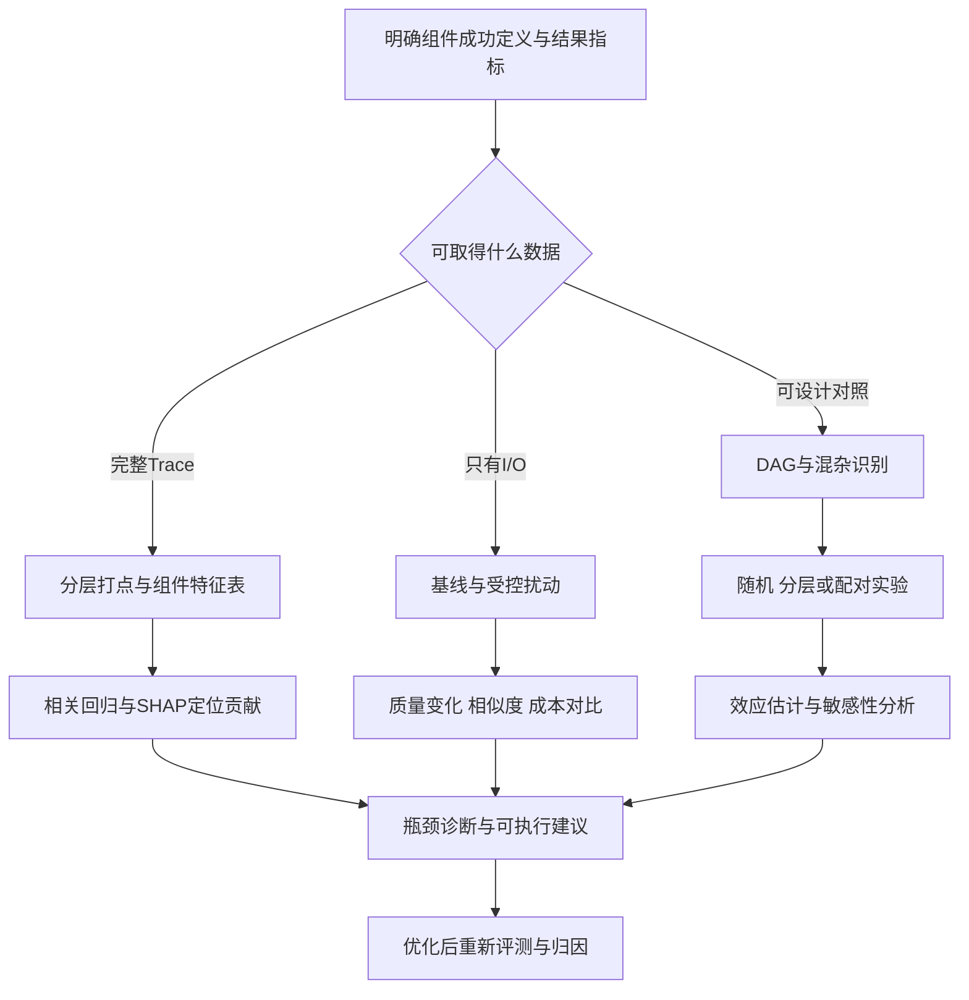

# AI评测因果归因

## TL;DR

本文把Agent评测从“总分怎样”推进到“哪个组件与结果变化有关、改变它会怎样”，以混杂变量和因果图约束归因判断。材料按数据条件给出三条路径：完整Trace用于组件指标和SHAP，只有输入输出时做扰动实验，可设计对照时做因果效应估计。工具选型、分层打点、随机/分层/配对设计与敏感性分析形成归因—优化—验证闭环。第五章明确所有案例数字均是示例，不是业务实测；多幅配图与正文的样本量或数值口径不同，不能据图补成一致实验，更不能把相关/预测贡献直接当已识别的干预效应。（来源：p.2–9、p.16–23）

## 核心概念：先问归因问题处于哪一层

**混杂变量（Confounders）** 是同时影响处理变量和结果的因素。新版Prompt得分更高，可能只是被分给更多简单Query；冰淇淋销量与溺水共同受气温影响，相关并不说明直接因果。**Treatment** 是主动改变的Prompt、模型或Temperature；**Outcome** 是成功率、满意度或时间等结果。（来源：p.2、p.16）

Pearl三层阶梯在图中依次为关联观察 $P(Y\mid X)$、干预 $P(Y\mid do(X))$、反事实 $P(Y_{x'}\mid X,Y)$。图中反事实符号只按p.4保留，未补作者未给的变量取值定义。Rubin潜在结果模型定义同一个体在不同干预下的潜在结果，图中 $ATE=E[Y(1)-Y(0)]$；ATE是整体平均效应，CATE是在给定协变量条件下的异质效应。Pearl用DAG、do算子和后门/前门准则强调识别机制，Rubin强调效应估计，作者主张可以结合。（来源：p.4、p.6、p.23）

**Shapley/SHAP** 在本文用于分配模型特征或组件的边际贡献：遍历联盟子集、比较 $v(S\cup\{i\})-v(S)$、加权平均。原图未给完整Shapley求和权重公式，故不从常识补公式。作者列效率性、对称性、哑元性、可加性，指出精确计算随特征数指数增长，可用近似。**预测模型贡献、移除敏感性、干预净效应** 是三种不同问题；p.9的相关/回归特征表仅用于找强关联瓶颈，不能仅凭这一步宣布排除了混杂。（来源：p.5–6、p.9、p.16–17）

## 知识框架

按p.8、p.20图与正文整理，保留数据条件分支。

原p.8分层诊断从端到端（成功率、质量、延迟/成本）到组件（推理链、工具选择、规划、记忆）再到根因（接口缺陷、Prompt、模型边界、环境反馈缺失）。它是分析层级，不表示最后得分能替代组件健康状态。

## 方法选型与工具分工

| 方法/框架 | 本文描述的作用 | 成立条件或代价 | 来源 |
|---|---|---|---|
| DoWhy | 建模→识别→估计→反驳 | 先把因果假设显式化 | p.4–5 |
| EconML | 正交机器学习、DML、异质处理效应 | 高维数据估计需经验与调参 | p.4–5、21 |
| CausalML | Meta-Learner、树模型和Uplift | 营销效果/增量建模 | p.4–5 |
| PyCausalSim | 模拟驱动因果发现与验证 | 按原文库描述，未检查API | p.4 |
| Shapley | 联盟边际贡献公平分配 | 指数复杂度；近似算法 | p.6 |
| Markov Chain | 移除渠道后转化概率变化 | 有顺序的多触点路径；大量模拟 | p.6 |
| Uplift | 找到因干预才转化的Persuadables | 需随机实验或强假设 | p.7 |
| PSM | 匹配处理倾向相近的样本 | 无法随机化时的本文选择 | p.7、17 |
| DID | 面板数据消除固定效应 | 平行趋势假设 | p.7 |
| IV | 外生变量处理内生性 | 相关性与排他性约束 | p.7 |
| DML | 机器学习与正交化估计 | 高维协变量场景 | p.7、23 |

p.7选型树先问有无随机实验，再问机制解释需求、数据维度、时序：随机实验走ATE/CATE估计；机制解释走Pearl/DoWhy/SCM；高维走EconML/CausalML/DML/Meta-Learner；低维有序路径走Markov，无时序走Shapley。这是原文方法导航，不是本次核验过的唯一选型法。Uplift四类包括Persuadables、Sure Things、Lost Causes和Sleeping Dogs，目的不是向所有必然转化者加干预。（来源：p.7图及正文）

## 路径一：完整Trace下的组件诊断

### 先定义成功，再逐层打点

工具选择不能只看工具在可用列表中，还要看其是否适合当前子任务；参数质量要检查字段、类型与语义；规划看步骤逻辑和依赖；回答相关性可用judge或人工；资源效率在本文表中为Completion Tokens / Prompt Tokens比率。这个比率是作者采用的指标，不等于普遍成本效率定义。（来源：p.9）

分层实施：第一阶段记工具序列和最终结果建基线；第二阶段加参数质量与规划；第三阶段做SHAP。历史Trace整理成每次执行一行、组件指标与最终分数为列的特征表，用相关/回归查强关联。p.20原图两条并列输入是DeepEval `@observe`组件打分与LangSmith自动追踪/日志解析（Latency、Token、Error），汇入SHAP，再输出Top3瓶颈及优先级建议。文章未给实际埋点代码与模型训练schema。（来源：p.9、p.20图）

### 三个示例分别对应三个失败环节

天气问题同时包含地点、时间、穿衣需求，Agent用了 `general_search` 而非 `weather_api`。示例工具选择=0、参数=N/A、规划=0.3、最终=0.2；50次同类Query中选择错60%，作者建议在工具描述增加天气衍生建议的场景。这是描述与选择的诊断示例，不是实际部署成绩。（来源：p.10）

报表转PDF选对 `doc_to_pdf_converter`，但带空格/中文路径引发File Not Found：工具选择=1、参数=0、规划=1、结果=0。100次示例文件任务中，参数错误占失败45%，其中特殊字符占70%。原文建议空格 `%20`、中文UTF-8编码，或工具层自动转义。⚠️[原文疑点] 文章把URL编码要求泛写为文件路径规范，未给该工具的路径契约；本笔记只保留其案例建议，不能改写成所有本地文件路径必须URL编码。（来源：p.10–11）

销售预测例子拆8步、每步调LLM，超过120秒超时；成功同类平均3–4步，示例工具/参数均1、规划0.4、资源效率0.2、结果0。作者建议合并可并行步骤、总步数5步以内、数据类优先多操作工具。5步是该示例建议，不是任何分析任务都必须压到5步。（来源：p.11–12）

## 路径二：没有Trace时做扰动对照

### 实验步骤与约束

原配置基线运行 $N\ge10$ 次，记平均与标准差；每类设计3–5个变体；每变体 $M\ge20$ 次，收集Embedding Cosine Similarity、任务完成评分、响应时间和token。指令同义替换不能变任务；删/替换few-shot至少保留一个；移除检索片段需记相关性；格式改变时解析器也要适应；温度扰动示例0.0→0.7→1.0并固定seed。（来源：p.12–13）

正文归因公式：

$$\text{贡献度}=\frac{\text{基线平均分}-\text{扰动后平均分}}{\text{基线平均分}}\times100\%$$

p.20图另给输出相似度口径 `Impact Score = 1 - Similarity`。两式测量对象不同，不当同一个分数。移除某要素后质量下降说明该要素对当前配置重要，但单变量扰动无法解释所有交互。（来源：p.13、p.20–21）

### 格式、检索和示例顺序的三组演示

| 示例实验 | 基线 | 变体结果 | 原文结论/条件 | 来源 |
|---|---|---|---|---|
| 订单提取格式 | 100次可解析率60% | JSON95%；逗号80%；few-shot92% | JSON字段`orderid`/`issuetype` | p.13 |
| 法律RAG | 10文档，3相关/7噪声；评分6.2/10 | >0.8剩3篇得8.5；随机删半7.1；Top5得8.0 | 文末建议阈值>0.75，和实验0.8分开 | p.14 |
| 数学few-shot | 3示例由易到难，50题78% | 由难到易72%；随机65%；只留最难70% | 作者主张顺序影响推理 | p.15 |

⚠️[原文疑点] 前两例的“贡献度”计算用 `(新分-基线)/基线`，分别写58.3%、37.1%，与p.13通用公式方向相反；第三例用下降方向写16.7%。保留每例口径，不统一成同一种有正负含义的因果贡献。p.15的50道题与65%准确率也未交代是否重复运行或平均，不能推整数题数。

这些示例提示结构输出契约、相关文档筛选与few-shot顺序可以作为待验证优化变量；不能把一组示意数字变成“JSON总优于few-shot”或“所有RAG阈值0.75”的确定规则。（来源：p.7示例说明、p.13–15）

## 路径三：对照设计与因果效应估计

### DAG、分配方式、估计、敏感性分析

先画DAG：Query复杂度影响Prompt分配和得分；用户经验影响得分；时间影响服务器负载再影响响应时间。再选择完全随机、按高/中/低复杂度分层随机，或同Query分别跑V1/V2的配对设计。简单t-test在确认无混杂且足够随机化时使用；无法完全随机时用PSM；作者将双重稳健描述为结合回归和PSM；高维混杂（>10个）时建议NOL。最后用假设未观测混杂做敏感性分析，检查结论稳定性。（来源：p.16–17）

⚠️[原文疑点] p.16概述称“传统A/B只能看相关”，p.17又讨论随机化且无混杂的估计。笔记以实际设计是否控制混杂为判断条件，不把“A/B”标签直接等同只有相关；原文没有详细说明双重稳健估计实现和必要假设，也没有可运行代码。

### 分层结果避免平均掩盖退化

示例V2总分平均高5%，但简单Query占测试集70%。分层后简单V2/V1为8.5/7.8（原文+8.9%）；中等7.2/7.5（-4.0%）；困难5.8/6.5（-10.8%）。作者猜测简化指令可能删减规划指导，建议简单用V2、复杂保留V1或V2-complex。这是异质效果及分布的演示，不是已验证动态路由系统。（来源：p.17–18）

Temperature示例从0.7到0.3，原数据客服与创意场景分布不同。未匹配一致性0.85/0.72，原文约18%；PSM后0.82/0.78，约5%。作者把差异中的“13%”归为混杂，⚠️[原文疑点] 两组相对变化的分母不同，直接相减不能在本文缺少定义时当作严格因果贡献分解。只保留匹配前后示例分数、设计动机和约束。（来源：p.18–19）

多参数示例收集1000次数据，5个Treatment为Prompt、Temperature、Top-p、最大token、重试，Query特征为混杂，正文写用EconML `LinearDML`。标题称NOL，二者关系未解释；也没有给交互建模配置。原文主张考虑组合和Pareto前沿，效果与成本共同选方案。（来源：p.19–20）

| 示例效应 | 原文数值 | 条件/范围 | 来源 |
|---|---|---|---|
| Prompt ATE | +0.12 | 1000次示例，多参数 | p.19 |
| Temperature ATE | -0.03 | 原文称不显著 | p.19 |
| Top-p ATE | +0.01 | 原文称几乎无影响 | p.19 |
| 最大token ATE | +0.08 | 原文称边际递减 | p.19 |
| 重试ATE | +0.15 | 成本增加3倍 | p.19 |
| Prompt+低温组合 | +0.18 | 高于原文单独和0.09 | p.19 |
| 重试>2次 | +0.02 | 原文称额外收益下降 | p.19 |
| 组合预计收益 | +0.41分 | 原文算0.18+0.08+0.15，未给统一交互验证 | p.19 |

最后一行只是作者示例中的估计，不能认定各效应可无条件相加。正文推荐Temperature0.3/重试2次；p.20配图最优点标Temperature0.95/K15，缺少与正文同实验的对应依据，故不把图值并入此表。

## 局限、停止与工程循环

Trace依赖埋点完整性、组件可拆性与样本积累，作者建议100+执行；单变量扰动有设计主观性和交互盲区，每变体20+次有API成本；PSM通常需500+样本找到匹配，DAG依赖领域知识，DML调参和收敛需经验。数据<50、系统每天快速改配置、debug已定位API故障或只有单模型/单Prompt时，逐条Bad Case更直接。（来源：p.21–22）

起步先选一个明确有问题的组件，先跑100+基线，目标是找主要瓶颈，不追虚假精确度；“80%确信度”是作者经验表达，未给统计定义。进阶形成归因—优化—再验证，关注成功case中被模型补救的组件错误，独立组件解释不足时看交互。高噪声配置建议≥30次并看均值/置信区间，每条归因至少有一项可执行建议。（来源：p.22–23）

周期归因应对瓶颈随时间漂移；实时诊断、自动因果发现PC/GES和归因自动改Prompt是未来探索，不是已实现能力。文中“接受5%误差换100x速度”等是作者应对主张，未给算法/数据对照，不能当Tree SHAP普遍性能保证。（来源：p.22–23）

## 图表与数据的阅读限制

⚠️[原文疑点] p.10正文50次，配图热图标n=200；p.13正文100次与60/95/80/92%，p.14图标每变体n=120和59.0/94.8/79.6/90.0%；p.15正文四策略、50题，p.16图增加Adaptive Mix等六维评分；p.17–18正文分层差0.7/-0.3/-0.7，p.18图使用另一些效应与样本量；p.19推荐0.3，p.20图标0.95最优点。材料标明含AI生成图片，未提供统一数据源。本笔记采用正文明确的示例口径，图只保留可核对机制或趋势，不冒称图文属于同一实验。（来源：p.10、14、16、18、20、25）

## 记忆锚点与复习卡片

助记改写：**先辨混杂，再选数据路径；组件定位找瓶颈，对照设计查干预；归因之后还要再验证。**

新版Prompt总分更高为何未必是它本身更好？::Query复杂度、用户经验或运行条件可能同时影响分配与结果，需控制混杂和看分层。（p.2、16–18）
Full Trace、I/O Only、可设计对照分别走哪条路径？::组件指标/SHAP、受控扰动、DAG和因果效应估计；数据条件决定方法。（p.8）
Trace打点为何先定义成功？::工具在列表里不等于适合子任务，参数还需类型和语义正确，指标契约决定如何判分。（p.9）
只有总分能判断工具健康吗？::不能，成功case也可能选错工具但被推理补救，应监控组件指标。（p.22）
扰动实验必须避免什么？::避免改变任务本质；格式变化还需匹配解析器，并保留基线和重复运行。（p.12–13）
A/B分层或配对设计解决什么问题？::控制Query复杂度和同题差异，避免样本分布掩盖复杂任务退化。（p.17–18）
什么时候直接看Bad Case更合适？::数据少于50、配置快速变化、原因已debug定位或单组件系统。（p.21–22）
第五章数字可以当实际业务提升证据吗？::不能，原文明确它们是示例性数据，且配图与正文有口径不一致。（p.7、图表说明）
归因结论交付后下一步是什么？::给可执行优化建议，修改后重新评测归因，形成闭环。（p.22–23）

## 知识关联与原文参考

[[Agent评测与反馈]]：指标拆解、混杂控制与重复运行；[[Prompt优化]]：格式、描述、示例排序的示意实验；[[Agent数据分析]]：Trace特征表与组件交互；候选[[因果推断与评测归因|因果推断]]。

原文p.24列14项参考，本笔记保留相关入口，未联网核验：Agent评测综述 `https://arxiv.org/html/2507.21504v1`；CounterBench `https://arxiv.org/abs/2502.11008`；Prompt Perturbation `https://arxiv.org/abs/2606.17634`；ToolMaze `https://github.com/Zhudongsheng75/ToolMaze`。完整引用表仍见RAW/逐页转写。

本次归纳主题：[Agent评测与反馈](../../20_topics/Agent评测与反馈.md) · [Prompt优化](../../20_topics/Prompt优化.md) · [Agent数据分析](../../20_topics/Agent数据分析.md) · [因果推断与评测归因](../../20_topics/因果推断与评测归因.md)。

> [!note]- 校对报告
> **覆盖度**：26页文本与缩略图全阅，放大p.2–8概念/结构/选型、p.10–12 Trace示例、p.14–16扰动数据图、p.18–21效应图与流程；七个正文主章、三条实践路径、九个示例均覆盖。参考全表保留在原文，推广评论不作论证。
> **一致性抽查**：扰动基线｜N≥10｜p.13｜一致；每变体｜M≥20｜p.13｜一致；JSON解析｜95%｜p.13正文｜一致；PSM后｜0.82/0.78｜p.18正文｜一致；小样本分流｜<50条｜p.21｜一致。数字均保留示例身份。
> **异常汇总**：公式正负口径、URL编码适用条件、A/B概述、NOL/LinearDML名称、相对提升“13%”分解及多处图文数据不一致已就近标注；正文阈值0.8实验/0.75建议分开。没有外部扩展，未把图示统计显著性当真实证据。
> **日期与格式**：页首2026年7月29日且末尾同日修改，date为2026-07-29，不猜时区。遵循AI_短标题.md命名；Mermaid未渲染，文章实验和命令未执行。Prompt仅为约束片段，无完整模板或Skill，不创建文件。
