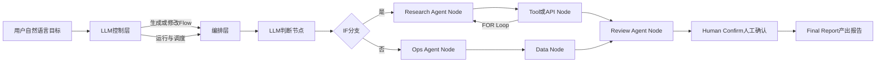

# Agent Flow与AI Native

## TL;DR

作者提出以Agent Flow承接固定且可验证的任务链：用户描述目标，LLM生成与维护Flow，编排层把任务交给合适节点。复杂任务拆成有具体上下文、适中工作量、可闭环确认的最小任务单元，避免所有路径都在一个概率性Agent loop中探索。文章强调真实数据、业务接口、权限和用户愿意付费的问题，比通用架构名词更能形成产品价值。它同时批评不够Agent-friendly的研发基础设施和过长组织反馈链；这些是作者个人经验与前瞻观点，非证明通用Agent普遍无效的实验。（来源：p.1–7）

## 核心概念与职责

**Agent Flow** 是作者正在构建的编排方案：LLM理解自然语言目标、生成/修改/运行Flow，Flow负责链路控制、任务下发与结果回收，Node负责实际执行。Node可以是QwenWork、Codex CLI、影刀RPA、千牛接口或内部运维Agent；Agent只是整条链的一种能力。（来源：p.1–2）

**最小任务单元（最小混沌单元）** 是给概率模型的有边界任务：具体上下文、适中工作量、可确认结果。编排层固定可确定的流程，节点承担局部智能或外部工具逻辑；这比把复杂任务全部描述为松散自然语言更易控制，是作者的工程判断，本文没有给两类实现的成功率与token成本对照。（来源：p.2）

| 层次 | 职责 | 原文支持的边界 | 来源 |
|---|---|---|---|
| 用户目标 | 自然语言说要完成什么 | 不要求理解节点连线和JSON | p.1 |
| LLM控制层 | 理解、生成、修改、判断分支、调度Agent、运行流程 | 控制层不是所有任务都亲自执行 | p.1图 |
| Flow | 链路控制、分支/循环/约束、任务下发与回收 | 不负责每个Node内部细节 | p.1–2 |
| Node | Agent、工具/API、数据、人工与产出节点各司其职 | 每个任务需有可确认交付 | p.1图、p.2 |

## 知识框架与原图结构

按p.1架构图复现主要分支与循环，省略产品交付能力和装饰。原图的LLM控制层对Flow既有生成/修改也有运行/调度关系；不是一条只运行一次的串行链。

原图还标注可运行、可调试、可发布、可监控，以及日志/指标/链路追踪能力。这是架构/产品表达，并非本文已给出这些能力的API实现与验证记录。（来源：p.1图）

## 关键要点与机制

### 1. 电商报表案例：把跨工具链拆给合适执行者

用户要汇总报表，先从QwenWork、影刀RPA、千牛接口三处获取数据，再汇总，通过DWS写入钉钉文档并发到群。作者称此前很难在单个Skill任务loop里完成，Agent Flow已可无介入跑通这一个case。笔记只记录案例，不把“三处取数”补画为已确认的并行调用，也不补失败重试、数据schema或权限配置。（来源：p.2）

机制是跳出单个Agent，把任务分发给适合的Node，利用已有业务能力。大量重复任务的总体路径固定，只在导出数据、整理文案、分析结果等局部节点引入Agent即可。作者希望用户不必在学习Skill与等待通用模型升级之间反复折腾。（来源：p.2）

### 2. 确定执行需要结果闭环，而不是无限探索

作者观察到同一任务在不同对话中会被不同路径执行，可能一个成功一个失败；仅靠堆Memory无法保证所有任务重复成功。YAML、Flow与hardcode固定路径，Node提供上下文和结果确认，因此系统更容易编排。这里的“可靠”是设计目标和作者判断；文章没有说明Flow节点的失败转移协议，不能凭工作流常识补出恢复机制。（来源：p.2–3）

适合采用固定链的例子包括每周可靠报告、固定审批辅助、若干有序LLM call加API即可解决的需求。原文“三个LLM Call加两个API”是示意性需求，不是统计调查结论、性能指标或必须照搬的模板。（来源：p.3–4）

### 3. 产品选择依据：独特资源与真实交付

作者提出用户选择某个Agent的两个理由：它能获得别处没有的关键数据/接口；它确实解决问题。淘宝商品数据、钉钉聊天记录等受保护业务资源不会因模型聪明自动变得可访问；数据获取与产品能力决定可落地范围。用户关心实际结果，而不是RAG、MCP、Multi-Agent、loop等组成名词。（来源：p.3–4）

这里应保留观点强度：独家数据和权限有壁垒，不自动证明某种Agent架构不可替代。p.9读者评论提出可把这些资源接给通用Agent的反问，但评论不是作者结论；它提醒该文没有完成通用与垂直方案的实证对比。本笔记不将评论推成新的已验证架构原则。（来源：p.3、p.9评论）

### 4. Hardcode与AI Native的作者定义

作者认为LLM降低定制代码的编写与维护成本，因此应重新评估hardcode：若需求只需固定调用链，就直接实现，不先建通用平台。Flow可把if/else、LLM call、Agent节点、业务接口和人工确认编排为可靠任务链，收益应围绕具体客户价值判断。作者以付费意愿衡量产品成功，本文未给定制方案维护成本或付费转化的量化证据。（来源：p.4）

**AI Native / LLM Native** 在本文的定义是基于LLM重塑交互、业务流程和对客服务，让用户更轻松、可靠、便宜或自然地完成问题。仅给旧系统加聊天框或一次LLM调用不符合作者理想。OneRec被用作原生推荐模型的例子，作者明确不是在赞扬它，本文也未分析其论文或性能。（来源：p.5）

### 5. WarRoom失败揭示基础设施前提

作者尝试自动接收告警、分析问题、写代码提PR的研发助手，却在日志授权、代码权限、中间件AK/SK管理和模型访问上受阻，最终Demo仅管理3个应用、模型受限，作者不断代做点击、申请、截图和复制。他据此认为旧基建是为人设计，导致人变成系统之间的胶水。（来源：p.5–6）

对比中，Aone团队已有类似内部运维Agent，能够把日志、trace和代码直接交给Code Agent；作者认为其资源位置更便于拿权限、接基建和通过审核。本文没有给Aone的成功率、架构或代码，不能把作者对其“做出来”的描述写成完整已核验实施教程。（来源：p.6）

文中“干掉流程、审批、权限”是作者激进提效观点，不是本资料库执行授权。可被材料支持的机制是缩短Agent取得上下文与工具资源的路径；具体生产授权如何重构，原文未给出制度或安全方案。（来源：p.5–7）

### 6. 组织链路比名义扁平更影响上下文

“一千张A4纸叠起来依然是厚的”用来描述任务、权限、上下文和反馈链仍很长的组织。层层转述与审批令信息不完整，Master向Sub-agent分派时，如果任务需反复人与人确认或局部深交互，协作就痛苦。作者理想是完整任务点对点交给一线，每个人能直接发现问题、写代码、提交并负责，自己也承认这一观点激进且理想化。（来源：p.6–7）

作者把交流类比TCP/IP：点对点、可靠、稳定、充分；这是比喻，不是提出网络协议实现。将完整上下文一次交给人与Agent，可以让目标模式更简单，是本文组织层面的主张。（来源：p.7）

## 数据与工程细节速查

本文缺少定量对照实验，不以背景数量凑性能表。关键机制定位如下。

| 要素 | 原文内容 | 条件/边界 | 来源 |
|---|---|---|---|
| 编排责任 | 控制链路、下发任务、回收结果 | Node执行具体任务 | p.1–2 |
| 最小单元 | 具体上下文、适中工作量、可确认结果 | 作者对概率模型的任务设计建议 | p.2 |
| 可混合节点 | Agent、API/工具、数据、人工确认 | 原图有分支和循环 | p.1图 |
| 失败案例规模 | Demo管理3个应用 | WarRoom受限场景，非普遍上限 | p.6 |
| 产品判断 | 是否可靠解决用户问题、愿意付费 | 作者价值判断，无转化统计 | p.3–5 |

## 记忆锚点与复习卡片

原文锚点：**一千张A4纸叠起来依然是厚的。** 助记改写：**目标自然表达，链路确定编排，节点负责执行，结果可以确认。**

Agent Flow与Node分别负责什么？::Flow负责控制、派发与回收，Node承担具体Agent动作或外部工具逻辑。（p.1–2）
最小任务单元有哪些约束？::有具体上下文、工作量适中，并能闭环确认结果。（p.2）
电商案例为何用多个节点？::取数来自QwenWork、RPA和千牛接口，后续汇总写文档发群需要跨不同业务能力。（p.2）
为何作者重新评价hardcode？::他认为LLM降低定制代码成本，固定需求可直接做可靠链路，不必先追求通用平台。（p.4）
WarRoom受阻的关键是什么？::日志、代码、中间件与模型访问不能顺畅交给Agent，作者被迫充当人工胶水。（p.5–6）
作者的AI Native判断标准是什么？::从LLM出发重塑交互和业务，让真实问题更轻松、可靠或自然地完成，用户愿意继续用和付费。（p.5）
“一千张A4纸”比喻什么？::名义上扁平但任务、权限、上下文和反馈链仍长，信息传递与行动仍受阻。（p.6–7）
本文证明通用Agent在所有场景无效了吗？::没有，它是作者个人观点与案例，没有覆盖通用方案的系统实验对照。（p.7及声明）

## 知识关联与原文参考

[[Harness与模型协同]]：控制与执行职责；[[AI研发协同]]：上下文与组织链路；[[问题澄清]]、[[决策方法]]：从用户真实问题选择方案。

原文项目 `https://github.com/huisezhiyin/symphlo` 与OneRec论文 `https://arxiv.org/abs/2502.18965`（p.7），仅作为原文引用，未访问核验。

本次归纳主题：[AI研发协同](../../20_topics/AI研发协同.md) · [Harness与模型协同](../../20_topics/Harness与模型协同.md) · [问题澄清](../../20_topics/问题澄清.md)。

> [!note]- 校对报告
> **覆盖度**：10页文本与缩略图全阅，p.1架构图高分辨率放大；覆盖八个正文章节，评论不作为作者主张，p.10为空白末页。
> **一致性抽查**：Flow职责｜控制/派发/回收｜p.1｜一致；Node职责｜执行具体任务｜p.2｜一致；最小单元｜上下文/工作量/结果确认｜p.2｜一致；三处取数｜QwenWork/RPA/千牛｜p.2｜一致；WarRoom Demo｜3应用｜p.6｜一致。缺少五个有意义实测数值，采用关键事实抽查。
> **边界**：作者观点保留其判断身份，未将组织理想或移除权限口号当操作指令；未补节点失败恢复、成功率或付费证据。原图与正文整理的关系已标注。
> **日期与格式**：p.1 Aug 5, 2026，date为2026-08-05，遵循AI_短标题.md命名；Mermaid未渲染，命令与文章动作未执行，卡片单行、一个H1。
