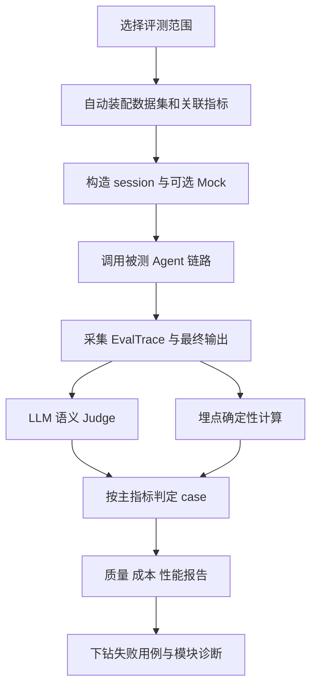
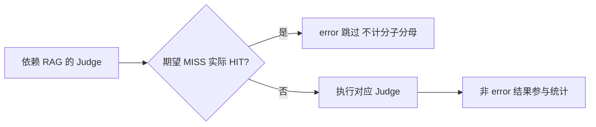

# Agent精细化评测

## TL;DR

商品中心 Agent 的综合分无法解释意图、路由、记忆、工具中的具体故障，本文把评测结构与应用架构对齐，用端到端评测判断任务完成，用模块评测定位原因。体系同时测量质量、成本和性能，把数据集标注、运行时 `EvalTrace` 与结构化 Judge Task 结合起来。每个场景由主指标决定 case 通过，其余指标单独诊断；上游路由误触发时，依赖 RAG 的下游评测标记 `error` 并退出分子和分母。平台已经完成多 Agent 配置化接入，但变更自动触发、趋势 diff、多模型 A/B、数据集自演化仍是未来方向；六类 Judge Task 的原图在 PDF 中实际缺失。（来源：p.2–5、14–19、24–27）

## 评测为何要与架构同构

**精细化评测**的目标是生成可指导行动的诊断报告。只看最终文本相似度会掩盖中间步骤、工具冗余、Token 成本、多轮上下文和真实模糊输入，还可能给表述合理但编造实体的回答高分。端到端任务完成率仍是用户视角的重要标准，模块级结果则回答应改 Skill、路由、检索还是工具，两者相辅相成。（来源：p.1–4）

商品中心 Agent 包含四个模块。感知用 LLM 识别输入并匹配已注册 Skill，未命中降级知识库；规划用持久化配置定义执行逻辑，分流 Skill/RAG；短期记忆按 session ID 维护最近 N 轮并注入用户画像，长期记忆在本文中指 RAG 检索内容注入；工具侧通过 MCP 多 Server 自动发现与统一调用，以及按 Agent 隔离、可热更新的文件系统 Skill 管理，两者封装为标准回调供 Agent 调度。（来源：p.3）

下面按正文整理评测主线（来源：p.3–5、16–18），未把四模块定义成仅能串行调用的固定系统架构。

质量检查正确、完整、忠实及幻觉；成本统计模型调用、工具调用、输入与输出 Token；性能同时观察首 Token、完整响应和模块延迟。仅追求正确可能成本失控，仅追求快可能简化复杂任务，仅压成本可能损害准确率，作者要求在当前业务场景中平衡。（来源：p.4、8–9）

## 指标的真实定义与边界

### 端到端和模块关注不同责任

| 范围 | 主要判断 | 容易混淆的边界 | 来源 |
| --- | --- | --- | --- |
| 端到端 | 任务完成、多轮完成、指令遵循、忠实性、异常处理、满意度 | 任务完成是语义完成，不要求字面等同；多轮以整组评估 | p.6–7 |
| 感知 | 意图准确/召回/精确、多意图、模糊澄清、降级触发 | 精确率关注识别为 Skill 的请求确可由 Skill 处理；未命中应合理降级 | p.7 |
| 规划 | 路由、工具选择、知识库检索决策、路径评分 | 路径是否最优由领域专家人工评判 | p.7–8 |
| 记忆 | 短期保留、长期检索精确/召回、衰减曲线 | 短期看语义连贯；长期“召回”按最终回复覆盖预标知识点判断 | p.8 |
| 工具 | MCP/Skill 加载、工具准确、成功、参数映射 | 加载是前置条件，选对工具不等于调用成功或参数正确 | p.8 |

本文的**忠实性**只判断 Agent 是否如实处理检索片段、工具原始数据、历史上下文，不判断源内容本身是否客观正确。合理归纳与基于上下文的解释可判忠实，编造具体接口/函数/配置或与来源核心信息相反则判幻觉。因而知识库质量必须另行保证，“忠实”不能替代“事实正确”。（来源：p.6–7）

短期记忆无需逐字复述商品 ID，只需延续主题和约束；长期检索精确率对相关性采取宽容定义，支持理解的概念、表结构也算相关，完全离开业务领域才算不相关。“长期记忆检索召回率”按预标知识点在最终回答的覆盖计算，需保留这个自定义口径，不能直接当成传统 chunk 检索召回。衰减评测在第 2、3、5 轮插入历史引用问题。（来源：p.8）

## 数据集工程：每条用例是多指标共享证据

八类数据集采用“基础覆盖 + 专项探测”。基础 Skill 与知识问答验证能力闭环，专项场景探测对话、异常输入、工具、复合/模糊意图及长对话。（来源：p.9–10）

| 指标 / 数据集 | 原文数值 | 语境 / 条件 | 出处 |
| --- | --- | --- | --- |
| 基础技能集 | ≥50 条 | 按 Skill 构造，部分实时分析用 Mock | p.9 |
| 知识问答集 | ≥100 条 | 明确答案、无答案降级、部分匹配 | p.9 |
| 多轮对话集 | ≥10 组、2–5 轮 | 上下文引用、话题切换、指代消解 | p.9 |
| 异常输入集 | ≥20 条 | 空、长、乱码、特殊字符等 | p.9 |
| 工具调用集 | ≥20 条 | 正确、缺失、错误参数 | p.9 |
| 多意图集 | ≥20 条、2–3 个意图 | 复合场景 | p.10 |
| 模糊意图集 | ≥20 条 | 语义模糊或缺关键参数 | p.10 |
| 长对话衰减集 | ≥10 组、5 轮以上 | 关键轮次引用历史 | p.10 |
| 评测并发 | 3 线程 | 团队对效率与 API 限流的折中 | p.19 |
| 单条超时 | 120 秒 | 阻止单例阻塞整批 | p.19 |
| 执行异常重试 | 最多 2 次、间隔 3 秒 | 超时/网络等；Judge 不通过不重试 | p.19 |
| 多轮等待持久化 | 通常 2 秒 | 下一轮前等待历史写入 | p.18 |

这些是文章的规模建议与执行参数，不是通用充分性保证。

### Skill、RAG 与多轮样本各自需要什么

基础 Skill 用例记录 `id`、`sceneCode`、`sceneName`、`userInput`、`expectedSkill`、`expectedRoute`、`expectedIntent`、`bizCode`、`datasetType`、`evalMode`、`mockDataId`、`referenceOutput`。字段分别支持分组、Agent 输入、数据集/Judge 路由、意图和执行路径判定。Mock 下参考输出主要描述应该发生的行为与输出结构，避免将具体措辞误当目标。（来源：p.10–11）

`E2E_MOCK` 用 `mockDataId` 找到按工具组织的预置返回值，拦截器按当前工具名替换真实调用，Agent 接收到与真实返回格式一致的数据后继续真实推理。Trace、可售性、标签等状态易变场景用它隔离外部数据波动。`E2E_REAL` 不注入 Mock，用于错误码查询等无需实时分析的 Skill 和知识问答；RAG 评测全部用真实检索，否则绕过了需要被检验的环节。（来源：p.10–11、18）

知识问答额外标注 `expectedKnowledge`；期望 `expectedSkill: null`、`expectedRoute: SKILL_MISS` 和 `expectedIntent: knowledge_qa`。负例以不存在的 `deleteAllProducts` 接口检测模型是否按已知命名模式编造接口；正确边界行为是告知未找到，不能因为名字“像”就生成调用教程。（来源：p.11–12）

多轮用有序 `conversationChain`，每轮含 `turnNumber`、`userInput`、`referenceOutput`、`expectedContains`；执行器共享 session 并依次发送，标注支持逐轮检查，但最终完成率按整组对话评判。文内例子从韩国不可售，追问 `sale_country_rule` 与 `visible_country_rule`，再问黑白名单，考察跨轮主题延续。（来源：p.12–13、18）

> [!warning] 代码示例存在右侧裁切
> ⚠️[材料缺失] p.10–13 JSON/Mock 示例的若干长字符串和行尾注释被页面裁切，真实页图同样截断。上述字段与机制可以核实，但不能把这些片段补成可直接运行的完整 JSON。本文没有交付完整 Judge Prompt。（来源：p.10–14）

自动生成用例以语雀文档 URL 和目标数据集类型为输入，借 Aone 文档知识工具及对应模板生成结构化标注，例如知识问答产出 `expectedKnowledge`。作者明确自动用例质量不齐，采用“LLM 生成—人工审核—入库”，所称数倍效率提升没有给具体对照数据。（来源：p.13）

## Judge Task：区分语义评判和确定性观测

**LLM-as-Judge**负责语义等价判断，结构化 **Judge Task** 和对应 Prompt 则将判断转成可计算结果。单纯关键词会把“商品下架事件标识”和 `product-downshelf` 判不一致，而语义裁判有机会识别等价。但作者没有报告裁判与人工一致率、重复评判波动或校准实验，不能把“可靠”视为无误差。（来源：p.13–14）

四条设计原则是单一职责（每 Prompt 一个指标）、先给 reasoning 再给结论、正负例引导、严格 JSON 输出。原文要求 reasoning，此处只保留作者设计说明，不补造其内部推理内容。多指标混在一个 Prompt 曾让完成率与忠实性判准下降，是团队经验，没有数值。（来源：p.14）

> [!warning] 六类 Judge Task 细节缺失
> ⚠️[材料缺失] p.14 的“5.1 Judge Task 的分层设计”写有红色“【待插入图片】”，不是文本提取漏图。六类的具体分类、量化方法无法从该处取得；保留缺口，不自行重建。（来源：p.14 页图）

### 主指标决定通过，其他指标解释短板

原文拒绝将全部 Judge 结果做 AND：内容完成但没有按参考分段，不应仅因形式否定核心任务。它为每种范围选一个主指标，**评测模式优先级高于数据集**，其他指标仍展示但不决定最终 case。（来源：p.14–15）

| 范围 | 主指标 | 来源 |
| --- | --- | --- |
| 端到端、核心模块、基础技能、知识问答 | 任务完成率 | p.14–15 |
| 感知模块 | 意图识别准确率 | p.14 |
| 规划模块 | 路由决策准确率 | p.15 |
| 记忆模块 | 短期记忆保留率 | p.15 |
| 工具模块、工具调用集 | 工具调用准确率 | p.15 |
| 多轮对话集 | 多轮对话完成率 | p.15 |
| 异常、多意图、模糊意图、长衰减数据集 | 对应异常处理、多意图识别、澄清、衰减指标 | p.15 |

这只是本文的通过口径；其他质量失败没有被消除，仍须下钻处理。

### 路由错误不污染下游模块分母

期望 `SKILL_MISS` 而实际 `SKILL_HIT` 时，知识问答被错误分到 Skill，RAG 从未执行。如果仍对忠实性、检索精确和召回判失败，就把没有运行机会的模块当成能力差。本文在每个依赖 RAG 的 Judge 前检测该分支，标 `error` 并跳过，不计分子或分母，路由错误由路由指标承担。（来源：p.15–16）

按正文整理分支（来源：p.15–16）：

[推断] 因为分母随是否执行变化，阅读下游通过率时应同时看路由结果与有效样本范围；否则仅看下游比例可能忽略入口失败。依据是原文明确排除 `error`，不是本文添加新的实现步骤。

## 执行引擎与持久化条件

引擎接收 `datasetType / evalMode`，按范围自动装配用例，注入 session 与 Mock，调用完整 Agent，采集 Trace，再执行 Judge 与埋点计算、组装 `EvalResult`。p.17 原图列语义 Judge 15 项和埋点确定性计算 6 项，形成 21 项质量指标；p.26 总览按端到端 11 项、核心模块 24 项计数，统计层级不同，未擅自并为一个指标总数。（来源：p.16–17、26）

`EvalTrace` 随链路流转：感知写 Skill 命中、意图和耗时；规划写决策耗时；记忆写注入耗时、历史轮数；工具写名称、参数、成功和耗时；RAG 写检索耗时、数量、原始文本块；模型记录调用、Token、首 Token 等。裁判读取输出和这些证据，因此无需从回答声称中猜测“是否真正调用某工具”。（来源：p.17–18）

多轮每组独立 session、组内共享；逐轮等待持久化后继续，防止历史未写入被误判为失忆；成本逐轮累加，所有输出拼接后整体 Judge。超时、网络错误等执行异常可重试，Judge 不通过不重试，避免把能力失败改成反复抽签。任务以 `taskId` 异步提交、轮询进度并可取消。（来源：p.18–19）

> [!note] 可复现性的表述边界
> 原文称 Mock 模式“保证可复现”，但它同时明确模型推理真实，Real 模式的不确定性包含 LLM 输出随机性。Mock 固定的是工具返回数据，文内没有说明模型确定性控制；因此不能据此承诺端到端输出逐字一致。（来源：p.18）

## 从看板到可配置基础设施

看板选择范围后自动加载数据和埋点；保留历史任务状态、通过数、JSON 导入/导出，以雷达和柱图展示质量、调用/Token、延迟，再按业务场景和逐例失败原因下钻。截图用于展示功能，未将图中一次运行的数值当成稳定 benchmark。（来源：p.19–23）

三个失败案例分别是知识库没检到核心概念、错误码 `F_IC_SERVICE_QUERY_002` 被解释为 `productIds is empty` 而实际为 `product == null`、第二轮输入“美国”时丢失前轮商品语境。这些例子把“答案错”拆成检索、事实归因、上下文维持的不同问题。（来源：p.22–23）

产品化通过配置解除与单个 Agent 的耦合：评测集按 Agent + Graph 挂载，在同一 `bizcode` 下隔离 Agent 与执行链路；内置多维 Prompt 按数据集关联指标；Graph 场景关联可用数据和范围；拦截器采集 Token、延迟、工具记录及返回值供 Judge。它针对团队同框架应用低成本接入，不等于无改造支持任意 Agent。（来源：p.23–25）

未来计划包括代码、模型、Prompt、知识库变更自动回归，版本趋势 diff，同用例多模型 A/B，线上 bad case 转结构化用例；文章明确目前多为人工发起，不能写成这些能力已经上线。（来源：p.27）

## 记忆锚点与教训

- “评测是诊断报告而非成绩单。”（原文主张，p.2）
- “先看是否发生，再看做得如何。”（助记改写，依据 Trace 与路由跳过规则，p.15–18）

最关键的错误是用一个总分替代模块责任、将字面措辞等同任务质量、用未持久化对话测试记忆、把执行异常和裁判失败一起重试。本文分别以架构同构、语义 Judge、轮次间同步、分类型容错应对，条件和责任必须随结果一起保留。

## 复习卡片

端到端与模块评测如何互补::前者判断用户任务是否完成，后者定位感知、规划、记忆或工具的问题。（p.4）
本文忠实性是否验证知识库内容本身正确::不验证；它只检查 Agent 是否忠实处理所获得的来源，知识库质量由另一评测体系保证。（p.6–7）
本文长期记忆检索召回率怎样判::预先标注应检索知识点，再看最终回答覆盖多少，需保留此自定义口径。（p.8）
为什么知识问答不用 Mock::需要验证真实检索到生成的 RAG 链路，Mock 会绕过被测检索环节。（p.11）
什么决定单条用例通过::按范围选择的主指标；评测模式优先于数据集，其余指标供诊断。（p.14–15）
路由误触发为什么让下游 Judge 标 error::RAG 没有实际执行，不能把缺少运行机会判成检索或忠实性失败，结果退出分子分母。（p.15–16）
多轮执行为何等待持久化::避免下轮读不到前轮历史而制造假性失忆，本文通常等待 2 秒。（p.18）
执行异常与 Judge 不通过如何区别重试::超时网络等最多重试 2 次、间隔 3 秒；Judge 不通过属于能力失败，不重试。（p.19）
EvalTrace 为什么有诊断价值::直接记录真实 Skill、路由、工具参数、检索片段与资源消耗，裁判无需仅凭最终回复猜测过程。（p.17–18）
哪些能力仍是未来方向::变更自动评测、趋势 diff、多模型 A/B 和数据集自演化，不能当成当前已交付。（p.27）

## 知识关联

评测与反馈：[[Agent评测与反馈]]、[[Agent工程循环]]。
状态与来源：[[Agent长期记忆]]、[[Harness与模型协同]]、[[AI研发协同]]。

## 原文参考线索

原文引用《Demystifying evals for AI agents》，并提及《全球化商品中心智能答疑Agent实践》《国际化IC-基于Spring AI Alibaba的智能答疑实践》。仅保留文章中的线索，未联网访问。

本次归纳主题：[Agent评测与反馈](../../20_topics/Agent评测与反馈.md) · [Agent工程循环](../../20_topics/Agent工程循环.md) · [Agent长期记忆](../../20_topics/Agent长期记忆.md)。

> [!note]- 校对报告
> **覆盖度**：通读全部 29 个物理页文本，浏览全部页图；放大核对 p.1、3、9、10、11、12、13、14、15、17、22、23、26。正文覆盖 架构与三维指标；数据集与样本规范；Judge与主指标；执行引擎与容错；可视化和产品化；演进与未来。推广、页尾互动与读者评论有意省略。
>
> **一致性抽查**：
>
> | 核对项 | 笔记值 | 原文值与位置 | 结果 |
> | --- | --- | --- | --- |
> | 知识问答规模 | ≥100 条 | ≥100 条建议，p.9 | 一致 |
> | 多轮范围 | 2–5 轮 | 2–5 轮，p.9 | 一致 |
> | 并发 | 3线程 | 3线程，p.19 | 一致 |
> | 执行异常重试 | ≤2次，3秒间隔 | 最多2次，3秒，p.19 | 一致 |
> | 超时 | 120秒 | 单条120秒，p.19 | 一致 |
>
> **异常与边界**：p.14 六类Judge Task原处为“【待插入图片】”，具体分类与量化方法材料缺失；p.10–13多段JSON与Mock长行右侧裁切，不能补成完整运行示例；Mock固定工具数据但真实LLM推理的确定性控制未说明，“保证可复现”不宜解释为端到端逐字一致
>
> **日期与格式**：发布日期依据 p.1“阿里技术 2026年9月2日 03:11 浙江”；转载声明“以下文章来源于AliExpress技术，作者砚东”；frontmatter 使用页首发布日期，不推测时区。本库归档名使用 `AI_Agent精细化评测.md`，服从知识库命名规则。Mermaid 未实际渲染，文章中的命令和代码未执行；卡片按单行 `问题::答案` 保存。
