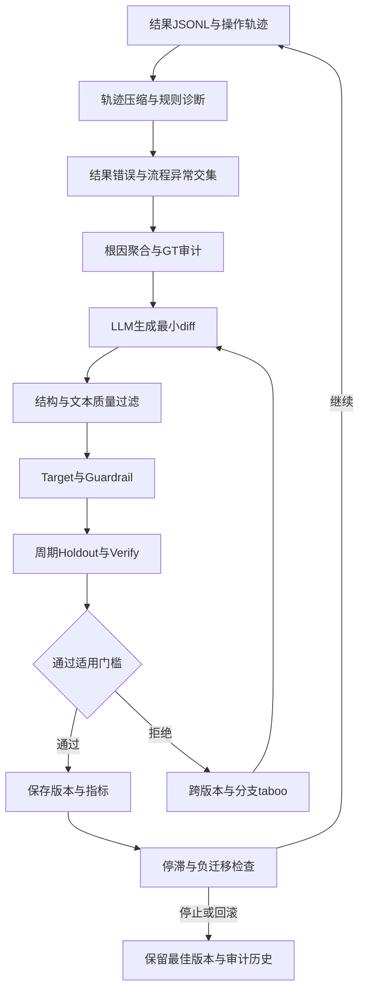

# Agent评测驱动Skill进化

## TL;DR

手工修改 Skill 容易修好一个 case、破坏另一个，本文把修改转成结果评测、轨迹诊断、候选 diff、分层验证和失败记忆组成的循环。LLM 只负责把诊断写成修改，诊断、数据审计、验收与回滚优先由确定性规则承担。安全审计案例依靠预先标注的二元答案和完整操作轨迹，使结果与流程能够交叉归因。作者报告同一批63个case上各模型的最终通过率提高，同时明确存在新增错误、规则覆盖有限和评测集质量依赖；这些局部结果不能代表所有修改都满足零回归要求。（来源：p.1–7、p.23–24）

## 核心概念与输入契约

**Skill** 在本文是描述任务步骤和约束的 `SKILL.md` 工作手册，改的是“怎么做”，不是创造新工具。**结果评测** 把 Agent 输出与人工标注比较，得到 TP、TN、FP、FN；代码安全案例中 `true` 是有漏洞，`false` 是无漏洞。作者强调，主观性仍存在于标注和 judge 提取规则，后续指标计算才是可重复的。适用条件是输出能被客观判对错；写文案或“总结得漂亮”不符合本文的自动迭代前提。（来源：p.2–3、p.23）

输入并非只有总分。`results.jsonl` 每行记录 `case_id`、`ground_truth`、`judge_verdict`、`pass_fail`、`failure_kind`；`sessions/<case_id>.jsonl` 记录工具调用、返回、阶段与结论。二者按 `case_id` 对齐，`manifest.json` 记录数据集、Agent、judge模型。文章的 JSONL 长行在 PDF 代码框右侧裁切，不能作为完整可运行样例；字段说明本身可读。（来源：p.3–4）

`sec-code-bench` 采用 FastAPI + SQLite 管理数据集、派题、记录、判分和导出，通过 OpenAPI 对接真实任务平台，并不自行起沙箱执行 Agent。评测侧负责标准答案与记录，执行侧保留日常模型、工具链和代码环境，以减少环境差异把优化方向带偏的风险。（来源：p.4）

## 知识框架

按正文整理，来源：p.2、p.10–20。下图是方法主线，非原插画逐节点复现。

## 关键机制

### 1. 用结果和过程共同定位修改对象

`trace_parser` 先把10万–50万token的session压缩成三层：工具调用骨架保留工具名和参数摘要、丢弃返回正文；阶段统计记录各类工具次数、error和重试；进度交叉验证比较“声称执行”与实际证据。作者给出的量级约100:1，并支持标准JSONL与Claude Code原生transcript的自动识别。压缩服务于稳定诊断，不表示完整原始轨迹已被等价保留。（来源：p.10）

`flow_diagnosis` 的基础规则不包含安全业务词，检测的是行为异常。`no_tool_calls` 检查零调用；`redundant_retry` 检查相同工具和参数重复≥3次；`repeated_file_edits` 检查同文件≥5次编辑；`tool_error_burst` 检查真实error≥8条；`tool_error_high_rate` 检查单工具error率≥50%；`tool_imbalance` 检查单工具调用占比>60%；`progress_mismatch` 检查声明步骤缺少证据；`conclusion_missing` 检查调用≥5个工具却未提交结论。搜索空结果和 `no such file` 等作者列出的“良性error”用 `BENIGN_ERROR_PATTERNS` 过滤，避免把探索过程判成故障。业务专属检查可扩展接入。（来源：p.10–11）

只有**结果错误 × 流程异常**的交集触发进化，答对但重试多的case优先级低。相同根因还需覆盖≥30%的失败case，避免围绕孤立异常改手册。作者对LLM直接诊断做过历史失败样本对照：更换prompt或温度后结论漂移，规则覆盖较窄却更稳定，因此选择“宁可少判，也不要飘着判”；本文未给出该实验的完整统计。（来源：p.9–11）

脱敏case `biz-vul-037` 连续3轮漏报。约28万token的轨迹中67次调用包括Read 38、Grep 21、Bash 8；Agent声称STEP1–4完成，证据只有STEP1、2、4。`progress_mismatch` 与FN组合指向“没有追到ServiceImpl实现层便下结论”。同根因覆盖5个失败case、占38%，通过聚合门槛后，候选patch要求使用 `Grep` 追到 `ServiceImpl` / `Processor`，接口签名或Facade不足以完成步骤，深度不足须说明判定置信度低。此处是该审计任务的业务约束，不是所有Agent通用规则。（来源：p.8）

### 2. 质疑标注，但不删掉难题

**gt_auditor** 给失败case计算0–1的GT可疑度：Agent与judge一致、却与GT相反权重0.40；步骤完整（≥5个STEP）0.20；执行清洁（error≤2）0.10；无重试0.10；结论明确0.10。≥0.5被标记GT嫌疑。嫌疑case仍参与gate，防止选择性忽略数据；patch阶段则提示LLM不要为迁就可能错标的样本改歪规则。同类型case的true/false冲突也会成为质量信号，但这是一项规则提示，不等于已证明标注错误。（来源：p.11–12）

⚠️[原文疑点] 列出的五个权重相加为0.90，文章未说明是否另有归一化。笔记保留逐项权重与阈值，不补造剩余0.10或改变分数定义。（来源：p.12）

### 3. 生成只是候选，限制修改的可执行性与幅度

LLM输入包含当前 `SKILL.md`（约5KB）、根因摘要（约2KB）、GT审计（约0.5KB）、taboo（约0.5KB），合计<10KB。输出严格限定unified diff，便于机器应用与精确撤销。候选依次过taboo方向拦截、结构检查和文本质量检查；任一fatal问题直接拒绝。（来源：p.12–14）

结构检查要求 `--- a/SKILL.md`、`+++ b/SKILL.md`、`@@`，总行数≤80，禁止新增Markdown标题以防重组文档。作者把80行视为保守learning rate：小改动便于定位回归、使taboo签名更精确、减少大面积重写破坏旧规则。这个约束是项目策略，不是diff格式本身的通用限制。（来源：p.14）

文本检查是“反口号”：DO/步骤行需命中具体工具、文件路径、反引号代码、大驼峰类名、函数调用或CLI参数；“认真审查”这样的空话不合格。“无论如何”“永远不”“跳过检查”被拒绝；声称修复的问题必须同时编码动作。原文只有规则解释和patch片段，没有提供完整生成prompt或可安装Skill，不能据此补成完整工具包。（来源：p.13–14）

### 4. 四层gate分别回答不同问题

| Gate | 判据 | 作用 | 来源 |
|---|---|---|---|
| Target | 本次想修的case至少1个从错变对 | 确认修改有效 | p.15 |
| Guardrail | 原先通过的case不得出现新错 | 拦截已有功能回归 | p.15 |
| Holdout | 每5轮检查，整体F1下降不超过1个百分点 | 检查未参与诊断的泛化样本 | p.15–16 |
| Verify | 文本质量≥75分，较上一版下降不超过5分 | 约束格式、触发词、规则前置等手册质量 | p.15–16 |

case池分为Selection 60%、Holdout 25%、Golden 15%。Selection用于每轮target与guardrail；Holdout只做周期泛化监控；人工审过的Golden用于verify校准、永不参与进化。隔离是为了不让诊断和patch参考到隐藏答案。前三层约束结果，Verify约束手册结构；当前样本上好用不自动意味着长期流程可靠。（来源：p.15–16）

### 5. 失败记忆、停止条件与恢复

拒绝的patch保存 `rule_id`、`diff_hash`、`reason`、`recorded_at`。正文同时描述生成前以“rule_id + 诊断方向”查询taboo、生成后以SHA256前16位指纹精确匹配；两种层次都保留，文章未详述二者的完整实现接口。taboo跨版本、分支共享，回滚不清空，避免重新尝试已知失败方向。（来源：p.14、p.16–17）

作者列出F1≥0.95、连续无进展、Skill超过15000字节和最大迭代预算等停止信号。正文进一步给出加权停滞：每轮增量为 `0.3 × target未改善 + 1.0 × guardrail回归 + 0.7 × holdout下降`，累计到5.0停止。⚠️[原文疑点] 前一页概述写“连续5轮gate都没通过”，后一页说明5轮仅未改善累计1.5仍继续；二者不是同一判据，执行实现应以实际脚本确认。guardrail权重高于单纯未改善，强调防止变坏。（来源：p.17–18）

当停滞超阈值时，对照当前版本与历史最佳holdout版本，若当前更差则建议或自动回滚。每轮target改善且guardrail不回归，也可能累积holdout下降，故不能只看单轮局部成功。15000字节是作者历史经验警戒线，不是通用常数；触发后进入只合并/删除冗余规则、不新增规则的精简模式。（来源：p.18）

工程上以Claude Code Plugin承载，薄 `/evolve` 命令负责参数，厚skill分成主流程、版本记忆、数据准备、verify模板。`.pending_round.json` 记录阶段供session-start hook提示恢复；原文长行被裁切，完整恢复状态schema未取得。版本目录保存 `SKILL.md`、`metrics.json`、`gate_verdict.json`、`patch.diff`、`provenance.json`，`current`软链切换版本，临时文件rename避免半写入。回滚也追加 `edit_audit.log`，snapshot、rollback、taboo_append、fork还写append-only timeline，文件系统便于git、rsync和tar管理。（来源：p.19–21）

## 实验数据与边界

以下均为同一营销漏洞数据集63个case、同一Agent，completed且error_cases=0的原文结果，不是独立泛化实验。

| 运行 | Skill profile | 通过率 | 通过/失败 | TP/TN/FP/FN | 平均耗时 | 来源 |
|---|---|---|---|---|---|---|
| Kimi v1 | deepseek | 77.8% | 49/14 | 18/31/4/10 | 760044ms | p.6 |
| Kimi v2 | evolution | 84.1% | 53/10 | 21/32/5/5 | 582401ms | p.6 |
| GLM v1 | deepseek | 77.8% | 49/14 | 18/31/4/10 | 694317ms | p.6 |
| GLM v2 | evolution | 88.9% | 56/7 | 22/34/3/4 | 739078ms | p.6 |
| DeepSeek v1 | deepseek | 82.5% | 52/11 | 19/33/2/9 | 626013ms | p.6 |
| DeepSeek v2 | deepseek | 84.1% | 53/10 | 20/33/2/8 | 843350ms | p.6 |
| DeepSeek v3 | evolution | 87.3% | 55/8 | 19/36/1/7 | 636617ms | p.6 |

⚠️[原文疑点] 固定同一标注集的描述下，表中部分运行的 `TP+FN` 为28，部分为26；`TN+FP` 也随之变化。表格逐项忠实保留，不能用这些混淆矩阵进一步推出可信的跨运行召回率变化。作者没有解释此处统计口径。（来源：p.5–6）

逐case层面，Kimi修复10个、新增6错、净改善4；GLM修复9个、新增2错、净改善7；DeepSeek v2→v3修复6个、新增4错、净改善2。与严格Guardrail规则一起阅读时，应区分“演化前后展示结果”和“单patch接受条件”，文章没有提供每一步gate记录证明展示结果均零回归。（来源：p.6–7、p.15）

另一组语义替换实验把同一Skill的“漏洞”改成“风险”，正确率89.3%→62.1%，正文简称差27个百分点；这与前述63-case表格是不同实验，不拼接。作者认为二元任务中“风险”扩大判定边界，但不宣称该词在所有语境禁止使用。项目整理17组中文、10组英文陷阱词及4种句式，PDF未提供完整词表。（来源：p.21–22）

## 可迁移原则与已知失败分支

把生成动作限制在有客观验收的候选修改上；保留原始结果和过程，避免只对总分优化；失败记忆在回滚后继续存在；独立隐藏集用于发现累积负迁移。这些机制建立在足够、有代表性且可靠标注的评测集之上，不能因有GT审计就忽略数据治理。（来源：p.22–24）

作者明确承认四个边界：缺少工具能力时改流程救不了；流程完整但纯认知判断错误时规则可能无法诊断；样本太少或FN/FP分布偏斜会误导30%门槛；F1到0.90+后剩余hard case收益递减，可能需要改善模型、工具和输入信息。（来源：p.23–24）

## 记忆锚点

“用工程纪律，去约束LLM的不确定性”串起全篇。助记改写：**先证明错在哪里，再提出小改动；既检查修好什么，也检查破坏什么；回滚版本，不抹掉教训。**（来源：p.23）

## 复习卡片

本文自动Skill进化的首要适用条件是什么？::任务输出能被客观判对错，并有可靠结果信号；开放式文案好坏不符合本文判据。（p.2–3）
为什么不能只有results.jsonl？::结果说明哪里答错，session轨迹才提供工具与步骤证据，两者交叉才能定位流程根因。（p.3–4、p.11）
为何诊断引擎优先使用规则？::作者发现LLM诊断会随prompt和采样漂移，规则覆盖有限但可复查且稳定。（p.9）
哪些case会触发修改候选？::结果错误和流程异常的交集，且同根因默认覆盖至少30%失败case；答对但低效不优先改。（p.11）
GT嫌疑case会退出gate吗？::不会，仍正常参与评测；生成patch时提示可能错标，避免迁就标注而改歪。（p.12）
Guardrail与Holdout分别保护什么？::Guardrail保护此前通过的case，Holdout隔离诊断和生成过程、周期检查泛化退化。（p.15–16）
为什么taboo不能在回滚时清空？::失败方向是跨版本经验，清空会再次尝试已拒绝的修改。（p.17）
流程完整但仍判断错能靠基础规则自动修好吗？::不一定，作者将纯认知错误列为未诊断边界；缺失工具能力也不能靠改Skill补出。（p.23）

## 知识关联与原文参考

评测与约束：[[Agent评测与反馈]]、[[Prompt优化]]；版本与记忆：[[Agent任务恢复]]、[[Agent长期记忆]]；工程循环：[[Agent工程循环]]、[[Harness与模型协同]]。

原文参考：《别让大模型“想太多”：SKILL开发中的语义陷阱与抗幻觉设计》，`https://sumsec.me/2026/skill-semantic-traps-anti-hallucination.html`（p.24）。仅保留原文入口，未联网核验。p.26作者回复称暂无开源地址、针对内部场景优化，不能把本文写成已公开可安装教程。

本次归纳主题：[Agent评测与反馈](../../20_topics/Agent评测与反馈.md) · [Agent任务恢复](../../20_topics/Agent任务恢复.md) · [Prompt优化](../../20_topics/Prompt优化.md) · [Agent工程循环](../../20_topics/Agent工程循环.md)。

> [!note]- 校对报告
> **覆盖度**：通读26页文本、浏览26页缩略图；放大核对p.3、6、8、12、15、18的代码裁切、实验表、patch、GT权重及gate/停滞。覆盖15个主章节；装饰插画、推广和读者评论不作为技术证据。长行裁切不补全。
> **一致性抽查**：核对项｜笔记值｜原文与位置｜结果。样本量｜63｜p.5｜一致；GLM最终通过率｜88.9%｜p.6｜一致；diff上限｜80行｜p.14｜一致；Holdout周期｜每5轮｜p.15｜一致；精简警戒线｜15000字节｜p.18｜一致。
> **异常汇总**：p.3、4、8、13、16、19–20存在长行右裁切；p.6固定标注集与混淆矩阵分母变化待确认；p.12权重合计0.90未解释；p.17–18“5轮”与加权停滞口径不一致。未添加外部技术知识。
> **日期与格式**：页首Aug 13, 2026，date为2026-08-13，不猜时区。正式文件遵循本库AI_短标题.md命名。Mermaid未渲染、文章命令及代码未运行；卡片单行`问题::答案`，一个H1，代码块已闭合。
