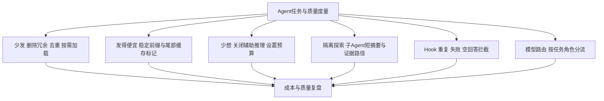

# Harness成本优化实战

## TL;DR

多轮 Agent 的账单主要来自固定前缀、累积历史与工具结果反复发送，用户几字需求只是表面。本文在百炼 `qwen3.7-max` 故障诊断实践中，把成本治理拆成少发、缓存、限制思考、隔离探索、Hook 止损和模型分流六项 Harness 职责。裁剪降低实际发送量，缓存降低重复部分单价，两者不能互相替代。标题的 88% 对应 20 轮主 Agent 输入侧的统一假设计费测算，假设每轮在 5 分钟 TTL 内连续命中，不是整体生产账单的严格受控实验结果。（来源：p.1–3、16–17）

## 度量先行：钱、轨迹与质量一起看

**Agent Loop**在这里是模型与工具循环交互；每轮都带固定规则、工具 schema 和历史，新增工具结果又会成为后续输入。原文三轮示意累计 209.4k Token，用户输入仅 0.3k，固定前缀重复六次达到 120k、占 57%。这个示意说明早进入上下文的内容会乘以后续轮数，而非只付一次成本。

团队用三条链交叉验证。自研采集 API usage 并写本地，`cache_hit_rate = cached_tokens / prompt_tokens`；没有 usage 记空值，不伪装成 0。Langfuse 中一次调用是一条 Generation、任务是一条 Trace，Subagent 通过 `parent_task_id` 回到父任务，异步上报不阻塞主循环。评测 Agent 先从轨迹找重复调用和连续失败，再用轻量模型评估相关性、工具效率、重复操作、错误恢复和完整性五维，低分/异常任务保存诊断包。作者强调不能用质量下降换账单下降，7 月又叠加任务接入和边界问题，完整优化在 8 月落地，不能把不同月份当作完全一致的实验样本。（来源：p.2–3）

## Harness的六个成本入口

下图按正文六项职责整理，六者是不同控制位置，不是所有任务必须顺序经过的固定工作流。（来源：p.3–16）



## 少发：一次性加载不等于每轮重新注入

### 规则与工具的固定开销

作者删去约 1.2K Token 的 ReACT 教学、工具协议和示例后，观察到工具准确率与任务完成率未下降。这个结果是其所用模型和样本的观察，不代表所有规则都可删除。System Prompt 每轮当场构建，历史只存 user/assistant 与工具结果，避免每轮又追加一份 system 后形成 ×1、×2、×3 的膨胀。（p.3–4）

**Deferred Tools**把工具分为常驻池和延迟池。Read/Edit/Bash/Grep/Glob/Write、ToolSearch、CallDeferredTool 等常驻完整 schema；MCP、WebSearch/WebFetch、DB 等低频能力在 prompt 中只留稳定名称目录，原文上限 50 行。百炼在作者测试中静默忽略 `defer_loading` / `tool_search`，HTTP 200 不等于延迟流程生效，所以团队在 Harness 自行实现代理。

激活有两条路径：模型调用 ToolSearch，或 ActivateSkill 返回正文后按工具名匹配延迟工具。返回的 `name+schema+guidance` 作为 reveal payload 追加历史尾部，`ToolRevealRecord` 持久化，由 CallDeferredTool 代理执行真实工具。`tools` 数组和 system 目录不因 reveal 改变，已加载工具再搜索只返回短回执。这样减少固定开销同时保住前缀缓存。原文流程图右端被裁切，不补全未显示的代理实现。（p.4–5）

常驻工具也要精简，但作者强调名称和入出参要一致，避免用熟悉名称配陌生契约，导致模型先按旧经验调用失败。对 Claude Code 定义与训练分布的说明是作者判断，不据此推断任何基模必然支持某个参数。（p.5）

### Skills与Read去重的不同边界

同一 Skill 在一次请求的 messages 中全文最多出现一次。用户 metadata 激活与 LLM ActivateSkill 共享这一不变量：先激活者持有全文锚点，后者只得短提醒，约 150 字符；激活集合从历史推导，重启也可恢复。按五次重复激活计算，正文只写一次可少写接近 80%，并非总账单降低 80%。（p.5–6）

Read 去重维护已读路径与文件 `mtime`，同 run 内已读且未改、或同批重复便跳过；文件改变可再次读取。原文示例即使 `offset=100` 也跳过，且注明“不看 offset”。因此这是一种激进省 Token 策略：若前次只读片段，它不应被理解为已经证明其他片段都可读；原文未给片段感知的更细实现。模型仍可用 shell 读取文件，本文没有把去重描述成完整访问控制机制。（p.6）

### MCP迁往CLI + Skills

作者的窄用途 Mongo 成本能力注册 24 个数据库工具，描述近万字符、76 处注解，每轮有两三千 Token 固定开销。迁移后常驻入口缩为 Bash，技能正文按需加载，输出可通过 `head/grep/jq` 过滤，再把需要的数据回传模型。作者强调 schema、返回体和旧调用范式污染三项成本，并建议新增能力先评估能否采用 CLI + 一份 Skill。

这里是作者的系统选择，不是所有 MCP 结果天生无法过滤、所有 CLI 天生兼容。原文关于 MCP 规范、模型训练和第三方研究的引用只按文内说法保存，没有联网核验；CLI 的集中更新、灰度和兼容收益也依赖其描述的更新机制。（p.7–8）

## 缓存：稳定的是序列化字节，不只是内容集合

**KV Cache**用于复用前缀 prefill 结果。本文百炼条件为显式命中标准输入价 ×10%、隐式 ×20%，显式新建 ×125%；至少 1,024 Token，单次最多 4 标记，TTL 5 分钟且命中续期，tools 也参与前缀缓存。这些是文章时点的供应商条件，本文没有验证当前 API 或价格。（p.8–10）

System Prompt 按变化概率从低到高排列：Constant 是身份与固定规则；SessionStable 是 AGENTS.md、技能列表与应用信息，会话内不变；MidConversation 是延迟工具完整目录，跨 reveal 不删改；之后才是 Dynamic 和 messages。分界字符串为 `__SYSTEM_PROMPT_DYNAMIC_BOUNDARY__`。变化从发生处破坏后续缓存，所以工具 A/B/C 即使集合相同，排序改成 B/A/C 仍会失效。团队只构建一次 tools，工具和技能先固定排序再截断。

动态区每块最多 4,000 字符、总计不超过 16,000；Memory index 到 8,000 字符后改为提醒按需查询。技能目录过长先短描述、再只留名称、最后截断。最新时间放本轮 user 消息末尾，避免影响先前已缓存的固定前缀。（p.9–10）

尾部缓存断点覆盖 system、tools 与全部历史；旧前缀下一轮按命中价、新增 Δ 按创建价。序列化出口从末尾往前找首条有文字的消息，累计字符至少 4096 时，在最后一个 text 块添加下列标记。字符阈值是本实现启发式，不能替换供应商的 1024 Token 下限；无文字的 `content=null` 跳过。

```json
{"cache_control": {"type": "ephemeral"}}
```

2026-07-26 同 prompt 诊断任务测试清空 memory，显式组 13 calls、隐式组 16 calls，且原文明确“两组非严格受控测”。显式加权命中 0.898、中位 0.939；隐式 0.800、中位 0.899。表内显式创建调用为 0.000，其“最低 0.640、无灾难脱靶”应放在创建之后的命中调用语境；不能删除初次创建记录后声称所有调用最低都大于零。输出长短也影响 latency，不能把 0.996 命中但 60.2s 的调用解释为缓存失效。（p.10–11）

## 少想、隔离和Hook：分别控制生成与循环成本

### 思考预算按场景实测

标题、分类、查询富化、建议、字段提取和简单压缩，输入输出短、答案范围窄，团队直接关闭 thinking；主循环和判断型 Subagent 才打开。主 Agent 与推理型子任务采用 `thinking_budget=4,096`，另给最终回答预留 4,096。故障诊断样本从不思考到 4K 改善工具选择和根因判断，再放到 8K/16K 没有同步改善完成率。这是特定样本拐点，不是百炼推荐通用配置。（p.11–12）

### 子Agent隔离“长过程、短结论”

Subagent 独立上下文调查，完整结果落文件，默认回传不超过 600 字符摘要与结果路径。父级只有在关键结论影响判断时按证据位置读取详情。原文估算父上下文少重发的 Token 约为“父级剩余轮数 ×（探索过程－回传摘要）”；它不包含子任务自身前缀和委派开销，所以单次 2k 查询、查完就能回答的任务可能更贵。

适合委派的是大量目录/日志/数据源探索、相互独立方向、最终只要结论与证据位置、边界清晰的只读工作；完全串行依赖、最终仍须通读原文或多人修改同一状态则留主级。并发只缩短等待，不自动减少三份上下文成本。委派必须写背景、目标、范围、已知事实、读写边界和返回要求；回报含状态、结论、证据、未确认项、下一步、结果路径。超时、预算耗尽或权限不足时，Hook 强制总结已查与未查范围。（p.12–14）

### 循环外部拦截退化

仅在 prompt 里说“不要重复”不够，退化内容还会沉入历史，越转越贵。原文规则如下，均是团队实测阈值，不是跨模型默认值：同一 SSE 内正常句子第三次完整重复就停止接收，排除代码块和短句；重新回答仍复读则结束 Loop。跨 Turn 对回答前 500 字符做指纹，与最近三个 Turn 比较，相似度超过 80% 判无进展，前两次提醒换方法，第三次结束，内容变化清零计数。同组工具参数连续 8 Turn、连续 5 Turn 结果全错/空、Shell 累计失败 4 次会触发改路提醒；用户连续 3 次未响应确认则停止确认动作。仅 reasoning、无正文或工具的假动作最多纠正三次，第四次仍空便停。退化 prompt 复述和自我指令也丢弃，并要求形成可读总结。（p.14–15）

## 模型分流与88%测算

ModelRegistry 用 `default_chat_alias`、`classify_alias`、`responses_alias`、`file_extract_alias` 四个角色指针间接引用具体模型，gRPC 下发、客户端落盘，后端换模型不需客户端发版。辅助任务通常走 Flash，质量评估若 `dimension_consistent == false` 才升级旗舰。explore/data-query 子任务走轻量，plan/verification/code-review 等走主模型；模式化 K8s Agent 全角色走 Flash，作者报告单次费用约为原来的 1/15。用户前台模型切换不改变后台分类 alias。（p.15–16）

20 轮示例输入为 \(S+i\Delta\)，S 是固定前缀，Δ 是每轮新增历史：

\[
20S+(1+2+\cdots+20)\Delta=20S+210\Delta
\]

| 场景 | 实际发送 | 等价全价Token | 输入费用 | 降幅 / 条件 | 出处 |
| --- | --- | --- | --- | --- | --- |
| 无优化 | 820k | 820k | ¥9.84 | 基线 | p.16 |
| 仅缓存 | 820k | 151k | ¥1.81 | 81.6% | p.16 |
| 裁剪+缓存 | 532k | 96.9k | ¥1.16 | 88.2% | p.16 |
| 标准输入价 | — | — | ¥12/M Token | 统一测算价格 | p.16 |
| 显式 / 隐式加权命中 | — | — | — | 0.898 / 0.800；非严格受控的同场景测试 | p.11 |

测算只包括主 Agent 输入侧，20 轮都在 5 分钟 TTL 内连续命中；缓存后的发送量仍是 820k，裁剪才变成 532k。不得把 88.2% 套给输出侧、子任务总账或任意会话。（p.17）

## 记忆锚点与复习卡片

**助记改写**：“少发改变数量，缓存改变单价；隔离长过程，Hook止空转。”

为什么用户几个字会产生大量Token？::固定前缀每轮发送，历史与工具结果不断累计，早出现的内容还会伴随后续轮次重发。（p.1–2）
usage缺失应该记0吗？::不应，本文记为空；0表示观测到零，会混淆不可用数据与实际消耗。（p.2）
Deferred Tools怎样同时省schema又保护缓存？::完整schema按需追加历史尾部，tools数组和名称目录保持不变，重复加载只回短回执。（p.4–5）
工具集合相同为什么仍会缓存失效？::缓存依赖序列化字节，列表重排就改变前缀，因此需要稳定排序与构建。（p.10）
4096字符等于供应商1024Token下限吗？::不是，前者是团队序列化标记启发式，后者是文中供应商缓存条件。（p.9–10）
4K thinking预算是通用推荐吗？::不是，是故障诊断样本扫出的拐点，且最终答案另预留4096空间。（p.12）
什么时候子Agent隔离可能更贵？::一次短查询即可回答、任务严格串行或父级仍须读全部原文时，子任务前缀与委派开销可能超过收益。（p.13）
88.2%降幅包括什么？::20轮统一假设下主Agent输入费用，裁剪与缓存叠加，要求5分钟TTL内连续命中；不包含整体输出和子任务账单。（p.16–17）

## 知识关联与原文资料

- [[Harness与模型协同]]、[[Agent工程循环]]：固定约束、运行时止损与角色分流。
- [[Agent长期记忆]]、[[Agent任务恢复]]：Skill锚点、历史推导与文件冷存储。
- [[Agent评测与反馈]]：轨迹异常、质量底线与诊断包。

原文参考入口包括[百炼缓存](https://help.aliyun.com/zh/model-studio/context-cache)、[显式缓存实践](https://help.aliyun.com/zh/model-studio/explicit-cache-guide)、[调用价格](https://help.aliyun.com/zh/model-studio/model-pricing)、[思考模式](https://help.aliyun.com/zh/model-studio/qwen-api-via-dashscope)、[Claude Code缓存](https://claude.com/blog/lessons-from-building-claude-code-prompt-caching-is-everything)、[Code execution with MCP](https://www.anthropic.com/engineering/code-execution-with-mcp)、[Lost in the Middle](https://aclanthology.org/2024.tacl-1.9/)等；仅保存原文引用，未访问核验。（p.17–18）

本次归纳主题：[Harness与模型协同](../../20_topics/Harness与模型协同.md) · [Agent任务恢复](../../20_topics/Agent任务恢复.md) · [Agent成本与上下文预算](../../20_topics/Agent成本与上下文预算.md)。

> [!note]- 校对报告
> **覆盖度**：通读 p.1–19 全部文字，浏览全部页图缩略，放大核对 p.1,3,5,6,9,10,11,16。主要章节已覆盖；文末营销、推荐与读者留言未作为技术结论。
> **一致性**：
> 
> | 核对项 | 笔记值 | 原文值与位置 | 结果 |
> | --- | --- | --- | --- |
> | 测算降幅 | 88.2% | 88.2%，p.16 | 一致 |
> | TTL | 5分钟 | 5分钟且命中续期，p.9 | 一致 |
> | 命中组对比 | 0.898/0.800 | 显式/隐式加权，p.11 | 一致 |
> | 思考预算 | 4096+4096 | 思考4096/答案预留4096，p.12 | 一致 |
> | 子任务摘要 | ≤600字符 | 不超过600个字符，p.12 | 一致 |
> 
> **推断与异常**：p.5–10多处等宽示例右端超出版面被裁切；保留可读机制，不补齐截断代码或ASCII图。；p.11显式表含首次创建0.000，“最低0.640”按创建后命中调用理解；不能称全部调用最低0.640。
> **日期与格式**：发布日期取自 p.1 页首，2026-08-21，未推测时区。归档沿用本库 `AI_短标题.md` 命名。一个 H1、卡片单行 `问题::答案`；Mermaid 未渲染，文章代码/命令未执行。
