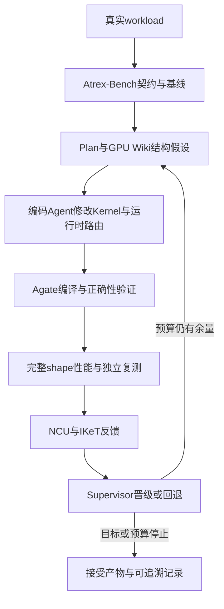

# KernelAgent生产算子优化

## TL;DR

AKA（Atrex Kernel Agent）把 Kernel 优化从有限 benchmark 推进到真实 workload、混合精度与生产接口契约。它在 FA4 prefill、FA4 decode、GDN prefill 共 60 个真实 shape 上，通过结构设计、编码、GPU 评测、性能反馈及 Supervisor 门禁，取得三条算子线几何平均时延均低于专家的结果。收益来自调度、页面布局、计算分解与流水线重构，并非只搜索 tile 参数；“平均更快”不代表每个 shape 都超过专家。Harness 自进化仍为实验性方向，文中显示更早进入高性能区，但不能把不同轨迹终点连成一次统一优化实验。（来源：p.1–9）

## 生产交付把问题重新定义为“契约内的稳定更优”

公开 benchmark 能验证给定题目的正确和性能，却未必覆盖真实 shape 分布、混合精度语义、MTP 负载、生产页表及输入/输出 buffer 协议。候选不能只对少数 case 有效，不能借特定输入分布或绕过必要计算取巧；精度、稳定性、整组收益任一失效都可能无法上线。

**AKA**是阿里巴巴 TRE AI 系统工程团队研发的生产级异构推理算子生成 Agent。三条线在相同硬件、接口与 shape 集合中，对照生产/官方实现、Atrex 专家手工实现与 AKA。候选先过数值正确性再进入完整 workload 性能复测。FA4 prefill 对照闭源 FlashInfer-TRTLLM 生产路径；decode 对照公开 FlashInfer；GDN 对照官方 chunked 主干，搜索时不向 Agent 提供独立专家 M64 源码或策略。（来源：p.2–3、5）

## 系统闭环：设计权与晋级权分开

**Atrex-Bench**把百炼真实部署的算子接口、shape、生产页表和 buffer 约束转为契约与基线，也据真实流量成本确定探索优先级。**Plan**结合 GPU Wiki、计算模式与硬件特性建立设计空间，涵盖数学等价变换、tile/layout、pipeline/warp role 和主机/设备端边界，之后编码 Agent 才实现 Kernel 与运行时路由。

**Agate**提供隔离、可复现的 GPU 执行环境；NCU 提供吞吐、occupancy、访存与 warp stall 宏观信息，**IKeT/IKET**等内核时间线记录 warp role、pipeline wait、TMA/MMA 与 barrier 事件。前者回答哪里慢，后者帮助定位哪个 warp 在哪个同步点等待。原文没有展开这些缩写定义与 profiler 接口，保留其名字和文中职责，不补安装细节。

**Supervisor**机械化管理预算、正确性、测量、晋级与回退。通过正确性硬门之后，还要完整 workload 评测和独立复测；错误或性能回归回退，稳定更优才晋级。代码、Profile、知识记忆与实验日志同步保存，使结果可复现、解释、回滚。原图还展示工作树中的 journal/handoff 作为重启恢复位置，Supervisor 在预算仍有余量时回到 Episode Worktree，达到目标或预算停止后接受输出。（来源：p.6–7）

下图按正文 p.6–7 整理，保留门禁和搜索回路：

## 三个结构优化案例

### FA4 prefill：让常驻cluster跨tile复用流水状态

在 `batch=1、Q=KV=4224` 的单序列 self-prefill，page64、16 个 Q head、1 个 KV head、head 维度 256，AKA 与专家都使用单个 2-CTA Kernel，所以这里性能差异不来自 Kernel 数量拆分。

专家采用固定 2-CTA tile 调度；AKA 对大 prefill 引入 **persistent grid**，常驻 cluster 跨约 4 个 wave 连续处理多个逻辑 tile，复用 pipeline、TMEM 与 barrier 状态，把启动、分配、同步和退出成本分摊到更多工作。单请求没有跨请求负载不均，M-raster 将 causal attention 轻重计算交错分给常驻 cluster。

数据路径也同步特化：原生 page64 TMA 直接搬 K/V，避开通用页面拼装；load-and-reduce 加速行最大值；causal softmax 拆成无 mask 前缀与有 mask 后缀，行最大值不变时跳过不必要校正缩放；合并写回并提前释放输出资源收紧 epilogue。这是调度、搬运、softmax 和写回联合调整的结果，不能把 1.17× 全归因于其中一个动作。该 shape 时延 AKA 63.42 µs、专家 74.37 µs、生产 94.60 µs，分别约 1.17×/1.49×。（来源：p.4）

### FA4 decode：生产布局原生适配，q1/q4分治

生产页表为 page128，上游通用入口主要按 page64 设计，通常需适配层将 KV 零拷贝重解释为两个 page64 并重展开页表。AKA 原生接收 `table_page_size=128`，直接匹配生产布局，并把 `q_len=1` 与 `q_len=4 MTP` 当不同调度问题。

q4 路径使用 `prediction_tile=2、sequence_tile=128、cluster_kv=2`，配合 split/reduction 搜索；编译期 mask 特化、循环剥离和静态 trip count 去掉通用边界分支。q1 与专家基本持平，决定性收益集中在 q4。q4 的 10 个 shape 全部领先专家，几何平均专家/AKA 约 1.19×、生产/AKA 约 2.15×；完整 20 shape 是生产/AKA 1.55×、专家/AKA 1.075×。这两个尺度必须分开，不能写成全部 decode 达到 2.15×。（来源：p.4–5）

⚠️[原文疑点] p.2 图1 decode 子图标题写 `Qwen3.7-Max`，正文与整篇主题写 `Qwen3.8-Max`。未静默统一；指标保留文中算子/shape 口径，但模型标签差异仍待原作者确认。

### GDN prefill：在问题描述与标量搬运上另走路径

**Gated DeltaNet（GDN）**在本文是 Qwen 混合架构的线性注意力算子。搜索从公开 FlashInfer chunked 主干开始，未提供专家 M64 代码/策略。专家 `cluster_shape_mnk=(1,2,1)` 让两个 CTA 合作拆 value；AKA 保持 `(1,1,1)`，在问题描述中把物理 value head 重述为两组行块，由调度器直接分配。

在 `B=1、M64` 稳定路径，专家用 g2r 与 chunk lookahead；AKA 增加 scalar-TMA warp，将四个 head 的标量列合并搬到共享内存，结合静态 TMA 描述符及 `q3/k4/v2/o1` 流水。NCU 与 IKeT 的联合反馈定位标量搬运和同步等待，促成事件流和流水阶段调整。经过 117 轮有效探索，10 shape 几何平均 AKA 179.830 µs、专家 192.176 µs、FlashInfer core 229.604 µs。（来源：p.5–6）

作者概括专家优化既定接口内的最快方式，AKA 则把接口边界、Kernel 数量、计算分解和调度结构纳入搜索。这里“搜索接口结构”仍须服从生产上游下游契约，不是允许改变既有语义以换取速度。（来源：p.2、6）

## 总体结果与逐shape边界

加速比统一为“基线时延 / AKA时延”，大于 1 才表示 AKA 更快。所有平均值为各算子完整 shape 集合的几何平均，不是某个最好 case，也不是业务端到端服务提升。（来源：p.2–3）

| 线路 / 指标 | 原文数值 | 语境 / 条件 | 出处 |
| --- | --- | --- | --- |
| FA4 prefill规模 | 30 shape | 总60 shape的一部分 | p.3 |
| prefill比生产 / 比专家更快 | 30/30；25/30 | 严格时延比较，不是全部超过专家 | p.3 |
| FA4 decode规模与更快数 | 20；19/20生产、12/20专家 | q1/q4合计 | p.3 |
| GDN规模与更快数 | 10；10/10生产、10/10专家 | 完整集合 | p.3 |
| prefill总体生产/专家/AKA | 1252.4 /1110.0 /1040.4 µs | 图1几何均值 | p.2图1 |
| decode总体生产/专家/AKA | 57.0 /39.6 /36.8 µs | 图1几何均值；模型标签疑点见正文 | p.2图1 |
| GDN总体AKA | 179.830 µs | 专家192.176、core229.604 | p.5 |
| q4子集加速 | 1.19×专家、2.15×生产 | 10个MTP shape | p.4 |
| decode完整集加速 | 1.075×专家、1.55×生产 | 20 shape | p.5 |
| GDN有效探索 | 117轮 | 主优化案例 | p.5–6 |

## Harness自进化：更早越线，不等于终点更低

实验性自进化把历次轨迹中的高价值上下文、profiler 信号和成功操作序列用于改提示词、知识路由、预算和复测。进化前轨迹第 28 轮过专家线，第48轮 186.799 µs，第103轮 184.268 µs；进化后是**另一次**GDN实验，23 个完成 Attempt、两条并行 Trajectory，第11个完成 Attempt 越线，第22个 187.299 µs。

按记录 Token，越过专家线进化后约 1.56 亿，进化前约 7.30 亿；进化后约 3.08 亿达到 187.299 µs。结论是新 Harness 在这次比较中更早进入高性能区间，不是证明最终时延胜过旧轨迹终点 184.268 µs，更不能与主案例 179.830 µs 拼成同一次连续演进。图中专家线 195.6 µs 属于此实验，不能替换前面完整 workload 专家 192.176 µs。（来源：p.8）

## 可迁移原则与记忆锚点

- 性能目标用真实 workload 与契约定义，避免局部 benchmark 的有利样本掩盖回归。
- Plan 提出结构假设，外部正确性/性能门禁决定是否接受，模型不能凭解释自行晋级。
- NCU 与时间线 profiler 提供互补反馈，必须把结构假设落实成独立复测，而非只看一次最好耗时。
- **助记改写**：“先契约，后结构；正确才计时，复测才晋级。”

## 复习卡片

为什么Kernel benchmark成功不等于生产可替换？::生产需覆盖真实shape、混合精度、MTP、页表与buffer协议，并在整组工作负载保持正确稳定收益。（p.2）
AKA候选由谁决定晋级？::Supervisor管理正确性门禁、全workload评测、独立复测与回退，只有稳定更优版本晋级。（p.7）
NCU与IKeT反馈怎样互补？::NCU看吞吐访存和warp stall宏观瓶颈，时间线定位warp角色与具体同步点等待。（p.7）
prefill案例为什么不能把收益归因于Kernel数量变少？::AKA和专家都是单个2-CTA Kernel，差别在persistent调度与内部数据流水联合重构。（p.4）
decode的2.15×适用于哪组？::只适用于q_len=4 MTP的10shape生产对照；完整20shape为1.55×。（p.4–5）
三条几何均值更快是否说明每个shape都胜专家？::不是，prefill仅25/30、decode12/20，GDN10/10更快。（p.3）
Harness自进化实验支持什么结论？::另一次实验更早以更少记录Token进入专家线以上性能区，未证明最终时延优于旧轨迹终点。（p.8）

## 知识关联与原文入口

- [[Agent工程循环]]、[[Harness与模型协同]]：结构假设、反馈、门禁和经验沉淀。
- [[Agent评测与反馈]]：真实workload、独立复测、逐shape与几何均值边界。
- 候选 [[Agent工程循环|GPU算子优化]]。

原文提供 [atrex-kernel-agent](https://github.com/alibaba/atrex-kernel-agent) 和 [atrex-kernels](https://github.com/alibaba/atrex-kernels)。文中称支持 NVIDIA/AMD/PPU、多种编码 Agent 与 Triton/CuTe DSL/CUDA/FlyDSL/TileLang；环境、命令与产物需看仓库 Quick Start，本文没有完整教程，未访问或执行。（p.9）

本次归纳主题：[Agent评测与反馈](../../20_topics/Agent评测与反馈.md) · [Agent工程循环](../../20_topics/Agent工程循环.md) · [Agent成本与上下文预算](../../20_topics/Agent成本与上下文预算.md)。

> [!note]- 校对报告
> **覆盖度**：通读 p.1–11 全部文字，浏览全部页图缩略，放大核对 p.1,2,4,5,7,8。主要章节已覆盖；文末营销、推荐与读者留言未作为技术结论。
> **一致性**：
> 
> | 核对项 | 笔记值 | 原文值与位置 | 结果 |
> | --- | --- | --- | --- |
> | 总shape | 60 | 60个真实shape，p.2 | 一致 |
> | prefill单例 | 63.42µs | 63.42µs，p.4 | 一致 |
> | decode完整加速 | 1.55× | 1.55×，p.5 | 一致 |
> | GDN时延 | 179.830µs | 179.830µs，p.5 | 一致 |
> | GDN探索 | 117轮 | 117轮，p.5–6 | 一致 |
> 
> **推断与异常**：p.2图1decode子图模型标签Qwen3.7-Max与全文Qwen3.8-Max不同，未静默统一。；p.8Harness进化为另一次GDN实验，与主案例不同；更早越线不等于终点时延更低。
> **日期与格式**：发布日期取自 p.1 页首，2026-09-28，未推测时区。归档沿用本库 `AI_短标题.md` 命名。一个 H1、卡片单行 `问题::答案`；Mermaid 未渲染，文章代码/命令未执行。
