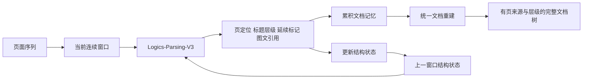

# LogicsParsing全局文档解析

## TL;DR

逐页 OCR 正确不代表整份文档读通：段落、表格、标题路径和图文引用可能在翻页后失联。Logics-Parsing-V3 以循环页面窗口接收上一窗口结构状态，输出有页定位和延续关系的结果，再重建完整文档树。本文报告模型规模 0.8B、MPDocBench-Parse 综合分 85.26、Heading TEDS 62.33，并用多页与单页案例展示结构保持能力。部分排名与能力数量的正文说法和图表不完全一致，需保留这一边界，不能直接把宣传结论当成无歧义的对照实验。（来源：p.1–8）

## 核心问题：局部正确，全局失联

**全局解析**在本文中不仅识别文字、表格和图片，还要保持跨页连续性、标题层级、阅读顺序以及图表与正文的关系。文章用装修工序交接作比：每个工种单独完成任务，缺少留线与接口信息，最终整体仍可能错误。文档解析同理，翻页时若重新开始，表格被拆成两截，段落割裂，标题错位；单页识别率不能直接反映这些结构性错误。

V3 延续 V2 的复杂版面和元素识别，新增循环滑窗与结构状态传递。其下游价值是让检索、问答和深度分析获得有层级与关联的文档输入；原文没有给下游 RAG 或问答任务的独立效果实验，不能推断最终问答正确率已提高多少。（p.1–2）

## 循环滑窗怎样把页面连成文档

**Structure-Aware Recurrent Parsing**的输入由当前连续页面窗口和前次状态组成。状态记录尚未结束的标题路径、近期已闭合标题和跨页延续内容；它不是把全部前文原样重复输入。原图展示不重叠窗口、示意 `k=3`，这个图示数不能写成唯一固定窗口配置。（p.2，框架图）

模型每次输出四类关键结构：页面定位标签、标题层级、内容延续标记、图注/图文引用关系。一边将结果汇入累积文档记忆，一边更新状态传给下一窗口。文档全部读完后，再依据页面来源、层级与阅读顺序统一重建，获得完整文档树。原图还标示状态更新 \(S_{t+1}=U(S_t,y_t)\) 和累积标签流 \(Y_t=Concat(Y_{t-1},y_t)\)，但没有展开函数 U 的内部判定或错误恢复策略。

下图按 p.2 原图的主关系简化复现，省略装饰与内部节点：

这套机制分别处理三种“失联”。跨页延续标记帮助段落/表格接续；标题路径与闭合状态帮助延续层级和阅读顺序；引用关系保留图片、表格、图注及正文之间的关联。本文没有说明窗口失败后的重试、状态纠错、超长窗口预算、部署硬件、延迟或吞吐，不能据此生成生产运行教程。（p.2–3）

## 评测：读分数，也读指标方向与对照范围

### 能力与成绩的不同含义

作者称 V3 支持单页、多页和超长文档，并能恢复密集文字、复杂表格、科学公式、化学符号、乐谱、思维导图、代码及伪代码。能力支持是“能处理这种结构”，不是所有样本都准确。MPDocBench 表中 Text Edit、Truncated Text Edit 和 Read Order 带向下箭头，数值越小越好；综合、Formula CDM、Table TEDS、Truncated Table TEDS、Figure F1、Heading TEDS 带向上箭头，越大越好。原文没有给出这些指标的完整公式与测试样本量，不自行补定义。（p.2–4）

| 指标 | 原文数值 | 语境 / 条件 | 出处 |
| --- | --- | --- | --- |
| 模型规模 | 0.8B | 文中发布介绍 | p.2 |
| MPDocBench综合 | 85.26 | V3图表行，越高越好 | p.3–4 |
| Text Edit | 0.042 | V3图表行，越低越好 | p.4图表 |
| 截断文本编辑距离 | 图表0.065；正文0.07 | 正文采用约两位小数，不能把四舍五入当冲突 | p.4 |
| Formula CDM | 91.35 | V3图表行，越高越好 | p.4图表 |
| Table TEDS | 87.74 | V3图表行；表内其他模型存在更高值 | p.4图表 |
| 跨页表格TEDS | 88.05 | V3图表行，越高越好 | p.4图表 |
| Figure F1 | 71.84 | V3图表行，越高越好 | p.4图表 |
| Read Order | 0.084 | V3图表行，越低越好 | p.4图表 |
| Heading TEDS | 62.33 | V3图表行；正文称领先第二名8.97分 | p.4 |
| 长文对照MinerU2.5pro+MinerU-PoPo | 综合83.52、Heading53.36 | 表中标注长文特化组合 | p.4图表 |

原文 p.3 宣称综合第一、领先端到端第二名 PaddleOCR-VL-1.5 4.46 分；但 p.4 表中的 80.70 是 PaddleOCR-VL-1.5，而同时列出长文组合 83.52。⚠️[原文疑点] 正文“第二名”及 4.46 分的统计/分组口径在现有图表中不明确，笔记保留其身份为作者说法，不把该差值作为独立核实的结论。Heading 的 62.33 与表内次高 53.36 相差 8.97 分，能够在图表中对照。（p.3–4）

### 四项结构能力的数量疑点

p.5 图表列文档级联合解析、跨页内容合并、图文关联、层级结构四列。`Ours` 四项均打勾；MinerU2.5-pro+MinerU-popo 在跨页、图文与层级打勾，但文档联合解析为叉；UnlimitedOCR 只在文档联合解析打勾。⚠️[原文疑点] p.4 正文说“两个覆盖全部四项关键能力的模型之一”，而 p.5 可见表只有 Ours 四项全部打勾。这是正文和能力矩阵的差异，不自行修改模型能力。（p.4–5）

## 案例怎样帮助理解机制

多页案例分别展示多层级结构提取、截断表格合并和跨页文本合并。层级案例对照并不是仅显示所有标题都识别出来，而是标题是否保持正确包含层级；跨页表格案例关注拆开的表内容是否能够接续，文本案例关注原段落被换页打断后的恢复。本文没有公布这些展示样本的总体统计，不把几张例图变成完整准确率。（p.5–6）

单页案例包括学术海报、复杂表格、代码块、化学试卷和手写笔记。海报用箭头表示阅读顺序，绿为正确、红为错误，展示的是版面流的顺序区别；复杂表格关注单元结构与内容；代码示例展示格式保留；化学试卷还需要保留结构式，手写笔记含多种文字和表格。页图确有这些截图，文本层未提取不等于原图缺失。图中小字并不足以逐行重建全部代码或化学题，故只概括其用途，未把展示片段当可运行程序或可复制题库。（p.6–8）

## 可迁移原则与记忆锚点

- 跨页任务要显式交接未闭合结构，而不是假设单页成功便有整体成功；本文的交接产物是标题状态、延续标记与引用关系。
- 解析结果除了内容，还应保存物理页来源与结构关系，便于重建和下游定位。（p.2）
- 评测需同时看元素识别、阅读顺序、跨页连接和标题层级；不能以综合分掩盖不同维度仍有更强对照。（p.4）
- **助记改写**：“窗口读内容，状态接结构，记忆聚结果，末尾重建树。”

## 复习卡片

逐页识别正确为什么仍可能整篇错误？::段落/表格跨页延续、标题包含关系和图文引用会失联，单页内容不代表全局结构正确。（p.1）
循环解析输入除了当前页面还需要什么？::上一窗口结构状态，包括未闭合标题路径、近期闭合标题和延续内容。（p.2）
结构化窗口输出保留哪些关系？::页定位、标题层级、延续标记以及图文引用，既累积到文档记忆又用于更新状态。（p.2）
全部窗口结束后为什么还要统一重建？::窗口局部结果需要按页来源、层级和阅读顺序组成完整文档树。（p.2–3）
原图k=3能作为通用默认配置吗？::不能，原图标注是示意窗口，正文未规定唯一窗口大小。（p.2）
截断文本0.07与图表0.065如何记录？::分别保留正文的四舍五入口径与表内精度，二者不自动构成矛盾。（p.4）
能力矩阵与正文有何待确认点？::正文称两个模型覆盖四能力，但可见p.5表只有Ours四项全勾，需保留源内疑点。（p.4–5）

## 知识关联与原文入口

- 文档到知识：[[决策知识结构化]]、[[Agent长期记忆]]。
- 验证口径：[[Agent评测与反馈]]。
- 候选主题：[[检索与文档解析|文档解析与跨页结构]]。

原文提供 [GitHub](https://github.com/alibaba/Logics-Parsing)、[HuggingFace](https://huggingface.co/Logics-MLLM/Logics-Parsing-V3)、[ModelScope Demo](https://www.modelscope.cn/studios/Alibaba-DT/Logics-Parsing)。仅记录原文入口，未访问核验。（p.1、8）

本次归纳主题：[检索与文档解析](../../20_topics/检索与文档解析.md)。

> [!note]- 校对报告
> **覆盖度**：通读 p.1–10 全部文字，浏览全部页图缩略，放大核对 p.1,2,4,5,7,8。主要章节已覆盖；文末营销、推荐与读者留言未作为技术结论。
> **一致性**：
> 
> | 核对项 | 笔记值 | 原文值与位置 | 结果 |
> | --- | --- | --- | --- |
> | 模型规模 | 0.8B | 0.8B，p.2 | 一致 |
> | 综合得分 | 85.26 | 85.26，p.3–4 | 一致 |
> | Heading | 62.33 | 62.33，p.4 | 一致 |
> | 截断文本编辑距离 | 0.065/0.07 | 表0.065、正文0.07，p.4 | 一致 |
> | Heading领先 | 8.97分 | 8.97分，p.4 | 一致 |
> 
> **推断与异常**：p.3“领先端到端第二名PaddleOCR-VL-1.5达4.46分”与p.4可见模型表的对照分组/数值口径不明确，未代为修正。；p.4称两个模型覆盖四项能力，但p.5矩阵可见仅Ours四项全勾；保留疑点。；展示截图的小字号代码和题目未逐字提炼为可运行程序/题库；只核对结构与展示用途。
> **日期与格式**：发布日期取自 p.1 页首，2026-09-21，未推测时区。归档沿用本库 `AI_短标题.md` 命名。一个 H1、卡片单行 `问题::答案`；Mermaid 未渲染，文章代码/命令未执行。
