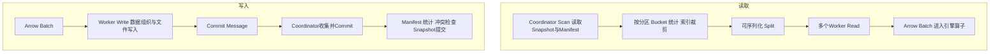

# Paimon C++湖表SDK

## TL;DR

Paimon C++ 是理解完整湖表语义的 Native 读写 SDK，不只是打开 Parquet/ORC 文件的 Reader。它以 Arrow C Data Interface 交换批式数据，把分布式调度和算子留给引擎，把 Scan、Read、Write、Commit、Compaction 与表格式兼容交给 SDK；通过插件保留引擎原有文件系统、缓存、内存和执行器优化。读取分离计划与执行，写入分离 Worker 文件生成与 Coordinator 提交，并以全局 Row ID 把索引召回连接到精准点查。生产端到端测试显示多个查询收益，但结论受数据、硬件与引擎条件限制，ClickHouse Native 等接入与后续能力仍属计划。（来源：p.1–9）

## 为什么“能读取文件”不等于“能读取表”

2024年1月阿里统一采用 Apache Paimon 表格式，而 ODPS、StarRocks、Native Flink/Spark 等需要 C++ Native 通路。如果每个引擎重做 Reader/Writer，维护格式兼容成本高；全部绕回 JVM，又会损失已有向量执行与I/O优化。（来源：p.1–3）

湖表有效数据由 **Schema、Snapshot、Manifest、Partition、Bucket、索引与更新/合并规则**共同决定，不能把对象存储目录下所有文件简单并集。需要确认当前 Snapshot 文件集合，区分 Append 与主键表，处理 **Merge-on-Read（MOR）**、**Deletion Vector（DV）**和 Compaction 形成的最终结果，并保持写入协议兼容。原文提供用途但未展开各表语义的算法细节，笔记不补造。（来源：p.2–3）

SDK 与计算引擎的职责边界是核心：引擎负责分布式调度、算子执行、数据交换；Paimon C++ 负责表级操作与格式、协议、索引、一致性语义。（来源：p.3–5）

## 四类 Native 接入要求

### Batch 边界避免依赖耦合

分析引擎以列式 Batch 计算，SDK读出与写入都用 Arrow Batch。**Arrow C Data Interface**减少逐行对象转换、不必要复制，并避免 SDK 绑定某个 Arrow C++ 版本，降低引擎已有 Arrow 依赖的 ABI 冲突与集成成本。这里是减少复制，不是所有路径都零复制的保证。（来源：p.3）

### 插件化保留已有优化

可替换模块包括 Format Reader/Writer、FileSystem、MemoryPool、Executor、Indexer。StarRocks 复用带 Block Cache 的内部文件系统，让已有缓存/I/O仍作用于湖表；Bolt 实现 Parquet 插件复用内部格式读写；注入 MemoryPool 可统一观测当前/峰值内存和分配，并与资源管理协调。（来源：p.3–4）

默认实现同时降低接入成本：ORC/Parquet/Avro/Blob 文件格式，Local/Jindo/S3 与文件系统抽象，默认内存池与执行器，Manifest 和 Parquet Metadata Cache，文件索引及标量/全文/向量全局索引。引擎可先使用默认方案，再只替换重点模块。可扩展与开箱即用是互补能力，不要求所有接入方实现全部插件。（来源：p.4）

### 格式兼容是跨引擎共享前提

SDK原生实现表语义，同时与 Java 格式及通信协议兼容，包括 Manifest、Data Split、Commit Message，使不同语言引擎读写同张表，而不维护分裂格式。文章称 v0.3.0 为 Apache 基金会下首个正式版本，经过近两年生产验证、支撑数 EB，2025年12月曾在 Alibaba GitHub 开源；这些是文章时点陈述，未联网核验最新状态。（来源：p.1、4）

## 计划、读取、写入与提交

按正文及 p.6 图整理，箭头表达交接产物，不代表由 SDK 负责分布式调度：

**Scan**在 Coordinator 集中生成计划，对 Snapshot/Manifest 的文件做元数据和索引裁剪，生成可跨进程/语言传递的 Split。**Read**在 Worker 并行执行 Split，继续列裁剪、嵌套字段裁剪、谓词下推、Page Filtering、预取缓存，输出 Batch。把计划与执行分开使同一表语义自然适配引擎既有任务调度。（来源：p.5–6）

**Write**在 Worker 接收 Batch、组织数据和写文件，交接 Commit Message；**Commit**收集消息并处理 Manifest、统计、冲突检查和 Snapshot 提交。p.6 写入原图进一步列 Build WriteContext→Write RecordBatch→PrepareCommit→序列化协议字节→Commit/retry/abort；图中没有给重试次数或冲突策略，不能补通用恢复参数。（来源：p.6 页图）

截图中的 C++ 调用是说明性示例，小字号代码没有作为完整复制代码交付；环境、完整错误处理和构建配置未在文章展开。本文未运行这些调用。

## 从批量扫描到索引召回与点查

传统访问以列裁剪、谓词下推、批量扫描为主；Agent 查询可能混合向量、全文、权限/时间等标量过滤，再返回文本、字段或图片音视频。**Data Evolution**为每行分配表级全局 **Row ID**，**Row Tracking**提供稳定行级定位，使结构化、文档、Embedding、Binary/Blob 共处同表。（来源：p.6）

三步访问是 Global Index 按标量/文本/向量条件召回候选 Row ID 与可选 Score，SDK结合 Snapshot/Manifest和文件范围生成 `IndexedSplit`，Reader 按 Row ID 读取所需字段/Blob。全局索引包括 BTree 标量范围，Lucene/Tantivy 全文，Lumina 向量；文件索引继续参与 Scan/Read 裁剪。（来源：p.7）

按 p.7 原图及正文整理：

作者主张这可减少向多套专用系统复制数据所带来的一致性、成本、运维问题。文章没有给混合检索融合策略、召回质量评测或所有多模态任务的结果，因此不能从统一存储推出检索效果必然更好。（来源：p.7）

## 性能来自哪些具体机制

### 分层 Spill Merge 减少旧 Run 重读

主键写入排序归并时，Buffer 超限需要 Spill 临时文件。平铺 Spill List 后续可能反复读取已合并旧 Run；分层方案只归并达到 Fan-in 的当前层级，减少旧 Run 重读并限制单次规模，同时保持主键语义。p.7 原图例子 Fan-in=4仅为示意，不是原文声称的默认配置。（来源：p.7 页图）

### 读取重叠、转换解耦、计数短路

同一 ORC/Parquet 文件按 Row Range 分给多个 Reader，并行I/O、解码、输出；每个 Reader 内部 Pipeline 重叠读取与解码。**异步 PK Row-to-Batch**用有界队列隔开 Sort Merge 生产端和 Arrow 转换消费端，消费端可多线程将 KeyValue 转为 Batch。（来源：p.8）

**COUNT(*) Short Circuit**在 Append、PK+DV、PK MOR 场景直接基于元数据或合并结果计数，避免完整 Value Batch 以及框架数据转换。p.8 原图区分 Append 元数据计数、PK DV 扣除 deletion vector cardinality、PK MOR merge count 无 Value Batch；不能把这种短路推广成任何查询都无需读取数据。（来源：p.8 页图）

## 生产端到端对照

原文对比切换 SDK 前后的完整查询链路，不是孤立 SDK 微基准。Native Spark采用 Gluten+Velox，PK MOR 表119.32 GB，约70文件主键重叠，读8轮；StarRocks 单 BE、8 Core/32 GB。各结果需要保留自己的样本与条件，不组成同一个提效曲线。（来源：p.8–9）

| 指标 | 原文数值 | 语境 / 条件 | 出处 |
| --- | --- | --- | --- |
| Spark PK MOR读取 | C++21–48分钟；基线41–126分钟；1.5–3.7倍 | 119.32GB，约70重叠文件，8轮 | p.8 |
| Narrow Count | 150ms vs220ms；1.5倍 | StarRocks单BE、8Core/32GB | p.8 |
| PK Count | 403ms vs1251ms；3.1倍 | 1000列、同上环境 | p.8 |
| Narrow Aggregate | 202ms vs451ms；2.2倍 | 同上环境 | p.9 |
| PK Point/Filter | 231–274ms vs376–403ms；1.4–1.7倍 | 同上环境 | p.9 |
| Full-width Aggregate | 18.5秒 vs62.0秒；3.4倍 | 同上环境 | p.9 |

倍数保留原文，未用区间端点自行重新配对计算。数据分布、文件数、查询类型、硬件和引擎配置都会影响效果。（来源：p.8）

## 接入状态与未来边界

文章区分生产使用的 Native Spark/StarRocks/Native Flink，已形成的 DuckDB 扩展、Bolt、Doris 社区接入，正在接入或使用的云产品，开展验证的内部业务，以及下一步 ClickHouse Native。未来路线一条跟进 Paimon 主线，完善 Scan/Read/Write/Commit/REST Catalog/Changelog；另一条探索AI、多模态、时序、动态JSON、Free-schema和实时负载。不要把“正在”“即将”“探索”统一成已投产。（来源：p.2、9）

## 记忆锚点

- “引擎保留执行优势，SDK统一湖表语义。”（助记改写，p.2–5）
- “索引找Row ID，快照定文件，点查取负载。”（助记改写，p.6–7）

## 复习卡片

为什么直接读Parquet不等于读Paimon表::有效数据还由快照、Manifest、分区桶、索引和更新合并规则决定。（p.2–3）
引擎和SDK如何分工::引擎负责调度、算子和数据交换，SDK负责Scan/Read/Write/Commit/Compaction及格式表语义。（p.3）
Arrow C Data Interface为何有价值::以Batch减少逐行转换和复制，同时避免绑定某个Arrow C++ SDK版本，降低ABI冲突。（p.3）
插件化如何保留性能::引擎注入已有格式读写、文件缓存、内存池、执行器或索引，而SDK维持共享表语义。（p.3–4）
Scan和Read交接什么::Scan裁剪并生成可序列化Split，Worker Read执行并返回Arrow Batch。（p.5）
Write和Commit交接什么::Worker写文件产生Commit Message，Coordinator收集后执行冲突检查及Snapshot提交。（p.6）
全局索引如何连接实际表数据::召回Row ID和可选Score，结合Snapshot/Manifest范围生成IndexedSplit，再点查字段或Blob。（p.7）
分层Spill Merge减少什么::减少已合并旧Run反复读取，并控制单次归并规模，不改变主键语义。（p.7）
COUNT短路有什么范围::Append、PK+DV、PK MOR计数场景可避免完整Value Batch，并非任意查询都能短路。（p.8）

## 知识关联

数据基础：[[数据湖表与互操作|数据湖表语义]]、[[数据湖表与互操作|多模态检索]]。
工程与评测：[[Agent数据分析]]、[[Agent评测与反馈]]。

## 原文参考资料

来自p.9，未访问核验：[仓库](https://github.com/apache/paimon-cpp)、[v0.3.0说明](https://github.com/apache/paimon-cpp/releases/tag/v0.3.0)、[使用文档](https://paimon.apache.org/docs/cpp/)、[Paimon官网](https://paimon.apache.org)、[Paimon仓库](https://github.com/apache/paimon)。

本次归纳主题：[数据湖表与互操作](../../20_topics/数据湖表与互操作.md)。

> [!note]- 校对报告
> **覆盖度**：通读全部 11 个物理页文本，浏览全部页图；放大核对 p.1、5、6、7、8、9。正文覆盖 背景和接入状态；语义边界与插件设计；读写两阶段与索引检索；性能机制和对照；社区路线。推广、页尾互动与读者评论有意省略。
>
> **一致性抽查**：
>
> | 核对项 | 笔记值 | 原文值与位置 | 结果 |
> | --- | --- | --- | --- |
> | 版本 | v0.3.0 | p.1 | 一致 |
> | Spark规模 | 119.32GB | p.8 | 一致 |
> | Spark收益 | 1.5–3.7倍 | p.8 | 一致 |
> | StarRocks硬件 | 8Core/32GB单BE | p.8 | 一致 |
> | 宽聚合 | 18.5秒 vs62.0秒 | p.9 | 一致 |
>
> **异常与边界**：未发现影响正文理解的缺页或不可辨认内容。
>
> **日期与格式**：发布日期依据 p.1“刘欣瑀 阿里技术 2026年9月9日 03:18 浙江”；frontmatter 使用页首发布日期，不推测时区。本库归档名使用 `AI_Paimon C++湖表SDK.md`，服从知识库命名规则。Mermaid 未实际渲染，文章中的命令和代码未执行；卡片按单行 `问题::答案` 保存。
