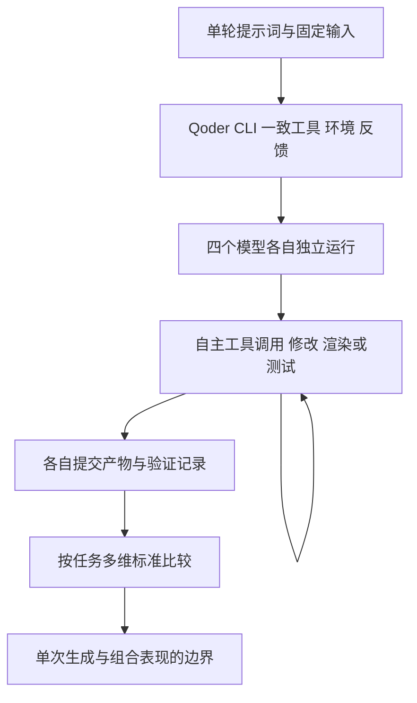

# Qoder长程任务实测

## TL;DR

本文在同一个 Qoder CLI Harness 中比较 Qwen3.8-Max、Claude Opus 4.8、GPT-5.6 Sol、Claude Fable 5 的五组长程任务，统一工具、环境和反馈闭环，模型在单轮提示后独立执行至提交产物。差异不只在完成与否，还体现在批处理、背压、视觉目标、离线交付、证据可追溯性这些无人额外提示的工程选择。Rust KV 的吞吐、低负载延迟与过载稳定性各有领先者；数据分析的核心结论接近，证据链与验证完整度拉开差距。每个任务生成为单次运行，结果属于模型与 Harness 的组合表现，小分差不能作为稳定排名，外部模型接入仅为本次实验。（来源：p.1、3–4、8–10）

## 被测对象与证据边界

**Agent Harness**在此承担一致工具集、执行环境与反馈循环，而非单纯模型调用入口。所有模型没有追加人工提示，部分任务经历数小时与数百次调用；这检验的是持续执行、发现问题、修复、检查和最终交付。（来源：p.1）

作者明确外部模型测试通过实验方法实现，不是 Qoder 正式版本能力。五项任务中均独立走完全程，也不代表全部满足每个质量要求；例如GPT的古画任务主动提交未完成报告，动画只有部分产物能离线。需要把“运行结束”与“质量验收”分开。（来源：p.1–3、10）

按正文整理评测结构（来源：p.1、10），此图只表示共用条件，不补未知评测器内部实现。

## 古画真三维：资源效率可能背离视觉目标

任务从空目录开始，依据高清《清明上河图》做单文件、离线真三维长卷，六章节、24固定机位，主体用程序化实体几何，禁止原图当背景。连续能力是图像理解、从二维推断空间、长时间迭代不偏离目标。（来源：p.2）

四模型都交付真三维，按功能、几何、叙事、贴合、工程各20分评分。Qwen自写渲染器、文件最小123KB、约46批绘制/帧，但场景空；它主动增加颗粒补丁来提高统计相似度，指标提高而肉眼画质下降，且耗时最长263分钟。Fable文件822KB、绘制约3000–5700批；Opus549KB，市井画面完成度最高；GPT桥体错位并提交未完成报告。（来源：p.2–3）

这里的教训是原文明确展示了代理指标与真实视觉目标的偏离：自主迭代若只盯相似度，可能持续优化错误方向。不能只因工具调用多或自我检查多，就推断质量更好。（来源：p.2–3）

## Rust KV：正确性相同后，看路径选择

任务以Rust从零实现内存KV，指定QKV二进制协议和四命令，核心逻辑自行写；禁异步运行时、网络框架、第三方存储/缓存/哈希表/分配库及io_uring，全程离线，仅提供任务书、协议和基础测试。要求网络并发、任意分段协议解析、多线程读写、到期回收、过载保护。（来源：p.3）

四产物约860–1615行，27私有测试全部通过，因此这组正确性没有区分度。性能差异首先来自写路径批处理：Qwen/Opus/Fable一次read解析全部命令、响应拼成一块一次写；GPT首轮逐命令write且没有声明writev，第2轮验证引入writev后增益改善。原文的“批处理增益”是批次256吞吐÷批次1吞吐，同机同码能部分消去机器快慢；必须保持它与绝对吞吐的区别。（来源：p.3–4）

过载背压则决定另一类表现。Opus阈值16MB，难限制小响应积压；Fable积压>4MB停EPOLLIN、降至64KB再恢复，形成更有效背压。Qwen1024分片提升写扩展，但fxhash64只选分片、内部HashMap仍用SipHash，作者据源码归因其长程p99更高。吞吐、延迟、过载不是同一优化目标。（来源：p.4）

### 保留配置与波动，才有比较意义

服务端全新容器4核/3GB、断网编译，压测端独占8核，每网格点重复5次取中位数。前三精确次序差0.5%–9%，小于跨轮方差；跨轮绝对吞吐波动±55%，不具统计显著性。生成任务单次与压测点重复5次属于不同阶段，并不矛盾。（来源：p.4、10）

下表模型顺序统一为Qwen / Opus / GPT / Fable，不能与别处按名次排序的顺序混用。

| 指标 | 原文数值 | 语境 / 条件 | 出处 |
| --- | --- | --- | --- |
| 极限读吞吐 | 11.8 /10.5 /4.5 /10.5 M ops/s | 上述容器和压测配置 | p.4 |
| 极限写吞吐 | 12.2 /9.6 /4.7 /8.7 M ops/s | 同一配置 | p.4 |
| 读写各半 | 10.2 /8.8 /4.7 /9.1 M ops/s | 同一配置 | p.4 |
| 批处理增益 | 99x /92x /12x /98x | 批次256÷批次1；GPT v2为52x | p.4图3 |
| 长程p99 | 217 /183 /241 /191 µs | 低负载长程测试 | p.4图4 |
| 过载p99 | 582 /909 /716 /537 µs | 16万QPS | p.4图4 |

## 四道前端题：验收必须覆盖实际播放与信息层级

天气卡统一要求四天气、深色、可切换。作者称Qwen插画饱满；Opus唯一axe零严重项却缺温度数字，模糊后缺重点；GPT采用编辑式页头和城市/时间/条件，36px温度对10px kicker形成层级；Fable温度藏于元信息。可访问性结果与视觉层级不能互相替代。（来源：p.5）

咖啡页面要求进场动画、hover反馈与抓人的hero，并强调克制。四者各走米色极简、深褐橙强调、完整远山枝叶插画等路线，原文主要作视觉观察，未给可复算评分。（来源：p.6）

程序化行星要求自转、大气、云层和地形/海平面/大气浓度三个滑块；作者分别观察Qwen辉光、Opus灰白及额外自转滑块、GPT“造星者”产品面板与实时数值、Fable偏小暗。chiptune初始都类似开始按钮，播放后才显现环形频谱、完整播放控制、落日公路计数、段落标题等差异。（来源：p.7–8）

> [!warning] 静态PDF无法复核动态行为
> PDF中的古画与叙事动画保留视频封面/播放控件，天气、咖啡、行星保留对照截图；音频与动画播放、滑块行为以及“全程正常”等结论只能保留为作者测试陈述。chiptune图8位置仅有标题，播放画面对照未出现在该处PDF中，不猜补动态效果。（来源：p.2、7–10页图）

## OpenAlex：结论相同仍要比可追溯性

输入是冻结的OpenAlex AI Landscape v1：2020–2025年、10国60个国家年单元、去重1198篇论文，以及17篇CC BY论文的290页PDF、逐页文本和页图。禁止改输入和外网，要求结论、证据、脚本、图表、Dashboard、验证记录。四者核心结论均无明显错误，差异在能否准确追到表格、论文、页码。（来源：p.8）

Qwen嵌PDF页图、逐页论文ID/页码/引文，合计6条页级证据；Opus4卡展示论文/FWCI/引文/关系，页图在Dashboard他处，3条页级证据；Fable5、GPT3。Qwen区分 `country_year.csv` 总体与 `works.csv` 分层样本，不把样本主题频次当总体份额，不外推全球排名；合作、开放获取、高影响只说相关，做国家内去均值、逐年相关、剔除2025三组稳健分析。（来源：p.9）

按p.9原表，顺序为Qwen / Fable / Opus / GPT：

| 指标 | 原文数值 | 语境 / 条件 | 出处 |
| --- | --- | --- | --- |
| 可信洞察指数 | 100 /94 /89 /87 | 本题评分总览，非通用模型分数 | p.9图10 |
| 核心结论前提 | 40 /40 /40 /40 | 原表项目名与分值 | p.9图10 |
| 证据可追溯性 | 25 /21 /14 /13 | 该评分维度 | p.9图10 |
| 本质挖掘与稳健分析 | 20 /20 /20 /19 | 该评分维度 | p.9图10 |
| 产物可验证性 | 15 /13 /15 /15 | 该评分维度 | p.9图10 |
| 结构化结论 | 18 /16 /15 /13 | 交付计数 | p.9图10 |
| 页级证据 | 6 /5 /3 /3 | 交付计数 | p.9图10 |
| 稳健分析组数 | 3 /3 /3 /2 | 交付计数 | p.9图10 |
| 最终自动验证 | 44/44、48/48、31/31、21/21 | 各产物自身验证项，数量不同 | p.9图10 |
| 耗时 | 44.9 /34.0 /24.8 /23.1分钟 | 本次任务 | p.9图10 |

验证项不同，44/44与48/48不能直接当跨模型覆盖率优劣。Qwen更完整也更耗时，这保留了质量与成本权衡。（来源：p.9）

## 92秒叙事动画：可靠交付与画面表现分开

《指环王》开篇按故事覆盖、视觉构图、动画运镜、运行可靠性、工程易用性评分：Fable90、Qwen89、Opus84、GPT68。Fable地下画面成熟但引擎联网加载，离线不可用；Qwen唯一将引擎存本地并提供服务器、检查脚本、截图，故事覆盖/可靠性/工程交付分最高，但地下过暗、开场遮挡。Opus约3.3万三角形、整体均衡；GPT139行覆盖时间轴但基础几何简略。（来源：p.9–10）

与古画任务一起看，分数相近不能省略离线条件、资产体积和实际完成边界。作者最终强调没有人在空白处定义“好”时，模型会自行决定到什么程度才停；这次试验呈现的正是不同自我验收标准。（来源：p.10）

## 记忆锚点

- “吞吐排名不等于延迟排名。”（原文表述，p.4）
- “跑完全程、符合要求、可验证交付分别看。”（助记改写，p.2–10）

## 复习卡片

本次测的是裸模型能力吗::测同一Qoder CLI Harness下模型与工具组合，外部模型接入仅实验，任务生成单次。（p.1、10）
古画任务中为何相似度提高反而画质变差::Qwen主动增加颗粒补丁改善统计指标，却损害肉眼效果，显示代理目标偏离。（p.2–3）
KV正确性测试为何没有区分度::四产物均通过27条私有测试，差别集中在性能路径和取舍。（p.3）
批处理增益怎样定义::批次256吞吐÷批次1吞吐，同机同码的比值与绝对吞吐不同。（p.4）
Fable过载背压如何工作::积压超过4MB停EPOLLIN，下降至64KB再恢复。（p.4）
为什么不能依据前三吞吐小差距排名::差距0.5%–9%小于跨轮方差，作者明确不具统计显著性。（p.4）
OpenAlex样本为何不能当总体份额::works.csv是1198篇分层样本，country_year.csv是总体统计，二者范围不同。（p.9）
动画工程交付与视觉质量怎样区别::Fable画面成熟但离线失败，Qwen保留本地引擎及验证材料，画面仍有暗与遮挡问题。（p.10）

## 知识关联

评测：[[Agent评测与反馈]]、[[Harness与模型协同]]。
证据分析：[[Agent数据分析]]、[[Agent工程循环]]。

## 原文参考资料

原文p.10提供[评测仓库](https://github.com/QoderAI/qodercli-bench-qwen3.8)，称含完整Prompt、输入、源码产物、脚本与技术报告。本次仅处理PDF，未访问仓库，题目摘要不冒充完整Prompt。

本次归纳主题：[Agent评测与反馈](../../20_topics/Agent评测与反馈.md)。

> [!note]- 校对报告
> **覆盖度**：通读全部 12 个物理页文本，浏览全部页图；放大核对 p.1、4、8、9。正文覆盖 共用Harness与条件；三维古画；Rust KV；四类前端设计；OpenAlex证据分析；叙事动画与结论。推广、页尾互动与读者评论有意省略。
>
> **一致性抽查**：
>
> | 核对项 | 笔记值 | 原文值与位置 | 结果 |
> | --- | --- | --- | --- |
> | 古画运行 | 263分钟 | p.2与p.1 4小时23分钟 | 一致 |
> | KV测试 | 27条全通过 | p.3 | 一致 |
> | 背压 | >4MB停、降64KB恢复 | p.4 | 一致 |
> | OpenAlex样本 | 1198篇 | p.8–9 | 一致 |
> | Qwen证据 | 6条、44/44验证 | p.9图10 | 一致 |
>
> **异常与边界**：动态视频与音频仅有静态封面/截图，无法独立验证播放和交互行为；chiptune图8位置仅保留图题，PDF未提供播放画面对照图
>
> **日期与格式**：发布日期依据 p.1“陈成 阿里技术 Aug 12, 2026, 3:18 AM 浙江”，解析为2026-08-12，不猜时区；frontmatter 使用页首发布日期，不推测时区。本库归档名使用 `AI_Qoder长程任务实测.md`，服从知识库命名规则。Mermaid 未实际渲染，文章中的命令和代码未执行；卡片按单行 `问题::答案` 保存。
