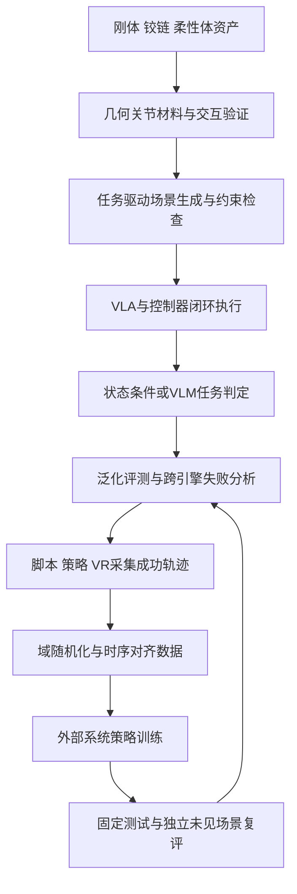

# RoboFlywheel具身仿真闭环

## TL;DR

RoboFlywheel 首发仿真板块将刚体、铰链物体、柔性体资产与跨引擎平台连接，重点从外观逼真转向可交互、可验证与可复用。刚体在部件层补碰撞和物理属性，铰链资产由经测试修复的类别级程序生成，柔性体用有界仿真探测调整材料并由独立探测验收。平台把场景、VLA执行、成功判定、轨迹数据、外部训练和独立复评连成飞轮。仿真校准与跨引擎通过不能直接证明真实材料或真机表现，原文明确仍需实物实验。（来源：p.1–5）

## 物体看起来正确，不等于机器人能操作

**仿真可用资产**在本文不仅有几何外观，还要有正确碰撞、尺度、质量、惯量、摩擦、关节与材料描述，并经过交互检查。杯把孔洞被碰撞模型封住就无法抓握，柜门缺正确转轴就无法打开，布袋还会形变、泄漏或损坏。外观解决“看见”，可靠物理属性才支撑“上手”。

首发仿真板块由阿里巴巴与清华大学赵昊团队联合构建，文章未给个人作者署名；“赵昊团队”为项目合作方，不能据此填成本文作者。首批覆盖52万刚体、40万铰链物体、10万柔性体，三方向分别是 World、Articulation、Soft，回答“会遇到什么物体、怎么动、如何验交互”。资产数量之外，还需要把操作转换为图像、本体状态、动作的时序对齐数据，再用评测反馈训练。（p.1）

## 三种资产分别补什么缺口

| 分支 | 主要对象 | 核心补全机制 | 验证关注 | 出处 |
| --- | --- | --- | --- | --- |
| World / Rigid | 刚体及任务世界 | 部件语义、结构分解、碰撞几何与物理属性；任务驱动场景构建 | 抓取提起、可达性、支撑与布局 | p.2 |
| Articulation | 关节/铰链对象 | 类别级生成器编码部件、连接与装配规则 | 运动学、被动稳定与跨引擎 | p.3 |
| Soft | 可变形对象 | 几何家族匹配、材料参数提议、有界探测校准 | 独立探测、损伤代理与完整性 | p.4 |

### 刚体：粒度下沉到部件，碰撞结构必须可检查

**RoboFlywheel-Rigid**是World构建的刚体数据集。杯身与把手有不同交互功能，不同材料工具部件不应共享随意参数。流程恢复语义、分解结构、构建碰撞几何，再补尺度、质量、质心、惯量与摩擦；多凸体分解等处理用于保留交互结构。视觉模型与物理对象之间的差距由此成为可检查问题，而不是仅凭渲染好看来判断。

World将多种资产检索接入**任务驱动Agentic场景构建**：任务描述先找到合适对象，按机器人可达性规划放置和支撑关系，再安排房间布局，经物理/视觉检查与校验循环生成跨仿真器训练场。在物体子集上，用六种不同手型做抓取与提起，研究资产类别覆盖对场景需求满足的影响。原图可见Allegro、Barrett、Shadow、Ability、Inspire和XHand；这是验证手型覆盖，原文没有给子集样本量和抓取成功率，不补总体精度。（p.2）

### 铰链物体：先修生成器，再批量采样

**类别级生成器**把稳定装配约束写入可复用程序。柜子尺寸、门型、抽屉数量可变化，板材连接、部件位置、关节装配则遵守代码规则；Agent反复测试与修复生成器，验证后批量采样，新增每个资产无需重跑模型推理。规模化扩的是结构分布，而不是复制同一个外观模型。

每项资产保留部件、关节、几何、估计物理属性与生成参数，可复现也可定向3D编辑。原图用桌上足球支撑结构、围栏面板数量、旋转设施材质、柜宽展示“只改指定部分，其余保持”，并未提供编辑命令或代码。运动关系的轴位置、方向和行程决定能否正确操作，因此验证要看结构与运动，不只看类别名称。（p.3）

原文测试运动学通过率99.93%；**另取**200资产，在Genesis、PyBullet、MuJoCo固定根部被动运行10秒，三引擎联合通过率99.0%。这两项是不同测试，不能合成同一分母，也不能把被动运行等同于主动任务成功或长期真机可靠性。（p.3）

### 柔性体：材料行为校准与独立探测

**RoboFlywheel-Soft**面向485种标准对象类型，分柔性实体、布片、薄壳、服装、袋体五类几何家族，匹配处理与仿真表示。困难在材料行为：拿海绵、布袋要面对压缩、形变和损伤，而不只是刚体滑落。

视觉与语义先验提出材料参数，Agent选择仿真探测、诊断失败并做有界调整，最后由**未参与调整的独立探测**验收。物理信息包记录几何、尺度、材料参数、仿真配置与验证来源，避免验证旧模型却发布新模型。易损物体既看动作完成，也看损伤代理、完整性、接触、收敛与安全施力区间。原图豆腐force test是一项展示，不能从截图估计通用安全阈值；代理指标也不是已建立真实损伤一致性。

这里校准的是仿真行为。真实材料一致性仍须实物实验，不能把“探测通过”写成实际材料参数已经准确恢复。（p.4）

## 跨引擎平台把资产接成完整实验

### 场景、执行与判定

自然语言任务驱动检索与布局，校验支撑、碰撞、关节约束，得到可交互场景。**VLA策略**结合指令、视觉和本体状态，通过控制器闭环执行；原文未展开VLA缩写或策略结构，按其文中输入与职责理解即可。

任务成功可以用状态谓词、逻辑组合与持续时间定义，也可由VLM根据任务与执行画面事后评分并说明依据。两者是平台支持的不同判定方式，原文没有保证VLM评分与状态断言等价，也没有给判定准确率。（p.4）

### 未见条件与跨引擎对照

泛化评测随机初态，并在未参与训练/调试条件下批量运行，用阶段结果和失败轨迹定位短板。跨引擎用统一场景表示，固定初态、动作序列和控制时序，比较MuJoCo、Genesis、Isaac Sim轨迹；需要考虑物理映射近似与预设容差，分析结果对仿真模型的敏感性。截图展示同一类场景的三个引擎，不能从视觉相似推断轨迹完全一致。

这组平台三引擎和前面铰链被动稳定试验中的Genesis/PyBullet/MuJoCo不同，各自保存名单，不能混写。（p.3–5）

### 从评测短板到训练增补再回测

针对短板，平台通过脚本、策略或VR遥操作采集并筛选成功轨迹；光照、材质、环境做域随机化，根据参数类型选择回放渲染或重新仿真，随后复核任务结果。不是所有随机化都能只换画面而不影响物理运行。图像、本体状态与动作时序对齐后供**外部系统**模仿学习；原文没有说平台内置完整训练器。

训练后的策略回固定测试条件和独立未见场景复评，用成功率与阶段结果检验新增数据是否有效。由此形成数据采集→策略训练→仿真评测闭环。新资产、新场景和新数据的价值来自补具体失败，不只是继续增大数量。（p.5）

以下按p.1–5正文整理，主线不表示三种资产必需串行处理：

## 数据速查

| 指标 | 原文数值 | 语境 / 条件 | 出处 |
| --- | --- | --- | --- |
| 首批刚体 | 52万 | 首发资产规模 | p.1 |
| 首批铰链 | 40万 | 首发资产规模 | p.1 |
| 首批柔性体 | 10万 | 首发资产规模 | p.1 |
| 刚体手型 | 6种 | 物体子集抓取与提起 | p.2 |
| 运动学通过率 | 99.93% | 铰链测试资产，分母未在正文给出 | p.3 |
| 跨引擎被动测试 | 200资产、10秒、99.0% | 固定根部；Genesis/PyBullet/MuJoCo联合通过 | p.3 |
| 柔性体类型 | 485种 | 标准对象类型 | p.4 |
| 几何家族 | 5类 | 实体/布片/薄壳/服装/袋体 | p.4 |

## 可迁移设计原则与记忆锚点

- 验收对象要包含可交互语义与物理属性，而非仅视觉外观。（p.1–2）
- 可复用生成规则先验证再批采，保留生成参数与物理信息包，让编辑、发布与测试版本可追溯。（p.3–4）
- 生成/调整与独立验收分开，泛化评测使用未参与训练调试条件。（p.4–5）
- 仿真成功不跳过实物验证，跨引擎差异要按统一输入和容差解释。（p.4–5）

**助记改写**：“资产能上手，轨迹能对齐，短板能回流，真机仍实测。”

## 复习卡片

外观逼真的杯子为什么仍可能无法被抓？::碰撞几何可能封住把手孔洞，交互需要正确几何质量摩擦等物理属性。（p.1）
World为什么把处理粒度下沉到部件？::不同部件语义、结构和材料不同，需要分别补碰撞与物理属性，避免视觉模型与物理对象脱节。（p.2）
类别级生成器怎样降低逐资产模型推理成本？::将稳定装配约束编程，Agent测试修复后可批量采样，不必每新资产重跑推理。（p.3）
99.0%跨引擎通过率的条件是什么？::另取200资产固定根部被动运行10秒，Genesis/PyBullet/MuJoCo联合验收，非真机任务成功率。（p.3）
Soft的参数调整怎样避免自评闭环？::有界调整后交给未参与调整的独立探测验收，并记录验证来源与配置。（p.4）
柔性体抓起成功是否已算通过？::不够，还需看损伤代理、完整性、接触收敛与安全施力区间。（p.4）
跨引擎对照要固定哪些条件？::统一场景表示、初态、动作序列与控制时序，并考虑物理映射近似和预设容差。（p.4）
训练数据怎样进入闭环？::筛选成功轨迹、随机化并复核、时序对齐供外部模仿学习，训练策略再回固定和独立未见场景复评。（p.5）

## 知识关联与原文入口

- [[Agent评测与反馈]]：独立探测、未见条件、版本和容差。
- [[Agent工程循环]]：任务构建、失败分析、增补数据与复评。
- 候选 [[具身智能数据闭环|具身智能仿真数据]]、[[具身智能数据闭环|可交互资产生成]]。

原文给出官网 [RoboFlywheel](https://roboflywheel.com)，仅保存文章入口，未访问核验。（p.5）

本次归纳主题：[具身智能数据闭环](../../20_topics/具身智能数据闭环.md)。

> [!note]- 校对报告
> **覆盖度**：通读 p.1–7 全部文字，浏览全部页图缩略，放大核对 p.1,2,3,4,5。主要章节已覆盖；文末营销、推荐与读者留言未作为技术结论。
> **一致性**：
> 
> | 核对项 | 笔记值 | 原文值与位置 | 结果 |
> | --- | --- | --- | --- |
> | 刚体资产 | 52万 | 52万，p.1 | 一致 |
> | 铰链资产 | 40万 | 40万，p.1 | 一致 |
> | 柔性资产 | 10万 | 10万，p.1 | 一致 |
> | 运动学通过 | 99.93% | 99.93%，p.3 | 一致 |
> | 跨引擎被动 | 200/10秒/99.0% | 200资产10秒99.0%，p.3 | 一致 |
> 
> **推断与异常**：p.5总结章节与平台章节编号重复为05；p.2标题写“被子”但正文对象是杯子，未以标题错字改变技术内容。；99.93%运动学与99.0%跨引擎被动稳定为不同测试；仿真效果需实物与真机另验。
> **日期与格式**：发布日期取自 p.1 页首，2026-09-24，未推测时区。归档沿用本库 `AI_短标题.md` 命名。一个 H1、卡片单行 `问题::答案`；Mermaid 未渲染，文章代码/命令未执行。
