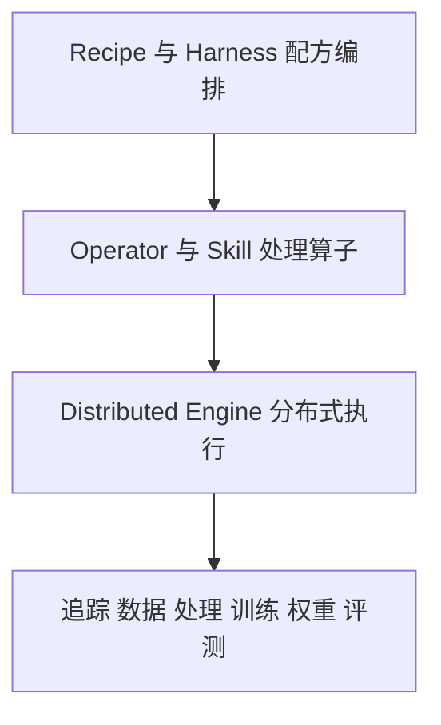

# RoboFlywheel具身数据闭环

## TL;DR

RoboFlywheel是阿里巴巴、清华大学、上海交通大学发布的具身智能开放数据基础设施，围绕Sim、Bench、Recipe、Dataset四个方向组织数据生产、处理、验证和复用。文章的核心判断是采集量不等于有效训练量，数据与本体、任务、场景耦合，需要可追溯配方而非一次脚本。首批资产、算子、数据集和WholeBodyBench被描述为已发布/接入，数据采集效率与构型边界评测、配方探索结果仍待后续推进。仿真不替代真机验证，本文是发布介绍，没有给训练收益对照、机器人成功率改进或配方优劣实测。（来源：p.1–6）

## 核心问题：数据规模与可训练价值不同

具身数据不同于可低成本复制的互联网文本图像代码，它与机器人本体、任务和物理场景紧密耦合。模型、训练、评测还在探索时，真正需要回答的是采什么、留什么、如何组合、何时训练和怎样验证。**数据配方**在本文指这些可执行的数据选择与处理安排，而不是数据集列表或收集数量。（来源：p.1、4–5）

RoboFlywheel希望让真实实践可比较、可复现、可继续迭代。四个方向分别提供可构造和验证的仿真资产、测评任务、数据处理配方、规范化开放数据入口，结果再反馈到数据生产和配方。（来源：p.1–6）

按p.2飞轮图及正文整理；“反馈”表达项目提出的建设闭环，不声称已有闭环效能实测：

## Sim：在真机前构造长尾与高风险场景

**RoboFlywheel-Sim**建设生成式资产底座，首批52万刚体、40万铰链、10万柔性资产。通过统一资产格式、跨引擎资产编译、自然语言场景构建、声明式评测Harness，使同一资产、场景、任务可在不同引擎复现，用于规模压力、失败诊断、版本回归。（来源：p.3）

p.2网站截图列Isaac Sim、MuJoCo、Genesis等引擎，说明跨引擎目标；文章没有提供完整资产格式、编译器调用、场景语言或误差校准方案。资产动画在PDF只保留视频静态封面，无法复核运动行为。原文明示仿真帮助更早暴露问题，最终仍要真机检验。（来源：p.2–3页图及正文）

## Bench：评模型，也计划评系统条件

首发**WholeBodyBench**聚焦模型，从基础单元、单元组合到高层组合逐级加复杂度，考察组合泛化、场景泛化、成功与安全。p.4网站截图展示评测榜单与公共榜单入口，但未在正文给本项目实验协议或新模型对照收益，不把截图榜分当成RoboFlywheel使模型提高的证据。（来源：p.3–4）

数据采集效率（真机与仿真）、机器人构型能力边界等系列评测是“还将覆盖”。评测不只排榜，还应把模型、数据、本体缺口反馈给数据生产和配方设计；前者为后续方向，后者为设计主张，不能统一写成已落地系统测评全覆盖。（来源：p.4）

## Recipe：把一次经验变成可追踪执行

**RoboFlywheel-Recipe**是 **Episode-native** 具身数据框架，原文使用该术语但未展开Episode字段模型。三层为Recipe/Harness负责配方编排，Operator/Skill承载处理算子，Distributed Engine负责规模执行。正文列数据选择、质量检测、时空对齐、语义标注、增强、训练优化；底层有分布式执行、IO优化、断点续跑、算子融合和高效重配方缓存。（来源：p.4）

三层按正文整理（来源：p.4），不补节点接口与停止策略：

首批20+算子涵盖接入转换、质量清洗、时空对齐与动作提取、语义标注、增强、训练数据优化。每份配方可以记录“数据—处理—训练—权重—评测”，替换数据/算子/模型做对照，让结果能定位到具体环节。首批配方“将以可复现结果回答”什么数据转为能力，说明探索结论尚待取得；没有给缓存键、算子配置或完整Recipe原文，不生成可执行Skill。（来源：p.4–5）

p.5配方网站截图还标“即将上线，敬请期待”，下方流水线展示界面属于展示图，不能把图中未说明分母的73%/62%/85%解释成训练效果或数据质量收益。这与正文介绍框架能力并不相互替代：框架宣称可支持的能力、网站开放状态、配方实验结果是不同层级。（来源：p.5页图）

## Dataset：统一接入不等于全部训练过

首批接入40+数据集，覆盖多构型真机、无本体、仿真。统一Schema和接入规范补齐格式转换、基础质量检测、元数据，并记录来源、许可、处理算子、质量报告、版本变化。开放贡献可包括数据、算子、配方、评测任务。（来源：p.5）

这些规模是接入范围，不等于40+数据集全部通过同一训练对照，也不说明许可已适用于任意用途；作者强调记录许可与来源，但未逐个给出明细。跨来源统一处理与验证是要继续建设的方向，不能将接入计数等同可无条件复用。（来源：p.5–6）

## 数据速查与状态

| 指标 | 原文数值 | 语境 / 条件 | 出处 |
| --- | --- | --- | --- |
| 刚体资产 | 52万 | Sim首批覆盖，网站卡片标52万+ | p.3正文与图 |
| 铰链资产 | 40万 | Sim首批覆盖，网站标40万+ | p.3正文与图 |
| 柔性资产 | 10万 | Sim首批覆盖，网站标10万+ | p.3正文与图 |
| 官方算子 | 20+ | 接入、清洗、对齐、标注、增强、训练优化 | p.4 |
| 数据集接入 | 40+ | 多构型真机、无本体、仿真，不等于训练样本量 | p.5 |

已描述发布/接入：四方向的基础设施、首批资产、WholeBodyBench、官方算子、数据集。后续方向：采集效率和构型边界评测、配方对照探索、社区反馈使路线收敛。文章没有模型提升数值，因此不能填一个“飞轮提效”结果表。（来源：p.3–6）

## 记忆锚点

“采多少之外，还要问采什么、留什么、怎么配、怎么验。”（助记改写，p.1）

## 复习卡片

采集量为什么不等于训练价值::具身数据与本体任务场景耦合，选择混配训练阶段与验证共同决定可用性。（p.1）
RoboFlywheel四方向是什么::Sim仿真资产，Bench测评，Recipe处理配方，Dataset规范接入，结果反馈下轮建设。（p.2–6）
仿真能否替代最终真机检验::不能，它先规模构造长尾高风险场景发现问题，最终仍需真机。（p.3）
WholeBodyBench首发关注什么::模型能力，从基础到组合复杂度，评组合/场景泛化与成功安全。（p.3）
数据采集效率测评是否已完整发布::原文说系列评测“还将覆盖”，应标后续方向。（p.4）
Recipe三层是什么::Recipe/Harness、Operator/Skill、Distributed Engine，分别组织配方算子和规模执行。（p.4）
完整追踪配方应连接哪条链::数据—处理—训练—权重—评测，方便替换数据算子模型做对照。（p.5）
40+数据集意味着什么::首批接入范围涵盖多构型真机无本体仿真，不是已训练效果或全部质量统一验证。（p.5）

## 知识关联

数据与反馈：[[具身智能数据闭环]]、[[Agent数据分析]]、[[Agent评测与反馈]]。
执行结构：[[Harness与模型协同]]、[[Agent工程循环]]。

## 原文参考入口

p.1提供[官网](https://roboflywheel.com)，未访问核验；没有取得完整配方、Operator Skill或实验材料。

本次归纳主题：[具身智能数据闭环](../../20_topics/具身智能数据闭环.md)。

> [!note]- 校对报告
> **覆盖度**：通读全部 7 个物理页文本，浏览全部页图；放大核对 p.1、2、3、4、5。正文覆盖 数据价值与四方向；Sim与Bench；Recipe框架；Dataset与共建。推广、页尾互动与读者评论有意省略。
>
> **一致性抽查**：
>
> | 核对项 | 笔记值 | 原文值与位置 | 结果 |
> | --- | --- | --- | --- |
> | 刚体 | 52万 | p.3正文（图52万+） | 一致，保留精度 |
> | 铰链 | 40万 | p.3正文（图40万+） | 一致 |
> | 柔性 | 10万 | p.3正文（图10万+） | 一致 |
> | 算子 | 20+ | p.4 | 一致 |
> | 数据集 | 40+接入 | p.5 | 一致，非训练量 |
>
> **异常与边界**：Recipe网站截图标“即将上线”，框架能力介绍与实际开放状态/实验结果需分层记录；视频仅静态封面，无法复核仿真运动行为；发布介绍未给训练收益对照、模型成功率改进或完整配方材料
>
> **日期与格式**：发布日期依据 p.1“阿里技术 2026年9月28日 03:54 浙江”；“以下文章来源于阿里数据，作者阿里数据”；frontmatter 使用页首发布日期，不推测时区。本库归档名使用 `AI_RoboFlywheel具身数据闭环.md`，服从知识库命名规则。Mermaid 未实际渲染，文章中的命令和代码未执行；卡片按单行 `问题::答案` 保存。
