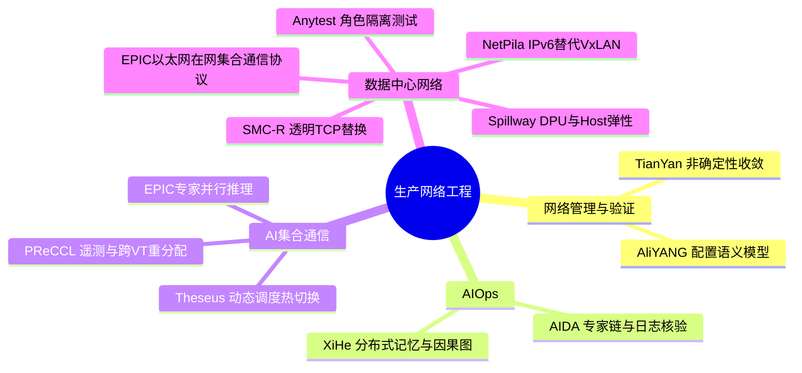

# SIGCOMM2026网络工程研究

## TL;DR

本文解读阿里巴巴入选SIGCOMM2026主会的12篇论文，涵盖网络验证与配置、AI运维、集合通信和数据中心网络。共同主线是把生产网络中的时序、异构、动态负载和规模约束转成可验证、可观测、可调控的机制。AIDA与XiHe用结构化知识、原始证据和可核验推理约束LLM诊断，其余系统从协议、调度、模型或资源边界改善性能与可靠性。本文是公众号论文介绍，报告的生产规模和效果以各自实验场景为限；没有通读下载论文、补充消融或复现实验，12篇不合成统一性能结论。（来源：p.1–14）

## 知识框架

按原文四类章节整理，来源：p.2–13。两个名为EPIC的项目属于不同研究，图中明确区分。

## 网络管理与验证

### 1. TianYan：验证不止一个稳定数据平面

论文 **Verifying Non-Deterministic Convergence on a Global Production WAN** 针对BGP同一配置因收敛时序产生多个稳定数据平面：模拟器假定唯一收敛时可能报告正确，真实网络却发生流量黑洞。问题不是仅增加一次模拟，而是探索潜在稳定结果，路由器级搜索在全球WAN规模会指数膨胀。（来源：p.2–3）

TianYan利用同组路由器共享策略、行为相似的特点，证明两条剪枝定理，将搜索压缩到组级而不损分析正确性。四阶段为改进仿真建每前缀精简模型；对200万前缀多项式筛查约4万疑似并按根因分组，把昂贵求解压到约百次；定位具体路由器/冲突策略；消除争议环或对齐真实状态恢复验证。p.3图给出Path Generator→Convergence Analyzer→Root Cause Localizer，并将Simulation Alignment送回Verifier、根因报告送Operator，验证器与人工处置职责分开。（来源：p.2–3）

### 2. AliYANG：语义模型作为长期控制点

论文 **Evolution of AliYANG: Model-driven and LLM-assisted Network Configuration Management** 从多厂商、多接口、数万模板/百万代码行造成的重复和脆弱性出发，把文本模板中的配置语义抽成可执行模型。扩展YANG表达CLI语法、层级、删除和语义比较；Vendor YANG保留设备真实能力，Core YANG统一跨厂商语义，NetCMDB编译为强类型对象承担翻译、序列化、比较与版本管理。（来源：p.3–4）

LLM在离线协助增强厂商模型、设计Core和生成双向翻译代码，确定性合并、规则验证、编译测试构成闭环。p.4图的V2C/C2V生成后Compile & Test失败回LLM Repair再测试，不是生成后直接生产执行。全量生成、增量变更和持续审计基于同模型，统一语义与具体设备实现解耦。（来源：p.3–4）

## AIOps：让诊断有可追溯证据

### 3. AIDA：提取专家推理，再用当前日志检验

论文 **AIDA: Accelerating Root Cause Analysis for Multi-Vendor Device Failures with LLM-Powered Reasoning** 的痛点是监控可定位设备，却需人与厂商通过邮件反复找根因。离线以监督微调和GRPO训练提取器，把历史邮件蒸馏成“问题描述—诊断证据—根因结论”，图融合合并等价节点、去冗余并保留不同因果路径，生成RCA图谱与语义日志模板。（来源：p.4–5）

在线以故障描述检索链，从运行日志过滤相关证据，对节点及完整链分步验证、置信度排序，再报告关键日志、历史案例和过程。证据不足或链矛盾时拒绝结论、转人工，这是关键失败分支；不能把命中相似案例直接当诊断成功。p.5图明确训练提取器、图谱构建、在线RCA三部分，在线结果来自检索与日志共同输入。（来源：p.4–5）

### 4. XiHe：分布式诊断保留全局因果传播

论文 **Networked Agent Memory and Causality Representation: Experiences towards Interpretable Cloud-Scale Root-Causing** 面对几分钟内数千异构告警，单Agent截断上下文会漏因果信号。XiProxy归一化、分发告警；去中心化Xilet按故障域或告警特征并行推理，在运维知识库约束下调用工具。（来源：p.5–6）

网络化Agent记忆通过拓扑感知通信共享根因假设、因果依赖、验证结果；网络化因果表示把分布式结果汇成关联原始告警的统一图，呈现根因→业务症状。集成投票和因果图稳定后的早停减少无谓继续推理。p.6图保留本地记忆与NAM通信、NCR汇聚、投票后处理及Operator Validation & Mitigation；多Agent并不代替最终运维核验。（来源：p.5–6）

## AI集合通信：运行时观察与一致控制

### 5. Theseus：允许初始化之后改变调度

论文 **Theseus: Runtime-Adaptive GPU Collective Communication with Hot-Swappable Schedules** 指出NCCL/RCCL调度集与选择逻辑在communicator初始化时固定，长期作业无法适应workload和硬件健康变化。Theseus提供用户可定义的selection context，容纳跨集群运行条件，通过agreement保证GPU选择一致，把协商开销摊薄；资源管理树复用资源，热切换做delta迁移而非从零建调度，所有GPU一致无中断切换。（来源：p.6–7）

p.7图区分Selection Context、Selector决策、Executor物化调度及GPU channels；用户策略输入不是直接绕过一致性去单卡选择。效果是多workload下相对NCCL的最大加速，不能用最大值当所有请求收益。（来源：p.6–7）

### 6. PReCCL：在任务边界重分配，避免在途竞争

论文 **PReCCL: Performant and Resilient Collective Communication via Integrated Inband Telemetry and Workload Reallocation** 将集合任务CCT分成映射不同虚拟拓扑VT（ring/tree等）的子任务，某VT掉队会拖慢整体。系统在CCL内部用软件带内遥测记录每VT stall，把元数据搭载已有通信，不要求专用P4-INT硬件；跨VT把掉队负载搬到健康路径。（来源：p.7–8）

关键一致性条件是只在CCT边界再分配：每任务有epoch，各rank从同epoch元数据确定性算下一分配；不改在途CCT、不新建/销毁NCCL连接，只调已有通道字节范围，避免额外同步和跨rank竞态。它还用该机制屏蔽部分故障，本文没有说明所有故障都可无中断覆盖。（来源：p.7–8）

### 7. EPIC专家并行推理：均衡计算还要均衡通信

论文 **Balancing and Beyond: Communication-Centric Optimizations in Expert Parallelism** 针对MoE专家并行EP：整专家放GPU有GEMM效率，但专家负载不均与通信低效共同形成尾延迟。仅按历史周期迁移、只平衡计算仍不足。（来源：p.8–9）

此EPIC使用性能/拓扑感知专家迁移和运行时激活，同时均衡计算通信；拓扑自适应传输kernel、去冗余与每专家细粒度计算通信重叠隐藏传输而保持GEMM效率，根据场景自动组合策略。p.9图把周期/动态专家迁移与Token Transmission（Transport、Routing、Overlap、Memory）分为两个优化面，不能合并成只做负载均衡。（来源：p.8–9）

## 数据中心网络：协议与资源边界重构

### 8. EPIC以太网协议：统一抽象、多态硬件

论文 **EPIC: Abstraction and Polymorphism of In-Network Collectives on Ethernet** 的EPIC全称是Ethernet Polymorphic In-network Collective，和上一论文的推理系统同名但不同。交换机、网卡、协议栈、通信库和网络管理器来自不同生态，单厂商优化难以形成系统加速；高通量以太网联盟用协议统一功能边界与既有接口，给三种交换机形态允许不同硬件参与。（来源：p.9–10）

机制包括三种协议形式化正确性验证、模块化从简到繁演进、SDN资源管理；验证分别使用协议验证、可编程交换机、模拟和FPGA/RTL，覆盖互操作、RDMA兼容、资源利用与芯片可行性。本文未给该协议数值性能，不借另一EPIC的40%结果填补。（来源：p.9–10）

### 9. Anytest：隔离角色后检验黑盒硬件

论文 **Anytest: Localizing the Root Cause of Hardware Transport Performance Anomalies** 处理RoCEv2吞吐塌陷、不公平和延迟膨胀。10毫秒至秒级计数器会平均掉亚微秒硬件反应，发送/接收/交换机紧耦合使相同症状来源多。Anytest在生产原位把角色拆RP（发送拥塞控制）、NP（接收CNP/ACK/NACK）、CP（交换机）；DUT每次只扮一个角色，DPDK端点模拟另两个。（来源：p.10–11）

协议正确报文、事件注入、硬件时间戳微秒测量形成“症状→测试轨道→角色隔离回归→触发条件”，配合O(1) ICRC和填充包间隔控制实现单核200Gbps、可扩400/800Gbps。配置值不等于实际语义，拥塞反馈本身也可能失效，要以在线证据验证。p.11图区分黑盒DUT与白盒模拟、测量、注入，不是离线只看监控猜根因。（来源：p.10–11）

### 10. Spillway：把DPU与闲置Host拼成弹性平面

论文 **Spillway: Orchestrating DPU and Host into a Unified vSwitching Fabric** 针对DPU内存/CPU有限与短连接风暴，DPU饱和而Host闲置。统一调度器在闲置vCPU上启动Elastic VM运行vSwitch接溢出，对租户和控制平面透明；sketch测量加Top-K挑最具成本效益的流回注。pCPU绑定、NUMA、CAT/MBA与用户态虚拟ATC控制竞争和隔离。（来源：p.11–12）

p.12图明确红色Control Plane与绿色Data Plane分开：DPU Fast Path表未命中进入Slow Path，流表更新和Host/DPU数据路径是不同箭头。本文给架构和最大收益，未给适用于任意机器的资源阈值或部署配置。（来源：p.12图）

### 11. NetPila：通过地址编码去掉全局映射

论文 **From Nimitz to NetPila: The Evolution of Production-Scale Container Network** 描述Nimitz在C100K规模下VxLAN全局overlay/underlay映射表膨胀、广播同步和封装成本。NetPila将64位节点、24位租户ID、40位容器地址编码到128位IPv6；不再维护映射或封装，表复杂度由O(容器数)降O(本地容器数)，更新从广播降为本地点对点，可静态网卡卸载。（来源：p.12–13）

节点地址隐私以AES-128密文替换，默认丢弃、逐条核验源目的实现租户隔离。作者认为大型场景少用VxLAN的IP迁移/自定义子网灵活性，因此以约束换简单；这不意味着所有容器网络都应放弃该能力。代表部署与评测规模分开：9205节点/589120容器是部署，2.5万节点是评测，10万节点扩容耗时是另一规模报告。（来源：p.12–13）

### 12. SMC-R：透明替换仍有生产生态条件

论文 **Rethinking Transparent TCP Replacement: Practical Lessons from SMC-R in the Cloud** 基于eRDMA历时四年打磨内核态SMC-R，让socket应用无需改为原生RDMA。难点包括启用机制、Linux TCP隐性依赖、运维生态和中间件干扰；方案用eBPF内核启用、连接级管控，不侵入租户镜像按需启停，补丁贡献上游。（来源：p.13–14）

原文厘清收益来源：协议栈本身提速仅数微秒，贴近生产默认配置下非最优系统设置和应用行为才造成更大差距，透明替换绕开这些短板。Redis/MySQL最大改善属于该测试条件，不代表协议本身在理想配置下也有同等收益。（来源：p.13）

## 数据速查：各系统独立条件

| 系统 | 原文数值 | 条件 | 来源 |
|---|---|---|---|
| TianYan | 200万前缀，约4万/2%异常，约100根因，纠正约3万前缀结果 | 全球WAN，部署超一年 | p.2 |
| AliYANG | 十万级设备、十亿行配置；20余小时查询→秒级；新厂商投入降低4–6倍 | 连续生产三年 | p.3 |
| AIDA | 846故障；精确率95.4%；中位72.6小时→1.6分钟；P90 329.9→19.4小时 | 部署超一年 | p.5 |
| XiHe | 3000余事件；准确率94.6%；错误减少54.9%；告警百倍仍90.0% | 部署>12月，对照最佳现有方法 | p.5 |
| Theseus | 稳定通信最大1.61×；动态2.46×；端到端1.84× | 相对NCCL，多workload | p.6 |
| PReCCL | 32卡测试床/1024卡生产集群；测试床CCT2.1×、训练1.21× | 消息阈值调优条件 | p.7 |
| EPIC推理 | O(10K)GPU；通信-40%、TPOT-21%、TPS+27%最大 | 在线推理，模型含Qwen3-Coder/DeepSeek-R1 | p.8 |
| Anytest | 4网卡/6交换机；58NPA，39起/67.2%自动；平均3.1人时 | 约一年按需部署；复杂旧例约20人天不作为同均值对照 | p.10 |
| Spillway | 3000余服务器；CPS最高+90%；扩容200ms；他租户吞吐干扰≤1% | >12月生产部署 | p.11 |
| NetPila | 64+24+40=128位地址；2.5万节点10%扩容12.5→1.25分钟；10万节点5分钟 | 地址编码与分别规模的扩容 | p.12 |
| NetPila性能 | RoCE延迟最多-4.281%、带宽+6.055%；vLLM时延改善0.8%/0.669%/1.081% | 首token/每token/token间分别列 | p.12 |
| SMC-R | Redis延迟最高-70%；MySQL吞吐最高+52% | 贴近生产默认配置 | p.13 |

这些最大值、生产均值、尾部时延与单案例成本互不替代，也不能跨系统相加。以太网EPIC未给数值结果，不填空。

## 可迁移原则与记忆锚点

[推断] 这些论文介绍共享一种可迁移工程思路：**先定位系统真实控制点，再让智能或调度在验证边界内变化**。依据分别是AliYANG的统一语义及编译测试（p.3–4）、AIDA拒绝无证据诊断（p.4–5）、PReCCL只在CCT边界分配（p.7）和Anytest角色隔离（p.10）。推广到别的业务前需重新识别输入契约、一致性和验收条件。

助记改写：**模型管语义，证据管诊断，epoch管一致性，真实负载管收益。** 这是跨文章介绍的导航，不是原作者提出的新统一算法。

## 复习卡片

TianYan为何不能只算一个稳定数据平面？::同配置可能因收敛时序得到多种稳定结果，唯一收敛假设会漏实际网络异常。（p.2）
AliYANG把LLM放在哪个质量边界内？::离线生成模型和翻译代码，以确定性合并、验证、编译测试闭环后使用。（p.3–4）
AIDA在证据不足时怎样处理？::拒绝结论转人工，不凭部分相似案例猜根因。（p.4）
XiHe的网络化记忆传递什么？::根因假设、因果依赖和验证结果，配合统一因果图关联原始告警。（p.5–6）
PReCCL如何避免跨rank再分配竞态？::同epoch元数据算下一次分配，只在CCT边界调整字节范围，不改在途任务和连接。（p.7）
两篇EPIC能共用效果数字吗？::不能，一个是专家并行推理系统，一个是以太网在网集合通信协议。（p.8–10）
Anytest如何把黑盒异常变成可检验假设？::DUT一次只承担RP/NP/CP一个角色，DPDK模拟其余角色并做报文注入与高精度测量。（p.10）
NetPila为何能取消全局overlay映射？::把节点、租户和容器编码到IPv6，让容器地址成为物理地址延伸，表和更新只需本地范围。（p.12）
SMC-R的大幅业务收益能只归为协议栈提速吗？::不能，原文称协议栈仅数微秒，生产默认非最优配置和应用行为是更大差距来源。（p.13）

## 知识关联与原文论文入口

[[Agent长期记忆]]、[[决策知识结构化]]：XiHe/AIDA；[[Agent评测与反馈]]、[[Harness与模型协同]]：可核验推理和确定性边界；候选[[云网络系统研究|网络验证]]、[[云网络系统研究|AI集合通信]]。

以下是本文提供的论文链接，不表示已下载或通读论文：

| 论文/系统 | ACM DOI PDF | 来源 |
|---|---|---|
| TianYan | https://dl.acm.org/doi/pdf/10.1145/3789240.3829180 | p.3 |
| AliYANG | https://dl.acm.org/doi/pdf/10.1145/3789240.3829193 | p.4 |
| AIDA | https://dl.acm.org/doi/pdf/10.1145/3789240.3829126 | p.5 |
| XiHe | https://dl.acm.org/doi/pdf/10.1145/3789240.3829145 | p.6 |
| Theseus | https://dl.acm.org/doi/pdf/10.1145/3789240.3829134 | p.7 |
| PReCCL | https://dl.acm.org/doi/pdf/10.1145/3789240.3829133 | p.8 |
| EPIC专家并行 | https://dl.acm.org/doi/pdf/10.1145/3789240.3829201 | p.9 |
| EPIC以太网 | https://dl.acm.org/doi/pdf/10.1145/3789240.3829196 | p.10 |
| Anytest | https://dl.acm.org/doi/pdf/10.1145/3789240.3829125 | p.11 |
| Spillway | https://dl.acm.org/doi/pdf/10.1145/3789240.3829154 | p.12 |
| NetPila | https://dl.acm.org/doi/pdf/10.1145/3789240.3829203 | p.13 |
| SMC-R | https://dl.acm.org/doi/pdf/10.1145/3789240.3829194 | p.14 |

本次归纳主题：[决策知识结构化](../../20_topics/决策知识结构化.md) · [Agent长期记忆](../../20_topics/Agent长期记忆.md) · [云网络系统研究](../../20_topics/云网络系统研究.md)。

> [!note]- 校对报告
> **覆盖度**：15页文本与缩略图全阅，p.1及p.3–14共13页放大核对总览、全部系统架构与关键数据。12篇分2/2/3/5四组实质覆盖；p.1背景会议介绍和p.2研讨会职责只作背景，不作为技术机制证据。
> **一致性抽查**：AIDA精确率｜95.4%｜p.5｜一致；XiHe准确率｜94.6%｜p.5｜一致；PReCCL生产规模｜1024卡｜p.7｜一致；Anytest自动定位｜39/58、67.2%｜p.10｜一致；NetPila地址｜64/24/40位｜p.12–13图｜一致。
> **边界与推断**：论文介绍不是论文全文，未核验消融/统计方法/当前论文状态；跨系统设计原则标[推断]并给来源。两个EPIC分开，时间/单位/最大值分开，不据示意图补精确数字；无完整Prompt/Skill。
> **日期与格式**：p.1为2026年8月19日，署名阿里学术、归档账户阿里技术；date为2026-08-19，不猜时区。遵循AI_短标题.md命名；Mermaid未渲染，论文链接未访问，命令未运行。
