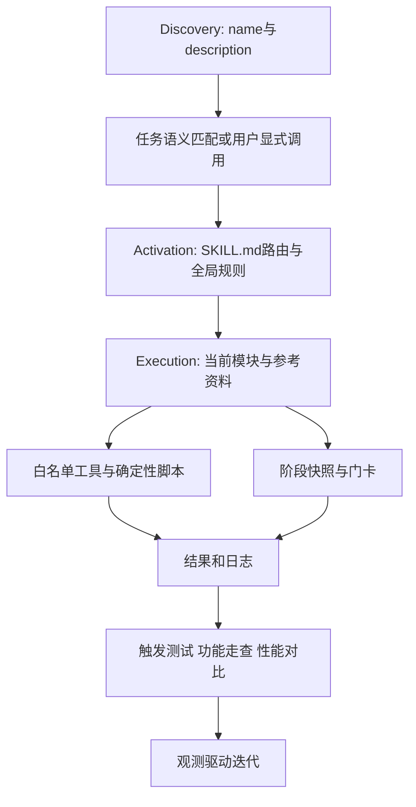

# Skill原理与最佳实践

## TL;DR

本文把Skill描述为可移植、可版本控制的专业知识与工作流封装，重点是把常驻规则和按需能力分开。渐进性披露依次发现元信息、激活入口、加载执行模块，以减少无关上下文占用。内部trade-ab-skill案例让入口承担路由，通过模块白名单、确定性脚本、阶段快照和观测日志约束AB实验操作。触发、完整流程和性能要分别验证；文章提供设计建议与示例，未给出完整项目源码和实测性能统计，平台字段也只按作者所述保留。（来源：p.1–12）

## 核心概念与知识框架

**Agent Skills** 是扩展Agent专业知识和工作流的轻量开放格式。作者把它类比新员工手册：把领域知识打包为可发现的模块，而不是每次重新解释。**Progressive Disclosure（渐进性披露）** 让知识随需要分层进入上下文。（来源：p.1–2）

按正文整理，来源：p.2、p.6–10；没有把原文的目录树误画成执行顺序。



| 维度 | 项目System Prompt | Skill | 来源 |
|---|---|---|---|
| 主要职责 | 全局编码规范与项目约定 | 特定领域工作流 | p.2–3 |
| 加载方式 | 会话启动全量加载 | 元信息常驻，正文与模块按需 | p.2 |
| 组织形式 | 单文件、扁平组织 | 多文件，脚本和资源可选 | p.2–3 |
| 规则关系 | 对所有Skill生效 | 激活时叠加内部规则 | p.3 |

⚠️[原文疑点] p.2表格称未命中Skill“零成本”，同页又明确name/description常驻上下文。宜把“零成本”理解为正文未加载，而非没有任何元信息开销；原文没有进一步澄清。

## 机制与实现条件

### 1. 入口做路由，资源按任务加载

标准目录有必需 `SKILL.md`，可选 `scripts/`、`references/`、`assets/` 与其他文件。主文件由YAML frontmatter和正文构成，`name`用于定位，`description`用于判断何时触发。入口不要堆完整业务细节，应说明触发时机、资源位置、预期产出的契约。只放一个路径无法告诉Agent何时读取、读取后做什么。（来源：p.3、p.6–7）

三阶段各有边界：Discovery只加载name/description；Activation加载完整入口与全局规则；Execution按路由读子模块、再按需查参考。作者建议入口控制500行以内，把其对应开销估计为2000–3000token；这只是本文量级估计，未给文本样本或tokenizer条件。单文件超过300行、某步骤超过100行是拆分信号，不是强制标准。使用越频繁的知识越靠近入口，偶尔查询的知识下沉。（来源：p.2、p.7）

trade-ab-skill中入口给“创建实验”路由到 `modules/creator/creator.md`，给“实验XX调流量”路由到 `modules/modifier/modifier.md`。创建模块编排Step；`collect-phase.md` 放参数填充11项清单；`validate-phase.md` 在Step3读取；`tools.md` 调接口时查阅；`safety.md` 放详细安全约束。p.8目录注释右侧裁切，不能补写收集阶段的确切Step编号。p.7决策树表达先入口、再模块、再具体Step文件、再按需工具/安全文档的知识分层。（来源：p.7–8）

### 2. 触发正确比文件漂亮更早决定成败

自动触发依赖description与用户意图的语义匹配；手动触发由斜杠命令显式点名。描述要回答WHAT和WHEN，使用客观第三人称，枚举真实术语与口语表达，如“创建实验”“新建”“做个实验”“建个AB”；可增加排除边界减少误触发。本文给出的公式为“功能定义 + 触发场景 + 核心能力”。（来源：p.5–6）

作者以Claude Code为例列字段：`name` 最长64字符、限定小写字母/数字/连字符；`description` 最长1024字符；`argument-hint` 显示参数提示；`disable-model-invocation: true` 限用户手动调用；`user-invocable: false` 限模型自动调用；`allowed-tools` 控制工具；`model` 指定模型；`context: fork` 用隔离子Agent；`agent` 在fork时指定类型；`hooks` 处理生命周期事件；`version` 追踪版本。这里是原文对特定平台的表述，不作为本次检查过的跨平台当前API规范。（来源：p.4–5）

⚠️[原文疑点] 表中name/description同时写“必填”和“省略时默认取目录名/正文首段”；未说明是否分别来自开放规范和平台兼容行为。正文又说通常“两级作用域”，随后表列企业、用户、项目、Plugin四类，优先级写企业>个人>项目>Plugin。保留作者给出的顺序，不推成所有产品通用规则。（来源：p.4、p.6）

### 3. 模块权限隔离比提醒小心更具体

trade-ab-skill将每个模块能调用的MCP接口放在独立 `tools.md` 白名单。creator只可用创建接口，modifier只可用修改接口；审批/发布接口全模块禁止，直接HTTP等万能工具全局禁用，modifier额外列容易混淆接口的禁用规则。这样把不同意图的动作范围显式隔开，防止路由正确却调错接口。（来源：p.8）

文章同时提到frontmatter `allowed-tools` 和配置 `allowedTools`，Bash可做前缀匹配；未展示完整权限配置或运行验证。不能仅凭Markdown里的白名单就宣称系统层权限已强制执行。该限制是作者AB实验项目的操作红线，不在本次笔记任务中执行文章审批或写操作。（来源：p.4、p.8）

### 4. 确定性计算交给脚本，阶段状态交给快照

作者建议当LLM可能算错而脚本能确定完成时，改为脚本：JSON读写、环境检测、日志采集和复杂计算都列为例子。MCP预检脚本查询依赖是否就绪，日志采集脚本封装操作日志；Agent调用后读结构化JSON，不猜环境状态。脚本设计要求异常内部处理、结构化输出、幂等、只操作指定文件。原文“始终正常退出”的建议还需与后文工具不可用时正确熔断一起阅读；并不等于失败能无声忽略。（来源：p.8–10）

快照作为跨阶段参数载体：本阶段写出、下阶段读入，门卡检查完整性，关键参数持久化避免对话中丢失。`businessName` 通过当前工号查询，`scenarioId` 按业务关键词对照表匹配，`metricBindingBases` 使用指定模板展开的指标数组。成功操作后持久化用户偏好，下次注入默认场景/模板与最近实验ID。下例完整保留p.9–10的示例数据，日期是样例字段，不是文章发布日期。

```json
{
  "defaultScenarioId": "<场景ID>",
  "defaultMetricTemplateId": "<模板ID>",
  "recentExperimentIds": ["<实验ID1>", "<实验ID2>"],
  "lastUsed": "2026-06-17",
  "usageCount": 2
}
```

两阶段traceId配对追踪用于日志埋点。文章未展开配对协议、快照完整schema或预检脚本源码，不能把这些名称当作直接可运行教程。（来源：p.9–10）

### 5. 测试不是只跑happy path

触发测试准备约10个自然语言变体，并加入不相关输入，分别检查漏触发和误触发。功能走查检查路由、加载时序、输出、红线和异常熔断；主动给边界值、模拟工具不可用、尝试禁用接口，才能暴露失败分支。性能测试对同一任务分别“无Skill/有Skill”各跑5次，比较token和完成质量。本文给测试方法，没有给这组性能实验的实际数字。（来源：p.10）

观测迭代记录成功/失败/取消、耗时、工具列表，用数据定位薄弱环节，再按“发现问题→定位原因→修复文档→验证效果”闭环。使用Skill并不消除测试责任。（来源：p.10）

## 原文创建流程

p.10–12给出由skill-creator辅助的步骤：先准备Git、SSH Key和支持文件操作的AI助手，再初始化目录、编写入口、添加参考文档、打包检查、关联远端提交推送、后续更新。原文的六条“告诉AI”短Prompt可完整读取，已另列PROMPT草稿；它们是作者演示用的自然语言指令，包含 `xxx` 占位符和写远端动作，本次未执行。文章没有完整skill-creator或trade-ab-skill源码，不能建立可安装SKILL文件。

## 数据速查

| 项目 | 原文数值 | 语境 | 来源 |
|---|---|---|---|
| name长度 | 最长64字符 | 原文Claude Code字段表 | p.4 |
| description长度 | 最长1024字符 | 原文字段表 | p.4 |
| 入口建议 | 500行以内 | 作者建议，估计2000–3000token | p.7 |
| 拆分信号 | 文件>300行或步骤>100行 | 经验法则 | p.7 |
| 触发测试 | 约10个语言变体 | 另测不相关输入 | p.10 |
| 性能测试 | 有/无Skill各5次 | 同一任务对比token与质量 | p.10 |

## 可迁移原则与记忆锚点

入口保留“路由与全局规则”，模块保留“当前任务需要的知识”；状态应有显式来源、阶段校验与快照持久化；工具权限按模块分开；确定性工作封装成脚本，但异常状态仍需被主流程识别。（来源：p.7–10）

助记改写：**发现靠描述，激活读入口，执行查模块；动作有白名单，阶段有快照，改动有测试。**

## 复习卡片

渐进性披露的三阶段分别读什么？::Discovery读name/description，Activation读SKILL.md路由与规则，Execution按需读模块与参考。（p.2）
为什么SKILL.md应做路由器？::把全局约束和意图分发放入口、业务细节下沉，避免一次加载所有知识稀释注意力。（p.6–7）
辅助文件引用应具备哪些信息？::触发时机、资源位置和预期产出，不能只给路径。（p.7）
description需要同时回答什么？::能力是什么、何时使用；真实触发词和排除场景帮助降低漏触发与误触发。（p.6）
trade-ab-skill如何防止创建和修改接口混用？::creator与modifier各有接口白名单，审批/发布全禁，modifier额外列混淆接口禁用规则。（p.8）
快照如何降低跨阶段参数丢失？::本阶段持久写入产出、下阶段读取，阶段门卡检查参数完整性。（p.9）
触发测试通过能代替完整功能验证吗？::不能，还需验证加载时序、红线、边界值和工具不可用时的熔断。（p.10）
何时应把指令计算改成脚本？::原文建议对LLM易错而脚本可确定执行的计算或状态查询使用脚本，读结构化输出。（p.8–9）

## 知识关联与原文参考

[[Harness与模型协同]]：渐进加载与模块职责；[[Prompt优化]]：触发与语义边界；[[Agent任务恢复]]：阶段快照；[[Agent评测与反馈]]：触发、功能与性能分开验证。

原文参考 `https://agentskills.io` 与《Agent Skills橙皮书》《Claude Code实战Harness工程之道》《Harness工程：从上下文管理到Agent系统构建》（p.12），未联网核验。

本次归纳主题：[Harness与模型协同](../../20_topics/Harness与模型协同.md) · [Agent评测与反馈](../../20_topics/Agent评测与反馈.md) · [Agent任务恢复](../../20_topics/Agent任务恢复.md) · [Agent长期记忆](../../20_topics/Agent长期记忆.md)。

> [!note]- 校对报告
> **覆盖度**：14页文本及14页缩略图全阅，放大p.4字段表、p.7决策树与路由代码、p.8裁切目录。覆盖概念、结构、触发、作用域、六项工程实践与创建流程；推广及读者评论省略。
> **一致性抽查**：name长度｜64｜p.4｜一致；description长度｜1024｜p.4｜一致；入口建议｜500行｜p.7｜一致；步骤拆分信号｜100行｜p.7｜一致；性能各跑｜5次｜p.10｜一致。
> **异常**：p.8目录注释右裁切；“零成本”与元信息常驻、“必填”与默认、“两级”与四类作用域存在表述口径未展开。未用外部资料修正作者平台规则。六条短Prompt可提炼，完整Skill未取得。
> **日期与格式**：p.1显示2026年8月17日，date为2026-08-17；遵循库AI_短标题.md命名。Mermaid未渲染，代码和文章操作未运行，一个H1，卡片单行，代码块闭合。
