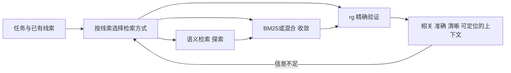

# zg本地混合检索

## TL;DR

zg（zvec-grep）把 Zvec 向量检索、BM25 和 ripgrep 精确匹配放进本地检索入口，通过 CLI/MCP 支持人和 Agent 从模糊意图探索到精确验证。它按代码符号、文档章节组织可定位单元，用 RRF 融合排序，并以紧凑结果、有限预览减少无关读取。默认扫描、提取、Embedding、索引、检索在设备内，远程 Embedding 需显式授权。配对 A/B 显示任务质量维持或提升且资源消耗下降，但预建索引开销不计入报告；PDF/Office、图检索、多模态等在文章时点仍属规划。（来源：p.1–7）

## 语义发现与精确验证各解决什么

rg擅长明确的函数、配置、错误文本和原文定位，但自然语言意图未必与实际词汇对齐：“恢复主题偏好”可能是 `hydratePreferences`，“访问权限申请”可能叫“账号授权与审批”。Agent若只能反复猜关键词，会增加调用、读取、Token，还可能在信息不完整时下结论。（来源：p.1–2）

**zg**在保留精确、快速、穷尽匹配的基础上补语义发现、相关性收敛、上下文组织。模糊查询可用向量找方向，已有关键词可用BM25/混合排序，确定符号或位置可用rg验证。原文明确这些不是必须依次走的固定流程，可以直接进入对应阶段，信息不足再探索。（来源：p.2–4）

按p.4原图及正文整理，保留可跳入与回探索的语义：



## 从安装到共享索引

首版支持macOS/Linux/Windows，开发者CLI、Agent MCP；`zg install`发现本机Codex、Claude Code、Cursor、OpenCode并配置MCP。随后在工作区 `zg index`，CLI和已接Agent共用本地索引，无需为每个Agent重建。以下是p.3完整命令示例，去排版行号，未执行，不代表本机已安装。（来源：p.3）

```bash
# 1. 安装 zg
npm install -g @zvec/zvec-grep
# 自动发现本机已安装的 Agent，并完成 MCP 配置；
# 也可以指定目标，例如：zg install --target codex --yes
zg install
# 2. 为当前工作区建立本地索引
cd your-repository
# 默认使用轻量本地模型 local/potion-code-16m-v2
zg index
# 3. 通过 CLI 或 Agent 开始检索
# 方式一：在终端中通过 CLI 检索
zg query --human "theme preference persistence on startup"
# 方式二：在已连接的 Agent 中直接提问，Agent 会按需通过 MCP 调用 zg
# 示例提示词：Find how theme preferences are restored on startup.
```

`your-repository`为示例路径；文章没有给安装失败恢复、版本锁定、资源预算等完整规程，此处不补。终端动画在PDF为静态首帧，步骤依据代码正文。（来源：p.3）

## 内容如何变成检索单元

| 内容类型 | 当前覆盖 | 组织方式 | 来源 |
| --- | --- | --- | --- |
| 代码 | C/C++、Go、Java、JS/TS、Python、Rust、Vue、Svelte | 支持结构解析时保留符号/签名/层级；组件提脚本，其余通用文本 | p.4 |
| 文档 | Markdown、纯文本、RST、HTML/XML | Markdown按标题章节，其余可定位片段 | p.4 |
| 文本数据 | CSV、JSON、TOML、YAML及可识别文本 | 通用文本提取参与索引 | p.4 |

文件路径、Glob、类型、忽略规则限制范围，扩大覆盖不必同时扩大噪声。这里CSV等是文本检索，不自动等同结构化SQL查询或数值统计。PDF和Office尚未原生支持，不能因正文说“研究资料”就推断所有二进制文档都可检索。（来源：p.4、6–7）

## 效率机制在完整任务中起作用

四类优化相互配合：MCP工具描述/指引帮助根据关键词、位置、符号选择方式，并在信息充分时停止；BM25+向量生成候选，用 **RRF（Reciprocal Rank Fusion）**多路融合、去重、统一排序；符号/章节切分保留路径位置，减少手动拼上下文；默认只返回排序后的紧凑结果及有限预览，需要时才读完整内容。原文未提供RRF参数、分块阈值、检索数或停止判定算法，不用常识补默认值。（来源：p.4）

[推断] 来源定位与有限预览使发现和证据验证可以分步进行，但不能保证模型一定引用正确或不漏检；依据是原文明确保留路径/位置并按需读全文，具体任务仍需验证。

## 配对 A/B 的收益与未计入成本

评测保持Agent、模型、Prompt、环境、任务限制一致，Baseline用标准工具，zg仅增加预建索引、MCP工具和指引。SWE-QA-Bench包含20真实代码仓库任务，跨文件定位与多步推理；图中标11仓库、每配置3次运行。BrowseComp-Plus为80深度研究问题，图中100,195文档、每配置2次试验。图表灰柱为Baseline归一100，彩色柱相对基线，不可把柱高当原始评分。（来源：p.5原图）

| 指标 | 原文数值 | 语境 / 条件 | 出处 |
| --- | --- | --- | --- |
| SWE评审得分 | 80.42→81.92；+1.50分 | 配对代码任务 | p.5图 |
| SWE输入Token | 559K→294K；-47.3% | 同组任务 | p.5图 |
| SWE工具调用 | 23.42→9.70；-58.6% | 同组任务 | p.5图 |
| SWE Agent耗时 | 127.5→79.7秒；-37.5% | 同组任务 | p.5图 |
| Browse准确率 | 98.67%→99.00%；+0.33个百分点 | 固定语料深度研究 | p.5图及正文 |
| Browse输入Token | 1.68M→1.05M；-37.56% | 同组任务 | p.5图及正文 |
| Browse工具调用 | 25.42→14.36；-43.52% | 同组任务 | p.5图及正文 |
| Browse Agent耗时 | 259.4→159.3秒；-38.58% | 同组任务 | p.5图及正文 |
| 默认Embedding | 16M级；缓存约32MiB | local/potion-code-16m-v2，无需GPU | p.6 |
| 索引案例 | 3457文件、不超过半分钟 | Django仓库、Apple M4 Pro | p.6 |

预建索引有一次时间/计算开销，远程Embedding还可能有Token/费用；原文因跨查询复用和增量摊薄而未计入上图。短期一次性任务不能只引用Agent耗时下降而忽略索引建立成本。正文未给全部原始运行结果、误差区间与评分器细节，复现线索在文末文档，本笔记未访问。（来源：p.5）

## 本地优先的实际数据路径

按p.5图整理：本地文件→结构识别切分→默认端侧Embedding→Zvec本地向量/BM25索引；用户或Agent从CLI/MCP进入zg查询，索引提供语义/BM25/混合结果，文件直接支撑rg，最终结果保留来源。可选远程Embedding路径只有显式授权才能向外发送片段或查询并返回向量，配置凭证不等于获得发送授权。（来源：p.5图、6正文）

内置11端侧模型覆盖代码、文档、多语、长输入和轻量需求。默认16M静态模型无需GPU；文中称SWE效果接近 `qwen/qwen3.7-text-embedding`，但未给此比较的具体分数。Zvec为嵌入式索引，不用部署独立数据库。远程不是自动启用，本地模型不满足质量、多语或设备条件时用户可选择。（来源：p.6）

## 现有、规划与产品对比

p.6矩阵列zg、rg、Semble、qmd、CodeGraph。对zg，CLI/MCP、本地优先、语义/BM25/混合、正则穷尽匹配、增量索引、自动刷新均标当前支持；属性过滤、Embedding丰富度、代码/文本结构提取标High。图检索、查询改写、模型重排、原生PDF/Office、图片多模态均为“❌*”，即已规划而未支持。（来源：p.6–7）

对比矩阵是作者时点定级，High/Medium/Poor考察维度覆盖、模型配置、格式与切分元数据等，未说明统一公开量化评分；不把它写成重新测试的工具选型结论。路线围绕更强检索/结构信号、PDF/Word/PPT和OCR版面多模态、更高上下文密度、本地资源效率与移动端探索，基础工程还包括升级卸载、并发、自恢复、诊断、兼容持续打磨。（来源：p.7）

项目采用Apache 2.0且处于起步阶段，文章邀请真实场景、可复现评测、格式模型集成等贡献；不等于这些未来能力可立即使用。（来源：p.7）

## 记忆锚点

- “语义发现、排序收敛、精确验证，按线索进入。”（助记改写，p.2–4）
- “评完整任务，也记索引成本。”（助记改写，p.5）

## 复习卡片

zg为何仍保留rg::明确符号、配置、错误和原文需要快速精确且穷尽匹配，语义发现不能替代验证。（p.1–4）
语义到BM25到rg是否固定流程::不是，可按已有线索直接选阶段，信息不足再探索。（p.4）
RRF在本文做什么::融合BM25与向量候选，去重并统一排序，让相关内容更早出现。（p.4）
紧凑预览为何省上下文::默认只给排序结果和有限预览，需要时再读全文，少让无关文本进入上下文。（p.4）
A/B报告遗漏了哪类成本::预建索引的一次时间计算及可能远程Embedding费用，作者按复用摊薄而未计入。（p.5）
CLI和MCP是否需各自索引::可以共用同一本地索引，不必重复构建。（p.3、6）
默认模型和运行条件是什么::local/potion-code-16m-v2，16M静态模型、约32MiB缓存，无需GPU。（p.6）
何时文本或查询可离开设备::远程Embedding显式授权后，不会自动启用。（p.5–6）
PDF与图检索在文章时点是否可用::原生PDF/Office、图检索等在矩阵为规划未支持，不能当现有能力。（p.6–7）

## 知识关联

检索与上下文：[[检索与文档解析|本地混合检索]]、[[Harness与模型协同]]。
质量与数据：[[Agent评测与反馈]]、[[Agent数据分析]]。

## 原文参考资料

p.7提供[zg仓库](https://github.com/zvec-ai/zvec-grep)、[SWE-QA协议](https://github.com/zvec-ai/zvec-grep/blob/main/benchmarks/swe-qa-bench/README_CN.md)、[BrowseComp-Plus协议](https://github.com/zvec-ai/zvec-grep/blob/main/benchmarks/browse-comp-plus/README_CN.md)、[性能测试文档](https://github.com/zvec-ai/zvec-grep/blob/main/benchmarks/README_CN.md)、[ripgrep](https://github.com/BurntSushi/ripgrep)。均未访问核验。


本次归纳主题：[检索与文档解析](../../20_topics/检索与文档解析.md) · [Agent成本与上下文预算](../../20_topics/Agent成本与上下文预算.md)。

> [!note]- 校对报告
> **覆盖度**：通读全部 10 个物理页文本，浏览全部页图；放大核对 p.1、3、4、5、6。正文覆盖 意图与精确检索；安装与内容提取；上下文优化与AB；本地数据路径；能力矩阵与规划。推广、页尾互动与读者评论有意省略。
>
> **一致性抽查**：
>
> | 核对项 | 笔记值 | 原文值与位置 | 结果 |
> | --- | --- | --- | --- |
> | SWE提升 | +1.50分 | 80.42→81.92，p.5图 | 一致 |
> | Browse精度 | 98.67%→99% | p.5 | 一致 |
> | 默认缓存 | 约32MiB | p.6 | 一致 |
> | Django索引 | 3457文件≤半分钟 | M4 Pro，p.6 | 一致 |
> | 原生PDF | 规划未支持 | p.6矩阵❌*、p.7图例 | 一致 |
>
> **异常与边界**：报告未计入预建索引时间计算与可能的远程Embedding费用；安装终端动图仅PDF静态首帧，步骤据可读代码正文
>
> **日期与格式**：发布日期依据 p.1“飞鸿 阿里技术 2026年8月31日 03:40 浙江”；frontmatter 使用页首发布日期，不推测时区。本库归档名使用 `AI_zg本地混合检索.md`，服从知识库命名规则。Mermaid 未实际渲染，文章中的命令和代码未执行；卡片按单行 `问题::答案` 保存。
