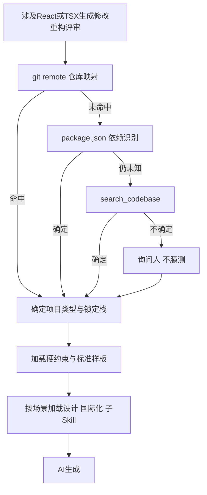
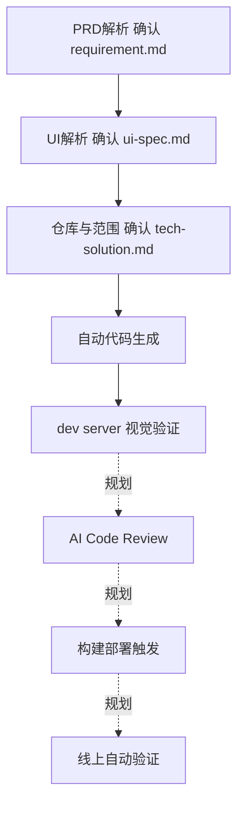

# 前端Skill团队研发实践

## TL;DR

本文把团队前端经验整理为 `an-frontend-skill`，先识别仓库与历史技术栈，再让触发、选型、硬约束、样板、跨能力映射进入生成代码的上下文。四类落地包括Status看板、旧平台升级、设计直接交付原型代码、国际化批处理，进一步将低复杂度CRUD需求串成R2C流程，前三阶段先确认Spec再进入自动生成。团队经验通过规则和样板复用，但文章明确自动Code Review、部署和线上验证仍是规划，提效量化也缺统一口径。PDF中Skill长行和截图片段有裁切，国际化“两周全部完成”与工作规模图的CM约三周需要保留为原文疑点。（来源：p.1–16）

## 痛点是生成时缺少团队判断

后端、PD、设计都能借AI写前端，但产物会出现视觉漂移、与线上ice/Fusion或umi/Ant Design生态不匹配、手写组件与SVG、未审计依赖、原型无法移植等问题。跨端同学并非不愿守规范，而不知道现有规则和历史坑；“功能跑通”可能把成本交给后续前端Review。（来源：p.1–2）

课程覆盖安装框架调试但无法传递具体仓库经验；知识库在技术债没盘清、无强owner仲裁时会产生新债和冲突；Aone Super/自建Anchor平台增加配置、代理插件、API Key维护与长任务中断成本。作者选择借集团工具，把团队精力放在Skill/MCP/知识库周边能力，直接在生成时注入约束。（来源：p.2–4）

## 从项目识别开始，防止规范被过度泛化

盘点分三类：经典稳态Ice/Fusion/React16/Formily求稳；稳定性标准x-ops/ProComponent有齐备规范组件；通用新建React18/Ant Design技术新但需团队约束。各类UI、请求、表单不同，不能把新项目建议套进历史仓库。（来源：p.4）

项目识别顺序是查git remote反查映射表→未命中读 `package.json` 依赖→仍未知用 `search_codebase`→不确定问人、不得臆测。确定上下文后再给红线；例如裸fetch绕开统一鉴权/拦截器，写规则还要解释原因，让约束不被扩展成错误范围。样板提供可模仿的团队标准，而非只列抽象原则。（来源：p.4）

按正文整理决策主线（来源：p.4–5），“不确定问人”是实际失败分支：



## 五维结构与实际文件职责

主 `SKILL.md`负责触发、路由、概要，重内容到 `reference/` 按需加载，项目专属规则嵌入子Skill。目录含 `aicoding-rules.md`、`tech-selection.md`、`component-templates.md`、`coding-standards.md`、`yunan-xops-design.md`、`domain-repository-map.json`、`glossary.md`、`contacts.md`、`skills/goc-frontend/`、`skills/x-ops/`。这是文章结构示意，文件实际内容与依赖没有随PDF交付。（来源：p.5–6）

| 维度 | 实际职责 | 约束与条件 | 来源 |
| --- | --- | --- | --- |
| When | React/TSX生成、修改、重构、评审触发 | 覆盖脚手架、组件Hook页面、团队库、选型、跨端及项目改动 | p.6 |
| What | 先历史栈路由，再新建场景选型 | 老项目锁定；新项目React18+TS+Vite+XOps+ahooks | p.6–7 |
| Don't/Why | 红线和原因 | 减少绕过，也防过度泛化 | p.4、7 |
| How | 最小可运行的团队样板 | 公共组件、双轨API、列表和表单 | p.7–8 |
| Map | 引用设计和国际化owner产物 | 只按场景加载，不再独立维护重复Token | p.8–9 |

### What：先锁定，才谈新选型

历史项目A保留Ice.js2.x/Fusion/Formily，B用私有Pro组件。新场景表首选Ant Design、Ant Design Form、ahooks/Zustand、内部 `magic-request`、AntV G2/G6，不推荐Tailwind、Formily、Ice Store、SWR、ECharts；作者分别给出绕过Token、社区维护、重复栈、包体等理由。它们是这个团队语境的选择，不是当前通用产品优劣榜；本笔记不联网更新或推广为所有项目规则。（来源：p.6–7）

### Don't/Why：八条硬约束

原文可确认的规则是禁any而用unknown+类型守卫；CSS Modules+Design Token而禁Tailwind；团队私有icon而禁第三方iconfont/散落SVG；Hook顶层调用；组件单一职责且单文件<200行；API走统一封装禁裸fetch；用useRequest而非手写useState/useEffect模拟请求；颜色间距圆角须Token。装包须tnpm也在前文红线举例。多条Why行尾裁切，以下为可确认转述，不冒充逐字完整Skill。（来源：p.4、7）

### How：样板明确交付接口

公共组件 `index.tsx + index.module.css + types.ts + 桶导出`；通用API用axios+拦截器，锁定栈用私有配置式请求库；列表骨架 `useRequest + Table + columns`；表单骨架 `Form + Form.Item + name + rules + onFinish`。p.8截图还显示goc/x-ops配置式 `@alife/goc-request` 在接口声明后统一处理鉴权、错误、Mock等，示例可见GET `getItemDetail` 与 `/gtsCloudService/innerApi/item/detail`，其下内容折叠/截断，不能补成完整代码。（来源：p.7–8页图）

### Map：能力引用而非复制维护

设计映射来自设计师Skill，包含Token、设计元素到组件和图标用法；涉及颜色、间距、圆角、阴影、图标、组件样式先加载 `yunan-design-system`。国际化用must框架，涉及多语文案/key/`FormattedMessage`加载 `an-i18n-setup`，默认可见文案走i18n，硬编码中文需PR解释。调用主Skill解析类型注入约束，再按设计/i18n场景加载，生成时多份规范在场。（来源：p.8–9）

示例Token是主色 `#1057D9`、警告 `#FA8C16`、基本圆角4px、卡片8px、常规间距16px。它们为该团队设计系统示例，不是任意应用默认值。原代码的Token表跨行排版不规范，此处只忠实恢复可确认值。（来源：p.8–9）

## 四个案例的不同证据性质

Status看板先尝试Aone Super D2C/R2C，一页十组件九核心接口，三周、AI采纳80%、已上线；还原一般需控制选区和人工微调，多轮上下文可能中断。这个案例为Skill设计提供踩坑依据，不是直接证明Skill让该项目提效。（来源：p.9–10）

CFD从Umi3/Ant Design Pro升级Umi4/xops-design/ProComponents，三天完成栈与库升级、具体页面样式持续优化。正文说去年同类其他平台2–3周，对照表标传统手工1–2周，均保留各自语境，不硬合成统一基线。（来源：p.10）

AIOps设计直接交代码需前端先建仓库并内置前端/设计Skill，设计能操作Qoder、Git、分支和O2部署。原型反馈在代码修改，通过CDN版本切换保留评审，前端直接移植适配约70–80%，接入从2–3天降到半天；它不是无学习和无Review的任意设计角色全自动交付。（来源：p.10–11）

国际化原来must extract之外还要手工处理模板字符串、Formily Schema表达式、ProTable locale。这次六步流水线与五脚本按序执行，作者称每步幂等、已处理跳过，跨行模板与复杂嵌套仍少量微调。（来源：p.11）

以下原文完整流程示例，只保留为资料；PDF没有脚本实现、领域词典与框架环境，不能直接作为可运行交付。（来源：p.11）

```bash
# 1. 自动抽取中文文案并包裹 $i18n.get()
echo "Y" | must extract
# 2. 处理 must extract 无法覆盖的模板字符串
node scripts/fix-template-literals.js
# 3. 处理行号偏移导致跳过的条目（模糊匹配兜底）
node scripts/fix-skipped-templates.js
# 4. 处理 Formily Schema 中 {{}} 表达式的中文
node scripts/transform-formily-i18n.js
# 5. 为所有 ProTable 批量注入 locale 配置
node scripts/add-protable-locale.js
# 6. 基于领域词典自动翻译 en-US.json
node scripts/translate-en-us.js
```

> [!warning] 国际化周期与规模有口径疑点
> ⚠️[原文疑点] p.11称“三个平台2周内全部完成”，p.12规模图CM为2026-05-08至05-28，标“约3周”；GOC为05-12至05-26（15天），CIS为05-08至05-22（2周）。统计窗口是否不同未解释，不能把两周写成已统一验证的全部项目周期。
> ⚠️[原文疑点] p.10写80+组件，并括注17公共+55页面级（合计72），是否还有其他组件未说明；保留原表述，不擅自补类别。

## R2C的已实现链路与人确认

**R2C（Requirement-to-Code）**面向低复杂度中后台CRUD，输入钉钉文档、可选设计稿与目标仓库。PM解析确认输出 `requirement.md`，UI规格解析确认输出 `ui-spec.md`，技术方案仓库分析/范围确认输出 `tech-solution.md`；前三阶段都“快照→用户确认→落盘+git commit”，技术方案确认后才自动生成路由、API、UI、逻辑，再启动dev server视觉验证。（来源：p.12–13）

十阶段文件每个管一件事，单点修复避免规则全堆在长文；六子Skill一起分发减少装配；写码前结构化Spec包含需求摘要、页面、接口、交互、改动文件、验收清单，作者称约30%场景此处发现需求/设计不一致。不能把“4000字后遵循度下降”的经验写成所有模型硬限制。（来源：p.13）

按正文整理（来源：p.12–13），规划节点用虚线关系区分：



自动CR、部署、线上验证在状态表仍为规划。一个标准CRUD从需求到浏览器约20分钟，对比过去试写后由前端Review改完2–3天，是局部流程案例，不等同生产上线20分钟。全链路还需后端OpenAPI契约、统一状态错误提示和跨端知识库。（来源：p.12–13）

## 数据速查

| 指标 | 原文数值 | 语境 / 条件 | 出处 |
| --- | --- | --- | --- |
| 单文件约束 | <200行 | 团队硬约束，超过拆分 | p.7 |
| Status采纳 | 80%、三周 | 一页十组件九接口、已上线 | p.9 |
| CFD升级 | 三天；传统表1–2周 | 23页、80+组件、30接口，页面仍调优 | p.10 |
| 手动规范对齐 | 约60%时间→接近0 | CFD样式/组件替换 | p.10 |
| 原型复用 | <30%→70–80% | AIOps3页/24+组件/8接口 | p.10–11 |
| 前端接入 | 2–3天→半天 | AIOps直接移植适配 | p.11 |
| 国际化 | 原两平台约2月；新称三平台2周 | 规模图CM约3周，保留疑点 | p.11–12 |
| 国际化GOC | 665变更文件、净增44815行、6074词条 | 图示05-12至05-26 | p.12图 |
| 国际化CM | 717文件、净增37422行；zh-CN5517/en-US5518词条 | 图示05-08至05-28 | p.12图 |
| 国际化CIS | 173文件、净增18127行、2366词条 | 图示05-08至05-22 | p.12图 |
| Spec暴露不一致 | 约30%场景 | 作者实测描述，未给样本规模 | p.13 |
| 标准CRUD到浏览器 | 约20分钟 | 低复杂度，非线上交付周期 | p.13 |
| 首产出返工比例目标 | 60%+→<20% | 度量建议中的目标，非达成结果 | p.14 |

## 可迁移方法与待验证边界

作者建议先用可观测对比：同规模人天、首次Review返工比例、下载/收藏/反馈信号。下载量只能说明使用侧，不能证明任务成功；不同人需求难度、采纳率定义未统一，工具与人贡献难归因。本文并未提供严格受控效能实验。（来源：p.14）

可迁移的是识别情境→加载约束理由→给样板→按owner引用周边能力→用真实案例反馈的组织方式。具体禁库、栈锁定、组件映射须随团队改变；“团队特有不到30%”为作者判断，不能作为未经验证的通用比例。后续横向扩后端契约/测试/PD，纵向扩自动CR/CI/部署巡检，均应保持状态标记。（来源：p.15–16）

## 记忆锚点

- “AI生成那一刻的上下文里有没有规范。”（原文主张，p.16）
- “When、What、Don't/Why、How、Map。”（原文五维，p.5）

## 复习卡片

陌生仓库识别如何分流::git remote映射，未命中看package依赖，再search_codebase，仍不确定问人而不猜。（p.4）
What为何有两层::先保护历史栈，再给新项目场景选型，不能把新栈偏好套到旧项目。（p.6–7）
为什么规则附Why::既减少绕过，也帮助AI理解场景理由，避免把禁止项过度泛化。（p.4）
标准样板为何是关键::它给可模仿的团队交付结构，组件/API/列表/表单不只剩抽象口号。（p.7）
Map如何避免重复维护::按场景引用设计与国际化owner产物，主Skill不复制Token规则。（p.8–9）
国际化幂等流程仍有什么依赖::must环境、五脚本、词典，且跨行复杂嵌套少量微调；PDF未提供脚本。（p.11）
R2C什么时候进入自动生成::前三阶段输出快照经用户确认落盘commit，技术方案确认后再自动生成。（p.13）
20分钟CRUD结果是什么范围::需求文档到浏览器跑起来的低复杂度案例，不是全生产上线耗时。（p.13）
哪些R2C能力仍规划::自动Code Review、部署触发、部署后线上自动验证。（p.12–13）
为什么采纳或下载不能独立证明效能::采纳定义、人员归因和任务成功口径尚未统一，使用信号需与可观察结果结合。（p.14）

## 知识关联

研发：[[AI研发协同]]、[[问题澄清]]。
工程：[[Harness与模型协同]]、[[Agent工程循环]]、[[Agent评测与反馈]]。

## 材料可复用范围

Skill目录、触发/红线/设计映射、六步命令是原文片段或说明；完整主Skill、子Skill、映射表、脚本和依赖未取得。本文不创建可安装Skill，也不将作者团队规范作为本库执行规则。


本次归纳主题：[AI研发协同](../../20_topics/AI研发协同.md)。

> [!note]- 校对报告
> **覆盖度**：通读全部 19 个物理页文本，浏览全部页图；放大核对 p.1、6、7、8、10、11、12、13。正文覆盖 痛点和路径尝试；仓库路由和五维；四类案例；R2C阶段与边界；度量与规划。推广、页尾互动与读者评论有意省略。
>
> **一致性抽查**：
>
> | 核对项 | 笔记值 | 原文值与位置 | 结果 |
> | --- | --- | --- | --- |
> | 文件行数 | <200 | p.7 | 一致 |
> | 原型复用 | 70–80% | p.10–11 | 一致 |
> | CFD周期 | 3天 | p.10 | 一致 |
> | 国际化步骤 | 6步、5脚本 | p.11 | 一致 |
> | 自动CR | 规划中 | p.12–13 | 一致 |
>
> **异常与边界**：p.6目录注释与触发行尾、p.7多条Why、p.8 API截图均右裁切或折叠，未取得完整Skill；p.11称三个平台两周完成，p.12 CM图为05-08至05-28约三周，窗口差异未解释；p.10写80+组件并括17+55，合计72，是否另有组件未说明；五个国际化脚本仅命令名称，脚本实现与词典等依赖未取得
>
> **日期与格式**：发布日期依据 p.1“原创 王僖 阿里技术 Jul 30, 2026, 4:55 AM 浙江 标题已修改”，解析2026-07-30，不推时区；frontmatter 使用页首发布日期，不推测时区。本库归档名使用 `AI_前端Skill团队研发实践.md`，服从知识库命名规则。Mermaid 未实际渲染，文章中的命令和代码未执行；卡片按单行 `问题::答案` 保存。
