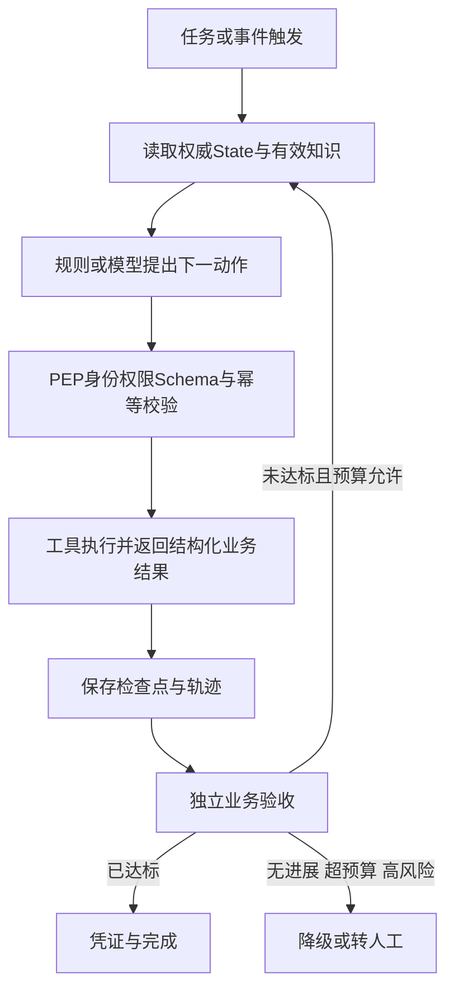

# 垂类生产级Agent落地

## TL;DR

生产级垂类 Agent 要把任务从受理推到可验收终点，同时满足稳定、可控、可审计和业务闭环，而不只是生成漂亮答案。本文主张从高频、风险可隔离、规则明确、闭环短的小场景开始，将目标和权限写成可执行规格。知识要有来源、版本、时效与权限，经验按场景封装，工具执行由确定性代码治理，长任务用权威状态恢复。上线后以分层指标、黄金集、灰度回滚和独立验证器管住漂移与自进化；RAG、Wiki、Loop、Graph、MCP等只是不同工程问题的解法，不应把名字当架构。（来源：p.1–5、26–28）

## 生产能力不是Demo能力的自动放大

**Agent**在本文以“大模型＋工具＋循环”为最小范式；**Harness**是模型外围的运行时，提供工具、沙箱、权限、预算与评估，作者用“Agent＝模型＋Harness”强调智力如何安全作用于业务。稳定性要求真实流量中重复完成，可控性要求动作可被拦截，可审计性要求还原所见数据、工具、策略版本与批准者，业务闭环要求真实系统进入验收状态。

真实输入会因订单、会员和活动改变语义；工具会超时或变更；用户会中途改口、隔天补资料；错误退款和承诺产生资损风险。常规流程能用自动化稳定完成的，就不应硬塞多轮推理；单纯检索可用助手，需要动态决策才考虑 Agent。本文转述 Klarna 等公开故事说明规模化和质量风险并存，但没有在本文重新核验这些外部数字。（p.1–4）

小场景切入需同时满足高频、低风险/可隔离、规则明确、短闭环。最小闭环检查五问：任务是否正确理解、知识数据是否适用、是否调用允许能力、是否进入真实系统或给可执行下一步、失败是否有降级转人工与追溯。五问不清便扩展，只会复制缺陷。（p.5）

## 目标、风险分级与动作闸门

目标至少写对象、场景、基线、目标值、红线与测量方式。降本、提效、降风险、体验并不自动一致：只追自动解决率会压制转人工，只追满意度又可能把可自动完成工作全部交回人。目标权重与红线必须明确。

“这个能退吗，不行就帮我退”包含咨询与执行两段：先据有效政策和订单状态给可追溯结论，再判断是否可发起售后。仅有自然语言“不乱退款”没有策略拦截点；动作目录应列查订单、改地址、创工单、发退款和承诺话术，轨迹带 `scene_id、policy_version、tool_call_id、decision`，高风险保留确认句柄，关键办理留凭证。（p.6）

| 等级 | 自治与人工职责 | 成立条件 | 出处 |
| --- | --- | --- | --- |
| L0 | 纯信息展示/检索全自动 | 只读 | p.7 |
| L1 | 输出建议、确认后执行 | 质量需把关，或执行不可逆需人/强规则闸门 | p.7–8 |
| L2 | 先执行、后抽查复核 | 高确定性，加工程保障的可逆性 | p.7–8 |
| L3 | 人主导，Agent辅助，每步审批 | 强合规或高资损 | p.7 |

“确定性×可逆性”不是四格直接对应四等级。L1 同时可能是低确定建议的质量门与高确定不可逆动作的权限门。L2 的可逆性要由幂等键、撤销窗口与补偿接口做出来，做不到便退 L1；文中小额退款可在这些前提下讨论 L2，大额仍须 L1/L3，不能据此普遍授权资金写入。（p.7–8）

边界建设可分档叠加：场景分级清单统一做/不做与谁确认，却拦不住运行时越权；动作目录＋**策略执行点（PEP）**在调用前校验，却不负责知识正确；将 SOP 编成可执行契约，机器检查进入条件、槽位、守卫与停止，但建设与变更发版成本更高。建议先清场景，再对写操作设闸门，最后将红线流程契约化。（p.8–9）

## 知识从“找得到”到“证明当前适用”

### RAG失败不都归因模型

FAQ、SOP、商品说明、工单和群聊可能冲突；Top K 相似并不等于正确版本。条件与例外分块后容易只命中原则，去年规则又与今年语义相近。权限在召回后才过滤，会让被删除内容仍进入排序或日志；库存/订单状态等实时事实编进知识库则过期。没有引用、冲突暴露与未命中策略时，模型会把空白补成流畅承诺。（p.9）

**知识编译/LLM-Wiki**将原始文档在摄入时整理为可追溯中间层，查询消费已发布结论，持续更新，而不是每次查询临时综合原文。文章展示 Raw Sources、Schema、Wiki 三层：原文只读，Schema规定结构，Wiki由编译维护并支持回答引用。个人模式进企业后，必须加生效日期、权威来源、多角色/租户权限、审批留痕和版本。（p.10–11）

### Ingest、Query、Lint分工

**Ingest（摄入）**是可重复编译作业：原文只追加；先定页面类型、元数据、章节和 schema；输出受影响结论及交叉引用补丁，避免整页反复润色导致细节坍缩；抽出与推断分开；概念页在参考实践中至少两篇来源再独立；日志机器可读；去重、命名、状态与字段校验交脚本，摘要、归并、冲突建议交模型。企业流程“发现→抓取→编译→验收”要能断点续作，已抓十篇可先摄入五篇而不丢剩余进度。（p.11–12）

**Query（取用）**先读索引和已编译页面。精确对象直接目标页；关系问题走链接/图；模糊问题先收业务域再混合召回，读中选全文后带引用综合。权限与时效在召回前过滤，脚本粗排、模型只精排短名单，候选必须满足品类、渠道、会员与活动等当前条件。不达检索阈值禁止用通用常识补企业事实；库存、余额、物流与工单状态走工具，Wiki只答规则。好回答最多进入候选或日志，经审核编译才发布，不能即时热更政策。查询日志也反向提供缺口和腐化信号。（p.12–13）

**Lint（体检）**分结构和语义两层。脚本检查来源/时效/权限字段、断链孤页、原文/Wiki/图节点对账和新鲜度；模型提出冲突与缺口建议，人裁决政策语义。单页生成后先检查字段引用，整库构建后再全局对账。断链、缺引用和契约缺失应为 ERROR、非零退出、阻断发布，孤页薄页建议为 WARNING。摄入后轻量检查，每周或规则变更后全量巡检，问题进治理待办，以增量重编关闭。（p.13–14）

### 从文档到语义的三道坎

结构化提取明确字段；关联显式表达规则优先级与条件；可执行把“通常”“工作日”等模糊表达精确化。文中贷款年龄18–65、逾期30天与VIP45天是说明方法的示例，不是本库可执行业务政策。选择可按失败信号逐级加强：文档 RAG 解决找到；混合检索加元数据；Agentic RAG支持复杂多跳但限跳数；规则引擎＋LLM填槽提供高风险可测判定；Wiki/Claim/Release提供可引用可发版知识，但增加编译审核成本。（p.14–16）

快速变化外部信息适合 RAG，稳定手册与SOP适合编译，交易日志适合数据库查询＋LLM解释，探索知识可 RAG＋人工后逐步入 Wiki。两者互补。无论形式，都要结构切分、`source_id+version+定位符`引用、冲突显式化、未命中降级和场景化评测。（p.15–16）

### 知识缺口须跨会话成立

“零结果”可能是闲聊、表达不完整、查错对象、权限拒绝或检索故障。可晋升缺口至少是企业应覆盖领域、当前 Release 未覆盖、最终无有效证据，并在多个独立会话重复出现。正确回流为交互短期 Buffer→噪声过滤→主题归一→跨会话累积→达阈值运营列表→补原资料→编译审核发布→代表问题回放通过后关闭。单次没搜到不直接改政策。（p.14、16）

## 经验封装：可发现、版本化、工具收紧

经验来自 SOP、历史工单、老员工习惯、团队约定与错误教训，全部塞长 Prompt 会失焦、难维护、难复用。方案可由工作流或确定性骨架做主路径，**Skills＋渐进披露**做可复用场景包，全局 prompt只留红线/人设，轨迹蒸馏负责产生下一版候选。

目录只放 `name+description`（文中约百 Token），命中才读 SKILL.md，必要时再读附录/脚本。能力单元至少含触发、输入、步骤、工具白名单、校验、异常与输出。作者建议一 Skill 一事，正文超过约5000 Token再拆；轨迹记录 `skill_version`并可回滚；独立看该 Skill工具成功与错误承诺率；按当前 Skill只暴露4–8个工具。`name/description`是触发接口，不是营销简介。材料没有完整可安装 Skill，只有设计字段与原则。（p.17–18）

## 循环工程：内循环行动，外循环裁决

模型提出 `tool_use`，实际执行工具的是外围代码。**内循环**处理当前状态下怎样走，**外循环**管为什么启动、怎样算完成、谁验收、何时停止。四要素是触发、可检验目标、独立验收器和停止条件；停止包含达标、超步数/时间/费用、无进展和高风险转人。

办理类目标应是“工单已派单且住客可见”或“引用有效政策且未越权退款”，不能是生成结束、HTTP 200 或用户似乎满意。验收优先使用下游状态机、必填槽位、规则和人工授权；不一定再用一个模型。回合、目标、时间、主动四档循环是嵌套关系，外面可定时或事件触发，里面仍需正确目标与验收。（p.18–20）

常见失败及控制：空转要步数/超时/无进展检测；目标漂移要每圈回看目标；假完成要业务断言；写重放要幂等且已成功动作不再做；上下文撑爆要压缩和进度外置；夜间自信越权要高风险停止和独立验收。图编排使分支、等待和人工卡点可审查，却不自动提供持久化与验收。生产常用确定性主链＋局部受控循环；开放探索才让模型动态选择下步。（p.21–22）

按 p.19–25 正文整理，覆盖主链职责，不表示文中已有某个完整实现图。

## 工具网关、补偿与长任务恢复

直连 API 易发生服务账号身份冒用、超时重复写、部分成功后全段重试、错误码/schema误读和工具过多。MCP标准化“怎么连”，不替代业务级鉴权、配额、审计与 PEP；连接器/iPaaS负责跨系统流转也不包办对话状态。推荐主路径是工具网关，最低要求用户身份绑定、场景白名单、JSON Schema、幂等键、超时熔断、可重试/不可重试/需人工的结构化错误以及最小权限。

可撤销动作要补偿接口，不可撤销动作前置确认，重试带同一幂等键。工单创建成功但通知失败时不能把全链路当作全部失败重做。具备代码执行能力还需沙箱隔离；文中 Dify/WorkBuddy能力只作为作者时点例子，没有在本次进行平台验证。（p.22–24）

**Context、Memory、State**不能混用：Context是单次推理窗口，Memory是天到月的跨会话信息，State是任务生命周期内当前执行进度。用户隔天补资料、人工审批、跨系统和异常重启都需要任务状态，而非只保存聊天摘要。

检查点在关键步骤后保存快照，从最近有效点恢复；事件溯源重放状态变更序列，更精细但成本高。需检查保存间隔、恢复告知、持久化审批等待、备份，并确保成功写操作不重放。接着聊不等于接着做。（p.24–25）

## 可衡量、可治理、可进化与平台边界

上线后知识、工具、模型和规则会漂移，总完成率可能掩盖某类场景退化。分层看任务完成/转人工/时长、能力步骤与错误分支、工具超时/幂等冲突、知识引用/过期/冲突、风险越权/承诺/资损、体验成本延迟。离线黄金集回归不过不全量，按场景/租户灰度，按版本回滚；只看流畅回复或未校准 LLM judge会漏掉轨迹错误。（p.26）

自进化分脚手架（Prompt、Memory、Skill、工具、workflow）和权重两路：先用快、便宜、可逆、可审计的脚手架试错，稳定通用经验再考虑模型内化。门禁包括有界小改、留出验证集严格更优才接受、拒绝缓冲和生成器/验证器隔离。轨迹先分知识缺口、规划失败、工具选错、Skill缺失；候选出新版本/PR，不原地覆盖；评估器只读，黄金集和红线不在被优化对象里。（p.26–27）

平台可用但不能代替企业治理。本文比较 Dify 类、WorkBuddy 类、云厂商AgentOps和纯框架，分别适合知识/标准流程快速验证、生态办公、既有云平台团队与行为核心竞争力团队；长任务、治理、行业知识和恢复层各有建设边界。这是2026年文章时点的概括，未核实当前平台。框架有 checkpointer也不等于已有业务恢复机制。（p.27–28）

## 关键参数速查

| 项目 | 原文数值 | 语境 / 条件 | 出处 |
| --- | --- | --- | --- |
| 自治等级 | L0–L3 | 风险分级；象限非一一映射 | p.7–8 |
| 场景工具暴露 | 4–8个 | 作者按当前Skill白名单建议 | p.17 |
| Skill拆分参考 | 正文超过约5000 Token | 作者建议，非标准强制上限 | p.17 |
| 概念独立页面门槛 | 至少2篇来源 | 参考实践，不是本资料库新增规则 | p.12 |
| Skill目录大小 | 约百Token | name+description，正文按需 | p.17 |

## 记忆锚点与复习卡片

**助记改写**：“知识证明适用，工具证明允许，状态证明进度，验收证明完成。”

L2的可逆性从哪里来？::幂等键、撤销窗口和补偿接口等工程保障，高确定写操作若做不到补偿应退L1。（p.8）
知识编译与RAG如何分工？::稳定知识摄入时编成可引用版本，查询消费；RAG找相关内容和探索，二者互补，实时事实走工具。（p.10、16）
为什么查询好答案不能直接变政策？::一次对话成功不证明跨场景适用，应进入候选经审核编译发布。（p.13）
零结果怎样才能晋升知识缺口？::属于应覆盖域、当前Release不足、最终无有效证据且多个独立会话重复，排除权限故障闲聊和查询错路。（p.14、16）
外循环必须有哪些构件？::触发、可检验目标、独立验收器、停止条件，分别约束何时开始、怎样完成、谁证明和何时停。（p.19）
HTTP200为什么不足以证明办理完成？::接口成功不等于业务目标状态，须独立检查工单派单可见等业务断言。（p.20–21）
MCP能替代业务级权限网关吗？::不能，它标准化连接与工具调用，身份、权限、幂等、审计配额仍由控制面负责。（p.23）
Context、Memory、State最大的区别是什么？::分别是当前推理窗口、跨会话持久信息、当前任务执行进度，恢复任务需State。（p.24–25）
自进化为何要生成器验证器隔离？::改策略者不应控制评分与黄金集，候选需留出验证门禁，防止看似优化实为漂移。（p.26–27）

## 知识关联

- [[Harness与模型协同]]、[[Agent工程循环]]：运行时执行权、外循环验收与停止。
- [[决策知识结构化]]、[[Agent长期记忆]]：Raw/Schema/Wiki、编译发布与记忆分层。
- [[Agent任务恢复]]：权威状态、检查点与幂等续跑。
- [[Agent评测与反馈]]：场景指标、黄金集与独立门禁。

本次归纳主题：[Agent评测与反馈](../../20_topics/Agent评测与反馈.md) · [Agent任务恢复](../../20_topics/Agent任务恢复.md) · [Agent工程循环](../../20_topics/Agent工程循环.md) · [决策知识结构化](../../20_topics/决策知识结构化.md)。

> [!note]- 校对报告
> **覆盖度**：通读 p.1–31 全部文字，浏览全部页图缩略，放大核对 p.1,7,10,15,17,19,25,26,28。主要章节已覆盖；文末营销、推荐与读者留言未作为技术结论。
> **一致性**：
> 
> | 核对项 | 笔记值 | 原文值与位置 | 结果 |
> | --- | --- | --- | --- |
> | 自治等级 | L0–L3 | L0至L3，p.7 | 一致 |
> | 工具白名单 | 4–8个 | 4~8个，p.17 | 一致 |
> | Skill拆分 | 约5000Token | 超过约5000token，p.17 | 一致 |
> | 概念页来源 | 至少2篇 | 至少被两篇引用，p.12 | 一致 |
> | 循环构件 | 触发目标验收停止 | 四件，p.19 | 一致 |
> 
> **推断与异常**：页面浮动“Harness工程实践”按钮遮住若干表格末端文字；相关正文/文本层可读，未补造不可见表格内容。；文内公开案例数据、平台能力和协议时间为作者转述，未联网或独立核验；不视为本次平台测试。
> **日期与格式**：发布日期取自 p.1 页首，2026-09-16，未推测时区。归档沿用本库 `AI_短标题.md` 命名。一个 H1、卡片单行 `问题::答案`；Mermaid 未渲染，文章代码/命令未执行。
