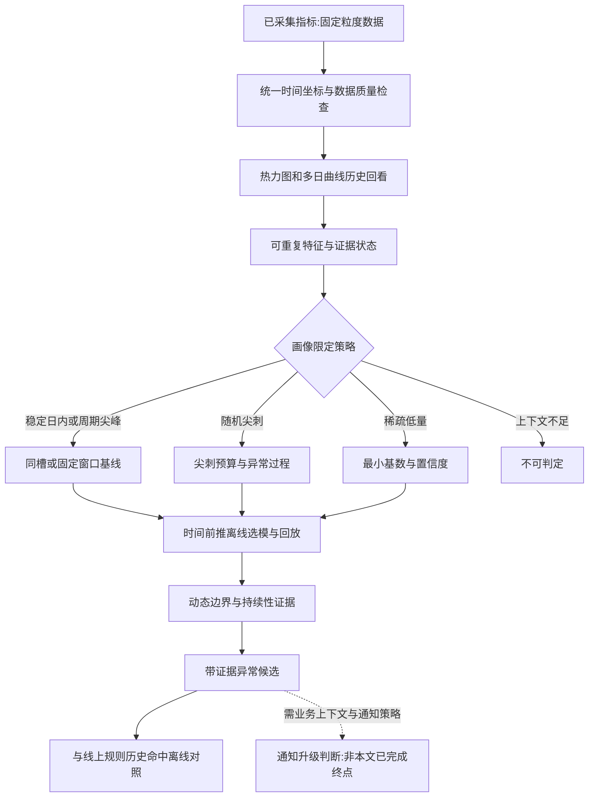

# 无订阅异常发现

## TL;DR

无订阅异常发现针对已经稳定上报、却尚未配置告警的指标，通过多日历史学习正常形态并生成可回放、可解释的异常候选。链路依次统一时间坐标、观察历史形态、计算指标画像、时间前推离线选模，再用动态边界与持续性收敛候选；原有固定阈值、前序环比和昨日同比规则继续兜底。稳定日内、周期尖峰、随机尖刺和稀疏低量采用不同策略，低基数、缺数据、日期类型及跨指标同步变化都参与证据判断。研究停在“候选发现”：数值越界可能来自平台补写、活动或规则调整，是否通知还需业务上下文和通知策略，本文没有完整生产通知闭环或整体准确率报告。（来源：p.1–11）

## 问题与边界：补覆盖，而不是直接替换告警

**无订阅** 指候选生成不要求用户预先为每条指标选择比较口径、阈值和连续命中次数；前提仍是平台已经采集到稳定上报数据，并有足够可回放历史。它不表示零配置、没有数据契约、没有告警决策。**异常候选** 是附观测、历史预期、边界、可信度、持续情况与原因的可核验对象，不是已确认业务故障，也不是一条应发送的消息。（来源：p.2、p.10–11）

现有规则透明可解释，但各有参照局限。新指标在完成规则配置之前不主动进入告警视野，同一数值凌晨反常而晚高峰可能正常；此前未订阅巡检、日报、虚拟监控扩覆盖，仍因低基数、自然流量和误配出现低价值消息。作者因此补一条根据历史主动发现的路径，保留线上规则而非把它们换个名字。（来源：p.1–2）

| 比较口径 | 观察什么 | 适用边界 | 来源 |
|---|---|---|---|
| 固定阈值 | 当前值是否越过明确绝对边界 | 一天同一把尺，不随凌晨/白天/晚高峰变化 | p.1–2图1 |
| 前序环比 | 相邻时间槽是否突然跳变 | 放大低基数/短抖动，可能漏每步较小的持续恶化 | p.1–2图1 |
| 昨日同比 | 前一天同一时间槽的差异 | 参照单日遇周末、活动、增长或异常参照日可失真 | p.1–2图1 |

三者可单独或组合使用，不相互排斥。本文自适应方法新增的是多日与当前上下文下的正常分布参照，不保证任何异常都被识别。

## 知识框架

按p.2图2和正文整理。通知环节超出本研究已验证链路，图中标明后续条件。

## 步骤一：先把不同天放进可比较坐标

原始指标按**10分钟**聚合，矩阵每行一天、每列同一日内位置。粒度是作者在灵敏度与稳定性间的取舍：相比小时更容易捕捉突发，相比分钟更能过滤短抖动，固定槽为跨日比较提供一致坐标，不是所有监控场景默认最优粒度。（来源：p.2–3）

计算之前必须区分真实零与没有采集，排除延迟补写尖峰误当业务；总量、受影响用户数、错误占比是不同问题，不能混在同规则比较；周末、活动和日常保留日期上下文，不默认同分布。无法区分真实0和缺报时，画像保留不可判定，不以填0掩盖缺数据。（来源：p.3、p.6图8）

## 步骤二：从多日观察理解正常形态

作者对大量指标批量回看，再从各类挑代表样本。热力图以天为行、时间槽横向展开，看同槽水位与持续高亮带；叠加多日曲线看共享轮廓、固定峰值和偶发噪声。两种视图提供互补证据，不是仅找一条拟合最好的曲线。（来源：p.3–6）

指标由大量个体行为、业务链路和上报机制聚合，在星期类型、活动阶段、用户结构、流量入口、业务规则、采集口径近似时，随机差异部分抵消，使预期水位、峰谷位置和波动区间可学习。作息和固定发券/补货等规则可产生昼夜或活动节律。“可重复”指相似条件下反复落入概率分布，不是每天同一曲线，也不保证条件变化后旧基线仍适合。（来源：p.3）

### 稳定日内与周期尖峰：高并不自动异常

稳定日内型的绝对量每日可变，凌晨、白天、晚间轮廓仍相近，适合历史同槽比较；晚间正常高峰超固定线不能单靠“大”告警。周期尖峰在固定窗口复现，须先把正常峰学入基线，再看当天是否超历史该峰的上界，峰的位置和复现更有解释力。（来源：p.3–4，图3–4）

### 随机尖刺与持续偏离：以过程替代逐点升级

随机尖刺分散、孤立多，难拟合稳定日内线；观察复发、持续时间和累计影响更合适，不追求预测每个尖刺。持续偏离则连续多槽脱离历史簇，热力图成亮带、多日曲线同时显出分离，应比孤立点获得更高候选优先级。这里优先级不同不等于每个持续偏离必然业务故障。（来源：p.4–5，图5–6）

### 跨指标同窗变化：先看采集平台

三个业务互不相关、原始量级差很大的指标，按各自历史尺度独立归一化后，共有“回落→抬升→再次回落”的同期拐点。比較的是节奏而非绝对值，这构成疑似平台/数据质量信号；先核验采集与平台，不能立刻拆成三件业务异常。同步变化是诊断证据，不是已证明平台根因。（来源：p.5–6，图7）

## 步骤三：将看图经验变成可审计画像

**指标画像** 要能回到原始历史片段和计算过程。它检查缺失、水位、共享日内轮廓、同槽稳定性、尖刺时间/复发、局部占总体结构等，而不凭观感贴标签。输出同时包含形态、命中依据、证据状态和建模条件，缺分母、关联指标或平台事件时“不可判定”不等于“未命中”。（来源：p.6–7，图8–9）

p.6图8给出主要计算依据，以下照图保留；图未给的零分母保护、轮廓距离和尖刺提取算法不补。

| 特征 | 原图计算 | 解释/边界 | 来源 |
|---|---|---|---|
| 数据覆盖率 | 已观测时间槽 / 应观测时间槽 | 缺报与延迟补写先检查 | p.6图8 |
| 量级/活跃度 | 日均量 = Σx / D；活跃率 = count(x>0)/(D×T) | 连续有量与稀疏零值区别，先看绝对量与低基数 | p.6图8 |
| 日内形态拟合 | p[d,t]=x[d,t]/Σt x[d,t]；拟合度=1−多日轮廓差异的中位数 | 异常尖刺优先稳健处理，轮廓差异具体定义未展开 | p.6图8 |
| 同槽稳定 | 稳定度[t]=1/(1+MAD[t]/中位数[t])；总体=median_t(稳定度[t]) | 低值提示随机/结构/数据问题，0分母处理未给 | p.6图8 |
| 尖刺时间熵 | −Σk p(k)ln p(k)/ln K | 低支持固定窗口，高支持随机；p(k)/K构造未展开 | p.6图8 |
| 孤立比例 | 孤立尖刺数 / 全部尖刺数 | 高则强调过程、持续与累计影响 | p.6图8 |
| 固定窗口复现 | max_k(窗口k出现天数)/D | 高支持周期尖峰，正常峰应进基线 | p.6图8 |
| 占比稳定 | 占比[d]=局部量[d]/总量[d]；稳定性=1/(1+稳健离散度) | 缺少可靠分母时不下结构异常结论 | p.6图8 |

D/T在图注是样本天数/每日时间槽数，MAD为中位绝对偏差；特征阈值需验证，本文未交付统一阈值表。由特征按证据优先级检查稳定日内、周期尖峰、随机尖刺、稀疏低量、比例异常、平台/数据质量敏感、样本不足，再限制后续策略，而非给每指标跑所有模型。（来源：p.6–7）

随机尖刺画像走episode/budget及异常过程回放，比较复发、时长、累计超额面积、影响面；稳定日内走历史同槽；周期尖峰保留固定窗；低量先处理最小基数与置信度。p.7界面样例写 `ready（历史≥14天）`，这只属于图示研究样本，不改写成所有画像最低14天要求。（来源：p.7图9）

## 步骤四：用时间前推选模，不能历史泄漏

**时间前推回放（Walk-forward）** 每个验证窗口只用此前已发生的历史，完成窗口后再加入下一轮训练，持续推进覆盖可验证日期。它既避免拿同批数据拟合又证明有效的泄漏，也观察历史从不足到稳定的过程，不只看最后窗口成绩。（来源：p.7–8）

候选基线包括动态谐波、稳健分解、同槽邻域中位数、同槽中位数、截尾均值、指数平滑、前日同槽。相同历史和验证窗口提供统一比较场；原文没有展开实现公式、训练窗口长度或超参数，不补工程配置。（来源：p.7–8图10）

选模保留两类结果：中心预测相对误差和排序；边界、可信度、候选回放表现。监控还要检查正常尖峰能否包容、持续异常能否发现、随机单点是否放大、边界是否稳定。p.8图选中的“日内形态分位数尖刺模型”显示WAPE20.25%，昨日同槽显示18.36%；这可用于理解选择不只按单个误差最小，但图没有完整选择权重，不能推其最终综合评分。（来源：p.8图10及正文）

## 步骤五：边界与过程共同筛候选

### 同槽动态基线和当天水位校正

稳定日内型每槽学习预期水位、柔性边界、高分位边界和历史充分性。白天只比较历史附近同槽，不混凌晨/晚高峰；当天整体偏高或偏低时，用当日已发生槽估计水位变化校正基线，避免整天升量被切成某点异常。这仍需保留上下文，不能把持续业务恶化一概用校正消掉，原文未给校正公式与允许范围。（来源：p.8）

越界后继续检查实际量/绝对增量能否排低量抖动，样本/日期是否可信，是否显著越高分位或短窗反复越柔性边界，孤刺是否足够强。不足者观察而非立即升级。p.9图11显示p95软上界和p99硬上界，它们是该图例边界，不作为任意业务通用告警门槛。（来源：p.8–9）

### 随机尖刺聚合为异常过程

把时间相邻尖刺合成episode，衡量短时复发、累计超额面积、持续时间和整体水位。孤刺可容忍，重复或持续恶化才升级。合并解决“同一件事被拆成多消息”，不是简单删最高值，也不能据没有形成候选就认定点绝对正常。（来源：p.9）

完整回放样例固定规则多次命中，大多数孤点未达到历史同类过程的综合上界，留观察；一组相邻命中合成一个持续候选。图12是8个规则点、2个共同命中、6个压制项、模型1候选、模型新增0；这是一个验证日样例，压制6点并不证明6个都是误报，也不能算总体精确率/召回率。（来源：p.9–10图12）

图13的14:30–15:40区间含5有效尖刺，记录持续80min，高于历史同类episode时长p95的57min，保留1个episode候选而水位变化通道0命中。另有峰值更高的短过程仍为observe，可见裁决主要由持续性驱动。状态 `shadow_only` 且候选/可通知 `1/0` 明确表示影子回放不发通知；历史/回放11/4天、回放<最小5天是该样例状态说明，不当所有生产条件。（来源：p.10图13）

## 结果边界与误报处理

候选阶段只读指标历史，生成后才与订阅规则命中离线对照。部分样本规则未命中却发现持续偏离，另些样本正常高峰/随机刺被规则反复触发却留观察。文章展示覆盖互补，不给完整样本总量、标注真值、准确率、召回率或通知降噪率；不能用单例压制数推全局改进。（来源：p.10）

平台延迟补写、活动、少数用户集中请求、规则调整都可能越基线，曲线不像平时与值得打扰业务是两个问题。升级通知需业务上下文和通知策略，研究终点就是候选；线上订阅规则继续兜底。样本不足、缺分母、缺关联/平台证据保留不可判定；已有正常周期要被学习、低基数先看绝对量、同步变化先查数据质量，分别对应不同误判分支。（来源：p.3–11）

## 数据速查与截图边界

| 项目 | 原文可读值 | 条件 | 来源 |
|---|---|---|---|
| 聚合粒度 | 10分钟 | 作者研究数据坐标 | p.2–3 |
| 图示样本建模状态 | ready，历史≥14天 | 图9随机尖刺样例，非统一默认 | p.7图9 |
| 图示动态界线 | p95软/p99硬 | 图11标签，非普适通知规则 | p.9图11 |
| 图示回放结果 | 8规则点/2共同点/6压制/1候选/0新增 | 一个验证日，不代表误报真值 | p.9图12 |
| 候选episode | 5有效尖刺、80min | 14:30–15:40图示槽记录 | p.10图13 |
| 历史时长比较 | p95 57min | 同类过程 | p.10图13 |
| 影子状态 | shadow_only；候选/可通知1/0 | 未触发通知 | p.10图13 |

⚠️[原文疑点] p.1及图注称日期/业务标识隐去，数值为区间/定性，不展示内部状态、精确评分或通知门槛；但图13实际仍可读回放日期2026-06-08至2026-07-14、验证2026-06-19、`shadow_only`、平均置信度0.79及部分门槛，图9/10也有精确比例/误差。故正文的脱敏/展示范围声明不与实际截图完全一致。本笔记不把截图日期当发布日期，也不把这些未提供真实数据来源的样例值当业务规模或配置建议。（来源：p.1、p.7–10）

图12还显示6处规则压制时刻和2共同点，图13列5个episode不同范围；点、episode、通知是不同统计对象，不能直接把5有效尖刺与2共同规则点判成数字矛盾。（来源：p.9–10）

## 可迁移原则与记忆锚点

先立数据契约和时间参照，再计算画像缩策略，用只有过去的历史检验；结果保留候选/观察/不可判定与证据，最后把发现和业务通知分开。只有在日期条件、采集口径及样本可比较时，历史分布才能成为有意义参照。（来源：p.2–11）

助记改写：**先问平时怎样，再看当前偏离；点越界先观察，过程持续留候选；发现有证据，通知另判断。**

## 复习卡片

无订阅是否表示没有前置数据条件？::不是，指标要已稳定上报且有足够可比较历史，缺上下文或样本仍可不可判定。（p.2–3、6–7）
固定阈值与动态基线主要参照区别是什么？::固定线看绝对边界，动态基线按多日相似条件的同槽预期和波动区间判断。（p.1–3、8）
为什么真实零和缺报不能混？::缺报填成零会改变水位/形态证据，无法区分时不能假装完成画像。（p.3、6图8）
周期尖峰为何不直接告异常？::重复固定峰可能是正常业务节律，应先进入基线，再查超过该峰历史上界。（p.4）
随机尖刺型为何使用episode而不逐点升级？::它难以预测每个刺，相邻点合过程后可看复发、持续、累计影响，减少同件事拆消息。（p.4–5、9）
业务互不相关的指标同步变化提示什么？::疑似采集平台/数据质量共同信号，应先核验，而非立即拆成多个业务故障。（p.5–6）
证据不足的画像结论如何处理？::保留不可判定，不把缺分母/关联指标/平台事件当作未命中。（p.6–7）
时间前推如何避免看到未来？::每验证窗只用先前历史，完成后才加入下一训练窗，并持续向前。（p.7）
为何不能仅按拟合误差选模？::监控还需稳定边界、正常峰包容、持续异常候选和单点抖动抑制。（p.8）
一个异常候选能直接发送通知吗？::不能，候选表明可疑变化及证据，通知还需业务上下文与通知策略；本文影子回放未发消息。（p.10–11）

## 知识关联

候选[[异常监控与稳定性|监控异常检测]]：指标形态、动态边界和过程候选；[[Agent数据分析]]：数据口径/证据不足/上下文；[[Agent评测与反馈]]：时间前推、模型中心误差与实际候选表现分开评估。这里的监控模型不是LLM Agent，关联只在数据与验证方法层。

本次归纳主题：[异常监控与稳定性](../../20_topics/异常监控与稳定性.md)。

> [!note]- 校对报告
> **覆盖度**：12页文本与缩略图全阅；p.1–2、4–10共9页放大，全部13幅核心图查看；p.6–10截图再300dpi局部放大核对公式、模型比较和episode裁决。覆盖九主章节、五段方法、形态分流、完整回放和通知边界，推广/读者评论省略。
> **一致性抽查**：粒度｜10分钟｜p.2–3｜一致；固定规则点｜8｜p.9图12｜一致；过程候选｜1｜p.9图12｜一致；过程有效尖刺｜5｜p.10图13｜一致；历史持续p95｜57min｜p.10图13｜一致。数值为截图样例，不是总体验证或通用参数。
> **异常与缺口**：脱敏/定性声明与可见日期、精确数字和内部状态不同，已标[原文疑点]；未补零分母、轮廓距离、熵分桶、窗口选择、选模权重或通知门槛。图存在，图片表格没有文本层不等于缺图；没有完整Prompt/Skill，不建文件。
> **日期与格式**：页首2026年7月30日、署名孙晴，date为2026-07-30；回放截图日期不当发布日期，不猜时区。正式命名AI_短标题.md；一个H1、10条单行卡片、围栏闭合。Mermaid未渲染，文章算法/命令/通知未运行。
