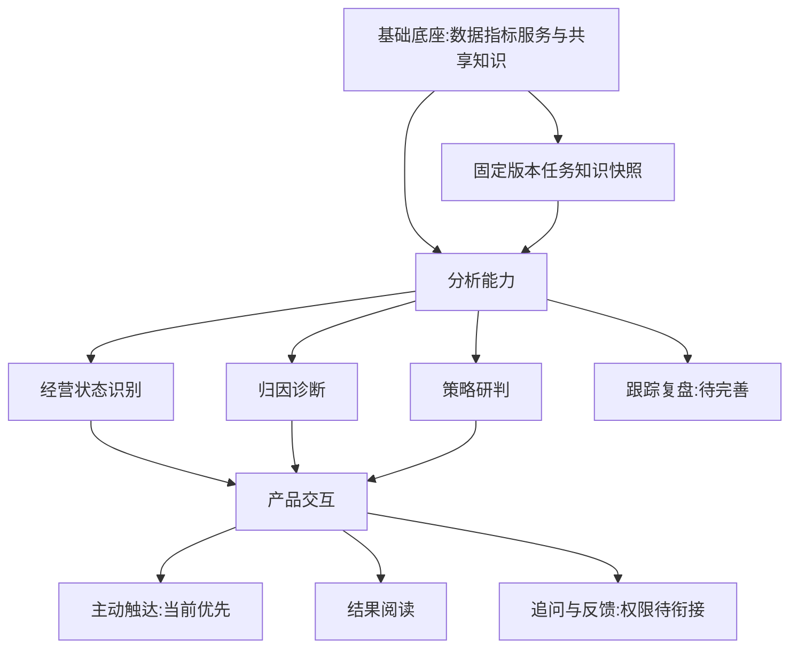

# 本地生活分析Agent实践

## TL;DR

高德本地生活分析Agent从智能问数走向经营诊断，真正难点不是流程能否跑完，而是口径能否闭合、证据是否进入模型、业务知识是否可正确复用、判断是否有适配的检查与返修。作者用共享知识快照、分析Skills与Pipeline、主动报告触达构成三层体系，让程序承担计算、引用和路径约束，模型承担综合判断，人审阅业务语义与关键取舍。案例分别解决归因被组装丢失、关系身份无法查询、看板口径追踪和报告格式规则压制推理的问题。系统报告全22业务单元覆盖、全行业一轮≤1小时，约22倍是人工串行耗时折算；自主追查、权限追问和业务行动反馈闭环仍在建设，不能宣称已实现完整无人经营。（来源：p.1–5、p.17–21）

## 核心概念与能力边界

**L0–L4** 是团队结合调研与业务场景形成的能力分级：L0手动取数、L1自助看数、L2智能问数、L3智能诊断、L4自主决策。L2准确理解口径、找到数据即可解决30%以上需求；L3要沿业务链路回答“为什么下降”并拿证据；L4接入决策行动，但正文明确不等于无人化，人参与关键取舍和执行反馈。作者认为本项目大多数任务具L3特征、正向经营研判延伸；组织其他部分场景到L4，不代表本项目自主执行已落地。（来源：p.2–3及图2）

**知识快照** 是一次任务固定使用的口径/材料版本，支持追溯分歧与复现。**分析Skills** 保存方法、前置信息、步骤和陷阱；**Pipeline** 连接状态识别、归因诊断、策略研判及后续复盘。数字本身不含对象、商业模式、口径与行动关系，必须从底座读取。（来源：p.4、p.10–11）

## 三层框架与已实现范围

按p.4图4和正文整理。层间是支撑关系，分析路径中的跟踪与反馈仍有待完善。

底座解决依据，中层解决方法，交互解决结果如何进入工作。面向业务一号位先主动送判断摘要与完整报告；面向一线和分析师更适合交互问答、自助探索。追问从全国到城市、跨行业时需检查知识/数据/结果权限，计划先支持已授权报告内追问，再扩到新取数。角色不同决定入口，不是所有分析都先做聊天。（来源：p.4–5）

## 实践一：让分析路径与证据真正跑通

### 1. 口径闭合先于归因

一个行业接入中，总量/对象数量算出的均值与直接查询约差10%，分子分母来自不同来源和统计范围。团队统一来源与口径、核验“总量＝对象数量×平均值”闭合后才继续。⚠️[原文疑点] 小节标题写“同一指标差12%”，正文写约10%，没有解释两种口径，保留正文示例和标题差异，不能擅自统一。（来源：p.6）

达标和趋势是两维：达标仍可能有趋势/内部因子问题，未达标但趋势稳定不能直接叫经营恶化。跨月周报需同时看上周、上月同周和去年同期，避免正常月末月初节奏误报。规则应保留对象、周期和背景，而非简单把下降标签等同异常。（来源：p.6）

### 2. 计算、模型上下文、成稿是三次交接

引擎已算单维和组合归因，报告仍浅；排查“引擎输出→报告组装→写作输入”发现一处只留前三项、另一处把组合放备查区，模型只读正文，根本未见证据。修复在输入保留关键组合贡献、异常判断、定位线索，用关键证据清单对照成稿，遗漏退回修改。证据齐全后如何综合、怎样表达留给模型，而非要求所有材料套固定句式。（来源：p.6–7，图6）

“报告像日志”来自程序先生成带内部标签草稿，模型润色保留“机制已坐实”等措辞。改为模型直接读结构化事实/归因作诊断，再以业务表达 **Golden Cases** 校准与检查标签残留。这里清晰区分事实和写作输入：不能把丢失的证据问题当模型不会推理。（来源：p.6）

### 3. Handoff只展示当前有效状态

考虑数据敏感性，开发中两个Coding Agent交替方案审查、实现、验证，通过文件传递接口细节，如场域枚举须用英文不能直接传中文。交接历史越长越难判断哪些决策有效，作者改成几十行当前摘要：有效决策、待办、验证状态；历史另存按需读。新行业接入重跑已有广告案例，人审分析与业务表达，防止修改伤到原能力。（来源：p.7）

### 4. “分析不好”先定位缺的是哪一层

另一次报告到某转化环节即止，证据没有丢，缺的是后续分析路径。方法补成“纳入统计对象→实际使用对象→首次使用/持续使用”，区分尚未开始与开始后没持续。前例修证据传递，此例补分析方法；后续反馈需分流到方法、知识或实现，再回归案例。（来源：p.7–8）

按p.8图7正文整理：业务反馈→人定位问题→开发Agent实现→案例验证/业务审阅，需修则回开发，通过则更新可复用能力并进入下一任务。这是开发反馈循环，业务决策执行后的反馈仍未接齐。作者的取舍是“证据传递和分析路径工程兜底，深度推理、综合与表达留模型”。（来源：p.8）

### 5. 改编Demo不能当真实业绩

p.9图8以脱敏占位演示“既有用户使用加深、新用户尚未形成接续”，比较首次使用承接不足和共同环境/产品问题，策略先改善首次体验、验证接续再扩大范围。图中数值刻意模糊，不能读成真实指标或估算精确数。其用途是展示增长结构、原因比较、反证与策略验证的报告组织。（来源：p.8–9）

## 实践二：知识复用依赖语义、身份和入口

### 1. 蒸馏经验时补上默认省略的步骤

复盘文档同时混事实、机制、当期策略和历史口径，压缩摘要只能回答“当时发生什么”，未必指导下一次查什么。作者拆出三层：行业知识保业务模式、公式、口径与诊断起点；分析框架按指标树组织问题；分析方法把20多种方法按任务归成9类，保前置信息、步骤、陷阱，输出规范单独维护。（来源：p.9–10）

“使用率下降就按对象分层”仍不够：先看纳入统计总量是否扩大，再看实际使用绝对量；比较群体构成和各群自身使用率，再追新增对象为何未开始。这样才从抽象建议变成可执行分析路径。（来源：p.10）

存储先按知识/分析/表达拆，任务跨十几个文件；后按行业聚合又随事件膨胀；最终为“稳定行业文件 + 时效主题文件”。问口径先读概要，追原因再追加框架和方法。重组后还发现入口指向旧章节，必须同步检索指引、查旧值并用同一批问题复测。内容、入口、评测题共同维护，移动文件并不等于知识已可用。（来源：p.10）

### 2. 阅读分层与维护分层是两个视角

知识散在各Skill会重复定义，修一处不能保证别处同步，因此共享底座独立维护定义、关系和来源。阅读分层回答“分析时读什么”；维护分层回答“改后影响什么”，共同指向同一批知识，不建两套互相复制的事实。（来源：p.10–11）

| 维护层 | 负责的问题 | 示例 | 来源 |
|---|---|---|---|
| 业务语义 | 认对对象与数字 | 门店/商家身份、渗透率分母、公式和字段 | p.11 |
| 诊断知识 | 将变化变成可验证问题 | 经营机制、拆解、比较基准和当次数据 | p.11 |
| 策略与经验 | 判断放回业务背景 | 目标、行动、执行和历史条件 | p.11 |

指标、公式、对象各有稳定编号/别名和属性来源；关系有类型和自身身份，编译检查端点、引用、来源后固定版本；读取先定业务单元/任务再沿关系取回定义证据。案例中上百关系和端点已入图，用原关系编号却0命中，因编译只存连接没存关系记录身份。补独立关系节点和原始编号才可唯一找回：入库数量不能证明可寻址。（来源：p.11）

### 3. 指标血缘从真实技术口径追踪

以FBI业务顶层看板为权威源，组件→数据集→解析SQL语法→临时结果、别名、聚合、表达式→来源表字段，回查物理字段存在，保留筛选与解析缺口。稳定技术标识由表达式、来源字段、聚合、时间粒度、筛选范围共同生成；同名异口径分开等核对，不能只用中文名字合并。（来源：p.12–13）

| 表达式 | 原文计数对象 | 何时容易混淆 | 来源 |
|---|---|---|---|
| `COUNT(order_id)` | 非空记录 | 同一订单多明细会重复计数 | p.12 |
| `COUNT(DISTINCT order_id)` | 去重订单编号 | 与记录数同名“订单量” | p.12 |

数据集、指标、来源表形成Markdown节点和索引，保存公式、血缘、证据、确认状态。候选提取和知识包已实现；表达式改变是否意味业务含义改变、并存还是替代需分析师判断，自动历史对比及确认后共享库同步仍建设中。p.13图12用实线标机器提取、虚线标待衔接人工确认；不能把全图都当已完成能力。（来源：p.12–13）

## 实践三：给判断空间，并匹配质量工程

### 1. 经营输入的身份和时间不能混

补入经营事实、经营卡片（进展、偏差、阻塞）与策略账本（行动、投入、反馈），稳定商业模式/年度规划从知识库读。经营简报证明结果Facts，策略简报证明策略身份、动作和执行Facts；诊断Insights来自定期扫描与Agent判断，不让旧报告的判断冒充新事实。（来源：p.13–14）

业务对象、报告周期、来源版本及原文定位要对齐。文档本月更新不等于内容本月发生；历史结果保留历史身份，计划只能讨论预期，近期实际执行也需与机制、反向信号一起判断。作者尝试更高层跨行业汇总仅做到工程预览，随后收回默认层级，优先做好各业务一号位报告；跨行业准入、判断和展示约束未正式交付。（来源：p.14图13）

### 2. 固定格式和禁词并不保证判断好

早期固定三议题、每议题至少两数、卡片配额、句长、策略分级，报告规整却未变深。“指标上升需结合相邻环节复核”可通过检查，明确保留意见的“尚不能确认……导致……”却被因果词黑名单拒绝，门禁只抓词未理解句义。（来源：p.14）

作者删除这些硬约束，回到Skill的方法：联看收入、规模、订单、收益的经营全貌；依商业模式沿链路和团队/类目/城市结构展开；检视策略回应何种约束，动作与指标是否互相支持、是否有反向信号。有依据可以定性研判，精确贡献另需测算。图14三模式只是例子，不是互斥固定分类，复杂业务可混合。（来源：p.14–15）

### 3. 三层检查对应三类错误

报告用对数字却把“全部纳入统计”当“尚未开始使用”，对象范围错导致转化不足判断。继续加数值校验查不出该错误；需要把判断空间与质量工程配套，而不是期待一次生成完美。（来源：p.15）

**事实绑定**：上游提供数、单位、期间、比较状态，模型用事实ID引用，程序恢复数值；新计算先回计算环节核验。**分析/业务审阅**：模型形成结论、依据、条件、短稿，程序查覆盖/可追溯，人审对象混用、机制错误、反证遗漏。**成稿保真**：首轮检查通过后，成稿模型按内容块ID编排确认内容/图表，第二轮查遗漏、新增、改写，避免润色丢条件。（来源：p.15–16）

按p.16图15复现主路径，返修另分流；业务质量通过同周期、同来源/快照的新旧报告配对审阅，不是工程校验通过就证明业务判断好。

### 4. 返修要控制上下文和影响半径

某次15个生成单元组成11份报告，逐篇人工审阅再修语义。一个运行样本731来源、720事实、171指标族，若一处错也把全量重送，会成本高且改坏正确段落。首次输入压平共享引用/重复包装，最大引用深度13→4仍可还原；返修按错误字段、关系、历史比较选择相关知识、策略、反证，限制可改段落，某样本来源731→179。（来源：p.16）

图16分别报告首次输入估算305443→272705（-10.72%），局部返修391295→216789（-44.6%）；它们是两项对照的输入token估算，不能与来源条数变化拼成同一缩减百分比，也不是全部调用成本下降。（来源：p.16图16）

按影响重跑：输入/判断改变重做分析、成稿、渲染；内容编排改变只成稿检查及渲染；展示样式改变只渲染、保留验证正文；工程误报修程序复验旧输出，不让模型反复改正确文本。一次月报3次分析+1成稿累计约11.1分钟，另一业务三次仍表达错而停止，说明容错并非无限重试或保证成功。（来源：p.16–17，图17）

## 数据速查与成果边界

| 项目 | 原文值 | 语境/范围 | 来源 |
|---|---|---|---|
| 行业覆盖 | 100%，22业务单元 | 当前本地生活范围 | p.17图18 |
| 产出 | 全行业一轮≤1小时 | 过去人工约22人时串行折算≈22倍 | p.17 |
| 单批交付 | 15生成单元→11报告 | 某一批，非全部业务覆盖计数 | p.16 |
| 运行样本 | 731来源、720事实、171指标族 | 一个样本 | p.16 |
| 引用深度 | 13→4层 | 输入压平，事实仍可还原 | p.16 |
| 返修来源 | 731→179条 | 一个局部修订样本 | p.16 |
| 首次输入估算 | 305443→272705，-10.72% | 图中第一项token对照 | p.16图16 |
| 局部返修估算 | 391295→216789，-44.6% | 图中第二项token对照 | p.16图16 |
| 成功月报 | 3分析+1成稿，约11.1分钟 | 模型调用累计，非整体全行业墙钟时间 | p.17 |
| 共享库 | 130文档、5245节点、24233类型化关系、66180属性记录 | 共享底座，按自身范围 | p.12图11 |
| 业务诊断知识 | 134文件、40990文本行 | 方法/规则/行业经验 | p.12图11 |
| 经营判断知识 | 22诊断单元、232业务对象、93业务职能、72机制、187推理支持记录 | 与其他库有继承导入，不累加 | p.12图11 |
| 指标语义 | 837指标、92公式、60维度 | 语义规模 | p.17图18 |

知识数量是规模，文件/行数不等于去重后的知识条目，不把有继承关系的三库相加。22倍是作者按人工串行与系统1小时的折算，未含人类审阅等全流程相同成本实验。（来源：p.12图注、p.17）

## BI定位与尚待完成的循环

作者提出BI既是经营判断能力设计者，也是质量守门人：把商业理解写成知识、方法、校验，让经验下次可用；同时判断该查什么、审系统理解和参与资源策略取舍。报告问题要带回方法/知识/实现，不只修眼前文案；经验要说明对象、经营阶段、适用条件、反向信号。（来源：p.19–20）

**经营大脑** 是后续设计思考：内部经营/外部市场汇入关键问题，经营环跟目标、诊断、策略、执行、验证；若外部变化让增长假设失效，则回战略环审方向投入，积累事实、洞察、方法和业务记忆。p.18–19明确是设想，不能与已落地月报能力混写。（来源：p.18–19图19）

后续Agentic loop要按发现补证据、查反证、改路径；Human in the loop让业务补背景、做取舍、反馈行动效果。当前已能依报告问题改系统，但自主追查和业务执行结果回流未完全接上。权限追问、历史版本自动比较/共享库同步、跨行业总览也分别保留其建设状态。（来源：p.5、13–14、21）

## 记忆锚点

原文锚点：**入库不算完成，被分析任务正确用上才算。** 助记改写：**算对、传到、写出分别查；引用、语义、成稿分层守；改动多大，重跑多远。**（来源：p.7、13、15–17）

## 复习卡片

本地生活Agent主要处于哪个能力阶段？::作者认为多数任务具L3经营诊断特征，向研判延伸；自主执行和业务反馈仍在计划。（p.3）
归因已算出却未出报告时先查什么？::查引擎输出、报告组装、写作输入和成稿的证据传递，不先判模型推理不行。（p.6–7）
知识阅读分层与维护分层分别解决什么？::前者决定任务读什么，后者追踪修订影响什么；同一批知识不用重复定义。（p.10–11）
为什么图谱有边仍查不到原关系？::连接已保留但关系记录身份丢失，需独立关系节点和原编号才能唯一寻址。（p.11）
指标同名是否意味着同口径？::不是，表达式、来源、聚合、粒度和筛选共同确定技术身份；COUNT记录与DISTINCT订单有不同对象。（p.12）
本月更新的策略文档能直接解释本月增长吗？::不能，须区分更新时间、事实周期、计划/执行状态，再看业务机制和反证。（p.14）
为什么事实数值正确仍可能判断错？::模型可能混淆对象范围或周期，需分析和业务语义审阅，不仅查引用。（p.15）
成稿模型能重新形成经营解释吗？::本文分工中不能，分析阶段完成判断，成稿只编排已确认内容和图表并保真。（p.15–16）
样式变化需要重做分析吗？::按影响半径只重渲染，保留已核验正文；判断变化才重分析及后续交付。（p.17图17）
约22倍代表什么？::按全行业人工串行约22人时与系统一小时折算的批量产出效率，不是同成本端到端实测。（p.17）

## 知识关联

[[Agent数据分析]]：指标口径、路径和业务对象；[[决策知识结构化]]：知识身份、关系、策略账本与事实/洞察；[[Agent评测与反馈]]：同快照配对评测、证据分层检查；[[Agent任务恢复]]：Handoff摘要及按影响半径续跑；[[AI研发协同]]、[[Agent工程循环]]：人定位、Agent实现、案例验证与业务反馈的不同循环。

本次归纳主题：[Agent评测与反馈](../../20_topics/Agent评测与反馈.md) · [Agent任务恢复](../../20_topics/Agent任务恢复.md) · [Prompt优化](../../20_topics/Prompt优化.md) · [Agent工程循环](../../20_topics/Agent工程循环.md) · [Agent数据分析](../../20_topics/Agent数据分析.md) · [决策知识结构化](../../20_topics/决策知识结构化.md)。

> [!note]- 校对报告
> **覆盖度**：23页文本和缩略图全阅；放大p.2–18、20–21图表/异常，覆盖七个主章、三段实践、实现与规划边界。图8业务数字脱敏不可读取，不猜；图中实线已实现与虚线待衔接区分保留。无完整Prompt或SKILL.md正文。
> **一致性抽查**：批次报告｜11｜p.16｜一致；引用深度｜13→4｜p.16｜一致；局部返修估算｜-44.6%｜p.16图16｜一致；全业务｜22单元｜p.17图18｜一致；共享节点｜5245｜p.12图11｜一致。
> **异常与推断**：p.6标题12%/正文约10%未解释，保留差异；p.9改编Demo数值脱敏，不补；p.13有句子重复穿插，按可辨正文含义整理不另造结论。数字对照、知识范围和墙钟/调用时间分别保留；约22倍沿用原文折算，并说明成本边界。
> **日期与格式**：p.1为2026年9月30日，date为2026-09-30，署名钟雨洁，不猜时区。正式命名遵循AI_短标题.md；Mermaid未渲染，文章操作未执行，一个H1，10条单行卡片，代码块闭合。
